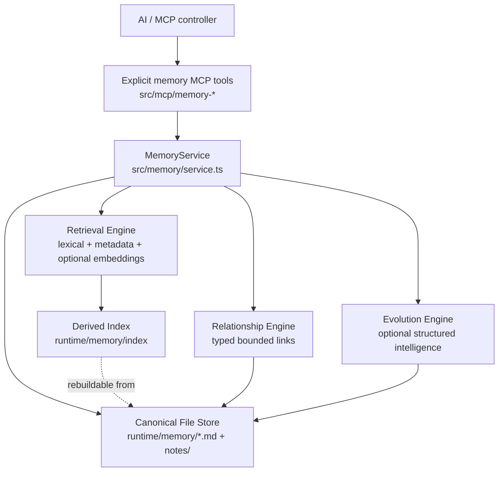

# Agent Core Memory — Implementation & Verification Record

> **Status:** PHASES 0–10 IMPLEMENTED/BUILT; TARGETED LOCAL ACCEPTANCE PASSED; EXTERNAL AI-CONTROLLER ACCEPTANCE PASSED; OAUTH TUNNEL RE-AUTH FLOW VERIFIED
> **Created:** 2026-09-17
> **Target project:** `E:\Projects\Agent-Core`
> **Primary reference grounded:** `DO NOT TOUCH WITHOUT INSTRUCTION EXPLICIT\memory\A-mem-sys`
> **Current controller memory:** `runtime\memory\00-agent-core-memory.md`

## Implementation progress — 2026-09-17

Implemented in source/build:

- Phase 0 — preserved bootstrap memory and direct RDC architecture.
- Phase 1 — memory domain types, paths, strict note format.
- Phase 2 — durable file-native store, atomic writes, process lock, pinned protection.
- Phase 3 — native `MemoryService` with real recall counters/history.
- Phase 4 — deterministic metadata-aware retrieval + typed linked-neighbor expansion.
- Phase 5 — explicit memory MCP tools alongside the unchanged 26 RDC tools.
- Phase 6 — startup, `/health`, launcher status mapping, React memory status integration.
- Phase 7 — rebuildable derived semantic-text/fingerprint index under `runtime\memory\index`.
- Phase 8 — provider-neutral embeddings plus Cloudflare Workers AI adapter, derived vectors, embedder identity/version invalidation, and hybrid semantic ranking.
- Phase 9 — strict deterministic metadata enrichment plus embedding-neighbor evolution proposals; evolution only fills empty metadata/adds bounded `related` links and remains fail-soft.
- Phase 10 — non-destructive consolidation candidates using semantic similarity + lexical Jaccard; `memory_reindex` remains separate and consolidation never auto-deletes/merges.
- Public memory MCP surface is now 10 tools; total Agent Core MCP surface is 36 = 26 RDC + 10 memory.

Build evidence obtained during implementation:

- root TypeScript build completed successfully after Phase 8–10 source/wiring changes;
- earlier React/Vite production build completed successfully;
- earlier .NET launcher publish completed with exit code 0; existing WindowsBase/WebView2 version warning remains;
- root `Agent Core.exe` had been refreshed from that earlier launcher publish while it was not running.

Targeted verification executed with user authorization during the 2026-09-17 audit:

- `npm run build` → PASS after both audit fixes.
- Final targeted Vitest batch → **4 files / 10 tests PASS, exit code 0**: `rdc-parity`, `bridge-runtime`, `memory-phase8-10`, and `desktop-status`.
- Authenticated bridge/parity acceptance confirms **36 public tools = 26 RDC + 10 memory** and normal RDC execution remains direct with no route/workflow/memory gate.
- `memory-phase8-10.test.ts` verifies semantic scoring, conservative evolution, proposal-only consolidation, fail-soft deterministic fallback when embedding fails, automatic health recovery after the embedder becomes healthy again, and service reinitialization durability using an isolated memory root.
- Audit fixed two source regressions: startup compatibility for callers without `memoryEmbedding`, and sticky `degraded` query-embedding health after a transient provider failure.
- Live Cloudflare embedding probe using the configured runtime model → provider `cloudflare-workers-ai`, model `@cf/google/embeddinggemma-300m`, 768 actual dimensions, finite vector values, normalized vector norm `1`.
- Temporary production-path `node dist/index.js` startup + `/health` readback → bridge `ok`, execution `available`, memory/canonical/index/embedding/intelligence all `available`, `issueCount=0`.
- The temporary production-path process was stopped after the audit and the transient embedding probe file was removed.
- External AI/controller acceptance through the real Agent Core MCP client path → PASS. The controller successfully exercised `memory_status`, `memory_list`, `memory_remember`, semantic `memory_search`, repeated `memory_read` metadata updates, conservative `memory_evolve`, proposal-only `memory_consolidate`, direct non-memory `get_config`, cleanup via `memory_delete`, and final health verification.
- Cross-check against `runtime\tracker\activity log.txt` confirmed the exact acceptance sequence with all operations recorded as SUCCESS and no intervening memory/MCP errors.
- Post-test live `/health` remained fully available with `issueCount=0`, `noteCount=1`, and the two temporary acceptance memory IDs were absent from canonical/derived memory state.

Still pending:

- Full repository-wide Vitest/xUnit regression was not run; verification was intentionally targeted to the changed memory/runtime contracts.
- Phase 11 — optional UX only if requested.

**Current-state interpretation rule:** the implementation progress section above and `docs\CODEBASE.md` define current implemented state. The remainder of this file preserves the original phase/design contract for provenance. Any later wording such as `proposed`, `planned`, `pending`, `memory: not-used`, or instructions tied to an earlier phase describes that historical checkpoint unless the progress section explicitly says it remains current.

## 1. Objective

Build a native Agent Core memory subsystem that preserves the useful mechanisms from A-MEM without importing its Python/Chroma runtime architecture.

The memory subsystem must provide durable long-term memory, structured semantic metadata, retrieval, explicit memory relationships, and optional agentic evolution while preserving Agent Core's current direct-RDC machine-control architecture.

Memory must remain a subsystem, not a routing gate. The core execution path must remain:

`AI -> MCP tools/list -> MCP tools/call -> RDC-compatible handler -> local machine`

Memory may provide context and memory-specific operations, but normal RDC tool execution must never require a memory preflight, workflow route, DAG, or evolution decision.

## 2. Current baseline

Current Agent Core has a native file-backed `MemoryService` implemented and built through Phase 10. Targeted local acceptance and external AI-controller acceptance have both passed. A post-re-auth read-only runtime snapshot on 2026-09-17 also confirmed the live bridge/execution/memory stack available, memory canonical/index/embedding/intelligence available with `issueCount=0`, tunnel readiness healthy, and active OAuth access/refresh grant state present.

A canonical controller-readable memory directory exists at `runtime\memory`, with `00-agent-core-memory.md` containing durable identity, purpose, protocol, architecture continuity, and local boundaries. `AGENTS.md` requires the AI/controller to view `runtime\memory` before other Agent Core work.

The public source contract contains 36 tools when MemoryService is wired: the original 26 RDC-compatible tools remain unchanged, with 10 explicit memory tools added alongside them. Authenticated bridge/parity tests verify that tool surface locally. Semantic embedding is provider-pluggable; the currently wired implementation is Cloudflare Workers AI when the required environment configuration is present, and a live configured embedding request has been verified during audit.

## 3. A-MEM grounding: mechanisms actually present

The grounded A-MEM implementation centers on `MemoryNote` plus `AgenticMemorySystem`.

A memory note contains:

- `id`
- `content`
- `keywords`
- `context`
- `tags`
- `category`
- `links`
- `timestamp`
- `last_accessed`
- `retrieval_count`
- `evolution_history`

When a note is added, A-MEM can generate missing semantic metadata with an LLM, create an enhanced semantic document, retrieve nearest memories, ask an LLM whether the new memory should evolve, strengthen links, and update neighbor context/tags.

The retriever builds embedding text from content plus context, keywords, and tags. `search_agentic()` retrieves direct semantic matches and can expand linked neighbors.
## 4. A-MEM implementation problems that must not be copied

The reference implementation has several architectural weaknesses for Agent Core:

- `self.memories = {}` is the primary note authority, so process restart loses that authority.
- `ChromaRetriever` uses `chromadb.Client(Settings(allow_reset=True))`, not a durable canonical store.
- `AgenticMemorySystem.__init__()` attempts `client.reset()`, which is unacceptable for long-term Agent Core memory.
- LLM provider selection is embedded directly in the memory system through OpenAI/Ollama/SGLang/OpenRouter controllers.
- Python, ChromaDB, sentence-transformers, NLTK, sklearn, LiteLLM, and related dependencies would create a second runtime stack.
- Neighbor evolution mutates in-memory neighbor metadata without immediately guaranteeing retriever/index synchronization.
- `retrieval_count`, `last_accessed`, and `evolution_history` exist as fields but are not consistently advanced by the grounded lifecycle.
- `consolidate_memories()` is primarily an index rebuild/re-add operation, not true semantic consolidation.
- The private `_search()` claims hybrid retrieval but calls the same retriever twice and contains interface assumptions inconsistent with the returned Chroma structure.

Therefore the implementation should steal the memory mechanics and data model concepts, not copy A-MEM wholesale.

## 5. Steal / adapt / reject decision

### STEAL directly as design concepts

- structured memory units
- semantic metadata: keywords, context, tags, category
- explicit links between related memories
- enhanced retrieval text using content + metadata
- nearest-neighbor relationship discovery
- linked-neighbor expansion during recall- structured evolution decisions
- relationship strengthening
- metadata enrichment of relevant neighbors

### ADAPT / redesign

- retrieval counters must increment on actual recall
- `lastAccessedAt` must update on actual recall
- evolution history must record concrete mutations
- consolidation becomes deterministic index rebuild plus optional semantic merge workflow
- semantic retrieval becomes provider-pluggable and rebuildable
- evolution intelligence becomes an interface, not a provider-specific controller embedded in storage

### REJECT from the target architecture

- Python sidecar as the primary memory runtime
- ChromaDB as canonical storage
- destructive reset on startup
- in-memory dictionary as authoritative memory state
- provider-specific OpenAI/Ollama/SGLang/OpenRouter logic inside memory storage
- memory as a mandatory gate before normal RDC execution
- hidden automatic mutation without durable history

## 6. Target position inside Agent Core

Memory should be a first-class sibling subsystem under `src\memory`, separate from `src\rdc`.

Proposed source layout:

```text
src/memory/
  types.ts
  paths.ts
  store.ts
  lock.ts
  note-format.ts
  semantic-document.ts
  retrieval.ts
  relations.ts
  evolution.ts
  intelligence.ts
  service.ts
```
MCP integration should remain an adapter layer:

```text
src/mcp/
  memory-schemas.ts
  memory-tools.ts
```

Runtime state should live under the already-canonical directory:

```text
runtime/memory/
  00-agent-core-memory.md
  notes/
  index/
  state/
```

`src\rdc` must remain machine-control only. No memory storage, relation engine, or recall logic belongs there.

`src\mcp` may expose explicit memory capabilities, but it must not contain the canonical memory logic.

## 7. Canonical authority model

The canonical source of truth must be the files under `runtime\memory`, not an embedding/vector index.

Any semantic/vector/lexical index is derived data. It must be safe to delete and rebuild from canonical memory files without losing memory content, relationships, metadata, or history.
Recommended canonical note format: one human-readable Markdown file per memory with a strict machine-readable JSON metadata block at the top.

Example conceptual shape:

```md
<!-- agent-core-memory
{"version":1,"id":"...","keywords":[],"context":"...","tags":[],"category":"...","links":[],"createdAt":"...","updatedAt":"...","lastAccessedAt":"...","retrievalCount":0,"evolutionHistory":[]}
-->

Memory content here.
```

This keeps memory directly viewable by an AI/controller and by the user while avoiding a YAML dependency.

The existing `00-agent-core-memory.md` remains a pinned bootstrap memory. It should be recognized as protected foundational context rather than silently converted, deleted, or rewritten during initial implementation.

## 8. Core memory data contract

Target `MemoryRecord` fields:

- `version`
- `id`
- `title` or short label when useful
- `content`
- `keywords: string[]`
- `context: string`
- `tags: string[]`
- `category: string`
- `links: MemoryLink[]`
- `createdAt`
- `updatedAt`
- `lastAccessedAt`
- `retrievalCount`
- `evolutionHistory: EvolutionEvent[]`
- `pinned: boolean`
- `source` / provenance metadata when known
`MemoryLink` should carry more information than A-MEM's raw ID list:

- `targetId`
- `type` such as `related`, `supports`, `supersedes`, `contradicts`, or `derived-from`
- `strength` in a bounded numeric range
- `createdAt`
- optional reason/evidence string

`EvolutionEvent` should record real state transitions, for example:

- `metadata_enriched`
- `link_added`
- `link_removed`
- `context_changed`
- `tags_changed`
- `content_updated`
- `superseded`
- `retrieved`

The event must contain timestamp plus before/after or changed-field information sufficient to understand why durable memory changed.

## 9. Persistence and concurrency

Memory writes must be atomic and safe across processes. Reuse Agent Core's proven persistence design instead of inventing a separate database transaction system.

Implementation direction:

- write to a unique temporary file
- flush/close the file
- atomically rename into place
- use a memory-specific cross-process lock for mutations
- reject or recover stale locks using the same ownership principles already proven by the OAuth store
- never fall back to an unsafe partial/in-place canonical-memory overwrite after failed atomic replacement

The OAuth lock implementation may be generalized into a reusable file-process lock only if that refactor remains small and does not weaken OAuth semantics.
## 10. Startup lifecycle

Memory initialization must be explicit and fail-safe, but it must not make the entire machine-control bridge unusable because an optional derived index is damaged.

Proposed startup order:

1. Resolve `runtime\memory`.
2. Ensure required memory subdirectories exist.
3. Load/validate pinned bootstrap memory.
4. Discover canonical notes.
5. Validate note metadata/version and IDs.
6. Recover or quarantine malformed derived index state.
7. Load/rebuild derived index when required.
8. Construct `MemoryService`.
9. Expose health status based on actual service readiness.
10. Continue normal HTTP/MCP startup.

Canonical note corruption is different from index corruption. Never silently discard a corrupted canonical note. Surface it as degraded/error state with exact path and leave the original file intact.

Derived index corruption should normally be recoverable by rebuilding from canonical notes.

## 11. Memory write lifecycle

Target write path:

```text
new durable fact
  -> normalize content
  -> optional metadata enrichment
  -> construct canonical MemoryRecord
  -> retrieve candidate neighbors
  -> relationship analysis
  -> optional evolution decision
  -> atomic canonical note write
  -> atomically persist affected neighbor mutations
  -> update/rebuild derived index entries
  -> record observable memory event
```

A failure in optional enrichment/evolution must not destroy the base memory write. The system should persist a valid minimal memory and record that enrichment was skipped/failed when appropriate.
## 12. Recall lifecycle

Target recall path should preserve A-MEM's best idea: direct semantic matches plus linked-neighbor expansion.

```text
query
  -> normalize query
  -> lexical/semantic candidate retrieval
  -> rank direct memories
  -> expand selected linked neighbors
  -> deduplicate
  -> rerank / apply limits
  -> update access metadata
  -> return compact recall result
```

Recall results should include enough provenance for the controller to understand why a memory appeared:

- memory ID/path
- relevance score or rank components
- direct match vs linked-neighbor expansion
- relevant tags/keywords/context
- link relationship when expanded through another memory

`retrievalCount` must increment when a memory is actually returned for use, not merely when it appears in an internal candidate list.

`lastAccessedAt` must update on actual recall. The write strategy should avoid corrupting or partially updating notes if multiple memories are recalled concurrently.

The recall API should support a result budget so memory context cannot grow without bound.

## 13. Update and delete lifecycle

Updates must mutate the canonical note first, then refresh derived indexes. The index can never be the only place where updated content exists.

Delete must be explicit. Deleting a note must remove or repair incoming/outgoing links in a deterministic transaction-like mutation under the memory lock.

Pinned foundational memories should not be deletable through ordinary memory APIs without an explicit elevated/destructive intent.
## 14. Relationship engine

A-MEM's raw `links` array should become a small typed graph stored inside canonical notes.

Relationship creation sources may include:

- explicit user/controller link
- deterministic same-topic/tag overlap
- semantic-neighbor analysis
- optional intelligence/evolution decision

Relationship rules:

- never create self-links
- deduplicate links by target/type
- validate target IDs before commit
- cap automatic link fan-out to prevent dense graph explosion
- preserve manually asserted links unless explicitly changed
- record automatic link changes in evolution history

Neighbor expansion during recall should be bounded separately from direct result count.

## 15. Enhanced semantic document

Preserve A-MEM's strongest retrieval mechanism: index a derived text representation richer than raw content.

Conceptual derived text:

```text
{content}
context: {context}
keywords: {keywords joined}
tags: {tags joined}
category: {category}
```

This representation is derived and rebuildable. It must never replace canonical content.

Changes to content, context, keywords, tags, or category invalidate the corresponding derived index entry.

A stable content fingerprint/hash should allow the indexer to detect stale entries without full re-embedding every unchanged note.
## 16. Retrieval engine stages

Implementation should be staged so memory becomes useful before requiring an embedding dependency.

### Stage A — deterministic local retrieval

Start with dependency-light retrieval over canonical/derived memory text:

- exact phrase/token matches
- keyword/tag/context weighting
- recency only as a weak tie-breaker, not dominant ranking
- relationship expansion
- optional fuzzy similarity using primitives already present in Agent Core when appropriate

This gives a working memory service without a second model/runtime stack.

### Stage B — pluggable semantic embeddings

Introduce a `MemoryEmbedder` interface only after the canonical store and deterministic retrieval are stable.

The interface should accept text and return a vector plus model/version identity. The index must record which embedder/version produced each vector.

Changing embedding providers/models must trigger rebuild of derived vectors, not migration of canonical memories.

No OpenAI/Ollama/SGLang/OpenRouter SDK belongs inside `store.ts` or canonical persistence.

### Stage C — hybrid ranking

Combine lexical score, semantic score, metadata match, relationship support, and bounded usage signals through an explicit ranking function.

Ranking must be inspectable enough to debug why a memory was selected.
## 17. Intelligence and metadata enrichment

A-MEM couples LLM providers directly to the memory object. Agent Core should instead define a provider-neutral `MemoryIntelligence` interface.

Responsibilities may include:

- fill missing keywords/context/tags
- classify category
- judge whether two memories should link
- propose metadata refinement
- propose neighbor evolution

The interface must return structured data validated against a strict schema before any durable mutation occurs.

The memory service must function without an intelligence provider. In that mode, caller-provided metadata and deterministic extraction/retrieval remain valid.

Provider failure must be fail-soft: no malformed LLM output may corrupt canonical memory.

## 18. Agentic evolution

Evolution belongs only to memory mutation lifecycle. It is never a precondition for normal machine-control tools.

Proposed decision model:

```text
new/updated memory + bounded nearest neighbors
  -> MemoryIntelligence.evaluateEvolution()
  -> strict validated decision
  -> no-op OR add/strengthen links OR refine metadata
  -> atomic affected-note commit
  -> record EvolutionEvent for every mutation
```

Automatic evolution must be conservative. It should not rewrite the substantive content of an existing memory merely because a model inferred a relationship. Automatic neighbor updates should initially be limited to metadata and links unless the user explicitly authorizes broader semantic rewriting.

Every automatic mutation must identify whether it was deterministic, controller-requested, or intelligence-proposed.
## 19. Consolidation model

Do not copy A-MEM's `consolidate_memories()` naming/behavior blindly.

Split the concept into two explicit operations:

1. **Index rebuild** — deterministic reconstruction of all derived retrieval state from canonical notes.
2. **Semantic consolidation** — optional operation that detects duplicate/overlapping memories and proposes merges/supersession.

Index rebuild may be automatic when derived state is stale or missing.

Semantic consolidation is potentially destructive and should initially require explicit user/controller intent or an approved policy. It must preserve provenance and should prefer `supersedes` links over irreversible deletion until confidence and review behavior are proven.

## 20. MCP memory surface

Once the core service is stable, expose explicit memory tools instead of a single action-router tool.

Current explicit tools after Phase 10:

- `memory_list`
- `memory_read`
- `memory_search`
- `memory_remember`
- `memory_update`
- `memory_delete`
- `memory_status`
- `memory_reindex`
- `memory_evolve`
- `memory_consolidate`

Possible later explicit tools if a real need appears:

- `memory_link`
- `memory_unlink`

Each tool should have its own Zod schema and metadata. Do not hide multiple unrelated actions behind a generic `memory(action=...)` router.
Adding memory tools will intentionally increase the public MCP surface beyond the current 26 RDC-compatible tools. That change must update `tests\rdc-parity.test.ts`, `CODEBASE.md`, and any UI/status wording that assumes exactly 26 total tools.

RDC parity should still be preserved as a named subset: all 26 RDC tools remain present and unchanged, with memory tools added alongside them.

## 21. Memory-first bootstrap behavior

`AGENTS.md` currently requires the AI/controller to view `runtime\memory` before other Agent Core work.

During the first implementation phases, this can continue using ordinary filesystem tools because the memory directory is directly readable.

After memory tools are available, the preferred first action can become:

```text
memory_list / memory_read pinned bootstrap memory
```

Do not automatically inject every memory into MCP initialization instructions. That would create unbounded context growth and defeat selective recall.

The pinned foundational memory should remain small enough to read at session start. Larger memories should be retrieved selectively.

## 22. Health semantics

Do not change `/health` from `memory: not-used` merely because source files or a memory folder exist.

Transition only when a real `MemoryService` is initialized and can read canonical memory safely.

Suggested states:

```text
not-used   = no integrated runtime memory service
available  = service initialized and canonical store usable
degraded   = canonical store usable but derived index/intelligence unavailable or partially broken
error      = canonical memory service cannot safely operate
```

Health details should distinguish canonical-store readiness from optional index/intelligence readiness.
## 23. Desktop UI behavior

The existing Memory status indicator should reflect health truth rather than merely folder existence.

Initial UI integration should be minimal:

- `not-used` while service is absent
- ON/available when canonical memory service is healthy
- degraded indicator if canonical memory works but optional retrieval intelligence is impaired
- error only when the canonical memory service itself cannot operate safely

Do not build a memory-management UI in the first implementation unless explicitly requested. The first objective is a reliable service and MCP surface, not another front-end subsystem.

## 24. Observability

Memory operations should integrate with the existing Activity Tracker without leaking raw memory content.

Record metadata such as:

- operation type
- memory ID or safe short identifier
- duration
- result count for searches
- index rebuild count/duration
- evolution action count
- degraded/fallback reason

Do not dump full memory bodies, prompts, credentials, tokens, or sensitive retrieved context into `activity.jsonl`, `activity log.txt`, or failure reports by default.

Thrown memory-service exceptions should use the existing error taxonomy. Expected no-result conditions and rejected invalid input are operational/request information, not system crashes.

## 25. Security and boundaries

Canonical memory belongs under `runtime\memory`, outside the protected reference-repository area.

The grounded A-MEM repository remains a reference only and must never become the live data directory.
Memory content should not be copied into `secrets`, auth stores, tracker reports, or tunnel profiles.

Path validation for memory APIs must keep all canonical writes inside the canonical memory root. Callers should select memory IDs, not arbitrary filesystem paths, for ordinary memory mutations.

Explicit filesystem tools remain capable of editing files according to their own permissions; the memory service itself must still enforce its own root boundary.

## 26. Seed memory handling

Existing seed:

`runtime\memory\00-agent-core-memory.md`

Initial implementation rules:

- keep the file intact unless migration is explicitly implemented
- treat it as pinned foundational memory
- make it discoverable by list/search/read
- do not duplicate its substantive content into multiple authoritative files
- if structured metadata is needed, either parse a compatible metadata block added surgically or maintain a derived index record keyed to the file fingerprint
- never silently replace the user-readable seed with opaque database state

The memory-first `AGENTS.md` directive remains valid throughout migration.

## 27. Failure model

Canonical memory write failure:

- do not claim success
- leave previous canonical file intact
- clean temporary files when safe
- report exact affected memory/path without exposing sensitive body content

Index write/rebuild failure:

- canonical memory remains valid
- mark memory service degraded
- fall back to deterministic direct scan/retrieval where practical
- permit later rebuild

Intelligence/evolution failure:

- persist base memory when valid
- skip automatic enrichment/evolution
- keep service available unless canonical persistence itself failed
## 28. Implementation phases

### Phase 0 — preserve current contract

Goal: establish implementation boundaries before touching runtime behavior.

Actions:

- preserve `runtime\memory\00-agent-core-memory.md`
- keep health at `memory: not-used`
- preserve all 26 RDC tools unchanged
- confirm `AGENTS.md` memory-first contract remains authoritative
- treat this plan as planned state only, not implemented architecture

Exit condition: no runtime behavior changed; target boundaries are explicit.

### Phase 1 — memory domain and canonical note format

Create:

- `src\memory\types.ts`
- `src\memory\paths.ts`
- `src\memory\note-format.ts`

Implement parsing/serialization and validation for canonical notes, IDs, links, evolution events, timestamps, and schema version.

Do not add embeddings or LLM calls yet.

Exit condition: Agent Core can deterministically parse and serialize memory files without a new service/runtime dependency.
### Phase 2 — durable file-native store

Create:

- `src\memory\lock.ts`
- `src\memory\store.ts`

Implement:

- discover/list canonical notes
- read by ID
- atomic create/update
- explicit delete
- cross-process mutation lock
- pinned-memory protection
- malformed-note reporting without destructive repair

Prefer reuse/generalization of Agent Core's proven atomic persistence and lock ownership patterns.

Exit condition: memory survives process restarts because files, not process memory, are authoritative.

### Phase 3 — core `MemoryService`

Create `src\memory\service.ts`.

Expose internal operations for list/read/remember/update/delete while keeping storage details behind the service boundary.

On real recall, update `retrievalCount` and `lastAccessedAt` durably.

On real mutation, append bounded `evolutionHistory` entries describing the change source and changed fields.

Exit condition: Agent Core has a real durable memory service even before semantic embeddings or agentic evolution exist.
### Phase 4 — deterministic retrieval and relationships

Create:

- `src\memory\semantic-document.ts`
- `src\memory\retrieval.ts`
- `src\memory\relations.ts`

Implement enhanced derived text, lexical/metadata ranking, bounded linked-neighbor expansion, deduplication, result budgets, and inspectable ranking components.

Do not require an embedding service yet.

Exit condition: `MemoryService.search()` can retrieve useful memories and expand explicit relationships using only local canonical state.

### Phase 5 — MCP adapter surface

Create:

- `src\mcp\memory-schemas.ts`
- `src\mcp\memory-tools.ts`

Register initial explicit memory tools only after the service boundary is stable.

Update server registration so RDC parity remains intact as a 26-tool subset while memory tools are additional capabilities.

Do not route normal RDC tools through `MemoryService`.

Exit condition: AI/controller can use memory through explicit MCP capabilities without changing existing filesystem/process behavior.

### Phase 6 — startup and health integration

Initialize `MemoryService` from `src\index.ts` after core configuration and before health state is finalized.

Expose truthful memory health: `available`, `degraded`, or `error` only after actual initialization evidence.
Update desktop status mapping so Memory reflects health truth instead of the current hard-coded `not-used` state.

Exit condition: health/UI truth matches actual memory-service readiness.

### Phase 7 — derived index persistence

Add `runtime\memory\index` as rebuildable state.

Store only derived search/index data there, including fingerprints and index schema/provider versions.

Provide deterministic full rebuild from canonical notes.

Index absence must not delete or invalidate canonical memories.

Exit condition: restart can reuse valid derived state or rebuild it safely.

### Phase 8 — pluggable semantic embeddings

Introduce the `MemoryEmbedder` interface and one selected implementation only when explicitly chosen.

Do not tie canonical storage to any embedding vendor/model.

Record embedder identity/version with derived vectors and rebuild when the identity changes.

Exit condition: semantic score improves recall while canonical files remain portable and provider-independent.

### Phase 9 — metadata intelligence and evolution

Create:

- `src\memory\intelligence.ts`
- `src\memory\evolution.ts`

Implement strict structured enrichment/evolution proposals, validation, conservative mutation policy, affected-note atomic commits, and evolution history.
Evolution must be fail-soft and must never gate normal RDC execution.

Exit condition: A-MEM-style linking/evolution exists as a controlled memory feature rather than an execution framework.

### Phase 10 — semantic consolidation

Implement duplicate/overlap detection only after retrieval and evolution behavior are stable.

Initial behavior should propose or mark supersession rather than automatically deleting overlapping memories.

Keep deterministic `memory_reindex` separate from semantic consolidation.

Exit condition: long-lived memory can reduce duplication without silently destroying provenance.

### Phase 11 — optional UX improvements

Only if later requested:

- memory browser/status details in desktop UI
- linked-memory visualization
- manual pin/unpin controls
- reindex/evolution controls
- memory diagnostics view

These are not prerequisites for the memory engine.

## 29. Required architecture invariants

The implementation must preserve all of the following:

1. Canonical memory is durable file-native state.
2. Index/vector state is disposable and rebuildable.
3. Memory does not gate normal RDC tools.
4. No destructive reset occurs on memory-service initialization.
5. AI/provider-specific intelligence is outside canonical storage.
6. Every automatic mutation is recorded.
7. Pinned foundational memory has stronger deletion protection.
8. Source code remains authoritative over indexes and documentation.
9. `CODEBASE.md` is updated in every implementation task.
10. Tests are not run unless the user authorizes them.
## 30. Verification plan — execute only with explicit user authorization

When implementation begins and test permission is granted, verification should be incremental by phase rather than one giant suite at the end.

Planned coverage:

- note parser/serializer round-trip
- malformed metadata rejection without source destruction
- atomic create/update under concurrent processes
- stale lock recovery
- pinned-memory deletion rejection
- restart durability
- retrieval count and last-access timestamps advance only on actual recall
- link deduplication and invalid-target rejection
- linked-neighbor expansion remains bounded
- index rebuild reproduces searchable state from canonical notes
- missing/corrupt derived index does not lose canonical memory
- optional embedder failure produces degraded/fallback behavior
- malformed intelligence output cannot mutate canonical memory
- evolution mutations create history entries
- memory tool schemas reject unsupported parameters
- all original 26 RDC tools remain registered and behaviorally unchanged
- health/UI memory status follows real service state

Representative acceptance should include stopping/restarting Agent Core and confirming the same canonical memories remain readable/searchable after restart.

No verification in this section is authorized merely by inclusion in the plan.

## 31. Acceptance criteria for the first useful release

The first production-useful memory release does **not** require embeddings or automatic evolution.

Minimum acceptable milestone:

- canonical `runtime\memory` store is durable
- pinned foundational memory remains intact
- memory list/read/remember/update/delete are reliable
- deterministic memory search works
- related links can be stored and expanded during recall
- retrieval usage metadata actually updates
- service survives restart without losing memory
- public health accurately reports memory readiness
- existing RDC bridge remains direct and functional
## 32. A-MEM source-to-Agent-Core mapping

| A-MEM source/mechanism | Agent Core target | Decision |
|---|---|---|
| `MemoryNote` | `src\memory\types.ts` | port concept, strengthen schema |
| `AgenticMemorySystem.add_note()` | `MemoryService.remember()` | redesign around durable store |
| `analyze_content()` | `MemoryIntelligence.enrich()` | optional/provider-neutral |
| enhanced document in `ChromaRetriever.add_document()` | `semantic-document.ts` | preserve concept |
| Chroma collection | `runtime\memory\index` | replace with derived index abstraction |
| `find_related_memories()` | `retrieval.ts` + `relations.ts` | preserve nearest-neighbor role |
| `search_agentic()` | bounded direct + linked-neighbor recall | preserve and make deterministic |
| `process_memory()` | `evolution.ts` | preserve concept with strict mutation policy |
| raw `links: []` | typed `MemoryLink[]` | strengthen |
| `evo_threshold` | explicit maintenance/evolution policy | redesign |
| `consolidate_memories()` | `memory_reindex` + separate semantic consolidation | split concepts |
| `LLMController` providers | external/provider-neutral intelligence adapter | do not copy into store |
| `self.memories` | canonical filesystem store | reject as authority |
| `client.reset()` | none | reject entirely |

## 33. Planned architecture



Normal RDC execution remains a separate direct path and does not pass through this graph.
## 34. Reference licensing / provenance

The grounded A-MEM repository declares the MIT License (Copyright 2025 AGI Research). Prefer native reimplementation of the mechanisms described in this plan rather than wholesale source copying. If any substantial A-MEM source code is copied or adapted directly, preserve the applicable MIT copyright/license notice as required.
