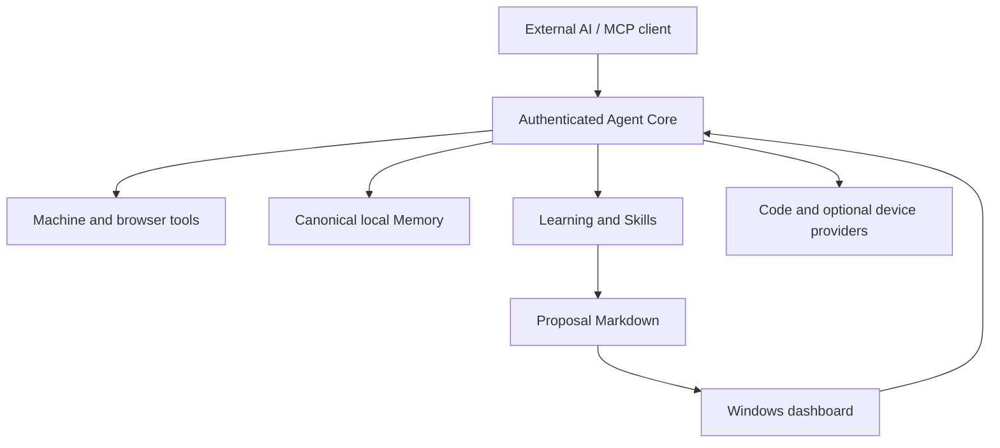

<p align="center">
  
</p>

<h1 align="center">Agent Core</h1>

<p align="center"><strong>1.6.0 · Windows x64 · MCP</strong></p>

<p align="center">
  A Windows workspace for AI-controlled tools, persistent Memory, and evidence-based Learning.
</p>

<p align="center">
  <a href="https://github.com/Black-Project-Agent-Core/Agent-Core/releases/latest">Download a release</a> ·
  <a href="docs/CODEBASE.md">Architecture</a> ·
  <a href="docs/README.md">Documentation</a> ·
  <a href="CHANGELOG.md">Changelog</a>
</p>

Agent Core connects an external AI assistant—such as ChatGPT, Codex, or another compatible MCP client—to tools on your Windows machine. The desktop launcher runs the local Core, presents system status and Workflows, and provides a place to read improvement proposals. Memory and Learning retain selected knowledge, task continuity, and review history across sessions.

**Native AI Agent Core and external controllers are active development targets.** The user opened Native development on 2026-10-24. Both use the existing owners and task-scoped runtime grants. See the [operating contract](AGENTS.md) and [Native integration status](docs/proposals/Integrasi-Arsitektur-Native-Agent-Core.md).

## What you can do

| Area | Capabilities |
| --- | --- |
| Machine tools | Read, search and edit files; run and inspect terminal processes; inspect supported documents and images. Access depends on the configured tool grants and path rules. |
| Memory | Store local knowledge with provenance and revisions; retrieve relevant content; keep scoped task events, checkpoints and continuity capsules; transfer preserved history through the v2 backup format. |
| Learning | Record task evidence and reuse receipts, review candidate knowledge, and propose reusable procedures. Claim review separates validation method, review triggers, attempts and last successful checks. |
| Browser use | Create owned task tabs through a supported Open Browser Use connection; observe and act using fresh page evidence; operate supported HTML controls and nested panels in the background. |
| Conversation reading | Page through loaded messages and read long rendered bodies in chunks from an owned ChatGPT tab, without typing, scrolling or sending messages during a read. |
| Skills and proposals | Keep proposal Markdown under `docs/proposals`, review path/status/revision cards in the dashboard, and read the exact document before a separate user decision. Reading grants no approval or execution permission. |
| Code tools | Use configured Grafel Code Intelligence and Semantic IDE/LSP providers for source navigation, analysis and scoped refactoring. |
| Workflows and devices | Inspect System + Memory diagrams and status. Android/Game Mode tools are available when their device connection and dependencies are configured. |

Optional providers, browsers, device transports and remote access require their own configuration. The live tool inventory depends on the connection and its grants; a fixed tool count is not a compatibility guarantee.

### Browser and conversation boundaries

Background Open Browser Use requests reuse an unambiguous supported extension connection and create their own task tab. They do not request OS foreground activation or desktop mouse/keyboard input. A background request fails when a suitable connection is unavailable; it does not silently launch a fallback browser. The managed native host starts through the extension while Core is running, without a separate manual server command.

Browser actions still depend on site behavior. Synthetic HTML activation may not work with controls that require trusted input. Session ownership and fresh observations are required; Agent Core does not claim arbitrary existing tabs.

Conversation reads describe the site's **loaded DOM**, with `completeHistory:false`. Unmounted history, attachments and uncertain authors remain explicit limitations. Rendered text is distinct from original Markdown. Private conversation bodies are not automatically copied into durable Memory or Learning.

See [Browser control](docs/Browser-Control.md), [Open Browser Use](docs/Open-Browser-Use.md), and [owned conversation reading](docs/Conversation-Reading.md).

## Quick start on Windows

The packaged desktop target is **Windows x64**. The launcher uses the Microsoft Edge WebView2 Runtime; install or repair that runtime if the desktop view cannot initialize.

1. Download the ZIP and `SHA256SUMS.txt` from the [release page](https://github.com/Black-Project-Agent-Core/Agent-Core/releases/latest) and read its current requirements.
2. Verify the ZIP's SHA-256 against the published checksum:
   ```powershell
   # Replace X.Y.Z with the version you downloaded.
   Get-FileHash .\Agent-Core-vX.Y.Z.zip -Algorithm SHA256
   ```
3. Extract the full archive to a writable local folder. Keep its bundled files and directories together; the EXE is not a standalone installation.
4. For a **new installation with no existing Memory**, initialize the canonical store once from the extracted root while Core is stopped:
   ```powershell
   & .\runtime\node\node.exe .\scripts\memory\activate-canonical.mjs --fresh
   ```
   Existing stores require the explicit migration/recovery workflow; `--fresh` refuses existing canonical or historical roots.
5. Launch **Agent Core.exe**:
   ```powershell
   & '.\Agent Core.exe'
   ```
6. Configure authentication for your MCP client. The local default endpoint is `http://127.0.0.1:8765/mcp`; API-key or OAuth authentication is required. Remote access uses the separately configured authenticated tunnel.

A release package includes its Node runtime and a self-contained launcher. A .NET SDK is needed to build the launcher, not to run that package. Browser automation additionally needs the browser/extension setup described in the browser guide.

For local configuration, use [.env.example](.env.example) as the template. Keep real credentials and private state local. Do not extract a new package over a running installation or replace an existing Memory store with the package's starter data; follow the [release and recovery guidance](docs/CODEBASE.md).

## Using Agent Core with an AI assistant

Controllers begin with `controller_contract` read/acknowledge and the canonical Memory inspection described in [AGENTS.md](AGENTS.md). Meaningful work uses a stable host-bound Learning task. External v2 Memory calls carry that task's `scope.taskId`; connection identity alone is not task identity.

A task description can link the Learning episode to resumable Memory continuity. Working-state events and Memory checkpoints remain separate from Learning checkpoint/review finalization. Failed or unavailable evidence must remain distinguishable from a successful outcome.

Proposal cards are notifications and readers. They do not approve, build or activate a Skill. Review the exact Markdown and revision, then use the existing user-evidence decision workflow.

A fresh release seeds `agent-core-capability-index`, `mind-control`, `performance-oriented-software-engineering`, and `reverse-engineer-anything` into the existing Skills catalog. Native and external task hooks auto-advertise the compact index and the exact-revision scientific activation descriptor. Controllers read `mind-control` for every coding task and every other task that requires reasoning, including ordinary or non-scientific work; only routine deterministic non-coding work with no reasoning skips it. References remain selective. Performance guidance applies before scale-sensitive software changes, and REA applies to shipped-artifact investigations. Hooks supply guidance; instruction delivery does not prove compliance, causal benefit, or a speedup.

Other Skill sources ship under `runtime/skills/capability-packs`, including `windows-powershell-host` (Windows PowerShell 5.1 command hazards) and `skill-authoring` (the strict Skill format and import review). A fresh release still seeds only the four Skills above; importing or activating any other Skill, or promoting a staged revision, stays an explicit owner decision.

REA's launcher reuses its pinned **6.5.0** runtime from an existing personal skill installation; `AGENT_CORE_REA_SKILL_ROOT` can select a custom owning skill folder. On a new computer, restore the included Skill's `tooling/rea` lockfile with `npm ci --ignore-scripts --no-audit --no-fund` in that directory before CLI use. Importing a Skill does not install a decompiler or provider. Agent Core's static artifact inspector and proof-obligation harness remain separate bounded capabilities.

- [External Memory/Learning guide](docs/memory/EXTERNAL-LEARNING-PRIORITIES.md)
- [Engineering Skills and hooks](docs/External-Engineering-Skills.md)
- [Proposal review guide](docs/proposals/REVIEW-GUIDE.md)
- [External controller partner profile](subagents/README.md)

## Build from source

Requirements:

- Windows, Node.js **24.15.0 or newer**, and npm.
- A local **Go toolchain** for the first browser-transport build, unless an existing transport binary and manifest match the current source, builder and target. The build does not download Go.
- **.NET 8 SDK** for the Windows launcher.
- Dependencies for any optional provider or device capability you intend to use.

From the repository root:

```powershell
npm ci
npm --prefix src/ui ci

if (-not (Test-Path .env)) {
    Copy-Item .env.example .env
}

npm run build
npm --prefix src/ui run build
# New installation only, with no existing Memory roots and Core stopped:
node scripts/memory/activate-canonical.mjs --fresh
npm start
```

`npm start` runs the Node Core. It does not build or open the Windows launcher. Core, UI and launcher builds check project path policy before compiling.

To publish a launcher into a staging directory:

```powershell
dotnet publish src/launcher/AgentCore.Launcher.csproj -c Release -r win-x64 `
  --self-contained true -p:PublishSingleFile=true `
  -p:IncludeNativeLibrariesForSelfExtract=true -o runtime/build/launcher
```

The staged launcher still requires the complete project layout: compiled Core/UI, project-local Node runtime and tunnel configuration. Building that EXE alone does not assemble a release. Use the [release workflow](.changeset/README.md) for versioning and packaging, and the project's [documented restart workflow](docs/CODEBASE.md) for an existing installation.

### Checks

```powershell
npm run path:check
npm test
npm --prefix src/ui test
npm run release:plan
npm run release:compat
```

Read-only helpers that change nothing and need no network:

```powershell
node scripts/verify/skill-pack-lint.mjs                          # Skill pack baseline: parse, size, routing overlap, dangling links
node scripts/verify/test-run-evidence.mjs <vitest-result-file>   # PROVEN / PARTLY / NOT computed from the counts
node scripts/verify/agents-md-audit.mjs                          # bytes of the always-loaded instructions and the tool manifest
node scripts/inspect/work-receipt.mjs --days 7                   # counts from the local Activity Tracker; unreadable values show ?
```

`node scripts/research/skill-upstream-drift.mjs` is the one explicit helper that uses the network: it asks the public GitHub API whether pinned upstream Skill folders changed.

Run checks appropriate to the change. Unit tests, Windows application acceptance, provider quality and measured learning benefit are different forms of evidence. Passing a build does not establish that every website, machine, provider or task works.

## Architecture



Memory, Learning and code providers share existing owners and remain separate from execution authority. Native and external tasks retain explicit runtime identity and scoped grants.

## Privacy and security

Memory, task state and application data are stored locally. Configured external AI, embedding, search, tunnel or other providers can receive the data needed for their requests; local storage does not imply that every operation is offline.

The listener binds to loopback by default. Authentication, tool grants and path restrictions remain necessary. Never publish `.env`, API/OAuth credentials, browser profiles, private chats, user Memory, runtime logs or backups. Release archives and source visibility do not authorize access to someone else's machine or data.

Text that comes from outside, such as tool results, web pages, files, recalled notes and plugin text, is treated as data and never as instructions. Invisible and bidirectional control characters are removed from labels built from such text, and key-shaped secrets are redacted even without a label. Dynamic OAuth client registration is limited to 20 registrations per minute for the process and 50 clients that have never authorized (kept for 24 hours). The process tool refuses an invalid PID, Agent Core's own process and its direct parent.

Read the [security policy](SECURITY.md) for reporting and credential-handling guidance.

## Documentation and releases

- [Codebase map](docs/CODEBASE.md) — implemented owners and verification entry points.
- [Product direction](docs/Agent-Core-Product-Direction.md) — goals and evidence limits.
- [External Memory and Learning guide](docs/memory/EXTERNAL-LEARNING-PRIORITIES.md) — task continuity, claim review and finalization.
- [Capability index](docs/Capability-Index.md) — which Skill to read for which task, and how one product can be registered twice.
- [Cloudflare Tunnel](docs/Cloudflare-Tunnel.md) and [Semantic IDE `servers.json`](docs/Semantic-IDE-Servers-File.md) — public access and extra language servers on Windows.
- [Node.js and npm: one owner](docs/Node-Npm-Single-Owner.md) — `runtime/node` is the only Node/npm on the machine; register, verify and the install guard.
- [Release notes](docs/releases/README.md) ([1.6.0](docs/releases/1.6.0.md)), [changelog](CHANGELOG.md), and [downloads](https://github.com/Black-Project-Agent-Core/Agent-Core/releases).
- [Contributing](CONTRIBUTING.md) and [support](SUPPORT.md).

## License

No project-wide open-source license is declared in this repository. Do not infer redistribution rights from access to its source. Bundled third-party components retain their own licenses and notices.
