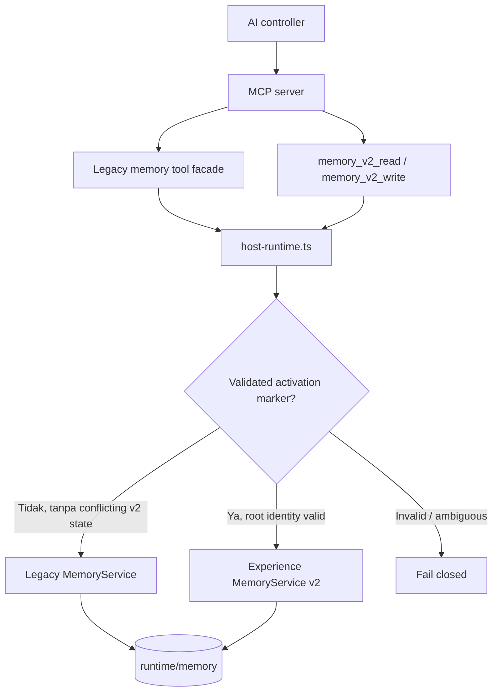
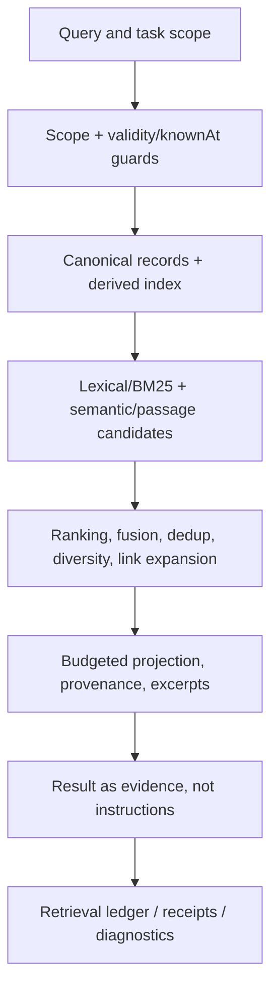
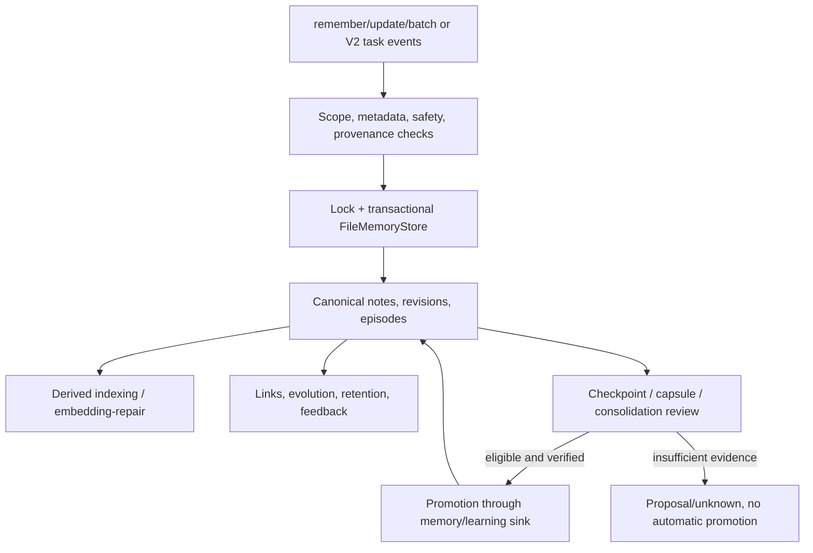

# Agent Core Memory — peta kerja dan relasi kode

Audit source terarah, 16 Oktober 2026. Hanya Memory dan penghubung langsungnya. Tidak ada perubahan source, test, build, atau restart.

## Fakta arsitektur penting

- Canonical path tetap `runtime/memory`. Aktivasi engine diatur `src/memory/host-runtime.ts` dengan marker `runtime/memory-v2-activation.json`, validasi root identity, symlink/path, dan process lock.
- Mode **legacy** memakai `src/memory/service.ts`. Mode **experience-v2** memakai `SubProject/agent-core-memory/src/memory/service.ts` melalui `SubProject/agent-core-memory/dist/index.js`; jangan menganggap seluruh kode legacy adalah owner runtime aktif.
- V2 mengikat operasi ke host-supplied `taskId`, `workspaceKey`, dan `controllerId`. Data memory yang dibaca tidak memberi izin mengeksekusi tool.
- `runtime/memory-v2` adalah input kompatibilitas historis, bukan lokasi canonical baru.

## Diagram 1 — Boot dan pemilihan engine

## Diagram 2 — Memory recall

## Diagram 3 — Capture, episode, promotion

## Tabel hubungan source — entrypoint dan lintasan

| Layer | File sumber (link relatif dari root Agent Core) | Hubungan kerja |
|---|---|---|
| Bootstrap | [src/memory/host-runtime.ts](../src/memory/host-runtime.ts) | Marker → pilih legacy atau Experience v2; root lock & identity |
| MCP legacy | [src/mcp/memory-tools.ts](../src/mcp/memory-tools.ts) | Register `memory_list/read/search/remember/update/batch` dan operasi lainnya ke service |
| MCP v2 | [src/mcp/memory-experience-tools.ts](../src/mcp/memory-experience-tools.ts) | `memory_v2_read/write` → host scope → dispatcher |
| MCP scope | [src/mcp/memory-scope.ts](../src/mcp/memory-scope.ts) | Task/workspace/controller host binding |
| MCP contracts | [src/mcp/memory-schemas.ts](../src/mcp/memory-schemas.ts) | Validasi payload operasi legacy |
| Public wiring | [src/mcp/server.ts](../src/mcp/server.ts) | Tool registration pada Node Core |
| Legacy service | [src/memory/service.ts](../src/memory/service.ts) | Menghubungkan canonical store, retrieval, revision, graph links, feedback, evolution, transfer |
| V2 package boundary | [SubProject/agent-core-memory/src/index.ts](../SubProject/agent-core-memory/src/index.ts) | Public exports engine, controller session, dispatcher, episodes, promotion |
| V2 service | [SubProject/agent-core-memory/src/memory/service.ts](../SubProject/agent-core-memory/src/memory/service.ts) | Composition root engine V2 |
| V2 protocol | [SubProject/agent-core-memory/src/memory/controller-protocol.ts](../SubProject/agent-core-memory/src/memory/controller-protocol.ts) | Typed controller dispatcher |
| V2 session | [SubProject/agent-core-memory/src/memory/controller-session.ts](../SubProject/agent-core-memory/src/memory/controller-session.ts) | Host-scoped recall/disclosure/task-context |
| Episodes | [SubProject/agent-core-memory/src/memory/episodes.ts](../SubProject/agent-core-memory/src/memory/episodes.ts) | Task events, checkpoints and episode durability |
| Capsules | [SubProject/agent-core-memory/src/memory/capsule.ts](../SubProject/agent-core-memory/src/memory/capsule.ts) | Continuity capsule generation |
| Promotion | [SubProject/agent-core-memory/src/memory/promotion.ts](../SubProject/agent-core-memory/src/memory/promotion.ts) | Consolidation eligibility, proposal and promotion |
| Store | [SubProject/agent-core-memory/src/memory/store.ts](../SubProject/agent-core-memory/src/memory/store.ts) | File-backed canonical records |
| Atomic transaction | [SubProject/agent-core-memory/src/memory/transaction.ts](../SubProject/agent-core-memory/src/memory/transaction.ts) | Journal, stage, commit, recovery |
| Retrieval | [SubProject/agent-core-memory/src/memory/retrieval.ts](../SubProject/agent-core-memory/src/memory/retrieval.ts) | Ranking and retrieval selection |
| Index | [SubProject/agent-core-memory/src/memory/index.ts](../SubProject/agent-core-memory/src/memory/index.ts) | Derived index lifecycle |
| BM25 | [SubProject/agent-core-memory/src/memory/bm25.ts](../SubProject/agent-core-memory/src/memory/bm25.ts) | Lexical ranking |
| Embedding | [SubProject/agent-core-memory/src/memory/embedder.ts](../SubProject/agent-core-memory/src/memory/embedder.ts) | Semantic vector generation |
| Passages | [SubProject/agent-core-memory/src/memory/passages.ts](../SubProject/agent-core-memory/src/memory/passages.ts) | Passage segmentation/retrieval units |
| Temporal | [SubProject/agent-core-memory/src/memory/temporal.ts](../SubProject/agent-core-memory/src/memory/temporal.ts) | Historical/temporal memory handling |
| Evidence | [SubProject/agent-core-memory/src/memory/evidence-excerpt.ts](../SubProject/agent-core-memory/src/memory/evidence-excerpt.ts) | Grounded bounded excerpts |
| Provenance | [SubProject/agent-core-memory/src/memory/provenance.ts](../SubProject/agent-core-memory/src/memory/provenance.ts) | File/repo/workspace context |
| Guard | [SubProject/agent-core-memory/src/memory/safety.ts](../SubProject/agent-core-memory/src/memory/safety.ts) | Memory safety validation |
| Revisions | [SubProject/agent-core-memory/src/memory/revisions.ts](../SubProject/agent-core-memory/src/memory/revisions.ts) | History and knowledge-time evidence |
| Learning bridge | [src/learning/memory-sink.ts](../src/learning/memory-sink.ts) | Existing Learning ↔ Memory promotion policy |

## Penyimpanan canonical yang diamati

`runtime/memory/00-agent-core-memory.md`; `notes/*.md`; `archive/{manifests,objects}`; `state/{episodes,episode-tasks,operations,capsules,revisions,transactions}`; `index/index.json`; `state/retrieval-ledger.jsonl`; `state/retrieval-use-receipts.jsonl`; `state/experience-manifest.json`.

## Batas klaim dan pemeriksaan

- Inspeksi ini membuktikan owner, file, dan API source. Tidak menjalankan full call graph runtime, test suite, atau verifikasi behavioral setiap jalur.
- Derived index bukan backup canonical. Index sehat saja tidak membuktikan kualitas ingatan atau akurasi keputusan.
- Retrieval receipt bukan bukti bahwa memory meningkatkan hasil tugas. Klaim tersebut perlu outcome evidence independen.
- Hubungan statis tambahan antar-file dapat dieksplorasi menggunakan import/reference search pada dua root Memory; kode dinamis yang tidak memiliki static import tidak boleh diasumsikan otomatis terhubung.

## Referensi implementasi

- [Memory engine public API](../SubProject/agent-core-memory/src/index.ts)
- [Memory engine integration guide](../SubProject/agent-core-memory/docs/controller-integration.md)
- [CODEBASE.md](CODEBASE.md)
