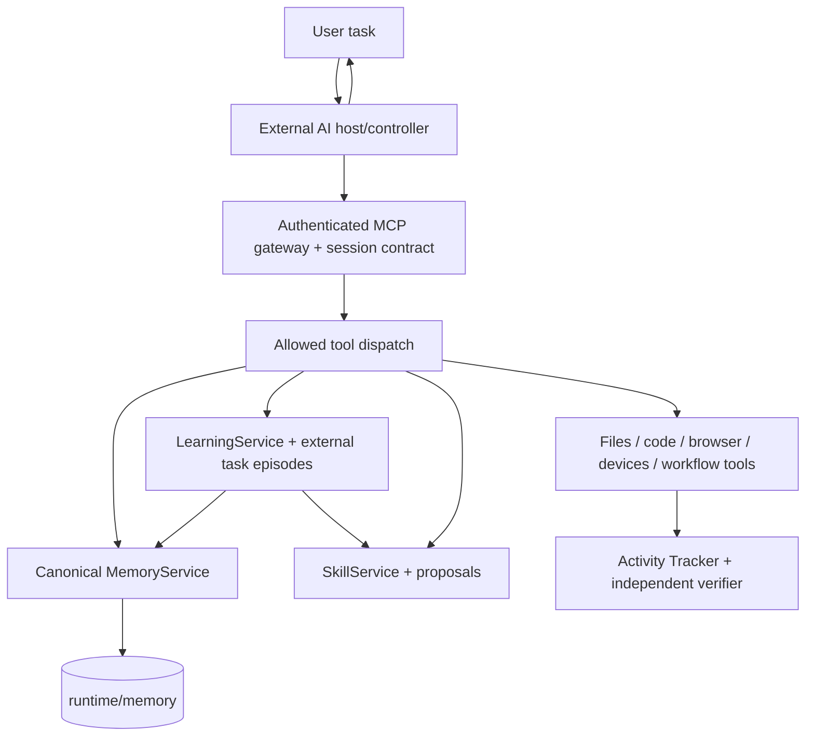
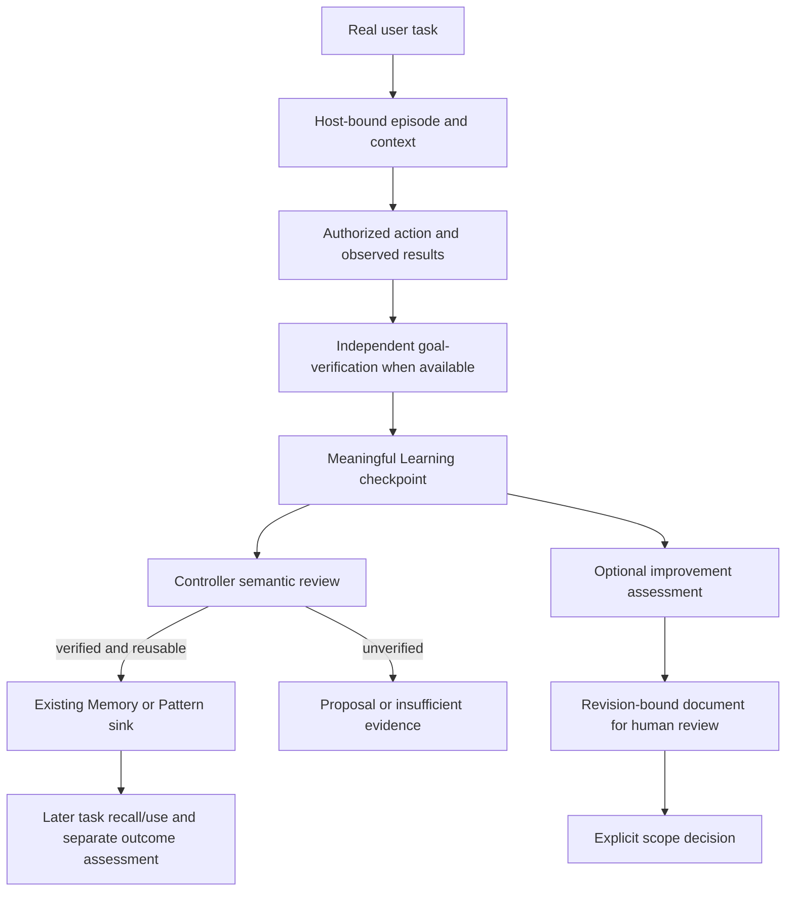

# Agent Core — Current Architecture Index
**Updated 2026-10-29 | current-source map | concise by design**

**Native provider recovery (2026-10-29):** `agent-provider-state.ts` persists a finite HALF_OPEN probe deadline using the existing breaker row and fences outcomes/releases with its revision; legacy abandoned claims expire through the same owner. `agent-provider-scheduler.ts` forwards claim lifecycle operations. `agent-provider.ts` releases every selected probe in `finally`, bounds its transport/qualification signal and refuses stale dispatch. Cancellation/preflight errors preserve outage history; real provider failures retain backoff, quota/auth state and model pinning. [Recovery evidence and test limits](verification/Provider-Stability-Recovery.md).

**Launcher continuation/composer update (2026-10-29):** AgentChatService startup parks recovered running/provider-wait turns until explicit Continue. AgentChatStore persists goal-mode metadata on the existing turn; Pause waits for a safe durable checkpoint, Continue resumes that same task, and Stop stays terminal. The authenticated HTTP owner and native WebView bridge carry pause/resume and request/conversation identities. App keeps session drafts and pending requests scoped while history remains switchable; uncorrelated reads cannot complete pending sends. ChatPage renders the real goal instruction/status above the composer, whose outer frame owns focus styling. Specification and bounded verification, including the UI runner limitation, are in [Launcher-Migration.md](plans/Launcher-Migration.md) and [Launcher-Restart-Recovery.md](verification/Launcher-Restart-Recovery.md).

> This document describes **currently observed owners and constraints**, not a chronological release log. Exact current code is implementation authority; `AGENTS.md` is the local operating contract. Statuses and external papers are evidence, not execution approval. Deep details are linked below and are read only when needed.

Folder map: **[docs/PROJECT-STRUCTURE.md](PROJECT-STRUCTURE.md)** is the single root/folder/subfolder placement index. All agents including Main, Native, external controllers and Raka must inspect its relevant owner plus the live filesystem before creating a directory. Reuse existing homes and update that map with this document when a genuinely new task-owned purpose is introduced. Skill-source locators in dated prose point to the current home; recorded event digests/statuses remain historical.

## 1. Scope, product intent, and source of truth
- **Product:** model-pluggable cumulative-learning agent body with persistent local Memory, procedural knowledge, verified tool action, a host-controlled external AI, and an existing Native Agent runtime.
- **Development scope:** Native AI Agent Core and external controllers are available for task-scoped development. The user explicitly removed the Native restriction on 2026-10-24. Runtime grants, authentication, protected data, source-drift and independent verification remain required. Current integration and resident evidence are recorded in the [R4 execution report](history-agent-core/Native-Architecture-Integration-Revision-4-Execution.md).
- **Canonical Memory:** `src/memory/` and `runtime/memory/` only. `SubProject/agent-core-memory` and `runtime/memory-v2` are historical reference/migration context, not active independent stores.
- **Learning:** one `src/learning/` state/review owner; memory sinks and Skill proposals are connected without granting autonomous execution.
- **Mind-Control completion, 2026-10-27:** revision 10 is active at `sha256:4c4649bf58044de3d3ccabd1ed6906afa8cd61612b400d7667a7487c5f19af04` (16 files, 184,747 bytes). The 7,689-byte entrypoint fits one real 8,192-byte serialized resident response (8,106 bytes; `nextOffset=null`). It retains the five ordered questions, self-audit/frame, T0/T1/T2, six fields, debugging example and seven argument checks. All 13 references/LICENSE and eight moved scientific sections match their baselines. The original proposal's one-fragment requirement was still unmet in revision 9; [completed proposal](history-agent-core/mind-control-upgrade.md) and [readback evidence](history-agent-core/mind-control-upgrade-evidence.json) close that gap. Existing SkillService provenance reconciliation records `implemented/catalog-active` without fabricating Native user-message decisions. Historical fresh baseline/candidate evaluation is retained; reused-Raka revision-10 acceptance scores 12/12 substance and 3/3 record compliance. No general reasoning, causal, Native-provider or latency benefit is claimed. Revision 9 is the immediate rollback target.
- **External episode scope diagnostics, 2026-10-27:** `src/mcp/controller-learning-tools.ts` preserves the `MEMORY_CONTROLLER_SCOPE_UNAVAILABLE` prefix but identifies missing owner, missing/blank task key, missing/blank workspace, or unavailable/unregistered workspace and gives bounded recovery guidance. The clone failure came from omitting workspace; rejection before task mutation was correct, and no persistence bug was established. No default workspace, schema or admission relaxation was added. Seven regressions cover unchanged task state and valid host binding; combined scoped verification passes 56/56 across five files. `npm run build` passes; one official restart activated the handler (resident PID 16472, health `ok`, build not stale). Live missing-workspace reproduction returns `workspace-required` and retains the original episode. [Owner and verification](Learning-External-Scope-Recovery.md).
- **Priority:** real user-goal outcomes, independence of verifier, next-task reuse, correctness before speed/cost; proposals are not installations.
- **Non-goal:** duplicated Memory/Learning, new hidden model agent, unconditional self-modifying runtime, self-deployment, silently updated grants, or implicit permission.

## 2. Runtime/topology

- **Core process:** TypeScript/Node.js `src/index.ts::startAgentCoreService`, compiled to `dist/`, serves HTTP/MCP via `src/http/`, `src/mcp/`.
- **Passive health:** `src/http/health.ts` bounds/coalesces each diagnostic owner independently. `/health` remains HTTP liveness even when a secondary probe times out; unavailable diagnostics stay explicit. Rich external-controller status/journal replay is excluded from launcher polling. Core has no inactivity shutdown in the inspected launcher/service lifecycle; explicit application close owns shutdown.
- **Desktop:** .NET 8 WinForms launcher, WebView2-hosted React UI (`src/launcher/`, `src/ui/`); launcher process responsibilities are distinct from Memory/Learning semantic policy.
- **Remote:** tunnel and OAuth/auth live behind existing HTTP access controls, not Memory content. MCP tool schemas and grants vary by configuration; do not rely on historical tool counts.
- **Cloudflare OAuth second route (2026-10-25):** default `AGENT_CORE_OAUTH_PROTECTED_RESOURCE_URL` remains the OpenAI tunnel. `CLOUDFLARE_TUNNEL_HOSTNAME=agent-core-mcp.joefreccejunior50.workers.dev` provides a separate OAuth resource. Local `scripts/tunnel/public-mcp-gateway.mjs` (loopback port 8788) allowlists MCP/OAuth routes and forwards with the fixed Worker `Host`; unauthenticated MCP returns 401, `/health` 404, and public Quick Tunnel OAuth discovery returns the correct Worker resource. **Superseded 2026-10-26: the Worker `agent-core-mcp` now reaches the gateway through the Workers VPC binding `AGENT_CORE_ORIGIN`; the earlier Quick Tunnel origin (HTTP 530/1016) is no longer used. See the lifecycle bullet below.**
- **Public MCP local gateway repair (2026-10-26):** `scripts/tunnel/public-mcp-gateway.mjs` had an invalid trailing `/` in the Worker `Host` header. Direct `/mcp` checks reproduced `401` with a valid Host versus `500` with the slash. Removed the slash and restarted only the gateway process: local `127.0.0.1:8788/mcp` now returns `401` unauthenticated, OAuth protected-resource discovery `200`, and `/health` `404` as intentionally excluded. The external Cloudflare Worker was **not redeployed** and its earlier Quick Tunnel `530/1016` remains a separate unverified-until-migrated public-origin issue.
- **Public MCP gateway lifecycle (2026-10-26):** `Agent Core.exe` (`src/launcher/AgentCoreRuntime.cs::EnsurePublicGatewayAsync`) starts `runtime\node\node.exe scripts\tunnel\public-mcp-gateway.mjs` as an owned child after Core `/health` is ready and before the internal Quick Tunnel. Any HTTP answer on `127.0.0.1:8788/mcp` proves the listener; a foreign owner on 8788 is refused. Launcher close stops only that exact-owned gateway, and the residual sweep matches it. Public path: Worker `agent-core-mcp` → Workers VPC binding `AGENT_CORE_ORIGIN` → VPC Service `agent-core` on Named Tunnel `agent-core-private` (Windows service `Cloudflared`) → `127.0.0.1:8788`. The Worker source lives in the Cloudflare dashboard, not in this repository. Verified after launcher activation: launcher log `GATEWAY … listening on internal port 8788`; public `/mcp` 401; OAuth protected-resource metadata 200. Scripted MCP-client OAuth end-to-end on the public path (2026-10-26 12:39 UTC, owner approval in browser): dynamic client registration 201, PKCE authorization, token exchange `Bearer`/`mcp:tools`/3600 s, authorization code single-use (replay 400), `initialize`, `tools/list` 82 tools, contract read and acknowledge, read-only `memory_status`, forged bearer 401 all passed. Watchdog (2026-10-26, `src/launcher/AgentCoreRuntime.cs::WatchdogLoopAsync`): every 30 s, under the lifecycle lock, the launcher probes Core `/health` and the gateway TCP port 8788 and starts whichever is down. A user `stop-core` suspends only the Core part until `start-core`, `restart-core` or `restart-all`. Live check: gateway killed 20:03:46 and restarted 20:04:14; Core killed 20:04:23, restarted 20:04:48, healthy 20:05:37, gateway 401 again. Remaining public-path work: reboot persistence (planning only) and multi-user isolation (planning only).
- **Restart path fix (2026-10-26):** `scripts/windows/Restart-Agent-Core.ps1` asks the running launcher to exit through `Local\AgentCoreDesktop.Exit` and then waits for that launcher process itself to exit before copying a pending exe; a launcher that stays alive (for example hidden in the tray) makes the run fail with no copy. `src/mcp/restart-tool.ts` starts `Restart-Agent-Core.cmd` by absolute quoted path, because `NoDefaultCurrentDirectoryInExePath=1` in an inherited environment stops cmd from finding a bare file name. Verified: the tool-triggered restart returned receipt `exitCode 0`, `Kesiapan: siap`, Core 200 and gateway 401.
- **Workflows:** `src/workflows/controller-cycle.ts` describes the external controller's request/response workflow. It is a **diagram builder**, not an always-on orchestration engine.

## 3. Canonical owner map (verify source before changes)
| Domain | Current source owner | Responsibility / boundary |
| --- | --- | --- |
| Service composition | `src/index.ts` | Initializes Memory, Learning, Skills, agent runtime, code intelligence, device and MCP owners |
| MCP contracts and admission | `src/mcp/`, `src/http/`, `src/auth/` | Session handshake, authenticated requests, validated schemas and scoped tool grants |
| Local machine execution | `src/rdc/` | File/search/process/browser operations; tool success is not goal verification |
| Shared project folder ownership | `src/portability/project-structure.ts`, `scripts/portability/project-structure.mjs` | Policy and generated tree in `docs/PROJECT-STRUCTURE.md`; before-mutation directory admission, atomic snapshot sync, CLI/path/build drift checks. Native/external/Raka share the filesystem tool owner; arbitrary shell calls remain outside interception. |
| External Controller ↔ Native Chat adapter/facade | `scripts/external/native-chat-bridge.mjs`, `src/mcp/native-chat-bridge-tools.ts` | External-only MCP list/read/create/send/cancel over existing authenticated loopback API; prompt stdin, stable request IDs, bounded/redacted output and explicit cancellation; excluded from Native registration. HTTP/service/store retain external message provenance and operator-command isolation. Exact adapter file is included by release-support packaging. |
| Memory activation/store | `src/memory/host-runtime.ts`, `service.ts`, `store.ts`, `transaction.ts` | Single canonical Memory, manifest identity, transactions, journaling, recovery |
| Retrieval and context | `src/memory/retrieval.ts`, `index.ts`, `controller-session.ts` | Source-revision, task-scoped lexical/BM25/semantic retrieval, bounded disclosure |
| Task continuity | `src/memory/episodes.ts`, `capsule.ts`, `prospective-intentions.ts` | Task events, working state and advisory future cues |
| Knowledge admission | `src/memory/promotion.ts`, `claim-review.ts`, `recall-repair.ts` | Revision-bound promotion/revalidation/limited repairs; no automatic truth |
| Learning | `src/learning/service.ts`, `triggers.ts`, `review.ts`, `sink-manager.ts` | Every meaningful checkpoint queues review; deduplicated evidence admission, canonical Memory/Pattern sinks and proposed curation |
| External learning task | `src/learning/external-controller.ts` | Host-bound episodes, context synthesis, task verification/finalization linkage |
| Self-improvement proposals | `src/learning/improvement-handoff.ts`, `external-improvements.ts` | Evidence-led advisory, revision-bound decision records, no auto-edit |
| Procedure and Skill | `src/agent-learning-loop.ts`, `src/learning/external-procedure.ts`, `src/skills/service.ts` | Reuse candidates and versioned Skill artifacts, explicit activation/rollback |
| Outcome evidence | `src/tracker/`, `src/verification/`, `src/learning/external-evaluation.ts` | Redacted observations, task/case provenance, baseline/candidate comparability |
| Code understanding | `src/code-intelligence/`, `src/semantic-ide/` | Existing Grafel-backed graph/LSP integration; retrieval is not proof of executed code |
| Web and browser | `src/web-research/`, `src/rdc/browser-control/` | Existing evidence and browser tools under scoped authorization |
| Device tools | `src/phone/` | Authorized Android phone observe/action under separate grants |
| Native runtime | `src/agent-controller.ts`, `src/agent-runtime.ts`, `src/agent-chat-service.ts` | Model loop, persisted conversation/task ownership, scoped capabilities and cumulative learning |
| Native Chat reliability (explicit 2026-10-23 scope) | `src/agent-chat-service.ts`, `src/agent-chat-store.ts` | One sequential startup recovery pass for newly interrupted safe checkpoints; revision-bound paused reasons; final chat events and text projected after durable commit; existing DTC grants/budgets/unknown-effect refusal retained |
| Native provider continuity/readiness (explicit Revisi 4 scope) | `src/agent-provider.ts`, `agent-provider-scheduler.ts`, `agent-provider-state.ts`, `agent-provider-readiness.ts` | Sticky global provider/key cursor, SQLite CAS/migration, quota/outage separation, per-key catalog/tool qualification; no new secret or Memory owner |
| Native provider routing evidence (explicit 2026-10-25 scope) | `src/agent-provider-state.ts`, `agent-provider-scheduler.ts`, `agent-provider.ts`, `agent-controller.ts`, `agent-turn-events.ts`, `agent-turn-checkpoint.ts`, `agent-chat-service.ts` | Read-only per-key skip reasons and route status (`all-limit-or-quota` only when every relevant key is a rate-limit/quota case; otherwise `mixed` or `provider-open`); secret-free `provider.route.decision` turn events and a bounded checkpoint `routeTrail`; selection order, failure classification, cursor/CAS and SQLite schema unchanged; no second retry worker, rotation owner or log store. Same-day follow-up ([evidence report](Native-Provider-Routing-Evidence-20261025.md) sections 14-22): `agent-chat-service.ts` and `agent-chat-store.ts` settle the runtime task of a stopped, failed or interrupted turn so its session can be archived; `agent-provider-readiness.ts` reads schema-2.x nested model catalogs; `agent-provider-errors.ts` matches `quota_exceeded` only as a whole token; `config.ts` defaults the request timeout to 180 s |

Model qualification uses two coalesced workers and waits for both to settle before releasing the shared preparation promise, including failure. Selection records the model actually checked against blocks and quota for each key; a model replacement during context qualification must pass selection again before inference. A newer, unexpired, successful exact-key/model tool probe supersedes an older model-not-found/access block while preserving its historical row; newer failures, capacity blocks, quota and authentication state remain controlling. Cached negative qualification is skipped while bounded background refresh proceeds, so a ready route is not starved by repeated scans.

A model-access/not-found failure newer than cached successful qualification derives pending readiness and a60-second retry delay. The existing qualification workers must obtain a new catalog/tool proof before reuse. This preserves both the earlier proof and later failure records rather than clearing operational state to force a request through.

Native result metadata keeps the requested model alias separate from provider-reported resolved identities and records coverage across successful model calls. Checkpoint, chat persistence and recovery retain this evidence. The isolated reuse comparison treats missing identity, mixed models within a task, or different models across a pair as confounds; a router alias alone does not establish a matched comparison. Resolved identity remains a provider report, not independent attestation of its physical model.

Evaluation file scope admits the canonical input and readback of the task's own answer; only that answer is writable. The sealed oracle and other paths remain excluded. Scope denials explain the fixed evaluation boundary separately from missing capability grants. Fresh coding evaluation cases use arithmetic expressions supported by the existing declarative checker, with changing constants and operation-order counterexamples; unsupported arbitrary JavaScript is not executed.

As of the explicit 2026-10-24 resume, the bounded engineering checker accepts fully balanced parentheses around a whole numeric arrow without evaluating code. Outer wrappers count toward the pre-existing depth-32 bound; input length is limited before normalization and inner semicolons, trailing calls and unsupported syntax fail closed. Focused source regression: 28/28 PASS; root TypeScript and path policy 467/0 PASS; isolated compiled reuse-runner self-check PASS without provider calls. Official resident restart was read back as Node Core PID 11524 (started 11:27 WIB after compiled artifact 11:25), Core v0.15.0, HTTP health `ok`, Memory/Execution/Native `available`. Fresh isolated R4 coding/research/browser cohort was attempted once per domain: coding seed oracle PASS but lesson capture absent; research seed+omit PASS with verified new seed lesson, research reuse failed on provider HTTP400; browser seed had unknown side-effect result plus action grant denial and was cancelled through its exact turn ID. No completed matched omit/reuse pairs, no verified Memory efficiency/correctness uplift, no unguarded replay. See R4 execution report at `docs/history-agent-core/Native-Architecture-Integration-Revision-4-Execution.md`. Next evaluation requires resolving the provider/browser admission confounds; this activation does not imply broad task-benefit verification.

Passive launcher status uses a bounded10-second grace from the first failed probe and resets on success/shutdown; retry failures do not extend it. Chat health reads aggregate SQL counts without loading transcripts or result metadata. A real sustained outage still appears unavailable; this does not prevent unrelated synchronous work from delaying the Core event loop.

Launcher string requests use the existing buffered HTTP completion mode, so the10-second client timeout includes the response body as well as headers. OAuth discovery, Core readiness and passive health share this helper; a server that stalls after headers cannot leave its polling gate occupied indefinitely.

The OBU runtime publishes its current Core owner before optional registry checks. Registry failure cannot leave an already registered relay tied to an obsolete process. The owner timestamp remains stable across same-process retries; the native relay retains shutdown and PID-reuse validation.

Native context assembly tries fusion first. If it returns only pinned context, one existing BM25 search with the same query, scope and exclusions admits only direct hits with positive lexical/content evidence. Receipt provenance, supersession and total context bounds are preserved; global identifier matching is unchanged. The isolated three-domain runner seals oracle files and limits tools before admission to the declared input/output or owned local browser session.
| Human review UI | `src/ui/`, `src/launcher/` | Proposal reader, Activity Log and current launcher; reads are not approvals |

## 4. Memory ownership and invariants

- Only `runtime/memory` is the canonical persistent root. `src/memory/host-runtime.ts` requires validated active experience manifest and canonical activation marker `runtime/memory/state/host/activation.json`. Conflicting historical markers/roots fail closed.
- `MemoryService` owns canonical notes, typed links, source provenance, revisions, task episodes, derived vector index and retrieval ledger. Read modes and budgeted disclosure are provided by existing Memory MCP facades.
- `FileMemoryStore` and `MemoryTransactionCoordinator` use locking, CAS fingerprints, journaled changes and recovery. An index or embedding failure is distinct from canonical data loss.
- Recall results are advisory. **Stored → retrieved → delivered → actually used → independently verified effect** are separate claims. Tool/session receipts cannot prove causal benefit alone.
- **Cognitive upgrades (opt-in, 2026-10-27; proposal [Advanced-Memory-Cognitive-Upgrades](history-agent-core/Advanced-Memory-Cognitive-Upgrades.md)):** nine composable extensions inside `src/memory/`, all disabled unless named in `MemoryServiceOptions.cognitive` or the host variable `AGENT_CORE_MEMORY_COGNITIVE` (`all`, `none` or a comma list; unknown names are ignored). They add no state: tier, epistemic status and forgetting score are derived from persisted fields, and neither the note format, `transaction.ts` nor `mcp/tools.ts` changed. Flags live in `cognitive-config.ts`; `MemoryService` owns the wiring.
  - Read path (fusion profile unless noted): `query-intent.ts` classifies the query and weights the RRF channels (`adaptiveFusion`); `epistemic-confidence.ts` adds a bounded ±0.04 term (`epistemicConfidence`); `graph-traversal.ts` replaces both single-hop neighbor loops and walks up to 3 hops, following only `related`/`supports`/`derived-from` beyond hop 1 (`multiHop`; results then carry `hops`/`viaPath`); `memory-tiers.ts` searches L1, then L1+L2, then everything, answering early only when the smaller pool already holds `limit` strong results (`tiering`). `forgetting-curve.ts` swaps the retention model of `retirementReview` (`forgettingCurve`; threshold 0.3 instead of 0.2).
  - Write path: `privacy-masking.ts` masks recognized credentials with typed placeholders before the canonical write in `remember`/`update`/`batch` (`secretMasking`); `scanMemorySafety` still rejects whatever it does not recognize, and history records redaction counts only.
  - Maintenance (`cognitive-maintenance.ts`, `MemoryService.cognitiveStatus/resolveContradictions/scanIntegrity/repairIntegrity/runCognitiveMaintenance`; previews by default): `contradiction.ts` hides the loser of a `contradicts` pair by writing a `supersedes` link on the winner, never deleting and never touching pinned records (`contradictionResolution`); `self-repair.ts` strips dangling links/evidence refs and refreshes the index through the bounded embedding repair queue, and refuses to run while the canonical store is incomplete (`selfRepair`); `rem-consolidation.ts` writes at most five idempotent, extractive, `inferred` digests per cycle that `derived-from`-link their sources, driven by an unref'd interval loop stopped by `dispose()` (`remConsolidation`, default every 30 minutes). Epistemic labels come from fields the writer controls (tags, `source.type`) unless a v2 record carries `experience.verification`, so autonomous pruning is advisory and reversible by removing one link.
  - Verification: `tests/memory/memory-cognitive-*.test.ts` (74 tests). No latency or throughput benchmark was run, by user rule.
- Past `SubProject/agent-core-memory` source maps are superseded by the 2026-10-16 consolidation. Avoid reviving the package as a second writer.
- Full current-source details: [Memory and Learning Research Atlas](research/Agent-Core-Memory-Learning-Architecture-20261022.md).

## 5. Learning, self-learning, and self-improvement lifecycle

- One `LearningService` owns checkpoint/review and existing sinks. Current `src/learning/triggers.ts::applyCheckpoint` makes **each new meaningful checkpoint** pending for semantic review; `LearningService.status` reports review due when pending entries exist. The exposed `reviewInterval` remains configuration, **not a ten-task threshold** in these branches. `learning(action=checkpoint)` and exact `learning(action=review)` are distinct from independent task verification; `no-new-knowledge` can close a review honestly.
- `ExternalControllerLearningService` binds real host taskId and workspace; model/controller decision-making is outside Core's source-verifiable internal execution.
- Structured procedures can be proposed on evidence and repeated verified task identities. Import/build/Skill activation require a separate exact user decision and revision.
- `learning/improvement-handoff.ts` suggests **at most one** relevant improvement from evidence already observed, without auto scanning/code edits.
- Existing external comparison (`external-evaluation.ts`) returns a withheld benefit verdict; separately validate real reuse on held-out tasks before claiming intelligence or performance gains.

## 6. Proactivity: implemented versus non-implemented

- **Implemented advisory:** task continuation capsule; bounded time/event cue *classification* (`waiting/eligible/expired/resolved/unknown`, due cues prioritized); per-claim HOW/WHEN recheck metadata; opportunistic curator recommendations; in-session proposal notice. None of these initiates unattended tool execution.
- **Not implied:** unattended polling, automatic daily research, autonomous source mutation, proactive notification delivery/ack, model retraining or silent deployment. An external scheduler is a separate task/authority.
- Provider credential scheduling in `src/agent-provider-scheduler.ts` is infrastructure availability management, not goal-directed initiative.

## 7. Canonical data versus auxiliary state
| Plane | Typical location | Meaning |
| --- | --- | --- |
| Canonical knowledge and episodes | `runtime/memory/` | Single file-native persisted Memory, lineage, task capsules |
| Derived index | `runtime/memory/index/` | Rebuildable search support, not a second database |
| Retrieval/exposure ledger | `runtime/memory/state/` and owner-declared logs | Attempt/delivery/use evidence; not automatic effect |
| Learning state/proposals | `config.learning.stateDir`, via `src/learning/paths.ts` | Checkpoint, review and proposal decision lifecycle |
| Skill active/staged/history | `src/skills/service.ts` resolved runtime paths | Versioned artifacts; digest and approval guarded |
| Activity diagnostics | `runtime/tracker/` | Redacted tool/runtime observations; no secret/raw reasoning dumps |
| Optional Grafel provider | `runtime/grafel/` | Code graph/index separate from canonical Memory |
- Exact state paths/schemas are defined in their source owners; files in `dist/` are compiled artifacts, not an alternate source of architectural truth.

## 8. Architecture-preserving research and polyglot adapters

- **2026-10-27 reference audit and shared folder map:** Current Skill-source locators in notices, plans, archive navigation and reproduction instructions now use `runtime/skills/capability-packs`. The revision-bound proposal projection remains byte-identical to its owner render; current locators are provided separately in the map. Other obsolete outside-home names remain in explicit prohibition/negative checks, captured managed provenance and the dated explanation of the correction. [PROJECT-STRUCTURE.md](PROJECT-STRUCTURE.md) records root/folder/subfolder locations, owners, protected/generated boundaries and Skill lifecycle roles. `AGENTS.md`, the Raka profile, delegation guide and Claude-host brief require checking the map plus live folders before creation. The documentation link audit also corrected the removed `docs/archive/README.md` link to existing history/research homes. No managed Skill payload, source digest, catalog/history, dependency, executable or service was modified by this documentation audit.
- **2026-10-27 Skill storage ownership — USER CORRECTION:** Respect the first existing home, `runtime/skills`. The previous decision to make newer `bundled-skills` the canonical source outside that home was wrong and is superseded. The existing 40-Skill collection was moved, not duplicated, into `runtime/skills/capability-packs`; all 358 files / 2,770,917 bytes had identical before/after transfer manifest SHA-256 `fe835258e7412d03534543a17382b7286fc0115143f15c8fa25cb9862904a862`, then root README links were updated. The empty outside parent was removed. Catalog (43 artifacts), 17 history trees, staged candidate, proposals and tooling stayed under their existing owners with unchanged payloads; performance active digest remains `sha256:ad530ab0a8350ddb9a82fd2ceedfcc74a4d778e060a9fe9cb90554cf4ae9115a`. `AGENTS.md` and [the ownership map](External-Engineering-Skills.md#storage-ownership) now require respecting the older parent and forbid recreating the outside home. The bounded layout check is wired into `path:check`. Git/package inputs narrowly include maintained source and `runtime/skills/README.md`; live catalog, revisions, Memory and local configuration remain excluded. Release intent, package seeds, integrity and recovery use the canonical subtree; new recovery rejects legacy outside-home payloads with a targeted-migration error instead of remapping hash-bound archives. Historical provenance retains original source paths as evidence; active documentation links point to the current home. Targeted verification passed 62/62 tests across storage, indexing, release readiness, integrity and Windows recovery, plus the real path check (40 sources / 43 catalog artifacts). The combined shell migration was blocked before execution; a separate exact-path check and Agent Core `move_file` performed the safe move. No SkillService/catalog rewrite, application build/restart, dependency installation, release apply, Git commit or publication was performed. Pending patch intent: `.changeset/respect-original-skill-home.md`.
- **2026-10-27 `performance-oriented-software-engineering` upgrade ACTIVE:** The user explicitly requested promotion of the existing proposal. SkillService validation, staging, expected-active promotion and resident readback agree on final digest `sha256:ad530ab0a8350ddb9a82fd2ceedfcc74a4d778e060a9fe9cb90554cf4ae9115a` (8 files, 22,535 bytes). The entrypoint is 7,650 bytes versus 9,746 originally (2,096 bytes / 21.5% smaller), including proposal provenance; an actual resident read at `maxBytes=8192` returns `nextOffset=null`, `truncated=false`. The initial 8,037-byte provenance-bearing artifact required two fragments because the read budget includes the serialized response envelope; repeated wording was compacted before final promotion. Both conditional references are readable at the final digest. Workload/metric/boundary/guardrail, critical-path and evidence-matching guidance is active with the original trigger boundaries and no added tool grants. Existing proposal reconciliation records `implemented/catalog-active`, final artifact digest and evidence revision `sha256:00b8a7430844509b7c7ffc67e4883f986acf28d8828cf9ba32505b4372407377`; original revision `sha256:34e953d2b0cbb2b12d1faaa7ec6f3660bafb757a88a8dfd23c0301ea08b4bd2a` is preserved in history. Native decisions remain empty; no user-message proof was fabricated. [Completed proposal](history-agent-core/performance-oriented-software-engineering-upgrade.md); [readback evidence](history-agent-core/performance-engineering-skill-promotion-evidence.json). Original active digest `sha256:157edb537eeb46130bd3023efcef8ed091517cae3dc493767bb02377df212639` and intermediate promotions remain rollback history. This is live catalog-data activation; no application code, executable build, restart, dependency install, release apply, Git commit or publication was performed. Behavioral/task-quality gains remain unmeasured.
- **2026-10-26 WeKnora donor audit / W-02 provider response transport (BUILT; TARGETED TESTS 168/168; RESIDENT ACTIVATED 2026-10-26 22:49 BANGKOK; LIVE FAILOVER CASE NOT FORCED):** [Active audit](research/WeKnora-Donor-Audit.md) pins Tencent/WeKnora `22a331a2` and inventories 5,674 files, separating lexical coverage from deep source comparisons. Donor `internal/models/api/endpoint.go::roundTrip` distinguishes body-read transport failures from size/decode errors. Independently implemented in `src/agent-provider-errors.ts`, a cycle-safe eight-object cause scan recognizes known structured transport codes (including Undici body/socket/content-length errors) before the existing transient branch. HTTP status precedence, deterministic JSON/size errors, bare `terminated`, aborts and unknown/deep/cyclic errors retain their prior paths. A real local HTTP mid-body disconnect reproduces `TypeError: terminated` with `UND_ERR_SOCKET`; before the fix it failed classification. Eight focused regressions plus the existing provider/outbound files pass 168/168. Historical Native audit turns also failed with `terminated`, but their exact causes were not retained and are not claimed proven. Existing scheduler retry/breaker/cooldown owners are reused; no new config, tool schema or dependency. [Provenance](research/weknora-donor/ATTRIBUTION.md). Combined byte/blob triage and per-family disposition now cover all 5,674 tracked paths (zero blob mismatches; 118 files with counted explicit excerpts, 5,556 mechanical-only). [Platform report](research/weknora-donor/main-platform-audit.md), [Raka report](research/weknora-donor/raka-knowledge-audit.md) and [Main corrections to Native](research/weknora-donor/native-main-review.md) preserve source/measurement limits. K-LOC-01 direct local XLSX/XLSM evidence is now built and resident-active: actual coordinates preserve sparse cells; incremental 4MiB output and 128-cell/16KiB evidence budgets preserve exact spans only for unchanged delivery. Raka targeted checks pass58/58; Main PDF-owner/manifest checks pass7/7; final build passed and restart b800905190d8402da589aa3700c687ea completed exit0 (PID12116, started2026-10-26T16:32:54Z, dist not stale). Fresh plugin read returns A1/Z100/D90000/B7000 with exact spans. Existing source/native Excel, URL admission, tool input schemas and dependencies are preserved. Source owner: src/rdc/document-projection/xlsx-evidence.ts through local projection/FileMetadata/handler/result-budget; evidence and limits are in the linked audit. Native is quiet per the user, Raka has authorized access to canonical Memory under its own task, and the separate multi-direct/shared-Memory idea is deferred. Main scoped Memory event/capsule and exact Skill-use receipts are recorded. Its Learning checkpoint/review completed with awaiting-verification (no sealed host manifest or durable verified promotion); Raka finalization remains unavailable after shared-head rotation. A workspace-file evidence capture timed out ambiguously and was not duplicated; raw Memory state was not edited.
- **2026-10-26 mind-control revision 9 ACTIVE; packages C/D complete:** User explicitly approved promotion and requested Native AI as partner. Active digest `sha256:15553bddf5b1bad3fee25d0655bb2217ed678dc135d8f897f7b90f39ef33346a` (16 files, 186,908 bytes); body 10,220 bytes with T0/T1/T2 record depth, six labeled evidence fields and a ten-line debugging example. Trigger/non-trigger text, all 13 references and LICENSE match revision 8. Three-case acceptance: baseline and all candidates 12/12 substance; uniform v2 record scores baseline 0/3, A 0/3, B 1/3, C 3/3. Negative wording versions remain retained; Raka independently corroborated grading. Existing targeted tests pass 7/7. `evals/` remains source evidence and is excluded by the existing SkillService artifact scanner. Native partner attempts/review are recorded in the [completed proposal](history-agent-core/Mind-Control-Upgrade-Dampak.md); catalog and fresh descriptor/full reads confirm activation without restart. No general reasoning-quality, Native behavioral or latency improvement is established; provider-token counts unavailable. Revision 8 is the rollback target. [Evaluation report](../runtime/skills/capability-packs/mind-control/evals/report.md).
- **2026-10-26 cross-controller confirmation of `mind-control` revision 8:** Codex independently inspected the resident catalog: active digest `sha256:9b97e694092fad4aeff92d3405c3ec18788e4f05eed155607df7d2eff6a3a4c0`, adapter revision 8, no staged candidates, and revision 7 retained in history. A fresh handshake advertised that digest; live digest-bound read delivered all 7,785 body bytes from offset 0 with `nextOffset=null`. Promotion preceded this task; no promotion, build, restart or test rerun occurred. The impact document now explicitly records partial completion (A+B active; C/D undecided). This is catalog/delivery evidence, not a measurement of reasoning quality or provider latency. Evidence: external episode `ext-5b2d69d2eccb46538a1f6b90cfd0329e`.
- **2026-10-26 `mind-control` adapter-revision 8 (SOURCE CHANGED; PROMOTED AND CATALOG ACTIVE on user approval the same day: `promote_revision` with `PROMOTE_SKILL_REVISION`, `sourceLineageChanged=false`, previous digest `sha256:d3ad77bd…` kept in history; a fresh `controller_contract` handshake then advertised `expectedActiveDigest sha256:9b97e694…` without a restart, and a live `skills(read)` at that digest returned the whole body in one fragment, `totalContentBytes 7785`, `nextOffset null`; AT INITIAL PROMOTION NO NEW TASK USE HAD BEEN RECORDED; LATER CONFIRMATION IS DOCUMENTED ABOVE):** User-approved packages A and B of the Skill revision proposal `skill-proposal:a9a893d32b83c0aa4fc8130cb378ae42` ([projection](history-agent-core/mind-control-upgrade.md), [impact document](history-agent-core/Mind-Control-Upgrade-Dampak.md), reviewed with the Native Agent as partner on chat conversation `8750bc37`). `runtime/skills/capability-packs/mind-control/SKILL.md` shrinks from 21,993 to 7,785 bytes so one `skills(read)` fragment of 8,192 bytes delivers it (SkillService dry-run: `nextOffset=null`; revision 7 needed three fragments): the eight upstream-derived body sections (Overview, When to Use This Skill, Appraisal Workflow, Visual Aids, Core Capabilities, Application Guidelines, Remember, Citing Scientific Agent Skills) moved byte-identical into a 13th reference `references/scientific_appraisal.md` (11,360 bytes, K-Dense attribution kept, note that the activation gate lives in `SKILL.md`); the body keeps one trigger definition (frontmatter description plus the parser-read `## Triggers` and `## Non-triggers`), the Agent Core adaptation, Core questions, Boundaries, Argument reconstruction, a condensed reference list and the ownership section; `compatibility` drops the diagram clause; `UPSTREAM.json` adapterRevision 8; the eight upstream references and `LICENSE` are unchanged (`cmp`). Staged through `skills(action=stage_revision)` as `sha256:9b97e694092fad4aeff92d3405c3ec18788e4f05eed155607df7d2eff6a3a4c0` (16 files, 184,149 bytes) against active `sha256:d3ad77bd…`; revision 7 source backed up in `runtime/build/mind-control-r7-backup-20261026/`. Tests `capability-pack-indexing` and `external-skill-guidance` 7/7 (pass with `--testTimeout=90000 --hookTimeout=90000`; the default 10 s fixture-cleanup hook timed out twice, the known ENOTEMPTY cleanup flake). `skills(action=decide_proposal)` refused the external controller's decision for lack of a host-recorded `userEvidenceRef`, so the user's approval is recorded in the impact document and the stage evidence, not in the proposal state. Remaining undecided: packages C (proportionality tiers, reasoning record, debugging example) and D (evals). Promotion/activation of A+B is complete as confirmed above; no benefit on reasoning quality is claimed. Native's side finding during the review, an `agent_core_finalize` schema rejection of an array `evidenceRefs`, is recorded in the impact document and not reproduced.
- **2026-10-25 `/health` process identity and report-only restart readiness (BUILT; RESIDENT SINCE 12:30:49 WIB; ONE REAL RESTART OBSERVED):** Items 12 and 5 of the [microduck assessment](research/Microduck-vs-Agent-Core-Assessment-20261025.md), approved by the user as one change. `GET /health` now carries `process` (`pid`, `startedAt` derived from the process's own uptime, `uptimeSeconds`, `entry` relative to the project root, never an absolute path) and `build` (`distNewestModifiedAt`, `stale` = a `dist` file was written after this process started; `stale: null` with an `issue` when `dist` cannot be read, which is unknown and not fresh). The code is `src/http/process-identity.ts`, wired in `src/index.ts` beside the other bounded probes: the `dist` scan (about 745 files) is cached for 5 s and times out at 1.5 s through `boundedHealthProbe`, so a slow disk degrades only this block. Both fields are on the unauthenticated `/health` like the existing diagnostics; they add a PID and a start time, no path. `scripts/windows/Restart-Agent-Core.ps1` gained `-ReadinessTimeoutSeconds` (default 60, 5 to 300) and, after the launcher window opens, polls `/health` once a second and prints one `Kesiapan: <siap | belum menjawab | menjawab tidak sesuai> (<detail>; N dtk)` line before `Selesai:`. The verdict reads only `status` and whether the answering process started after the launch (2 s slack); the memory, phone and web blocks are ignored on purpose. It never changes the exit code and never retries or rolls back. The port is `AGENT_CORE_PORT` when the task environment has it, else 8765; `.env` is not read. `scripts/windows/Invoke-Agent-Core-Restart.ps1` copies the last `Kesiapan:` line into the receipt as `readiness` (null when absent) and its wait budget grew by 65 s. The scheduled task definition is unchanged. Tests: `tests/process-identity.test.ts` (8) and `tests/restart-readiness.test.ts` (5, including real HTTP listeners that answer, fail, hang, refuse and recover); together with `restart-receipt-reason`, `restart-tool`, `launcher-pending` and `http-auth` all six files (31 tests) passed after the final edit, and `npm run build` passed (path policy 471/0). LIVE: before the restart `/health` had neither block (listener PID 21616 from 11:16:35); after one official restart (receipt `a8fc7fcc…`, exit 0, `error` null) `/health` reports `process.pid` 16508 equal to the owner of port 8765, `startedAt` 36 ms from the operating system's start time, `build.stale` false, and the receipt `readiness` reads "siap (PID 16508 mulai 2026-10-25T05:30:49Z; dist basi: tidak; 21 dtk)" with `Selesai: ok` still the last log line. NOT observed on the resident server: `stale: true`, and the `belum menjawab` or `menjawab tidak sesuai` outcomes (unit and listener tests only). The tunnel is still not tested by the restart.
- **2026-10-25 Learning backlog visibility, stale-orphan closure and procedure scaffold (BUILT; RESIDENT; `backlog` VERIFIED LIVE; REST SOURCE/FIXTURE ONLY UNTIL NOTED BELOW):** Implements the differing parts of [Penyelesaian-Review-Learning-Yatim](history-agent-core/Penyelesaian-Review-Learning-Yatim.md) merged with R6-A/B/C of [Evidence-Gated-Harness-Self-Improvement-Lab](proposals/Evidence-Gated-Harness-Self-Improvement-Lab.md); parts already covered elsewhere were skipped, not redone. (1) A checkpoint `summary` (≤500 chars, safety-scanned; a secret-shaped text is dropped and reported as `summaryDropped`) is stored on the `PendingLearningReview` ([types.ts](../src/learning/types.ts), [triggers.ts](../src/learning/triggers.ts), [state.ts](../src/learning/state.ts), [service.ts](../src/learning/service.ts)). (2) `isStalePendingReview` / `PENDING_REVIEW_STALE_MS` (7 days): `reviewDue` counts only fresh pending reviews while `pendingReviewCount` stays the total; `status` adds `freshReviewCount`, `staleReviewCount`, `oldestPendingAt`. (3) New `learning(action=backlog)` returns the compact view from [status-view.ts](../src/learning/status-view.ts) (counts, ≤25 pending without evidence bodies, latest ≤10 decisions and decision totals by status, procedure/proposal/improvement counts); the default `status` shape is unchanged because the frozen Native reconcile and the review-replay path read `state.reviewDecisions`. (4) An external controller may close a pending checkpoint that no live task owns: older than 7 days, and the task is absent or its external episode is closed or untouched for the same time; it needs a `disposition` and a ≥20-char reason in `summary`, is recorded as a `stale-orphan` `resolution` on the decision, cannot carry candidates, and a Native-owned or recently touched entry is refused (`LEARNING_EXTERNAL_CHECKPOINT_NOT_BOUND`, `LEARNING_ORPHAN_RESOLUTION_*`); [external-controller.ts](../src/learning/external-controller.ts) `episodeActivity` / `releaseClosedCheckpoints` clear the released keys from any episode. (5) A `verified-recovery` checkpoint from an external controller returns a `procedureScaffold` ([procedure-scaffold.ts](../src/learning/procedure-scaffold.ts): five questions plus the exact `controller_learning(procedure, propose)` payload fields; `executionAuthority:false`) so a procedure candidate can be admissible; nothing is proposed automatically. Tool schema: `action` enum gained `backlog`; the `learning` tool description was shortened because [mcp-manifest-contract.test.ts](../tests/mcp-manifest-contract.test.ts) caps the manifest at 128 KiB and the working tree was already 17 bytes over before this change. Tests: [learning-pending-review-health.test.ts](../tests/learning-pending-review-health.test.ts) (14), the manifest contract and the adjusted [learning-finalization-continuity.test.ts](../tests/learning-finalization-continuity.test.ts) pass; `npm run build` passes; release intent [.changeset/20261025-learning-backlog-visibility.md](../.changeset/20261025-learning-backlog-visibility.md) (minor). Resident evidence: after the official restart (fresh process, `/health` build not stale) `learning(action=backlog)` over the plugin route returned `view:"compact"` with `pendingReviewCount:1`, `freshReviewCount:1`, `staleReviewCount:0` and 324 decisions. **Limits:** the full test suite was not run to completion; failures seen in unrelated groups (Native grants, reconstruction harness, capability parity, image_inspect catalog, memory engine/browser) were judged unrelated by inspection and were **not bisected on a clean baseline**; the compact view size was compared with the earlier full-status measurement (about 217k characters) rather than re-measured; ChatGPT-side tool refresh is separate from the Claude Code route used here.
- **2026-10-25 contract receipts without idle expiry and controller-neutral tool-refresh guidance (BUILT; RESIDENT for the receipt change; refresh text built after the last restart, so not yet served):** At the user's request [controller-contract.ts](../src/mcp/controller-contract.ts) dropped the 30-idle-minute receipt expiry; a receipt now ends on a contract edit, a restart or least-recently-used eviction, and each use moves it to the most-recent end ([controller-contract.test.ts](../tests/controller-contract.test.ts) covers 31 minutes and 3 days idle with a mocked clock; the live idle case was not yet observed). The `restart_agent_core` description and its `next` text in [restart-tool.ts](../src/mcp/restart-tool.ts) previously told every controller to open ChatGPT settings and click Refresh tools; they now say a ChatGPT controller does that, while a Claude controller must not open ChatGPT (the user refreshes the Claude Desktop connector and the controller verifies its own tool schema). `AGENTS.md` section "External-controller build activation and tool refresh" carries the same split; [restart-tool.test.ts](../tests/restart-tool.test.ts) and the manifest byte budget pass, release intents in `.changeset/20261025-contract-receipt-no-idle-expiry.md` and `.changeset/20261025-controller-neutral-refresh-guidance.md`.
- **2026-10-25 `skills(read)` delivery diagnostics and boundary check (BUILT; RESIDENT since 14:28 WIB; `{}` ON THE CHATGPT CONNECTOR NOT REPRODUCED OR EXPLAINED):** Implements the diagnosable part of the [Skill-Read delivery-gap proposal](history-agent-core/Skill-Read-Client-Visible-Delivery-Gap.md). [skills-tools.ts](../src/mcp/skills-tools.ts) now adds `basis:'host-prepared'`, skill, source, digest, offset, nextOffset, `contentBytes`, `resultBytes` and `resultSha256` of the prepared result text to the existing `SKILLS` activity record of a successful `read` (never the instruction text; `runtime/tracker/activity.jsonl`). The episode `skillReads` counters are built from the same prepared text before the client sees it, so they prove host preparation, not client receipt; their shape is unchanged because `capability-awareness.ts` is shared with the Native path. Boundary evidence for one read of `agent-core-capability-index` (6,896 content bytes): service output, prepared result and a raw authenticated HTTP `tools/call` agree (200, one text part, 7,262 bytes, identical sha256, `nextOffset:null`), and a Claude client received the full envelope for that and for two larger reads (`mind-control` 21,993 bytes, `test-driven-development` 18,582 bytes). Conclusion: no server or serialization defect was demonstrated, so none was patched; the `{}` reported through the ChatGPT connector is connector-side or unverified and could not be tested without a ChatGPT session. No client-acknowledgement protocol was added: the strict `SKILL_INSTRUCTIONS_NOT_FULLY_READ` refusal remains the only gate, and a client that received `{}` would still be counted as read by the host. Test: [skill-discovery-tools.test.ts](../tests/skill-discovery-tools.test.ts); release intent `.changeset/20261025-skill-read-delivery-diagnostics.md` (patch).
- **2026-10-25 Native chat no longer fails a conversation-only turn with `AGENT_RUNTIME_VERIFICATION_EVIDENCE_REQUIRED` (SOURCE AND TARGETED TESTS PASS; BUILT; RESIDENT; OWNER CONFIRMED 2026-10-25 14:54 WIB THAT A "halo" CHAT NOW ANSWERS):** Observed: every Native chat that only said "halo" (tasks `d1b8d48e`, `ba56943a`, `3a52353d`, `5b6ac855`, `080e6ef5`) ended `failed` with 0 tool calls and no evidence; the UI showed "Task failed AGENT_RUNTIME_VERIFICATION_EVIDENCE_REQUIRED". Cause (reproduced by a failing test): the model finalized `outcome=verified` with an evidence ref the runtime cannot store (for example `conversation:halo`); the `agent_core_finalize` schema only checked that some ref was non-empty, `AgentRuntimeService.markTerminal` then dropped the unsafe ref via `cleanEvidence` and threw, and the throw failed the whole turn instead of returning to the model. [agent-controller.ts](../src/agent-controller.ts) now judges verified evidence in the finalize handler with the runtime's own `safeEvidenceRefSchema` filter (`hasUsableEvidence`): a turn with no ordinary tool call, no lesson candidates and no procedure is accepted as **conversation-only** and gets the host-observed ref `activity:native-turn:<taskId>` plus an episode saying that only the provider reply was observed (the declared outcome stays `verified`, `jobVerification` stays `unavailable`, learning decision defaults to `no-new-knowledge`); any other verified claim without a usable ref gets a recoverable `FINALIZATION_BLOCKED` tool message that lists the valid prefixes, instead of a thrown error. The old schema-level refine was removed (the check moved to the handler). Tests in [agent-controller.test.ts](../tests/agent-controller.test.ts) (conversation with no ref, with a rejected ref, tool turn with unusable ref, lesson without evidence); 12 tests there and 45 of 48 in the neighbouring Native/learning/manifest files pass; the 2 stable failures in `native-donor-workflows.test.ts` ("dynamic controller discover the read-file family", "restricted browser action before dispatch") fail identically with the new branch disabled, so they predate this change, and one more test in that file failed once in a bundled run and passed alone (flaky). **Limits:** `activity:native-turn:<taskId>` names the task's own recorded episode, not an Activity Tracker event; no live Native chat was sent by me; the `activity:` prefix is not resolved by any consumer.
- **2026-10-25 Native: no forced capabilities on simple turns, concise-by-default replies and a provider/model picker (SOURCE, UI AND LAUNCHER BUILT; TARGETED TESTS PASS; LIVE NATIVE CHAT AND UI NOT EXERCISED BY ME — OWNER TESTS):** (1) *Cause of the forced reading:* [external-guidance.ts](../src/skills/external-guidance.ts) `taskSkillGuidance` is injected as a system message on every Native turn ([agent-controller.ts](../src/agent-controller.ts)) and told the model to read the capability index "at each task" and `mind-control` for any reasoning, so a plain "halo" read about 29 KB of Skills. The guidance now opens with a simple-conversation clause (answer directly, skipping is correct), the index applies "for a task that needs tools, code, evidence or multi-step judgment", and `mind-control` says a greeting is not such a task; the coding/reasoning gates themselves are unchanged (a later same-day refinement, built but active only after the next restart, widens "simple conversation" to "simple conversation or a simple question with a short factual answer" and says coding work, including standard coding, still triggers `mind-control`). Provenance: `taskSkillGuidance` is an uncommitted AI-written implementation of the 2026-10-24 owner rule recorded in Memory `c7872a43` (design note `docs/superpowers/specs/2026-10-24-scientific-capability-auto-guidance-design.md`); the owner states he never applied or built the "NATIVE SKILL GUIDANCE" injection, and Memory `50292446` now records his clarification (mind-control for coding and genuine reasoning only; simple Q&A skips it). The same text serves the external controller, so [AGENTS.md](../AGENTS.md) "Mandatory capability routing" got a proportionality bullet that overrides the old "every task" wording. (2) *Response style:* `RESPONSE_STYLE_CONTRACT` in `agent-controller.ts` tells the Native model to answer short, dense, important, meaningful and direct by default; length grows **only** when the user's own message contains depth words (detail, jelaskan, rinci, perinci, terperinci, lengkap, step by step, explain, in detail, elaborate, thorough), "singkat/ringkas/brief/tl;dr" mean shortest, and "sederhana/simple/simpel/awam/ELI5" mean easy language, not length. This is prompt guidance: its effect on a real model is **not** measured. (3) *Provider/model choice:* `AgentProviderCompletionOptions.routeId` in [agent-provider.ts](../src/agent-provider.ts) pins one configured route (never rotated away from on failure, so an unavailable choice pauses the turn; unknown route → `AGENT_RUNTIME_PROVIDER_ROUTE_UNAVAILABLE`); `providerRoute` flows through `NativeAgentTaskInput`, the durable turn checkpoint ([agent-turn-checkpoint.ts](../src/agent-turn-checkpoint.ts), so a resumed turn stays on it) and `AgentChatService.runTurn`, which also exposes `listProviders()` (id, model, configured, available; no keys or URLs). HTTP: `GET /agent/chat/providers` and optional `providerId` on the turn POST (`auto`/absent = rotation; invalid → 400) in [app.ts](../src/http/app.ts). Launcher: [AgentCoreRuntime.cs](../src/launcher/AgentCoreRuntime.cs) `ListAgentProvidersAsync` and `providerId` in the turn body, [MainForm.cs](../src/launcher/MainForm.cs) message `agent-chat-providers`. UI: a "Provider dan model" select in the chat composer ([pages.tsx](../src/ui/src/pages.tsx), [App.tsx](../src/ui/src/App.tsx), default Auto, choice kept in `localStorage`). The model per route stays the one configured for it (`.env`); the picker chooses a route, not an arbitrary model name. Tests: [agent-provider-pool.test.ts](../tests/agent-provider-pool.test.ts) (pin, no rotation, unknown route), [native-chat-reliability.test.ts](../tests/native-chat-reliability.test.ts), [agent-ui-transport.test.ts](../tests/agent-ui-transport.test.ts), [agent-controller.test.ts](../tests/agent-controller.test.ts), `src/ui/src/App.test.tsx`; the full UI suite passes (52). Pre-existing design-hook findings in `src/ui/src/index.css` (side-stripe borders at lines 72-125) were not touched. Owner test 2026-10-25 15:xx WIB: "halo" answered short with 0 tools and 1 model call (task `4b00b8dd`), a small coding macro completed (model time about 572 s over 5 calls, provider latency, not host time), and a question about what the AI remembers was answered "I have no long-term memory" even though the host recalls 3 Memory items before every turn and the `memory.read` tool family is granted (in `agent-capability-catalog.ts`); the system prompt now carries a `MEMORY ACCESS` line saying Native has persistent shared Memory and must not deny it (built, tested, resident since 08:49 UTC; the owner then asked "apa kamu punya memory…" and confirmed the answer no longer denies Memory, though its figure "133 record aktif … status 2026-10-12" came from an older Memory record, not a live count). Activation needs the rebuilt `Agent Core.exe` (C# changed) plus restart.
- **2026-10-25 compact launcher shell, draft-first Chat and tray close (SOURCE; UI TESTS AND UI BUNDLE BUILT; LAUNCHER STAGED, NOT YET ACTIVATED; OWNER TESTS THE WINDOW):** Owner picked option B (icon rail) from three mockups. `src/ui/src/components.tsx`: the 84px top bar (dead search box, clock, avatar) is gone; `Sidebar` is a 46px icon rail (`aria-label`/`title` equal the old labels, so navigation names are unchanged) with a status dot (`ONLINE/OFFLINE/DEGRADED/CONNECTING` kept as screen-reader text) and a **Quick Actions** popover that now holds the per-page quick actions and the process card (Escape or an outside click closes it). `AppShell` takes `onNewChat`. `src/ui/src/App.tsx`: the default page is `chat`; the effect that reopened the latest conversation is removed; `onChatDraft` clears the active conversation and the rail **New Chat** calls it; `onChatCreate` clears a stale error. `src/ui/src/pages.tsx` `ChatPage`: a compact bar (history button, title, provider/finalization chips, Archive), a **history panel** instead of the 285px thread column, no hero or runtime strip (their numbers moved to the status chip tooltip), and a **draft**: the conversation is created by the first send (`agent-chat-create`, then `agent-chat-send` once the host returns the state; the typed prompt is restored if creation fails), so opening the launcher no longer leaves empty threads. `src/ui/src/index.css`: old top bar/sidebar/thread-rail rules removed, compact rules appended (page h1 22px, metric cards 72px, panel padding 12px). `src/launcher/MainForm.cs`: a `NotifyIcon` with exactly two items, **Show App** and **Exit**; the window close button now only hides to the tray (balloon hint once) and keeps Core running; Exit, Windows shutdown and the restart signal still run the existing `ShutdownAsync` path. Named events `Local\AgentCoreDesktop.Show` (a second launch shows the hidden window instead of silently exiting) and `Local\AgentCoreDesktop.Exit`. `scripts/windows/Restart-Agent-Core.ps1`: new `Request-LauncherExit` signals the exit event first, so the official restart exits directly without the tray; a launcher build without the event still gets `CloseMainWindow` as before. Verification: `src/ui` vitest 57/57 and `tsc --noEmit` clean; `tests/launcher-exit-signal.test.ts` 2/2 (mutation check: breaking the signal fails it) plus the existing launcher-pending/restart tests; a stubbed-host browser check of Chat draft, history panel, Quick Actions and Dashboard. Not exercised: the tray, hide/show and Exit on a real window; a real restart through the new signal; the draft send against a live Native host.
- **2026-10-25 Harness2 donor audit (DOCS ONLY; NO SOURCE CHANGE; PROPOSALS AWAIT OWNER DECISION PER ITEM):** `google-research/harness2` (commit `1cfe254`, Apache-2.0) was cloned read-only to `G:\repos\harness2` and audited with `replica-recon`/`replica-diff` methods and `mind-control`: [research report](research/Harness2-Donor-Audit-20261025.md), feature matrix [features.csv](research/harness2-donor/features.csv) (parity 58.5, computed in Node because Python is not installed; weights are the auditor's judgement) and [Harness2-Donor-Proposals](proposals/Harness2-Donor-Proposals.md) (P1 always-on budget measurement, P2 effort-parity gate for evaluation comparisons, P3 Skill validation warnings, P4 confound-aware attribution wording, P5 harness-surface inventory). Nothing was donated, built, or run; the Propose-Probe-Compose loop is deliberately not proposed for production tasks. Gaps are proven only for the functions read, not repo-wide.
- **2026-10-26 Open Browser Use owned tab reuse, serialized open and close-on-expiry (SOURCE CHANGE IN `open-browser-use.ts` AND `service.ts`; BUILT; RESIDENT SINCE RESTART WITH capabilitiesChanged=false; LIVE: open, same-URL reuse, different-URL navigate in the same tab, observe, close, two concurrent opens gave one session and one tab, close cleared the tab per `open-browser-use tabs` against the managed socket; NOT EXERCISED: the 30-minute expiry path and a real owner change):** An owner with a usable Open Browser Use session gets that session back (`reused:true`, same `tabId`) instead of a new `createTab`; a different URL navigates the owned tab (`OpenBrowserUseTransport.navigate`) and clears the stale observation. Opens are serialized inside `BrowserControlService`, so concurrent requests for one owner cannot each create a tab. The 30-minute expiry now runs `dispose()` (closes the owned tab) instead of only dropping the RPC connection. Session tabs are grouped under the id `agent-core:<sessionId>`.
- **2026-10-26 Browser Bridge removed; Open Browser Use is the sole browser transport (SOURCE, TESTS AND DOCS CHANGED IN THE SAME TASK; NOT BUILT OR VERIFIED WHEN THIS RECORD WAS WRITTEN):** The owner approved removing the Agent Core Browser Bridge, the second browser-control transport (a Chromium/Brave extension with transport value `extension`, pairing codes and the HTTP routes `/browser-bridge/*`). `browser_control` accepts only `transport="open-browser-use"`. The actions `conversation_draft` and `conversation_status`, which worked only through that extension, are removed; `conversation_read` stays, is served by Open Browser Use and is read-only. The `BrowserTransport` type moved to `src/rdc/browser-control/open-browser-use.ts`. Removed: `extensions/agent-core-browser-bridge/` and its zip, `src/http/browser-bridge.ts`, `src/rdc/browser-control/extension-bridge.ts`, the `browser-extension-*.test.ts` tests, `tests/browser-bridge-dom-cases.js`, `scripts/verify/browser-bridge-dom.mjs`, `scripts/verify/browser-bridge-v020.mjs`, `docs/Browser-Bridge-v020-Integration-20261018.md`, `docs/Browser-Bridge-Pairing-DOM-Repair-20261018.md` and `docs/memory/Browser-Bridge-v020-MCP-Manifest-20261018.json`. The `/browser-bridge/x` probe is gone from `scripts/windows/Start-Cloudflare-Tunnel.ps1`; [Browser-Control.md](Browser-Control.md), [Open-Browser-Use.md](Open-Browser-Use.md), [Conversation-Reading.md](Conversation-Reading.md) and [Cloudflare-Tunnel.md](Cloudflare-Tunnel.md) describe only the Open Browser Use state. Source and tests are being changed in the same task by a separate agent: no build, test run or resident restart is claimed here. Dated history records that mention the bridge (`docs/history-agent-core`, `docs/research`, `docs/memory/project-continuity.md`, `CHANGELOG.md`) are left unchanged as history.
- **2026-10-27 Native report completion R3 (IMPLEMENTED / RESIDENT / ACCEPTANCE PASS):** The full-completion request supersedes historical R2 single-block scope. [Completed proposal](history-agent-core/Native-Final-Report-At-Tool-Iteration-Limit.md) and [integration evidence](verification/Native-Final-Report-and-Chat-Bridge-Completion.md) record the implementation: controller emits one `turn.failed`, optionally makes one no-tool provider attempt within remaining budget and keeps the failure code. Optional schema-1 `iterationLimitReport` checkpoint records attempted before dispatch and response before terminalization; recovery never redispatches it and metrics count actual attempt/model/usage. ChatService captures run/resume report, transactionally persists through existing failTurn, then projects `assistant.final` with success=false. Stored report is redacted, <=4000 characters and <=250 words including incomplete label, exactly one assistant per failed turn, replayable and available to bounded next-turn context. Failed/unverified status, cancellation, stale-executor and terminal monotonicity remain. Final scoped 120/120 tests and UI11/11 pass; build/EXE publish and one official restart exit0 activated PID1664, health ok/build not stale. Live authenticated MCP normal delegation finalized once and replayed; forced real 24-iteration path remains unexercised, covered by deterministic provider/recovery fixtures.
- **2026-10-27 Claude Code upgrade opportunities, items 1, 2a and 2b (BUILT AND RESIDENT AS OF 2026-10-27 13:27 LOCAL, VERSION 0.15.0, `stale:false`; TARGETED TESTS PASS; NOT MEASURED ON A REAL LONG SESSION):** Source: [proposal (archived COMPLETED)](history-agent-core/Peluang-Upgrade-Agent-Core-dari-Claude-Code.md), promoted on the owner's `/goal` instruction of the same day; donor ideas only, no donor code (the donor license is all-rights-reserved). **(1) Stop reaches the in-flight tool call.** `AgentRuntimeToolSession.call(name, args, invocationId, signal)` now refuses to dispatch when the turn signal is already aborted (`AGENT_RUNTIME_TURN_STOPPED`) and otherwise passes the signal to `client.callTool`, so the MCP client sends `notifications/cancelled` and handlers that consume `ctx.mcpReq.signal` stop; `toolObservesStop(name)` declares which tools do (read_file, read_multiple_files, web_search, web_open, browser_control, native_chat_bridge, artifact_inspect, reconstruction_harness, memory_v2_read/write; every other tool, for example start_process, only has its late result discarded and may still finish). `NativeAgentController` checks Stop again after the `tool-planned` checkpoint and before the mutating `tool-dispatching` one; a Stop during the call ends the turn as stopped (no tool failure, no strategy penalty, no retry), records one observation episode that says whether cancellation is observed by that tool and whether a mutating result is unknown, and leaves the durable `dispatching` checkpoint untouched, so the existing guard still refuses to repeat the unknown mutation. Abort is not rollback. The MCP client's default 60 s request timeout is unchanged. **(2a) One context accounting.** `src/agent-context-accounting.ts::accountContext` returns bytes, a hard upper bound (a token spans at least one byte), an estimate (observed provider input tokens per byte when known, else bytes/4), method and confidence, output reserve and the required window. `OpenAICompatibleProviderPool.complete` serializes the request once and uses it for the readiness minimum, the route refusal (`MODEL_CONTEXT_INSUFFICIENT(bytes=…;required=…;window=…;estimate=…/method)`) and the completion cap; the controller's continuation requirement uses the same function (it replaces the old messages-only bytes/4 estimate). Admission stays on the conservative bound; the estimate and the in-memory per-route observation (`usage.inputTokens`) feed diagnostics and compaction only. Readiness fix found on the way: a request larger than a model's window used to be saved as a 60 s `pending` verdict and overwrote a `ready` one, so a single oversized request blocked the route for smaller ones; `ProviderModelReadinessService` now returns `MODEL_CONTEXT_INSUFFICIENT_FOR_REQUEST` for that case without persisting it, and the pool reports it as a `context` skip with the accounting numbers instead of waiting. **(2b) Durable compaction.** `src/agent-context-compaction.ts` is a deterministic, extractive digest (no model call): `compactTurnMessages` replaces the middle of a turn (the leading system block, the user prompt and the newest `keepRecent` messages stay; a call is never separated from its results; unresolved calls are never replaced; exact evidence refs and presented tool names are carried in the digest and parsed back on resume) and `summarizeConversationPrefix` digests chat messages that no longer fit the 24-message / 48,000-character history window (`AgentChatStore.boundedContext`; `boundedContextMessages` is unchanged). The controller compacts before a provider call when the conservative request bound passes 75% of the route's known window (`OpenAICompatibleProviderPool.knownContextWindow`: configured contract, else the lowest qualified catalog value), only for durable turns, in at most two passes (keep 8, then 4 messages). The replaced messages are archived in the new `chat_compaction_sources` table in the same SQLite transaction as the compacted checkpoint (`saveCheckpoint(..., compactionSources)`), with a digest check on write and read; the checkpoint carries `compactions[]` records (id `cmp-…`, range, digest, bytes before/after). A failed or crashed compaction therefore leaves the previous valid checkpoint. `normalizeAgentTurnCheckpoint` now bounds messages with `boundedMessages` (keeps the system block, never starts the kept tail with an orphan tool result) instead of a blind `slice(-256)`. `AGENT_CORE_AI_COMPACTION=off|0|false|no` disables both digests. Digests are labelled derived and fallible; the summary is background, never instruction authority. Tests: `tests/agent-tool-session.test.ts`, `tests/agent-context-accounting.test.ts`, `tests/agent-context-compaction.test.ts`, and the new Stop and compaction blocks in `tests/dtc1-durable-turn-continuation.test.ts`. Not measured: answer quality, token cost and latency against a baseline on a real long session (the compaction episode records bytes and request bound before and after, which is the measurement hook), and no live Stop was forced against a running process.
- **2026-10-27 Claude Code upgrade proposal, conditional opportunities (VERIFIED; DELIBERATELY NOT IMPLEMENTED):** The proposal marks these as not first-wave and gives conditions. Nested workspace instructions: source search found no Native resolver for workspace `AGENTS.md` (the contract loader `src/mcp/agent-protocol.ts` serves external controllers only); not implemented because no consumer was shown and loading repository text as instructions widens the prompt-injection surface, which is an owner policy decision. Native child tasks and extra lifecycle hooks: no concrete use case exists and observability events already fail soft. Reviewer/verifier workflow: guidance already exists. Ralph-style promise loops: rejected by the proposal; budgets, Stop and independent verification stay.
- **2026-10-27 Claude Code upgrade, item 3: Claude plugin compatibility preview and Skill adapter (SOURCE CHANGED; TARGETED TESTS 9/9; `skills` TOOL SCHEMA BYTES UNCHANGED):** `src/skills/claude-plugin.ts` plus `SkillService.validateSource/analyzeClaudePlugin/adaptPluginSkill`. The existing `skills` actions `validate`, `stage_revision` and `import` accept a Claude plugin directory (no root `SKILL.md`; `.claude-plugin`, `skills`, `commands`, `agents`, `hooks` or `.mcp.json` present) without any schema or description change (full cohort manifest stays 130,965 of 131,072 bytes). `validate` returns a read-only preview: per-component status (compatible/adaptable/unsupported), deterministic name mapping, mapping and catalog collisions, unresolved relative references (links and code spans outside fenced blocks), and file counts with digests before and after. Commands, agents, hooks and MCP config are reported only (`REPORTED_ONLY_NOT_INSTALLED`); hook commands, MCP launch details and plugin descriptions are never echoed. `stage_revision` and `import` with `name` set to a plugin skill directory adapt that skill (display name to lowercase-hyphen identifier, `version` and unknown keys to `metadata`, original `SKILL.md` kept under `references/claude-original-skill.md`, provenance in metadata), re-validate the result with the unchanged strict parser, and return an `adaptation` report (changes, file lists and sha256 before/after). `stage_revision` still needs an active skill with the mapped name and never promotes; `import` is the existing explicit act that installs a new name directly into the catalog, now also available for one adapted plugin skill at a time. Two plugin skills that map to one identifier stop the adapter for both. Directory walking, size and count limits, symlink refusal, the source validator and digests are the existing SkillService guards (`scanDirectory` was split into `walkSkillFiles`, `loadSkillContents` and `digestFiles` without behavior change). Limits: archives are not supported, only default component locations are scanned, frontmatter is a small YAML subset (nested maps such as `hooks:` make the skill unsupported), non-ASCII report labels become `?`. Because of the schema byte budget the tool description does not mention the feature; discovery is this record. Tests: `tests/skill-claude-plugin.test.ts`.
- **2026-10-27 Claude Code upgrade, item 4: read-only actual-changes view (SOURCE CHANGED; BACKEND 11/11 AND UI 63/63 TESTS; UI AND LAUNCHER BUILT; VISUAL RENDERING NOT YET SEEN):** `GET /agent/task-changes?taskId=<id>` in `src/http/app.ts` (loopback + UI token like the other UI routes; handler `src/http/task-changes.ts`) returns `computeTaskChanges()` from `src/rdc/checkpoints/task-changes.ts`. It reads automatic pre-mutation checkpoints through the new read-only `FileCheckpointService.readAutomaticCheckpoints/readBlob/blobFilePath/workspaceRoot` (no state creation or publication; existing checkpoint semantics are unchanged) and reports three groups: requests (checkpoint invocations with an "afterwards" differs/same/unknown check), applied changes (live file against the task's first checkpoint of each file: added, modified, deleted, renamed by exact content, unverified; diff by fixed-argv `git diff --no-index`, bounded in time and output; states binary, too-large (512 KB per side), truncated (600 lines or 24 KB), sensitive-not-shown, budget (40 diffs) and unavailable; attribution `checkpoint-baseline` plus `otherCheckpointTasks`), and external changes (`git status` and numstat entries the task did not claim, always `unattributed`, mtime-after-task-start only as a hint, at most 300 listed; `unavailable` without Git). The only input is a task id; content is withheld by the checkpoint eligibility rules and by redaction. Nothing is staged, committed, restored or written. The Native UI mounts `TaskChangesPanel` under assistant messages (collapsed, fetches only when opened; `aria-expanded`, `role=status`/`alert`, +/- markers besides colour); the WebView2 launcher forwards the host message `task-changes-get` through `AgentCoreRuntime.GetTaskChangesAsync` (2 MiB, 22 s bound) because the UI can only reach HTTP through the launcher bridge. `ToolReadableCode` still shows the request diff, labelled as a proposal. Limits: automatic checkpoints exist only for requests with `autoCheckpoint:true` and a `file_checkpoint` grant, and the 28 automatic nodes in the live store have no task id (their changes appear as external); a later writer of the same file cannot be separated from the task; external entries carry counts against HEAD, not diff text; a rename whose content also changed shows as deleted plus added. Tests: `tests/task-changes.test.ts`, `src/ui/src/TaskChangesPanel.test.tsx`.
- **2026-10-27 Claude Code upgrade, verification and activation record (VERIFIED WHERE STATED):** Build: `npm run build` and `npm --prefix src/ui run build` passed; the launcher was published with `dotnet publish` (exit 0), staged under `runtime/launcher/pending` and activated by the official `restart_agent_core(capabilitiesChanged=false)` (no client tool refresh needed because no tool schema or description changed). Resident check: `/health` reports version 0.15.0 and `stale:false`; the process started at 13:27 local, after the newest `dist` file (11:53); `Agent Core.exe` at the root has the pending build's timestamp and size; `GET /agent/task-changes` answers 401 without the UI token while an unknown route answers 404. Tests: 56 test files that import the changed modules ran with 120 s timeouts, 549 of 552 tests pass. The three failures (`tests/agent-capability-execution-parity.test.ts` and two in `tests/native-donor-workflows.test.ts`) came from the owner's earlier uncommitted `src/agent-capability-resolver.ts` (last changed 2026-10-24), which makes the dynamic mode grant the registered surface at task start, limited only by the tool ceiling, while those tests still expected staged grants; the resident already runs that design (the live Stop turn below called `start_process` without any capability request). On the owner's delegation the three tests were updated to that design and pass when run alone: the parity test uses a tool ceiling as the boundary (`kill_process` stays refused); the donor dynamic read-file test now asserts that the ceiling-limited surface is granted at task start and `write_file` is never offered; the restricted-browser-action test runs under the `read-only` policy, which still restricts actions. The donor file was run with a name filter because it also holds a test that opens real Open Browser Use tabs. A whole-suite run was abandoned after 75 minutes without output; failures seen in it and classified as outside this work: `tests/bridge-runtime.test.ts` (67 tools instead of 66, consistent with uncommitted `src/mcp/server.ts` registrations, and a PDF test that needs an installed browser), `tests/image-inspect-mcp.test.ts` (uncommitted catalog and server changes register `image_inspect` for Native), memory-engine process-kill tests (timeouts on this machine; the memory engine does not import the changed files) and `tests/owned-conversation-reading.test.ts` (`BROWSER_OBU_METHOD_REFUSED` from the browser-control method allow-list under uncommitted changes; its cleanup deletes `session.openBrowserUse` before `service.close`, so real test tabs stay open). With the Open Browser Use extension enabled, `systemone-browser-adoption`, `browser-control`, `browser-panel-scroll` and `browser-snapshot-size` pass (38 tests). UI tests: 63 of 63. Live Stop on the resident (2026-10-27, 13:41 local): a Native turn on the Atria provider was asked through the chat bridge to run `start_process` with `ping -n 40 127.0.0.1`; `tool.started` arrived at 06:41:35Z, the bridge cancel route (the UI Stop path) was called, and `turn.cancelled` with `AGENT_RUNTIME_TURN_STOPPED` arrived at 06:41:50Z, about 25 s before the tool would have ended. The turn status is `stopped`, `start_process` started once (no retry) and no assistant message was stored. The spawned `ping` kept running because `start_process` does not observe Stop (late result discarded, effect not rolled back, as recorded above) and was ended by hand afterwards. Not exercised live: the cooperative-tool path (it is covered by the real MCP client/server tests in `tests/agent-tool-session.test.ts`), the stored observation text of that turn, and a real Claude plugin directory through `skills validate` (none exists locally; the adapter is covered by `tests/skill-claude-plugin.test.ts`). Speed, latency and compaction quality are not measured by owner decision: the owner's machine is the bottleneck and verification targets correct function, not benchmarks.
- **2026-10-27 Claude Code upgrade, second test wave and cleanup (VERIFIED WHERE STATED):** Modules can reach changed code through other modules, so the 132 remaining non-memory-engine, non-real-browser test files were run as well (log `runtime/build/launcher-claude-code-upgrade-20261027-rest-tests.log`): 124 files and 1,265 tests passed, 8 failed. None of the 8 touches files changed by this work. Five followed the owner's uncommitted changes or a date and were reconciled, then pass alone: `tests/rdc-parity.test.ts` (50 external tools including `native_chat_bridge`), `tests/agent-os-tool-grant-adoption.test.ts` (33 tools), `tests/learning-evaluation.test.ts` (the `learning` tool now lists `backlog`), `tests/restart-tool.test.ts` (`src/mcp/restart-tool.ts` now spawns the absolute, quoted script path) and `tests/four-plan-adoption-wave.test.ts` (it stored a rejection with the fixed date 2026-09-27, and rejection history expires after 30 days, so it began to fail on 2026-10-27; it now uses a relative date). Earlier the same way: `tests/bridge-runtime.test.ts` (67 tools) and `tests/image-inspect-mcp.test.ts` (Native registers `image_inspect`). The last three were then diagnosed and resolved, and pass alone: (1) `tests/terminal-manager-process-ledger-race.test.ts` exposed a real ordering defect in committed `src/rdc/terminal-manager.ts`: the 100 ms periodic check could resolve `executeCommand` on an observed exit before the `exit` handler had finalized the ledger and moved the session to the completed list, so a slow disk returned a result while the session still looked active; an observed exit now gets a 2 s grace period for the handler to resolve first (the periodic path still resolves afterwards as before); rebuilt and activated by the restart. (2) `tests/authenticity-maintenance.test.ts`, the RDC-readiness test boots the whole service and needs about 72 s on this machine, over its 60 s limit; the Windows limit is now 180 s and it passes. (3) `tests/open-browser-use.test.ts`: the owner's uncommitted rewrite of `src/rdc/browser-control/service.ts` serializes opens per service (`serializeOpen`) and reuses one tab per owner, so the old test, which waited for four concurrent connects and a fifth rejected, could never finish (the fifth open queued behind the pending first one); it now opens four owners one after another and expects the fifth owner to be refused with `SESSION_LIMIT`, then closes all sessions; it uses mocked transports only. Nothing was run against the owner's live browser in this wave. The 112 memory-engine test files were not run (some take 1,000 to 1,700 s on this machine) because a static walk of their relative and dynamic imports shows that none of them reaches any of the 18 source files changed by this work (`agent-tool-session`, `agent-controller`, `agent-provider`, `agent-provider-readiness`, `agent-runtime`, `agent-context-accounting`, `agent-context-compaction`, `agent-turn-checkpoint`, `agent-chat-store`, `agent-chat-service`, `skills/claude-plugin`, `skills/service`, `mcp/skills-tools`, `rdc/checkpoints/task-changes`, `rdc/checkpoints/service`, `http/task-changes`, `http/app`, `rdc/terminal-manager`); the five real-browser files were run earlier, one at a time, with the extension enabled. Cleanup under the owner's standing permission: 194 test leftovers in `runtime/tmp` (109 empty folders, 85 test fixture folders older than one hour) were removed, 234 folders became 40, `npm run structure:check` passes (445 directories); the large folders `native-integration-r4-20261023` and `launcher-publish-20261025` (referenced by the R4 execution report), the dotnet caches `Roslyn` and `.net`, UUID-named folders with files and the old evidence files were left in place because they are not clearly junk.
- **2026-10-27 Dashboard "Proposals to review" lists only proposals that still wait for the user (SOURCE CHANGED; TARGETED TESTS 37/37 ACROSS 4 FILES; BUILT; RESIDENT SINCE 17:18 WIB):** On the owner's `/goal`, the dashboard stopped showing approved, implemented, completed or closed proposals. `src/learning/proposal-documents.ts` adds `needsUserDecision()` and `ProposalDocumentReader.listForReview()`; `src/http/proposals.ts` serves `GET /agent/proposals` from it. A document status is its first keyword: `PROPOSED`, `DRAFT`, `AWAITING`, `HOLD`, `DEFERRED`, `REVISE` stay; `APPROVED`/`APPROVE`, `REJECTED`/`REJECT`, `IMPLEMENTED`, `COMPLETED`/`COMPLETE`, `CLOSED`, `SUPERSEDED`, `ARCHIVED`, `WITHDRAWN` are hidden; an unrecognized status stays visible as `unknown` (a hidden proposal nobody could classify would be lost). Skill proposal records are hidden when `approved`, `implemented` or `rejected` and shown when `proposed`, `notified`, `changes-requested` or `deferred`. `list()` is unchanged on purpose: `external-improvements.ts` and the MCP `proposals` action look cards up by id across all states, and `read()` still opens a hidden proposal by exact id and digest. `src/ui` and the launcher are unchanged. Tests: three new cases in `tests/proposal-documents.test.ts` (document statuses; Skill record statuses) and `tests/proposal-http.test.ts` (route returns only the review list); with `skill-proposal-actions-external-docs` and `external-improvements` the four files pass 37/37. Verification: `npm run build` and path policy pass (`Project structure PASS`); one official `restart_agent_core(capabilitiesChanged=false)` at 17:18 WIB; the resident Node Core (PID 6084, started 10:18:49Z, `/health` `stale:false`) loaded the rebuilt `dist`; unauthenticated `GET /agent/proposals` answers 401; the compiled filter run read-only against the real `docs/proposals` returns 4 visible (three `PROPOSED`, one `unknown`: `Evidence-Gated-Harness-Self-Improvement-Lab`, whose status line starts with `R8-S1a` and still has open decisions) and 1 hidden (`Integrasi-Arsitektur-Native-Agent-Core`, `CLOSED BY USER DECISION`). Not verified: the rendered dashboard (the owner denied screen access for this check), and the three `implemented` Skill cards, which are covered by the Skill-status test rather than by a live read. Changeset `.changeset/20261027-dashboard-proposals-needing-decision.md` (patch). Review guide and proposals README describe the rule.
- **2026-10-27 Claude ecosystem donor audit and proposal (DOCS ONLY; NO SOURCE CHANGE; PROPOSALS AWAIT OWNER DECISION PER PACKAGE):** On the owner's `/goal`, three local checkouts were read read-only: `claude-code` (`a5b0f2e`, all rights reserved), `claude-plugins-official` (`5826794`, Apache-2.0) and `knowledge-work-plugins` (`33d3dea`, Apache-2.0). Eighteen read-only workers produced 290 findings in four stages; one independent checker then tried to refute the proposal's claims (63 claims: 41 confirmed, 14 partial, 2 refuted, 6 unverifiable) and every mandatory correction was applied. The owner excluded finance, cross-platform apps including Zoom, and all non-coding material; 219 findings map to 14 packages, 31 are reference-only and 40 are excluded (`traceability.tsv`, 290 of 290 mapped). No package needs a new MCP tool schema. Proposal: [Claude-Ecosystem-Donor-Proposals](proposals/Claude-Ecosystem-Donor-Proposals.md); audit: [Claude-Ecosystem-Donor-Audit-20261027](research/Claude-Ecosystem-Donor-Audit-20261027.md); evidence: `docs/research/claude-ecosystem-donor/` (new purpose `claude-ecosystem-donor-evidence` declared under owner `docs` in `PROJECT-STRUCTURE.md`). Defects found in earlier adoptions and confirmed against source: the `changed_source` scanner reports `resolved` for skipped files, its `exec(` and TLS rules over-match and it has no test; the Claude plugin adapter's link regex is quadratic (a hostile `SKILL.md` of up to 2 MiB can stall the server), rejects descriptions containing `<` or `>` and ignores marketplace roots; `kill_process` has no PID guard; `finishReason` is recorded but never read. Not implemented. Coverage is reported, not total: the claim that nothing remains cannot be proven (new findings per round: 13, 20, 9, 11, 11, 9, 14, 7, 6). **2026-10-28 promotion (DOCS ONLY; NO SOURCE CHANGE):** on the owner's request the proposal was promoted into the priority queue in `docs/proposals/README.md` (rows 4-6, 8 and 10) and revised to Revision 2, which fixes the package numbering (scanner = UP-01 ... new Skills = UP-08, matching `traceability.tsv`, the audit and the verification report; Revision 1 had two UP-01 headings, a 13-row table and no scanner in the wave order). Wave 0 and scanner claims were re-checked against source the same day (`claude-plugin.ts:195`, `rdc/tools/process.ts:85`, `rdc/tools/schemas.ts:52`, `change-review.ts:85-88`, `changed-source-security.ts:170`, no test calls `scanChangedSourceSecurity`). Promotion is an ordering, not an approval: every package still awaits APPROVE / REVISE / HOLD / REJECT.
- **2026-10-28 Claude donor UP-01 `changed_source` scanner (SOURCE CHANGED; 29 TARGETED TESTS; `npm run build` AND PATH POLICY PASS; RELEASE 1.0.0 APPLIED; NO TOOL SCHEMA CHANGE):** the owner approved UP-01 to UP-14 with one local commit per package and a version change at every completed commit (official `release:apply`; the first apply consumed 47 pending intents, two of them `major` from the browser work, so 0.15.0 became 1.0.0; `release:package` was not run). `src/code-intelligence/changed-source-security.ts` now reports `status` (`complete`, `partial`, `nothing-scanned`), `filesRequested` before the 128-file cap, `filesDropped`, `truncated` and `limits`; `resolved` lists only findings whose file was scanned again, and skipped files keep their history; each finding has a stable `key` (rule id, file, hash of the normalized matched line, `#n` for repeats; the proposal asked for a hash of the surrounding 3 lines, which was rejected because every edit next to a finding would report it resolved and new), an `introducedByChange` flag from `git diff -U0 HEAD`, and notebook findings carry a `cell` index. New `src/process/readonly-git.ts` (first created as `code-intelligence/git-readonly.ts`, moved by UP-04) is the hardened read-only git helper (no optional locks, `core.fsmonitor=false`, `diff.autoRefreshIndex=false`, `core.quotePath=false`, fixed `a/` `b/` prefixes, `LC_ALL=C`); UP-04 moved the other git callers onto it. Rules: `exec(` no longer matches `RegExp.exec(` or method declarations, the TLS rule needs the value `0`, nine curated rules were added with extension gating, project rules with a quantified alternation are rejected as ReDoS-prone, and a name such as `..cache` no longer aborts the scan. The Activity Tracker outcome is `partial` instead of `clean` when files were skipped. Self-scan of `src` (416 files, no `node_modules`): 2 genuine `execSync` hits, 3 hits inside the scanner's own pattern text, no false positive. `tests/changed-source-security.test.ts` is the scanner's first test file. `docs/PROJECT-STRUCTURE.md` declares `.changeset/applied` (`applied-release-intent-archive`, owner `.changeset`) so each release archive folder passes the structure check. Known limits: lifecycle history lives in process memory only, one finding per rule per line, notebook findings have no `introducedByChange`.
- **2026-10-28 Claude donor UP-02B plugin adapter compatibility (SOURCE CHANGED; 14 ADAPTER TESTS; RELEASE 1.1.0 APPLIED; NO TOOL SCHEMA CHANGE):** `src/skills/claude-plugin.ts` and `SkillService.analyzeClaudePlugin` extend the read-only plugin preview with optional fields only. A marketplace root (`.claude-plugin/marketplace.json` without a plugin manifest) is reported as `marketplace.plugins` (local, remote or unknown source; entries are never followed) with the warning `MARKETPLACE_ROOT_VALIDATE_EACH_PLUGIN_FOLDER`. The adapter swaps `<` and `>` in a description for look-alike quotation marks and records `angle-brackets-normalized` (the strict parser is unchanged), strips a UTF-8 BOM (`bom-stripped`) and names UTF-16 and invalid UTF-8 as `SKILL_PLUGIN_ENCODING_UNSUPPORTED`. Adapted skills carry `source-plugin` provenance; when the active skill of the same name was written for another plugin the revision is `unsupported` with `SKILL_PLUGIN_NAME_CONFLICT_OTHER_ORIGIN` and a blocking `name-conflict-other-origin` collision, and an active skill with no `source-plugin` key is reported as `origin: unverified` and stays stageable (strict-valid skills are installed unchanged, so nothing records their origin). The preview also reports `plugin.license` (manifest string and a heuristic LICENSE marker check, `All rights reserved` deliberately excluded), warnings for proprietary markers, a skill license that differs from the plugin and invalid declared paths, `declared` component paths (validated, never followed), hook handler kinds, MCP transports (`not-a-server` for stray keys), command skill candidates with `[args]` for `$ARGUMENTS`/`$N`, and skill notes for `${CLAUDE_PLUGIN_ROOT}` and links that leave the skill directory. Commands, URLs and free text are never echoed. `missingReferences` detection was deliberately not widened. `docs/PROJECT-STRUCTURE.md` snapshot refreshed for the new release archive folder.
- **2026-10-28 Claude donor UP-03 Windows process and command guards (SOURCE CHANGED; 85 NEW GUARD TESTS PLUS 196 NEIGHBOURING TESTS PASS; RELEASE 1.2.0 APPLIED; NO TOOL SCHEMA CHANGE):** `src/rdc/command-guards.ts` (new) holds the refusal-only guards: `catastrophicDeleteTarget` refuses `rm`, `rmdir`, `rd`, `del`, `erase`, `Remove-Item` and `rimraf` aimed at a drive root, the user profile, the Users folder, the Windows, Program Files and ProgramData folders, the Agent Core project folder or the folder that holds it (globs count as their directory, `%VAR%`, `$env:VAR`, `$HOME` and `~` are expanded, relative targets are not judged because the working folder is unknown); `start_process` returns an error that says how to run it personally, and a guard that throws refuses (D1 recommendation, no override parameter because the tool manifest has no byte budget). `persistenceAdvisory` appends a note when a command mentions a PowerShell profile, the Startup folder, a git hook, a Run key or a scheduled task; it never blocks. `command-manager.ts` now treats newlines as separators, strips quotes and executable extensions (`reg.exe` is `reg`) and reads quoted executable paths that contain spaces; `normalizeCommandName` is the single source for that. `command-manager` has its first tests (blocklist corpus, fail-closed on unreadable config). `src/rdc/terminal-output.ts` (new) strips ANSI sequences and names NTSTATUS exit codes; `terminal-manager.ts` decodes stdout and stderr with one `StringDecoder` each, sets `NO_COLOR` unless already set, closes stdin before SIGINT on a forced stop and records `ownerTaskId` (from the current tool invocation) on the process ledger. `agent-controller.ts` adds `ownedProcesses` to `turn.cancelled` when the ledger still shows processes of the stopped task; they are reported, never stopped, and the ledger status is not re-probed on the Stop path. `semantic-ide/path-safety.ts` gains `canonicalPathKey` (NT namespace prefixes, trailing dots and spaces, alternate data streams) which `isProtectedPath` now uses, so every lexical caller is covered at once, and `hazardousWindowsPath`, which `validatePath` uses to refuse NT namespace, UNC share and alternate-data-stream paths. Not done: 8.3 short names (need realpath), ancestors beyond the direct parent in `kill_process`, new deadlines (`timeout_ms` already exists), `interact_with_process` input is not inspected, nested shells (`cmd /c "..."`) and command substitution are not expanded by the delete guard, and D6 (`-NoProfile` for PowerShell 5.1) is left as is because it changes what every command loads.
- **2026-10-28 Claude donor UP-04 file and git integrity (SOURCE CHANGED; 62 TARGETED TESTS PLUS 250 NEIGHBOURING TESTS PASS; RELEASE 1.3.0 APPLIED; NO TOOL SCHEMA CHANGE):** `src/process/readonly-git.ts` exports `readOnlyGitArgs`, `readOnlyGitEnv` and `readOnlyGit`; the git calls of `change-review.ts`, `graph-observability.ts`, `memory/repository-identity.ts`, `memory/provenance.ts`, `code-intelligence/workspace-resolver.ts` (`currentGitRef`), `semantic-ide/workspace-policy.ts` (ignore check and file listing) and `rdc/checkpoints/task-changes.ts` use it. `workflows/service.ts` is left as is: it already isolates git from system and global configuration through `GIT_CONFIG_NOSYSTEM`/`GIT_CONFIG_GLOBAL`. `task-changes.ts` now ignores submodules, spends one shared deadline across its git calls (`time-budget` when it is gone) and parses numstat names that contain a tab; `scripts/inspect/workspace-fingerprint.mjs` carries the same flags, reports `pathEvidenceOmitted` and `coverage`, refuses `resolved` when either side was cut, and treats lockfiles, `.d.ts`, `.pb.go` and `*.generated.*` as generated. `rdc/utils/files/text-encoding.ts` (new) decodes strictly: `readFileInternal` (the edit tool) refuses a file that is not valid UTF-8 with `TEXT_NOT_VALID_UTF8` and decodes UTF-16 LE and BE; `TextFileHandler.write` keeps the encoding the existing file already has (UTF-8 BOM, UTF-16 LE or BE) for rewrite and append and never doubles a BOM. `checkpoints/service.ts` `restore` re-reads every restored file and rolls back with `CHECKPOINT_RESTORE_VERIFICATION_FAILED` instead of reporting success on a mismatch. `src/text-bounds.ts` `truncateText` cuts without splitting a surrogate pair (used for change-review hunk lines). New tests: `tests/text-encoding.test.ts`, `tests/readonly-git.test.ts` and two cases in `tests/workspace-fingerprint.test.ts`. Not done: UP-04f (normalizing the Memory repository identity, decision D2) is held because it would change `repositoryId` of existing Memory records; `read_file` still shows UTF-16BE files as garbage (only the edit and write path handles them); the "changed since read by content hash" idea has nothing to attach to because no edit path compares modification times; a tab in a file name cannot be created on Windows, so that parse is covered by reasoning only.
- **2026-10-28 Claude donor UP-05 Native loop reliability (SOURCE CHANGED; 232 TARGETED TESTS PASS; RELEASE 1.4.0 APPLIED; NO TOOL SCHEMA CHANGE):** `src/agent-turn-outcomes.ts` (new) holds the closed vocabularies. `NativeAgentController` classifies the provider `finish_reason` (`completed`, `truncated-by-limit`, `refused-by-provider`, `context-exceeded`, `unknown`): on `truncated-by-limit` the last tool call of the reply is not dispatched (only the last call can be cut), the model gets `FINISH_TRUNCATED_BY_LIMIT` as the tool result and the episode is an observation, not a failure, so it is not a failed strategy; a reply without tool calls that was refused or overflowed the context gets the matching note appended to the "turn is not complete" message. Tool errors end with one `TOOL_OUTCOME` sentence per cause (`denied-by-policy`, `no-answer`, `technical-failure`) and a successful tool with no text is shown as `TOOL_RESULT_EMPTY`. `classifyAgentProviderFailure` leads with the status: 408 and 5xx are `PROVIDER_TRANSIENT` whatever the body says, a 429 is `RATE_LIMIT` unless the body reports spent quota or credit. `AgentCapabilityResolver` builds the `restrictions` table with no prototype and `AgentRuntimeToolSession` reads it by own keys. `loadSemanticProviderSet` skips an invalid `servers.json` entry and reports `SEMANTIC_SERVER_CONFIG_INVALID` with the count instead of dropping the file. Not done: progress heartbeat for long tools, per-task cap on non-cancellable tool calls, search-result vocabulary (no verified consumer). Changeset `minor`: `.changeset/20261028-up05-native-loop-reliability.md`.
- **2026-10-28 Claude donor UP-06 always-loaded text and manifest, measure phase (SOURCE CHANGED; 64 TARGETED TESTS PASS; RELEASE 1.4.1 APPLIED; NO TOOL SCHEMA CHANGE; NOTHING TRIMMED):** `scripts/verify/agents-md-audit.mjs` (new, read-only, no gate) prints AGENTS.md bytes by `##` section, repeated lines of 60 characters or more, cited repo paths and `name(` tool names that do not exist, capability pack descriptor cost, per-tool manifest bytes (15 largest, headroom under the 128 KiB budget; it registers schemas only, as the contract test does, and needs `dist`) and the position of the first `controller_contract` in the assembled server instructions. `tests/instructions-budget.test.ts` keeps that sentence inside the first 4,000 characters. `contextBytesBySource` in `src/agent-context-accounting.ts` splits request bytes by role and tool schemas, and the Native compaction episode records it. Measured 2026-10-28: AGENTS.md 84,043 bytes; assembled instructions 87,993 characters; manifest 130,871 of 131,072 bytes (83 tools). The trim phase waits for the owner (decision D3). Changeset `patch`: `.changeset/20261028-up06-instruction-budget-measurement.md`.
- **2026-10-28 Claude donor UP-07 untrusted content, credentials and OAuth registration (SOURCE CHANGED; 194 TARGETED TESTS PASS; RELEASE 1.5.0 APPLIED; NO TOOL SCHEMA CHANGE):** `src/security/untrusted-text.ts` (new) exports `neutralizeUntrustedText` and `oneLineLabel` (drop control, format, surrogate and private-use characters, non-emoji variation selectors, blank letters and combining runs over three; keep ZWNJ between letters of joining scripts and ZWJ between emoji; cut by code point with `[+N chars]`); used for plugin Skill descriptions in `skills/claude-plugin.ts` (a strict-valid Skill with hidden characters now goes through the adapter, change `invisible-characters-removed`), for every label in the Native knowledge packet (`detail` in `agent-knowledge-synthesis.ts`) and for OAuth client names. The Native system prompt in `agent-controller.ts` treats tool results, web pages, files, recalled notes and plugin text as data and requires showing the user an action whose target comes only from such text (exceptions: a read-only lookup in the granted scope, a target the user named; unattended tasks record an observation). `security/redaction.ts` redacts unlabelled key shapes (`sk-` family, GitHub, AWS, Google, Slack, JWT, URL credentials, private key blocks); `security/credential-names.ts` `isCredentialFileName` is the one name check for credential files and their editor and Windows copies, used by `rdc/checkpoints/service.ts` and `task-changes.ts`. `oauth/store.ts` and `oauth/service.ts`: `/oauth/register` allows 20 registrations a minute process-wide and at most 50 clients that never authorized (`unauthorized` flag until the first authorization code; such clients older than a day are dropped, used and legacy clients never), answers `429` with `Retry-After`, and bounds client name and redirect URI count. `memory/safety.ts` gains the `personal-identifier` finding (Luhn-valid card number beside a card keyword, NIK or KTP, SSN, passport beside their keyword; provider test card numbers exempt). Not done: change-panel and agent-name labels, repo-text-cannot-grant code, auth-material and safe-write rules (Skill content, UP-09), MCP elicitation. Changeset `minor`: `.changeset/20261028-up07-untrusted-content-credentials-oauth.md`.
- **2026-10-28 Claude donor UP-08 four new Skills proposed (DOCUMENTS ONLY; RELEASE 1.5.1 APPLIED; NO SKILL BUILT OR ACTIVATED):** `windows-powershell-host`, `security-change-review`, `skill-authoring` and `incident-postmortem` were submitted through `skills(action=propose)` (status `proposed`, artifact `not-built`); the projections are `docs/proposals/skills/agent-core/<name>.md` and the canonical records live under `runtime/skills/proposals/agent-core`. Building or activating any of them needs the owner's decision recorded by the host for the exact revision digest listed in `docs/proposals/Claude-Ecosystem-Donor-Proposals.md` (UP-08 ledger entry). Changeset `patch`: `.changeset/20261028-up08-skill-proposals.md`.
- **2026-10-28 Claude donor UP-10 Skill pack lint, baseline (SOURCE CHANGED; ONE SCRIPT; 1 TARGETED TEST PASSES; RELEASE 1.5.2 APPLIED; NO SKILL CHANGED):** `scripts/verify/skill-pack-lint.mjs` (new, read-only, no gate) parses each pack in `runtime/skills/capability-packs` with the strict `parseSkillMarkdown` from `dist` and reports parse and name errors, packs over the 8,192-byte page size, Non-triggers text shared by five or more packs, dangling links, pack files outside `references/` that `skills(read)` cannot deliver, bash examples without PowerShell and incomplete `UPSTREAM.json`; `--strict` exits 1 on an error and `--remote` compares pinned upstream commits with upstream HEAD (the only network use). Baseline: 40 packs, 0 errors, 26 over 8,192 bytes, 36 sharing one Non-triggers text, 13 with files outside `references/`, 12 bash-only, 4 with incomplete `UPSTREAM.json`. Content revisions of existing Skills (discriminative Non-triggers, relocating pack files) wait for owner decisions. Changeset `patch`: `.changeset/20261028-up10-skill-pack-lint.md`.
- **2026-10-28 Claude donor UP-11 test run verdict computed by a script (SOURCE CHANGED; ONE SCRIPT; 11 TARGETED TESTS PASS; RELEASE 1.5.3 APPLIED):** `scripts/verify/test-run-evidence.mjs` (new, read-only, dependency-free, no gate) parses a vitest text log, a vitest JSON report or a JUnit file and prints `PROVEN`, `PARTLY` or `NOT` from the counts: nothing executed, everything skipped, a failure, or a result older than the code it covers (`--code`, `--max-age-minutes`) is `NOT` and exits 1; some skipped is `PARTLY`. A log without a summary is refused. `--self-check` runs six embedded known-good and known-bad runs and fails unless each reads correctly. Not wired into an `npm run` step; use is manual. Changeset `patch`: `.changeset/20261028-up11-test-run-evidence.md`.
- **2026-10-28 Claude donor UP-13 Activity Tracker outcome defects (SOURCE CHANGED; 4 NEW TESTS PASS; RELEASE 1.5.4 APPLIED):** `src/learning/skill-outcome-review.ts` records Skill outcomes under `skill.<name>` (the tracker accepts only `[a-z0-9._-]`, so `skill:<name>` always threw). `src/tracker/activity-tracker.ts`: `recordOutcome` no longer throws into its caller (an outcome that fails validation is kept as a `feature-outcome-rejected` event with `context.trackerIssue`), outcome property keys are validated before the sixteen-key cap, and `readFeatureOutcomes` and `readToolInvocationEvents` set `getJournalIssue()` when the journal cannot be read (still returning an empty list). Other UP-13 items (panel hunks, evidence age, impact and cost reports, correlation column, contrast check, empty-state honesty) are not done. Changeset `patch`: `.changeset/20261028-up13-tracker-outcome-fixes.md`.
- **2026-10-28 Claude donor UP-14 repository process and developer docs (NO SOURCE CHANGE; RELEASE 1.5.5 APPLIED):** `.github/ISSUE_TEMPLATE/agent_behavior.yml` (new issue form: controller, tool grant, files changed versus read, AGENTS.md rule broken). `.gitattributes` gains `runtime/skills/** -text`; a repository-wide EOL normalization was dry-run with `git ls-files --eol` and rejected because 65 tracked files carry CRLF or mixed endings in the index, 24 of them under `runtime/skills` where digests are computed from exact bytes. `docs/Cloudflare-Tunnel.md` gains "Reading a probe result" (a `401` from `/mcp` is a healthy endpoint; Agent Core answers JSON, Cloudflare answers HTML). `docs/Semantic-IDE-Servers-File.md` (new) documents the `servers.json` entry format, the per-entry skip behavior and the Windows launch limits. UP-12 is recorded in the proposal ledger as conditional and not implemented. Changeset `patch`: `.changeset/20261028-up14-repository-process.md`.
- **2026-10-28 Claude donor UP-09 reference deltas for existing Skills (NO RUNTIME SOURCE CHANGE; 10 SKILL CANDIDATES STAGED, NONE PROMOTED; 25 NEW TESTS PASS; RELEASE 1.5.6 APPLIED):** fourteen new `references/*.md` files, 3.0 to 4.9 KB each (limit 8,192 bytes, one `skills(read)` fragment), written in original wording from the donor findings: `code-review-and-quality` (`review-calibration`, `review-lenses`, `verification-verdict`), `security-and-hardening` (`vulnerability-review`, `finding-report`), `deprecation-and-migration` (`verified-code-migration`, `characterization-and-equivalence`), `git-workflow-and-versioning` (`branch-cleanup`, which also replaces the secret-printing pre-commit grep with a names-only check), `doubt-driven-development` (`attack-patterns`), `ci-cd-and-automation` (`workflow-hardening`), `debugging-and-error-recovery` (`environment-differences`), `test-driven-development` (`component-strategies`), `documentation-and-adrs` (`runbooks-and-onboarding`) and `mind-control` (`tool_output_trust`, nineteen rules including the KWB-02, GCF-01 and GCI-06 additions). Nine packs gain one pointer line each in their `## Agent Core integration` section (the adapter, not the upstream workflow) and `adapter-revision` 2; the upstream text and `UPSTREAM.json` are unchanged. All ten were staged with `skills(action=stage_revision)`; staging never promotes, and the active digests are unchanged. Staged candidates: `code-review-and-quality` `sha256:285252c8…`, `security-and-hardening` `sha256:2714e268…`, `deprecation-and-migration` `sha256:aae03176…`, `git-workflow-and-versioning` `sha256:778b68dd…`, `doubt-driven-development` `sha256:45a4ff13…`, `ci-cd-and-automation` `sha256:d7bfbaf9…`, `debugging-and-error-recovery` `sha256:900f5b48…`, `test-driven-development` `sha256:548f0892…`, `documentation-and-adrs` `sha256:b5279180…`, `mind-control` `sha256:c6968e2f…`. **`mind-control` exception:** `runtime/skills/capability-packs/mind-control` holds the older eight-question revision-10 lineage (history digest `sha256:15553bdd…`), while the active Skill is the v13 text imported on 2026-10-26 (`sha256:432f55d2…`). The candidate was therefore built from a transient copy of the active catalog tree (an unmodified copy validated to the active digest first), plus the new reference and one appended `## Tool output trust` section; the transient copy was deleted after staging. The reference file is also kept in the source folder for version control, and the source `SKILL.md` was not edited; reconciling that folder with the active Skill is an open owner decision. Activation of any candidate needs the user's host-recorded decision. Verification: `skill-pack-lint` 0 errors and no new dangling link; `skills(validate)` and staging succeeded for all ten; `tests/skill-reference-deltas.test.ts` (new) checks size, ASCII and LF, the pointer links, the adapter revision and that the referenced verdict script exists and passes `--self-check`. Not measured: whether any of these references improves task outcomes (no evaluation or benchmark was run). Changeset `patch`: `.changeset/20261028-up09-skill-reference-deltas.md`.
- **2026-10-28 Claude donor UP-11 continuation, "self-attestation is not evidence" contract tests (NO SOURCE CHANGE; 16 NEW TESTS PASS; RELEASE 1.5.7 APPLIED):** `tests/agent-capability-self-attestation.test.ts` pins behavior that already held (GCA-09): an approval claim in the request `reason` does not change `approvedFamilies` or the granted tools (read-only mode, three high-risk families), a risk-1 family is denied with `user-intent` when the message does not ask for it, a family requested twice produces one denial, a non-empty tool list stays a hard ceiling even in dynamic mode, explicit mode with an empty list grants nothing, unset capability settings load as `explicit` with no families, a misspelt policy (`yes`, `true`, `1`, `dyn`, `dynamic;`, `all`, `full-access`) or an unknown family stops `loadConfig` with `AGENT_CORE_AI_CAPABILITY_POLICY_INVALID` or `AGENT_CORE_AI_ALLOWED_CAPABILITY_INVALID:<name>`, valid policy names are accepted regardless of case and surrounding spaces, and only `1`, `true`, `yes` and `on` enable the Native agent switch. No bug was found. Items 2 and 3 of GCA-09 became config-level tests because the resolver does not read the config itself. The wider GCD-09 matrix (about 50 cases over `task-changes`, fingerprint and scanner) is not done. Changeset `patch`: `.changeset/20261028-up11b-capability-self-attestation-tests.md`.
- **2026-10-28 Claude donor UP-13 continuation, theme contract test and work receipt (UI TEST AND READ-ONLY SCRIPT; 17 NEW TESTS PASS; RELEASE 1.5.8 APPLIED):** prerequisites UP-04 and UP-05 are done, so the items with a specified, testable shape were taken. `src/ui/src/theme-contract.test.ts` (GCB-17) reads `index.css` only: the eight text tokens (`text`, `text-2`, `muted`, `cyan`, `green`, `amber`, `red`, `offline`) keep at least 4.5:1 against all five surfaces (measured minimum 4.96 for `muted` on `panel-3`), the focus ring token keeps 3:1 and a `:focus-visible` rule exists, `cyan-2` and `purple` (4.48 and 3.97 on some surface) are never used as a text `color:` in any stylesheet or component, and the stylesheet has no external `url()` or `@import`; 12 tests in the UI project, `tsc --noEmit` clean. `scripts/inspect/work-receipt.mjs` (OFB-25; folder `scripts/inspect` already existed) streams the Activity Tracker journal and prints Markdown: active days (footnoted as a count of calendar days, not hours), tool calls and the top eight tools with failures, tool failure events as a separate record stream (the tracker logs `handled-tool-failure` and `tool-exception` as their own kinds, so the two rows are not added), Learning checkpoints and reviews, Memory tool calls, and for each `--repo` the commits in the window and the distinct files they touched. A value that cannot be read is `?`, never 0; the report states what it leaves out on purpose (money, hours saved, per-activity cost, per-project attribution, because the journal has no project field, measured on 61,845 records from 2026-09-22) and writes a file only with `--out` under `runtime/tmp`. 5 tests, including a real temporary git repository. **Not done and why:** CHB-14 (correlation columns), OFA-19 (evidence age on the panel), OFB-26 (session cost) and GCD-11 (panel empty-state wording) are reference-only in the research with no consumer; MOD-19 (attach hunks to the next message) is reference-only and would change a Native feature. Changeset `patch`: `.changeset/20261028-up13b-theme-contract-work-receipt.md`.
- **2026-10-28 Claude donor UP-10 continuation, trigger overlap lint and upstream drift report (NO RUNTIME SOURCE CHANGE; 8 NEW TESTS PASS; RELEASE 1.5.9 APPLIED):** `scripts/verify/skill-pack-lint.mjs` gains `triggerOverlap` (CHB-11): trigger bullets normalised and counted across packs, bullets shared by five or more packs, pairs whose remaining Triggers have a word-set similarity of 0.6 or more, and a Non-triggers entry (not itself shared widely) that equals another pack's Trigger; the new `--packs <folder>` option lints a fixture folder, so two new tests run without the real packs. **Baseline on the 40 real packs (2026-10-28):** one shared trigger bullet (`apply when the current task matches the upstream purpose and workflow below`, 36 packs), 0 similar pairs, 0 Non-triggers entries that are another pack's Trigger; the routing problem is therefore the shared boilerplate, not literal overlap, which matches KWB-04. `scripts/research/skill-upstream-drift.mjs` (OFB-15, new, explicit and read-only) reads each `UPSTREAM.json` (both `repository` and `repo` spellings), asks the anonymous GitHub API for the default branch and one compare per repository and pinned commit, and reports per pack `changed` (a file at or under the pinned path differs), `unchanged` (the whole listing was seen and none does) or `unknown` (no usable pin, 404, network failure, listing cut off at 500 files, rate limit; it stops asking after a 403 or 429); `--out` is accepted only under `runtime/tmp`; it never edits a pin or opens a pull request. 6 tests use a fake GitHub. **It was not run against GitHub** (the research asks for an explicit run by the owner; anonymous limit 60 calls per hour). **Still not done:** KWB-04 (discriminating Non-triggers for 6 to 8 packs, whose verification `verify:skill-routing` needs recorded routing runs that do not exist), D5 relocation of files outside `references/` (13 packs), `assertions[]` and `admissionAdvisory` (no consumer, `skills` declares no `outputSchema`). Changeset `patch`: `.changeset/20261028-up10b-trigger-overlap-and-drift.md`.
- **2026-10-28 Claude donor UP-14 continuation, one product with two registrations (DOCUMENTATION ONLY; RELEASE 1.5.10 APPLIED):** `docs/Capability-Index.md` gains "Satu produk, dua registrasi" (KWB-10): Agent Core can be registered as a local MCP server (`mcp__agent-core__*`) and as a Claude Desktop connector (`mcp__<uuid>__*`), which are two identities with their own credential, `contractSession`, Memory owner and Learning episodes; pick one form per session, do one `controller_contract` handshake for it, never pass its session to the other form, name the product "Agent Core" with the form in reports, and never match tools by client prefix (a search for `mcp__` in `src` returned no file on 2026-10-28). It sits in the on-demand index, not in `AGENTS.md`, so the always-loaded text did not grow. The `CODEOWNERS` item needs no change (the file holds only the default `*` rule). The remaining UP-14 items are reference-only by the proposal (CCP-17, CCP-18, CCP-20, KWA-17, GCB-20). Changeset `patch`: `.changeset/20261028-up14b-two-registrations-doc.md`.
- **2026-10-28 Claude donor UP-09 continuation, duplicated Skill proposals merged into the reference deltas (NO RUNTIME SOURCE CHANGE; 2 CANDIDATES RE-STAGED, NONE PROMOTED; RELEASE 1.5.11 APPLIED):** on the owner's instruction to merge duplicated parts into the revised Skills. `security-change-review` overlapped the UP-09 `vulnerability-review` reference, so its unique parts were folded into `security-and-hardening/references/vulnerability-review.md` (trust-boundary scope with "touches none = out of scope, not secure"; Windows path traversal through alternate data streams, short names and archive entries; regular expression backtracking; untrusted deserialization; check and use separated in time; look-alike names; evidence levels `demonstrated`, `traced`, `suspected`; "never write that no vulnerabilities exist"; review kept separate from repair with a regression test that fails before the fix) and `finding-report.md` now uses the same evidence-level words. `incident-postmortem` overlapped only in its runbook step, so its remaining workflow became the new `debugging-and-error-recovery/references/incident-handling.md` (3,287 bytes: declare, stabilize first, timeline with sources, several contributing causes, impact, actions with owners, verified close, lessons to Memory and Learning, a by-kind table for runtime regression, data corruption and failed release) and its runbook step points to the `runbooks-and-onboarding` reference instead of repeating it; the debugging pointer line now lists both references. Re-staged candidates: `security-and-hardening` `sha256:dbedde67…` (supersedes `sha256:2714e268…`) and `debugging-and-error-recovery` `sha256:88202c35…` (supersedes `sha256:900f5b48…`); the older candidates remain staged because SkillService has no delete. Nothing is promoted. The two proposals `security-change-review` and `incident-postmortem` stay `proposed` and their documents are unchanged (they are Learning-owned projections); the recommended decision for both is REJECT, because the content now lives in the revised Skills, and a REJECT only closes the proposal and removes nothing. `windows-powershell-host` and `skill-authoring` have no duplicate and still await the owner's decision, which only a Native chat message can record (`/skill build <name> sha256:<revision>`; `/skill approve and activate <name> sha256:<revision>` also activates). `tests/skill-reference-deltas.test.ts` now covers the new file (26 tests); `skill-pack-lint` 0 errors, 0 dangling links. Changeset `patch`: `.changeset/20261028-up09b-merge-skill-proposals.md`.
- **2026-10-28 Claude donor UP-08 continuation, two Skills built as validated sources (NO RUNTIME SOURCE CHANGE; NOT IMPORTED, NOT ACTIVE; 4 NEW TESTS PASS; RELEASE 1.5.12 APPLIED):** on the owner's instruction, and because building a Skill does not require the Native agent. `runtime/skills/capability-packs/windows-powershell-host/SKILL.md` (5,471 bytes, `skills(validate)` digest `sha256:e29336f8…`) turns the proposal into eight steps with a PowerShell example each: exit codes that mean something (`robocopy` 0 to 7, `fc.exe`, `git diff --exit-code`, `findstr`; read `$LASTEXITCODE` at once), encoding in Windows PowerShell 5.1 (`>` and `Out-File` write UTF-16 LE, `-Encoding utf8` writes UTF-8 **with** a byte order mark, which the proposal text did not say, so UTF-8 without a mark uses `[IO.File]::WriteAllText` with `UTF8Encoding($false)`), quoting, prompts and a time limit on the wait, paths (260 characters, online-only placeholders, locked files, `-LiteralPath`), a program missing from `PATH` in a running process, and the missing 5.1 syntax (`&&`, `||`, `?:`, `??`, `-AsHashtable`). `skill-authoring/SKILL.md` (4,470 bytes, digest `sha256:01ffebbe…`) with `references/intake-review.md` (2,555 bytes) covers the strict frontmatter keys, the one-fragment size rule and the fact that only `references/` is readable through `skills(read)`, discriminating Triggers and Non-triggers, the Tools used table with tiers, the single source home and the validate-then-submit path, and an eight-point intake review that ends in `Safe to stage`, `Needs changes` or `Block` with the review basis. Both were checked with `skills(validate)` and the lint (42 packs, 0 errors, 0 dangling links, no trigger overlap, no size note; the only note is "no readable UPSTREAM.json", expected for original Skills, which raises the lint\'s `upstreamProblems` baseline from 4 to 6). They are validated sources only: nothing was imported into the catalog, the capability index is unchanged, and the Learning proposals `windows-powershell-host` and `skill-authoring` stay `proposed` because only a decision recorded from a Native chat message changes that state. Activating means importing each folder with `skills(import)`, which is a separate step the owner asks for. `tests/skill-reference-deltas.test.ts` now has 29 tests (4 new: one fragment, plain ASCII and LF, strict frontmatter keys without angle brackets, and the required sections). The two folders are declared in `docs/PROJECT-STRUCTURE.md` `directoryIntents` (`skill-source-windows-powershell-host`, `skill-source-skill-authoring`, owner `runtime/skills/capability-packs`); the first commit of this package left `path:check` failing because that declaration was missing, and the declaration was added in the same commit afterwards. Changeset `patch`: `.changeset/20261028-up08b-build-two-skills.md`.
- **2026-10-28 Claude donor UP-08 activation of the two built Skills (CATALOG STATE ONLY; NO TRACKED SOURCE CHANGE; RELEASE 1.5.13 APPLIED):** on the owner's instruction ("aktifkan"), `skills(action=import)` was run on `runtime/skills/capability-packs/windows-powershell-host` and `.../skill-authoring`, both returning `status: imported` with digests equal to the validated source digests (`sha256:e29336f8…` and `sha256:01ffebbe…`). `skills(inspect)` confirms the same digests, the catalog now scans 45 Skills (45 valid, 0 invalid), and a lexical search for "robocopy exit code PowerShell 5.1 encoding" ranks `windows-powershell-host` first. The catalog (`runtime/skills/catalog`) is managed state and is not tracked by git, so this commit records the activation only in the ledger. Not changed: the compact `agent-core-capability-index` (it still lists the earlier capabilities, so the two Skills are found by search and by their declared triggers, not by that index), and the Learning proposals for the two Skills, which stay `proposed` until a decision is recorded from a Native chat message. Changeset `patch`: `.changeset/20261028-up08c-activate-two-skills.md`.
- **2026-10-28 Repository housekeeping, owner's pending local changes committed (NO SOURCE CHANGE; RELEASE 1.5.14 APPLIED):** on the owner's instruction to commit what was not yet committed. `link.txt` (a root file that held saved chat links, deleted by the owner and never restored) is removed from the repository so GitHub mirrors the local structure; it remains in earlier history. `docs/history-agent-core/Advanced-Memory-Cognitive-Upgrades.md` records that all nine cognitive Memory features were activated on 2026-10-28 (`AGENT_CORE_MEMORY_COGNITIVE=all`), six changed lines, no other content change. Changeset `patch`: `.changeset/20261028-housekeeping-pending-local-changes.md`.
- **2026-10-28 Release 1.6.0 (RELEASE 1.6.0 APPLIED; PACKAGE BUILT AFTER THE COMMIT):** on the owner's instruction to change the launcher and repository version, update the README, and produce the ZIP package and changelog. `release:apply` takes the `minor` changeset `.changeset/20261028-release-1-6-0-claude-donor-rollup.md` (a roll-up of UP-01 to UP-14) from 1.5.14 to 1.6.0 and synchronizes every version surface: root `package.json` and `package-lock.json`, `src/ui/package.json` and `package-lock.json`, `src/version.ts`, and the launcher `AgentCore.Launcher.csproj` (`Version` and `InformationalVersion` 1.6.0, `AssemblyVersion` and `FileVersion` 1.6.0.0); `CHANGELOG.md` gets the 1.6.0 entry. `README.md` header changes from the stale 0.15.0 to 1.6.0 and gains four facts that were verified earlier in this work (Skill sources that ship but are not seeded, the read-only helper scripts, the outside-text and OAuth/process protections, and links to the capability index, Cloudflare guide and `servers.json` guide). New `docs/releases/1.6.0.md` holds the release notes, scope limits and source qualification, and `docs/releases/README.md` points to it. The archive is produced afterwards by `npm run release:package` on the committed tree (it refuses dirty inputs) and lands in the git-ignored `release/v1.6.0/`; a fresh package still seeds only the four packaged capability Skills. The resident Agent Core was not restarted for this version string, so it keeps reporting 1.5.6 until the next official restart.
- **2026-10-28 Claude donor proposal closed and 1.6.0 published (DOCS ONLY; NO SOURCE CHANGE; NO VERSION CHANGE):** `npm run release:package` finished with exit code 0 (`release/v1.6.0/Agent-Core-v1.6.0.zip`, 230,379,233 bytes, SHA-256 equal to `SHA256SUMS.txt`, the launcher inside reports 1.6.0.0 / 1.6.0, no credential, Memory, tracker or backup entries). One difference is unexplained: `nativeLauncher.sha256` in `RELEASE-MANIFEST.json` (`528f43c8…`) differs from the launcher inside the ZIP and in `INTEGRITY-MANIFEST.json` (`08780a54…`); archives v0.13 to v0.15 matched and the staging folder is already deleted, so on the owner's decision no rebuild was made. The branch `feature/claude-donor-up01-up14` was pushed and `main` was fast-forwarded from `f76a0bd` to `8997c89` without force; no tag and no GitHub Release. On the owner's instruction ("tutup semua") `docs/proposals/Claude-Ecosystem-Donor-Proposals.md` is now `CLOSED BY USER DECISION` (Revision 4): deferred decisions D2, D3, D5, D6, D8 and D9, the four UP-08 Skill proposals and the ten staged UP-09 candidates are recorded in its disposition section, and `docs/proposals/README.md` marks its queue rows closed. The file stays in `docs/proposals` because the archive rule keeps documents with open scope there. Nothing changed in code, Skills or configuration, so no changeset or version change was made and the repository version still matches the packaged 1.6.0.
- **2026-10-28 Claude ecosystem donor Wave 0 hotfixes (SOURCE CHANGED; TARGETED TESTS 22/22; `npm run build` AND PATH POLICY PASS; ACTIVE AFTER ONE OFFICIAL RESTART; NO TOOL SCHEMA CHANGE):** the owner approved only Wave 0 (UP-02A, UP-03 item a, UP-04 item c). (1) `src/skills/claude-plugin.ts` `findMissingReferences` scans only the first 256 KiB of `SKILL.md` (`MAX_LINK_SCAN_CHARS`) and the link pattern has bounded quantifiers, so repeated `](` is no longer quadratic; known limit: links after 256 KiB or with a target over 256 characters are not checked. (2) `src/rdc/tools/process.ts` `killProcess` refuses non-positive-integer pids, `process.pid` and `process.ppid` with an error result; the `pid: number` schemas in `rdc/tools/schemas.ts` and `mcp/rdc-schemas.ts` are intentionally unchanged because the tool manifest has almost no byte budget left, and the wider launcher process tree is not resolved. (3) `src/code-intelligence/change-review.ts` exports `revisionOptionError` (a revision starting with `-` is an option, never a git ref); `changeRange` throws on it and `src/mcp/code-intelligence-tools.ts` rejects `base`/`head` (impact) and `refA`/`refB` (diff refs) before any provider call. Tests: `tests/skill-claude-plugin.test.ts` (hostile 2 MiB body), `tests/rdc-kill-process-guard.test.ts` (new; `process.kill` is mocked), `tests/graft-graphify-adoption.test.ts` (option-like revisions; no `--output` file written). Live check after the restart (pid 13252): `kill_process` refused 1.5, -1 and the core's own pid; `code_surface impact` with `base=--output=...` returned the new error and wrote no file; `skills(validate)` on a 40 KB `](` plugin fixture returned a normal preview. Changeset: `.changeset/20261028-claude-donor-wave0-hotfixes.md` (patch). No speed benchmark was run: the bound is argued from the pattern's complexity and checked by a termination test. Committed locally on `feature/advanced-memory-cognitive-upgrades` with the owner's explicit approval (path-limited staging); not pushed. Proposal: [Claude-Ecosystem-Donor-Proposals](proposals/Claude-Ecosystem-Donor-Proposals.md) Revision 3; the other packages still await a decision.
- **2026-10-26 `skill-discovery-observation` ENOTEMPTY cleanup flake, and the first Native partner delegation (TEST FIXTURE CHANGE; 0 OF 8 RUNS FAIL AFTER, 3 OF 7 BEFORE):** Cause, observed with temporary instrumentation in the shared fixture's cleanup: after the first test the only file left under the temp root was `runtime/memory/state/retrieval-ledger.jsonl`. `observeInvocation` ([external-controller.ts:438](../src/learning/external-controller.ts)) races each bounded observer action against a 250 ms timer and returns the fallback when the timer wins, while the action continues; the failure-context Memory recall of the test's deliberate `SKILL_ACTIVE_REVISION_CHANGED` call then appends the ledger after the test body, racing `rm`. This is the designed bounded-observer behavior, not a product defect. Awaiting `mutationTail` did not help (2 of 6 runs still failed), because the recall is not a mutation. [skill-proposal-fixture.ts](../tests/skill-proposal-fixture.ts) now removes temp roots with `rm(..., { maxRetries: 5, retryDelay: 100 })` (Node retries ENOTEMPTY/EBUSY with linear backoff, about 1.5 s), covering the 20 test files that use the fixture. The work was first delegated to the Native agent as a parallel partner through [native-chat-bridge.mjs](../scripts/external/native-chat-bridge.mjs): openrouter failed (`INTERNAL_CONTRACT`), pinned gonka paused (see the gonka entry), pinned atria ran 22 tool calls in about 21 minutes and ended `AGENT_RUNTIME_MAX_TOOL_ITERATIONS_EXCEEDED` without a response; a follow-up turn without tools reported that the previous turn's tool output was not in its context. The controller then did the diagnosis. Proposal [Native Final Report at the Tool-Iteration Limit](history-agent-core/Native-Final-Report-At-Tool-Iteration-Limit.md) records that historical R1 gap; full R3 completion is documented in the current report entry above.
- **2026-10-26 gonka route never qualified: catalog without limits; owner-declared provider capacity (BUILT; RESIDENT SINCE 08:17 UTC; 17 OF 18 GONKA KEYS READY ON THE LIVE TOOL PROBE):** Observed on a Native partner turn pinned to gonka: `provider.route.decision` paused with all 18 keys skipped for `readiness`. `provider-state.sqlite` showed every gonka key `pending MODEL_CONTEXT_OR_TOOLS_UNPROVEN` (last success 2026-10-23 14:04 UTC); credential states were active, so key rotation itself was not failing. A read-only probe with keys 01, 10 and 18 got HTTP 200 from `api.gonkarouter.io/models` with 3 models, the configured `deepseek-ai/DeepSeek-V4-Flash-0731` listed, but each entry carries only `id` and `object`. [agent-provider-readiness.ts](../src/agent-provider-readiness.ts) needs a context size (catalog or `route.continuation`) before it runs the tool probe, and no production configuration ever filled `route.continuation`. [config.ts](../src/config.ts) `declaredCapacity` now reads `<PREFIX>_CONTEXT_WINDOW_TOKENS` and `<PREFIX>_MAX_OUTPUT_TOKENS` for `ATRIA`, `GONKA` and `OPENROUTER`; both must be positive or nothing is declared. The existing readiness path uses them only when the catalog entry for the pinned model lacks limits, and the per-key tool probe still decides `ready`. [agent-provider-readiness.test.ts](../tests/agent-provider-readiness.test.ts) (gonka-shaped catalog) failed first and passes; readiness, pool, capability-config and provider-wait tests pass 56/56; `tsc --noEmit` clean. `.env.example` documents the variables. The real gonkarouter limits are not published where checked; third-party listings give about 1M context and 384K output for DeepSeek-V4-Flash. The owner's `.env` now declares `GONKA_CONTEXT_WINDOW_TOKENS=131072` and `GONKA_MAX_OUTPUT_TOKENS=8192` (conservative; previous `.env` kept in `runtime/build/r8-s1a-20261026/`). After the official restart (receipt exit 0, `/health` ok), `provider-state.sqlite` showed keys 01–14 and 16–18 `ready MODEL_TOOL_PROBE_VERIFIED` with 131,072 tokens between 08:18:56 and 08:20:16 UTC; key 15 stayed `pending MODEL_ENTITLEMENT_OR_TOOL_PROTOCOL_UNPROVEN` (catalog read, tool probe did not return the nonce; retried by the existing readiness cycle). Changeset `20261026-declared-provider-capacity.md` (patch).
- **2026-10-26 Native chat bridge `--provider` (SCRIPT CHANGE; TEST PASSES):** [native-chat-bridge.mjs](../scripts/external/native-chat-bridge.mjs) `send` forwards `--provider <id>` as the turn `providerId` (validated `^[A-Za-z0-9][A-Za-z0-9._:-]{0,63}$` before sending; the server validates the route), including the deduplicated re-POST after a wait. Used to pin the Native partner turn after the automatic route (openrouter `nvidia/nemotron-3-ultra-550b-a55b:free`) failed with `INTERNAL_CONTRACT` and gonka paused. [native-chat-bridge.test.ts](../tests/native-chat-bridge.test.ts) 4/4. Changeset `20261026-native-chat-bridge-provider.md` (patch).
- **2026-10-26 Reconstruction-harness receipt resolver counts only terminal tracker kinds (SOURCE CHANGE IN ONE FUNCTION; TESTS PASS; NO PRODUCTION BEHAVIOR CHANGE):** The three `external-reconstruction-harness` tests that failed before R8-S1a (`'unknown'` vs `'ready'`) were caused by the 2026-10-21 request/response activity detail: each MCP call now also records `tool-detail` events with the same `invocationId`. The test mocks `readToolInvocationEvents` with every recorded event, so `resolveToolTerminals` ([receipt-adapter.ts](../src/harness/reconstruction/receipt-adapter.ts)), which removed only `tool-invocation-start` and required exactly one remaining event, saw four and treated the receipt as ambiguous. The real reader (`activity-tracker.ts`) already returns only start and terminal kinds, so live receipts were not affected. The resolver now keeps only `tool-call`, `handled-tool-failure`, `tool-exception` and `tool-invocation-interrupted`; duplicate terminals stay ambiguous. `external-reconstruction-harness` and `harness/rea-reconstruction` pass 38/38. No changeset (no shipped behavior change).
- **2026-10-26 Official restart ignores external clients of the bundled Node (SOURCE CHANGE IN ONE SCRIPT FUNCTION; TESTS PASS; USED FOR THE SUCCESSFUL RESTART AT 07:26 UTC):** Found while activating R8-S1a. `Test-ProjectProcess` in [Restart-Agent-Core.ps1](../scripts/windows/Restart-Agent-Core.ps1) counted every process whose executable is `runtime\node\node.exe` as a project process. The Claude Desktop stdio bridge (`E:\Agent-Core-Plugin\setup\agent-core-stdio-bridge.mjs`, a 90-line stdio-to-HTTP proxy that writes no files) runs with that Node and does not exit when the launcher closes, so the restart (receipt `e64d0d74…`) waited the 120-second shutdown timeout, stopped with "Batas tunggu shutdown habis … PID 6420 (node.exe); PID 6272 (node.exe)" and launched nothing, leaving Core stopped; a rerun would have refused with "Launcher tidak ada tetapi proses runtime lama masih hidup". New `Test-ExternalNodeScript` treats the bundled Node as external only when its first argument is a rooted path outside the checkout; a flag, a relative path or a path inside the checkout stays owned, and a path that `GetFullPath` cannot resolve stays owned. [restart-external-node-client.test.ts](../tests/restart-external-node-client.test.ts) failed first and passes; the six restart test files pass 21/21; `-WhatIf` then reported 0 launchers and 0 project processes with both bridges running, and the next official restart (receipt `1172e70d…`, exit 0) opened launcher PID 9064 and `/health` answered. The bridge processes were not stopped. Changeset `20261026-restart-ignores-external-node-clients.md` (patch).
- **2026-10-26 External-controller Learning state written compactly, R8-S1a (SOURCE CHANGE IN TWO FILES; TARGETED TESTS PASS; BUILT; RESIDENT SINCE 2026-10-26 07:26 UTC, VERIFIED ON THE LIVE FILE):** Evidence-Gated Lab R8-S1a ([Revisi 10](proposals/Evidence-Gated-Harness-Self-Improvement-Lab.md) section 18.10), approved by the owner's answer "you decide for me with your rekomendation choice and i accepted your advices" to "Setujui R8-S1a?" (controller-reported, not host-authenticated). [state-file.ts](../src/persistence/state-file.ts) `writeStateFile(file, value, options = {})`: `options.compact` drops only the indentation; the default output stays `JSON.stringify(value, null, 2) + '\n'`, and the previous-generation `.last-good`, degraded-read refusal and readback check are unchanged. Only `ExternalControllerLearningService.save()` ([external-controller.ts:619](../src/learning/external-controller.ts)) passes `{ compact: true }`, so `runtime/learning/external-controller.json` is one JSON line; episode archive files, recovery snapshots, Learning `state.json` (`state.ts:273`) and Native state (`agent-runtime.ts:509,513,795`) keep two-space indentation. An older indented state is read as before and rewritten compactly on the next save. [state-file-compact.test.ts](../tests/state-file-compact.test.ts) failed first (2 of 4) and passes. Of 19 test files (nine state readers, the external-controller suite and the new test) run sequentially with a 60-second timeout, 239 tests pass and 4 fail; the three `external-reconstruction-harness` failures (`'unknown'` vs `'ready'`) fail identically without the change, and the `skill-discovery-observation` temp-directory `ENOTEMPTY` also fails in one of two baseline runs. Default parallel runs on this machine time out many tests at 15 seconds with and without the change. Microbenchmark with the real `dist` `writeStateFile` on a 606-episode copy: 8,728,739 → 6,118,740 bytes, median mutation 578 → 420 ms (local disk, not request latency). Live after the first post-restart mutation: 6,118,840 bytes on one line, 606 episodes, none missing; pre-activation backup in `runtime/build/r8-s1a-20261026/`. Changeset `20261026-compact-external-controller-state.md` (patch). Not claimed: a user-visible latency gain.
- **2026-10-26 Learning state closure, R8-S0 dry-run (DOCS, ONE READ-ONLY RESEARCH INSTRUMENT AND RAW AGGREGATES; NO SOURCE, CONTRACT, RUNTIME, BUILD OR RESTART CHANGE):** Evidence-Gated Lab R8-S0 ([Revisi 9](proposals/Evidence-Gated-Harness-Self-Improvement-Lab.md) sections 18.8 and 18.9), run on a copy of `runtime/learning/external-controller.json` (SHA-256 `12E479C1…36170`, 8,721,300 bytes, 603 episodes), after the owner asked the controller to decide and accepted its recommendation (controller-reported, not host-authenticated). Report: [Learning-State-Closure-R8-S0-20261026.md](research/Learning-State-Closure-R8-S0-20261026.md); instrument [dry-run-closure.mjs](research/learning-state-closure-r8s0/dry-run-closure.mjs) (refuses a `--state` inside `runtime/learning` and an `--out` inside `runtime`; re-implements the archive step of `ExternalControllerLearningService.save()` rather than calling it); raw aggregates and two agent-produced code maps in [research/learning-state-closure-r8s0](research/learning-state-closure-r8s0/). Findings, all on that copy: closing episodes (rule A) moves 152 episodes (−29.83% state bytes) and rule B at most 201 (−1.44%), with zero episodes lost, no pending or active-head episode moved and every archive file read back identical; but `closedAt` has no reopen path (`startEpisode` returns a closed episode and `save()` archives it again, `invocationTaskCurrent`, `invocationEpisode`, `verifyEpisode` and the Memory v2 recall admission refuse or drop task-bound writes), so the R8 falsifier "a consumer depends on an open episode" holds and closure stays on HOLD. Writing the same state without indentation gives 6,113,244 bytes (−29.90%) with no semantic change and about −26% to −30% per mutation in a local I/O microbenchmark (disk C:, warm cache; not request latency). Events are 91.5% of episode bytes; every bound tool completion rewrites the whole file; `MAX_EVENTS` is declared at line 36 and never applied. An adversarial review of the first report version corrected one wrong number (86, not 85, explicit episodes updated within 7 days), the archive-read timings, the Memory v2 scope and the S1a scope (it also touches `src/persistence/state-file.ts`, shared with the Native runtime and Learning `state.json`). No source file, test, build output or runtime file was changed; `external-controller.ts` stays at SHA-256 `98A41477…`. Next step awaits the owner's decision on R8-S1a (section 18.9).
- **2026-10-26 Bootstrap capsule prints the real pending-episode count (SOURCE CHANGE IN ONE FUNCTION; BUILT; ACTIVE SINCE 2026-10-26 10:36 WIB TOGETHER WITH F1-A, VERIFIED ON THE LIVE ACKNOWLEDGE RESPONSE):** Harness2 donor proposal P1 Phase 1 candidate F1-A2, approved by the owner the same day (the answer "Auto-Approve, no debates" to the question "Setujui F1-A2 sebelum restart resmi?"; controller-reported, not host-authenticated), changes only `ExternalControllerLearningService.bootstrapInstructions` in `src/learning/external-controller.ts`. `pendingEpisodes` is no longer cut to five when it is built, so the line `- prior external episodes with unresolved Learning: N` prints the number of all meaningful episodes with unresolved Learning except the session's active episode; the `.slice(0, 5)` moved to the lines that list episodes, which still show at most the five most recently updated. Line text, order, sorting and the 7,600-character cap are unchanged (3 lines added and 3 removed against the pre-edit copy). Before this change the count never exceeded 5 although `controller_learning(action=status)` had reported 195 pending episodes. In `tests/external-bootstrap-capsule.test.ts` the pressure test now expects count 6 for six pending episodes (it expected 5) and the order test asserts count 6 and exactly five `  - episode ` lines; both failed on the F1-A function because the count printed 5, and pass now. Three mutations of the new code (list of four, list of six, count taken from the cut list) each make at least one of them fail. Consumer tests: `external-skill-guidance` passes alone (5 tests) and `improvement-handoff` and `controller-contract` pass; in a combined three-file run one `external-skill-guidance` test ("always exposes the installed capability index …") timed out at 15 s, with the cleanup hook timing out at 10 s, in two runs on the new source and in one run on the F1-A source, so the timeout does not come from this change (that test builds no pending episodes); why the combined run is slow was not investigated, and the same three files passed (14 tests) when F1-A was built. Build exit 0 and path policy pass (473 files, 0 exceptions); `dist` rebuilt. Not covered by the tests: the real capsule (the fixture uses six episodes, not 195; the live capsule was checked after activation, see below); the worst-case fit is arithmetic (the count line grows by a few characters, about 7,558 of 7,600), not a test result; no test asserts that the five listed episodes are the five newest (sorting is unchanged); the full suite was not run. Activation: once the source change, tests, build and documents were done, `restart_agent_core(capabilitiesChanged=false)` was called once, under the owner's "Auto-Approve, no debates" and the standing authorization in `AGENTS.md` (the restart part is the controller's reading, not a user quote). The call returned `status: requested` (launcher process 11884, log `runtime/restart/mcp-8b1939e2-b494-42cd-a748-82f46e7c804a.log`); `/health` refused connections from 10:34:30 WIB and answered again at 10:37:41 WIB with process 1308 started 03:36:40 UTC and `build.stale: false` (before: process 5028 started 2026-10-25 23:50:34 UTC with `stale: true`). The MCP connection dropped during the restart and came back (connector status `connected`) without a client refresh; no tool schema changed. The fresh handshake's acknowledge response then contained `- pending Learning reviews: 2` and `- prior external episodes with unresolved Learning: 195` directly after the improvement-handoff text, followed by two whole current-authority lines; the capsule was 7,350 characters of 7,600 (25 lines), and the correction, lesson, episode and closing lines were dropped whole by the cap. An independent read of `runtime/learning/external-controller.json` found 602 episodes, 196 meaningful ones with `pendingLearning`, and 195 once this task's own episode (the session head) is excluded, equal to the printed 195. The falsifiers of F1-A (count lines missing) and F1-A2 (count capped at 5) were not triggered. Not exercised live: the 893-character worst-case authority line, and what the cap hid among correction, lesson and episode lines. No pre-edit checkpoint tool was usable; the pre-edit copy exists only in the session scratchpad, and the manual rollback is written in the F1-A2 section of `docs/proposals/Harness2-Donor-Proposals.md`.
- **2026-10-26 Bootstrap capsule keeps the Learning count lines (SOURCE CHANGE IN ONE FUNCTION; BUILT; ACTIVE SINCE 2026-10-26 10:36 WIB, VERIFIED ON THE LIVE ACKNOWLEDGE RESPONSE):** Harness2 donor proposal P1 Phase 1 candidate F1-A, approved by the owner the same day ("kerjakan F1-A"; controller-reported, not host-authenticated), changes only `ExternalControllerLearningService.bootstrapInstructions` in `src/learning/external-controller.ts`. The two count lines (`- pending Learning reviews`, `- prior external episodes with unresolved Learning`) now follow `IMPROVEMENT_HANDOFF_CONTRACT` directly, before the current-authority, correction and lesson lines; the pending-episode lines and the closing line stay after the lessons. The joined text is cut at a whole-line boundary (`lastIndexOf('\n', 7_600)`) instead of a mid-line `slice(0, 7_000)`, and the cap is 7,600 characters. With the Phase 0 static size (6,579 characters, line separators included) the counts and one worst-case current-authority line (893 characters) end at 7,556; a second such line is dropped whole. With no dynamic data the line order and text are unchanged (checked by a shape test, not a byte-for-byte diff). The contract text, tool schemas, `AGENTS.md` and persisted state are untouched. New test `tests/external-bootstrap-capsule.test.ts` has three tests (cap and whole-line behavior under dynamic-data pressure, line order, shape without dynamic data); the first two failed on the original function (also in the final test version) and pass now, and four mutation runs (mid-line cut, cap 8,000, counts moved last, episode lines moved before the authority lines) each make at least one of them fail. The consumer tests `external-skill-guidance`, `improvement-handoff` and `controller-contract` pass (three files, 14 tests); build and path policy pass (473 files, 0 exceptions). The fixture's static text is 5,892 characters against 6,579 measured in Phase 0, so the fit of one worst-case authority line is arithmetic, not a tested result, and the full suite was not run. `dist` was rebuilt and the resident process was restarted once afterwards, together with F1-A2; the activation record is in the F1-A2 entry above. Not covered at build time: the real capsule size (the tests use the fixture Skill catalog; the live capsule was observed afterwards at 7,350 characters, see the F1-A2 entry above) and a finding left unchanged on purpose, that the `prior external episodes with unresolved Learning` count is printed after `.slice(0, 5)` and so never exceeds 5 although `controller_learning(action=status)` reported 195 pending episodes (candidate F1-A2, since approved and implemented; see the entry above). No pre-edit checkpoint was taken for the source edit; the F1-A section of `docs/proposals/Harness2-Donor-Proposals.md` records the manual rollback.
- **2026-10-26 Always-on text budget, Phase 0 report (DOCS AND ONE READ-ONLY MEASUREMENT SCRIPT; NO CONTRACT, SOURCE OR RUNTIME CHANGE):** Harness2 donor proposal P1 Phase 0, accepted the same day, is done: [report](research/Always-On-Text-Budget-Phase0-20261026.md), instrument [measure-always-on.mjs](research/always-on-budget-phase0/measure-always-on.mjs) and raw data [measure-20261026.json](research/always-on-budget-phase0/measure-20261026.json). The script reads `AGENTS.md` and side-effect-free `dist/` modules only, derives the project root from its own location and writes a file only with `--out`; path policy PASS (473 authored files, 0 exceptions). Measured, with tokens estimated as ceil(bytes / 4): `AGENTS.md` is 78,135 bytes in 46 segments, judged 41.4% always-needed, 52.1% situational and 6.5% historical; the bootstrap capsule built by `bootstrapInstructions` is cut at 7,000 characters and its static part is 6,579, so the dynamic lines (current authority, corrections, lessons, pending Learning reviews and unresolved episodes) mostly do not fit, which this session's acknowledge response confirmed by ending in "- c"; the Native static prompt is 16,392 bytes (about 4,100 tokens) per model call in `dynamic` capability mode against 7,732 and 8,263 provider-reported input tokens for one-call conversation-only turns. The classes are the controller's judgement and the token figures are estimates, not tokenizer counts. Phase 1 candidates F1-A (room for the capsule's dynamic lines), F1-B (conditional Native sections) and F1-C (external contract split) await separate decisions and none was started.
- **2026-10-26 Proposal priority queue and first promotion (DOCS ONLY; NO SOURCE CHANGE):** At the owner's request ("promote the proposals that must go first or the important ones") the controller ranked the active proposals and added a queue to [proposals/README.md](proposals/README.md). Recorded decision: [Harness2 Donor Proposals](proposals/Harness2-Donor-Proposals.md) **P1 Phase 0 only** (read-only measurement of the always-on text budget) is ACCEPTED as a controller-reported decision, which is neither a host-authenticated user message nor an execution grant; P1 Phase 1 and P2 to P5 stay undecided. [Evidence-Gated Harness Lab](proposals/Evidence-Gated-Harness-Self-Improvement-Lab.md) gained Revision 8, which re-scopes R6-D and awaits a decision. Its evidence is a one-time read-only count of `runtime/learning/external-controller.json` on 2026-10-26: 8,696,065 bytes, 599 episodes, none with `closedAt`, 3 with `terminalOutcome`, 160 decided-and-not-pending episodes (about 1.9 MB) left open, while the archive in `external-controller.ts::save()` only moves episodes that are closed. Nothing was built, tested, restarted or changed under `runtime/`.
- **2026-10-25 microduck second assessment pass and source folder removed (DOCS ONLY; NO SOURCE CHANGE):** After the user asked to re-assess the whole microduck source and delete it only if nothing new remained, the update, restart, recovery, release, CI and test material was read in a second pass (coverage map in [the assessment](research/Microduck-vs-Agent-Core-Assessment-20261025.md), microduck-only facts in [the mechanisms note](research/Microduck-Mechanisms-20261025.md) section 4b). No new mechanism with Agent Core failure evidence appeared beyond items 5 (post-restart readiness, report only) and 12 (process identity in `/health`), both still awaiting the user's decision; item 5 gained three design limits (the verdict reads only what a restart can be blamed for, three answers instead of two, report only). Items 15 to 17 and a list of mechanisms considered were recorded as not adopted. Measured on the way: `runtime/restart` holds 344 files of about 100 KB in total (a `du` figure of 25 MB was disk blocks and is not used), 17 of 17 `.ps1` scripts under `scripts/` parse with zero errors, 25 `src` files import `child_process` and five that call processes lack `windowsHide` (all in the vendored `src/rdc` code, no observed harm), and `GET /health` answers without a key. The clone (clean, HEAD `942e58e`, nothing unpushed, git-ignored, referenced by no code) was moved to the Recycle Bin and is recoverable from there or by cloning `https://github.com/pollen-robotics/microduck.git` at that commit. Not covered: robot-domain code and documents were triaged by headings and keyword scans only. Nothing was built, tested or restarted.
- **2026-10-25 restart receipts carry the failure reason (SOURCE AND TARGETED TESTS PASS; NOT YET EXERCISED BY A REAL RESTART):** Item 4 of the [microduck assessment](research/Microduck-vs-Agent-Core-Assessment-20261025.md), approved by the user. Evidence before the change: of 97 `runtime/restart` receipts, 91 exited 0 and 6 exited 1, and all six had `error: null`; one of them (run `ba17dff8…`, 2026-10-17) had no reason in its log either. `scripts/windows/Restart-Agent-Core.ps1` now always ends its output with `Selesai: ok` or `Selesai: gagal`, printed from its `finally` after cleanup (a cleanup exception becomes a `GAGAL:` line and exit 1). `scripts/windows/Invoke-Agent-Core-Restart.ps1` gains `Get-WorkerFailureReason`, called in the Task-mode `finally` when the wrapper has no error of its own: the last `GAGAL:` line of the worker log, else "worker melaporkan gagal tanpa baris GAGAL (exit N)", else "worker berakhir tanpa baris akhir (exit N)"; the result is the receipt's `error`, which Run mode already prints. The scheduled task definition is unchanged (same script path and arguments), so nothing is re-registered. `tests/restart-receipt-reason.test.ts` has six tests: two unconditional cross-file marker tests and four Windows PowerShell behaviour tests, one of which runs a real failing worker copy and reads its UTF-16 log back through the helper. The pre-change worker prints no `Selesai:` line, so the new assertions fail against it. Vitest 13/13 together with `restart-tool` and `launcher-pending`; path policy 470/0. Not covered: no restart was run after the edit, so no receipt yet carries the new field; the cause of the 2026-10-17 silent failure is still unknown; a run killed before it can write a receipt (one claim without receipt exists) is unchanged.
- **2026-10-25 `mind-control` rename, upgrade and activation (CATALOG ACTIVE; BUILT; RESTARTED; NOT YET USED ON A NEW TASK):** The `scientific-critical-thinking` capability was renamed `mind-control` (current source locator `runtime/skills/capability-packs/mind-control`; catalog names must be lowercase kebab-case) and upgraded to adapter-revision 5: a new reconstruction/evaluation section in `SKILL.md` and three Agent Core references (`argument_reconstruction.md`, `fallacies_and_form.md`, `evidence_links_and_decisions.md`) adapted at the idea level from read-only Argumentation-Logic-Research clones (Argdown, Logika, PyArg, the Jin et al. fallacy taxonomy, SciArgGraph, ArgBlazer, AF-XRAY, ARCT, GRASP, Carneades literature); those clones were then moved to the Recycle Bin. The skill was imported as a new catalog entry (`sha256:1cdde02867f998c335d8dad30ae1ded4620640d99d2247b0f00c74538d52f7cd`, 14 files, 174,415 bytes) and `agent-core-capability-index` was staged and promoted with source-lineage confirmation, because its first import came from a plain folder and the same folder is now inside the git worktree (`sha256:03cafcdfab3beded262c3b2a94d8a6c93c211160b9441b856c255a6f25c2aa4c`, 6,896 bytes; the previous `sha256:15494db8…` is kept in revision history for rollback). The old `scientific-critical-thinking` entry (`sha256:a7ba9375…`, 11 files) stays in the catalog, now 43 artifacts, because SkillService has no delete. `npm run build` passed, `dist/skills/external-guidance.js` names `mind-control`, and the project restart task exited 0 (receipt `7d04d13f276c4a2da5cd1b8009b0cf34`; Node listener PID 21616 on 8765 from 11:16:35; tunnel client back). Focused tests passed 7/7 (`capability-pack-indexing`, `external-skill-guidance`). NOT verified: the running server's advertisement over MCP (the session had no API key and received HTTP 401), any new task that actually applied the skill, and any benefit of the added procedure on LLM-agent coding outcomes: no cited source tests it. Same-day follow-up: adapter-revision 6 was staged and promoted through the `skills` tool (active `sha256:f841a254b7e75e433efa4cf3e450d50c93c368ad33eef5a6065074c4bd4c82d5`, 15 files, 184,463 bytes; revision 5 kept in history; focused tests 7/7). The promotion needed `CONFIRM_SKILL_SOURCE_CHANGE` because the live server records a plain-directory source identity for the bundled folder, while revision 5 had been imported by a script that recorded git identity; the file diff was only `SKILL.md`, `UPSTREAM.json` and the new `question_map.md`. Adapter-revision 7 (ownership recorded as Ikbal and Claude Code (AI assistant) in `SKILL.md` metadata and body, `LICENSE`, `UPSTREAM.json` and the four added references, with the K-Dense Inc. copyright kept for upstream-derived material) was then staged and promoted through the `skills` tool (active `sha256:d3ad77bd8a5811b36af1b5c65e2bc088bd1adf7b67cf6efd5516595a463f974b`, 15 files, 186,473 bytes; revisions 5 and 6 kept in history; `sourceLineageChanged=false`, so no source-change confirmation was needed because revisions 6 and 7 were both staged by the live server; tests 7/7). It adds `references/question_map.md` and a `Core questions` section in `SKILL.md` from the user's own fifteen-question framework (research request of 2026-10-24). Three GitHub-tool research reports (two deep-research summaries and one Gemini export) were checked against the earlier source studies: no repository catalogue or tool-to-question mapping was adopted, because several claims were wrong or unverifiable (Logika described as an engine, Carneades repository contents, an unavailable `epistemic-reasoning-core`, an unsupported hallucination claim).
- **2026-10-25 Native stuck-session repair, Duanyan switch and provider-routing activation (SOURCE/FIXTURE PASS; BUILT; INSTALLED; RESIDENT since 09:46:21; ONE LIVE NATIVE TASK ON ATRIA; LIVE KEY ROTATION UNDER INDUCED LIMITS NOT OBSERVED):** Two 10/24 Native R4 sessions could not be archived (`AGENT_RUNTIME_SESSION_HAS_RUNNING_TASK`) because a stop between task creation and the model loop had left their runtime tasks `running`. The controller now records its `model-ready` checkpoint inside its main try block, so a stop ends the task through the normal terminal path, and `AgentChatService` settles the runtime task of every `stopped`, `failed` or `interrupted` turn at startup, on send, on archive, on stop and when an executor ends: one in-flight settle per task, `finalizeTask(awaiting-verification)` only by the settler that ended the task, waits bounded to 10 s, one retry after a running-task conflict, no model call and no tool replay; `AgentChatStore.listEndedTurnTasks` ignores turns without a runtime task id. Provider side: `agent-provider-readiness.ts` reads schema-2.x nested model catalogs (per-modality objects; non-text models are skipped; `tools` must be present and not false, null or `{supported:false}`), `agent-provider-errors.ts` matches `quota_exceeded` and `insufficient_quota` only as whole tokens (per-minute and concurrency quota codes stay RATE_LIMIT), and `config.ts` defaults the request timeout to 180 s (catalog requests stay capped at 15 s). Project `.env` (two lines) now points `atria` at Duanyan (`https://discovery-api.intern-ai.org.cn/v1`, `Atria-Dawn`, 512K context) with provider order `atria,gonka,openrouter`. Activation: `tsc --noEmit` exit 0; 164/164 on the seven affected test files; the staging build exited 0 (path policy 470/0); six compiled files were installed with hashes identical to the staging build; one official restart produced Node listener PID 18552 (09:46:21) and `/health` `ok`. LIVE: the two orphan tasks became `finalized` (running tasks 2 to 0) and both sessions now read `archived` in `chat.sqlite` (the controller did not archive them); all 18 `atria` credentials are `ready` (`MODEL_TOOL_PROBE_VERIFIED`, context 524288; 17 of 18 at the first pass); one Native task (`6055d59c-0dd5-4731-b1c8-e6a13c8a7b4f`) finalized on `atria` / `Atria-Dawn` with one `provider.route.decision` (attempt 1, `keep`, `atria:01`), 5 model calls and 59,781 provider-reported tokens. NOT observed: any real rate-limit or quota rotation, sibling or provider switch, attempt-window resume, live mixed or all-limited classification, or the sticky cursor outranking the first configured key. Reviewer reconciliation, token accounting and residual risks: [evidence report](Native-Provider-Routing-Evidence-20261025.md) sections 14-22.
- **2026-10-24 capability collections and default scientific reasoning:** The existing SkillService now exposes **42 valid artifacts**: 36 pinned Replica/Addy workflows, 3 specialized capabilities (`performance-oriented-software-engineering`, `reverse-engineer-anything`, **newly imported `mind-control`**, named `scientific-critical-thinking` at that date and renamed on 2026-10-25) and 2 pre-existing operational Skills, plus a **6,960-byte** active `agent-core-capability-index` (6,896 bytes since the 2026-10-25 rename). The user's source-layout consolidation grouped the engineering collections at that date; after the 2026-10-27 correction their current source locator is `runtime/skills/capability-packs/`, inside the original Skill home. All three specialized Skills declare parser-visible trigger and non-trigger boundaries; fresh release packages seed them together with the compact capability index. The scientific skill is a strict-parser-compatible MIT adapter preserving all eight upstream references and scoped appraisal instructions; its full body is not embedded into the lightweight index. [Purpose map](Capability-Index.md) routes ordinary capabilities by relevance but evaluates the scientific activation gate first. Shared Native/external guidance exposes the index plus a lightweight, digest-bound `mind-control` descriptor independently of lexical ranking on every task/session. The full scientific body is required for every coding task and every other task that needs reasoning, including ordinary and non-scientific work; only routine deterministic non-coding work with no reasoning skips it, while references remain selective. `src/capability-awareness.ts` requires contiguous, revision-bound active instruction delivery for applied/adapted admission; simple inspection/retrieval is not use or verified task benefit. No new registry, tool grant, Memory, runtime model or policy engine was introduced. [Original collection installation](plans/2026-10-24-capability-routing-install.md) records previously verified resident admission, not new scientific use. On 2026-10-24 the corrected resident route was active at index `sha256:15494db883b1bfe224984ba05e2dece61aba9ae855d5dee229a4ac954101fe06` and scientific (`scientific-critical-thinking`) `sha256:a7ba93754e8b925de134b2287fc5c2337016d4012954ae118aac2cf0395468b0`, since superseded by the 2026-10-25 `mind-control` entry above: focused source tests passed 7/7, the build passed, restart receipt `6f49262d0c864e8080b2d52c0627e04f` exited 0, `/health` returned `ok`, fresh controller context exposed the pre-relevance gate without the Skill body, and the ChatGPT plugin tools were refreshed. No complex-task outcome benchmark was run, so this evidence establishes delivery, indexing, activation, and residency rather than causal quality improvement.
- **2026-10-25 selected Skill reference receipt follow-up (REGRESSION PASS; BUILT/RESIDENT; NEW NATIVE TASK UNVERIFIED):** `inspectedSkillArtifacts` in `src/capability-awareness.ts` now accepts instruction-fragment descriptors only when `source` passes the shared packaged-resource validator (`SKILL.md` or valid `references/...`), rather than silently dropping reference delivery before the Native `absorbInspectedSkills` and external `recordToolOutcome` consumers. Their existing active-digest rechecks and `observeSkillRead` request-bound source/UTF-8 offset/length/nextOffset/total/truncated checks still control receipt credit. Main-body admission remains `skillInstructionsRead(name)`; each reference retains `name#references/...` coverage, independently of other resources and tasks. The dynamic `memory_v2_write` test assertion now matches registered tool discovery without modifying per-action authorization. Source regressions exercise the shared Native filter/resume seam, a Native controller fixture, and real external bound MCP delivery/error paths: 5 owner suites 38/38 PASS. Five further provider/Native integration suites 59/59 PASS, including pinned-model key1->key2->other-provider fixture sequence, healthy-key stickiness, differential failure taxonomy, and bounded attempt-budget behavior. TypeScript noEmit and build exited 0 (path policy 469/0); .NET SDK 8.0.425 project-local launcher publish exited 0. Prior dist (743 files) and launcher were backed up to runtime/backups/native-live-20261025-preactivation. One official restart produced receipt c9fede17e3e24a7bbaa46d653ff937ad exitCode 0; launcher installed hash c551851f2b255219ec8ed2374df0dcfe76ac0208892421e783034bc652d4493e and new Node resident health ok v0.15.0. A post-restart compiled dist receipt-smoke returned referenceComplete=true and mainAdmission=false with resourcePath schema accepted. These demonstrate fixture and compiled behavior, NOT an independently executed live Native Chat task. A controller helper intended to invoke the authenticated Native Chat endpoint was rejected by host safety before file creation; no bypass was attempted, and the ordinary background browser page at loopback root returned not_found. Thus fresh delegated Native tool invocation/contribution remains UNVERIFIED. ChatGPT plugin Refresh tools operation was attempted via background browser but could not establish a controllable session; client-schema refresh not proven. Real provider failover was NOT exercised; no credentials changed or quota intentionally consumed. No R4 benchmark, release or push. See [same reconciliation ledger](Native-Critical-Thinking-Reconciliation-20261025.md).
- **2026-10-24 provider diagnostics:** Passive provider health uses read-only SQLite snapshots with zero lock wait and batched model-readiness reads. It projects expired/replaced credential state without reconciling or selecting credentials. A latched store issue is recovered on the actual completion path after cancellation checking through schema-validated `ProviderStateStore.recoverAvailability()`, including keyless local providers; health polling never performs that recovery. Targeted provider health/scheduler/readiness/pool checks passed 54/54. Resident activation and measured outcomes are recorded in the R4 execution report.
- **Isolated Memory comparison:** Evaluated `omit`/`reuse` finalization rejects new lesson candidates and procedures before Learning persistence, and fixes the eventual disposition to `no-new-knowledge`. Seed capture and independently verified knowledge-use receipts remain available. Direct Memory/procedure tool paths stay outside the admitted evaluation tools. This prevents one paired task from teaching a later control through an extra record.
- **Six-donor Native architecture — R4 CLOSED by explicit user decision (2026-10-24):** [master roadmap, revision 4](proposals/Integrasi-Arsitektur-Native-Agent-Core.md) and [final decision in the R4 execution report](history-agent-core/Native-Architecture-Integration-Revision-4-Execution.md) are **CLOSED / OPERATIONALLY USABLE, NOT AN ACTIVE TASK**. Prior reliability remains in the [original execution report](history-agent-core/Native-Architecture-Integration-Execution-20261023.md). R4 added global provider/key continuity, model catalog/tool qualification, scoped/general recall, committed Memory-use metadata in Chat, and an optional isolated comparison harness. Memory-effect evidence is historically inconclusive; user explicitly ended model benchmarks and further R4 experiments, so neither unproven benefit nor historical HTTP400 should reopen R4 without a new user task/observed issue. No donor runtime, second Memory owner or automatic Skill activation is introduced.
- **2026-10-23 resumed integration:** The user explicitly resumed the [checkpoint](history-agent-core/Native-Architecture-Integration-Handoff-20261023.md). Current source defaults Native/external browser work to installed OBU, removes isolated Chromium, binds sessions to host caller/task/workspace identity and retains external-only conversation access. Exact renderer-local state tokens plus bounded action admission prevent oversized snapshots from closing the 1 MiB wire epoch. `src/memory/retrieval.ts` strips terminal sentence punctuation before concrete-identifier classification; path/symbol behavior remains guarded. [Execution evidence](history-agent-core/Native-Architecture-Integration-Execution-20261023.md) separates source/fixture checks, live checks and resident activation. Later-wave causal Memory benefit and performance optimization remain open.
- **OBU background recovery:** Optional keyboard delivery uses target-scoped CDP focus emulation with restoration after release. `src/launcher/BrowserUseNativeHost.cs` retains its eight-frame queues and sixteen-client bound, but waits at most one second for a saturated reader; concurrent notification enqueue preserves healthy readers during bursts and drops only stalled peers. No foreground activation, larger wire cap, SDK installation or new MCP tool is introduced.
- **Native capability discovery/recovery:** `agent_core_request_capabilities` describes each existing family and its member tool names directly from `AGENT_CAPABILITY_CATALOG`, so the model can discover that `read_file` belongs to `observe.local`. A model-selected tool outside the current grant receives a durable model-visible denial before mutation classification/dispatch, allowing an explicit capability request and revised strategy within the existing budget. No denied tool executes and no grant is inferred; dynamic grant, intent and operator ceilings remain authoritative. Actual provider failures and successful recoveries are separately attributed in the execution report.
- **2026-10-24 Native capability parity source changes (UNBUILT / NOT RESIDENT VERIFIED):** In `dynamic` mode `src/agent-capability-resolver.ts::initialGrant` now requests configured `observe.local`, `search.local`, `memory.read` and `skills.inspect` immediately, retaining configured family/tool ceilings and task-scope grants. Explicit user requests to `ingat/simpan` allow the existing `memory.write` family through intent classification; artifact-inspection intent also satisfies its existing category. `src/mcp/server.ts` exposes the existing local `image_inspect` tool to Native (catalog `observe.local`) and registers existing `artifact_inspect` when a real Native owner/task/workspace identity exists. `src/mcp/artifact-inspect-tools.ts` validates that identity and current invocation while retaining existing exact artifact-request/permit lifecycle; external freshness validation stays intact. Regression cases have been added but **not executed**. The observed 16-family active operator configuration omits `memory.write`, `artifact.inspect` and `reconstruction.harness`; these source changes **do not override** that explicit ceiling or prove those three are resident-grantable. Previous `read_file path: undefined` is a tool argument validation observation, not a verified serialization-owner bug; no speculative parser change was made.
- **2026-10-24 Native full-surface delegation (BUILT; NODE RESIDENT; Native tool task not exercised):** In existing `dynamic` mode, `AgentCapabilityResolver.initialGrant` now admits the complete runtime-registered Native MCP tool surface immediately, filtered only by an explicitly nonempty allowedTools list. Historical `allowedCapabilities` families serve catalog/compatibility metadata in this mode, not a second internal permission gate. The Native prompt and API model tool list omit `agent_core_request_capabilities` for `dynamic`; `explicit`, `minimal` and `read-only` retain prior modes. Memory/Learning tool actions use existing MCP owners; Native `image_inspect` and task-bound `artifact_inspect` were registered in source earlier. The catalog has been partially expanded for missing operations, but its category count is not parity proof. External-only controller handshake/episode actions have Native equivalents, not identical names. Provider model acceptance with the wider function schema is UNKNOWN. No test suites or Native tool tasks were executed, as explicitly requested by the owner. Root `npm run build` exited 0 (including path policy 468/0). One official `restart_agent_core` request was issued, returned `requested` (not terminal proof), and the Core was subsequently observed on a newly started Node listener PID 14716 with `/health` `ok`, Native `available` and policy `dynamic`. Tool-level Native capability parity is still unverified without a Native execution case. Existing unrelated working-tree modifications were preserved. A previous preliminary Native parity note directly above is superseded by this bullet.
- **2026-10-24 Native provider-request schema-size repair (SOURCE BUILT, activation pending):** User-observed `halo` task `d1b8d48e-1f31-4fe1-a4bf-b5c28e287ed7` failed on the first provider attempt (`AGENT_RUNTIME_PROVIDER_REQUEST_FAILED:400`, generic `Provider returned error`) before any tool execution. That task's episode reported `availableTools=79; initialGrantedTools=79`. Source showed Native had sent all registered MCP tool definitions to the model for every task, regardless of need; the actual cause of the provider 400 is not uniquely established. `src/agent-controller.ts` now preserves the full MCP execution grant but presents at most eight task-relevant tool schemas per request, plus `agent_core_toolbox` (`list` or `load`), `agent_core_strategy`, and `agent_core_finalize`. Schema loading is a model-context choice, **not** a request for additional tool permission. Toolbox can list currently granted MCP names or surface a requested schema on the next model iteration; resumed turns reconstruct the most recently loaded names from persisted tool messages. Runtime episodes report both tool authority and provider schema count. Legacy `explicit`/`read-only`/`minimal` policy modes keep their existing direct tool presentation. Root `npm run build` succeeded after the source patch; no test suite or benchmark was run per user instruction. Actual provider acceptance/`halo` finalization remains unverified until later user-driven Native Chat use. This note supersedes the earlier statement that full grant requires sending all schemas to the model.
- **2026-10-24 Native HTTP400 follow-up (source built; resident recheck pending):** The owner's real `halo` also failed when provider-visible tool definitions were reduced from 79 to 3 (`provider-presented tool definitions=3`, `AGENT_RUNTIME_PROVIDER_REQUEST_FAILED:400`, no tool invocation). Further simplification of provider-visible Native control schemas also compiled, but the next ordinary `halo` still encountered the same generic HTTP400. Thus model schema size/shape is **not a proven sole root cause**. Read-only scheduler SQLite inspection found OpenRouter alias `openrouter/free` qualified for 17 credential records and concrete `dots-studio/dots-3-note-preview:free` qualified for 2; earlier successful Native responses involved changing resolved models. `src/agent-provider-readiness.ts` now disallows treating an unpinned alias as stable tool qualification, selects only concrete `:free` candidates for that alias, and preserves the user's free-model constraint. `src/agent-provider-errors.ts` classifies only opaque `400: Provider returned error` as bounded model/credential failover (20 s cooldown); an explicit invalid-request 400 remains terminal. Existing credential/provider rotation and Memory owners are unchanged. No test suite or benchmark. Live user-dialog success remains unverified until a fresh Native completion after activation. This note supersedes the earlier hypothesis that 79 schemas alone caused the rejection.
- **2026-10-24 OpenRouter exact model selection (BUILT; RESIDENT; ONE NATIVE CHAT FINALIZED):** The owner explicitly selected `nvidia/nemotron-3-ultra-550b-a55b:free`. Project `.env` `OPENROUTER_MODEL` was changed from the `openrouter/free` routing alias to this exact ID. Following the first post-edit restart, the running Agent Core tool process reported the same exact value in its inherited `OPENROUTER_MODEL`, so the previously observed stale inherited alias was no longer present; no global dotenv-loader modification was warranted. `src/agent-provider-readiness.ts` now restricts OpenRouter candidate selection to exactly the configured model whenever OpenRouter has a non-alias model ID and disregards any cached ready proof for a different model. This prevents silent model substitution while keeping other named providers and credentials unchanged. A missing or failed exact-model tool proof is reported as pending/unavailable rather than substituting another model. User specifically forbids test suites/benchmarks; build, official activation and resident checks are separate evidence. After `npm run build` exited 0 and one official restart request, a new Node listener PID 10352 started at 23:52 WIB with HTTP health `ok`, Native `available` and inherited `OPENROUTER_MODEL` exactly matching the configured NVIDIA ID. An authenticated normal Native Chat `halo` (conversation `295fa2e3-9885-40a8-ba7d-9f2b8ee29ddc`, turn `1fc62290-caf5-4c37-9a1d-0a9e3fbe171d`, task `5b6ac855-af87-4c43-82b4-e1ba6913ffca`) returned `finalized` and an actual assistant response using OpenRouter `nvidia/nemotron-3-ultra-550b-a55b:free`. All 3 observed model calls named the same NVIDIA model; zero tool calls were expected for the greeting, Learning finalization completed, `jobVerification=unavailable`. This proves one normal Native conversation completed on the requested fixed model; it does not prove multi-task reliability, all tools, or causal improvement over other models. No test suite or benchmark was run.
- **Duanyan configuration preparation:** [.env.duanyan.example](../.env.duanyan.example) is an inactive 18-slot template for Duanyan's OpenAI Chat Completions endpoint through the existing `atria` route. The parser and provider adapter are unchanged; actual `.env`/credentials/order/scheduler are unchanged. Official protocol/catalog evidence, the 10-key-per-user/shared-quota limit, synthetic parser check and pending live authentication are recorded in the [configuration note](Duanyan-Provider-Configuration-20261023.md). **Update 2026-10-25:** the template values are now live in project `.env` (endpoint `https://discovery-api.intern-ai.org.cn/v1`, model `Atria-Dawn`); 18 credentials are configured, all 18 pass the tool probe and one Native task completed on this route (see the dated update in the configuration note and sections 14-22 of the [evidence report](Native-Provider-Routing-Evidence-20261025.md)). The user states that every key belongs to a different account, which the controller did not verify; the shared-quota remark above then applies per account only.
- **2026-10-25 explicit named-provider models (CONFIGURED / BUILT / RESIDENT RESTART VERIFIED):** `GONKA_MODEL=deepseek-ai/DeepSeek-V4-Flash-0731` now replaces MiniMax-M2.7 in project `.env`, matching GonkaRouter's live `/v1/models` catalog. The already-configured `ATRIA_MODEL=Atria-Dawn-Preview` is preserved for the Atria/Duanyan route, while the OpenRouter model, provider order, and numbered credential values remain unchanged. `src/agent-provider-readiness.ts` now admits/probes **only** the configured model for named `gonka` and `atria` routes, extending existing exact OpenRouter pinning; an unavailable model is reported pending/unavailable rather than silently switching models within its route. Provider-level failover remains intact. Regression targeted: `tests/agent-provider-readiness.test.ts` 13/13 PASS, root `npm run build` EXIT 0, path policy 468/0. Gonka authenticated catalog confirms the target ID; a bounded Atria catalog probe returned HTTP 401 for one existing credential, so Atria entitlement/inference are **not** verified. Official restart returned a request receipt and subsequently a new Node Core listener PID 21368 (older PID 10352); `/health` returned `ok`, product `0.15.0`, Agent Runtime `available`, `issueCount=0`, and the installed compiled JS contains the explicit model pin. This establishes resident build/health, **not** a completed Gonka/Atria inference call or successful Atria credential authentication. **Update 2026-10-25 (later the same day):** project `.env` now names the Duanyan endpoint and `Atria-Dawn` for the `atria` route, so the `Atria-Dawn-Preview` pin and the HTTP 401 probe above are superseded; catalog access, the tool probe on 18 credentials and one complete Native task on `Atria-Dawn` were observed after the 09:46 restart. A Gonka inference call is still not exercised; by the user's instruction only Duanyan was called.
- **2026-10-25 Native residual + critical-thinking reference read (SOURCE-ONLY; NO TEST/BUILD/ACTIVATION):** [Revisi 2 ledger](Native-Critical-Thinking-Reconciliation-20261025.md) reconciles latest Native dynamic registered-surface grants and pinned OpenRouter/named-provider readiness against stale regression fixtures, without changing `agent-capability-resolver.ts` or provider credentials. `tests/agent-provider-pool.test.ts` now separates exact OpenRouter/no-substitution from non-pinned model-replacement protections; most `tests/agent-capability-resolver.test.ts` dynamic assertions were updated. **One legacy dynamic Memory-write assertion remains unresolved** after an edit was denied by a safety gate. Historical Native `read_file(path: undefined)` remains UNKNOWN without the raw generated/serialized request. New `src/skills/resource-path.ts` and existing `src/skills/service.ts`, `src/skills/discovery.ts`, `src/mcp/skills-schemas.ts`, `src/mcp/skills-tools.ts`, and `src/capability-awareness.ts` expose optional digest-bound `skills(read,resourcePath='references/...')` with bounded UTF-8/pagination and a separate reference receipt key; main `SKILL.md` full-read admission is unchanged. Dedicated source tests written but **NOT RUN**. No standalone engine, donor runtime, auto-enforcement gate, benchmark, restart, release or build. Runtime feature availability and improvement remain UNVERIFIED.
- **Primary language:** TypeScript/Node owns canonical state and MCP contracts; .NET hosts the desktop UI/runtime. External pure-compute workers in Python/Go/Rust are optional, not built-in second owners.
- Polyglot integration must use a bounded, versioned, read-only-by-default request/response, real host-bound taskId, source digest, explicit resource/network policy and independently checked result. No direct writes into `runtime/memory`.
- Compare **native minimal patch → isolated adapter → fundamental redesign**. Change design only if source and measurable impact show a real gain, not because donor technology is fashionable.
- **External Native Chat bridge R3 (IMPLEMENTED / RESIDENT / ACCEPTANCE PASS):** [Completed proposal](history-agent-core/External-Native-Chat-Bridge.md) retains R1 adapter and R2 Chat-page-only UI list/transcript polling, historical real WebView before/after evidence and current 11/11 UI regressions. R3 adds external-only `native_chat_bridge` through existing registration; no Native capability/grant expansion. CLI/facade bounds JSON, stream line/record/total output and child buffers, redacts general secrets and UI token, requires stable facade send IDs and returns unknown outcome on transport loss without retry or automatic Native cancellation. HTTP accepts only external-controller provenance header; service bypasses artifact/Skill operator commands; additive nullable `chat_turns.turn_origin` retains unknown legacy history. Exact adapter script is release-staged without sibling files. Real authenticated resident tools/list returns83 including facade; create/list/send/replay/read proves BRIDGE_PHASE_B_OK, one external turn/two messages, missing read/cancel bounded errors and no credential leakage. Codex chat tool cache remains82 without facade despite user-reported refresh; protocol-client acceptance is recorded separately and does not claim this cache changed. No second restart for caching, new credential, release apply or deploy. Latest five-child fixture transport timings under concurrent test load have median1055ms/range466–1958ms,1585bytes each; no production speedup/latency or cognitive benefit claim. [Evidence](verification/Native-Final-Report-and-Chat-Bridge-Completion.md).
- Fair optimization experiment: baseline + equal-compute simple retry/refinement + one isolated candidate, with independent task verifier, protected passing cases, measured costs and final untouched holdout.
- Full proposal: [Polyglot Improvement Contract](research/Agent-Core-Polyglot-Improvement-Contract-20261022.md). Earlier harness research: [Third-Wave Gap Audit](Harness-Self-Improvement-Third-Wave-Gap-Audit-20261022.md). No integrations from the donor frameworks are declared active.

## 9. Evidence hierarchy, review and stop rules
1. Current source and observed host/tool/verification facts outrank outdated plans and memory claims; source presence is not execution.
2. Distinguish **SOURCE PRESENT**, **CONNECTED**, **INDEPENDENTLY VERIFIED**, **RESIDENT ACTIVE**, and **PROVEN TASK BENEFIT**.
3. User approval is scoped to exact proposal revision and action; a Dashboard read/notice is not approval.
4. Do not run product tests, build, alter credentials/grants/security, restart, deploy or publish merely to document architecture. Any such action requires the relevant explicit scope.
5. Unknowns stay unknown. Stop an improvement without a real consumer, independent oracle, unchanged safety invariants and a reversible path. `NO_OP` is valid.
6. Never use private raw tool logs, hidden reasoning, credentials or user data as durable public documentation or research corpus.

## 10. Focused deep references (read on demand; no bulk history)
| Need | Target |
| --- | --- |
| Memory internals, Learning, self-learning, proactive scope | [Memory/Learning Research Atlas](research/Agent-Core-Memory-Learning-Architecture-20261022.md) (source contracts, state/cadence, evidence chain, candidate governance, API boundaries, retention, gaps) |
| Polyglot extension, cross-project donor comparison | [Polyglot Improvement Contract](research/Agent-Core-Polyglot-Improvement-Contract-20261022.md) |
| Source-level Memory dependency inventory | [Memory Architecture Audit 2026-10-16](Agent-Core-Memory-Architecture-Audit-20261016.md) |
| Recent Memory consolidation and source-linked workflow | [Memory Source-Linked Workflow](Agent-Core-Memory-Source-Linked-Workflow-20261016.md) |
| Historical external Learning qualification | [External Learning Promotion](External-Learning-Promotion.md) |
| Proposal human-review and revision protocol | [Proposal Review Guide](proposals/REVIEW-GUIDE.md) |
| External Controller ↔ Native Agent Chat bridge | [External Native Chat Bridge, R3](history-agent-core/External-Native-Chat-Bridge.md) — R1 adapter, R2 UI synchronization and R3 external MCP facade/provenance/package support implemented and accepted. Real resident83-tool discovery/send/replay/read and negative cases passed; current UI11/11 and scoped120/120 pass. Host chat cache82-tool limitation remains explicit. [Completion evidence](verification/Native-Final-Report-and-Chat-Bridge-Completion.md). |
| Harness self-improvement research and donor contract | [Evidence-Gated Harness Lab, R7](proposals/Evidence-Gated-Harness-Self-Improvement-Lab.md) — R7 adds source-grounded `karpathy/autoresearch` donor analysis for a controlled experiment contract: immutable oracle/case/budget control plane, one mutable external-only surface, baseline-first, equal-budget attempts, all-attempt ledger, reversible lineage and simplicity as an advisory tie-breaker. It reuses existing Learning/evaluation/proposal/checkpoint owners and does not add a runtime or authorize experiments. Historical R5 promotion and R6 research framing remain inside the proposal; R8 (2026-10-26) re-scopes R6-D after a read-only measurement of the Learning episode state and awaits a decision; R7 remains PROPOSED / NOT IMPLEMENTED and requires an exact new decision. |
| R5-P0/P1 audit and R5-P2 evidence gate | [Source Parity & Host Observation Evidence Packet, 2026-10-22](research/Harness-R5-P0-P1-Source-Parity-and-Evaluation-Observation-Candidate-20261022.md) — `external-evaluation/v1` uses two arms and `external-controller.ts::evaluate` omits host-sourced observations; current invocation/task source records only tool/task evidence, not independently observed model/asset/config/evaluator/case metadata. Scoped Vitest run on 2026-10-22: **2 suites / 34 tests PASS (exit 0)**; synthetic fixtures demonstrate fail-closed behavior, not live trusted host provenance. The connected client config exposes only name/version, not upstream model/config/evaluator attestation. The existing Memory retrieval hit@k scorer/verifier offers a *separate offline research route* with properly grounded data, not a replacement for real external-model A/B/C; the Memory outcome harness explicitly rejects live-controller provenance. HSL-OBS-01 remains **HOLD / NO-OP** until an independently checked host-issued observation source exists; stop equivalent retries. Parent proposal remains accepted; no new test, source, runtime, Native, deployment, build or proven benefit change in this follow-up |
| Product aspiration vs actual status | [Product Direction](Agent-Core-Product-Direction.md) |
## 11. Operational contracts

- **Automatic structure guard — verified 2026-10-27:** eight focused suites passed **101/101** cases across structure/core admission, real filesystem tools, Native MCP dispatch, Skills, checkpoints, packaging, integrity and Windows recovery. `npm run build` passed; real path check accepted 474 authored files, 40 sources, 43 catalog artifacts and the 445-directory map. After the verified MCP raw-path adapter fix and a successful rebuild, final official restart run `4e87f712ba9d411c8261de69ace62cca` completed exit 0; `/health` reported process 22588 started `2026-10-26T19:51:04.46Z`, `dist/index.js`, build not stale. A fresh acknowledged external connection called `create_directory` for the forbidden former root: `PROJECT_STRUCTURE: parallel home bundled-skills; reuse runtime/skills`; independent readback confirmed the folder was absent and `structure:check` passed 445. The Native MCP fixture exercises both rejection and permitted automatic synchronization through the same registry. It also reproduces and rejects a junction-based move at the public MCP handler while retaining canonical mutation locks and checkpoint behavior. A live-volume junction fixture was unavailable (`EISDIR` on the current E: filesystem); the actual Native MCP junction regression passed in NTFS temporary storage, and the incomplete live fixture was safely removed. The live external parallel-home rejection and final path/map checks passed on the activated build. No dependency install, version apply, commit, publication or new persistent storage directory was performed. Pending patch intent: `.changeset/automatic-project-structure-guard.md`. This verifies the declared shared-tool boundary and checks, not enforcement over arbitrary host system calls.

- **Automatic folder ownership (2026-10-27):** [PROJECT-STRUCTURE.md](PROJECT-STRUCTURE.md) contains the single policy (`owners`, `directoryIntents`) and generated snapshot. `structure:check` is read-only; `structure:sync` refreshes only the snapshot and refuses undeclared/duplicate homes. `path:check` and the normal build include the same check. `create_directory` and directory `move_file` use the shared `src/portability/project-structure.ts` admission before side effects, including recursive ancestors, incoming subtree declarations/copies, canonical root/map retention and junction resolution. Accepted operations serialize across processes and atomically update the map; partial update errors explicitly distinguish an already-completed filesystem mutation. Native uses the same MCP registry through `AgentRuntimeToolSession`, so the rule also applies to Raka when using the shared tools. Ordinary reads/file moves/external workspaces retain their existing paths. Native host runtime owners are declared even when absent in a fresh package. Stable/development packaging carries and finalizes the map; only the live root map is mutable for integrity/recovery, while the source snapshot and checker code remain sealed. Raw shells/editors/internal lifecycle writes are outside interception and must follow the same declared ownership plus sync/check; this is not a filesystem sandbox or a detector for arbitrary concealed semantic duplication. Structural provider status reported current but did not find the new helper; review used exact source/dispatch paths and independent Raka review instead. Focused verification and resident activation are recorded below when observed.
These source-inspected boundaries remain applicable; recheck their owners before modifying them:
- **HTTP security:** `src/http/app.ts` composes authentication, MCP dispatch, bounded request bodies, health, proposal readers and optional agent-facing routes. `src/http/security-policy.ts` validates direct/proxied host and protected-resource identities. The local agent UI requires loopback plus a distinct token; that UI token is not an ordinary MCP grant.
- **External admission:** `src/mcp/controller-contract.ts::ControllerContractGate` requires read/acknowledge of the current `AGENTS.md` digest using a volatile, session-bound receipt; a receipt has no idle expiry (removed 2026-10-25; it used to lapse after 30 idle minutes), it is rejected only after a contract edit, a restart or least-recently-used eviction at 128 retained receipts, and each use moves it to the most-recent end so churn evicts idle receipts first. It does not enlarge the user's tool permissions.
- **Desktop lifecycle:** `src/launcher/Program.cs` enforces the `Local\AgentCoreDesktop` single-instance boundary, resolves the root, starts the ActivityJournal and installs exception/crash diagnostics. `src/launcher/AgentCoreRuntime.cs` starts/checks the Node Core before the tunnel and projects `/health` to desktop status. WebView2/React remains presentation, not a second Memory/Learning owner.
- **Execution services:** `src/rdc/` contains the existing filesystem/search/terminal/document and browser-control owners; `src/phone/` and `src/code-intelligence/` remain separate optional capability families. Actual actions require current grants and must not be inferred from old tool counts.
- **Observability:** `src/tracker/activity-tracker.ts` uses bounded local activity logs and sanitizes potentially sensitive context/feature outcomes; an Activity event, process-start return or health check does not independently establish task goal completion.
- **Portable state:** `src/portability/`, `src/launcher/RootLocator.cs` and runtime owners define relocation/path boundaries. Treat current source/manifest identity as the authority, not historical absolute paths or copied state diagrams.
- **Qualification:** current source and runtime observations outrank dated “PASS,” PID or release descriptions. Keep a separate source/revision/readback basis for every claimed live activation; do not turn previously verified historical events into today's tests.

**Maintenance rule:** remove or replace a documentation passage only when it is proven obsolete, contradictory, a duplicate with no unique current value, or pure chronology. Preserve the substance of still-valid architectural contracts here or via the linked deep research atlas. Prior standalone history/evidence files remain untouched; no repository-wide deletion is implied.
