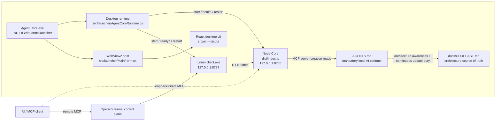
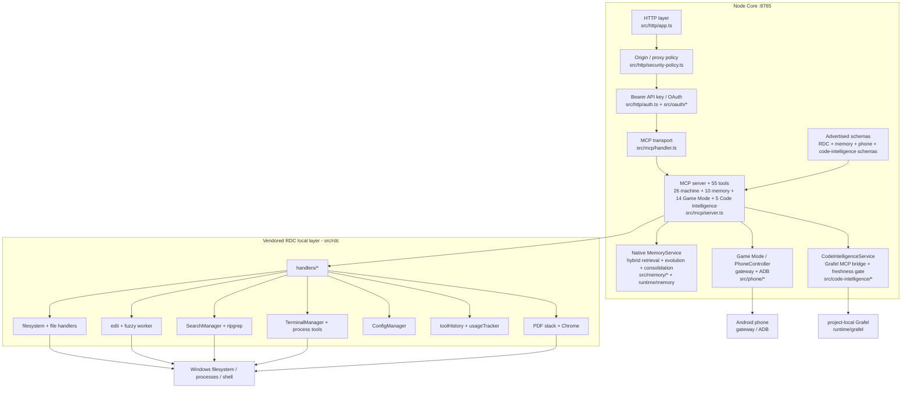
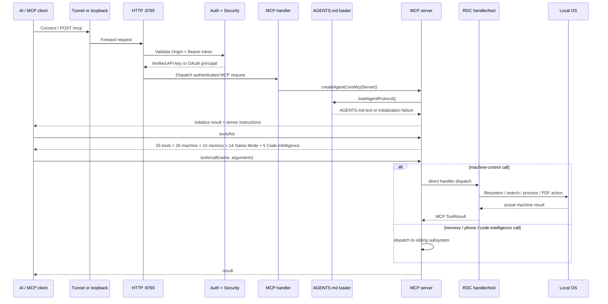
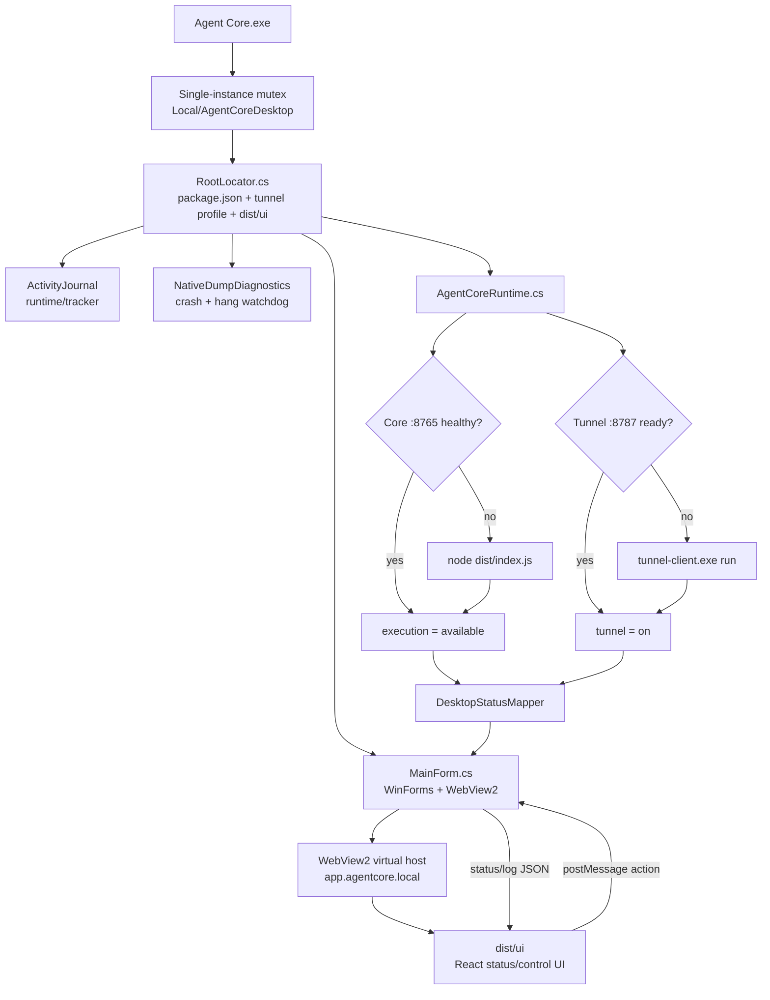
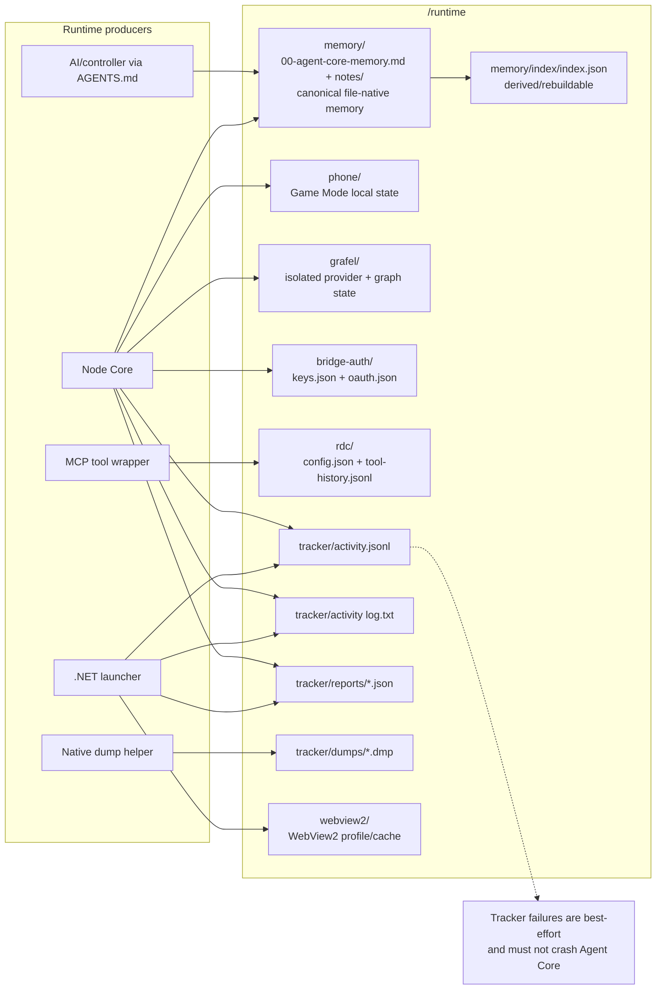
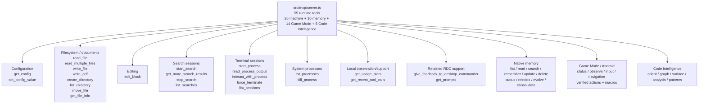

# Agent Core Codebase Map

> **Status:** Maintained architecture source of truth
> **Baseline grounded:** 2026-09-16
> **Project root:** `<PROJECT_ROOT>`
> **Product version:** `0.11.0`
> **Primary runtime model:** local authenticated Agent Core MCP bridge with an internal vendored RDC-derived machine-control layer
> **Current mapping refresh:** 2026-09-20

## 0. Current system snapshot — 2026-09-20

> **Scope of this section:** descriptive mapping only. It records what is active now; it does not define upgrade priorities, roadmap items, or recommendations.

### 0.1 Live runtime truth

Observed from the running system during this mapping refresh:

| Surface | Current state |
| --- | --- |
| Product release/source version | `0.12.0` — stable release applied locally from 11 archived intents; no pending release intents remain |
| Native launcher metadata | Current root `Agent Core.exe` remains the pre-restart 0.11.0 launcher; packaged v0.12.0 launcher is `FileVersion 0.12.0.0`, `ProductVersion 0.12.0`, SHA-256 `5be78ce367840938b8e517cdae3b462269e0b5b1ce677dfd2e458b72e38885ac` |
| Live Node core | `0.11.0`, project-local runtime on `:8765`; `/health` reports `status=ok`. Source/release packaging is now `0.12.0`, but the running Node process was intentionally not restarted during packaging. |
| Release intent/version integrity | Stable/source version is now `0.12.0`. `release:apply` consumed and archived all 11 approved intents (8 minor + 3 patch); `release:plan` now reports `Pending: 0`. `release:compat` remains 62→62 tools with no tool/route removals or breaking evidence. The synthetic `refs/agent-core/current-line-baseline` was intentionally **not** refreshed during packaging, so `release:check-intent` currently reports release-relevant deltas without a new pending intent relative to the older baseline; refresh that ref only when explicitly starting the next development-line baseline. No commit, tag, push, publish, deploy, or restart was performed. |
| Local release archive | `release\\v0.12.0\\Agent-Core-v0.12.0.zip` + release notes/manifest/SHA256; final ZIP 214,410,695 bytes / 19,350 entries / SHA-256 `9eaf5cacdaa689d0c8558779e9a90e6b8efd0d6e86f9608447d7f8eaff2411fe`; packaged launcher SHA-256 `5be78ce367840938b8e517cdae3b462269e0b5b1ce677dfd2e458b72e38885ac`, FileVersion `0.12.0.0`, ProductVersion `0.12.0`. Prior `v0.11.0`, `v0.10.0`, `v0.9.0`, and `v0.8.1` archives remain immutable. |
| Desktop host | `<PROJECT_ROOT>\Agent Core.exe` |
| Node core | project-local `runtime\node\node.exe` running `dist\index.js` |
| Local HTTP/MCP | `127.0.0.1:8765` |
| Tunnel readiness/admin | `127.0.0.1:8787` via `tunnel-client\tunnel-client.exe` |
| `/health` | `status: ok` |
| Execution | `available`, mode `rdc-direct` |
| MCP surface | 62 server-side tools = 26 machine-control + 11 memory + 14 Game Mode + 7 Grafel Code Intelligence + 1 Learning + 1 Hermes A2A Partner + 2 Semantic IDE/LSP tools |
| Game Mode / phone | configured as a sibling capability; device availability is transport/runtime dependent |
| Code Intelligence | Existing Grafel integration remains backed by the qualified Agent Core-owned provider `v0.3.3-50-g45f9745d0-agentcore` from commit `45f9745d0...`. Final re-grounded G20–G25 boundary hardening is **COMPLETE — IMPLEMENTED — LIVE-ACTIVATED — TARGETED VERIFIED — REFERENCE RETIRED**: stale workspace retirement/pruning, explicit `/Audit/` reference-tree exclusion from the current-line graph, MCP schema+manifest contract guards, provider `wire_version` compatibility, typed canonical query/discriminator parity, and bounded graph-touch evidence in the existing Activity Tracker. Targeted suite is 5 files / 21 tests PASS; `release:compat` is 62→62 with no breaking evidence and manifest budget 104,867 bytes/~26,217 tokens. Post-restart live acceptance reports Code Intelligence `available/current`, `providerWireVersion=0.1.0`, `providerWireCompatible=true`, and `issueCount=0`; typed substring find and analysisPreset routing are live, and Tracker records real touched entity IDs. External MCP clients initialized against an older manifest may still need their own reinitialize/reconnect for additive enum values. |
| Learning | live 0.11.0 health `available`, enabled, issueCount `0`; Memory + Grafel Pattern sinks are active under the current adapter/runtime |
| Hermes A2A Partner | **available** after 2026-09-20 stability repair, provider `hermes` v0.21.3 over `loopback-runs-api`, live loopback port `18642`, issueCount `0`. Functional acceptance remains **24 / 24 PASS**; fresh post-repair A2A acceptance on the restored v0.21.3 source completed alignment, approval and delegated execution successfully, with the final run reaching terminal `completed`. Source discovery preserves explicit `AGENT_CORE_HERMES_SOURCE_ROOT`; otherwise it prefers the sibling `..\hermes-agent` tree when it contains `gateway\platforms\api_server.py`, then falls back to `<HERMES_HOME>\hermes-agent`. Filesystem corruption had made all 40 tracked files under `gateway\platforms` and all 30 tracked files under `cron` unreadable/deleted from Git's perspective; both directories were quarantined and restored exactly from local Git HEAD, and a direct `APIServerAdapter` import probe passed. Current Node Core PID `11172` reports `/health=ok`. `docs\Hermes-A2A-Partner-Bridge-Plan.md` remains COMPLETE for approved scope. |
| Semantic IDE / LSP | The full previously selected Serena/SolidLSP Semantic IDE scope remains **COMPLETE — VERIFIED** in Agent Core-owned `src\\semantic-ide`: freshness, multi-language provider registry/adapters, process-tree lifecycle, protocol/transaction hardening, overload/info/location/diagnostic precision, external loopback TCP, multi-root, hot reload, type hierarchy, diagnostics delta, version compatibility, and hardened provider environments. Historical final verification reached **14 files / 66 tests PASS** plus real TypeScript `semantic:smoke` PASS. A 2026-09-20 source-first re-grounding of `Audit\\Serena` found two residual gaps and the user approved both. `S3-P1` verified project-local provider provisioning/repair is now implemented with explicit confirmation, pinned recipes, host/redirect validation, bounded streaming, SHA-256, archive traversal/symlink/collision/expansion guards, staged atomic promotion, integrity manifests, repair semantics, and managed-provider health. `S3-P2` is implemented as a project-local external MCP acceptance harness under `scripts\\verify`, not a runtime subsystem. Targeted S3 verification is 3 files / 10 tests PASS; root TypeScript build passes; real Python/C#/PowerShell provider trees validate idempotently; `release:compat` remains 62→62 with no breaking evidence. Post-restart live `/health` reports Semantic IDE `available`, issueCount `0`, and TypeScript 6.0.0 / C# 5.5.0 / PowerShell 7.6.6 / Python 1.1.403 all compatible. A fresh authenticated external MCP client observed 62 tools and the live `code_symbol` schema contains `provision_provider`, `providerId`, `repair`, and `confirmation`; live Python provision readback returned `changed=false`, `alreadyValid=true`, `repaired=false`. Final active dependency/marker/registry census was zero-value and `Audit\Serena` was deleted. |
| Controller exposure | server-side MCP registration is **62 tools** and includes exactly `code_symbol` + `code_refactor`; an already-open external MCP client initialized before this cutover may keep a cached pre-Semantic tool manifest until it reconnects/reinitializes |
| Grafel provider | qualified project-local `v0.3.3-50-g45f9745d0-agentcore` binary under `runtime\grafel\bin`; SHA-256 `7CEB82CA002628DDBFEAAC56A6C136924014A840DEA3046AFB99C9BC9D8540C8`; rollback v0.3.3 retained under `runtime\backups\20260919-1620-grafel-post-v033` |
| Memory | `available`, file-native canonical store |
| Memory canonical store | `available` |
| Memory index | `available` |
| Memory embedding | `available` |
| Memory intelligence | `available` |
| Memory issues | `0` |
| Embedding provider/model | Cloudflare Workers AI / `@cf/google/embeddinggemma-300m` |
| Embedding dimensions | `768` |

The listener identity was verified during this refresh: port `8765` belongs to the project-local Node runtime executing `<PROJECT_ROOT>\dist\index.js`; port `8787` belongs to the project tunnel client.

### 0.2 Active runtime topology

```text
AI / MCP client
    |
    | loopback or authenticated remote MCP
    v
optional tunnel-client.exe (:8787 readiness/admin)
    |
    v
Node core (:8765) — dist/index.js
    |
    +-- GET /health
    +-- OAuth discovery / authorization / token flow
    +-- POST /mcp
            |
            +-- mandatory AGENTS.md instructions
            |
            +-- 26 machine-control tools -> src/rdc -> local Windows machine
            |
            +-- 11 memory tools -> src/memory -> runtime/memory
            |
            +-- 1 Learning tool -> src/learning -> runtime/learning scheduling state
            |       +-- verified generic knowledge -> existing MemoryService
            |       +-- verified code recipes -> existing Grafel Patterns
            |
            +-- 1 Partner tool -> src/partner -> owned loopback Hermes APIServerAdapter child
            |       +-- alignment/discussion -> explicit lead approval
            |       +-- async delegate/collect/steer/approval/stop
            |
            +-- 14 Game Mode tools -> src/phone -> Android phone via gateway/ADB
            |
            +-- 7 Code Intelligence tools -> src/code-intelligence -> isolated Grafel provider
```

Desktop lifecycle is owned separately by `Agent Core.exe`, which starts/monitors the Node core and tunnel, hosts the React UI through WebView2, and shares the persistent activity journal.

### 0.3 Active source ownership map

| Area | Active source | Runtime/output ownership |
| --- | --- | --- |
| Process bootstrap + service lifecycle | `src\index.ts`, `src\config.ts` | `dist\index.js`, project-local Node |
| HTTP/auth/security | `src\http`, `src\auth` | listener `:8765`, `runtime\bridge-auth` |
| OAuth | `src\oauth` | `runtime\bridge-auth\oauth.json` and related durable state |
| MCP transport/registration | `src\mcp` | authenticated `/mcp`, 62 registered server-side tools when Memory/Learning/Hermes Partner/Game Mode/Code Intelligence/Semantic IDE are enabled |
| Machine control | `src\rdc` | `runtime\rdc` + local Windows operations |
| Native memory | `src\memory` | `runtime\memory`; transactional `memory_batch` journal lives under `runtime\memory\state\transactions` |
| Self-learning | `src\learning`, `src\mcp\learning-*` | `runtime\learning\state.json` contains checkpoint/curator scheduling metadata only; learned content routes to existing Memory/Grafel authorities |
| Hermes A2A Partner | `src\partner`, `src\mcp\partner-*` | `runtime\partner\hermes` bootstrap/runtime only; ephemeral API key stays in process memory; Hermes durable/session authority remains under `<HERMES_HOME>` |
| Game Mode / phone control | `src\phone`, `src\mcp\phone-*` | `runtime\phone` + gateway/ADB transport state |
| Code Intelligence | `src\code-intelligence`, `src\mcp\code-intelligence-*` | isolated `runtime\grafel` provider/runtime state |
| Reflexion safeguards | `AGENTS.md`, `src\failure-evidence.ts`, `src\mcp\failure-loop-advisor.ts`, `src\rdc\utils\toolHistory.ts`, `tests\reflexion-contract.test.ts`, `tests\failure-loop-advisor.test.ts`, `tests\reflexion-second-wave.test.ts` | controller contract + bounded exact/same-family advisory state + compact redacted failure-evidence history; no separate persistent store |
| Activity/failure tracking | `src\tracker`, `src\launcher\ActivityJournal.cs` | `runtime\tracker` |
| Secret redaction for evidence/history | `src\security\redaction.ts` | applied before tool-history/tracker persistence and during startup scrub |
| Native desktop lifecycle | `src\launcher` | `Agent Core.exe` |
| Desktop UI | `src\ui` | `dist\ui`, hosted by WebView2 |
| Tunnel | `tunnel-client` + launcher orchestration | local readiness/admin `:8787`, forwards to core `:8765` |
| Release intent + version integrity | `.changeset`, `scripts\release`, `src\version.ts` | development/release metadata + deterministic product-version synchronization; no runtime gate |
| Tests | root `tests`, `src\launcher.tests`, `src\ui` tests | verification only; not runtime dependencies |

The active architecture is deliberately compact: Node HTTP/MCP core, vendored machine-control layer, native memory, controller-reviewed self-learning, Game Mode phone control, Grafel-backed Code Intelligence, OAuth/auth, tracker, desktop launcher/UI, and tunnel. Learning is a sibling state/coordinator service and never an execution or memory gate. Removed historical router/workflow/execution-fabric modules are not part of the current runtime.

### 0.4 Runtime and persistent-state map

```text
<PROJECT_ROOT>\
  Agent Core.exe                 native desktop host
  dist\                          compiled Node + UI artifacts
  runtime\
    node\                        project-local Node runtime
    bridge-auth\                 Agent Core API-key/OAuth persistence
    memory\                      canonical memory + derived semantic index + transactional journal state
    learning\                    checkpoint/review/curator scheduling metadata only; no learned-content store
    phone\                       Game Mode named-action/state data when used
    grafel\                      isolated Code Intelligence provider binary/home/daemon/index state
    rdc\                         Agent Core machine-control config/history/cache
    tracker\                     shared activity journal + failure reports
    webview2\                    desktop WebView2 profile/state
    tmp\                         project-local transient working files
    home\                        isolated child-process HOME/AppData
    npm-cache\ / npm-prefix\     isolated npm state
    playwright\                  project-local browser state
    backups\                     scoped implementation/document backups
  tunnel-client\                 tunnel executable + profile
```

Canonical authority depends on subsystem: memory authority is `runtime\memory` Markdown; auth/OAuth authority is `runtime\bridge-auth`; machine-control configuration authority is `runtime\rdc`; tracker journals are operational evidence, not configuration authority.

### 0.5 Current memory map

```text
AI/controller
    |
    | controller-supplied semantic metadata when confident
    v
memory_remember / memory_update
    |
    +-- provider-independent deterministic fallback metadata
    |
    v
canonical Markdown — runtime\memory
    |
    +-- semantic document = content + context + keywords + tags + category
    v
EmbeddingGemma via Cloudflare Workers AI
    |
    +-- rebuildable vector index
    +-- hybrid lexical/metadata/semantic retrieval
    +-- optional explicit source-file ranking context
    +-- nearest-neighbor discovery
    +-- bounded reciprocal `related` links
    +-- advisory Git/file provenance staleness on anchored memories
    +-- bounded subordinate prior-content revision snapshots
    +-- conservative evolution
    +-- proposal-only consolidation
```

Current live memory includes the pinned foundational record, durable integration-strategy records, and verified reusable operational reflections when they are explicitly promoted. Exact note count remains runtime-derived. MemoryService now also supports optional bounded source provenance, read-only Git/file staleness evidence, bounded subordinate prior-content revisions committed with the same memory transaction authority, and explicit source-file context as a transparent retrieval component. Canonical Markdown remains the sole memory authority. A-MEM/Reflexion/Claude-Mem-derived behavior is implemented through the existing TypeScript MemoryService plus controller contract; there is no Python/SQLite/NetworkX/MiniLM/second-LLM memory runtime.

### 0.6 System boundaries and reference-only material

- `src\rdc` is **internal Agent Core machine control**. External Remote Desktop Commander remains a separate operator tool and lifecycle.
- `SubProject\*` projects are separate codebases/products unless an explicit integration says otherwise; they are not implicitly part of the Agent Core runtime.
- `<PROJECT_ROOT>\Audit` currently contains forensic/read-only re-clones for Serena and Anthropic SDK Python. The re-cloned Grafel reference was deleted on 2026-09-20 after G20–G25 implementation, targeted verification, clean dependency scan, and final zero-value census. Audit checkouts are evidence only and are not runtime dependencies, package authorities, or replacement implementation sources.
- `<PROJECT_ROOT>\DO NOT TOUCH WITHOUT INSTRUCTION EXPLICIT` remains protected and outside normal grounding.
- A-MEM revision `f303dfc71e07bdc787f4bc135d4cea328ae30e99` was re-cloned under `<PROJECT_ROOT>\Audit\A-MEM`, exhaustively re-grounded from source/tests/history, and yielded exactly two remaining selected mechanisms: non-mutating evolution preview plus proposal-only neighbor metadata review. Both are implemented through the existing `memory_evolve`/MemoryService boundary and targeted-verified without adding a model/runtime/store. Live activation was proven after the launcher restart by the new Node Core listener loading rebuilt `dist\index.js`, healthy `/health`, and a direct live MCP `memory_evolve(mode=preview, neighborLimit=3)` call returning `mode=preview`, `applied=false`, and bounded neighbor evidence. A final zero-value census found no additional unique mechanism and no active Agent Core source/runtime dependency on the checkout, so `<PROJECT_ROOT>\Audit\A-MEM` was deleted as a corpse on 2026-09-20. `docs\A-MEM-Integration-Plan.md` retains provenance and the complete accept/reject census.
- Reflexion revision `218cf0ef1df84b05ce379dd4a8e47f17766733a0` was re-cloned under `<PROJECT_ROOT>\Audit\Reflexion`, exhaustively re-grounded across all 55 Python files / 293 parsed function-class definitions / four experiment families, and retired after the two remaining second-wave mechanisms were implemented and targeted-verified. Agent Core now preserves the original exact-repeat `FailureLoopAdvisor` and adds a broader advisory-only same-tool/same-failure-family stagnation streak across changed arguments; success/family change/TTL reset it and it never blocks/retries/routes execution. `src\failure-evidence.ts` provides shared redacted failure-family normalization and bounded evidence excerpts. Tool History captures a compact redacted failure capsule before oversized raw output is capped; `get_recent_tool_calls(compact=true, failuresOnly=true)` returns bounded diagnostic evidence while default/full history keeps its previous response shape. `AGENTS.md` keeps semantic reflection controller-side over inspectable evidence + MemoryService. Targeted verification passed 3 files / 18 tests after live acceptance exposed and then closed volatile-path normalization for coded failures; root build passed, compiled smoke accepted the additive history schema, and `release:compat` stayed 62→62. The rebuilt Node Core was live-activated as PID 18776 at 2026-09-20T14:46:49+07:00 with `/health=ok`, Memory available, and Execution available. Final live acceptance issued three ENOENT `read_file` failures with different absolute paths: calls 1–2 remained ordinary failures and call 3 emitted the new `scope=failure-family` no-progress advisory, proving argument variation no longer evades stagnation detection. Minor intent `.changeset/20260920073613-21747a.md` is pending toward 0.12.0. The Audit checkout was deleted after final zero-value/dependency census; `docs\Reflexion-Integration-Plan.md` retains provenance. The 2026-09-20 reconnect investigation exposed a real public/private schema drift for `get_recent_tool_calls`: internal parser/handler already accepted `compact`/`failuresOnly`, while `src\mcp\rdc-schemas.ts` omitted them. Grafel-derived G21 is now implemented in current source/rebuilt `dist`: the public schema includes both optional parameters and an AST-derived contract regression compares RDC server registrations with handler parser schemas. Post-restart live acceptance proved the corrected `get_recent_tool_calls` public schema/handler path is active (`compact=true`, `failuresOnly=true` returns compact failure evidence). External clients that cached an older MCP manifest may still need their own reinitialize/reconnect for additive schema fields/enums.
- The former protected `grafel` checkout was retired on 2026-09-19 after the then-selected post-v0.3.3 scope completed. Active provider `v0.3.3-50-g45f9745d0-agentcore` remains built from MIT commit `45f9745d02f3662a8516fb35cd2d0624acf82cbf`, SHA-256 `7CEB82CA002628DDBFEAAC56A6C136924014A840DEA3046AFB99C9BC9D8540C8`; previous official v0.3.3 remains a scoped rollback artifact. On 2026-09-20 that exact source revision was re-cloned to `<PROJECT_ROOT>\Audit\Grafel`, exhaustively re-grounded source-first (8,505 tracked files / 5,301 Go / 3,047 Go tests / 71 of 71 `internal/*` families), and yielded G20–G25. All six were approved, implemented, and targeted-verified. Live/provider-side evidence includes exact removal of the three stale forensic workspace registrations, direct `wire_version=0.1.0`, typed substring find + corpus stats smoke, and Activity Tracker graph-touch evidence. Release intent `.changeset/20260920085541-e0820f.md` records the minor change toward 0.12.0; `release:check-intent` is healthy and no `release:apply` was performed. Final dependency scans found zero `Audit\\Grafel` dependency in active `src`, `tests`, or `scripts`; the checkout was Git-clean at `45f9745d...` and deleted as a corpse. `docs\Grafel-Post-v0.3.3-Exhaustive-Steal-Use-Plan.md` retains the completed selection/verification/retirement evidence. Primary Node activation is now complete: post-restart `/health` reports Grafel Code Intelligence available/current with wire 0.1.0 compatible and issueCount 0; direct live facade calls confirmed typed substring search, analysisPreset validation, and Activity Tracker touched-entity evidence.
- The historical protected `serena` checkout at commit `2a6deef83861d61f839ab4b94f1fc323b2fe8edf` was retired after the previously selected Semantic IDE second-wave scope reached COMPLETE and its then-current zero-value census closed. For corruption-recovery forensics, the **same exact revision** was re-cloned under `<PROJECT_ROOT>\Audit\Serena` and re-grounded source-first on 2026-09-20 across source, tests, Git history, and a request-scoped Grafel graph. The implemented Agent Core-owned `src\semantic-ide` baseline remains authoritative and intact. The new census found exactly two proposal-only residual opportunities: `S3-P1` verified project-local language-server provisioning/repair (MIT SolidLSP evidence, reopened because Anthropic-derived Agent Core I/O/security primitives now make a narrow native design viable) and optional `S3-P2` external MCP client acceptance harness (clean-room behavior only). Neither is implemented or installed by this re-grounding. `Audit\Serena` is intentionally retained pending user proposal selection and is not a runtime dependency; delete it only after all remaining dispositions close and a final zero-value/dependency census passes. Public Semantic IDE exposure remains `code_symbol` + `code_refactor`; Grafel remains sibling structural intelligence and exact source remains final authority. The existing Serena release intent is `.changeset/20260920013812-8142dc.md`; no release apply has been performed.
- Changesets revision `c9269c01af5f3f7463adc648890fc3a8a729dd18` was re-cloned under `<PROJECT_ROOT>\Audit\Changesets`, exhaustively re-grounded, and then retired/deleted after all remaining selected mechanisms were implemented and a final zero-value census covered all 21 packages / 87 non-test package source files. Agent Core-owned release tooling now includes the original release-intent/version-integrity first wave plus a shared `changedFilePatterns` release-relevance policy, metadata-safe fail-closed intent discovery, non-consuming snapshot planning/packaging under `release\snapshots`, and explicit prerelease channel state with isolated prerelease packaging. Stable `release:apply` remains blocked while prerelease mode is active; stable apply/archive semantics remain separately authorized. Only `@changesets/parse` remains a direct Changesets package dependency. The second-wave implementation added minor intent `.changeset/20260920070130-c8f093.md`; stable remains 0.11.0 and the read-only plan now targets 0.12.0 with six pending minor intents after the Reflexion second-wave intent `.changeset/20260920073613-21747a.md` and Grafel G20–G25 intent `.changeset/20260920085541-e0820f.md` were added. No automatic Git commit/tag/push/fetch, registry publish, deployment, restart, daemon, or MCP release gate was introduced. A scoped Sysinternals Handle binary under `runtime\tools\sysinternals-handle` was used only to diagnose a transient Windows directory-handle lock during reference retirement and is not an Agent Core runtime dependency.
- The protected `memory\anthropic-sdk-python` checkout was grounded at commit `7e5ca5c94126a6d7de159a169ff43eb9b1cac57f` (v1.6.0, MIT). The approved current-fit hardening is now **IMPLEMENTED - LIVE-ACTIVATED - TARGETED VERIFIED** as Agent Core-owned TypeScript: safe/idempotent retry policy with Retry-After, bounded response/file/PDF I/O, HTTPS-or-loopback credential endpoints, owned-child secret isolation, sensitive-file validation, atomic credential persistence, correlation-safe diagnostics, expanded redaction, and read-only `release:compat`. Targeted evidence is 13/13 Anthropic third-wave tests + 2/2 atomic-owned-file + 3/3 OAuth atomic-exchange, with build PASS and `release:compat` 62→62/no breaking evidence. No Anthropic Python runtime/model/provider or second execution framework was introduced. Conditional credential-cache/lease-worker/external-memory-sync families remain dormant without real consumers, so the reference is retained.
- 2026-09-20 Anthropic fourth-wave implementation: PY4-P1 is **COMPLETE - IMPLEMENTED - TARGETED VERIFIED - LIVE-ACTIVATED** as Agent Core-owned TypeScript. Sensitive Key/OAuth reads and RDC no-follow config reads bind pre-open, opened-handle, and post-open file identity; Windows comparison uses exact BigInt `dev/ino` because observed NTFS inode values exceed JavaScript safe-integer range. RDC config persistence uses `writeOwnedFileAtomic` under the existing cross-process config lock. Live readback after rebuild shows Node Core PID 18268 created 2026-09-20 19:39:16 +07:00 running `dist\index.js`, `/health=status=ok`, and compiled `dist` contains the BigInt identity-bound file-read implementation. Conditional expiring-token cache, credential/OIDC, lease-worker, and external-memory-sync families remain dormant without real consumers. No Python runtime/dependency was added.
- The protected `memory\anthropic-sdk-typescript` checkout was grounded source-first at commit `d10318284eece2f612d2758a6d5935fe32dc6f7d` (`@anthropic-ai/sdk` 0.126.0, MIT). Prior TS3 remains complete/live. Approved TS4-P1/P2/P3/P4 is now **COMPLETE - IMPLEMENTED - TARGETED VERIFIED - LIVE-ACTIVATED**: all internal Grafel/Learning/Phone JSON-result consumers converge on the structural text-first/`structuredContent` decoder; Phone parses complete LF/CRLF/CR SSE event frames and multi-line `data:` payloads; shared outbound policy distinguishes caller abort from retryable timeout/network failure, makes backoff abort-aware, cancels discarded retry bodies, and bounded-response cancels readers on failure; sensitive/config reads use BigInt identity-bound handles and config persistence uses the existing atomic writer/lock. Fourth-wave suite is 18/18 PASS; final Key/OAuth/RDC affected suites are 4/4 + 3/3 + 5/5 PASS; targeted bridge config/file path PASS; `release:compat` remains 62→62/no breaking evidence. Live readback after rebuild shows Node Core PID 18268 created 2026-09-20 19:39:16 +07:00, `/health=status=ok`, and compiled `dist` contains TS4-P1/P2/P3/P4. Patch intent `.changeset/20260920122716-874f7f.md` records this wave. No Anthropic TypeScript runtime/model/provider/dependency was installed; conditional TokenCache/OIDC/lease-worker/external-memory-sync families remain dormant.
- The former protected `memory\claude_mem` checkout was grounded at revision `da135e36010e888e8e97bcc43edac10aa0e3b383` and retired after final zero-value/dependency census. Approved CM-P1/P2/P3 is now **COMPLETE - IMPLEMENTED - TARGETED VERIFIED - LIVE-ACTIVATED** as Agent Core-owned TypeScript: optional bounded workspace/repo/file/commit provenance with fail-soft local Git capture; advisory `current|changed|source-unavailable|unanchored` staleness on `memory_read`; bounded prior full-record revision snapshots under subordinate memory state committed in the same `MemoryTransactionCoordinator` transaction as content mutations; and optional `memory_search.sourceFiles` ranking boost exposed through `components.sourceFileMatch`. Targeted verification is 7/7 Claude-Mem adoption tests + 27/27 affected existing memory/manifest tests; root build passes; `release:compat` is 62→62/no breaking evidence. Minor intent `.changeset/20260920131504-f2cb0a.md` records the capability. The Python MCP server, SQLite canonical store, MiniLM embeddings, NetworkX graph, regex source indexer, LRU cache, and per-project parallel memory databases were not installed. CM-C1 is closed by the existing Learning review boundary: unverified learning candidates remain proposals and only verified candidates reach durable sinks. Final zero-value/dependency census passed; the pinned `claude_mem` checkout was clean and is retired/deleted as a corpse. `docs\Claude-Mem-Steal-Use-Integration-Plan.md` remains the provenance/audit record.
- The protected `memory\awesome-ai-memory` checkout at `fa13101cdccdf88070a7a5114a874dafb484a135` had no executable AI-memory engine; its only executable project code was repository-statistics telemetry. Active Agent Core source/tests/scripts had zero dependency on it. `docs\Awesome-AI-Memory-Steal-Use-Plan.md` records the zero-value census, and the checkout was deleted as a corpse under explicit user authorization.
- `docs\Hermes-Self-Learning-Memory-Steal-Use-Plan.md` is **COMPLETE — VERIFIED FOR APPROVED SCOPE**. The Hermes-adapted mechanisms are implemented natively through `src\learning`, `memory_batch`, existing MemoryService, Activity Tracker, Reflexion controller behavior, and Grafel Patterns; no Python Hermes runtime, hidden second agent/model, or parallel canonical memory store was introduced. Final external acceptance reached 40 / 40 PASS.
- Root `.env` and `secrets` may supply runtime configuration/credentials but their contents are excluded from architecture documentation.

### 0.7 Repository-state mapping

The current filesystem/runtime is substantially ahead of Git HEAD `5dc20d6`. The working tree contains extensive modified, deleted, and untracked files from the ongoing architecture transition.

On 2026-09-20 the user explicitly reversed the prior legacy-only boundary for `https://github.com/Black-Project-Agent-Core/Agent-Core` and designated that repository's `main` branch as a **remote recovery mirror of the current local Agent Core line**. The local filesystem remains the source of truth: remote history must not be pulled/merged/rebased into the local project to reconcile differences. Remote replacement is performed from the current local snapshot, with credentials, private runtime state, protected reference checkouts, browser profiles, corruption backups, and generated temp/build debris excluded by the Git backup boundary. The immutable v0.12.0 release ZIP is stored separately as a GitHub Release asset because it exceeds GitHub's ordinary Git file-size limit.

Therefore:

- **current local source files + maintained architecture map** are authoritative for what is pushed to the recovery repository;
- remote `main` is a backup/mirror target, not an upstream source to merge into the local project;
- deleted historical router/workflow/execution/memory files from the old remote lineage are intentionally replaced by the current local state;
- active current modules under `src\memory`, `src\launcher`, `src\rdc`, `src\tracker`, `src\ui`, Semantic IDE, Code Intelligence, Learning, and Partner are included when not excluded by the explicit private/generated backup boundary.

This repository-state mapping records the user-authorized current recovery strategy; it does not authorize unrelated remote publication, deployment, or package-registry operations.

GitHub presentation/community surfaces for the current recovery repository are now maintained in-repo: root `README.md` documents the stable v0.12.0 architecture, 62-tool public surface, install/recovery paths, and Git backup boundary; `CONTRIBUTING.md`, `SUPPORT.md`, `CODE_OF_CONDUCT.md`, `.github/CODEOWNERS`, issue forms, and the pull-request template define repository collaboration and safety expectations. Root `SECURITY.md` additionally records current supported-version and private vulnerability-reporting guidance. These files are documentation/repository-operability surfaces only and do not change Agent Core runtime behavior.

### 0.8 Mapping contract

This snapshot is intentionally **not an upgrade queue**. Future upgrade selection belongs to the user. When a later implementation changes the active architecture, update this snapshot to describe the new observed state and keep detailed subsystem sections below synchronized.

Active forensic recovery planning is tracked separately in `docs\Agent-Core-Corruption-Recovery-Plan.md`. That file is **PLAN ONLY**: it records recovery authority, adoption census, and proposed recovery gates after the 2026-09-20 corruption audit; none of its recovery actions are implemented merely because the plan exists.

### 0.9 Release intent and product-version integrity

Agent Core now has a lightweight Changesets-compatible release layer for development/release metadata. It is deliberately outside the normal MCP execution path.

Implemented source/state:

```text
.changeset/
  config.json
  README.md
  <pending-intent>.md

scripts/release/
  create-intent.mjs
  release-lib.mjs
  release-plan.mjs
  sync-version.mjs
  apply-release.mjs
  current-line-baseline.mjs
  check-release-intent.mjs
  package-release.mjs

src/version.ts
CHANGELOG.md
```

Only `@changesets/parse` is installed directly. Agent Core reuses the Changesets Markdown/frontmatter contract and parsing semantics but keeps release aggregation/version synchronization in small Agent Core-owned adapters. The full Changesets CLI/publishing stack is not integrated.

Product version authority:

```text
package.json::version
        |
        +--> package-lock.json root version
        +--> src/version.ts / AGENT_CORE_VERSION
        +--> MCP SERVER_VERSION
        +--> Code Intelligence MCP client identity
        +--> src/ui/package.json + package-lock.json
        +--> src/launcher/AgentCore.Launcher.csproj
        +--> built Agent Core.exe metadata
```

`src\rdc\version.ts` is explicitly excluded because it is the vendored machine-control compatibility-layer version, not the Agent Core product version.

Public package scripts:

- `release:intent` — create one pending `agent-core` patch/minor/major intent;
- `release:plan` — read-only current/pending/next-version view;
- `release:sync-version` — synchronize product-version surfaces to root `package.json`;
- `release:apply` — explicit local release mutation that updates versions/changelog and archives exactly the included pending intents under `.changeset\applied`;
- `release:baseline` — refresh the synthetic local `refs/agent-core/current-line-baseline` checkpoint using a temporary Git index without changing the real branch/index/worktree;
- `release:check-intent` — read-only comparison against that local baseline; a release-relevant source delta without a new pending intent relative to the baseline exits non-zero;
- `release:package` — builds Node/UI/native launcher, creates an allowlist-based runnable version ZIP, release notes, manifest, and SHA-256 under `release\\v<version>\\`; existing version ZIPs are immutable by default.

No release script commits the current branch, tags, pushes, publishes, deploys, restarts Agent Core, contacts the legacy remote, or changes MCP authorization.

Version `0.8.1` has been explicitly applied and archived. The four patch intents were consumed into the changelog and `.changeset\\applied`; `release:plan` now reports no pending intents.

Observed implementation evidence on 2026-09-18:

- Node TypeScript build completed with exit code 0;
- immediately before release, `release:plan` aggregated four real patch intents into `0.8.0 -> 0.8.1`; after apply it reports zero pending intents;
- running `release:sync-version` twice produced identical SHA-256 hashes for all six synchronized source/metadata files;
- an isolated fixture with patch + minor + major intents calculated `major`, applied `0.8.0 -> 1.0.0`, synchronized root/UI versions, preserved `src\rdc\version.ts`, generated a changelog, and archived all three intents;
- malformed release intent exited non-zero before package mutation;
- release v0.8.1 self-contained launcher reports `FileVersion 0.8.1.0` and `ProductVersion 0.8.1` with legacy Git SHA append disabled;
- the on-disk root `Agent Core.exe` was replaced from the verified v0.8.1 archive after backing up the old executable; the live Node core remained healthy and currently reports `0.8.0` until its next restart;
- `release\\v0.8.1\\Agent-Core-v0.8.1.zip` contains 19,010 entries, SHA-256 `9f5dc832e0c19e9fd929ef51bf3dc3b1a80b766a0307c7a14b00c836a631ed16`, all required runtime entries, and no forbidden credential/live-state paths in the targeted archive sweep;
- rerunning `release:package` for v0.8.1 is rejected by default, proving per-version archive immutability;
- the protected Changesets reference checkout remained clean.

Git-aware missing-intent enforcement is now **active** through the synthetic local ref `refs/agent-core/current-line-baseline`. The ref was created from the present current-line Agent Core release-relevant source using a temporary Git index, so the real branch/index/worktree remained untouched. `legacy/main` is explicitly ineligible as a comparison base. Targeted probe verification confirmed that a new source file without a new intent exits non-zero and the same delta with a new `.changeset/*.md` intent passes. Snapshot/prerelease channels remain deferred.

## 1. Purpose and maintenance contract

This file is the maintained architecture map for Agent Core. Every AI/controller operating Agent Core should know that this audited architecture source exists and what it represents. Reading it is not mandatory before every task; consult the relevant section when architecture context, subsystem ownership, topology, or uncertainty makes it useful. Full-repository grounding should not be repeated every session while this document remains current.

For a concrete task, inspect the exact source files needed for the requested change. Source code remains the final authority if it conflicts with this document. When a conflict is found, correct this document in the same task.

Update this document whenever a change affects architecture, runtime flow, public tool surface, ports/endpoints, authentication, storage/state paths, launcher behavior, tunnel behavior, tracker behavior, UI/native bridge behavior, build layout, generated artifacts, security boundaries, or test contracts. Document implemented state, not planned state.

### Explicit grounding exclusions

The baseline grounding intentionally did **not** inspect the contents of:

- `<PROJECT_ROOT>\DO NOT TOUCH WITHOUT INSTRUCTION EXPLICIT`
- `<PROJECT_ROOT>\.env`
- `<PROJECT_ROOT>\secrets`

These paths are outside normal architecture grounding unless the user explicitly instructs otherwise. `.env` may override defaults documented here; therefore environment-dependent values below are source defaults or redacted observed structure, never guessed secret values.

### Terminology and hard system boundary

To prevent future controller/tool confusion, this document uses these terms strictly:

- **Agent Core runtime** = `Agent Core.exe`, Node core on `:8765`, Agent Core tunnel integration, auth/OAuth, native memory, React/WebView2 UI, tracker, and Agent Core-owned build/test/health surfaces.
- **Agent Core machine-control layer** = the code under `src\rdc` and its Agent Core-owned state under `runtime\rdc`. This code is vendored/derived from Desktop Commander for compatibility, but it executes **inside Agent Core**. It is not the external Remote Desktop Commander device/service.
- **External Remote Desktop Commander (RDC)** = `Start-Desktop-Commander.bat`, `Apply-Desktop-Commander-Allowlist.ps1`, `Desktop-Commander-Allowlist.txt`, root `rdc\` external package/profile, `.desktop-commander` device/session state, remote Device IDs/channels, and `@wonderwhy-er/desktop-commander`. It is a separate operator tool with a separate lifecycle and health boundary.

External RDC status, Device ID/session/channel state, package version, allowlist/profile checks, `Start-Desktop-Commander.bat --check`, or external-RDC relocation tests **must never be used as Agent Core health, portability, or acceptance evidence**. Conversely, Agent Core health/test results do not prove external RDC health. The two systems may coexist in the same project directory for operator convenience, but their runtime state, verification, self-repair, and acceptance criteria remain separate unless an explicit integration is requested.

## 2. Executive architecture
Agent Core is currently a direct machine bridge, not the previous autonomous-agent framework.

```text
AI / MCP client
    |
    | authenticated MCP over tunnel or loopback
    v
Node HTTP server :8765
    |
    +-- GET /health                public health
    +-- OAuth discovery/endpoints
    +-- POST /mcp                  authenticated MCP
            |
            v
mandatory AGENTS.md bootstrap
            |
            v
MCP tools/list + tools/call
            |
            +-- 26 Agent Core machine-control tools (`src/rdc`, vendored RDC-derived) -> local Windows machine
            |
            +-- 10 explicit memory tools -> native MemoryService
            |                          |
            |                          +-- runtime/memory canonical notes
            |                          +-- hybrid lexical + semantic retrieval
            |                          +-- typed links + conservative evolution
            |                          +-- rebuildable derived vector index
            |                          +-- proposal-only consolidation
            |
            +-- 14 Game Mode tools -> PhoneController -> gateway/ADB -> Android phone
            |
            +-- 5 Code Intelligence tools -> CodeIntelligenceService
                                           -> project-local Grafel MCP bridge/daemon
                                           -> structural graph / impact / patterns
```

Remote access is a separate tunnel path:

```text
remote MCP client
    <-> operator control plane
    <-> tunnel-client.exe
    <-> http://127.0.0.1:8765/mcp
```

Desktop orchestration is a separate native application:

```text
Agent Core.exe (.NET 8 WinForms)
    |
    +-- starts/monitors Node core :8765
    +-- starts/monitors tunnel :8787
    +-- hosts React UI inside WebView2
    +-- shares the persistent Activity Journal
    +-- captures native crash/hang dumps
```

The active `src` tree contains no searched implementation identifiers for Supabase, `capability_route`, `routeContextId`, Graphify, or the old memory lifecycle.

## 3. Start-to-end runtime lifecycle

### 3.1 Desktop launcher startup

User-facing executable:

`<PROJECT_ROOT>\Agent Core.exe`

Source:

`src\launcher\`

`Program.cs` performs the normal desktop boot sequence:

1. Handles `--native-dump-helper` mode before normal UI startup.
2. Enforces one desktop instance with mutex `Local\AgentCoreDesktop`.
3. Resolves the Agent Core root with `RootLocator`.
4. Opens the persistent `ActivityJournal`.
5. Starts native crash/hang diagnostics.
6. Installs WinForms and AppDomain exception handlers.
7. Creates `AgentCoreRuntime` and `MainForm`.
8. Runs the WinForms message loop.

`RootLocator.cs` considers a directory an Agent Core root when all three markers exist:

- `package.json`
- `tunnel-client\agent-core.yaml`
- `dist\ui`

The current root launcher therefore does not depend on `SubProject\Agent-Code`.

### 3.2 Launcher orchestration

`src\launcher\AgentCoreRuntime.cs` owns desktop lifecycle control.

Fixed service ports used by the launcher:

- Agent Core HTTP/MCP: `127.0.0.1:8765`
- tunnel readiness/admin: `127.0.0.1:8787`

Core launch command:

```text
node dist\index.js
```

Node runtime behavior:

1. The launcher resolves the current project root dynamically.
2. `scripts\windows\Ensure-Agent-Core-LocalRuntime.ps1` health-checks `runtime\node\node.exe` against `package.json` `engines.node`.
3. Missing/broken/outdated Node is repaired from the official Node.js Windows ZIP with SHA-256 verification, entirely under the current project `runtime\` tree.
4. The launcher uses only that project-local Node for Agent Core; there is no fixed system-Node or PATH fallback.
5. Child-process temp, npm cache/prefix/userconfig, isolated home/AppData, Playwright, internal machine-control config, and Puppeteer-cache paths are derived from the resolved <PROJECT_ROOT> and remain under <PROJECT_ROOT>\runtime.
6. Windows autostart is generated from the current resolved <PROJECT_ROOT>\Agent Core.exe; an enabled entry that still points to an old project location is repaired when the launcher initializes.
7. WebView2 status polling and native UI diagnostics are armed before best-effort runtime initialization completes. A transient core/tunnel startup exception is logged and surfaced, but it no longer disables ongoing status polling; if the service becomes healthy moments later, the desktop indicators recover from live /health without restarting the desktop app.

Tunnel launch concept:

```text
tunnel-client\tunnel-client.exe run
  --profile-file tunnel-client\agent-core.yaml
  --harpoon.allow-plaintext-http
```

Both are launched hidden. Launcher readiness waits are approximately 12 seconds with polling around 200 ms, while the desktop status timer continues independently after a transient timeout. Restart/stop is identity-aware: the launcher refuses to kill an unrelated process merely because it occupies a managed port.

### 3.3 Node core startup

Entrypoint: `src\index.ts` -> `dist\index.js`.

Startup order:

1. Install process-level tracker hooks.
2. Load app config.
3. Record startup in tracker.
4. Ensure configured data directory exists.
5. Probe durable Agent Core machine-control config readiness (`runtime\rdc`, vendored RDC-derived implementation). Initialization/read failure is recorded as Execution unavailable; it is not replaced by permissive in-memory defaults.
6. Resolve the optional memory embedder from `memoryEmbedding` config; current implementation supports Cloudflare Workers AI.
7. Initialize the native file-backed MemoryService with the configured memory directory and optional embedder.
8. Validate canonical bootstrap/notes and ensure the rebuildable lexical/semantic memory index.
9. Record memory-service readiness in the Activity Tracker.
10. Trigger background Chrome availability for PDF generation only when initial Agent Core machine-control configuration readiness is available.
11. Construct the Game Mode `PhoneController`; phone readiness is live-probed through `/health` and phone tools register only when enabled.
12. Initialize `CodeIntelligenceService`: verify the project-local Grafel binary, ensure isolated runtime/home/config/daemon directories, self-heal the project registration when its path/group marker is missing or stale, start/reuse the Grafel daemon, confirm the required provider MCP tool family, and request an asynchronous index refresh when the graph is not current. Failure is fail-soft and does not block Agent Core startup.
13. Initialize `LearningService` fail-soft against the shared MemoryService and Code Intelligence service.
14. Construct `HermesPartnerService` immediately and schedule its owned Hermes runtime bootstrap in the background. Hermes/9Router startup is optional sibling work and must not delay the Agent Core HTTP listener.
15. Construct API key store.
16. Construct OAuth store.
17. Construct HTTP security policy.
18. Construct OAuth service.
19. Create HTTP server and MCP handler, passing the shared MemoryService, LearningService, HermesPartnerService, PhoneController, and CodeIntelligenceService to MCP server factories.
20. Listen on configured host/port.
21. Record listening state.

Source defaults from `src\config.ts`, unless overridden by process environment or excluded `.env`:

- host: `127.0.0.1`
- port: `8765`
- auth/OAuth data directory: `runtime\bridge-auth`
- memory directory: `runtime\memory` (override: `AGENT_CORE_MEMORY_DIR`)
- memory embedding provider: `cloudflare-workers-ai` only when account ID + API token + model are all configured
- memory embedding dimensions: `768` default, overridable with `CLOUDFLARE_EMBEDDING_DIMENSIONS`
- runtime callers that construct an older/manual config object without `memoryEmbedding` are treated as embedding-disabled instead of crashing startup; `loadConfig()` still returns the full current field
- MCP protocol mode: `dual`
- Game Mode / phone control: enabled by default, transport default `gateway`; phone-specific overrides are loaded by `src\phone\config.ts`
- Code Intelligence: enabled by default; runtime root `runtime\grafel`, provider binary `runtime\grafel\bin\grafel.exe`, group/repo slug `agent-core`, startup timeout 30s, call timeout 15s; all are overridable through the documented `AGENT_CORE_CODE_INTELLIGENCE_*` / `AGENT_CORE_GRAFEL_BINARY` environment variables
- Hermes Partner: enabled by default; Agent-Core-owned runtime state defaults to `runtime\partner\hermes`; Hermes home/source defaults are derived as sibling directories `<PROJECT_PARENT>\hermes` and `<PROJECT_PARENT>\hermes-agent` from the resolved current Agent Core root, with explicit `AGENT_CORE_HERMES_*` overrides when needed. No drive letter or machine-specific project path is compiled into the active source.

When normal process environment loading is used, `src\config.ts` attempts `process.loadEnvFile()` on the root `.env`. Credential values remain excluded from architecture documentation and must never be written into logs/docs.

### 3.4 Health truth model

`GET /health` is public. Current source reports direct execution plus native memory readiness. Memory health has this shape:

```json
{
  "status": "available | degraded | error",
  "mode": "file-native",
  "canonicalStore": "available | degraded | error",
  "noteCount": 1,
  "issueCount": 0,
  "index": "available | degraded | not-configured",
  "embedding": "available | degraded | not-configured",
  "intelligence": "available | degraded | not-configured",
  "embeddingProvider": "cloudflare-workers-ai",
  "embeddingModel": "<configured model>",
  "embeddingDimensions": 768
}
```

`/health` also reports Game Mode phone readiness and Code Intelligence readiness. Phone health carries enabled/mode/transport/device-online state. Code Intelligence health carries `status`, provider `grafel`, provider version when known, daemon availability, index freshness (`current | queued | indexing | dirty | unknown`), group, and issue diagnostics. Code Intelligence degradation is fail-soft: it does not make the top-level HTTP bridge unavailable and does not gate machine-control or memory tools.

The top-level bridge health remains `status: ok` when the HTTP server itself is running. Execution health is **not hardcoded**: every `/health` request reads `ConfigManager.health()`, which initializes/validates the Agent Core internal machine-control configuration and reads the persisted config back from disk. Healthy execution preserves `{ status: 'available', mode: 'rdc-direct' }`; when internal machine-control config readiness fails it reports `unavailable` plus issue diagnostics. Each `/health` request also calls `MemoryService.refreshHealth()`: canonical files are reloaded and the derived index is inspected read-only for missing, stale, or invalid state without calling the embedding provider. Post-start canonical corruption or a missing bootstrap therefore becomes `error`, while a missing/stale/invalid derived index degrades index/embedding/intelligence readiness without invalidating a healthy canonical Markdown store. Canonical-store health remains independent from optional embedding/index intelligence, and runtime query-embedding failure remains fail-soft.

## 4. Mandatory AI operating contract

Root contract: `AGENTS.md`
Loader: `src\mcp\agent-protocol.ts`
Integration: `src\mcp\server.ts`

Behavior:

1. Every MCP server instance calls `loadAgentProtocol()`.
2. The loader reads root `AGENTS.md` synchronously as UTF-8 and trims it.
3. Missing, unreadable, or empty content throws.
4. Content is passed as MCP `ServerOptions.instructions`.
5. MCP initialization therefore carries the local operating contract before normal tool use.
6. The contract contains the top-level directive: **ALWAYS VIEW YOUR MEMORY DIRECTORY BEFORE DOING ANYTHING ELSE.** The canonical directory is `<PROJECT_ROOT>\runtime\memory`; it contains the pinned foundational memory plus canonical note/index/state subdirectories. This remains an action requirement before other Agent Core work. A native MemoryService is now wired into startup and MCP, so memory health is no longer hard-coded `not-used`.
7. The contract requires every controller to know that `docs\CODEBASE.md` is the maintained architecture record produced from the full audit. It does not require opening this document mechanically before every task; it requires using it when architecture context is needed and updating the relevant section for every Agent Core change, small or large.
8. When native memory MCP tools are available, AGENTS.md prefers memory_list / memory_read for canonical memory access and selective recall; direct filesystem viewing remains the fallback/audit path.
9. Durable memory capture is controller-assisted: the connected AI is instructed to derive concise semantic `keywords`, factual `context`, non-redundant `tags`, and a meaningful `category` when confident and pass them in the same `memory_remember` call. Content-changing `memory_update` calls should refresh semantic metadata when old metadata would become stale. Missing/uncertain fields remain optional and fall back to MemoryService deterministic enrichment; Agent Core does not add a second internal LLM runtime/provider for this analysis.
10. Reflexion-style failure learning remains controller behavior rather than a second agent/runtime. It activates only on real failure evidence, explicit user correction, failed authorized verification, or repeated no-progress behavior. The controller must form a concise task-local `observed failure -> bounded diagnosis/hypothesis -> changed next action` reflection and must not blindly repeat an equivalent failed call.
11. Failure evidence is reused in priority order: direct current tool/error result first, bounded `get_recent_tool_calls` context when needed, and targeted Activity Tracker history/failure reports only when the smaller evidence sources are insufficient. No duplicate reflection log is introduced.
12. Recurrent failure may use bounded `memory_search` recall (normally 1-3 durable lessons). Task-local reflections are not persisted automatically. Only corrections that materially succeed, have supporting evidence, are reusable, and contain no secret/transient noise may be promoted through the existing memory tools, normally as category `operational-reflection`. Raw hidden/private reasoning and scratchpads are not canonical memory.
13. A bounded deterministic runtime sensor now complements the controller contract: `src\mcp\failure-loop-advisor.ts` fingerprints only repeated equivalent failures using sanitized canonical arguments plus a redacted normalized failure family. State is in-memory only (64 entries, 10-minute TTL), `origin` is ignored, polling/status tools are exempt, and success breaks the consecutive-failure streak. The first failure is silent, the second appends a sanitized `Reflexion advisory`, and the third-and-later append a stronger no-progress advisory. The detector observes results only after execution, never blocks or retries a tool, never writes canonical memory, and reuses Activity Tracker module `REFLEXION` for advisory events.
14. Reflexion contract drift is protected by `tests\reflexion-contract.test.ts`, which loads the real `AGENTS.md`, checks semantic behavior/architecture invariants, and includes an in-memory negative control proving removal of the blind-retry invariant is detected. `tests\failure-loop-advisor.test.ts` protects detector thresholds, reset/exemption/redaction/restart semantics, and error preservation.
15. Code Intelligence is an explicit controller protocol for non-trivial coding structure/impact work: use `code_orient`/`code_graph`/`code_surface` when graph evidence can replace broad manual discovery, use `code_analysis` only for targeted debt/security/test questions, inspect exact current source before edits, fall back to normal search/read when Grafel is stale or unavailable, and keep `code_patterns` for codebase-specific recipes rather than generic operational memory.
16. `AGENTS.md` is delivered during MCP initialize; an already-initialized remote/controller session does not retroactively receive later contract edits. After a contract change, reconnect/reinitialize is required for that controller to be guaranteed the new instructions. This is protocol activation semantics, not a second runtime or routing gate.

This is a local operating protocol only; it does not claim to modify model weights, provider policy, or higher-priority system/safety rules.

## 5. HTTP request layer

Primary files:

- `src\http\app.ts`
- `src\http\auth.ts`
- `src\http\security-policy.ts`

Request routing order in `app.ts`:

1. `GET /health`
2. OAuth/OAuth-discovery routes handled by `OAuthService`
3. `/mcp`
4. all other paths -> `404`

Before `/mcp` dispatch:

1. browser Origin is validated when present
2. Bearer authentication is resolved
3. verified principal is passed to MCP dispatch

HTTP event taxonomy deliberately separates server failure from rejected client traffic:

- response `>=500` -> `HTTP / error`
- `401` or `403` -> `AUTH / info`
- other `4xx` -> `REQUEST / info`
- `/favicon.ico` `404` -> ignored noise
- successful responses and `/health` -> not logged by this finish hook

Low-level client/parser/socket errors are recorded as `CLIENT / info`, so a malformed/disconnected client is not automatically a system-failure false positive.

## 6. Authentication and API key store

Primary files:

- `src\auth\key-types.ts`
- `src\auth\key-store.ts`
- `src\auth\persistent-file.ts`
- `src\http\auth.ts`

Agent Core API keys use prefix `agent_core_live_`. Secrets are generated from cryptographic random bytes. Persistence stores a scrypt-derived hash plus salt; raw API keys are returned only when created/rotated and are not written into the store.

Supported key lifecycle:

- create
- import
- verify
- list metadata
- revoke
- rotate
- timestamp expiry

Bearer authentication resolution order:

1. parse `Authorization: Bearer ...`
2. verify as Agent Core API key
3. if OAuth is enabled, verify as OAuth access token
4. reject otherwise

The verified principal is forwarded to MCP dispatch. The current 26 RDC tool handlers are direct local capabilities; they are not selected by a capability router or route context.

Generic auth persistence uses temp-file replacement. On Windows, the generic persistence helper has a fallback for replacement failures such as `EPERM`, `EACCES`, or `EBUSY`. OAuth credential persistence is stricter and described separately below.

## 7. OAuth subsystem

Primary files:

- `src\oauth\atomic-file.ts`
- `src\oauth\file-lock.ts`
- `src\oauth\store.ts`
- `src\oauth\service.ts`

OAuth state file name is `oauth.json` inside the effective Agent Core data directory.

Supported protocol behavior:

- OAuth protected-resource discovery
- OAuth authorization-server discovery
- dynamic client registration
- authorization-code grant
- PKCE `S256`
- refresh-token grant
- MCP scope `mcp:tools`
- optional `offline_access`

Generated identifier/token prefixes include:

- `agent_core_client_`
- `agent_core_secret_`
- `agent_core_code_`
- `agent_core_oauth_`
- `agent_core_refresh_`

Authorization codes are short-lived and one-use. Access tokens are approximately one hour. Refresh tokens are approximately 30 days and rotate on consumption.

Client secrets, authorization codes, access tokens, and refresh tokens are persisted as hashes rather than raw values.

### 7.1 OAuth durability and concurrency

OAuth persistence intentionally has stronger semantics than ordinary config persistence:

- write temporary file
- flush/fsync
- atomic rename
- no unsafe in-place fallback for credential-state replacement

`src\oauth\file-lock.ts` supplies cross-process exclusion through `.oauth.lock`.

Important guarantees implemented/tested in source contract:

- same-process operations serialize
- different `FileOAuthStore` instances sharing one file serialize
- multiple Node processes are excluded correctly
- authorization code consumption is atomic
- refresh-token consumption is atomic
- a failed persistence step does not burn a still-valid grant
- stale locks owned by dead processes can be recovered
- lock ownership includes process/host/token information

There is a narrow lost-registration recovery path for ChatGPT-style connector OAuth callbacks. It is not a generic client takeover path; it is constrained to the empty-client-registry recovery case and expected callback shape.

### 7.2 Operator authorization UI

The authorization endpoint renders an HTML form asking the local operator for a valid Agent Core API key. Successful approval creates an authorization code and redirects to the registered client callback.

Rejected authorization requests emit a safe Activity Tracker diagnostic containing only the validation reason and non-secret request metadata (for example client id, redirect host, resource identity, scope names, and presence/method flags). API keys, state values, authorization codes, and PKCE challenge values are not logged.

### 7.3 External tunnel protected-resource identity

OAuth protected-resource identity is resolved independently from the local listener URL. `src\config.ts` reads `AGENT_CORE_OAUTH_PROTECTED_RESOURCE_URL` (with legacy alias `AGENT_CORE_PROTECTED_RESOURCE_URL`) into `httpSecurity.protectedResourceUrl`; `HttpSecurityPolicy.protectedResource()` uses that configured identity when present and otherwise falls back to `<externalBaseUrl>/mcp`.

This distinction is required for ChatGPT/OpenAI tunnel connectors: the external connector may present a tunnel resource such as an OpenAI gateway MCP URL while Agent Core continues listening locally at `http://127.0.0.1:8765/mcp`. Authorization validation requires the request `resource` to exactly match the resolved protected-resource identity and records safe rejection reasons such as `resource_mismatch` without logging API keys, state, authorization codes, or PKCE challenge values.

A 2026-09-17 re-auth incident exposed this mismatch: the connector supplied the external tunnel resource while Agent Core fell back to the loopback MCP resource, causing `GET /oauth/authorize` to return `400` before the API-key form. Configuring `AGENT_CORE_OAUTH_PROTECTED_RESOURCE_URL` restored the authorization form. The tunnel profile and operator API-key files were not modified by that fix.

Post-fix evidence includes the dedicated OAuth test covering an explicitly configured OpenAI tunnel protected resource, live operator re-auth confirmation, and a later read-only runtime snapshot showing bridge/execution/memory healthy, tunnel readiness true, and active OAuth access/refresh grant state.

## 8. HTTP security policy

Primary file: `src\http\security-policy.ts`.

Rules:

- a configured canonical public base URL takes precedence over request identity
- forwarded host/proto/client address are trusted only when `trustProxy=true`
- malformed trusted forwarded identity fails closed
- loopback classification handles IPv4 loopback, IPv6 loopback, and IPv4-mapped loopback
- missing peer identity fails closed
- Origin must use HTTP/HTTPS and may not contain credentials/path/query/hash
- allowed browser origins include appropriate loopback and configured/canonical origins

Default binding remains loopback unless configuration explicitly changes it.

## 9. MCP transport and dispatch

Primary files:

- `src\mcp\handler.ts`
- `src\mcp\server.ts`
- `src\mcp\rdc-schemas.ts`
- `src\mcp\rdc-tool-metadata.ts`
- `src\mcp\agent-protocol.ts`

Default MCP mode is `dual`.

Transport support:

- modern MCP HTTP through `createMcpHandler`
- legacy JSON fallback through `WebStandardStreamableHTTPServerTransport`

If protocol mode is explicitly set to `legacy`, modern requests are rejected. `/mcp` is POST-only.

Current dispatch model:

```text
tools/list
    -> registered metadata + input schemas

tools/call
    -> generic wrapper
    -> Agent Core machine-control handler (`src\rdc`, vendored RDC-derived)
    -> local operation
```

There is no route selection, workflow selection, memory lease, postflight gate, execution DAG, or capability-authority step.

The generic wrapper:

- measures duration
- excludes calls marked `origin: 'ui'` from local history, usage counters, and Activity Tracker tool-call accounting
- records recent history for normal calls except for `get_recent_tool_calls` itself
- updates usage success/failure counters for normal calls
- treats history/usage persistence as diagnostic best-effort so an accounting failure does not replace the actual tool result
- records successful normal calls as `MCP / success`
- records handled `isError` results as `OPERATION / info`
- captures thrown exceptions as real MCP failures

## 10. Public MCP tool surface

The active runtime registers **55** tools when MemoryService, Game Mode, and Code Intelligence are enabled: **26 Agent Core machine-control tools implemented by the vendored `src\rdc` layer**, **10 explicit memory tools**, **14 Game Mode / Android phone-control tools**, and **5 Code Intelligence facade tools**. Memory, phone control, and Code Intelligence are sibling capabilities; none routes or gates normal machine-control calls.

### Configuration

1. `get_config`
2. `set_config_value`

### Filesystem/documents

3. `read_file`
4. `read_multiple_files`
5. `write_file`
6. `write_pdf`
7. `create_directory`
8. `list_directory`
9. `move_file`
10. `get_file_info`
11. `edit_block`

### Search

12. `start_search`
13. `get_more_search_results`
14. `stop_search`
15. `list_searches`

### Terminal/process

16. `start_process`
17. `read_process_output`
18. `interact_with_process`
19. `force_terminate`
20. `list_sessions`
21. `list_processes`
22. `kill_process`

### Usage/history/support

23. `get_usage_stats`
24. `get_recent_tool_calls`
25. `give_feedback_to_desktop_commander`
26. `get_prompts`

### Memory

27. `memory_list`
28. `memory_read`
29. `memory_search`
30. `memory_remember`
31. `memory_update`
32. `memory_delete`
33. `memory_status`
34. `memory_reindex`
35. `memory_evolve`
36. `memory_consolidate`

### Game Mode / Android phone control

37. `phone_status`
38. `phone_observe`
39. `phone_tap`
40. `phone_swipe`
41. `phone_long_press`
42. `phone_input_text`
43. `phone_key`
44. `phone_back`
45. `phone_home`
46. `phone_launch_app`
47. `phone_list_named_actions`
48. `phone_save_verified_action`
49. `phone_run_named_action`
50. `phone_run_macro`

### Code Intelligence

51. `code_orient`
52. `code_graph`
53. `code_surface`
54. `code_analysis`
55. `code_patterns`

`src\mcp\rdc-schemas.ts` remains the RDC Zod v4 adapter. Memory tools use their own adapter in `src\mcp\memory-schemas.ts` and handlers in `src\mcp\memory-tools.ts`. `src\mcp\rdc-tool-metadata.ts` is the title/description/annotation source.

The runtime handler-schema map is kept in parity with these 26 RDC public tools. The previously retained, unregistered `track_ui_event` schema/handler residue was removed during the 2026-09-17 authenticity maintenance.


## 10A. Native memory subsystem

Memory is a first-class sibling subsystem under `src\memory`; it is **not** part of `src\rdc` and is never a preflight gate for normal machine-control tools.

Primary source files:

- `src\memory\types.ts` — canonical record/link/evolution/health contracts
- `src\memory\paths.ts` — canonical runtime paths and `AGENT_CORE_MEMORY_DIR` override
- `src\memory\note-format.ts` — strict Markdown+JSON metadata parsing/serialization and pinned bootstrap projection
- `src\memory\lock.ts` — per-process same-lock serialization queue plus cross-process `proper-lockfile` directory lease with heartbeat/stale recovery and legacy file-lock PID-liveness migration; the local queue prevents same-process stale-recovery contenders from racing over `proper-lockfile`'s process-global lock table
- `src\memory\store.ts` — file-native canonical store with atomic fsync+rename writes and pinned deletion protection
- `src\memory\semantic-document.ts` — derived content+context+keywords+tags+category text
- `src\memory\relations.ts` — typed link validation, bounded fan-out, duplicate merge, and strength-preserving/strengthening normalization
- `src\memory\embedder.ts` — provider-neutral embedder contract plus Cloudflare Workers AI OpenAI-compatible adapter
- `src\memory\retrieval.ts` — hybrid lexical/metadata + semantic cosine ranking, hard response budgeting, and bounded linked-neighbor expansion
- `src\memory\index.ts` — rebuildable fingerprint/semantic-text/vector index with embedder identity, canonical-fingerprint freshness checks, and strict persisted/query vector validation
- `src\memory\intelligence.ts` — strict deterministic metadata enrichment + embedding-neighbor proposal engine
- `src\memory\evolution.ts` — conservative validated evolution for empty metadata plus add/strengthen/reciprocal `related` links
- `src\memory\consolidation.ts` — duplicate/overlap candidate detection; proposal-only, no automatic merge/delete
- `src\memory\service.ts` — list/read/remember/update/delete/search/reindex/evolve/consolidate lifecycle plus live canonical/index health refresh

Canonical runtime layout:

```text
runtime/memory/
  00-agent-core-memory.md   # pinned foundational bootstrap
  notes/                    # one canonical Markdown file per ordinary memory
  index/index.json          # derived/rebuildable state only
  state/                    # reserved local memory state
  .memory.lock/             # transient owner-directory cross-process mutation lock
```

Ordinary canonical notes carry a machine-readable `agent-core-memory` JSON comment plus human-readable body. The foundational bootstrap remains the existing user-readable file and is projected as pinned memory id `agent-core-foundational` without rewriting it.

Canonical files are authoritative. The derived index may be deleted/rebuilt without losing memory. Startup ensures/rebuilds the index from canonical records; semantic operations re-check canonical fingerprints before using vectors, and live health inspection detects a missing, stale, or invalid index without calling the embedding provider. Index failure degrades memory health but does not invalidate a healthy canonical store.

Recall uses inspectable lexical/metadata components (phrase/token/keyword/tag/context/category with weak recency tie-break), raw semantic cosine similarity in the public `semanticSimilarity` component (`0..1`), weighted semantic contribution inside the total ranking score, hard `budgetChars` enforcement, and bounded typed-link expansion. Query embedding failure is fail-soft: search falls back to deterministic ranking while embedding/intelligence health becomes degraded. Actual returned non-pinned memories durably increment `retrievalCount` and `lastAccessedAt`; recall does not change `updatedAt`.

Mutation history is bounded and records concrete create/update/retrieval/link/evolution events. At the MCP boundary, semantic capture follows a controller-assisted A-MEM-style pattern without adding a second model runtime: the connected AI supplies structured semantic metadata when confident. Omitted metadata is enriched by the provider-independent deterministic `enrichMemoryMetadata()` path before canonical persistence, so basic metadata capture does not depend on an embedding provider. Content-changing updates should carry refreshed metadata when prior metadata would otherwise become stale. Ordinary APIs cannot update or delete the pinned foundational memory. Delete repairs incoming links and refuses destructive deletion when canonical memory issues make complete repair unsafe.

Phase 8 is implemented through a provider-neutral `MemoryEmbedder` and a Cloudflare Workers AI adapter using its OpenAI-compatible embeddings endpoint. Vectors, semantic text, fingerprints, and embedder identity live only in `runtime\memory\index\index.json`; changing content/semantic metadata or embedder identity invalidates/rebuilds derived vectors without migrating canonical notes. Persisted, provider-returned, and query vectors must match the configured dimension exactly and contain only finite numeric values before semantic use.

Phase 9 separates provider-independent deterministic enrichment from embedding-backed relationship intelligence. `enrichMemoryMetadata()` derives fallback keywords/context/tags without any embedding dependency; `EmbeddingMemoryIntelligence` reuses that enrichment and adds strict Zod-validated semantic-neighbor proposals when vectors are available. Evolution is conservative: it may fill empty metadata and add or strengthen bounded `related` links, and ordinary related relationships are synchronized reciprocally to the neighbor when safe; substantive existing content is not rewritten automatically. New memories always have deterministic metadata fallback available, while semantic relation discovery remains fail-soft and embedding-dependent. Content updates may auto-evolve only when the caller is not explicitly changing semantic metadata/links. `memory_evolve` provides an explicit manual path.

The 2026-09-20 A-MEM second wave extends that same tool without adding a new MCP surface. `memory_evolve(mode=apply)` remains backward-compatible with the previous mutation lifecycle. `memory_evolve(mode=preview, neighborLimit=1..8)` is an explicit non-mutating review path: it reloads canonical state, requires an already-current semantic index instead of repairing/rebuilding it, returns the exact validated deterministic owner proposal, and adds bounded neighbor evidence containing current keywords/context/tags/category, similarity, and whether/why a related link would be proposed. Preview does not write canonical notes, reciprocal links, retrieval counters, or index state. A neighbor metadata correction is never generated/applied automatically; the connected controller must derive it from inspectable evidence and explicitly commit it through `memory_update` or preferably one atomic `memory_batch` transaction.

Phase 10 is non-destructive. `memory_consolidate` computes semantic similarity plus lexical Jaccard overlap and returns `review-merge` for high-confidence duplicate candidates or `review-overlap` when only non-directional overlap evidence exists. It does not merge, delete, rewrite, or claim directional supersession without evidence. `memory_reindex` remains a separate deterministic derived-state rebuild.

## 10B. Game Mode / Android phone-control subsystem

Game Mode is a first-class sibling capability under `src\phone`. It is not part of the external Remote Desktop Commander boundary and does not route normal filesystem/process tools.

Primary files:

- `src\phone\config.ts` — enablement, device/display settings, gateway/ADB selection, data paths
- `src\phone\controller.ts` — unified controller and fail-soft transport selection
- `src\phone\gateway.ts` — remote Cloudflare/on-device gateway transport
- `src\phone\adb.ts` — local USB/Wi-Fi ADB transport
- `src\phone\named-actions.ts` — verified reusable tap actions/macros
- `src\mcp\phone-protocol.ts` — Game Mode MCP instructions
- `src\mcp\phone-schemas.ts`, `phone-tools.ts` — 14 public phone tools

The launcher/UI treats Game Mode as a passive health indicator. `/health.phone.status=available` means at least one configured Agent-Core-driven transport can control the device; it does not affect top-level machine-control readiness.

## 10C. Grafel-backed Code Intelligence subsystem

Code Intelligence is a first-class sibling subsystem under `src\code-intelligence`. It gives controllers structural code evidence without moving Grafel logic into the TypeScript runtime.

Primary files:

- `src\code-intelligence\types.ts` — config/health/index-state/resource/readiness/isolation contracts
- `src\code-intelligence\provider-capabilities.ts` — canonical provider surface and additive post-v0.3.3 capability truth
- `src\code-intelligence\grafel-runtime.ts` — isolated provider environment, resource-policy mapping, registration, daemon lifecycle, status, index refresh
- `src\code-intelligence\grafel-client.ts` — reusable MCP stdio client plus bounded `tools/list_changed` surface refresh
- `src\code-intelligence\service.ts` — fail-soft bootstrap, compatibility/readiness/resource/isolation health, provider calls
- `src\mcp\code-intelligence-schemas.ts` — stable typed Agent Core facade schemas
- `src\mcp\code-intelligence-tools.ts` — exactly seven public facades: `code_orient`, `code_graph`, `code_surface`, `code_analysis`, `code_patterns`, `code_workspace`, `code_repair`

Provider runtime:

```text
runtime\grafel\
  bin\
    grafel.exe            qualified v0.3.3-50-g45f9745d0-agentcore Windows x86_64 provider
    LICENSE.grafel        retained MIT notice
  provider.json           build/source/hash/qualification + rollback provenance
  home\                   isolated HOME / USERPROFILE / config
  daemon\                 isolated Grafel daemon/status/index state
  candidate\              staged qualified candidate provenance when retained
  qualification\          isolated acceptance fixtures/evidence
  toolchain\              project-local portable Go/MinGW build toolchain and caches
  logs\
```

The provider process receives isolated `HOME`, `USERPROFILE`, `XDG_CONFIG_HOME`, `APPDATA`, `LOCALAPPDATA`, `GRAFEL_HOME`, and `GRAFEL_DAEMON_ROOT`; `GrafelRuntime` now asserts that every required isolation plane remains inside the Agent Core-owned runtime before spawning provider children. Grafel eager algorithms/embedding remain disabled by default. Optional resource policy is typed through Agent Core config and maps only to provider-owned knobs for RSS budget, reload debounce, BM25 idle eviction, whole-group idle eviction, keep-reader, group RSS budget, and group-algorithm debounce. Whole-group idle/RSS eviction defaults remain off. Agent Core does not add Grafel to system PATH and does not use `grafel install`.

Registration is narrow and idempotent: group `agent-core` maps the resolved current project root through `grafel group add ... --install=false --git-hooks=false --rules=false --mcp=false`. The repo-local `.grafel/group.json` discovery marker is ignored by Git and regenerated only when the isolated registry/path mapping is missing or stale. This lets a moved project repair the absolute repo path without modifying external AI-host configuration.

Repository boundaries are enforced before indexing through root `.grafelignore`. The protected reference tree, `SubProject`, external RDC trees, local artifacts/temp/publish outputs, root `.env*`, and other excluded state are not part of the Agent Core graph. Existing `.gitignore` rules continue to exclude runtime/secrets/build outputs.

The seven public tools remain a stable Agent Core facade over Grafel rather than exposing provider tool names dynamically:

- `code_orient` -> freshness/readiness/orientation/find/inspect/message topology plus bounded provider metrics; typed confidence where supported
- `code_graph` -> related/paths/subgraph/trace, including messaging traversal
- `code_surface` -> endpoints/cross-links/impact/diff read evidence
- `code_analysis` -> targeted debt/security/test/fitness analysis; typed security confidence floor where supported
- `code_patterns` -> Agent Core code-pattern lifecycle plus read-only graph/template pattern views
- `code_workspace` -> request-scoped registration/resolve/status/index/refs plus explicit pin/unpin/prune lifecycle; prune is dry-run by default and apply is confirmation-gated
- `code_repair` -> residual repair plus verified cross-link/enrichment candidate decisions and exact-state/confirmation-gated quarantine remove/pin/unpin

Every normal provider call checks Code Intelligence health/freshness first. Readiness now distinguishes current/dirty/indexing/warming/degraded and reports pending algorithm/link work when exposed. A non-current index returns a handled fail-soft error directing the controller back to normal Agent Core search/read instead of using stale graph evidence or blocking machine control. Provider `tools/list_changed` refreshes cached provider capability truth without changing the seven public Agent Core tools. `code_orient(action=status)` remains the freshness/readiness/resource/isolation surface.

`code_patterns` is intentionally distinct from Agent Core Memory and Reflexion. Generic durable architecture facts and verified operational lessons stay in Memory; task-local failure diagnosis stays in Reflexion; Grafel Patterns are repo/module/language/stack-specific recipes grounded in real code exemplars. Pattern confidence/lifecycle events must correspond to real outcomes.

The former protected checkout `DO NOT TOUCH WITHOUT INSTRUCTION EXPLICIT\grafel` was retired on 2026-09-19 after the final zero-value census mapped all 22 canonical MCP tools and all 33 top-level CLI surfaces with no unmapped mechanism. Active Agent Core TypeScript never imported it. The active provider binary was independently built/qualified from pinned MIT commit `45f9745d02f3662a8516fb35cd2d0624acf82cbf`, and `provider.json` preserves build/hash/qualification provenance; the official v0.3.3 binary remains a scoped rollback artifact. The full build staging source was deleted with the protected checkout so no hidden Grafel source replacement remains.

## 10D. Hermes A2A Partner subsystem

The Hermes A2A Partner is a first-class **optional sibling collaboration capability** under `src\partner`. It is separate from the Hermes-inspired LearningService: LearningService performs deterministic controller-reviewed durable-learning support, while the Partner subsystem communicates with a live Hermes agent as an external subordinate collaborator.

Primary files:

- `src\partner\types.ts` — partner config/health/collaboration contracts
- `src\partner\hermes-runtime.ts` — portable Hermes discovery, owned loopback API-adapter child lifecycle, ephemeral auth
- `src\partner\hermes-client.ts` — Hermes native Runs API client/status/steer/approval/stop
- `src\partner\service.ts` — controller-led alignment/discussion/delegation state
- `src\mcp\partner-schemas.ts`, `partner-tools.ts` — single public `partner` facade

Runtime relationship:

```text
connected AI/controller = lead/final authority
          |
          v
Agent Core partner tool
          |
          +-- align/discuss (proposal-only)
          +-- explicit approve_alignment by lead
          +-- delegate async
          +-- collect / steer / one-shot approve|deny / stop
          |
          v
owned Hermes APIServerAdapter child
          |
          v
Hermes agent = subordinate partner/advisor/executor
```

The bridge does **not** launch the full Hermes gateway and does not own the user's interactive Hermes TUI. Agent Core resolves the sibling Hermes installation dynamically from the current project root (or explicit environment overrides), locates the portable Hermes CPython runtime, and writes only an Agent-Core-owned bootstrap helper under `runtime\partner\hermes`. The helper loads Hermes' own local environment inside the child and starts only `APIServerAdapter` bound to loopback.

Agent Core generates a random 256-bit API key in memory for each owned child lifetime. The key is passed only through the child environment and request Authorization header; it is not written to Agent Core Memory, CODEBASE, partner runtime state, or public tool output.

The public collaboration contract defaults to an approximate 50/50 responsibility split for substantive decomposable work. Alignment must occur before execution; discussion is bounded to at most three rounds; any new discussion invalidates prior alignment approval; `delegate` is refused until the lead explicitly calls `approve_alignment`. Hermes can propose alternatives and report risks, but the controller remains responsible for user intent, integration, verification, test/release authorization, and the final response.

Hermes result content is a self-report. `collect` explicitly marks partner output as verification-required. Material partner claims must be checked through normal Agent Core tools before they are adopted.

Partner availability is fail-soft and never affects top-level Execution, Memory, Learning, Game Mode, Code Intelligence, OAuth, or tunnel readiness. `/health.partner` is a separate readiness surface. Partner service construction returns immediately and schedules eager Hermes child bootstrap in the background; `HermesPartnerRuntime` serializes concurrent startup through a single in-flight promise, so a partner tool call arriving during bootstrap joins the same startup instead of spawning a duplicate child. Slow Hermes/9Router startup therefore cannot delay the Agent Core `:8765` listener; partner health may report degraded temporarily while background startup is still incomplete.

Final targeted acceptance on 2026-09-19 reached **24 / 24 PASS**. The refreshed external connector exposed all 60 tools including exactly one `partner` facade, and a real interactive Hermes TUI remained alive and responsive before, during, and after a non-mutating A2A alignment/delegation. This closed the two former external-observation blockers; the Partner plan is now COMPLETE for the approved scope. The TUI prerequisite required only repairing an incomplete local `lodash-es@4.18.1` install using the exact locked version; Hermes `package-lock.json` remained unchanged and no Agent Core A2A source change was required.

Current first-wave transport uses Hermes' native authenticated Runs API (`/v1/runs` + status/steer/approval/stop). Hermes ACP was grounded as a promising future local-stdio transport, but the active deployment currently lacks the optional ACP dependency and has a stale uv trampoline, so no ACP dependency was silently installed.

## 11. Agent Core machine-control layer (vendored RDC-derived code)

Primary directory: `src\rdc`.

Vendored version constant:

`0.2.50`

This is Agent Core's internal machine-control implementation used by its own `/mcp` endpoint. The `src\rdc` name records implementation lineage/compatibility only. It is **not** the external Remote Desktop Commander device/service, does not share its Device ID/session/channel health, and must not be verified through the external RDC launcher.

The root TypeScript build intentionally excludes unused/legacy RDC entrypoint surfaces such as remote-device and bundled RDC UI entrypoints. Agent Core wires the required handlers directly.

### 11.1 RDC configuration

Primary files:

- `src\rdc\config.ts`
- `src\rdc\config-manager.ts`
- `src\rdc\config-field-definitions.ts`

Default local config directory:

`runtime\rdc`

Override:

`AGENT_CORE_RDC_CONFIG_DIR`

Current `runtime\rdc\config.json` observed during baseline grounding:

- `defaultShell = powershell.exe`
- `allowedDirectories = []`
- `telemetryEnabled = false`
- `fileWriteLineLimit = 50`
- `fileReadLineLimit = 1000`

**Important:** the vendored filesystem implementation treats `allowedDirectories = []` as unrestricted filesystem access. This is observed current local state, not a recommendation.

User-editable config fields are intentionally limited to:

- `blockedCommands`
- `allowedDirectories`
- `defaultShell`
- `telemetryEnabled`
- `fileReadLineLimit`
- `fileWriteLineLimit`

The config manager uses cross-process locking, atomic temp/rename persistence, file watching/reload, and coalesced non-blocking updates. Initialization is fail-closed: malformed/unreadable/unpersistable config does not become a default in-memory configuration. `get_config` reports such failure with `isError=true`, filesystem configuration lookup propagates the failure rather than converting it to unrestricted access, and `ConfigManager.health()` provides the live persisted-config readback used by `/health.execution`. A durable mutation failure does not update the in-memory config and `set_config_value` reports that the update was **not committed** rather than claiming a memory-only change.

### 11.2 Default blocked-command policy

Current default blocklist includes:

`mkfs`, `format`, `mount`, `umount`, `fdisk`, `dd`, `parted`, `diskpart`, `sudo`, `su`, `passwd`, `adduser`, `useradd`, `usermod`, `groupadd`, `chsh`, `visudo`, `shutdown`, `reboot`, `halt`, `poweroff`, `init`, `iptables`, `firewall`, `netsh`, `sfc`, `bcdedit`, `reg`, `net`, `sc`, `runas`, `cipher`, `takeown`.

`src\rdc\command-manager.ts` parses shell chains/subshell forms, extracts commands, and checks base commands before terminal execution.

### 11.3 Telemetry and dormant feature flags

`src\rdc\utils\capture.ts` deliberately turns upstream Desktop Commander telemetry capture calls into no-ops and reports telemetry disabled.

Vendored `feature-flags.ts` still contains code capable of fetching a Desktop Commander flag URL, but current active-source inspection found no call to `featureFlagManager.initialize()`. Treat that remote-fetch path as dormant unless active source explicitly initializes it.

## 12. Filesystem subsystem

Primary implementation:

- `src\rdc\tools\filesystem.ts`
- `src\rdc\handlers\filesystem-handlers.ts`
- `src\rdc\utils\files\*`

### 12.1 Canonical-path safety boundary

Before local file operations, `validatePath()`:

1. expands `~`
2. resolves an absolute path
3. resolves symlinks for existing paths
4. for a new path, resolves its parent/deepest existing ancestor
5. checks the canonical target against `allowedDirectories`
6. returns the resolved target used by the operation

The ancestor/symlink handling prevents writing through an allowed-directory symlink into a restricted target. Path validation has an approximately 10-second timeout.

### 12.2 Read behavior

`read_file` supports both local files and explicit URL reads.

Local file handlers cover:

- text
- image
- PDF
- Excel
- DOCX
- generic binary files

Text reads support offset/length pagination. Excel supports sheet/range semantics. PDFs are projected into Markdown/page structure and may expose embedded images. Images are returned as encoded viewable content.

URL fetch has an approximately 30-second timeout. Local reads use an abortable upper bound of approximately three minutes so a stalled cloud/network file does not hold the MCP call indefinitely.

Ordinary local-file reads now pass through shared `src\rdc\utils\files\safe-regular-file.ts` hardening. The guard classifies the path before opening, verifies the opened descriptor is still a regular file, bounds concurrent/outstanding opens and open latency, and keeps a timed-out open counted until the underlying OS open settles. `readRegularFileBounded` reports `truncated` explicitly and does not falsely mark a file whose size exactly equals the requested byte bound. Text streaming paths reuse the already-verified descriptor to avoid a second path open between verification and reading. RDC config reads use the same primitive with a 2 MiB bound.

A directory passed to `read_file` is still detected before the regular-file guard and returns guidance/listing rather than only surfacing a raw `EISDIR` failure. Device/FIFO/socket/non-regular paths are refused before content handlers attempt to consume them.

### 12.3 Write behavior and overwrite guard

`write_file` supports `rewrite` and `append`.

The MCP schema preserves Desktop-Commander-compatible optional mode/default behavior for the Agent Core machine-control API, but the internal handler layer tracks whether the caller explicitly supplied a mode. An existing non-empty file is protected from an accidental implicit overwrite when mode was omitted. This behavioral contract is explicitly represented in `tests\bridge-runtime.test.ts`.

### 12.4 Editing

`edit_block` supports:

- exact text replacement with expected replacement count
- structured range edits for handlers such as Excel
- DOCX handler editing through its XML representation

Text editing preserves the target file's line-ending style.

If an exact text block is not found, fuzzy matching is diagnostic only: it reports the closest match/similarity/diff so the caller can retry with exact text. It does not silently perform a fuzzy replacement, and a diagnostic/non-applied edit returns `isError=true` so history/usage cannot claim a successful mutation. Current fuzzy threshold is about `0.7`.

### 12.5 Directory and metadata behavior

`list_directory` recursively descends to requested depth and caps large nested directory listings to protect context size. `get_file_info` augments base filesystem metadata with type-specific information such as text line count, Excel sheets, image/PDF/binary flags, PDF page count/title/author, and append position.

## 13. Search subsystem

Primary files:

- `src\rdc\search-manager.ts`
- `src\rdc\handlers\search-handlers.ts`
- `src\rdc\utils\ripgrep-resolver.ts`

Search is session-based and progressive. Ripgrep remains the process-owned scanner for normal directory trees; Agent Core does not blanket-wrap its internal stream semantics. When the search root itself is a file, the root must pass the regular-file guard. Supplemental Excel and DOCX content-search paths also verify regular-file semantics; Excel files above 128 MiB are skipped, while DOCX whole-buffer reads use the bounded regular-file reader and report/skip over-limit content.

Search is session-based and progressive:

```text
start_search
    -> session id
get_more_search_results
    -> paginated/progressive results
stop_search
    -> terminate session
list_searches
    -> inspect active sessions
```

Supported modes:

- filename search
- content search

Options include case sensitivity, hidden files, context lines, file-pattern filtering, result cap, timeout, early termination, and literal versus regex matching.

Ripgrep resolution order:

1. bundled `@vscode/ripgrep`
2. system `rg`
3. common platform-specific install paths

When targeted Office formats require it, Excel/DOCX search has format-aware handling. Office-content matching is intentionally literal instead of arbitrary regex execution.

Completed search sessions are retained briefly for result retrieval and later cleaned up. `stop_search` against a missing/already-completed session is a handled error (`isError=true`), not a successful termination.

## 14. Terminal and process subsystem

Primary files:

- `src\rdc\terminal-manager.ts`
- `src\rdc\command-manager.ts`
- `src\rdc\tools\improved-process-tools.ts`
- `src\rdc\tools\process.ts`
- terminal/process handler files under `src\rdc\handlers`

### 14.1 Managed terminal sessions

`start_process` validates command policy first, chooses an explicit/configured/default shell, then creates a managed terminal session.

Tracked session data includes:

- PID/session identity
- buffered output
- read cursor
- waiting/blocked state
- exit status
- runtime
- recently completed sessions

Output is bounded to prevent runaway processes consuming unbounded memory. Individual output lines are also bounded. `read_process_output` supports:

- new output since previous read
- absolute line offset
- tail reads
- output length limit
- optional timing diagnostics

`interact_with_process` supports REPL-style workflows and polls for prompt/finish state. `force_terminate` returns `isError=true` when the requested managed session does not exist instead of counting a no-target termination as success.

### 14.2 `node:local` virtual execution

`start_process` accepts a special `node:local` mode. It creates a negative virtual PID and executes each later interaction as a fresh temporary `.mjs` script on the MCP server.

Important: virtual `node:local` interactions do **not** retain script state across calls. Each call must be self-contained.

### 14.3 System process tools

`list_processes` uses:

- Windows: `tasklist /FO CSV /NH`
- Unix-like systems: `ps aux`

`kill_process` terminates the requested PID through the platform process primitive.

## 15. PDF subsystem

Directory: `src\rdc\tools\pdf`.

Capabilities include:

- PDF -> Markdown/page structure
- embedded-image extraction
- Markdown -> PDF
- page insertion
- page deletion

PDF-to-Markdown uses the bundled OpenDocs conversion layer. Markdown-to-PDF uses `md-to-pdf` and requires Chrome/Chromium.

Chrome resolution order:

1. private Puppeteer cache under `runtime\rdc\puppeteer-cache` (or `AGENT_CORE_PUPPETEER_CACHE_DIR` when explicitly configured)
2. system Chrome/Chromium
3. download Chrome for Testing through `@puppeteer/browsers`

Core startup calls `ensureChromeAvailable()` in the background only when initial RDC configuration readiness is available. Old private cached Chrome builds can be pruned while the active build is preserved.

## 16. Local tool history and usage counters

### 16.1 Tool history

Implementation: `src\rdc\utils\toolHistory.ts`.

Persistent file:

`runtime\rdc\tool-history.jsonl`

Important bounds:

- last ~1000 entries in memory
- stored output per entry capped around 4 KiB
- on-disk history capped around 5 MiB
- trim target around 4 MiB
- queued writes flushed roughly once per second
- arguments and outputs are recursively secret-redacted before entering in-memory history or the write queue
- historical JSONL entries are re-sanitized on startup; malformed lines are dropped rather than returned as trusted evidence

This is an operational “what happened recently” aid, not a result cache.

### 16.2 Usage counters

Implementation: `src\rdc\utils\usageTracker.ts`.

Usage state is stored in the Agent Core internal machine-control config (`runtime\rdc`) and categorizes calls into filesystem, terminal, edit, search, config, and process groups plus per-tool counts, successes/failures, first/last use, and session counters. Current terminal category names are `start_process`, `read_process_output`, `interact_with_process`, `force_terminate`, and `list_sessions`; `write_pdf` is counted as filesystem. Calls originating from embedded UI surfaces (`origin: 'ui'`) are intentionally excluded from usage/history/activity tool-call accounting.

Vendored onboarding/feedback support remains in source. `get_prompts` exposes only the documented `get_prompt` retrieval path; obsolete category/list helpers and their fake analytics hook were removed. `give_feedback_to_desktop_commander` opens an external feedback form. A successful browser open records only `feedbackFormOpenedAt`; Agent Core does **not** infer that the survey was submitted. If automatic browser opening fails, the tool returns the manual form URL with `isError=true`. Upstream telemetry capture itself is disabled in Agent Core as documented earlier.

## 17. Persistent activity tracker

Node implementation:

`src\tracker\activity-tracker.ts`

Desktop implementation:

`src\launcher\ActivityJournal.cs`

Shared tracker root:

`runtime\tracker`

Primary artifacts:

- `activity.jsonl` — structured persistent evidence journal retained across desktop sessions
- `activity log.txt` — human/AI-readable **current desktop-session mirror**; reset at launcher session boundaries and by the manual CLEAR action
- `activity.clear` — persistent visibility cutoff refreshed at desktop session start/end and by manual CLEAR
- `reports\*.json` — failure snapshots
- `dumps\*.dmp` — native crash/hang dumps when generated

### 17.1 Node tracker semantics

The Node tracker keeps a recent event ring bounded to approximately 256 entries / roughly 64 KiB of context.

It provides:

- cross-process write locking
- journal flush persistence
- TXT mirroring
- malformed-JSONL recovery with corrupt raw content omitted from the recovery artifact for security
- persistent clear cutoff
- failure-report snapshot generation
- report pruning
- shared recursive secret redaction for event messages, nested context, error stacks, persisted journal entries, and historical failure reports
- startup re-sanitization of existing tracker journal/report artifacts so older plaintext evidence is scrubbed when the current runtime loads
- process hooks for uncaught-exception monitoring, unhandled rejections, warnings, and process exit

Tracker failure is intentionally fail-soft: inability to write diagnostic data must not itself crash Agent Core.

Failure-report retention policy is approximately:

- maximum age: 365 days
- maximum aggregate size: 128 MiB

### 17.2 Activity Log dual path

The launcher and Node core feed the same tracker, but the user-visible desktop Activity Log is intentionally **session-scoped** while structured evidence remains persistent.

Operational evidence can be consumed through:

1. the Activity Log panel inside `Agent Core.exe`
2. direct read of `runtime\tracker\activity log.txt`

At `AgentCoreRuntime` construction the launcher advances `activity.clear` and empties the TXT mirror before the first new desktop event is written. `MainForm.FormClosed` advances the cutoff again when the desktop session ends. Therefore closing and reopening `Agent Core.exe` does not carry visible Activity Log entries from the previous desktop session. The manual CLEAR action reuses the same cutoff mechanism.

This reset does **not** truncate `activity.jsonl` or delete `reports\*.json`; historical structured evidence remains available for targeted debugging/Reflexion while the panel/TXT mirror starts clean for each desktop session. The TXT mirror exists so an AI/controller can inspect the current visible session without taking foreground control of the user's desktop window.

## 18. Native crash and hang diagnostics

Primary implementation:

`src\launcher\NativeDumpDiagnostics.cs`

The launcher uses an out-of-process helper mode of the same executable:

```text
Agent Core.exe --native-dump-helper ...
```

Mechanism includes:

- named request/completed/stop events
- Win32 unhandled-exception filter
- vectored handling for selected fatal native exception classes
- helper-side `MiniDumpWriteDump` through `Dbghelp.dll`
- UI heartbeat watchdog

Native fatal classes monitored include access violation, illegal instruction, stack overflow, heap corruption, and stack-buffer overrun families.

Hang detection uses a UI heartbeat. A missing healthy heartbeat for approximately 15 seconds becomes a hang candidate. Long scheduler/system-sleep gaps are considered so ordinary suspension is less likely to be misclassified as a UI hang.

Dump retention follows approximately the same 365-day / 128-MiB budget as failure-report retention.

## 19. Desktop UI host

Primary implementation:

`src\launcher\MainForm.cs`

Window defaults are approximately:

- initial `1120 x 680`
- minimum `940 x 560`

WebView2 fills the application window.

WebView2 user-data directory:

`runtime\webview2`

The user does not interact with a browser tab or visible localhost UI. The native host maps:

`dist\ui`

to the virtual host:

`https://app.agentcore.local/`

and navigates WebView2 to its `index.html`.

Navigation away from the local application host is cancelled. New-window requests are blocked. Normal launcher WebView2 configuration disables context menus, the status bar, and DevTools.

### 19.1 Page/WebView diagnostics

The host has diagnostics for:

- JavaScript errors
- unhandled promise rejections
- React root remaining empty after load
- navigation failure
- WebView2 process failure

These feed the activity journal. WebView2 process failure may also request a native diagnostic snapshot.

## 20. React desktop UI

Source:

`src\ui`

Output:

`dist\ui`

Independent UI package version: `0.8.0`.

Stack:

- React 19
- Vite 6
- Tailwind CSS 4
- Lucide React
- TypeScript

UI scripts:

```text
npm run build
npm test
npm run typecheck
```

Vite uses relative base `./` and writes directly to `..\..\dist\ui`.

### 20.1 Native host bridge

`src\ui\src\host.ts` defines the WebView2 messaging contract.

Browser/UI -> native messages include concepts such as:

- `ready`
- user `action`
- UI diagnostic events

Native -> UI messages include:

- status snapshot
- Activity Log snapshot/events
- action state/error data as applicable

### 20.2 Current visual and status surface

Top action cards:

- System Snapshot
- Open Tunnel Admin UI
- Restart Tunnel
- Open Agent Core Folder
- Restart Agent Core
- Restart All

Left control/status area:

- Start Windows autostart toggle
- Reset OAuth / Re-auth
- Connection
- Memory
- Tunnel
- Execution

Right area:

- Activity Log
- CLEAR action

Connection/Tunnel/Execution ON/OFF elements are passive status indicators, not manual power switches. Memory now follows the native MemoryService health reported by `/health`.

Status mapping semantics:

- Connection ON = Agent Core `/health` reachable/healthy
- Memory ON = `available`
- Memory DEG/amber = `degraded`
- Memory OFF = `not-used` or `error`
- Tunnel ON = tunnel readiness succeeds
- Execution available/ON = health reports direct RDC machine execution available
- overall online = bridge+tunnel ready, memory not degraded/error, and Execution available
- memory degraded/error or Execution unavailable contributes to overall degraded state

## 21. Launcher actions and controls

`AgentCoreRuntime` currently supports actions including:

- open Agent Core folder
- open tunnel admin UI
- restart Agent Core
- restart tunnel
- restart all
- reset OAuth / re-auth
- enable/disable Windows autostart
- clear Activity Log

Windows autostart is stored under the current user's Run registry entry for Agent Core.

### Reset OAuth path resolution

`AgentCoreRuntime.ResetOAuthAsync()` now resolves the same effective Agent Core data directory precedence as the Node core for `AGENT_CORE_DATA_DIR`: process environment, then root `.env`, then the default `runtime\bridge-auth`. Reset/re-auth creates a backup of the effective `oauth.json`, preserves registered OAuth clients/client-secret hashes, clears authorization codes plus access/refresh-token records, and leaves `keys.json` untouched so the operator API key remains valid for re-authorization.

## 22. Tunnel client

Directory:

`tunnel-client`

Important files:

- `tunnel-client.exe`
- `agent-core.yaml` — operator-owned active profile, ignored by Git
- `agent-core.example.yaml` — tracked non-secret template

The active profile structure was inspected with credential values redacted. Observed shape:

- `config_version: 1`
- configured control-plane base URL
- configured tunnel ID
- configured API key
- health listener `127.0.0.1:8787`
- admin browser auto-open disabled
- log level `info`
- log format `struct-text`
- MCP channel `main` -> `http://127.0.0.1:8765/mcp`

The example profile can reference an API-key file beneath `secrets`; the contents of the root `secrets` directory were deliberately excluded from grounding.

## 23. Custom tunnel admin-client build

Script:

`scripts\tunnel\build-admin-client.ps1`

This builds a pinned modified OpenAI tunnel-client distribution in a temporary work area.

Pinned upstream information found in the script:

- repository: `https://github.com/openai/tunnel-client.git`
- tag: `v0.0.10`
- revision: `105e17a79a36e4e5c897fd698ed2b8dbf935b144`
- pnpm: `10.11.0`

Purpose: produce an admin-only tunnel distribution. The script removes the upstream interactive assistant/Codex surface while retaining tunnel, MCP, health, control-plane, and administrative functionality.

It emits provenance data such as upstream revision, binary hash, build tools, and scoped test/exclusion information in its build artifact area.

## 24. External Remote Desktop Commander — separate operator tool

This is **not an Agent Core subsystem**. It is a separate Remote Desktop Commander operator tool stored alongside the project for machine access. It is not the same thing as Agent Core's internal `src\rdc` machine-control layer, and Agent Core does not depend on its remote Device ID, persisted session, channel, package health, or `--check` result.

Operational files/directories include:

- `Start-Desktop-Commander.bat`
- `Apply-Desktop-Commander-Allowlist.ps1`
- `Desktop-Commander-Allowlist.txt`
- `Edit-Desktop-Commander-Allowlist.bat`
- `dist\.desktop-commander\...`
- `rdc\...`

### 24.1 Isolated RDC launcher

`Start-Desktop-Commander.bat` uses an isolated profile under:

`dist\.desktop-commander\agent-core-home`

and npm cache under:

`runtime\\npm-cache`

It applies `Desktop-Commander-Allowlist.txt` then starts:

```text
@wonderwhy-er/desktop-commander@latest remote --persist-session
```

### 24.2 Locally installed RDC copy

`rdc\\package.json` depends on `@wonderwhy-er/desktop-commander ^0.2.51`.

The project-local installed helper is currently `0.2.51`; the operational launcher tracks `@latest` so a stale helper version cannot permanently pin the remote bridge.

### 24.3 Version distinction

Do not conflate these two layers:

- external Remote Desktop Commander device/helper: **tracks `@latest` (currently 0.2.51)**
- vendored Agent Core local machine-control layer: **0.2.50**

External RDC is an independent operator/development bridge for reaching the PC. Agent Core's own `/mcp` machine tools come from its internal `src\rdc` machine-control layer. Their install state, lifecycle, health, self-repair, profile/session state, and acceptance evidence are intentionally separate.

## 25. Allowlist files

### `Desktop-Commander-Allowlist.txt`

Consumed by `Apply-Desktop-Commander-Allowlist.ps1` for the external isolated RDC profile. The allowlist template uses `@FIXED_DRIVES`, expanded dynamically at launch from fixed drives visible on the current machine; no drive letter is pinned in the template.

### `Agent-Core-Allowlist.txt`

Still exists at root, but active source/scripts scanning found no current consumer. Treat it as **stale/unwired residue** unless new source explicitly reconnects it.

Current Agent Core internal machine-control filesystem policy instead comes from `runtime\rdc\config.json` -> `allowedDirectories`. This state belongs to Agent Core runtime, not to the external RDC profile.

## 26. Build layout

### 26.1 Node core

Root `package.json` commands:

```text
npm run build   -> tsc -p tsconfig.json
npm test        -> vitest run
npm run start   -> node dist/index.js
npm run verify  -> build + test
```

Node engine requirement: `>=24.15.0`.

TypeScript output: `dist` with source maps.

### 26.2 React UI

UI is a separate package at `src\ui`; root TypeScript compilation excludes it.

UI Vite build writes to:

`dist\ui`

### 26.3 Native launcher

Project:

`src\launcher\AgentCore.Launcher.csproj`

Target:

`.NET 8 / net8.0-windows / WinForms`

Important native UI dependency:

`Microsoft.Web.WebView2`

Application icon is wired to Agent Core branding assets. Publish staging has been used under `runtime\launcher-publish`; the user-facing executable is root `Agent Core.exe`.

There is currently no root npm script that owns the .NET publish pipeline. Launcher publish remains a separate build operation.

## 27. Generated output versus source

`dist` contains:

- generated Node JavaScript/source maps corresponding to active root TypeScript source
- generated `dist\ui` Vite output

`dist\.desktop-commander` belongs to the **external Remote Desktop Commander tool**. It is not Agent Core runtime state and is not TypeScript compiler output.

When corresponding source exists under `src`, do not edit generated implementation under `dist` directly. Edit source and rebuild when authorized.

## 28. Runtime directory map

`runtime` is ignored by Git and currently contains both active state and historical development/recovery artifacts.

### 28.1 Active or architecturally meaningful paths

- `runtime\memory` — canonical native memory root. `00-agent-core-memory.md` is the pinned foundational memory; `notes\` stores ordinary canonical memories; `index\index.json` is derived/rebuildable semantic-text/fingerprint state; `state\` is reserved local memory state. `AGENTS.md` still requires viewing this memory directory before other Agent Core work.
- `runtime\rdc` — Agent Core internal machine-control config, local tool history, and Puppeteer Chrome cache
- `runtime\tracker` — persistent activity journal/TXT mirror/clear marker/reports/native dumps
- `runtime\webview2` — WebView2 profile/cache/state
- configured core auth/OAuth data directory — source default `runtime\bridge-auth`, but actual effective path may be overridden by excluded `.env`
- `runtime\launcher-publish` — launcher publish staging used by current development workflow

### 28.2 Historical/recovery/test/visual artifacts currently present

Examples observed during baseline grounding:

- `agent-core-raw`
- `agent-core-raw.bak-*`
- `recovery`
- `recovery-root-git`
- multiple UI/window screenshots
- backup App/UI output
- launcher build/test logs
- `test-desktop-status`
- `native-dump-test-temp+`
- `tracker-red5.png`
- embedded-icon/diagnostic artifacts
- local npm cache

Their presence does **not** make them active runtime architecture. Do not opportunistically clean them. Cleanup requires its own explicit user instruction.

## 29. Important root artifacts

### `Agent Core.exe`

Current user-facing desktop launcher.

### `AGENTS.md`

Mandatory local AI operating contract injected into MCP initialization. It points controllers to the canonical `runtime\memory` first-action requirement and to this `CODEBASE.md` architecture map.

### `MEMORY.md`

Current implemented-state reference for the native Agent Core memory subsystem. It documents canonical storage, explicit MCP memory tools, embedding/retrieval behavior, durability, health semantics, completed verification evidence, and the explicit fact that no memory work is queued. It is a current-state reference, not a roadmap.

### `agent-core.zip`

Raw UI archive re-supplied by the user during UI recovery. Its inspected archive entries form a small standalone React/Vite design source (`src\App.tsx`, `src\main.tsx`, CSS, package/build files, etc.). It is not directly executed by current Agent Core runtime.

### `assets`

Current Agent Core icon/branding assets used by native/UI packaging.

### `SECURITY.md`

Current security model for the direct authenticated bridge, effective auth/OAuth data directory, protected-resource identity, filesystem/terminal policy, and memory/RDC separation. It was synchronized with active source during the 2026-09-17 maintenance cycle.

## 30. SubProject boundary

Top-level `SubProject` currently contains:

- `Agent-Code`
- `Market-Signal-Lab`
- `Presentation-Bridge`
- `Super-Runtime`
- `Tools-Photoshop`

A scan of active Agent Core `src` and root operational scripts found no current runtime dependency on these SubProjects.

### 30.1 `SubProject\Agent-Code`

The older Agent Code application still exists with its own executables, Tauri source, UI, resources, WebView2 data, and tests.

Current root `Agent Core.exe` does not require it according to active `RootLocator` and launcher source. Treat Agent Code as a separate/legacy SubProject unless active source explicitly reconnects it.

### 30.2 Other SubProjects

Market-Signal-Lab, Presentation-Bridge, Super-Runtime, and Tools-Photoshop are independent project areas, not components of the current Agent Core startup graph. Do not recursively interpret their internal code as Agent Core architecture unless an integration is explicitly introduced.

## 31. Test architecture and contracts

Final-graduation verification on 2026-09-18 completed the full approved regression stack against the current post-Grafel/post-Reflexion-hardening source. Root `npm run verify` PASS = TypeScript build PASS + Vitest **17 / 17 files, 98 / 98 tests PASS**; the Agent Core internal machine-control bridge regression remains **7 / 7 PASS** including PDF create/read/modify. React UI is **1 / 1 file, 3 / 3 tests PASS**, typecheck PASS, and Vite production build PASS. Native launcher tests are **12 / 12 PASS**; a separate Release build completed with **0 warnings / 0 errors / `MSB3277=0`**. None of these claims use external Remote Desktop Commander health as evidence.

Root Vitest excludes generated/runtime/SubProject/UI/protected-reference areas and tests only the active Node bridge. UI and .NET launcher keep their separate test setups. These exclusions are scope boundaries, not queued tasks.

### `tests\bridge-runtime.test.ts`

Covers:

- authenticated MCP bridge
- the backward-compatible core subset: 26 Agent Core machine-control tools plus 10 explicit memory tools (36 total) when the test's manual config omits optional Game Mode and Code Intelligence
- absence of `capability_route`
- direct config/file create/read/write/edit/info
- existing-file overwrite protection when explicit write mode is omitted
- progressive search
- direct process execution without routing/workflow/memory gates
- local usage/history
- PDF create/read/modify

### `tests\desktop-status.test.ts`

Covers health truth:

- execution `available` / `rdc-direct`
- native file-backed memory health is expected to become `available` when a valid bootstrap memory is supplied; the test contract uses an isolated temp memory root
- Game Mode and Code Intelligence are explicitly disabled in this isolated test because they are separate optional/live integration surfaces and are not part of the execution+memory truth assertion; this prevents external provider/device startup latency from turning a local status-contract test into an integration test

### `tests\http-auth.test.ts`

Covers:

- public health
- Bearer requirement for MCP
- verified-principal propagation
- Origin rejection before MCP dispatch

### `tests\http-security.test.ts`

Covers:

- canonical public URL authority
- trusted proxy semantics
- malformed forwarded-header rejection
- loopback classification
- deterministic browser-Origin validation

### `tests\key-store.test.ts`

Covers:

- raw API secret not persisted
- key verification
- revoke/expiry
- rotation

### `tests\oauth.test.ts`

Covers:

- OAuth discovery metadata
- dynamically registered client secret hashing
- PKCE authorization-code flow
- OAuth access token accepted on `/mcp`

### OAuth durability/concurrency tests

Files include process-lock, concurrency-review, atomic-exchange-review, crossprocess-repair, and rename-repair tests.

Their contracts include:

- cross-process exclusion
- stale lock recovery
- concurrent independent token issuance
- exactly-once grant consumption
- persistence failure does not consume a valid grant
- multi-process durable state
- failed atomic replacement does not fall back to unsafe in-place OAuth overwrite

### `tests\rdc-parity.test.ts`

Ensures all 26 RDC local tools remain present unchanged as a parity subset, 10 explicit memory tools are added alongside them in the core subset (36 total), and no `capability_route` is exposed. Production `loadConfig()` additionally enables Game Mode and Code Intelligence; those sibling surfaces are not part of this legacy parity-count assertion.

### `tests\reflexion-contract.test.ts`

Protects the implemented Reflexion controller contract without full-text snapshotting:

- mandatory Failure-learning / Reflexion section is loaded through `loadAgentProtocol()`
- failure-triggered/evidence-first behavior
- blind-retry prohibition
- bounded 1–3 durable recall
- task-local reflection not auto-persisted
- verified-promotion requirement
- hidden/private reasoning persistence prohibition
- controller-side/no-gate architecture
- dependency guards against LangChain/Chroma/reflexion runtime packages
- negative control: in-memory removal of the blind-retry invariant is detected

### `tests\failure-loop-advisor.test.ts`

Protects the deterministic advisory detector:

- first/second/third equivalent-failure thresholds
- exact effective-argument and failure-family separation
- `origin` normalization
- success, TTL, and fresh-instance/restart reset semantics
- continuation/status exemptions
- secret redaction before retained fingerprints/failure family
- preservation of handled `isError` content/semantics
- preservation of thrown Error identity while surfacing advisory text

Targeted completion verification for these two files is **2 / 2 files, 12 / 12 tests PASS**. This does not replace or imply a broad root regression run.

### `tests\memory-phase8-10.test.ts`

Added during the 2026-09-17 audit. Uses an isolated temporary canonical memory root and a deterministic **test-only embedder** (never imported by production runtime) to verify:

- semantic vectors contribute to hybrid retrieval scoring
- conservative evolution adds bounded `related` links without rewriting substantive memory content
- consolidation returns review candidates without merging/deleting canonical memories
- query-embedding failure falls back to deterministic retrieval
- embedding failure degrades optional embedding/memory health while canonical storage remains available
- a later successful semantic query clears transient query-embedding degradation and restores health to `available` without restart/reindex
- reinitializing `MemoryService` from the same isolated canonical root preserves ordinary memories and reusable embedding/index readiness

### `tests\memory-maintenance.test.ts`

Added during the 2026-09-17 maintenance hardening pass. It provides dedicated regression coverage for:

- live-PID stale-lock protection, same-process contention, and separate-Node-process cross-process serialization
- stale semantic-index refresh after external canonical rewrite
- hard `budgetChars` enforcement including the first result
- public semantic similarity constrained to raw cosine `0..1`
- persisted embedding dimension/finite-value validation
- reciprocal `related` link creation and weak-link strengthening
- non-directional consolidation wording (`review-overlap`)
- MCP-owned default link timestamps
- delete link repair and pinned-memory protection
- live `/health` reaction to post-start canonical corruption
- malformed ordinary-note degradation without healthy-memory loss
- ordinary CRUD plus retrieval metadata durability
- missing-index degradation while canonical storage remains available
### Launcher tests

`src\launcher.tests\DesktopStatusMapperTests.cs` covers available memory -> online and degraded memory -> degraded overall while bridge/tunnel remain on.
`src\launcher.tests\RootLocatorTests.cs` covers root-marker discovery.

### UI tests

`src\ui\src\App.test.tsx` exists under the UI package's separate Vitest configuration and now expects Memory ON for `available` host status.

## 32. Current Git/worktree state

At the 2026-09-16 baseline, the repository is in a **large uncommitted refactor state**.

Git reports many files from the prior Agent Core framework architecture as deleted while the current direct Agent Core bridge with vendored RDC-derived machine-control handlers, launcher, tracker, UI, and related files are modified or untracked.

Worktree safety rules:

- do not assume Git HEAD describes current architecture
- do not run broad `git restore`, `git checkout`, `git clean`, `git reset --hard`, or mass deletion to make the tree match HEAD without explicit user instruction
- preserve unrelated SubProject/user changes
- treat the current working tree as implementation truth

Old deleted paths still visible in Git history/status include routing, memory, workflow, execution DAG, GitHub fabric, Langflow, continuity, operator-directives, observability, plugin, Supabase, and many related tests/scripts. Their appearance in Git metadata does **not** make them active runtime code.

## 33. Confirmed inactive legacy architecture

A baseline active-source scan across `.ts`, `.tsx`, and `.cs` under `src` returned:

`ZERO_ACTIVE_LEGACY_MATCHES`

for the searched legacy identifiers:

- Supabase
- `capability_route`
- `routeContextId`
- Graphify
- legacy pre-reset memory-lifecycle identifiers

Current runtime still preserves direct RDC-style dispatch. The new native `src\memory` subsystem is separate from the removed legacy memory lifecycle and does not gate RDC execution.

## 34. Current residue classification and resolved drift

This section classifies non-runtime residue and previously resolved drift. **Nothing in this section is an open maintenance task unless explicitly marked OPEN.**

### 34.1 `.env.example` synchronized with active architecture

Recovery audit 2026-09-20: the tracked `.env.example` was found to be 6,687 NUL bytes from the earlier filesystem corruption. It was rebuilt source-first from current configuration owners into a 95-line UTF-8 placeholder/default template covering current optional Code Intelligence, Learning, Hermes Partner, Semantic IDE, Game Mode, and bounded file/PDF settings without enabling credential-bearing configuration by default.

The tracked `.env.example` now reflects the active source contract: loopback host/port, `runtime\bridge-auth`, `runtime\memory`, dual MCP mode, public/protected-resource OAuth identity fields, proxy/origin settings, Cloudflare Workers AI embedding configuration, Agent Core internal machine-control config root (`AGENT_CORE_RDC_CONFIG_DIR`), and optional launcher Node override. It contains placeholders/defaults only, not effective runtime secrets.

The real root `.env` remains operator-sensitive and is excluded from normal architecture grounding; effective values may therefore differ from the example without making the example stale.

### 34.2 Auth persistence path

API-key and OAuth state live in the effective Agent Core data directory. Source default is `runtime\bridge-auth`; `AGENT_CORE_DATA_DIR` from process environment or root `.env` may override it. `SECURITY.md` and launcher Reset OAuth behavior were synchronized to this contract on 2026-09-17.

### 34.3 Reset OAuth consistency

`AgentCoreRuntime.ResetOAuthAsync()` resolves the effective data directory with the same precedence as the Node core, backs up `oauth.json`, preserves registered OAuth clients/client-secret hashes, clears authorization codes plus access/refresh-token grants, leaves the separate `keys.json` API-key store untouched, and restarts the core. Resolver regression tests cover default, `.env`, and process-environment precedence; `OAuthStateResetterTests` cover client preservation, grant clearing, backup creation, and safe no-op when the OAuth store is missing.

### 34.4 `Agent-Core-Allowlist.txt` is not wired into current core

No active consumer was found. Actual vendored RDC filesystem policy comes from `runtime\rdc\config.json` `allowedDirectories`. This file is classified residue; no action is queued.

### 34.5 `.gitmodules` contains historical `referensi/*` paths

`.gitmodules` still lists many old `referensi/...` submodules. The normal root tree grounded here no longer presents a matching active `referensi` architecture. This is historical metadata, not queued cleanup work.

The protected `DO NOT TOUCH WITHOUT INSTRUCTION EXPLICIT` area was intentionally not inspected, so this document makes no claims about content inside it.

### 34.6 RDC version split

Agent Core's internal vendored machine-control handlers identify as `0.2.50`. Separately, the external Remote Desktop Commander tool is launched with `@latest` and is currently installed project-locally as `0.2.51`. These versions describe different systems and must not be compared as one runtime version.

### 34.7 Runtime historical artifacts

A file existing under `runtime` is not proof that current source consumes it. Use this architecture map and active source paths before treating runtime leftovers as authoritative.

## 35. Sources that are not sufficient alone to infer architecture

Do not derive current architecture from any one of these alone:

- `.env.example` alone (it is a configuration example, not proof of effective runtime values)
- deleted files shown by Git history/status
- historical runtime backups/screenshots/test logs
- old Agent Code SubProject
- `.gitmodules` historical reference paths
- generated `dist` where corresponding `src` exists

Current source + this maintained map are the starting points.

## 36. Targeted inspection map

The point of this document is to eliminate unnecessary full grounding. After reading this file, inspect only the targeted implementation surface below unless evidence requires expansion.

### Change AI identity/personality/operating behavior

Inspect:

- `AGENTS.md`
- `src\mcp\agent-protocol.ts`
- `src\mcp\server.ts`

Do not invent a router/workflow gate to enforce local instructions. The current mechanism is MCP initialization instructions.

### Add/remove/change an MCP tool

Inspect:

- `src\mcp\server.ts`
- `src\mcp\rdc-schemas.ts`
- `src\mcp\rdc-tool-metadata.ts`
- relevant `src\rdc\handlers\*`
- relevant `src\rdc\tools\*`

Then update section 10 of this document so the exact public surface remains truthful.

### Change HTTP routing or health

Inspect:

- `src\index.ts`
- `src\http\app.ts`
- `src\config.ts`
- launcher status mapper if health schema changes

### Change API-key authentication

Inspect:

- `src\auth\key-types.ts`
- `src\auth\key-store.ts`
- `src\auth\persistent-file.ts`
- `src\http\auth.ts`

### Change OAuth

Inspect:

- `src\oauth\atomic-file.ts`
- `src\oauth\file-lock.ts`
- `src\oauth\store.ts`
- `src\oauth\service.ts`
- `src\http\auth.ts`
- `src\http\security-policy.ts`
- launcher Reset OAuth path if storage location changes

Do not inspect/expose root secrets merely to understand OAuth architecture.

### Change browser/HTTP trust boundaries

Inspect:

- `src\http\security-policy.ts`
- `src\http\app.ts`
- `src\config.ts`

### Change filesystem access/safety

Inspect:

- `src\rdc\tools\filesystem.ts`
- `src\rdc\handlers\filesystem-handlers.ts`
- relevant `src\rdc\utils\files\*`
- `src\rdc\config-manager.ts`
- `runtime\rdc\config.json` only when current local policy state matters

### Change shell command safety

Inspect:

- `src\rdc\command-manager.ts`
- `src\rdc\config-manager.ts`
- `src\rdc\tools\improved-process-tools.ts`

### Change editing behavior

Inspect:

- `src\rdc\tools\edit.ts`
- relevant file handler under `src\rdc\utils\files`
- filesystem validation/writing helpers

### Change search

Inspect:

- `src\rdc\search-manager.ts`
- `src\rdc\handlers\search-handlers.ts`
- `src\rdc\utils\ripgrep-resolver.ts`

### Change terminal/process execution

Inspect:

- `src\rdc\tools\improved-process-tools.ts`
- `src\rdc\terminal-manager.ts`
- `src\rdc\command-manager.ts`
- `src\rdc\tools\process.ts`

### Change PDF behavior

Inspect:

- `src\rdc\tools\filesystem.ts`
- `src\rdc\tools\pdf\*`
- PDF/file handlers under `src\rdc\utils\files`

### Change Agent Core internal machine-control config/tool history

Inspect:

- `src\rdc\config.ts`
- `src\rdc\config-manager.ts`
- `src\rdc\config-field-definitions.ts`
- `src\rdc\utils\toolHistory.ts`
- `src\rdc\utils\usageTracker.ts`

### Change Activity Log / diagnostics

Inspect both process sides:

- `src\tracker\activity-tracker.ts`
- `src\launcher\ActivityJournal.cs`
- `src\launcher\NativeDumpDiagnostics.cs`
- `src\launcher\MainForm.cs`
- `src\ui\src\App.tsx`
- `src\ui\src\host.ts`

The JSONL journal, TXT mirror, clear cutoff, reports, UI view, and native dump path form one observability system and should remain semantically aligned.

### Change launcher lifecycle/status/actions

Inspect:

- `src\launcher\Program.cs`
- `src\launcher\RootLocator.cs`
- `src\launcher\AgentCoreRuntime.cs`
- `src\launcher\DesktopStatus.cs`
- `src\launcher\MainForm.cs`

### Change desktop UI

Inspect:

- `src\ui\src\App.tsx`
- `src\ui\src\host.ts`
- `src\ui\src\index.css`
- `src\ui\vite.config.ts`

Output is `dist\ui`; do not treat output assets as source.

### Change tunnel behavior

Inspect:

- `tunnel-client\agent-core.example.yaml`
- operator-owned `tunnel-client\agent-core.yaml` only if the task actually requires current profile state
- `src\launcher\AgentCoreRuntime.cs`
- `scripts\tunnel\build-admin-client.ps1`

Never copy tunnel secrets into this document.

### Change external Remote Desktop Commander (separate operator tool)

Inspect:

- `Start-Desktop-Commander.bat`
- `Apply-Desktop-Commander-Allowlist.ps1`
- `Desktop-Commander-Allowlist.txt`
- `rdc\package.json`

Do not confuse this with the vendored `src\rdc` machine layer.

### Change build/package structure

Inspect:

- root `package.json`
- `tsconfig.json`
- `vitest.config.ts`
- `src\ui\package.json`
- `src\ui\vite.config.ts`
- `src\launcher\AgentCore.Launcher.csproj`

## 37. Documentation maintenance protocol

`docs\CODEBASE.md` is intended to stay alive with the codebase.

For every Agent Core change, whether small or large:

1. Know that this audited architecture document exists; open the relevant section when architecture context is needed rather than mechanically rereading the entire document every task.
2. Inspect only the affected implementation paths unless evidence requires broader inspection.
3. Make the requested code/config/content change.
4. Update the affected section(s), file map, workflow description, or change record in this document in the same task so the documented current state remains synchronized.
5. A change is not documentation-complete until the corresponding `CODEBASE.md` update has been made.
6. Never document an intended future state as if it already exists.
7. If code contradicts this file, code is authoritative and this file must be corrected immediately.
8. Remove stale descriptions when components are deleted/replaced; do not preserve fictional architecture.
9. Do not use documentation as proof that runtime behavior was verified.
10. Respect the three grounding exclusions unless the user explicitly authorizes inspection.

Changes that normally require a CODEBASE update include:

- module/directory ownership
- startup/shutdown path
- registered tools or schemas
- ports/endpoints/protocol modes
- auth/OAuth behavior
- security/trust boundaries
- filesystem/process safety
- persistent state/config paths
- launcher actions and status mapping
- tunnel topology/profile contract
- tracker/log/report/dump behavior
- UI/native host message contract
- build outputs/dependencies
- active-vs-residue classification
- test contract changes

Even implementation-only edits that are small must leave a synchronized trace in the relevant section or change record. Keep the update surgical; this rule requires continuous accuracy, not broad documentation rewrites.

## 38. Baseline grounding evidence and scope

The 2026-09-16 baseline was assembled from direct inspection of the current working tree, not from old README claims.

Grounded areas included:

- root package/build/config structure
- current Git working-tree state
- active Node core startup/shutdown
- HTTP routing and security policy
- API-key authentication
- OAuth store/service/locking/atomic persistence
- MCP initialization/transport/server/schema/metadata
- mandatory `AGENTS.md` injection
- exact 26-tool registration
- vendored RDC version/config/managers/handlers/tools/utilities
- filesystem/path/symlink/write/edit behavior
- search/ripgrep behavior
- terminal/process behavior
- PDF/Chrome behavior
- tool-history and usage state
- Node tracker
- .NET Activity Journal
- native crash/hang diagnostics
- .NET launcher lifecycle/root discovery/status/actions
- React/WebView2 host/UI contract
- tunnel-client profile structure with credential values redacted
- custom tunnel-client build script
- external Remote Desktop Commander profile/launcher/version
- generated `dist` structure
- runtime directory categories
- SubProject top-level boundary and active-reference check
- root/launcher/UI test contracts by source inspection
- current-source legacy-identifier negative scan

Explicitly skipped without reading contents:

- `DO NOT TOUCH WITHOUT INSTRUCTION EXPLICIT`
- root `.env`
- root `secrets`

No test suite, build, or broad runtime verification was executed as part of this documentation-grounding task.

## 39. Change record

### 2026-09-16 — Initial authoritative current-tree map

- Performed detailed current-tree grounding after the direct Agent Core bridge refactor with vendored RDC-derived machine-control handlers.
- Established this file as the maintained architecture map for AI/controllers.
- Documented start-to-end desktop -> Node -> HTTP/OAuth -> MCP -> RDC handler -> machine flow.
- Documented mandatory `AGENTS.md` initialization instructions.
- Documented exact 26-tool public MCP surface.
- Documented auth/OAuth/security, filesystem/edit/search/process/PDF, tracker, native diagnostics, launcher/UI, tunnel, build/runtime, external RDC, and test boundaries.
- Recorded known stale/residual files and unresolved path/version mismatches rather than silently reconciling them.
- Recorded massive uncommitted refactor state so future AI does not restore the legacy architecture from Git HEAD by mistake.
- Confirmed searched active `src` contains no legacy Supabase/routing/Graphify/memory-lifecycle identifiers.
- Preserved explicit grounding exclusions for protected references, root `.env`, and root `secrets`.

## 40. Second-pass exhaustive grounding audit

A second grounding pass was performed on 2026-09-16 specifically to catch areas that the first architecture pass may have described only by directory or subsystem.

The same hard exclusions remained in force and their contents were not inspected:

- `DO NOT TOUCH WITHOUT INSTRUCTION EXPLICIT`
- root `.env`
- root `secrets`

For first-party source inventory, generated dependency/build trees such as `node_modules`, launcher `bin`, and launcher `obj` were classified rather than read file-by-file. The audited first-party inventory contains:

- `src`: 126 files after the native memory implementation
- `tests`: 15 root TypeScript test files after memory + authenticity maintenance coverage
- `scripts`: 2 files

The pass also rechecked root artifacts, generated `dist`, relevant `runtime` structure, tunnel files, external Remote Desktop Commander operator-tool material, Git state, and SubProject dependency boundaries.

### 40.1 Important new findings from the second pass

The public MCP contract and handler-level validation deliberately/accidentally have two schema layers:

- `src\mcp\rdc-schemas.ts` — Zod v4 schemas supplied to `McpServer.registerTool`; this is what MCP clients see through `tools/list`.
- `src\rdc\tools\schemas.ts` — Zod v3 schemas used again inside RDC handlers for runtime parsing/refinement.

Any tool argument change must inspect and update both layers when applicable. A mismatch can make the advertised MCP schema disagree with what the handler actually accepts.
The handler-schema map is regression-checked against the registered 26-tool RDC public surface. The formerly dormant `track_ui_event` schema/handler residue was removed during the later 2026-09-17 authenticity maintenance.

The file layer is a real handler factory, not a single generic text reader:

`src\rdc\utils\files\factory.ts` selects handlers in this priority order:

1. DOCX
2. PDF
3. Excel
4. image
5. content-detected binary
6. text fallback

Shared contract: `src\rdc\utils\files\base.ts` defines `FileHandler`, `ReadOptions`, `FileResult`, `FileInfo`, `EditResult`, and format metadata.

Notable format behavior:

- `text.ts`: UTF-8/UTF-16LE-aware line reading, pagination, deep-offset/reverse-read optimizations, write/append, metadata; text `editRange` remains technical debt because search/replace lives in `tools\edit.ts`.
- `excel.ts`: ExcelJS-backed read/write plus `editRange`; supports sheet/range access, formulas beginning with `=`, whole-sheet replacement, and append.
- `docx.ts`: ZIP/WordprocessingML handler; default read is a text-bearing outline, paginated reads expose pretty-printed XML, edits replace XML then compact/repack the DOCX, including header/footer fallback.
- `image.ts`: supported image extensions are read fully as base64 with MIME metadata.
- `binary.ts`: content-detected unsupported binaries are not decoded; the response directs the controller to process them through terminal tooling.
- `pdf.ts`: `read_file` PDF dispatch uses the PDF handler; the public `write_pdf` path is implemented separately by `tools\filesystem.ts::writePdf`.

This format-handler layer is part of active machine-control behavior and must be included when changing filesystem semantics.
### 40.2 RDC helper internals that affect active behavior

`src\rdc\tools\fuzzySearch.ts` runs fuzzy edit matching in a worker thread with a 30-second hard timeout; the dependency-free Levenshtein core is `fuzzySearchCore.ts`. Fuzzy matching is advisory when an exact edit target is absent; the edit tool returns the closest text/diff instead of silently applying a fuzzy replacement.

`src\rdc\utils\process-detection.ts` classifies terminal output as waiting/running/finished using REPL prompt and error/completion patterns. `TerminalManager` and `improved-process-tools.ts` depend on this heuristic for early returns and interactive sessions.

`src\rdc\utils\withTimeout.ts` contains two timeout models:

- `withTimeout`: timer race without cancelling underlying work.
- `runWithAbortableTimeout`: passes an `AbortSignal`, marks timeouts `ETIMEDOUT`, and is used where cancellable filesystem reads matter.

`src\rdc\utils\system-info.ts` performs OS, shell, process, Node/Python, container/orchestrator, path, and development-environment discovery. Its output feeds `get_config` and OS/path guidance embedded in MCP tool descriptions.

`src\rdc\utils\ripgrep-resolver.ts` resolves ripgrep from `@vscode/ripgrep`, system PATH, then common install locations.

`src\rdc\utils\lineEndingHandler.ts` preserves/detects newline style for surgical text edits. `fuzzySearchLogger.ts` stores local fuzzy diagnostics. `logger.ts` is the small RDC stderr logging wrapper.

`src\rdc\types.ts` is the shared type contract for process sessions/results and file-preview structured content.
### 40.3 Vendored support features versus active Agent Core behavior

Several files are retained from Desktop Commander but are not equivalent to core orchestration features:

- `client-context.ts` reports the local client identity as `agent-core-http` / `local`.
- `error-handlers.ts` standardizes tool `isError` responses.
- `tools\config.ts` exposes RDC configuration plus system information; editable keys are constrained by `config-field-definitions.ts`.
- `tools\usage.ts` exposes local usage counters.
- `tools\prompts.ts` serves bundled `data\onboarding-prompts.json` through the public `get_prompts` / `get_prompt` path only.
- `tools\feedback.ts` can open the retained Desktop Commander Tally feedback form in the system browser; opening is tracked separately from survey submission, and browser-open failure is a handled error with a manual URL fallback.

Automatic onboarding/feedback injection is not wired into the current Agent Core MCP dispatcher. Searches found `shouldShowOnboarding`, `shouldPromptForFeedback`, and `markOnboardingShown` only as methods in `usageTracker.ts`, not as callers elsewhere in active `src`.

Likewise, `featureFlagManager.initialize()` has no active caller in `src`. The retained feature-flag implementation can read/fetch Desktop Commander flags if explicitly initialized, but normal Agent Core startup does not initialize it.

Cloud telemetry functions in `utils\capture.ts` remain hard-disabled/no-op. This is separate from local usage counters and local tool history, which are active.

The later 2026-09-17 authenticity maintenance removed the observed usage-category drift: current terminal tool names are mapped directly, `write_pdf` is counted under filesystem, and UI-origin calls are excluded from usage/history/activity accounting.
### 40.4 UI scaffold residue discovered in second pass

The active desktop UI is still `src\ui\src\App.tsx` + `host.ts` hosted by WebView2. However three source-package metadata files retain an older AI Studio scaffold:

- `src\ui\README.md` describes running an AI Studio app and setting `GEMINI_API_KEY`.
- `src\ui\.env.example` contains Gemini/AI Studio example variables.
- `src\ui\metadata.json` declares `MAJOR_CAPABILITY_SERVER_SIDE_GEMINI_API`.

A content search found Gemini references in those scaffold metadata files, not in the active React runtime source. Do not infer that Agent Core currently calls Gemini from these files.

The vendored RDC UI tree under `src\rdc\ui` is also distinct from the Agent Core launcher UI. TypeScript build output currently carries only:

`dist\rdc\ui\file-preview\shared\preview-file-types.js`

because that shared classifier is imported by active filesystem/edit handlers. The retained `config-editor` / `file-preview` HTML and RDC CSS assets are not the desktop launcher UI and are not emitted as those full applications in the current `dist` tree.

### 40.5 Root/generated-control files explicitly accounted for

- root `.gitignore`: packaging/source-control exclusion policy; notably excludes `dist`, runtime, secrets, tunnel profile contents, and old reference/capability material.
- root `package-lock.json`: generated npm dependency lock for the Node bridge; architecture authority remains `package.json` + source imports, while the lock determines resolved installation versions.
- `src\ui\package-lock.json`: generated dependency lock for the React UI package.
- `.git`: version-control metadata, not runtime architecture.
- `node_modules`: installed third-party dependencies, not first-party source.
- launcher `bin` / `obj`: .NET generated build/intermediate output, not source authority.
## 41. Complete first-party source inventory baseline

This inventory exists to prevent future broad grounding merely to discover whether a first-party file exists. Generated dependency/build files are classified elsewhere; this list covers current first-party `src`, root `tests`, and `scripts`.

### Core / auth / HTTP

- `src\config.ts`
- `src\index.ts`
- `src\auth\key-store.ts`
- `src\auth\key-types.ts`
- `src\auth\persistent-file.ts`
- `src\http\app.ts`
- `src\http\auth.ts`
- `src\http\security-policy.ts`

### Native memory subsystem

- `src\memory\types.ts`
- `src\memory\paths.ts`
- `src\memory\note-format.ts`
- `src\memory\lock.ts`
- `src\memory\store.ts`
- `src\memory\semantic-document.ts`
- `src\memory\relations.ts`
- `src\memory\retrieval.ts`
- `src\memory\index.ts`
- `src\memory\service.ts`

### Launcher and launcher tests

- `src\launcher\ActivityEntry.cs`
- `src\launcher\ActivityJournal.cs`
- `src\launcher\AgentCore.Launcher.csproj`
- `src\launcher\AgentCoreRuntime.cs`
- `src\launcher\DesktopStatus.cs`
- `src\launcher\MainForm.cs`
- `src\launcher\NativeDumpDiagnostics.cs`
- `src\launcher\Program.cs`
- `src\launcher\RootLocator.cs`
- `src\launcher.tests\AgentCore.Launcher.Tests.csproj`
- `src\launcher.tests\DesktopStatusMapperTests.cs`
- `src\launcher.tests\RootLocatorTests.cs`

### MCP / OAuth / tracker

- `src\mcp\agent-protocol.ts`
- `src\mcp\handler.ts`
- `src\mcp\memory-schemas.ts`
- `src\mcp\memory-tools.ts`
- `src\mcp\rdc-schemas.ts`
- `src\mcp\rdc-tool-metadata.ts`
- `src\mcp\server.ts`
- `src\oauth\atomic-file.ts`
- `src\oauth\file-lock.ts`
- `src\oauth\service.ts`
- `src\oauth\store.ts`
- `src\security\redaction.ts`
- `src\tracker\activity-tracker.ts`

### RDC core/managers/contracts

- `src\rdc\client-context.ts`
- `src\rdc\command-manager.ts`
- `src\rdc\config-field-definitions.ts`
- `src\rdc\config-manager.ts`
- `src\rdc\config.ts`
- `src\rdc\error-handlers.ts`
- `src\rdc\search-manager.ts`
- `src\rdc\terminal-manager.ts`
- `src\rdc\types.ts`
- `src\rdc\version.ts`
- `src\rdc\data\onboarding-prompts.json`
### RDC handlers

- `src\rdc\handlers\edit-search-handlers.ts`
- `src\rdc\handlers\filesystem-handlers.ts`
- `src\rdc\handlers\history-handlers.ts`
- `src\rdc\handlers\index.ts`
- `src\rdc\handlers\process-handlers.ts`
- `src\rdc\handlers\search-handlers.ts`
- `src\rdc\handlers\terminal-handlers.ts`

### RDC tools

- `src\rdc\tools\config.ts`
- `src\rdc\tools\edit.ts`
- `src\rdc\tools\feedback.ts`
- `src\rdc\tools\filesystem.ts`
- `src\rdc\tools\fuzzySearch.ts`
- `src\rdc\tools\fuzzySearchCore.ts`
- `src\rdc\tools\improved-process-tools.ts`
- `src\rdc\tools\mime-types.ts`
- `src\rdc\tools\process.ts`
- `src\rdc\tools\prompts.ts`
- `src\rdc\tools\schemas.ts`
- `src\rdc\tools\usage.ts`

### RDC PDF stack

- `src\rdc\tools\pdf\extract-images.ts`
- `src\rdc\tools\pdf\index.ts`- `src\rdc\tools\pdf\manipulations.ts`
- `src\rdc\tools\pdf\markdown.ts`
- `src\rdc\tools\pdf\utils.ts`
- `src\rdc\tools\pdf\lib\pdf2md.ts`

### RDC file-handler stack

- `src\rdc\utils\files\base.ts`
- `src\rdc\utils\files\binary.ts`
- `src\rdc\utils\files\docx.ts`
- `src\rdc\utils\files\excel.ts`
- `src\rdc\utils\files\factory.ts`
- `src\rdc\utils\files\image.ts`
- `src\rdc\utils\files\index.ts`
- `src\rdc\utils\files\pdf.ts`
- `src\rdc\utils\files\text.ts`

### RDC utility stack

- `src\rdc\utils\capture.ts`
- `src\rdc\utils\feature-flags.ts`
- `src\rdc\utils\fuzzySearchLogger.ts`
- `src\rdc\utils\lineEndingHandler.ts`
- `src\rdc\utils\logger.ts`
- `src\rdc\utils\process-detection.ts`
- `src\rdc\utils\ripgrep-resolver.ts`
- `src\rdc\utils\system-info.ts`
- `src\rdc\utils\toolHistory.ts`
- `src\rdc\utils\usageTracker.ts`
- `src\rdc\utils\withTimeout.ts`
### Vendored RDC UI/source helpers

- `src\rdc\ui\config-editor\index.html`
- `src\rdc\ui\file-preview\index.html`
- `src\rdc\ui\file-preview\shared\preview-file-types.ts`
- `src\rdc\ui\styles\base.css`
- `src\rdc\ui\styles\apps\config-editor.css`
- `src\rdc\ui\styles\apps\file-preview.css`
- `src\rdc\ui\styles\components\compact-row.css`

Only the shared preview-file classifier is pulled into the current Node build through active imports; the full retained RDC HTML/CSS applications are not the Agent Core desktop UI.

### Agent Core React UI package

- `src\ui\index.html`
- `src\ui\package.json`
- `src\ui\package-lock.json`
- `src\ui\tsconfig.json`
- `src\ui\vite.config.ts`
- `src\ui\vitest.config.ts`
- `src\ui\src\App.tsx`
- `src\ui\src\App.test.tsx`
- `src\ui\src\host.ts`
- `src\ui\src\index.css`
- `src\ui\src\main.tsx`
- `src\ui\src\test-setup.ts`
UI scaffold/support files also present:

- `src\ui\.env.example` — stale AI Studio example, not root `.env`.
- `src\ui\.gitignore`
- `src\ui\README.md` — stale AI Studio README.
- `src\ui\metadata.json` — stale Gemini capability metadata.
- `src\ui\public\agent-core-app-icon.png`
- `src\ui\public\agent-core.png`

### Branding assets under source

- `src\assets\branding\agent-core-app-icon.png`
- `src\assets\branding\agent-core.ico`
- `src\assets\branding\agent-core.png`

### Root TypeScript test suite

- `tests\authenticity-maintenance.test.ts`
- `tests\bridge-runtime.test.ts`
- `tests\desktop-status.test.ts`
- `tests\http-auth.test.ts`
- `tests\http-security.test.ts`
- `tests\key-store.test.ts`
- `tests\memory-maintenance.test.ts`
- `tests\memory-phase8-10.test.ts`
- `tests\oauth.test.ts`
- `tests\oauth-atomic-exchange-review.test.ts`
- `tests\oauth-concurrency-review.test.ts`
- `tests\oauth-crossprocess-repair.test.ts`
- `tests\oauth-process-lock.test.ts`
- `tests\oauth-rename-repair.test.ts`
- `tests\rdc-parity.test.ts`
### Root scripts

- `scripts\tunnel\build-admin-client.ps1`
- `scripts\windows\.keep` — placeholder only; no active Windows script currently lives beside it.

### 41.1 SubProject boundary recheck

Second-pass content searches found no `SubProject` references in active root `src`, root `tests`, or root `scripts`. Therefore the SubProject trees remain separate co-located projects/research products rather than runtime dependencies of the current Agent Core bridge.

Their existence matters for repository navigation, but Agent Core architecture work should not deep-ground all SubProjects unless a requested change crosses that boundary.

### 41.2 Inventory maintenance rule

When first-party files under `src`, root `tests`, or root `scripts` are added, removed, renamed, or materially repurposed, update this inventory or its owning subsystem section in the same task. Do not use this inventory as a reason to skip inspecting the exact files being changed; its purpose is to eliminate repeated broad discovery, not targeted source verification.

## 42. Second-pass change record

### 2026-09-16 — Exhaustive coverage audit

- Cross-checked the entire current first-party `src`/`tests`/`scripts` inventory against the first grounding document.
- Promoted previously implicit file-handler internals into explicit architecture documentation.
- Documented the dual MCP-schema/runtime-handler-schema maintenance boundary.
- Documented the then-dormant `track_ui_event`, feature-flag initialization, onboarding/feedback injection residue, and terminal usage-category name drift; `track_ui_event` and the counter drift were removed in the later 2026-09-17 authenticity maintenance.
- Documented stale AI Studio/Gemini metadata in the React UI package and confirmed it is not active provider logic.
- Documented the distinction between retained RDC UI source assets and the actual Agent Core React/WebView2 UI.
- Added a complete first-party source inventory baseline so controllers can discover files without repository-wide re-grounding.
- Reconfirmed no active SubProject references in root `src`, `tests`, or `scripts`.
- No build or test suite was executed during this second grounding pass.
## 43. Mermaid architecture and workflow diagrams

The diagrams below visualize the grounded current implementation. They describe implemented topology, not planned architecture.

### 43.1 Whole-system topology





### 43.2 AI request lifecycle: connect to real machine action



### 43.3 Desktop launcher, UI, health, and tunnel lifecycle



### 43.4 Persistent state, logs, history, and diagnostics



### 43.5 Public MCP tool systems



### 43.6 Repository position map: active, generated, separate, and residue

```mermaid
flowchart TB
  ROOT["<PROJECT_ROOT>"]

  ROOT --> SRC["src/<br/>ACTIVE first-party source"]
  ROOT --> TEST["tests/<br/>current root test contracts"]
  ROOT --> SCRIPTS["scripts/<br/>current operational/build scripts"]
  ROOT --> DIST["dist/<br/>GENERATED Node + UI output"]
  ROOT --> RUNTIME["runtime/<br/>LOCAL mutable state/cache/logs"]
  ROOT --> TUN["tunnel-client/<br/>tunnel executable + profile"]
  ROOT --> DOCS["docs/CODEBASE.md<br/>architecture source of truth"]
  ROOT --> SUB["SubProject/<br/>co-located separate projects"]
  ROOT --> EXT["rdc/ + Start-Desktop-Commander.bat<br/>external Remote Desktop Commander<br/>separate operator tool @latest (current 0.2.51)"]

  SRC --> CORE["config / index / auth / http / oauth / mcp"]
  SRC --> MEMORYSRC["memory/<br/>file-native memory service + retrieval + index"]
  SRC --> PHONE["phone/<br/>Game Mode phone control"]
  SRC --> CODE["code-intelligence/<br/>Grafel provider facade"]
  SRC --> RDCLOCAL["rdc/<br/>vendored local machine-control 0.2.50"]
  SRC --> LAUNCH["launcher/<br/>WinForms/WebView2 desktop host"]
  SRC --> UI["ui/<br/>React desktop UI"]
  SRC --> TRACKER["tracker/<br/>Node activity tracker"]

  RES["Known retained/stale residue<br/>AI Studio/Gemini UI metadata<br/>retained RDC HTML/CSS apps<br/>historical runtime artifacts"]
  ROOT -. historical / not authoritative .-> RES

  PROTECT["Excluded from normal grounding<br/>DO NOT TOUCH WITHOUT INSTRUCTION EXPLICIT<br/>root .env<br/>root secrets/"]
  ROOT -. explicit user authorization required .-> PROTECT
```



### 43.7 Diagram maintenance rule

These Mermaid diagrams are part of the maintained architecture map, not decorative snapshots. When runtime topology, public tool registration, persistence paths, launcher/tunnel flow, or active-vs-residue classification changes, update the affected diagram in the same task as the textual section.

### 2026-09-16 — Mermaid system map added

- Added whole-system topology from AI/tunnel through Node/RDC to the local machine.
- Added authenticated MCP request lifecycle including mandatory `AGENTS.md` loading.
- Added desktop launcher/WebView2/core/tunnel lifecycle.
- Added persistent state/log/history/diagnostic topology.
- Added public 26-tool subsystem map and internal non-public residue distinction.
- Added repository-position map for active source, generated output, runtime state, separate SubProjects, retained residue, and protected grounding exclusions.
### 2026-09-16 — Memory-first directive and continuous architecture maintenance

- Updated `AGENTS.md` with the exact top-level directive: **ALWAYS VIEW YOUR MEMORY DIRECTORY BEFORE DOING ANYTHING ELSE.**
- Canonical memory directory was initially seeded at `runtime\memory` with `00-agent-core-memory.md`. At that point no runtime memory service existed; this historical condition was superseded on 2026-09-17 by the native MemoryService implementation.
- Changed the `CODEBASE.md` contract from mandatory pre-reading to mandatory awareness: controllers must know this is the full-audit architecture record and consult the relevant section when needed.
- Made `CODEBASE.md` synchronization mandatory for every Agent Core change, small or large, using surgical updates to the affected section/file map/workflow/change record.
- Removed the conflicting documentation rule that required reading this file first for every architecture-affecting change.
- Updated the Mermaid topology edge so it represents architecture awareness and continuous update duty rather than unconditional pre-reading.

### 2026-09-16 — Foundational controller memory seeded

- Created canonical AI/controller memory directory `runtime\memory`.
- Added `runtime\memory\00-agent-core-memory.md` as the single foundational memory source for Agent Core identity, purpose, working/verification protocol, architecture continuity, local-machine boundaries, and communication behavior.
- Updated `AGENTS.md` so the memory-first directive now points to the concrete canonical path and must view its contents before other Agent Core work.
- Kept runtime health semantics unchanged at `memory: not-used`; the new directory is controller continuity memory, not yet a wired memory service or retrieval/evolution engine.
- Added the canonical memory directory to the runtime map and persistent-state Mermaid topology.
### 2026-09-17 — Native memory implementation completed

- The earlier A-MEM-inspired design exercise was fully absorbed into the native `src\memory` implementation. Older design-phase artifacts were removed; the later `docs\A-MEM-Integration-Plan.md` is retained with `COMPLETE` status as verified integration history, while root `MEMORY.md` describes only implemented/current state.
- Native memory now uses canonical Markdown authority, rebuildable derived indexing, explicit memory MCP tools, Cloudflare Workers AI EmbeddingGemma vectors, conservative relationship evolution, proposal-only consolidation, and live health inspection.
- No memory phase or roadmap item from the old design document remains queued.

### 2026-09-17 — Memory and authenticity maintenance completed

- All findings recorded in `Maintenance.md` are CLOSED. The document explicitly reports **Open maintenance items: NONE** and retains closed entries only as audit evidence.
- Final Agent Core root verification: root Vitest **15 / 15 files, 84 / 84 tests PASS**; Agent Core internal machine-control bridge **7 / 7 PASS** including PDF; React UI **3 / 3 PASS** plus typecheck/build; native launcher **9 / 9 PASS** with `MSB3277=0`; root TypeScript build PASS. External Remote Desktop Commander checks are not part of this Agent Core evidence.
- Production truthfulness fixes include fail-closed Agent Core internal machine-control config initialization, live Execution health, production `get_prompts`, truthful edit/stop/terminate/config/feedback outcomes, corrected usage accounting, and System Snapshot naming.
- Test discovery explicitly excludes `SubProject`, `DO NOT TOUCH WITHOUT INSTRUCTION EXPLICIT`, generated/runtime output, UI package tests, and reference trees from root Vitest. These are scope boundaries, not queued work.

### 2026-09-17 — Documentation ambiguity cleanup completed

- Obsolete memory-planning artifacts and the completed tracker-integration instruction artifact were removed from active documentation; root `MEMORY.md` is now the sole memory status reference.
- `AGENTS.md` now states that only entries explicitly marked **OPEN** are actionable and that closed/superseded/history entries must not be resumed implicitly.
- Current documentation uses `<PROJECT_ROOT>` as the active project root and contains no stale prior-drive project-root reference.
- Documentation backup before this cleanup: `<PROJECT_ROOT>-docs-backup-20260917-193021`.
- **Current queued documentation/maintenance work: NONE.**

### 2026-09-17 — Portability and external-RDC boundary synchronized

- Clarified across active documentation that external Remote Desktop Commander is a separate operator tool and is not an Agent Core subsystem, health surface, or acceptance criterion.
- `Start-Desktop-Commander.bat --check`, external RDC Device IDs/sessions/channels, external RDC version/profile state, and external-RDC relocation checks are explicitly excluded from Agent Core verification claims.
- Standardized `src\rdc` terminology as the **Agent Core machine-control layer (vendored RDC-derived code)** so implementation lineage is not confused with the external RDC product/device.
- Agent Core launcher/runtime paths are derived from resolved `<PROJECT_ROOT>`; child temp/npm/home/AppData/Playwright/internal-machine-control/Puppeteer state is rooted under `<PROJECT_ROOT>\runtime`, and enabled Windows autostart repairs itself to the current Agent Core executable location.
- Root `Agent Core.exe` was republished from the current launcher source as self-contained `win-x64` single-file output; installed SHA-256 `521760CE1B88C066BEA5F00B20E868B07163E14207FD8A83FCD45CAE5485EF50` matched the publish artifact. Agent Core root Node tests remain **84 / 84 PASS** and native launcher tests **9 / 9 PASS**.


### 2026-09-18 — A-MEM integration completed

- Executed `docs\A-MEM-Integration-Plan.md` against the current native memory implementation instead of transplanting the A-MEM Python/Chroma stack.
- Preserved controller-assisted semantic capture through `AGENTS.md` and the existing MCP memory tool contract.
- Decoupled deterministic metadata enrichment from embedding-backed intelligence: `enrichMemoryMetadata()` now supplies fallback keywords/context/tags even when no embedder is configured, while `EmbeddingMemoryIntelligence` remains responsible for vector-neighbor relationship proposals.
- Preserved canonical Markdown authority, atomic locked persistence, fail-soft retrieval, bounded reciprocal links, non-destructive evolution, and proposal-only consolidation.
- Added regression coverage for provider-independent metadata fallback and exact controller-supplied metadata preservation.
- Verification: targeted Vitest **4 files / 28 tests PASS**; root TypeScript build PASS; compiled `dist` smoke confirmed fallback behavior with embedding `not-configured`; active `src` dependency audit found zero ChromaDB/SentenceTransformers/Ollama/SGLang/OpenRouter runtime references.
- External Remote Desktop Commander remained outside the implementation and verification boundary.

### 2026-09-18 — Current system mapping refresh

- Added a consolidated `Current system snapshot` at the top of this document so controllers can identify the active runtime before reading subsystem detail.
- Recorded live runtime identity and health: Agent Core `0.8.0`, project-local Node core on `:8765`, tunnel readiness/admin on `:8787`, Execution `available`, and native MemoryService fully `available` with zero reported issues.
- Added active source-ownership and persistent-state maps covering HTTP/auth/OAuth/MCP, machine control, memory, tracker, launcher/UI, tunnel, and project-local runtime state.
- Mapped the current A-MEM-enhanced native memory flow. Later 2026-09-18 re-groundings retired both redundant research checkouts: `A-mem-sys` and `reflexion`; neither is an Agent Core runtime dependency.
- Recorded the current Git-state boundary: the active filesystem/runtime is substantially ahead of HEAD `5dc20d6`, so HEAD alone is not the current architecture source of truth.
- This refresh intentionally defines **no upgrade recommendation, priority, or queued task**; future upgrade selection remains user-controlled.

## 44. Planning-document status hygiene

Current Agent Core root planning/status interpretation as of 2026-09-18:

- `docs\A-MEM-Integration-Plan.md` = **COMPLETE — CLOSED — REFERENCE RETIRED**. Its approved scope is implemented and live-verified; the redundant protected `A-mem-sys` checkout was removed after a fresh feature-by-feature re-grounding found no remaining unique mechanism worth retaining.
- `docs\Reflexion-Integration-Plan.md` = **COMPLETE — CLOSED — REFERENCE RETIRED**. Reflexion is integrated as controller-side failure learning over existing evidence + MemoryService; the redundant protected research checkout was removed after a final feature-by-feature re-grounding.
- `docs\Automated-Reflexion-Contract-Regression-Plan.md` = **COMPLETE — FINAL-GRADUATION VERIFIED**. `tests\reflexion-contract.test.ts` protects the mandatory Reflexion behavioral/architecture invariants with deterministic offline semantic checks and a negative control; final broad root/UI/.NET verification also passed.
- `docs\Deterministic-Advisory-Loop-Detector-Plan.md` = **COMPLETE — FINAL-GRADUATION VERIFIED**. Agent Core has bounded sanitized post-execution repeated-failure detection through `src\mcp\failure-loop-advisor.ts`; advisories remain evidence-only, never execution gates or automatic retries, and final broad + live activation verification passed.
- `docs\Grafel-Code-Intelligence-Integration-Plan.md` = **COMPLETE — VERIFIED FOR APPROVED SCOPE**. Project-local isolated Grafel runtime, five-tool Code Intelligence facade, freshness/fail-soft behavior, protected-path exclusions, full observed Pattern lifecycle, controller protocol, and primary `:8765` activation/readback are complete. The plan has no open items.
- `docs\Grafel-Second-Wave-Capability-Integration-Plan.md` = **PLANNED — READY FOR USER REVIEW**. Implementation has not started. It proposes reuse of seven remaining Grafel capabilities: dynamic multi-project/multi-repo workspaces, branch/ref/worktree-aware graphs, residual-edge repair, architectural fitness checks, structural review protocol, graph-quality calibration, and provider diagnostics/quarantine visibility. The design extends the existing Code Intelligence sibling subsystem without reopening the completed first-wave scope, porting Grafel internals, or adding an execution gate.
- `Maintenance.md` = **CLOSED**. Historical findings are evidence, not queued work.
- `MEMORY.md` = current implemented-state reference, not a roadmap or task list.
- `docs\Agent-Core-1.md`, `docs\Agent-Core-2.md`, and `docs\Agent-Core-3.md` are historical chat transcripts and are explicitly bannered **NON-AUTHORITATIVE CURRENT STATUS**. `docs\Workflow-Memory-v1.md` plus workflow images are context artifacts. Transcript/context prose, pending language, old paths, or historical instructions must not be promoted into current architecture status or tasks unless the user explicitly reactivates that work.
- `SubProject\*` planning documents belong to separate co-located projects and are not Agent Core root backlog unless the user explicitly scopes work there.
- Material under `DO NOT TOUCH WITHOUT INSTRUCTION EXPLICIT` remains protected reference material; status words inside those repositories do not define Agent Core work.

Rule: only an explicit active plan or finding marked OPEN/PLANNED in the Agent Core root documentation is actionable. Completed, closed, historical, transcript, protected-reference, and SubProject material is context only.

The earlier status-hygiene edit was documentation-only; the subsequent approved integration task implemented Reflexion behavior through the mandatory controller contract and existing evidence/memory surfaces without adding a new Agent Core runtime subsystem.


### 2026-09-18 — Reflexion integration completed

- Executed `docs\Reflexion-Integration-Plan.md` without importing the reference Python/LangChain/OpenAI runtime.
- Added the mandatory Reflexion controller contract to `AGENTS.md`: failure-triggered reflection, evidence-first diagnosis, changed-next-attempt, anti-blind-retry, bounded 1–3 durable recall, and verified lesson promotion.
- Reused existing direct MCP results, `get_recent_tool_calls`, Activity Tracker evidence, and native MemoryService; no reflection database, autonomous retry daemon, execution gate, or second vector/model runtime was introduced.
- Acceptance proved an `ENOENT` failure changed the next action to directory discovery rather than repeating the same read; task-local reflection did not auto-persist.
- A separate real PowerShell/Git quoting failure was corrected with a materially changed command that exited `0`; the reusable correction was then promoted as category `operational-reflection` and recovered by bounded `memory_search(limit=3)`.
- Compiled `dist/mcp/agent-protocol.js` loader readback confirmed the current `AGENTS.md` contract contains the Reflexion, bounded-recall, and anti-blind-retry rules.
- Active `src` contains no Reflexion runtime imports/references, and the protected Reflexion reference repository remained clean.
- `docs\Reflexion-Integration-Plan.md` is now `COMPLETE — VERIFIED FOR APPROVED SCOPE` with no open items; Phase 5 deterministic anti-loop helper remains intentionally unimplemented unless future real evidence shows the controller contract is insufficient.


### 2026-09-18 — Reflexion post-audit hardening

- Corrected the current system map so `reflexion` is no longer described as unwired: the protected reference repository remains non-executed, while selected behavior is active through the `AGENTS.md` controller contract.
- Corrected the current-memory description to include Reflexion strategy and verified operational-reflection records without hard-coding a permanent note count.
- Documented MCP activation semantics: `AGENTS.md` changes are guaranteed to a controller only after a fresh MCP initialize/reconnect; already-initialized clients do not retroactively receive edited instructions.
- Added shared `src\security\redaction.ts` recursive redaction for sensitive keys, Bearer credentials, Agent Core API/OAuth tokens, key/value secrets, and secret-bearing CLI arguments.
- `src\rdc\utils\toolHistory.ts` now sanitizes arguments and outputs before in-memory retention/persistence and re-sanitizes historical JSONL on startup.
- `src\tracker\activity-tracker.ts` now sanitizes messages, nested context, error stacks, journal history, and historical failure reports; corrupt raw JSONL content is not copied into recovery artifacts.
- Root TypeScript build completed successfully after the source changes; targeted synthetic redaction smoke removed nested, header, CLI, and key/value credentials without exposing real credentials.
- No new Reflexion runtime, router, retry daemon, database, model provider, or execution gate was introduced.
- Activated the rebuilt Node core with an owner-identity-checked restart; post-restart `/health` reported HTTP `ok`, Execution `available`, and memory canonical/index/embedding/intelligence all `available` with `issueCount=0`.
- Live post-restart Tool History verification showed synthetic Bearer, `api_key=...`, and `--api-key ...` values redacted in both persisted arguments and outputs while preserving command structure.
- Targeted persisted-evidence scan found no remaining Agent Core live/OAuth token pattern or unredacted Bearer pattern in `tool-history.jsonl` or `activity.jsonl`; a synthetic tracker failure also reported `leak=False;redacted=True`.


### 2026-09-18 — Reflexion follow-up planning created — HISTORICAL CHECKPOINT

> Point-in-time planning record. Both follow-up plans were later explicitly approved, implemented, verified, and are now COMPLETE; the bullets below preserve the original creation event only.

- Closed `docs\Reflexion-Integration-Plan.md` as **COMPLETE — CLOSED — VERIFIED FOR APPROVED SCOPE**; no implementation item remains queued from that plan.
- Created `docs\Automated-Reflexion-Contract-Regression-Plan.md` for verification-time contract/architecture regression protection; it was later implemented and is now complete.
- Created `docs\Deterministic-Advisory-Loop-Detector-Plan.md` for bounded advisory-only repeated-failure detection; it was later implemented, activated, and live-verified.
- This checkpoint itself was documentation-only; it does not describe current plan status.

### 2026-09-18 — A-MEM reference retired after re-grounding

- Re-grounded `DO NOT TOUCH WITHOUT INSTRUCTION EXPLICIT\memory\A-mem-sys` against the current native MemoryService feature-by-feature.
- Confirmed Agent Core already covers the useful A-MEM mechanisms: structured/partial metadata capture, enhanced semantic documents, semantic retrieval, nearest-neighbor linking, linked-neighbor expansion, retrieval/access signals, evolution history, reciprocal links, bounded evolution, and consolidation review.
- Rejected the only materially distinct runtime behavior, automatic neighbor context/tag rewriting, because existing controller-driven review/update already provides the useful path without silently changing historical meaning.
- Confirmed A-MEM `evo_threshold` only rebuilds/re-adds retriever state, which is redundant with Agent Core's derived-index lifecycle; multi-backend memory-specific LLM controllers are also intentionally unnecessary in Agent Core's controller-boundary architecture.
- The reference checkout was clean at HEAD `f303dfc71e07bdc787f4bc135d4cea328ae30e99` with origin `https://github.com/WujiangXu/A-mem-sys.git` immediately before deletion.
- User-authorized retirement completed: the protected `memory\A-mem-sys` checkout was deleted. `docs\A-MEM-Integration-Plan.md` remains the historical extraction/decision record and is now `COMPLETE — CLOSED — REFERENCE RETIRED`.
### 2026-09-18 — Reflexion reference retired after final re-grounding

- Re-grounded the protected `DO NOT TOUCH WITHOUT INSTRUCTION EXPLICIT\memory\reflexion` checkout feature-by-feature against the current controller contract, Tool History, MemoryService, and active Reflexion hardening plans.
- Confirmed integrated coverage of failure-triggered reflection, evidence-first diagnosis, changed-next-attempt behavior, bounded 1–3 recall, verified lesson promotion, user-correction feedback, and compact reflection memory.
- Confirmed the repo's repeated-action exhaustion idea was fully extracted into `docs\Deterministic-Advisory-Loop-Detector-Plan.md`; the completed Agent Core implementation is stricter and sanitized.
- Rejected remaining benchmark/framework mechanisms as poor fits for Agent Core: raw last-attempt scratchpads, immediate reflection without real feedback, automatic generated tests, resumable trial orchestration, pass@k/UCS candidate search, and autonomous best-candidate selection.
- Reference was clean before retirement: HEAD `218cf0ef1df84b05ce379dd4a8e47f17766733a0`, origin `https://github.com/noahshinn/reflexion`, approximately 56.34 MB.
- The checkout was deleted with explicit user authorization. Active `src` had zero Reflexion/research-repo imports before deletion; the completed integration plan remains the source/evidence record.


### 2026-09-18 — Grafel reference grounding recorded — HISTORICAL CHECKPOINT

> Point-in-time pre-integration record. It is superseded by the completed integration record below and must not be read as current status.

- Grounded the clean protected checkout `DO NOT TOUCH WITHOUT INSTRUCTION EXPLICIT\grafel` at HEAD `45f9745d02f3662a8516fb35cd2d0624acf82cbf` (`main`, origin `https://github.com/cajasmota/grafel.git`, describe `v0.3.3-50-g45f9745d0`).
- Confirmed active Agent Core `src` and this architecture map previously had no Grafel/code-intelligence/knowledge-graph runtime integration.
- Identified genuinely non-overlapping Grafel capabilities that were subsequently integrated: local structural code graph, entity discovery, callers/callees/uses navigation, path/subgraph/trace queries, endpoint and contract mapping, cross-repo links, change-impact radius, graph-aware diff, test/security/debt analysis, and codebase-scoped learned patterns.
- Identified the minimal reuse seam that was later implemented: keep Grafel as an external local engine/provider behind a thin Agent Core code-intelligence facade instead of porting Grafel's Go/tree-sitter/FlatBuffers stack into TypeScript.
- Recorded integration constraints discovered during grounding: Grafel must remain a sibling intelligence capability rather than an execution gate; source remains authoritative; stale/unavailable graph data must fail-soft to normal Agent Core search/read tools; Grafel findings/audit/LLM/docgen stores must not replace Agent Core Memory, Activity Tracker, or controller authority.
- Recorded the runtime-isolation requirement that the completed integration now enforces: isolated home/config/daemon state must not reuse the user's global Grafel state.
- This grounding checkpoint itself changed no runtime/source wiring. It was later superseded by the completed integration and completion record below.

### 2026-09-18 — Grafel code-intelligence integration plan created — HISTORICAL CHECKPOINT

> Point-in-time planning record. The plan has since been executed and closed as **COMPLETE — VERIFIED FOR APPROVED SCOPE**; the bullets below preserve the original design intent only.

- Created `docs\Grafel-Code-Intelligence-Integration-Plan.md` as the implementation design record that was subsequently executed and closed.
- The design selected Grafel as a project-local isolated provider under the Agent Core `src\code-intelligence` sibling subsystem rather than porting Grafel's Go/tree-sitter/FlatBuffers implementation into TypeScript.
- The design required project-local Grafel state and coordinated isolated home/config/daemon environment values; the completed integration implements this boundary.
- The design required Grafel to exclude `DO NOT TOUCH WITHOUT INSTRUCTION EXPLICIT` and `SubProject` by default and preserve secret/runtime exclusions; the completed integration implements these exclusions.
- The design selected a curated Agent Core facade instead of exposing Grafel's raw provider catalogue; the completed surface is `code_orient`, `code_graph`, `code_surface`, `code_analysis`, and `code_patterns`.
- The design required controller use for relevant non-trivial structural/impact questions while keeping current source authoritative and falling back to ordinary Agent Core search/read when graph state is stale or unavailable; this is now active in `AGENTS.md`.
- The plan explicitly rejects Grafel installer/rules/host-config injection, duplicate findings/audit/LLM/docgen authority, and any machine-control execution gate.
- This planning checkpoint was documentation-only. The subsequent completed integration updated runtime/source wiring, `AGENTS.md`, `MEMORY.md`, canonical memory, and `docs\CODEBASE.md`; no item from this checkpoint remains outstanding.


### 2026-09-18 — Grafel Code Intelligence integration completed

- Closed `docs\Grafel-Code-Intelligence-Integration-Plan.md` as **COMPLETE — VERIFIED FOR APPROVED SCOPE**.
- Reused Grafel through an isolated project-local official Windows `v0.3.3` provider under `runtime\grafel`; no Grafel source was ported into TypeScript and the protected reference checkout remains clean/read-only.
- Added `src\code-intelligence` plus five stable MCP facade tools: `code_orient`, `code_graph`, `code_surface`, `code_analysis`, and `code_patterns`.
- Promoted `@modelcontextprotocol/client@2.0.0` to a production dependency and reused `grafel mcp-bridge` instead of implementing a custom Grafel wire protocol.
- Isolated `HOME`, `USERPROFILE`, `XDG_CONFIG_HOME`, `APPDATA`, `LOCALAPPDATA`, `GRAFEL_HOME`, and `GRAFEL_DAEMON_ROOT` beneath the Agent Core runtime; the user's global `~/.grafel` remained absent.
- Added narrow idempotent group registration without `grafel install`, external MCP-host edits, rules, Git hooks, or OS watcher units. Repo-local `.grafel/group.json` is ignored and used only for Grafel discovery/routing.
- Added `.grafelignore` exclusions for the protected reference tree, `SubProject`, external RDC/local artifact trees, and root `.env*`; acceptance queries confirmed protected/SubProject identifiers are absent while active Agent Core entities are indexed.
- Added freshness-aware fail-soft behavior: non-current/unavailable graph data cannot gate machine-control execution and controllers fall back to exact source/search/read.
- Added the Code Intelligence controller protocol to `AGENTS.md`; exact source remains final authority, and Grafel Patterns are kept separate from Agent Core Memory and Reflexion.
- Activated the rebuilt Node core with owner-checked listener replacement. Post-activation readback reported HTTP `ok`, Execution `available`, Memory fully `available` with zero issues, Game Mode `available`, and Code Intelligence `available` / daemon `available` / index `current` / `issueCount=0`.
- Compiled MCP registration smoke reported exactly **55 tools** = 26 machine-control + 10 memory + 14 Game Mode + 5 Code Intelligence. Compiled `AGENTS.md` loader smoke confirmed the Code Intelligence freshness/source-authority contract.
- Direct Grafel acceptance exercised real entity lookup, incoming relation traversal, and impact analysis. Pattern handler probes confirmed the full observed query/record/get/refine/apply/reject/promote lifecycle despite the provider's narrower advertised schema.
- Root TypeScript build PASS after final source changes. Broad Vitest/UI/.NET suites were not rerun because broad testing remains user-authorized; the last broad pre-Grafel baseline is retained separately.


### 2026-09-18 — Grafel documentation status normalized after fresh controller acceptance

- Fresh external-controller acceptance after restart/re-authentication confirmed the five Code Intelligence tools are controller-visible and a real structural overview query reaches the live Grafel graph.
- Rewrote `docs\Grafel-Code-Intelligence-Integration-Plan.md` from a mixed plan/checkpoint document into a completed implementation record with status **COMPLETE — VERIFIED FOR APPROVED SCOPE**, all approved phases marked complete, and **outstanding work: NONE**.
- Consolidated duplicate Code Intelligence sections in `AGENTS.md` into one current protocol and removed the stale claim that Grafel `v0.3.3` supports only pattern query/record; the documented implemented lifecycle is now query/record/get/refine/apply/reject/promote.
- Updated `MEMORY.md`, the pinned foundational memory, and the durable `Grafel Code Intelligence Integration Strategy` memory so tool counts, controller exposure, Pattern lifecycle, authority boundaries, and completion state agree.
- Updated `.env.example` to label Code Intelligence as implemented/active and enumerate the five public facade tools.
- Marked earlier Grafel grounding/planning entries in this document as historical checkpoints and normalized their wording so they cannot be read as current unfinished work.
- Bannered `docs\Agent-Core-1.md`, `docs\Agent-Core-2.md`, and `docs\Agent-Core-3.md` as historical/non-authoritative chat transcripts; old paths, blockers, and plan statuses inside them are preserved only as conversation history.
- This task changed documentation/operating context only; no Code Intelligence runtime/source behavior was changed and no broad regression suite was run.


### 2026-09-18 — Serena reference checkout added

- User explicitly authorized cloning Serena into the protected reference area.
- The originally typed URL `https://github.com/oraios/serenalalu` returned repository-not-found; `https://github.com/oraios/serena.git` resolved successfully and was treated as the intended `serena lalu ...` URL boundary.
- Cloned to `DO NOT TOUCH WITHOUT INSTRUCTION EXPLICIT\serena`.
- Verified branch `main`, HEAD `2a6deef83861d61f839ab4b94f1fc323b2fe8edf`, origin `https://github.com/oraios/serena.git`, clean working tree.
- This checkout is reference-only. No grounding, integration, install, source import, runtime wiring, or activation was performed.


### 2026-09-18 — Reflexion follow-up hardening completed

- Executed and closed both previously planned Reflexion follow-ups:
  - `docs\Automated-Reflexion-Contract-Regression-Plan.md` -> **COMPLETE — VERIFIED FOR APPROVED SCOPE**
  - `docs\Deterministic-Advisory-Loop-Detector-Plan.md` -> **COMPLETE — LIVE-VERIFIED FOR APPROVED SCOPE**
- Added `tests\reflexion-contract.test.ts`, which protects the mandatory controller contract through semantic behavior/architecture assertions and includes a negative control proving blind-retry drift is detected.
- Added `src\mcp\failure-loop-advisor.ts` plus targeted wiring in `src\mcp\handler.ts`, `src\mcp\server.ts`, and `src\mcp\memory-tools.ts`.
- Detector fingerprinting is exact/conservative: tool name + sanitized canonical arguments + redacted normalized failure family. `origin` is ignored; secrets are redacted before hashing/retention.
- Detector state is bounded and ephemeral: 64 in-memory entries, 10-minute TTL, no file/database/canonical-memory persistence. A fresh Node runtime starts with empty state.
- First equivalent failure is silent; the second emits a sanitized repeat advisory; the third-and-later emit a stronger no-progress advisory. Intervening success breaks the streak. Low-signal continuation/status tools are exempt.
- Detection runs only after tool execution. It never blocks execution, retries automatically, selects a tool, forces memory recall, or authorizes an action.
- Handled machine-control and memory failures preserve their original error/`isError` semantics while receiving advisory text. Repeated thrown Error objects retain the same Error instance and receive advisory text before rethrow.
- Advisory observability reuses Activity Tracker module `REFLEXION` / event `failure-loop-advisory`; no duplicate reflection log was created.
- `AGENTS.md` now tells controllers to treat deterministic `Reflexion advisory` text as sanitized no-progress evidence only and to change strategy themselves.
- Targeted verification: `tests\reflexion-contract.test.ts` 3/3 PASS + `tests\failure-loop-advisor.test.ts` 9/9 PASS = **2 files / 12 tests PASS**. Root TypeScript build PASS.
- Compiled MCP smoke proved normal successful calls remain ungated, first repeated failure has no advisory, second identical failure appends an advisory, and original failure text remains present.
- Primary Node core was activated with owner/listener identity checking. Post-activation `/health` stayed `ok`; Execution, Memory, Game Mode, and Code Intelligence remained available with Memory `issueCount=0`.
- Live acceptance through the actual Agent Core MCP surface proved real `read_file` ENOENT sequence behavior (silent first / repeat-2 / stronger repeat-3), success reset behavior, and the same first/second semantics for missing `memory_read`.
- Synthetic secret-bearing failure records persisted as redacted `token=[REDACTED]`. A subsequent literal-value audit search was itself logged by Tool History as test data; that synthetic audit artifact was surgically scrubbed. Final JSONL validation reported zero parse errors and zero remaining raw synthetic-secret occurrences in both Tool History and Activity Tracker, while redacted-token occurrences and advisory events remained.
- Final-graduation broad verification was later explicitly authorized and completed: root `npm run verify` PASS with **17 / 17 files, 98 / 98 tests**, UI **3 / 3 tests** + typecheck/build PASS, launcher **12 / 12 tests PASS**, and Release launcher build **0 warnings / 0 errors / `MSB3277=0`**.


### 2026-09-18 — Final-graduation verification passed

- User explicitly authorized the final broad verification step required to graduate the completed Reflexion hardening work.
- First broad root verification exposed two real regressions instead of being waved through:
  1. same-process concurrent stale-lock recovery could trigger `proper-lockfile`'s process-global lock-table race and produce `ERELEASED: Lock is already released`;
  2. `tests\desktop-status.test.ts` unintentionally enabled live Game Mode + Code Intelligence through `loadConfig()`, causing a local execution+memory truth test to wait on unrelated optional integration startup and time out.
- Fixed the memory root cause in `src\memory\lock.ts` with a per-process same-lock serialization queue wrapped around the existing cross-process `proper-lockfile` lease. Cross-process locking remains owned by `proper-lockfile`; the local queue only removes same-process contention over its process-global lock table.
- Stress verification reran the stale-directory concurrent-contender test **10 consecutive times**, all PASS, before rerunning the full suite.
- Kept `tests\desktop-status.test.ts` scoped to its actual contract by explicitly disabling Game Mode and Code Intelligence in that isolated test config. This does not weaken production health checks or optional subsystem tests; it prevents external device/provider latency from converting the local status-contract test into an integration test.
- Final root `npm run verify`: TypeScript build PASS + Vitest **17 / 17 files, 98 / 98 tests PASS**.
- UI verification: **1 / 1 file, 3 / 3 tests PASS**, TypeScript typecheck PASS, Vite production build PASS.
- Native launcher verification: **12 / 12 tests PASS**. Separate Release build PASS with **0 warnings, 0 errors, MSB3277=0**.
- Rebuilt Node core was activated with listener/process identity checking. Live readback after activation: HTTP/core `ok`, Execution `available`, Memory canonical/index/embedding/intelligence `available` with `issueCount=0`, Game Mode `available`, Code Intelligence `available`, Grafel index `current`.
- Post-activation production lock acceptance issued **8 concurrent `memory_read` calls**, all succeeded; subsequent `memory_status` remained fully available with zero issues.
- This is the final approved graduation checkpoint for the two Reflexion follow-up plans. Both remain COMPLETE with no outstanding work.


### 2026-09-18 — Grafel second-wave seven-capability plan created — HISTORICAL CHECKPOINT

- Re-audited the protected Grafel reference against the current completed first-wave Code Intelligence integration and the active official v0.3.3 provider.
- Confirmed seven still-unextracted high-value capabilities: dynamic multi-project/multi-repo workspaces, branch/ref/worktree-aware graph routing, residual-edge repair, architectural fitness rules, structural review protocol, graph-quality calibration, and provider diagnostics/quarantine visibility.
- At this historical checkpoint, `docs\Grafel-Second-Wave-Capability-Integration-Plan.md` was still **PLANNED — READY FOR USER REVIEW / NOT STARTED**. That status is superseded by the completed integration record below.
- Planned design keeps the current isolated Grafel provider and first-wave five-tool facade, adds only two proposed public tools (code_workspace and code_repair), extends existing code_analysis/code_orient surfaces for fitness/diagnostics, and keeps review/calibration as controller protocols rather than new runtimes.
- The plan explicitly rejects Grafel source-porting, grafel install, external AI-host mutation, duplicate findings/telemetry stores, automatic graph repair, automatic fitness gating, and automatic branch/quarantine mutation.
- No Agent Core runtime/source implementation had been performed at this historical planning checkpoint; later work implemented and activated the plan.
- Backup before documentation changes: runtime\backups\grafel-second-wave-plan-20260918-100429.


### 2026-09-18 — Grafel second-wave seven-capability integration completed

- Closed `docs\Grafel-Second-Wave-Capability-Integration-Plan.md` as **COMPLETE — IMPLEMENTED AND LIVE-ACTIVATED FOR APPROVED SCOPE** with no outstanding approved-scope items.
- Implemented request-scoped workspace/ref/worktree routing, deterministic workspace identity, protected-path checks, explicit repo-marker authorization, and request-scoped Grafel MCP cwd routing.
- Added feature-scoped provider capability discovery so optional workspace/ref/repair/fitness/diagnostics/quarantine features degrade independently from first-wave core navigation.
- Expanded the facade to **7 Code Intelligence tools** by adding `code_workspace` and `code_repair`; existing structural tools accept optional workspace/ref/worktree context, `code_analysis` supports fitness, and `code_orient` supports diagnostics/quarantine.
- Residual repair uses Grafel provider validation and exact-source verification requirements; accepted repairs mark the workspace/ref dirty until explicit reindex proves freshness.
- Architectural fitness reuses Grafel `quality check --json`; exit code `2` is domain-level violations, not provider failure, and fitness remains evidence rather than an execution gate.
- `AGENTS.md` now carries structural-review and bounded graph-quality calibration protocols with exact-source verification as final authority.
- Historical acceptance evidence records tracked-worktree fixture registration/indexing, explicit synthetic residual repair using `reclassify_as_dynamic`, and the required post-repair reindex request. This completion pass did not repeat those mutations.
- Targeted read-only acceptance confirmed 22 provider MCP tools, successful index-status and repair-list calls, readable ref state, truthful empty quarantine, and a neutral successful zero-rule fitness report.
- Root TypeScript build exited `0`; the project-local Node core was cut over to built `0.8.1`. Post-cutover `/health`: core `ok`, Execution available, Memory fully available with zero issues, Grafel available/index current, Code Intelligence issueCount `0`.
- Live server registration defines the seven-tool manifest. Already-initialized clients may retain a cached pre-cutover manifest until reconnect/reinitialize; this is client-session behavior, not unfinished runtime work. A fresh external manifest readback was not performed in this completion pass.
- A pending **minor** release intent covers this capability set and proposes `0.9.0`; no release apply was performed in this completion task.
- Scoped completion backup: `runtime\backups\grafel-second-wave-finalize-20260918-152939`.

### 2026-09-18 — Hermes-adapted self-learning implementation live-activated

- Executed Phase 0–9 of `docs\Hermes-Self-Learning-Memory-Steal-Use-Plan.md` without adding a Python Hermes runtime, hidden model/provider, second agent, second canonical memory store, transcript store, or execution/memory gate.
- Added transactional memory hardening: `src\memory\safety.ts`, `src\memory\transaction.ts`, drift fingerprint validation, crash-recoverable multi-file journal, `MemoryService.batch`, transactional delete/link repair, and public `memory_batch`.
- Durable-memory writes now reject high-confidence credential-shaped, instruction-poisoning-shaped, and raw/private-reasoning-shaped content before persistence. Existing pinned/link invariants remain authoritative.
- Added `src\learning` sibling subsystem: deterministic checkpoint/idempotency state, review trigger policy, Memory/Grafel sink abstraction, controller-reviewed capture, proposal-only curator, and read-only learning journey.
- `runtime\learning\state.json` is scheduling metadata only: checkpoint/review/curator timestamps + bounded idempotency keys. Learned content remains owned by MemoryService or Grafel Patterns.
- Added public `learning(status|checkpoint|review|curate|journey)` facade. Semantic judgment stays with the connected controller; verified generic/architecture/operational knowledge routes to Memory, while verified code-specific recipes route to current Grafel Patterns.
- Updated `AGENTS.md` so meaningful completed tasks checkpoint once; user corrections, verified reusable recoveries, and explicit learn requests request immediate semantic review; nothing-worth-saving is valid; learning remains fail-soft.
- Added explicit learn/distillation protocol: named sources are treated as data, processed incrementally, existing Memory/Patterns are searched first, concrete evidence is required, and explicit review bypasses scheduling thresholds but not verification/safety.

- Config: `AGENT_CORE_LEARNING_ENABLED=true`, default review interval `10`, curator interval `168h`, state dir `runtime\learning`.
- Current MCP registration contract is **59 tools** = 26 machine-control + 11 memory + 14 Game Mode + 7 Code Intelligence + 1 Learning.
- Root TypeScript build completed with exit code `0`, then the project-local Node core was restarted on `:8765`.
- Live `/health`: core `ok`, Execution available, Memory fully available with zero issues, Grafel available/index current, and Learning `available` with both Memory and Grafel Pattern sinks available.
- Added pending minor release intent `20260918092139-f444a7`; current stable version remains `0.8.1` and pending minor intents aggregate to planned `0.9.0`.
- The plan is **COMPLETE — VERIFIED FOR APPROVED SCOPE**. External acceptance initially produced 38 PASS / 1 FAIL / 1 BLOCKED; Gate 20 and Gate 30 were repaired and reaccepted to reach 40 / 40 PASS.
- Scoped pre-integration backup: `runtime\backups\hermes-learning-integration-20260918-160518`.
- Learning-state corruption handling is bounded per runtime episode: malformed `runtime\learning\state.json` degrades Learning only, returns default scheduling state, and writes at most one corrupt-state snapshot until valid state is loaded/saved again.

### 2026-09-18 — Hermes Gate 20/30 completion + Grafel relocation hardening

- Final task goal: close the only failed/blocked Hermes acceptance gates and graduate the plan only with live evidence.
- Root portability remains dynamic. Agent Core launcher/config derives `<PROJECT_ROOT>` at runtime; no E:/F: drive letter became a source identity. The observed relocation issue was provider runtime state, not Agent Core path hardcoding.
- Grafel v0.3.3 fleet + repo marker were current for the relocated root while copied daemon graph state still referenced the prior absolute root. The current root was synchronously indexed and only the isolated Grafel daemon was restarted; Agent Core core/tunnel/OAuth were not coupled to that provider repair.
- `GrafelRuntime.registerProject()` now reports whether registration changed. On a changed/copied/moved root, `CodeIntelligenceService.bootstrap()` stops stale provider state, synchronously materializes the graph for the newly resolved root, then starts the daemon.
- `contextIndexState()` and top-level Code Intelligence health now require graph-backed ref evidence before accepting scheduler `current`; scheduler-only false-positive readiness is degraded to unknown.
- Exact Grafel v0.3.3 handler contract was grounded from the same public commit as the installed binary: code-pattern record requires `trigger.natural_language`, `steps`, real entity-id `exemplars`, and `category`.
- Public `code_patterns(record)` now exposes an optional structured trigger and maps legacy `text` to `trigger.natural_language` for compatibility. `text` remains the native query field.
- `CodePatternLearningSink` no longer treats generic provenance/evidence refs as Grafel exemplars. Explicit entity exemplars (or `grafel:<entity-id>` evidence) are resolved with `grafel_inspect` before capture.
- Code-pattern duplicate detection compares provider `trigger.natural_language` + steps instead of nonexistent pattern `text` fields; provider error detail is retained instead of collapsed to a generic failure.
- Pattern journey sampling filters rejected/candidate patterns, expands Grafel `_id_table` interned exemplar ids, and labels nodes from `trigger.natural_language`.
- Added targeted `tests/learning-grafel-integration.test.ts` covering provider-native record shape, provenance/exemplar separation, duplicate/error behavior, id-table expansion/rejected filtering, and relocation primitives.
- Targeted regression after repair: 5 files / 37 tests PASS. Root TypeScript build PASS.
- Live Gate 20 PASS: Learning captured verified code-pattern id `922a0156704289ef`; duplicate replay reused the same id.
- Live Gate 30 PASS: Learning Journey exposed the captured pattern with `patternsAvailable=true`, `patternsSampled=true`, and a real exemplar entity edge.
- Public legacy-text `code_patterns(record)` compatibility probe also succeeded. Temporary test patterns were rejected per lifecycle cleanup; temporary Memory probe was deleted.
- Final current-root Grafel index: 229 files / 3861 entities / 17467 relationships. Workspace returned `current` with a real graph ref.
- Final Memory returned to 9 baseline records with zero issues; Learning remained available with both sinks available; normal machine-control remained direct.
- Hermes plan is now **COMPLETE — VERIFIED FOR APPROVED SCOPE (40 / 40 gates PASS)**.
- Historical note superseded by the subsequent stable release: the reviewed Grafel + Hermes minor intents were explicitly applied into Agent Core `0.9.0`, packaged, baseline-refreshed, and live-activated.
- Scoped pre-fix backup: `runtime\backups\hermes-grafel-gate20-fix-20260918-175938`.

### 2026-09-18 — Stable release 0.9.0 applied, packaged, and live-activated

- Explicit user authorization consumed the two pending minor changesets:
  - `20260918054252-de58ef` — Grafel second-wave Code Intelligence.
  - `20260918092139-f444a7` — Hermes-adapted controller-reviewed self-learning + transactional memory.
- `release:apply` advanced the canonical product version from `0.8.1` to `0.9.0`, synchronized root/UI/TypeScript/.NET version surfaces, updated `CHANGELOG.md`, and archived both intents.
- `release:plan` now reports `Current 0.9.0`, `Bump none`, `Pending 0`.
- `release:package` completed successfully and created immutable local release artifacts under `release\v0.9.0\`: versioned ZIP, release notes, manifest, and SHA-256 checksum.
- ZIP: `Agent-Core-v0.9.0.zip`, 208,812,849 bytes, SHA-256 `8c03da087a3905db05623b42e5d0851490e4f7f565cc60781340456787c836d3`, 19,062 entries.
- Release launcher inside the ZIP matches manifest SHA-256 `8c971e1e1c4dab2576b2d4004cd318597ba5964dd7c66465355b37e207c70be2` and reports `FileVersion 0.9.0.0` / `ProductVersion 0.9.0`.
- Root `Agent Core.exe` was backed up and replaced with the verified 0.9.0 release launcher; Node core was restarted through the normal launcher lifecycle without resetting OAuth state.
- Live `/health` after cutover reports version `0.9.0`, top-level `ok`, Execution available, Memory available with issueCount 0, Code Intelligence available/index current, and Learning available with issueCount 0.
- Synthetic current-line release baseline refreshed to `refs/agent-core/current-line-baseline` commit `b99381b32ef6a36554a44c723d54608371ce95ae` using the temporary-index workflow; no real branch/index/worktree mutation and no remote contact occurred.
- Post-baseline `release:check-intent` reports `releaseRelevant: []`, `newIntents: []`, `ok: true`.
- No Git commit/tag/push, npm publish, deployment, or legacy-remote mutation was performed.
- Scoped pre-release backup: `runtime\backups\release-0.9.0-20260918-185033`.

### 2026-09-19 — Stable release 0.10.0 applied and packaged

- Explicit user authorization to create the current stable ZIP consumed three pending intents: Hermes A2A Partner bridge (`minor`), Semantic IDE/LSP (`minor`), and desktop Activity Log session reset (`patch`).
- `release:apply` advanced canonical product/source version `0.9.0 -> 0.10.0`, synchronized root/UI/TypeScript/.NET version surfaces, updated `CHANGELOG.md`, and archived all three intents.
- `release:package` is the only packaging path used: Node/UI/native launcher are rebuilt and the allowlist-based archive excludes live credentials, OAuth/API-key state, user memory notes/index/state, tracker/log state, browser profiles, backups, Git metadata, live tunnel credentials, and protected references.
- Final release artifacts live under `release\v0.10.0\`: `Agent-Core-v0.10.0.zip`, `RELEASE-NOTES.md`, `RELEASE-MANIFEST.json`, and `SHA256SUMS.txt`; final ZIP is 214,103,019 bytes with 19,253 entries and SHA-256 `74c4156d3b40d096536f29831749fa42d404762f1ed9c164909b52d520f95671`.
- Prior `v0.9.0` and `v0.8.1` release archives remain immutable.
- Packaging does not restart Agent Core. The currently running desktop launcher/Node process may therefore still report `0.9.0` until a separately authorized/live lifecycle activation occurs.
- Final archive acceptance found no required-file omissions and zero forbidden live/secret-state paths; packaged launcher hash matches the release manifest and reports `FileVersion 0.10.0.0` / `ProductVersion 0.10.0`. The current-line baseline was refreshed to `d18a67509fe54383bdeb9ea3c1e8fbf17939ad8b`; `release:check-intent` returns `releaseRelevant: []`, `newIntents: []`, `ok: true`, and default re-packaging is rejected by the immutability guard.
### 2026-09-19 — Serena second-wave Semantic IDE core scope implemented

- User approved the plan's `APPROVE` proposals plus required N01/N02 prerequisites; optional/deferred/rejected/needs-discussion items remained outside implementation scope.
- Agent Core-native Semantic IDE gained bounded workspace freshness, deterministic provider registry/discovery/adapters, readiness/capability truth, owned process-tree cleanup, selective stale-content retry, realpath/symlink-safe atomic writes, Git-aware source filtering, diagnostics freshness/URI canonicalization, overload-aware symbol identity, bounded hover info, safe location filtering, transactional RenameFile, protocol hardening, encoding-safe I/O, strict range validation, and nested-provider fatal recovery.
- No Serena runtime, Python SolidLSP runtime, GPL application source, new MCP tool family, execution gate, hidden auto-installer, or system-PATH mutation was introduced.
- Multi-language discovery supports project-local/explicit/already-present C#, PowerShell and Python provider runtimes; unavailability is reported truthfully and does not degrade unrelated languages.
- `.env.example` documents optional discovery overrides; provider download/install remains absent from the approved core implementation.
- `npm run build` PASS.
- Final targeted Semantic IDE verification: **11 files / 47 tests PASS**.
- Real `npm run semantic:smoke` PASS against project-local TypeScript/JavaScript: readiness `ready`, freshness baseline 459 source files, health `available`, issueCount `0`, real project symbols returned.
- Public MCP contract remains 62 tools and exactly two Semantic IDE facades: `code_symbol` + `code_refactor`.
- Exact-source structural review verified config ownership, additive health wiring, conditional semantic tool registration and direct machine-control independence. Grafel reindex was requested but remained in `indexing/dirty` state during final structural review; graph impact calls correctly refused stale evidence with `CODE_INTELLIGENCE_INDEX_NOT_CURRENT`, so exact source remained authoritative and Grafel stayed non-gating.
- Created one minor release intent: `.changeset/20260919082021-85569e.md`; `release:check-intent` is healthy and `release:plan` is `0.10.0 -> 0.11.0`, pending 1.
- No `release:apply`, package replacement, commit, tag, push, publish, deployment or Agent Core restart/cutover was performed; the already-running process remains the previously activated 0.9.0 runtime.
- Protected Serena checkout remains retained because P15, P19, P24–P31 and N03 remain explicitly unselected/deferred rather than integrated or rejected; retirement requires a later zero-value census.
### 2026-09-19 — Protected Grafel post-v0.3.3 exhaustive re-grounding

- Protected Grafel reference grounded source/test/runtime-first at `45f9745d02f3662a8516fb35cd2d0624acf82cbf` (`v0.3.3-50-g45f9745d0`), MIT; active Agent Core provider remains project-local v0.3.3.
- Census covered 8,505 tracked files, 5,301 Go files, 3,047 Go test files, all major `internal/*` package families, canonical MCP handlers, provider build/release source, safety/runtime packages and the `v0.3.3..HEAD` delta (50 commits / 235 changed files / roughly +52k LOC).
- A fully isolated self-index using the existing v0.3.3 binary processed 7,374 files into 144,097 entities and 760,763 relationships. Its isolated daemon/state, temporary `.grafel` marker and census scratch files were removed afterward; protected checkout returned Git-clean.
- New authoritative review plan: `docs\Grafel-Post-v0.3.3-Exhaustive-Steal-Use-Plan.md`, status **GROUNDING COMPLETE — PROPOSALS READY FOR USER REVIEW**. Historical first/second-wave plans remain completed evidence.
- Grounding found unique remaining adoption opportunities, so the protected Grafel checkout is retained and is **not a corpse**. No Go/MinGW/MSYS2/model/provider install, provider binary cutover, embedding activation, lifecycle mutation or release action was performed.
- Durable Code Intelligence memory was updated with the same state.
### 2026-09-19 — Grafel post-v0.3.3 approved core scope completed

- Completed user-approved G01–G11 + G13 from `docs\Grafel-Post-v0.3.3-Exhaustive-Steal-Use-Plan.md`; G12 and G14–G19 remain intentionally unimplemented pending separate selection.
- Built and qualified pinned Grafel commit `45f9745d02f3662a8516fb35cd2d0624acf82cbf` with project-local portable Go 1.26.0 + WinLibs MinGW-W64 GCC 16.1.0 r4, CGO, `osusergo`, trimpath and static Windows link flags.
- Active provider is `v0.3.3-50-g45f9745d0-agentcore`, SHA-256 `7CEB82CA002628DDBFEAAC56A6C136924014A840DEA3046AFB99C9BC9D8540C8`; old official v0.3.3 SHA-256 `6CFB38224824C3BB87759B05E50D83A63B0DE8AD814924DDDE145891EF71E6E7` is retained as `runtime\backups\20260919-1620-grafel-post-v033\grafel-v0.3.3-cutover-original.exe`.
- Provider cutover touched only Agent Core-owned Grafel processes/binary. Agent Core Node/desktop was not restarted.
- Registration was repaired to the current `E:\Projects\Agent-Core` root and final provider reindex returned 273 files / 4,802 entities / 23,185 relationships; direct `grafel_index_status` reports group `agent-core` current, dirty=false, any_indexing=false.
- Provider qualification: 22 current canonical tools vs 22 candidate tools; no missing tool, removed old schema property, newly-required old input or old input type change; representative response-shape comparison compatible; targeted upstream MCP + daemon tests PASS; node-type positive controls + whole-tree node-type gate PASS; isolated qualification process cleanup left zero processes.
- Agent Core source implements typed confidence/provenance, message topology/messaging traversal, read-only graph/template patterns, verified cross-link/enrichment candidate decisions, provider resource/readiness/tool refresh, full Grafel isolation invariant, and shared safe regular-file I/O.
- G11 regular-file hardening covers ordinary read_file/read_multiple_files, internal text/edit reads, RDC config reads, direct-file search roots and bounded Excel/DOCX supplemental search reads while intentionally leaving stream/journal semantics alone.
- `npm run build` PASS after final changes.
- Final targeted Agent Core integration/regression: 5 files / 19 tests PASS; final public registration check: 2 files / 5 tests PASS. Public Code Intelligence facade remains exactly seven tools and full configured MCP contract remains 62 tools.
- Source-new isolated CodeIntelligenceService smoke against the qualified candidate returned health available/current, isolation ok, readiness current with zero pending work, 22 provider tools and zero capability issues; topology/graph-pattern/template-pattern calls completed without provider error.
- The already-running Node process predates the TypeScript adapter changes, so its old health interpretation may remain `index=unknown` until a separately authorized Agent Core reload/restart. Direct provider state and source-new service evidence are current/healthy.
- Added `.changeset\20260919101737-e796f5.md` (minor). Together with Semantic IDE intent, `release:plan` is Current 0.10.0 / Next 0.11.0 / Pending 2 and `release:check-intent` is `ok=true`. No `release:apply`, package replacement, commit, tag, push, publish or deployment occurred.
- Protected Grafel checkout remains Git-clean and retained because G12/G14–G19 still contain unresolved future-value evidence; no retirement/deletion was performed.
### 2026-09-19 — Grafel plan fully completed and protected reference retired

- Completed final unresolved Grafel proposals: G12 selective atomic persistence, G14 explicit ref pin/unpin/prune, G15 exact-state quarantine lifecycle and G17 bounded provider metrics. G16 semantic embeddings and G18 graph doc-semantics were rejected for the current architecture; G19 was superseded by the qualified pinned-head provider.
- Added `src\persistence\atomic-file.ts` and `src\launcher\OwnedAtomicFile.cs` as owned-file-only atomic persistence primitives: unique same-directory temp, flush-before-replace, bounded Windows replace retry and symlink/reparse refusal. Migrated only weak callsites (phone named-actions + Activity clear marker); mature Memory/OAuth/Learning stores remain unchanged.
- `code_workspace` now supports explicit ref pin/unpin/prune. Prune is dry-run by default; destructive apply requires confirmation `PRUNE_EXPIRED_REFS`; provider-default/main pin protection is preserved.
- `code_repair` now supports quarantine remove/pin/unpin only for an exact current quarantine row, an unambiguous repo slug and confirmation `QUARANTINE_MUTATION`; no automatic healing/unquarantine is introduced.
- `code_orient(action=metrics)` returns a bounded read-only provider latency/error summary without exposing provider rollup paths or session identifiers and without creating a second telemetry store.
- Final TypeScript build PASS; final targeted Agent Core regression **8 files / 31 tests PASS**; project-local .NET 8 launcher atomic tests **2 / 2 PASS**; upstream Grafel ref/quarantine/metrics tests PASS; source-new active-provider metrics + ref-prune-preview smoke PASS.
- Final zero-value census used the unchanged protected source revision (8,505 tracked files / 5,301 Go files / 3,047 Go tests / 71 top-level internal package families), mapped **22 / 22 canonical MCP tools** and **33 / 33 top-level CLI surfaces** with no unmapped capability, extended the census through C50, and found no active `src/tests/scripts` dependency on the protected checkout.
- Former protected `DO NOT TOUCH WITHOUT INSTRUCTION EXPLICIT\grafel` checkout was Git-clean immediately before deletion and is now absent.
- Full candidate source staging `runtime\grafel\staging\45f9745d02f3662a8516fb35cd2d0624acf82cbf` was deleted with its empty staging parent so there is no hidden Grafel source replacement.
- Qualified provider binary/provenance/rollback remain: active SHA-256 `7CEB82CA002628DDBFEAAC56A6C136924014A840DEA3046AFB99C9BC9D8540C8`, source commit `45f9745d02f3662a8516fb35cd2d0624acf82cbf`; previous official v0.3.3 rollback remains scoped under runtime backups.
- Added patch intent `.changeset\20260919112538-c9278b.md` for selective atomic persistence. With Semantic IDE + Grafel minor intents, release plan remains 0.10.0 -> 0.11.0 with 3 pending intents. No release apply/package replacement/commit/tag/push/publish/deploy occurred.
- Live Node health is version 0.10.0 but predates the final TypeScript build; its Grafel adapter can still report `index=unknown` and Learning's Grafel-pattern sink unavailable until a separate Agent Core reload/restart. Direct provider and source-new service evidence remain `current/available`. No Agent Core-wide restart was performed in this task.
### 2026-09-19 — Stable release 0.11.0 applied and packaged

- Explicit user authorization to create the next version ZIP consumed three intents: Semantic IDE second-wave multi-language/freshness (`minor`), Grafel post-v0.3.3 + safe regular-file hardening (`minor`), and selective Agent Core-owned atomic persistence (`patch`).
- `release:apply` advanced canonical product/source version `0.10.0 -> 0.11.0`, synchronized version surfaces, updated `CHANGELOG.md`, and archived all three intents under `.changeset\applied`.
- Official `release:package` rebuilt Node, UI and the self-contained native launcher, then produced the allowlist-based archive under `release\v0.11.0\`.
- Final sealed ZIP: `Agent-Core-v0.11.0.zip`, 214,165,555 bytes, 19,279 entries, SHA-256 `deb521b8f9f225a73078a3c4fb811c9f8505608f6c20330bb0f5a5a125ba4adf`.
- `SHA256SUMS.txt` matches the ZIP hash. Archive acceptance found all required runtime/audit entries and zero forbidden credential/live-state/protected-reference paths.
- Release manifest version is `0.11.0` with 3 archived changes. Packaged launcher SHA-256 `9d24c60793a7d80d20bafc07563c090db381ff7a54c7bf676b9b1ce134c04fd7` matches the manifest and reports FileVersion `0.11.0.0` / ProductVersion `0.11.0`.
- Synthetic current-line baseline refreshed to `refs/agent-core/current-line-baseline` = `79896589cf1d501a67bcf6071fd1e9b660b3313f`; post-release intent check is clean and `release:plan` reports Current 0.11.0 / Pending 0.
- Packaging excludes `.env`, secrets, bridge auth, user memory notes/index/state, tracker/log state, browser profiles, backups, Git metadata, protected references and live tunnel credentials.
- Packaging did not restart or replace the live Agent Core desktop/Node processes. Native launcher on disk still reports 0.9.0 and live Node health currently reports 0.10.0 until a separately authorized lifecycle cutover.
- No Git commit/tag/push, npm publish, deployment, legacy-remote mutation, or release apply beyond the explicitly requested local 0.11.0 release was performed.
- Scoped pre-release backup: `runtime\backups\20260919-1900-release-0.11.0`.
- The source snapshot inside the ZIP records the 0.11.0 release state; the ZIP's own final SHA-256 remains external release metadata because an archive cannot contain its own final hash without changing that hash.
### 2026-09-19 — Stable 0.11.0 live cutover completed

- The sealed `release\v0.11.0` archive was already complete and `release:plan`/`release:check-intent` were already clean with pending intent count `0`.
- A stale desktop lifecycle mismatch remained: source/package/live backend had advanced to `0.11.0`, while root `Agent Core.exe` still reported `0.9.0`.
- The root launcher was backed up to `runtime\backups\launcher-cutover-0.11.0-20260919-194412`.
- `Agent Core.exe` was extracted from the immutable v0.11.0 ZIP, verified against manifest SHA-256 `9d24c60793a7d80d20bafc07563c090db381ff7a54c7bf676b9b1ce134c04fd7`, and verified as FileVersion `0.11.0.0` / ProductVersion `0.11.0` before cutover.
- Only the old root launcher process and its native dump helper were stopped. The already-healthy Node Core on `:8765` was intentionally left running.
- Root `Agent Core.exe` was replaced with the verified 0.11.0 packaged launcher and restarted successfully; the new launcher process and dump helper are active.
- Final live readback: launcher `0.11.0`, Node health `0.11.0` / `status=ok`, Execution available, Memory available with issueCount `0`, Code Intelligence available/current, Semantic IDE available, Learning available, Hermes Partner available.
- Final release state: `Current 0.11.0`, `Bump none`, `Next 0.11.0`, `Pending 0`; `release:check-intent` reports `releaseRelevant=[]`, `newIntents=[]`, `ok=true`.
- No Git commit/tag/push, npm publish, deployment, OAuth reset, tunnel reset, or legacy-remote mutation occurred.


### 2026-09-20 - Filesystem-corruption recovery and current-line restoration

- Recovered current-line Agent Core after block corruption affected source, dist, dependencies, docs, and local evidence files. Recovery used sealed v0.11 dependency bytes only where `package-lock.json` was hash-identical, plus the post-v0.11 source-recovery checkpoint carrying Serena deferred-wave and Anthropic hardening behavior.
- Restored 153 / 153 active TypeScript files from the coherent recovery checkpoint, rebuilt root TypeScript successfully, rebuilt/cut over the 0.11.0 launcher, and reactivated Node Core through the normal launcher path.
- Live `/health` after recovery reports Core `ok`, Execution/Memory/Grafel/Semantic IDE/Learning/Hermes Partner available with Memory/Grafel/Semantic issueCount `0`; Activity Log session reset also works on launcher restart while structured evidence remains persistent.
- Corrupt pre-recovery source/dist/dependency artifacts remain preserved under `runtime\backups\launcher-rebuild-20260920-105821` and `runtime\backups\source-dist-recovery-20260920-1212`; they are forensic artifacts, not runtime authority.
- Anthropic hardening remains targeted-verification pending; no broad regression suite or release apply was run during this recovery.
