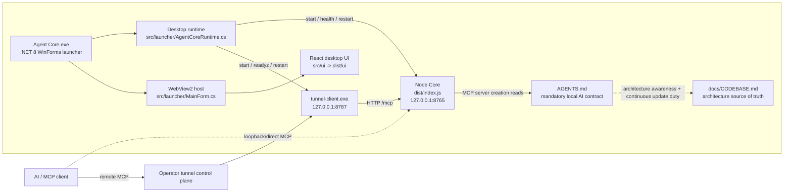
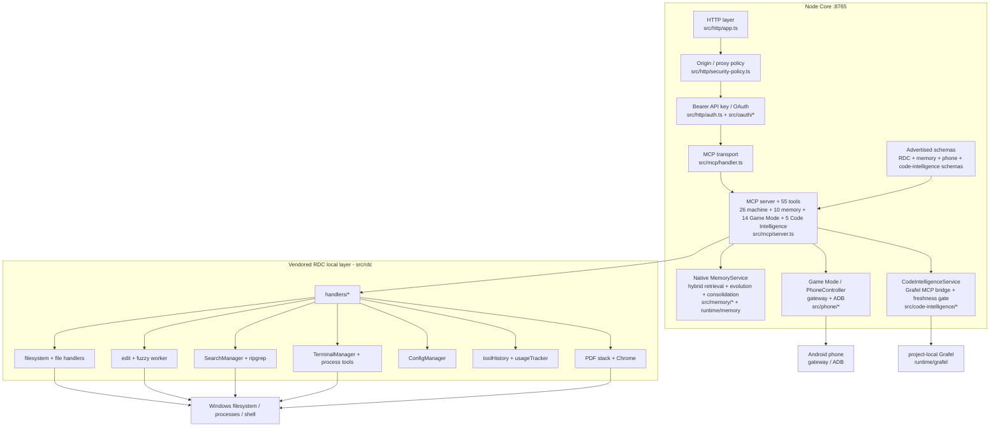
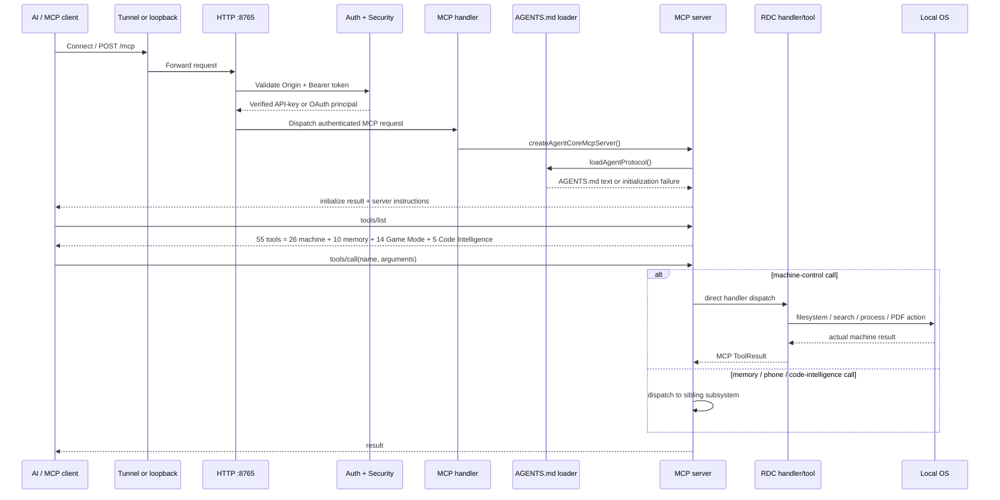
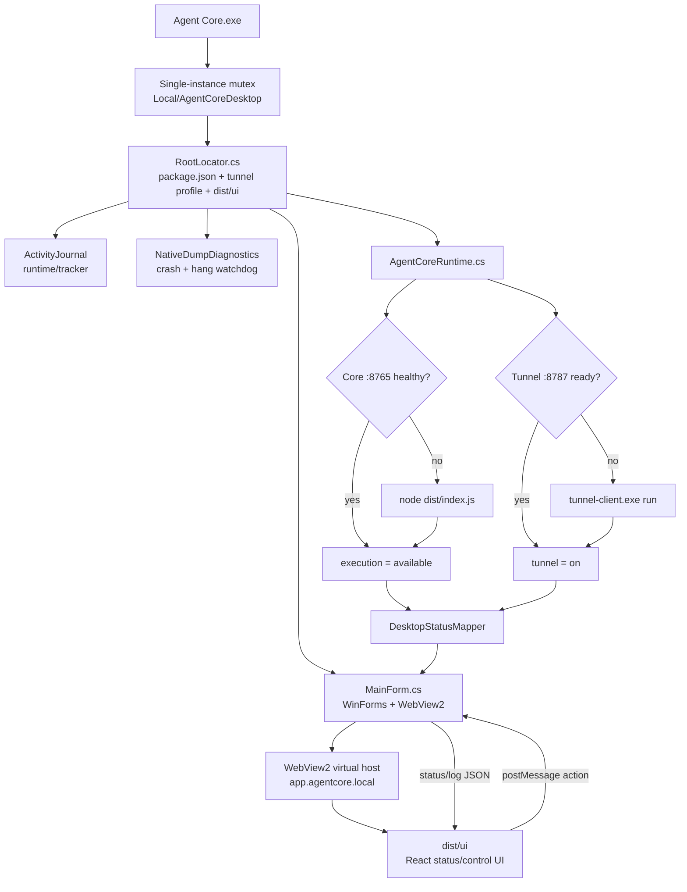
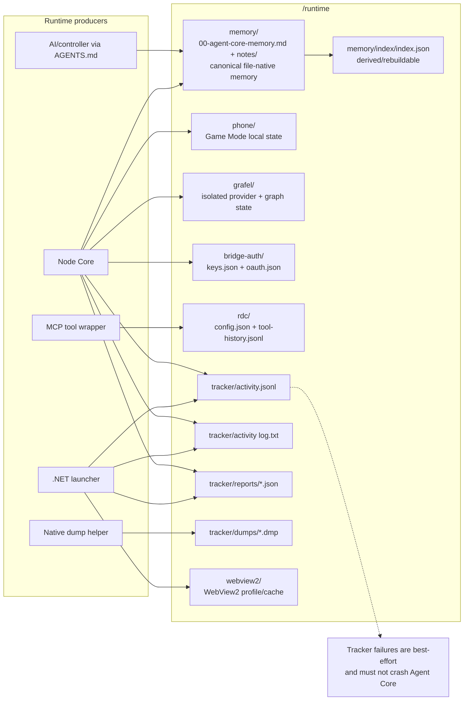
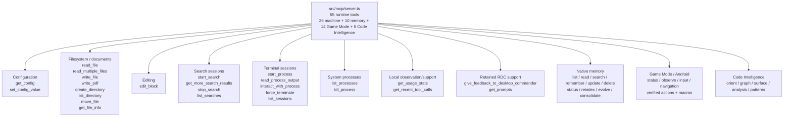

# Agent Core Codebase Map

## 2026-10-19 — Scoped release readiness and external engineering Skills

The current release work retains the authoritative local tree and explicitly reconciles the five remote Batch17 files. It does not reset, rebase or replace local source with remote history. Source is synchronized to 0.15.0; package acceptance and publication are distinct receipts. `scripts/release` now handles source-only prerelease exit with an exact-version receipt, owner-correct intent archival, recoverable rollback, exclusive receipt publication and committed-source/HEAD guards. Portable support includes current proposal/archive/Raka guides and the hash-bound browser transport plus source. Stable packages leave canonical Memory absent, ship generic `MEMORY-BOOTSTRAP.md`, and require the existing offline `scripts/memory/activate-canonical.mjs --fresh` owner before first launch. No activation marker, user Memory, browser profile or credential is copied.

`src/skills/external-guidance.ts` is an external-only instruction hook used by existing controller bootstrap and task context. It checks the two explicitly user-approved Skills through their existing owner, reports unavailable installations honestly and supplies exact digest-bound paged reads. It runs no model or Skill script, grants no tools and proves neither compliance nor performance. `bundled-skills` contains curated portable copies, excluding installation metadata and `node_modules`; stable packaging imports only these two artifacts through `SkillService`. REA's launcher reuses the original pinned 6.5.0 runtime or an explicit `AGENT_CORE_REA_SKILL_ROOT`; mismatches fail closed. The original personal Skill was updated and its launcher regression tests passed 3/3. A catalog invocation returned 6.5.0. This is separate from the static artifact inspector and proof-obligation harness.

The external static inspector now validates the exact captured invocation/task at awaited boundaries, rejects stale heads and revoked/expired final leases, and reports supported findings dropped by JS/ASAR/managed parser, worker and envelope caps. Truncation produces `partial` with explicit counts; analyzer revision is `artifact-static-v2`. Existing input descriptors, worker/deadline/resource caps and operator permits remain unchanged. Directed acceptance passed 53 tests; no whole-program semantics or live-target equivalence is claimed. Maintained usage is in [engineering Skills](External-Engineering-Skills.md).

Actual `start_process` qualification exposed Agent Core's isolated HOME, which the ordinary shell did not reproduce. The personal and bundled REA launcher now reads an explicit validated host-local link outside the catalog; no runtime duplication or environment-isolation change is needed. A demonstrated failing isolated-HOME case preceded 4/4 launcher passes. The artifact was staged/promoted through existing Skills revision owners with unchanged source lineage; actual Agent Core execution subsequently returned the pinned command help successfully. Host link configuration is not shipped and is never copied from user runtime state.

Independent review found that a valid catalog-local runtime could bypass a configured host link's unavailable/mismatched target. Two failing regression cases preceded exclusive host-link selection (environment override remains highest priority); all six launcher tests now pass. No fallback hides an invalid explicit selection.

Readiness repairs preserve sealed Memory oracle bytes using LF attributes, use Windows-safe child paths and honest filesystem-privilege skips, and update stale external task/schema/config fixtures. The 502-record exact-byte transfer correctness case completed in 86.6 seconds on this Windows host; its former 60-second test-runner deadline was not a product latency requirement. Its larger Windows allowance changes no correctness assertions and establishes no speedup. A later explicit human exception authorized only three Native test fixtures and their three baseline hashes: host identities were corrected, assertions retained, and 28 tests passed. All implementation hashes and 78 protected sections remain unchanged. The completed review is archived in [history](history-agent-core/native-test-fixture-contract-refresh.md). Source/unit evidence is distinct from resident activation and release-package acceptance. Full root acceptance recorded 3,006 passes, three fixture failures and 37 skips; the three repaired files reran with 37 passes, zero failures and one skip. This closes the three failed cases without relabeling the original command as green. See docs/releases/0.15.0.md for the evidence method.

The release contract parser now selects the explicitly identified external schema and preserves bounded same-file object/shape inheritance, overrides and cycle/depth rejection. Seven demonstrated failing regressions preceded 16/16 release-readiness passes. Actual comparison against the unchanged prior baseline reports no removed tools/parameters, new required fields or narrowed enums; compiled manifest budget passes. This is structural schema evidence, not proof about refinements, authentication or the task protocol.

## Batch 17 #18 — same-owner Skill writers and activation recovery (reconciled 2026-10-19)

`src/skills/service.ts::import` uses the same per-normalized-name `withRevisionLock` as promotion and rollback. Source scan/provenance/approval remain before acquisition; destination inspection, duplicate/collision decisions, publication and owned staging cleanup stay inside it. Same-name participating writers observe settled state while different names remain independent. Digest/baseline/source-lineage/approval checks and Learning-state → Skill lock order are preserved; internal activation does not acquire the guard again.

`activateRevision` separates failed publication/restoration from cleanup after successful publication. A failed restore preserves the prior backup and reports bounded failure codes plus its project-relative recovery path. An occupant observed before restoration is neither removed nor overwritten; the subsequent rename is not an atomic no-replace fence against out-of-band writers. Successful restoration rethrows the publication failure. After publication, cleanup failure reports `SKILL_REVISION_ACTIVATED_CLEANUP_FAILED` without reverting the active candidate; inspect its active digest before retrying. Cleanup touches only the operation's candidate staging tree. This does not promise cross-process exclusion, crash atomicity, an out-of-band writer fence or a source scan/copy snapshot.

The remote dated acceptance is preserved in [Batch17](Batch17-Linux-Skill-Writer-Recovery-20261015.md), including its Linux-only evidence and original216 #18 Acontext adaptation provenance. Current Windows concurrency/recovery regressions passed 12/12 across the new writer tests and existing notification suite; this supersedes the report's then-unobserved Windows branches without rewriting that history. No new MCP schema, dependency or Memory owner was introduced by this reconciliation.

## 2026-10-19 — Comparison of 68 Learning findings (proposal only)

[Penguatan Learning, Proaktif, Self-Improvement, dan Memory](proposals/Penguatan-Learning-Proaktif-Self-Improvement-dan-Memory.md) compares M01–M68 with current local source and the already integrated proposal owners. It distinguishes existing mechanisms, partial contracts, unverified benefit and deliberate external-scope limits. Eight proposed work packages reuse Memory, Learning, Skills and tracker owners; none is implemented or activated by this documentation task. Native remains frozen. No product tests, benchmark, build, restart, dependency or configuration change was performed. The linked source audit records inspected-file hashes and document coverage, not new runtime acceptance or measured improvement.

Later user approval implemented only P08/P01/P02 plus proposal Markdown/cards;
the dated comparison above remains historical. Current source/activation and
verification limits: [External Learning acceptance](External-Learning-Priorities-20261019.md).

## 2026-10-18 — Paged reading of the external controller's owned ChatGPT tab

External `browser_control.conversation_read` now accepts `read:{kind:'index',cursor?}` or `read:{kind:'message',messageRef,offset?}` for an existing Open Browser Use session. The ordinary B-created tab is where the human chats with A; no copied tab or extra extension is needed. `src/rdc/browser-control/owned-conversation-reader.ts` provides 20-message index pages and 12,000-UTF-16-unit rendered-text chunks, full bounded-body SHA-256 versions, opaque URL/document/message-bound refs and bounded metadata-only caches. The service serializes reads and enforces existing session/observation budgets. External schema/handler/descriptor are additive; legacy paired Bridge and frozen Native paths remain separate.

Modern user bubbles and assistant selection ownership supply role evidence. Unassigned modern body parts inside explicit app-turn wrappers remain readable as `unknown`/`authorKnown:false`, excluding recognized owners, user bubbles, unrelated formatting and mismatched scopes. Their version binds exact part membership. Navigation API URL epochs reject SPA away/back ref reuse; browsers without that API explicitly report the weaker current-URL-only fallback. Reads issue fixed Runtime evaluation without scroll, focus, input, navigation or message sending. Existing conversation metadata-only durable history and no-spill budgeting protect private bodies; raw chats are not added to Memory or evidence.

Source qualification: 65 directed tests across six files passed, including real Chromium 105-turn pagination, exact long Unicode reconstruction, tail/role changes, SPA navigation, scope and compatibility checks. A later focused unknown-group test also verifies same-content part replacement invalidates its ref; the SPA test passed again after cache-upgrade hardening. Build passed Native freeze (31 files/78 sections), path policy (445 files) and TypeScript. Real private-chat qualification through the existing healthy OBU scope read six loaded groups/20,153 characters to EOF, recovered the former truncated tail and retained identical focus/draft/scroll metrics; two groups had unknown author.

One official capability-changing restart completed exit0 (`runtime/restart/4374021009884d66b44913d7e2706a9b.json`); hash-verified launcher SHA-256 remained c7971956c3d048226ccb6d2cdcdf2a830e6cd4b41a0fcf1134a7760afecb16fd. After draft0 qualification and acknowledged cleanup of the original test tab, actual MCP reopened the exact same selected conversation URL in a fresh owned background tab. The site mounted ten groups; resident MCP index plus ten body reads returned27,042 characters, all EOF, including the10,067-character answer. Independent before/after metadata again showed unchanged hidden/focus/draft/scroll state. Mandatory direct-link settings scrolling exposed Refresh tools; one click was acknowledged, action disappeared during loading and returned enabled, then settings cleanup was acknowledged. This controller descriptor remained cached, although actual resident calls accepted and exercised the new selector; fresh descriptor discovery is not claimed. The human conversation tab was retained, subject to the existing30-minute session lifetime.

These measurements describe changing loaded DOM windows only: `completeHistory:false`, two unknown authors, unsupported attachments and unmounted history remain explicit. No whole-history claim or raw transcript evidence is retained. Evidence: `runtime/build/conversation-coverage-20261018`; [calling sequence and limits](Conversation-Reading.md). Pending minor Changeset intent does not change the product version.

## 2026-10-18 — External background panel scrolling

`src/rdc/browser-control/service.ts` adds nested vertical scroll actions only for external Open Browser Use. Nine viewport samples plus at most 64 control ancestor walks (12 levels, 256 distinct nodes, eight panels) discover visible scroll containers. Opaque SCROLL actions bind the observed document, node, scroll position, dimensions, geometry and overflow state. Mutation rechecks these and hit-testing, uses instant DOM scroll with viewport overlap, and requires actual directional movement. It sends no foreground or mouse command. External observation excludes clipped/covered controls and text; the existing 250-action budget reserves room for panel actions. Native/default snapshot and wheel execution remain on the prior branch.

Directed real-Chromium tests cover clipping, scroll/click, stale position/replacement/locking, short panels and actual candidate pressure. All 52 directed tests passed; guarded source build and local-SDK launcher publish passed. One official activation completed exit 0 (`1427d0e59e15489495498feeebfde020`), and resident health is ok. Actual MCP settings acceptance scrolled the panel once, clicked visible Refresh tools once, observed the action disappear during loading and return enabled, then closed the task tab. Refreshed client descriptor discovery is not claimed. A separate resident MCP fixture performed five scrolls/click, produced a POST and fresh hidden=true result, and closed its tab; foreground remained ChatGPT throughout that host-receipted browser interval. The wider settings observer recorded OS window transitions and cannot establish unchanged foreground for its entire interval. All seven known old/new test IDs are absent from current nine-tab browser inventory. Native behavior stayed frozen; no fallback/browser download was needed. Evidence belongs to `runtime/build/browser-use-panel-scroll-20261018`; see [maintained behavior](Open-Browser-Use.md).

## 2026-10-18 — Persistent Windows Workflows test symlink fixture

The shared desktop startup now calls `SymlinkFixtureSetup` after Core/Tunnel readiness. It invokes the fixed Ensure owner, installs an absent protected helper through one same-account elevation when required, and validates/reuses the exact synthetic Workflows links on subsequent starts. This concerns test fixtures only. Existing Memory Prepare/Cleanup operations remain supported; normal test invocation never requests elevation. See [fixture ownership and lifecycle](Windows-Workflows-Symlink-Fixture.md); current execution evidence is under `runtime/build/symlink-autosetup-*`.

Current acceptance: 34 Workflows tests plus two Memory symlink tests passed from Medium Integrity; reuse did not rerun the task or change receipts/mailbox. The final transport is a fixed protected request file with SID WriteData-only, avoiding the observed registry visibility mismatch. Core/launcher builds passed and the installed EXE's official restart completed (`6078fe05d68441009061a9fa4036fd05`, exit 0); actual launcher fixture reuse and healthy Core/Memory/Learning were read back. Version remains 0.15.0-beta.4.

## 2026-10-18 — Browser Bridge 0.2.3 observed-marker adapter; live read OPEN

Current evidence supersedes the older activation/path notes below. Live 0.2.2 structural diagnostics found user-bubble text and assistant code-source text under the same generic whitespace class. The existing selectChatTurns/pageRead owner now recognizes data-user-message-bubble and selection-scoped data-markdown-text-style, checks the conversation-selection ID, uses real message/source/selection or one search-message ID, and filters control/sidebar/composer/tool content. No role alternation, positional IDs, whole-page extraction or frame/shadow traversal was added.

The actual Brave registration is djnpklbndhblfgjbolnjmmgeikmogbpn at runtime/build/browser-reader-completion-20261018/agent-core-browser-bridge. Six relevant files matched the pre-patch baseline before the existing extracted copy received the same four changed runtime/version files as the standalone source. The manager then visibly displayed 0.2.3 after Reload. Existing identities, permissions, worker protocol and Core public schema are unchanged. No Core restart/build or plugin update was performed or required by this marker patch.

Qualification: final real isolated Chromium synthetic DOM 18/18 (original 15-case baseline: 10 failed/5 passed); Windows extension regression 38/38; existing read-only MCP/HTTP/worker and status-contract selection 11 passed/14 unselected skipped, exit 0. Changed function hashes match across the Chromium-qualified and installed source. Full conversation.js SHA-256 is 41079b6a61fde6304d2b7813585238de179c626e14d8ee1a86c7052e1f006e86. Cases semantic digest is 2a7a01f4946221c5d18d5d1fa80c94f8bb2ce48f2bc89bc21638d3ab1d0d5640. Evidence lives under runtime/build/browser-markers-20261018; backups under runtime/backups/browser-markers-20261018.

The latest attempted post-update binding expired without attachment: closed/current=false/revision=0/BROWSER_CONTROL_SESSION_CLOSED. No post-update target message/role acceptance or real send is proved. A fresh user-selected tab binding remains required; this is activation, not a selector remedy. No draft/message was created or sent to a real chat. The current task remains OPEN until actual target read/status and visible-message comparison succeed. Older completion/activation counts below are historical.


## 2026-10-18 — Background OBU operation (resident MCP verified)

The user's explicit Agent Core auto-approval reaffirmation is recorded in `AGENTS.md`: ordinary related engineering and necessary official activation do not require repeated confirmation, while browser automation must preserve the no-foreground/no-desktop-input requirement after activation. This does not change frozen Native scope or runtime permissions.

The user's no-screen-takeover requirement corrects the preceding foreground focus-recovery acceptance. The existing external `headless:true`/default argument now selects an inactive owned OBU task tab through an existing connection; actual browser state is reported as `headless:false, background:true`. Explicit false retains the prior foreground/fallback behavior. `open-browser-use.ts` skips/refuses foreground activation, accepts ready hidden documents and requires an existing connection without launching a fallback. `service.ts` retains scoped CDP, page/node freshness and target checks, then verifies the intended DOM field before background text insertion. Only the external browser descriptor changed; public input shape and frozen Native owners remain unchanged.

Startup in `src/index.ts` prepares the native host and probes existing connections without starting a browser. Live CDP mouse acknowledgements did not establish editable focus or native form submission. The correction uses preventScroll DOM field focus plus freshness recheck for fill, and guarded native HTMLElement activation for background clicks; it replaces CDP mouse input and refuses non-HTML targets. 48 directed tests and real existing-extension in-process qualification passed before final activation. Two official restarts completed exit 0; final launcher SHA-256 is c7971956c3d048226ccb6d2cdcdf2a830e6cd4b41a0fcf1134a7760afecb16fd and health returned ok. Actual final MCP open/read/fill/submit returned a fresh VERIFIED result and independent receipt with hidden=true; 380 foreground samples recorded one unchanged Chrome window throughout the final flow. No fallback browser or desktop input was used. Successful final/settings tab cleanup was acknowledged. Historical limitation: observation-failure tab 589865431 had uncertain cleanup, and PageDown did not expose the nested settings pane. The panel-scroll acceptance above supersedes both states: current inventory confirms the tab absent and actual MCP scrolled/clicked Refresh tools. Cached-client descriptor discovery remains unverified. See [behavior, evidence and limits](Open-Browser-Use.md) and `runtime/build/browser-use-background-20261018`.

## 2026-10-18 — Automatic browser-use discovery and managed lifecycle (preceding foreground acceptance)

Current external browser-use startup prefers one live supported external extension and otherwise uses a dedicated Agent Core browser. `src/rdc/browser-control/open-browser-use-runtime.ts` manages per-user native host registration, shared fallback startup, project-owned profile and owned-only shutdown; effective existing standard registrations in both HKCU/HKLM registry views are preserved. `open-browser-use.ts` supports operator `discovery:"auto"`, bounded endpoint handshakes and unambiguous selection. HTTP readiness is not blocked by browser warmup in `src/index.ts`.

The native-messaging relay is embedded in `Agent Core.exe` as `src/launcher/BrowserUseNativeHost.cs`, entered before UI/mutex for the exact extension origin. It owns one UUID socket under `runtime/rdc/browser-control/managed`, bounded clients/frames/queues, request correlation and a Core-owner lifetime watcher. The bundled fallback extension lives under `extensions/agent-core-open-browser-use` with MIT attribution. Existing project Chrome for Testing and a separate persistent profile are reused; no new browser/runtime download or external MCP server is introduced. Existing user tabs are not attached. The official restart worker excludes native-browser helper processes from launcher classification and can activate a hash-verified pending launcher after shutdown, retaining the original binary.

Owned-tab focus recovery attempts one `Page.bringToFront`, confirms actual DOM focus boundedly and rechecks observation freshness before input. Unknown focus evidence and unknown action outcomes remain distinct; no action replay. Managed Windows endpoints use the embedded .NET transport connector because their real AF_UNIX metadata fails the original Go `ModeSocket` check; explicit external endpoints retain the existing Go connector. Directed TypeScript verification: 64 tests across 8 files, then 40 focused tests after that correction. Standalone real-stream/socket native relay: 18 tests. Node and launcher builds, Native freeze and path checks passed. Full optional compiled manifest: 82 tools / 131048 bytes.

The built runtime is active after two deliberate official restarts (initial activation, then verified Windows connector correction), both exit 0. Resident health returned ok; actual MCP acceptance used the user's existing Chrome OBU 1.1.0 connection, backgrounded an owned form tab, recovered its focus, filled/submitted and observed a matching independent server receipt plus fresh `VERIFIED active-extension-focus` DOM. No fallback Chrome was running or launched in that successful flow; fallback lifecycle is fixture-tested. The direct settings URL was opened; computer-use scrolled the nested pane, clicked visible Refresh tools once and observed loading return to idle. Current controller descriptors remain cached, so refreshed-client exposure is not claimed. Maintained behavior/limits and evidence are in [Open-Browser-Use.md](Open-Browser-Use.md) and `runtime/build/browser-use-lifecycle-20261018`. Pending minor intent: `.changeset/20261018-browser-use-managed-lifecycle.md`; version remains 0.15.0-beta.4.

## 2026-10-18 — Internal Open Browser Use transport for external controllers

The existing `browser_control` owner accepts explicit `transport="open-browser-use"` and opens a new focused task tab through the installed host/extension in the operator-selected profile. Routing stays external MCP → browser handler → `BrowserControlService` → `OpenBrowserUseTransport` → framed RPC → a small owned Go stdio/AF_UNIX relay → existing Open Browser Use native host/extension. The default remains isolated Chromium; Native schema/catalog/description stay frozen. Source owners are `src/rdc/browser-control/open-browser-use.ts`, `open-browser-use-rpc.ts`, `open-browser-use-stdio.go`, plus existing service/handler/schema/metadata/capability owners. [Maintained guide](Open-Browser-Use.md) covers usage and activation.

Donor `iFurySt/open-browser-use` is pinned at `b136cac71a3c497b5696aefd871dd15cba7d7559`; MIT attribution and full license are retained. This adapts the wire/session/tab mechanisms without a second MCP server or browser engine. The installed host/extension must return supported version 1.0.0 or 1.1.0. Operator configuration is `runtime/browser-control/open-browser-use.json`; the present Windows profile uses `F:\\Brave-Isolated\\Temp\\open-browser-use`. Endpoint selection is bounded and read-only; Windows socket validation belongs to Go, which recognizes AF_UNIX reparse points. Correlated replies and scoped events share one connection. Timeouts or uncertain CDP outcomes invalidate the epoch without replay; cleanup reports acknowledged versus uncertain separately from independent detach proof.

Official build passed with Native freeze 31 files / 78 sections and path policy 437 files / zero exceptions. The bounded external manifest has 82 tools / 131020 bytes, while Native transport choices remain unchanged. Focused tests passed 21 adapter, 5 manifest, 14 existing bridge, 2 protocol and 3 isolated browser checks across directed runs; this was not one combined 45-test run. Live Windows native HTML form evidence proves own-tab open/read/fill/select/click, independent local server receipt, fresh DOM, primary-tab removal and a separate owned sentinel still responding before its cleanup. Original inline-JavaScript acceptance remains failed; read-only profile inspection shows default JavaScript block with two port-specific localhost exceptions. No profile policy was changed and no visual screenshot review is claimed.

Evidence is retained under `runtime/build/open-browser-use-20261018`. Product version remains 0.15.0-beta.3; `.changeset/20261018-open-browser-use-internal.md` records pending minor release intent. The build script uses existing Go with local-only toolchain/dependency settings and verifies source/builder/binary digests. Package lock, Git index and unrelated working-tree changes are preserved. One official capability-changing restart completed at 2026-10-17T23:28:38.8039523Z with receipt `runtime/restart/9ce48c8eff4944a695492b56b4448f72.json` (exit 0). A fresh contract/Memory/task handshake succeeded and actual MCP open/observe used OBU 1.1.0. Two earlier caller mutations were foreground-refused before input; an expired-fixture open returned a connector Internal error without a session ID. Those historical uncertainties remain in `resident-mcp-evidence.json`. A later actual ChatGPT MCP run passed open/read/fill/select/click with a fresh `VERIFIED Raka 2046 review` DOM result and independent localhost POST receipt at 2026-10-18T00:09:07.146Z; server PID 16160 exited 0. `resident-mcp-acceptance.json` records that success and close ACK, without independently observed detach or an inferred cause for earlier refusals. Actual UI navigation reached the correct selected app (asdk_app_6ad1239cdf308191a3ccb8ba0cd49503), but current Plugin settings/account/plugin/app-detail controls did not expose Manage app/Refresh tools. Discovery refresh remains pending; `refresh-tools-ui-evidence.json` records the inspected UI and cached description. No reconnect, upload or reinstall was substituted. OBU checkpoint 421 and scoped Learning review completed; its reflection remains a proposal, not behavioral improvement proof. A separate existing episode/verify task-selection defect caused one wrong terminal declaration; the affected Browser Bridge record was restored to open/unavailable with retained history, exclusive-write backup/readback and canonical start. See `learning-closeout.json` and [the subsequent task-selector repair](proposals/external-episode-verification-task-selection-20261018.md); its current activation is recorded in the External Learning section below. Codex-Design reconciliation remains pending.

## 2026-10-18 — External Learning verification selects the requested task

The external `controller_learning(action=episode, episodeOperation=verify)` contract now requires the actual host-returned `taskId`. `src/mcp/controller-learning-schemas.ts` validates this operation-specific selector; `src/mcp/controller-learning-tools.ts` forwards it; `src/learning/external-controller.ts::verifyEpisode` snapshots it and checks equality with the genuine invocation task and current session head before verifier I/O and again inside the existing mutation queue. Missing selectors fail with `EXTERNAL_EPISODE_VERIFICATION_TASK_REQUIRED` at the service boundary; requested/host mismatch fails with `EXTERNAL_EPISODE_VERIFICATION_TASK_MISMATCH`. Existing host identity, owner/workspace, stale-task, closed-state and proof checks remain authoritative. Caller IDs never authorize or select other episodes. Other Learning operations and Native execution are unchanged.

This closes the OBU/Browser Bridge incident's omitted-selector path. The existing headerless namespace remains credential/hour scoped; explicit headers remain host supplied. Separate contract receipts do not create separate Learning heads. Wrong-target verification now fails safely; automatic isolation of chats and redesign of unrelated head-based operations are not claimed. Existing telemetry may record a refused tool call; verification outcomes, closures, verified counts and unrelated progress remain untouched. The historical repaired records are preserved.

Regression evidence lives in `runtime/build/learning-task-selection-20261018`. Three new bug probes first failed against the former implementation. Final directed run: 74 passed, one host directory-alias fixture skipped; build/native/path checks passed. Tests cover requested A versus pre-captured B, omitted/foreign selectors, public input validation, existing rotation during verifier await and identity/evidence cases, plus real HTTP same-header/different-header admission. Existing direct test callers pass their actual task IDs. The maintained incident/remedy is `docs/proposals/external-episode-verification-task-selection-20261018.md`; pending patch release intent is `.changeset/20261018-external-learning-task-selection.md`. One official restart completed at 2026-10-18T08:39:06+07:00 (receipt `runtime/restart/30b51d4ee21e4a84b58dcff937d09029.json`, exit 0), local health returned ok, and the connector was refreshed once. Fresh connected verification refused a real mismatched selector with TASK_MISMATCH and preserved current verification/closure/count/event fields. The connected Raka descriptor is host-neutral and the scoped tool count remains 81. Its active guidance leaves host configuration untouched. An unrelated unchanged MCP schema test still expects 28 literal registrations while current source has 27; actual manifest tests pass, and no registry/test-count adjustment was made.

## Reusable external partner Raka — host orchestration

The reusable external partner is **Raka**, with stable host task name `raka`. Its maintained entry point is [subagents/README.md](../subagents/README.md); [raka.md](../subagents/raka.md) defines the role, [CORTEX_MEMORY.md](../subagents/CORTEX_MEMORY.md) defines shared external-memory use, and [VERIFICATION.md](../subagents/VERIFICATION.md) records the setup evidence and its limits.

Main resolves a currently available host agent and uses `followup_task` for later assignments; `send_message` steers active work. It spawns `raka` only when no reusable instance is available, supplies the profile plus a bounded task packet, and keeps final acceptance and task ownership. The profile supports research, coding, review, testing, data, design, writing and other authorized tasks. Model/tool access follows the actual host; Markdown does not register an executable tool or grant access.

Cross-session continuity uses the stable profile and selected Cortex records. Live process identity, runtime IDs and full conversational context are not promised across chats. Cortex is shared supplementary context; tags are logical grouping and do not create private ACLs. Canonical Agent Core Memory, controller binding and Learning remain with their existing owners. The initial setup was documentation-only; the subsequent external capability exposure below requires the ordinary Core build/reload.

External structured exposure is owned by `src/external-partner-capability.ts`, `src/capability-awareness.ts` and `src/agent-knowledge-synthesis.ts`. `controller_learning(action=context)` delivers `external:raka` in both `capabilities.inventory` and `synthesis.capabilityExposure.inventory`. The descriptor provides resolved profile paths, complete bounded source-byte digests and conditional host invocation examples (inventory, reuse, steer, create), adapted to the current host API. It reads only the three fixed local guides under the dynamically resolved project root, at most 24 KiB per source, and rejects source-file or directory aliases to other paths before opening. Missing/empty/oversized/unreadable core sources fail softly and suppress spawn guidance; an unavailable optional Cortex guide retains local collaboration and reports Cortex guidance unavailable. Source bodies are not copied into the inventory. Every context refresh rechecks source bytes.

Raka guidance is reserved before ordinary capability rows so a crowded Skill catalog cannot hide it; existing capability/context text caps remain 5,000/16,000 code units. Local profile availability is distinct from host execution, which remains `unknown`; `executionAuthority=false` and the existing unknown host-plugin status are retained. Discovery creates no host agent, tool call, grant, usage receipt or benefit claim. The new descriptor is loaded only for external knowledge synthesis; the Native catalog, resolver, runtime and Native projection remain unchanged. No MCP schema/tool, runner, dependency, credential, daemon or new Memory owner is introduced. Targeted tests are `tests/raka-capability.test.ts`; release intent is `.changeset/20261018-raka-external-capability.md` (minor, unapplied).

Resident acceptance on 2026-10-18: one official restart completed (receipt `runtime/restart/048960513c074576a7458b5ca278a548.json`, exit 0), local `/health` returned ok, a fresh external contract/Memory/task handshake succeeded, and actual connected context returned `external:raka` with matching top-level/synthesis projections and 81 registered tools, unchanged from before. ChatGPT Refresh tools was clicked once and returned idle. Evidence is under `runtime/build/raka-capability-20261018`. Official build/native/path checks passed; focused Raka/Skill-context tests passed 16 with one host directory-alias fixture skipped (EISDIR). Five older capability census/disclosure test failures also reproduced with this task's changes removed; they remain outside scope. Learning checkpoint 422 and its scoped review completed; the architecture candidate remains an awaiting-verification proposal, without a benefit or promoted-knowledge claim.

Active instructions are wired from root `AGENTS.md`. Treat setup observations as time-bound evidence and recheck capability availability when used on another host. Pending tasks are not resumed by reading a memory record.

## 2026-10-18 — Browser Bridge 0.2.2 diagnostic relay and status correction; live acceptance OPEN

The real Brave registration was inspected: extension lmhnhemmpokcmhjilcliaoelfcehobme loads the standalone E:\Projects\agent-core-browser-bridge folder. The actual popup was observed at 0.2.1 with the correct target preview; its previous grant then expired/disconnected. No live message body/role/ID extraction has yet been proved. Fourteen .whitespace-pre-wrap matches are formatting-class leads, not identified messages; no iframe/shadow/other-extension cause is asserted.

Core source owners remain src/rdc/browser-control/extension-bridge.ts and conversation-contract.ts. Status now computes current from paused/error consistently with read; this fixes the independently observed attached+paused+error+current=true response. The existing read/status result schema accepts optional strict structural diagnostics capped at 24,576 serialized characters. Tool names/actions/input descriptors remain unchanged. Standalone worker.js uses its existing fixed evaluator and dom-diagnostic.js on explicit error read/status requests only, without overriding pause/rebind or introducing arbitrary scripts/selectors. conversation.js distinguishes loading, unsupported markers, invisible candidates, incomplete extraction and wrong main-frame context. Message selection itself is unchanged pending live evidence; no broad page or frame/shadow extraction is added.

Extension source/version is 0.2.2. Targeted checks: extension read-only fixtures 12/12; Core status/reply contract 8/8; manifest 5/5; selected existing actual worker/HTTP/MCP read-only integration 3 passed and 14 skipped. Official npm run build exited 0, Native freeze 31 files/78 sections, path policy 434 files/0 exceptions. Tests are synthetic, not target acceptance. Evidence: runtime/build/browser-reader-completion-20261018. Backups: runtime/backups/browser-reader-completion-22efb869e82c4131a1fa66970da7bce1. Changeset: .changeset/20261018-browser-read-status-diagnostics.md. One official schema-discovery-unchanged restart completed (runtime/restart/53ffba47929643b9ae903de45c9f9446.json, exit 0); the new MCP/bridge host PID15484 runs dist/index.js after the build, and its fresh browser status has no sessions. HTTP /health was not established (8787 returned 404; 8765 timed out); MCP calls respond, and no repeat restart occurred. Extension 0.2.2 reload and fresh selected-tab pairing still precede actual read validation. Full extension ZIP0.2.2 and same-app plugin ZIP1.1.1 are packaged under runtime/build/browser-reader-completion-20261018; hashes and pending live acceptance are in the maintained report docs/Browser-Bridge-Pairing-DOM-Repair-20261018.md.

## Historical 0.2.1 stage — live DOM reading remained unverified

The unpacked extension at E:\Projects\agent-core-browser-bridge is now 0.2.1. It reuses selectChatTurns for visible body/real-ID selection, preserves prior windows on incomplete DOM attempts, keeps valid initial coverage/errors, binds the popup preview tab/window/URL before pairing, and guards startup navigation and overlapping reads. No remote approval, retry-on-unknown, generic bypass or permission changes. Installed extension tests32/32; existing MCP/HTTP/worker and contract tests35/35; isolated real-Chromium DOM21/21. Function hashes match the tested DOM code. Core runtime/public schema unchanged; no additional Core restart or plugin ZIP is required by this patch. The user has loaded 0.2.1 but live message reading still fails. The user-supplied structural report has matching target, complete/visible main frame, zero message candidates/roles/markdown and 14 generic .whitespace-pre-wrap matches; these are not proven message bodies. The fixed local popup diagnostic (dom-diagnostic.js, diagnosticRevision=userbody-structure-v1) now captures up to 16 matches and bounded ancestor metadata, pseudonymizes IDs, reports truncation, and does not read text or enter frames/shadow trees. Eight directed synthetic diagnostic tests pass; the actual 14-match ancestor report is still pending. Reader, worker, manifest and MCP contract remain unchanged; no replacement selector or third-party-extension cause is asserted. Full report: docs/Browser-Bridge-Pairing-DOM-Repair-20261018.md; evidence: runtime/build/browser-bridge-repair-20261018.


## 2026-10-18 — Separate Browser Bridge extension pairing/DOM repair candidate (NOT live verified)

The standalone user-selected E:\\Projects\\agent-core-browser-bridge source (not Agent Core's src/dist) received a scoped local repair of conversation.js, worker.js, popup.js and popup.html. Pairing now has actionable distinctions between an invalid/expired pairing token, a wrong bound conversation, a real /share/ link and a tab that is not a conversation. The popup locally displays the currently selected target tab. New DOM reading accepts a bounded set of message-turn markers plus body-only selectors; empty/unsupported markup is an error, never a proved empty chat. A short initial render wait is bounded. Read and pre-send ID discovery share one page-injected adapter; index-only visual IDs are read-only and fail closed for sending. Same-conversation query/hash navigation does not force re-pairing. The original exact URL, revision, popup approval and once-only/no-retry constraints remain.

A separate legacy 0.1.0 extension still exists under E:\\Projects\\Agent-Core\\extensions\\agent-core-browser-bridge. Installed Brave extension folder identity is unverified; this repair does not replace/disable it. The current Agent Core server browser protocol/schema and Native runtime have not been edited. No tests, build, extension reload, live authenticated DOM observation, browser send, product release or deployment was performed for this corrective source patch. Its reversible four-file backup is runtime/backups/browser-bridge-dom-pairing-20261018. The previous donor 20/20 and integrated 40/40 results below apply to the original v0.2.0 baseline, **not** to this untested patch.

## 2026-10-18 — Scoped Browser Bridge 0.2.0 for external AI (activation pending)

The existing browser_control owner now supports external conversation_read, conversation_draft and conversation_status actions; close dispatches AgentCore.detach. Source ownership stays in src/rdc/browser-control/service.ts and extension-bridge.ts, with a shared conversation-contract.ts and the existing handler/MCP/HTTP paths. Open explicitly uses transport=extension, mode=conversation and the exact selected ChatGPT conversation URL. Native browser action schema and descriptor remain unchanged.

The exact user-supplied Browser Bridge v0.2.0 ZIP was read and hash-pinned (SHA-256 341e323661d82e991616fe1551ed6c132774669967c77c2983aaa00f6818a590). Its worker performs local popup review/edit/approve-once. Agent Core validates exact tab/URL grants, read revisions and result bounds; cursors belong to each grant; reconnect revokes old work. Deltas preserve reset/coverage/truncated/busy/paused/error and windowExits never proves deletion. Receipt evidence follows the extension, including unknown/no-retry and scoped detach uncertainty. Conversation calls are metadata-only in durable tool evidence and never spill content to artifacts. A scoped poll permits 1 MiB for JSON-expanded bounded DOM data; ordinary browser/pair/disconnect retain 256 KiB. The loopback bridge remains 8765; 8787 is the existing health/admin tunnel.

Verification: exact donor 20/20; existing MCP/HTTP/actual-donor-worker fixture and compatibility selection 40/40 (16 integration, 14 bridge, 3 worker, 2 protocol, 5 manifest). Official build exit 0, Native freeze 31 files / 78 sections, path policy 433 files / zero exceptions. Evidence: runtime/build/browser-bridge-v020. Compiled full optional manifest: 82 tools / 131010 bytes; docs/memory/Browser-Bridge-v020-MCP-Manifest-20261018.json, SHA-256 c558362e97ab31e5b0d5ce41762250e4e6ca1fa1d02593af80d065796e88d8b1. Minor release intent: .changeset/20261018-browser-bridge-conversation.md; product remains 0.15.0-beta.3.

Same-app ChatGPT plugin ZIP v1.1.0 is prepared at runtime/build/browser-bridge-v020/Agent-Core-ChatGPT-Plugin-v1.1.0.zip (541 bytes; SHA-256 bbdede5c8211907ff2f92c2a755acc461bd84b9e50729916fdb79e4781a54dd9). Original app manifest and selected app asdk_app_6ad1239cdf308191a3ccb8ba0cd49503 are preserved; current source release was verified as 1.0.0. This ZIP is distinct from the browser extension and the compiled schema snapshot.

Activation is NOT complete: no restart/upload/real send occurred; latest resident browser status has zero sessions and this ChatGPT inventory still exposes the old browser actions. User must authorize the schema-changing restart, update the same plugin with the ZIP, then choose a test chat and pair. Verify refreshed tool visibility and a real popup-approved receipt afterward. Polling does not wake AI; existing response notices and Native credential scheduling are not an external ChatGPT wake mechanism. No recurring monitor/model daemon was added.

See [Browser-Control.md](Browser-Control.md) and [full integration/activation evidence](Browser-Bridge-v020-Integration-20261018.md). Other local work and checkpoints are preserved; dist comes only from the official build.

## 2026-10-17 — External REA Reconstruction Harness

`src/mcp/external-reconstruction-harness-tools.ts` exposes `reconstruction_harness` to external controllers through the existing contract, credential, invocation and Learning wrappers. Its actions are `schema`, `preview`, `assess`, `readiness`. Schema discovery returns the full existing manifest schema/example; assessment remains strictly validated and bounded by the shared evaluator. The external adapter requires a current host-owned controller session/task/workspace before and after evaluation, observes cancellation, and filters receipts by the credential's current source-tool grant. No caller-supplied identity, new receipt store, execution engine, automatic approval or direct Memory write is introduced.

The existing `reconstruction.harness` family becomes available from actual external tool registration. An external-only descriptor identifies task-bound host receipt assessment; omitted external context preserves the Native descriptor. Schema/preview do not count as material capability use. Native files, registration, action schema, catalog and grants remain unchanged under the freeze baseline. The older Native-only audit below is historical and is superseded for external exposure by this implementation.

The first live assessment exposed a real observer-budget mismatch: Activity Tracker recorded `late-unavailable` after its 250 ms observation window, although the same successful attributed invocation was durably stored in the current Learning episode. The external adapter reconciles only that status using a unique host-written tool/failure event, exact explicit/open episode owner/task/workspace identity, invocation/reference/tool match and process-instance digest. It changes only an ephemeral copy of attribution status, then retains the unchanged shared resolver's age, ambiguity, scope and grant checks. Missing, conflicting, foreign, unbound or late-closed evidence remains unknown. `getEpisode(sessionId, true)` uses the existing read-only state loader; previous callers keep their behavior. No persisted telemetry or Native receipt adapter is changed.

Usage: contract handshake → canonical Memory → `controller_learning` episode with stable taskKey/workspace → `reconstruction_harness(schema)` → actual task tool → episode status `current.events[].evidenceRefs` → manifest selection → `assess`/`readiness`. A genuine positive terminal receipt proves only declared tool completion; behavior, reconstruction fidelity and semantic/binary equivalence remain unknown without supported authority. This capability does not require a standalone installed Skill.

Validation: external MCP/manifest tests **19/19 passed**, covering contract/grants, discovery, strict input limits, scope freshness, foreign receipt rejection, source-tool grant filtering, real wrapper completion receipts, late-attribution reconciliation/negative cases, capability notices and preserved Native schema/descriptor. Combined with the unchanged shared harness suite, **43/43 passed** (`runtime/tmp/external-rea-harness-tests-20261017.json`). Official build passed: Native freeze **31 files / 78 sections**, path policy **431 files / zero exceptions**. Compiled full optional manifest **82 tools / 130906 bytes**, below 131072 with 166 bytes remaining; `docs/memory/External-REA-MCP-Manifest-20261017.json`, SHA-256 `e086e2615d59ce83d24b7f36d0c8d51d606fac27c362843cb989e0849aebb8ce`. Pending release intent: `.changeset/20261017-external-rea-harness.md`. Resident activation and refreshed-client evidence follow separately; these build/test results alone do not claim live exposure.

Live activation: the initial build restarted once (`runtime/restart/8b3d3755a3d8443c9b226ba32169bcea.json`, exit 0), then ChatGPT web **Refresh tools** was clicked once and returned idle. `reconstruction_harness` subsequently appeared in the actual connected tool inventory; schema discovery and external capability context succeeded. The observer-budget repair required one corrected build and one further restart (`runtime/restart/28d5a43e8d414aca8fcfec1893ad3678.json`, exit 0); its public schema was unchanged, so no additional refresh was needed. Core health returned `ok`. Total: two deliberate requests, one per build; no blind restart retry, credentials/grants changes, dependencies, publication or Native modifications.

Verified through the actual connected external tool: the same `get_file_info` receipt `tool:b25a22bf49fc461d97cee462ede40332` changed from `HOST_RECEIPT_UNAVAILABLE` to **ready / 1 verified obligation** after the repair. Preview remained unknown; a forged receipt remained `HOST_RECEIPT_UNAVAILABLE`; an unsupported behavior claim remained `AUTHORITY_INSUFFICIENT`. Final Native freeze check passed. Bounded proof: `runtime/tmp/external-rea-live-proof-20261017.json`; screenshot: `runtime/tmp/external-rea-refresh-tools-20261017.png`. No Native runtime task or full suite was run; readiness attests only declared tool completion.

Learning checkpoint **414** and its task-scoped review completed for `ext-b02424bc6ad04817b8c6fd0df32f0004`. The architecture lesson remains a proposal awaiting independent evidence resolution; it was not automatically promoted as proof of AI improvement. Unrelated pending reviews were preserved.

## 2026-10-17 — External-only development and Native freeze

The user's current development scope is external AI controlling Agent Core. Root `AGENTS.md` explicitly supersedes historical Native parity plans: features, capabilities, tools, Skills, plugins and improvements must target the external controller unless the human explicitly requests Native development. Existing Native execution remains intact.

`scripts/governance/native-freeze.json` freezes the current working bytes of 31 dedicated Native files and 78 Native sections across 17 shared files, including routing, provider configuration, UI/launcher, Native capability grants and the existing Native-only REA registration/receipt adapters. It preserves pre-existing uncommitted work; it is not a reset to Git HEAD. `src/agent-*` is reserved against new Native owners except the existing shared Learning/synthesis files. There is no automatic baseline-refresh command or caller-supplied approval override.

`src/native-development-freeze.ts` rejects protected writes with `NATIVE_AGENT_FROZEN`, checks shared proposed text against unique anchors and LF-normalized hashes, and handles real paths, Windows case/ADS, ancestor moves, compiled paths and hard-link aliases. Existing filesystem write/edit/move/PDF/directory owners, semantic atomic writes and batch preflight, and checkpoint restore enforce it before mutation. Reads, checkpoint capture and dry-run remain available. Shared Native files require a complete proposed text for safe external edits; whole-file move/restore is conservatively rejected. Policy files are also protected through these writers.

`npm run native:check` runs before root compilation; UI builds and the launcher MSBuild `CheckNativeDevelopmentFreeze` target use the same check. Runtime packages and development artifacts carry the manifest. This is source governance, not an OS sandbox: unrestricted external shells can bypass repository tooling, and fingerprints cannot classify arbitrary new code elsewhere or prove semantic non-interference. Agents must not use those escape routes to evade the user's scope.

Verification: 48 tests passed across six focused files, two existing source-safety symlink tests skipped by their suite (`runtime/tmp/native-freeze-final-tests.json`). Tests cover aliases, changed/missing/duplicate Native sections, new Native owners, safe external edits, failures before actual mutation, semantic batch atomicity and checkpoint capture versus restore. Core build/path policy and the dedicated launcher check passed. No live Native task, full UI/launcher rebuild, release packaging or full-suite test was performed.

Activation: one restart request after the final build, using the compiled existing restart helper with `capabilitiesChanged=false`. Receipt `runtime/restart/1f77845658954084ac1198f424233fca.json` reports exit 0 (11:06:51 UTC), replacing launcher 2672 with 26308. Subsequent Core `/health` returned `ok`, version `0.15.0-beta.3`; Core PID 28468 listened on 8765 and tunnel PID 17096 on 8787. No new tool/schema was registered, so this build did not require another web Refresh tools.

Fresh-client follow-through: refreshed tool discovery became available during finalization. The live `controller_contract` read/acknowledge succeeded, followed by canonical Memory list/read. A live `move_file` probe with identical source/destination `src/agent-controller.ts` returned `NATIVE_AGENT_FROZEN` before mutation; the baseline check still passed. Evidence: `runtime/tmp/native-freeze-live-proof-20261017.json`. Learning checkpoint412 and its scoped review completed for `ext-fb861fe170c8486a8ff903b87addfa4c`; the architecture candidate remains a proposal awaiting evidence resolution, not promoted knowledge. The previously delayed restart recovery was separately finalized at checkpoint413 for `ext-ca950421ecb94f51a10aed7b8b4a36d5`, with scoped awaiting-verification disposition. No unrelated pending review was cleared, and no direct Memory/database bypass was used.

## 2026-10-17 — Restart startup recovery and REA installation audit

The first task-issued CMD request produced receipt `runtime/restart/ba17dff8103d46328f4a82825edfc0bb.json` (worker exit 1, no captured error). Its log stopped after opening the launcher. This happened before Core startup, so the abnormal PowerShell worker exit is a separate unresolved issue. A later receipt `ece95f5612304908831916b5f3f7586d.json` recorded worker success but Core again failed `MEMORY_V2_ACTIVATION_INVALID:ENGINE_NOT_ENABLED`; script success proves a window only, not healthy Core/tunnel.

Observed canonical lock mtime remained at the old shutdown (10:42:41 UTC); subsequent Core startup failed after about five seconds. An isolated orphan-lock fixture reproduced `Memory store is busy in another process` after 5017 ms. The existing lease expires after 120 seconds, but initialization formerly waited only five. `FileMemoryStore.initialize` now waits up to the existing stale threshold plus five seconds (125 seconds), inside the launcher's existing 180-second cold-start budget. Normal operations still wait five seconds; heartbeat, stale detection and active-writer exclusion are unchanged. No activation marker, canonical note or lock was manually reset/deleted. Host errors now include bounded redacted underlying issues and dispose a failed service instance.

Verification: build/path check passed; targeted lock/host checks **13 passed, 23 intentionally filtered**, in `runtime/tmp/restart-memory-recovery-focused-tests.json`. The new startup fixture initially failed, then passed after the change. Separate diagnostic-detail check passed in `runtime/tmp/restart-memory-diagnostics-tests.json`. The broader exploratory maintenance selection also exposed two unrelated failures (oversize-result preview and an unactivated legacy health fixture); these remain unmodified and are recorded in `runtime/tmp/restart-memory-recovery-tests.json`. Release intent: `.changeset/20261017-memory-startup-lock-recovery.md`.

REA Reconstruction Harness audit: source and compiled registration require host `nativeTaskId` and `nativeWorkspace`; catalog family `reconstruction.harness` exposes `preview`, `assess`, `readiness` under existing grants. Fresh isolated harness tests passed **24/24**. It is absent from the external 81-tool manifest and has no standalone active Skill dependency. Therefore external ChatGPT/Codex controllers cannot invoke it through that manifest; Refresh tools alone cannot change the Native-only registration. The implementation is a bounded host-receipt proof-obligation evaluator, not the entire REA stack or a proof of semantic/binary equivalence. No Native implementation was changed during this audit, and no live Native task was run.

Recovery activation: after the corrected build, one deliberate recovery request through the compiled restart helper produced `runtime/restart/cc98afc928ff424faa17e60d30736846.json`, exit 0, closing launcher 9044 and opening launcher 2672. Core `/health` returned `ok`; the launcher recorded secure tunnel readiness at 10:50:54 UTC. This task issued two CMD requests total: the initial failed activation, then the corrected-build recovery; the separate 10:43 receipt was not issued by this task. An attempted direct launcher start during diagnosis exited under the existing single-instance mutex, without another persistent window. No automatic retry loop was added. Evidence: `runtime/tmp/external-restart-activation-20261017.json`.

The existing ChatGPT plugin's **Refresh tools** button was clicked once after recovery and returned to idle. Screenshot: `runtime/tmp/agent-core-refresh-tools-20261017.png`. New descriptors remain unverified in the currently cached Codex context, which still lacks `controller_contract` and `restart_agent_core`; do not claim a live external harness or completed fresh-client handshake. Source-task Learning checkpoint 411 and its scoped review completed before activation. Follow-on recovery Learning is pending a refreshed client capable of the mandatory handshake; no direct database write or credential bypass was used.

## 2026-10-17 — External restart tool and ChatGPT refresh guidance

`src/mcp/restart-tool.ts` registers external-only `restart_agent_core(capabilitiesChanged)` through the existing contract, credential and mutation wrappers. It launches the portable root `Restart-Agent-Core.cmd` once per resident, preserving the existing PowerShell/Scheduled Task restart owner. No caller-supplied executable, path or shell arguments are accepted. Concurrent/repeated requests share the original launch result; a definitely failed preflight/spawn allows a corrected explicit request. Once CMD starts, unknown outcomes never trigger an automatic retry. Logs use `runtime/restart/mcp-*.log`; existing Scheduled Task receipts remain authoritative for script completion. Tool output reports **requested**, never verified restart or health.

After an ordinary successful build requiring activation, call with `capabilitiesChanged=false` once. Controller instructions revised 2026-10-18: tool/skill/capability/plugin/schema changes require all three steps in order: (1) rebuild/package `Agent Core.exe` so it includes the modifications and confirm build success; (2) call `restart_agent_core(capabilitiesChanged=true)` once and wait for Agent Core to return; (3) **Refresh tools is mandatory in ChatGPT web**: use the browser-use capability → open [Agent Core plugin settings](https://chatgpt.com/settings/plugins-settings/plugin_asdk_app_6ad1239cdf308191a3ccb8ba0cd49503) → **scroll down** → look for visible **Refresh tools** text → if it is not visible, **scroll down again** and repeat observation → click the visible **Refresh tools** text/control. Reconnect and repeat the AGENTS.md handshake after restart. Confirm the refresh result and subsequent client tool discovery before claiming the changed capabilities/tools are exposed; the click alone is not exposure proof. A stale schema is not a reason for another restart. If browser use cannot reach or operate the page, report that concrete limitation and give the same direct link/scroll/click steps. Root AGENTS.md contains the same controller guidance. This instruction revision does not claim a build, restart or browser refresh was executed. Pending release intent: `.changeset/20261017-external-restart-tool.md`.

Build passed (427 authored files, zero path-policy exceptions). Five targeted files passed **35/35 tests** covering fixed-script launch/concurrency/error recovery, contract admission, credential grants, Native exclusion, manifest and machine-control parity; process spawning was mocked in tests. Inspectable result: `runtime/tmp/external-restart-tool-tests.json`. Compiled full optional manifest: **81 tools / 130317 bytes**, SHA-256 `e69f094b68b6505a79451601e6cb59ac407a7e2d2e448da2563c70c6217dfcbd`, saved to `docs/memory/External-Restart-MCP-Manifest-20261017.json`.

## 2026-10-17 — External-controller AGENTS.md admission gate

**SOURCE/BUILD/TARGETED TESTS COMPLETE; RESIDENT ACTIVATION PENDING.** Scope is external AI controllers only. The requested gate denies all ordinary MCP tools, explicitly including canonical Memory, until full contract delivery and session acknowledgement. Native controller source and behavior are unchanged. Implementation and limitations are in section 4 below.

Validation: `npm run build` passed (426 authored files, zero path-policy exceptions). Eight targeted files passed **77/77 tests**: contract receipts/HTTP isolation, public manifest, credential grants, machine-control parity, invocation evidence, image HTTP, Memory task reconnect and Memory v2 host integration. Inspectable result: `runtime/tmp/external-controller-contract-tests.json`. Full optional compiled manifest is **80 tools / 129620 bytes**, SHA-256 `437d6c85c328320e3875e4e319586e23b920d3ca7924e8cf581a96087852d0f3`, saved to `docs/memory/External-Controller-Contract-MCP-Manifest-20261017.json` using the existing release compatibility serializer. Only redundant optional schema-dialect URIs were omitted to retain the 128 KiB budget; no tool arguments, validation or descriptions were removed.

Verification limits: no full-suite or live resident acceptance. Earlier additional checks exposed nine unrelated Learning fixture failures (capability disclosure 4, image MCP 3, web MCP 1, Skill discovery 1) and three stale Reflexion text/source invariant failures; these are not represented as passing and were not repaired by broadening this task. No new dependencies, publication, plugin installation, service restart, release version application, or Native Agent implementation. `scripts/release/release-compat.mjs` now tracks the added bootstrap registration and its source. Pending release intent: `.changeset/20261017-external-controller-contract-gate.md`.

Activation requires refreshing the external connector's tool schema and reloading the resident. Cached clients without `controller_contract`/`contractSession` will be blocked by the changed server. The schema snapshot is a preparation artifact, not an uploaded/installed plugin. Existing concurrent source changes were preserved.

## 2026-10-17 — Measured fast-execution workflow for external coding controller (not a runtime source patch)
- User requests substantially shorter wall-clock delivery time for AI coding/script execution. Evidence distinguishes **controller orchestration latency** from Node.js execution: on the last 99 `start_process` tool-history records, median ~3,551 ms, 90th percentile ~12,596 ms, 11/99 >=10 seconds, 5/99 >=30 seconds. In a smaller direct file-tool sample, median read_file ~11 ms, read_multiple_files ~16 ms, write_file ~9 ms, edit_block ~15 ms. These are local tool durations, NOT end-to-end AI latency or proof of causal bottleneck.
- A fresh Node v24.21.0 `console.log` command through the PowerShell process tool completed in **576 ms** per verbose timing; no assertion that TypeScript/Node CPU execution causes the many-second waits. Existing project builds compile TypeScript to `dist`; there is no observed need to migrate to Bun, Deno, SWC, tsx, or larger heap. The earlier Node working-set sample was ~645 MiB on a ~32 GiB host; RAM shortage not established.
- **Measured local optimization:** project TypeScript 7.0.2 `tsc --noEmit --incremental --tsBuildInfoFile <PROJECT_ROOT>/runtime/tmp/agent-core-fast-typecheck.tsbuildinfo --project <PROJECT_ROOT>/tsconfig.json` exit 0 twice: first 1,842 ms; repeat on unchanged source 465 ms (~3.96x faster after warm cache). Only a derived cache (~220,535 bytes) was created under `runtime/tmp`. Incremental checks are for rapid iteration; they do not replace final path policy checks, emitted build, necessary targeted tests, or resident verification after source mutation.
- **External-controller fast path:** complete the external contract handshake first, then inspect canonical Memory; batch related file reads; use surgical edits instead of many artificial 25-line file write chunks; group independent approved command steps in one process; use already supported `node:local` for suitable short self-contained JavaScript analyses; use warmed incremental typecheck for iterations; run final scoped validation once; avoid repeated full scans, huge raw outputs, uncontrolled concurrency, redundant restarts or dependency installs. Preserve separate authorization, cancellation, task ownership, security and evidence rules. The later same-day contract gate supersedes the original Memory-before-AGENTS ordering in this measurement.
- Status: OPERATIONAL WORKFLOW + LOCAL TYPECHECK PROBE VERIFIED, **NOT a measured end-to-end speedup for complete AI tasks**. No TypeScript/launcher/Node runtime or tool schema source changed, no new third-party dependency, no release/deploy/restart. The existing Memory owner retains the reusable guideline and evidence; root tsconfig/package were not modified.

## 2026-10-17 — REA Reconstruction Harness resident activation readback (current)

**Status:** RESIDENT PROCESS LOADED AFTER COMPILED BUILD — CORE/LEARNING/MEMORY HEALTH AVAILABLE — NATIVE HOSTED HARNESS INVOCATION NOT YET EXERCISED — EXTERNAL TOOL NOT REGISTERED. User approved activation after confirming first-read order canonical `runtime/memory/00-agent-core-memory.md`, then `AGENTS.md`.

- **Preflight:** before restart, launcher PID 21800 and Node PID 9168 were started at 14:31 WIB, preceding the candidate compile. The compiled `dist/index.js`, `dist/mcp/server.js`, `dist/mcp/reconstruction-harness-tools.js`, and `dist/harness/reconstruction/receipt-adapter.js` had modification time 2026-10-17 **08:38:58 UTC**. Source and compiled native harness had passed **24/24 targeted tests**, build/path checks and the separate in-memory native read_file→tool terminal→harness READY-for-tool-completion smoke (see previous section); that fixture smoke is not a hosted-resident call.
- **Task guard:** existing registered `AgentCore-Restart-Manual-937A8AE664969FF8` matched the current account SID, had **1 validated fixed action, zero triggers**, was Ready and ran in Windows session 1. `Invoke-Agent-Core-Restart.ps1 -Mode Run -WhatIf` exited 0 without changes. The approved dispatcher `-Mode Run` was called; the caller's tool transport failed internally as resident shut down. **No blind restart was sent after the transport interruption.**
- **Observed effects:** **two distinct new task receipts** (reason for duplicate requests remains **UNKNOWN**): `runtime/restart/80b0285376714e19ae09bc04e4d024d9.json` completed 08:55:09 UTC exit 0 and its log closed launcher PID 21800, opened PID 9412; `runtime/restart/66824eb0df9944399d2e0821e42dd9da.json` completed 08:57:04 UTC exit 0 and its log closed PID 9412, opened PID **21684**. Both logs report one new window per restart. Do not describe this as a single-run activation or assume the second trigger's cause.
- **Current process validation:** launcher PID **21684** started 2026-10-17 **15:57:02 WIB**; Node PID **13964** started **15:57:06 WIB** via the project-owned `runtime/node/node.exe` with entrypoint `dist/index.js`; tunnel PID **21776** started 15:57:21 WIB. All are later than the 15:38:58 WIB compile. `dist/index.js` imports `dist/mcp/server.js`, which imports `dist/mcp/reconstruction-harness-tools.js`. HTTP `/health`: `ok`, product `0.15.0-beta.3`, canonical Memory and Learning `available`; `agentRuntime.status=available`, `agentChat.status=available`, runningTurnCount 0. Canonical `memory_status` separately returned noteCount 218 and issueCount 0. These establish loaded process/health and import-path eligibility, **not** an independent full Native Agent user-task behavioral result.
- **Surface and release boundary:** `reconstruction_harness` is **native-only** (registered conditionally when actual `nativeTaskId` and `nativeWorkspace` are supplied). The compiled full external manifest remains historically measured at **79 tools / 130,803 bytes of 131,072**; no new external tool, no plugin ZIP upload/version, no source change, no release/commit/push/deploy, no extra installation or third-party target inspection occurred during activation. `morluto/rea` remains a protected donor checkout.
- **Continuity:** this activation readback is authoritative for resident chronology; the immediately following implementation section remains correct for earlier source/test evidence but its old NOT-resident state is historical. Exact detailed activation receipt interpretation also appended to `docs/REA-Harness-Capability-Source-Audit-and-Integration-Plan-20261017.md`. Canonical Agent Core Memory updated with matching boundaries after current observations; docs/memory must not imply a direct native harness call inside the resident. The same existing explicit external task ext-402b9f5765a549198d7edd17859b991a was reselected by its stable taskKey after restart; Learning checkpoint 408 (key rea-harness-resident-activation-20261017-readback) advanced and its task-scoped review closed with status no-new-knowledge, complete=true, 0 candidates; other pending reviews were not cleared. This Learning bookkeeping is not additional live tool behavioral proof.

## 2026-10-17 — REA Reconstruction Harness native-only source integration (historical pre-activation state; resident readback above supersedes)
- Approved REA donor mechanism was implemented as a bounded, native-owned reconstruction proof-obligation/readiness evaluator, **not** a second REA runtime, model, Memory store or binary provider.
- Source owners: src/harness/reconstruction/{contracts,receipt-adapter,obligations,readiness,service}.ts; src/mcp/reconstruction-harness-tools.ts; conditional nativeTaskId/nativeWorkspace registration in src/mcp/server.ts; classification in src/agent-capability-catalog.ts and src/capability-awareness.ts. Existing artifact_inspect/rights unchanged.
- Proof is **host task-bound tool terminal only**: verified native tool completion can satisfy a declared positive operational-completion obligation, never semantics, goal success or runtime equivalence. Claims beyond supported authority remain UNKNOWN. No target analysis or automatic Memory/Learning/Cortex write.
- Targeted harness suite **24/24 PASS**; initial empty-obligation rejection was fixed, then a second real-receipt smoke exposed that Activity Tracker correctly redacts `processSessionId`, so the harness native adapter now validates host-owned `processInstanceDigest` (SHA-256 of the actual process nonce), never redacted plaintext. A dedicated negative regression rejects missing/forged digests even if a raw session string is supplied. The compiled native MCP smoke now proves an actual `read_file` → host `tool-call` terminal → `reconstruction_harness(assess)` **READY for the declared tool-completion claim** (`instanceDigestMatched=true`), plus a separate preview UNKNOWN. No user-goal or semantic correctness inferred. Path checker 425 files/0 exceptions; portable Node TypeScript compile exit 0. All checks are compiled-candidate/fixture, NOT resident production activation.
- Compiled manifest parity: public base 76 tools / 124,297 bytes and external full 79 / 130,803 bytes, with no reconstruction_harness tool; native 75 / 122,490 with reconstruction_harness present. External full cohort has only 269 bytes spare under 131,072, so public descriptor/ZIP **not expanded**. No resident restart/cutover, no installed plugin update, no release.
- Latest evidence and remaining H04/H10/H14/H16/H17/H18 qualifications: docs/REA-Harness-Capability-Source-Audit-and-Integration-Plan-20261017.md §10. Donor checkout remains protected/read-only at morluto/rea HEAD 79d2b718963b28d5b5ce42cda67db648827a9a23. Existing unrelated dirty checkout files preserved.

## 2026-10-17 — F2/F3 internal Memory resident activation + real external and generic consumer readback

**Status: LIVE ACTIVE AND VERIFIED** under user-approved controlled activation. F2/F3 compiled JS under `dist/memory` was emitted on 2026-10-17 07:22:40 UTC. Node Core old PID 21456 had started before this build. Existing on-demand manual restart task was verified (one fixed action, zero triggers) and produced exactly one new successful receipt `runtime/restart/d69fd6ef52634caba033f0a58f228ea3.json`, exit 0; an invocation replay was blocked by a one-time local activation marker, so no second restart was sent. New launcher PID **21800** / Core Node PID **9168** / tunnel PID **6324** started 14:31 WIB, all after F2/F3 compilation. Core health `ok`; canonical Memory and Learning `available`.

**Actual internal behavior through the resident:** host-bound `memory_v2_read(recall)` returned five F3 `expand-if-needed` hints with exact SourceRef revisions (9499 bytes under 16384); `memory_v2_read(expand)` returned the exact complete 2768-character record body with no next cursor; incorrect revision failed `MEMORY_REVISION_CONFLICT`. A separate 14-hit recall (26042 bytes under 32768) exposed F2 `shared-origin` for three source-correlated canonical records, others `unknown`. Read-only canonical metadata independently confirmed their captured-source/derived-from anchors. Native/general `memory_search` and `controller_learning(context)` returned the same F2 correlation; full search deliveries did not fabricate F3 hints, truncated context did. Current external episode carried 22 bound delivered tuples across three Memory recalls; no inferred applied/beneficial use. Fake task was denied `MEMORY_CONTROLLER_SCOPE_UNAVAILABLE`. Canonical Memory: 217 notes, zero issues, index and embedding available.

**Architecture:** results originate from `src/memory/evidence-lineage.ts`, `progressive-disclosure.ts`, `search-projection.ts` and `controller-session.ts`, all using the single canonical `MemoryService`; external controller and MCP transport consume them without a second Memory engine. Prior targeted build acceptance **165/165 PASS across 12 suites** remains valid; no build/tests, source edits, data migration/reindex, Qdrant or Cortex writes, plugin schema updates, commit, push or release in the activation turn. Full evidence: `docs/memory/PLAN-MEMORY-FOUR-REFERENCE-IMPROVEMENT.md` §15. Historical source-only status below is superseded only for activation, not erased.

## 2026-10-17 — F2/F3 internal Memory lineage and progressive disclosure (source/dist tested; resident unchanged)

**Internal owner and real consumers:** `src/memory/evidence-lineage.ts::assessEvidenceLineage` projects only observed shared upstream evidence across **returned** canonical records using active `derived-from` lineage, exact `SourceRef` revisions and captured file/digest provenance. No evidence match → `unknown`, never an independently verified support count. `src/memory/progressive-disclosure.ts::progressiveMemoryDetail` provides an exact revision-bound `expand-if-needed` hint only when the preview/legacy search actually omits detail. Both flow via `src/memory/search-projection.ts` → `src/memory/service.ts::search` (Native/search/context consumers) and via `src/memory/controller-session.ts::recall` → `memory_v2_read` / internal planned retrieval. `src/learning/external-controller.ts::contextCore` consumes the same Memory-owned projection; it is not a new service. Existing scope, revision, budget, ledger, cursor, Learning and Native owners preserved; no trust formula, second index, new MCP tool or auto-expand.

**Validation:** synthetic canonical MemoryService/ControllerMemorySession fixture 6/6 PASS and host-bound `controller_learning(context)` plus direct `memory_v2_read` integration PASS. Full targeted memory/P1–P5/revision/receipt/disclosure/temporal/scope regression **165/165 PASS across 12 suites**, process exit 0 with lowered file concurrency. Original first run 163/165: legacy top-50 test timed out at 15s under parallel I/O but reran alone PASS (~12.8s), and strict planned-scope test reported WORKSPACE_IDENTITY_UNVERIFIED; `src/memory/mcp/experience-tools.ts` now maps unavailable host workspace to MEMORY_SCOPE_MISMATCH, remains fail-closed, isolated test PASS. Official `npm run build` exit 0; path policy **418 files, zero exceptions**; scoped Git diff check exit 0.

**Activation boundary:** dist compiled but incumbent Node PID 21456 began before the new F2/F3 output. This is real internal source integration and isolated behavioral acceptance, **not** loaded resident proof. No resident restart, plugin update, migration, commit, push, release or delegated process. `docs/memory/PLAN-MEMORY-FOUR-REFERENCE-IMPROVEMENT.md` §14 records integration/evidence/limitations. F1 resident proof remains §13.

## 2026-10-17 — Four-reference Memory F1 external recall + Learning review admission (source/dist qualified; resident unchanged)

**Observed operational defect:** connected host-bound external task `ext-36f92c3ee9394483b24821f80efca1cd` had working `controller_learning(context)` and `memory_v2_read(capabilities)`, but direct `memory_v2_read(recall)` returned `MEMORY_CONTROLLER_SCOPE_UNAVAILABLE` for both semantic and map reads. `src/mcp/server.ts` had used `ExternalControllerLearningService.invocationDisclosureCurrent` (250-ms optional observer budget) for a long-running Memory disclosure admission, conflating observer expiry with current task authority.

**Minimal fix:** `src/memory/mcp/scope.ts::createExternalMemoryRecallAdmission` retains the existing host-issued owner, per-call invocation identity, exact taskId/workspace/current Learning head, workspace registration and AbortSignal checks across the await boundary. `src/mcp/server.ts::createAgentCoreMcpServer` wires it to direct v2 recall only. Native, planned retrieval, optional observer timing, canonical Memory/ledger, tool names/input schema and all other systems remain unchanged; no new Memory engine or score. The already existing delivery and cancellation guards remain authoritative.

**Evidence:** isolated fixture RED before correction (slow 400-ms recall rejected), GREEN after (slow hit + exact episode mirror accepted, switched-task in-flight recall rejected). Seven targeted P1–P5 suites with the new tests: **66/66 PASS, exit 0**. Official `npm run build` final **exit 0**; path policy 416 authored files/0 exceptions. Re-run 2/2 F1 cases PASS after final TypeScript correction. New `dist/memory/mcp/scope.js` and `dist/mcp/server.js` emitted 17 Oct 06:04:46 UTC, later than resident Node process PID 9008 started 08:05:46 WIB; **no claim of new resident activation or live positive recall**. Public tool/schema unchanged, so plugin update ZIP not needed for this fix. F2 evidence independence and F3 progressive hints remain conditional/not implemented. Implementation evidence and approval constraints: `docs/memory/PLAN-MEMORY-FOUR-REFERENCE-IMPROVEMENT.md` §11. No restart, changeset application, commit, merge, push, release, UAC/symlink test or physical Memory preservation changes.

**Later verified F1 extension supersedes the interim 66/66 count above:** real controller Learning checkpoint 404 was bound to host task `ext-36f92c3ee9394483b24821f80efca1cd`, but `learning(review)` rejected the exact pending key with `LEARNING_EXTERNAL_CHECKPOINT_NOT_BOUND`. `src/mcp/learning-tools.ts::registerLearningTools` made two `invocationDisclosureCurrent` checks around `getEpisode`, incorrectly treating the 250-ms optional observer horizon as task authorization lifetime. New `src/learning/external-controller.ts::invocationTaskCurrent` instead checks the original WeakMap host invocation, authorized owner/workspace/task and current Learning head via existing `verificationTarget` without observer expiry. Generic caller `src/mcp/learning-tools.ts` uses it for checkpoint/review/receipt and checks original invocation identity and cancellation, retaining Native and optional attribution behavior. The delayed 400-ms review fixture **failed before fix**; slow valid review and rotated in-flight review **both PASS afterward**. Final **4/4 newly added F1 regression cases**, consolidated **68/68 PASS across seven P1–P5 suites**, final official `npm run build` **exit 0**, `path:check` **416 files / zero exceptions**. Final dist emitted **2026-10-17 06:18:50 UTC**, while resident PID 9008 started before that build. The current host task checkpoint is recorded but **Learning review has NOT completed on old resident**; do not erase existing pending keys or claim live activation. No tool/schema change or plugin ZIP is needed solely for the F1 source fix. Exact scoped source and evidence §11–12: `docs/memory/PLAN-MEMORY-FOUR-REFERENCE-IMPROVEMENT.md`. F2/F3 remain evidence-gated and unimplemented.

## 2026-10-17 — Protected on-demand symlink fixture task installed; restricted caller acceptance PASS

**Installed after explicit user approval:** same-SID installer via `scripts/windows/Install-Agent-Core-Symlink-Fixture.ps1 -Mode Install` invoked Windows `RunAs` consent path (outer exit 0). Protected `%ProgramData%\AgentCore-SymlinkFixture-<sid-hash>` now contains SHA-pinned `Worker.ps1`, guarded settings, on-demand synthetic fixtures/receipts. One Scheduled Task `AgentCore-MemorySymlink-<sid-hash>` runs under SYSTEM, exactly one fixed PowerShell action, zero triggers, task owner Administrators; Task ACL grants Administrators/SYSTEM Full and target SID read/run only; protected NTFS root grants the target SID ReadAndExecute (no write). `HKCU\Software\AgentCore\SymlinkFixture` contains bounded per-user metadata/request, never executable or target paths for the privileged worker. No Agent Core resident, canonical Memory, plugin, migration or UAC policy change.

**Actual fixes after install:** Task Scheduler expands SDDL generic GA/GRGX into numeric native ACL masks `001F01FF` / `001200A9`; `Invoke-Agent-Core-Symlink-Fixture.ps1::Assert-Install` now accepts only generic and equivalent normalized forms, with unchanged privilege boundaries. Receipt publication race (SYSTEM writer holds exclusive file handle) fixed by bounded client read retries for transient `IOException`, **without rerunning Task.Run**. Installed worker/immutable hash unchanged, so no second installation was performed.

**Evidence:** Status exit 0; direct fixed-task Prepare→2 actual directory symbolic links→correct empty sibling target→Cleanup exit 0. The second run used a restricted Windows token with `Administrator.Enabled=false`, and Prepare/Cleanup both exit 0 **without further UAC**. Original two `tests/memory/engine/memory-preservation.test.ts` assertions run by this restricted caller via `fixed-scheduled-task` and **2/2 PASS**, with two `cleaned:true` privileged teardown records and **0 fixture directories remaining**. Task readback showed one action, zero triggers, lastTaskResult 0 and worker checksum match. Restricted test token still had a **High integrity label**, not Medium; do not overclaim a Medium-IL acceptance or proof that a visual UAC prompt was observed from the already admin-capable installer context. Source parser 3/3 and final official `npm run build` exit 0 (416 authored files, 0 path exceptions). Exact logs: `runtime/tmp/one-time-uac-install-approved-BNExBg`; full install/operation/uninstall contract: `docs/memory/ONE-TIME-UAC-SYMLINK-FIXTURE-SETUP-20261017.md`.

## 2026-10-17 — Historical pre-install source staging (superseded by installed readback above)

**Source only: owner approval for protected SYSTEM Scheduled Task installation is still required.** Three Windows scripts are under `scripts/windows`: `Install-Agent-Core-Symlink-Fixture.ps1` (Preview/Install/Uninstall with explicit same-account UAC), `Invoke-Agent-Core-Symlink-Fixture.ps1` (normal-user Status/Prepare/Cleanup), and `Agent-Core-Symlink-Fixture-Worker.ps1` (only its copied, SHA-pinned, ACL-protected NTFS version may run elevated). No import to startup, MCP tool, canonical Memory, or production data path. The prototype intentionally **does not** reuse the writable-checkout worker path used for on-demand restart.

The one proposed per-SID Task Scheduler task is **on-demand SYSTEM / Highest**, no triggers, one literal PowerShell action under a new `%ProgramData%\AgentCore-SymlinkFixture-<sid-hash>` directory (outside project, NOT created). Folder/worker/config must be protected Administrators/SYSTEM Full and target SID RX; task ACL gives target SID read/run only. A single **bounded** HKCU request JSON holds only operation Prepare/Cleanup + random runId + timestamp/InstallId; Task.Run has **zero dynamic command arguments**. The trusted worker creates at most 16 distinct run-ID directories, containing real directory symlinks `inside/linked-root` and `inside/parent-alias` to empty synthetic sibling `outside`. Cleanup validates both exact links/targets and unlinks without traversal. The test `adaptiveSymlinkFixture` retries its existing native real symlink probe, then optionally calls the non-elevated fixed-task client if native permission is unavailable; original `MEMORY_PATH_SYMLINK` assertions and target-empty checks remain authoritative.

**Source verification, not install acceptance:** PowerShell parser 3/3 PASS, preview exit 0, uninstalled Status exit 3 `SYMLINK_SETUP_REQUIRED`; official build exit 0, 416 authored paths/0 exceptions. Two original symlink tests were **2/2 PASS via native symlink** during this task, but token was **High Mandatory Integrity / administrator**, so **not** proof of Medium Integrity no-UAC task operation. Read-only checks found no protected installed root, task or HKCU key. Nothing has been elevated/installed by this task, and no restart/release/push/merge. Full proposed protected path, explicit consent gate, uninstall, logs and test limitations: `docs/memory/ONE-TIME-UAC-SYMLINK-FIXTURE-SETUP-20261017.md`.

## 2026-10-17 — Adaptive isolated real-symlink preservation fixtures (Windows exFAT/NTFS)

**Test-only; no application source or canonical Memory change.** `tests/memory/engine/memory-preservation.test.ts` reuses its existing `root(base?)` helper for two unchanged-purpose security assertions: `standalone refuses a symlinked root before creating any foundation outside it` and `parent-directory symlink aliases are rejected before bootstrap`. Both expect `MEMORY_PATH_SYMLINK` from `src/memory/initialize.ts::initializeMemoryRoot` / `src/memory/transaction.ts::assertContainedPath` and no writes to a synthetic sibling target.

`adaptiveSymlinkFixture` discovers project runtime/tmp and user temp candidates from OS/environment at test time, probes the **actual** directory symlink (never a junction/mock) with lstat/readlink/realpath, then allocates a fresh owned `mkdtemp` fixture with sibling `inside`/ `outside` directories. Teardown verifies/ unlinks the owned symbolic link before removing only that fixture root; unsafe targets are left intact. No symlink work runs at Agent Core startup, and neither resident nor `runtime/memory` is used as a test write destination.

**Actual machine limit:** checkout/user-temp redirect is **exFAT → EISDIR**, alternate Windows user-profile temp on **NTFS → EPERM** for `symlink(...,'dir')`. Both original tests were **NOT RUN** (dynamic skip, not PASS); every synthetic probe had `cleanup:clean`. Build `npm run build` exit 0, 413 authored paths/0 exceptions; related non-symlink regression 28/28 PASS. Test-only Windows symlink permission is the remaining gate; no developer-mode/privilege changes were made. Exact commands, exit receipts and temp artifacts: `docs/memory/External-Memory-Workflow-Build-Acceptance-20261017.md` §7 and `runtime/tmp/adaptive-symlink-acceptance-20261017-24wOm4`. Previous 64/64 external/Native acceptance and compiled manifest remain unaffected; no new resident/plugin activation.

## 2026-10-17 — External Memory workflow built and tested with isolated fixtures (resident unchanged)

**Status: official `npm run build` exit 0 (413 authored paths / 0 exceptions); isolated external/Native targeted acceptance 64/64 across 7 suites PASS; resident Agent Core NOT restarted or activated.** Working baseline: `codex/cumulative-learning-workflow` @ `e69bcf5d3bd4c597a9e8a0c2735c044324b5c120`. Batch17 `main` @ `498637931` remains unmerged; `src/skills/service.ts` writer/backup changes are separate and unchanged. Protected local work (`MEMORY.md`, B16 notes and candidate review #134) remains untouched.

`src/memory/mcp/experience-tools.ts` now mirrors **serialized returned** direct v2 recall hits into the already host-bound external episode through `src/mcp/server.ts` and `ExternalControllerLearningService.recordV2MemoryRecall`. The canonical retrieval ledger remains authoritative: `MemoryRetrievalLedger.confirmedDelivery` and `MemoryService.confirmedMemoryDelivery` permit a receipt to reconcile a missed mirror by exact task/workspace/attemptId/memoryId/contentDigest without repeat recall or false use. `artifactReceipt` verifies a host-issued current external task for Memory use and takes workspace from that binding, never request inference.

`src/mcp/learning-tools.ts` now classifies external versus Native by host runtime; externally initiated checkpoint, keyed review and direct Learning receipt must match the current bound task, while native tools retain their own scope. Fail-soft external episode mirroring exposes `externalEpisodeLinkage`; `ExternalControllerLearningService.workflowNext` provides advisory next-step guidance on current scoped controller context/status/verify, and host-bound episode/start now returns a first-step advisory. Ordinary `controller_learning(context)` returns an exact `sourceRef` derived from the same Memory record revision as retrievalEvidence, reserving per-hit text allowance for the additional serialized metadata. Retrieval/feedback/learning use the existing owners; no alternate engine, store or caller-emitted memory benefit is implied.

Experience-v2 **online** `memory_export` remains unsupported and now returns an honest unavailable capability projection with a real manual offline `exportMemoryTransferV2` alternative; legacy import is not a whole-root restore. Preservation-required physical deletion stays blocked; archive and reversible forget remain different. `memory-outcome-live.mjs` stays authorization-blocked. Existing offline reconsolidation and outcome-diagnostic modules now have explicit manual scripted entrypoints under `scripts/memory` (no automatic calls, no inference or experiments run). Manifest-only JSON output location is now `docs/memory`, not `SubProject`. Tool descriptions changed: the currently installed plugin descriptor may be stale until proper build/activation and an identity-matched ZIP version update if needed.

The final isolated acceptance exposed and corrected four additional behavioral gaps: (1) `artifactReceipt` now forwards the caller's original reportedResult independently of its verified/unavailable result; (2) repeated receipt useId cannot inflate external artifact-use events; (3) external keyed Learning review replay after `no-new-knowledge` is read-only only for exactly matching prior task/workspace/key/disposition; and (4) direct MCP v2 recall now defers `MemoryRetrievalLedger.record` until the final response is serialized, not aborted, and the host-issued current task still matches. `src/memory/service.ts::recordControllerDisclosure` records the original attempt into the **same** canonical ledger only after this boundary, permitting missing-episode-mirror reconciliation without fabricating delivered results. Native/planned session exposure retains its original behavior. Negative tests cover wrong attempt/workspace/digest/disposition, cancellation, mid-flight rotation, stale revision and duplicate feedback.

**Compiled descriptor:** `docs/memory/External-Memory-MCP-Manifest-20261017.json`, 79 tools / **130803 bytes** (SHA-256 `0a66feae8bbbf3078134ed1bd0ac1e68f0f9e088253991bf47903779da414126`), under 131072-byte limit; manifest generator exit 0 and `stale=false`. The selected seven isolated suites passed **64/64 tests**. Additional full preservation suite on the E: **exFAT** filesystem could not construct either of its two symlink fixtures (`EISDIR` / NTFS requirement); these are explicitly NOT accepted as PASS. Audit-only history passed separately under an extended I/O deadline with its original assertions. No production Memory writes, resident activation or plugin installation occurred.

Owner, call graph, exact commands/results and limitations: `docs/memory/External-Memory-Workflow-Build-Acceptance-20261017.md`, `docs/memory/PLAN-EXTERNAL-MEMORY-WORKFLOW-COMPLETION.md`, `docs/memory/WORKFLOW.md`, and `docs/diagrams/Agent-Core-Memory-Workflow-20261016.mmd`. The 2026-10-16 resident acceptance below remains historical: it does not establish resident activation of this 2026-10-17 build.

## 2026-10-16 — Exact-source Memory workflow and linkage audit

A read-only source-first architecture audit is documented in [Agent-Core-Memory-Architecture-Audit-20261016.md](Agent-Core-Memory-Architecture-Audit-20261016.md). Mermaid workflow and full static dependency graphs are in `docs/diagrams/Agent-Core-Memory-Workflow-20261016.mmd` and `docs/diagrams/Agent-Core-Memory-Dependencies-20261016.mmd`. The companion `docs/diagrams/Agent-Core-Memory-Dependency-Inventory-20261016.md` records 423 relative TypeScript source references with exact file/line links; the audit report documents 71 concrete call/data handoffs. Static references are not runtime call proof. Source trace distinguishes canonical Memory, derived semantic index, ordinary MCP operations, host-bound Memory v2 experience, Native prompt injection, external context disclosure, and Learning Memory sink. No application source, canonical memory records, runtime activation, or release semantics were modified by this audit.

## 2026-10-16 — Memory implementation consolidated into src/memory (Windows source, build, and resident verified)

**Source/build and resident activation complete.** On 2026-10-16, canonical `runtime/memory/state/host/activation.json` was read back with `schemaVersion=2`, `status=complete`, `root=runtime/memory`, `hostLayoutVersion=1`, and unchanged root identity `84705917-7036-4eb4-b4a4-bf9de887aab8`. Node Core PID 14956 started 2026-10-16T15:40:33Z, after metadata migration at 15:13:20Z and after `dist/memory/host-runtime.js` compilation. MCP `memory_status` reported canonical/index/embedding/intelligence available, 212 canonical notes and 0 issues. A task-scoped live `memory_v2_read(action=capabilities)` reported `writeMode=experience-v2`. Old `SubProject/agent-core-memory` and old root-level activation marker were absent. Source authority is now `src/memory` exclusively. The former `SubProject/agent-core-memory` package and four `src/mcp/memory-*.ts` transport owners have been removed. Public `memory_*` tool names are registered from `src/memory/mcp` via the generic MCP server. Storage, transactions, indexing, retrieval, embeddings, controller experience, capsules, reconsolidation, outcomes, retention and Memory-specific Learning integration are under `src/memory`. Generic Learning, workflows, skills and Native/External controller services remain callers, not second Memory engines.

The main root `npm run build` is the only Memory build path; `tsc -p tsconfig.json` emits `dist/memory` (80 TypeScript memory modules, 80 JavaScript modules). Path policy passed with 410 authored files/zero exceptions; root build exit 0 after old package deletion and direct verifier wiring. Removed outdated compiled entry points and root `src/learning/workflow-verifier.ts` re-export shim. One mixed Memory-specific `reconsolidation-report.ts` was moved from Learning to `src/memory`, with its historical type contract recovered from exact Git source and built successfully.

**Canonical user data is unchanged by source installation:** `runtime/memory` remains the only store. The root-level historical activation marker has now been migrated into `runtime/memory/state/host/activation.json` by the user-operated offline helper, and the old marker is absent. The agent was subsequently restarted and successfully served fresh Memory MCP calls through the compiled `dist/memory` implementation. The earlier dry-run-only status is superseded; do not repeat migration on this completed root. Historical documents retaining package paths are archival only.

Backup of existing displaced files and hashes: `runtime/backups/memory-domain-consolidation-20261016-c5fcdbd4`. Project continuity `MEMORY.md` is retained because it has newer local content and is not executable Memory implementation. No canonical notes, archives, revisions, capsules, receipts or credentials were replaced. No public MCP tool rename has been made; a client manifest refresh may be needed after runtime restart but no replacement plugin archive is justified by source refactoring alone.


## 2026-10-16 — Marginal Evidence and Replay Abstraction (integrated and verified)

**Completed.** Explicit user authorization supersedes historical HOLD for these two proposals. Existing salience now preserves unresolved mandatory/high/critical/unknown observations, reviews unchanged contradictions, and provides bounded optional-stopping or reasoned-deferral advice through shared external/Native Learning callers. Historical `knownAt` disclosure no longer consults present-day source freshness; it returns unknown with an explicit warning. Existing synthesis, promotion, capsule, exact revision/expansion and usage receipts are reused without another engine/store.

Acceptance: **230 distinct functional tests across 16 files**, build, release-intent check, and live stopping/critical/deferral/knownAt checks after one official restart. Core 20044 and launcher 19028; receipt `runtime/restart/b7e503e6e9b34fff8f1b8bbfa8156edc.json`. The same Agent Core connector was refreshed to accept the extended schema. Full manifest 79 tools/130689 bytes. Both exact drafts were hash-checked and deleted; canonical Memory titles now say Integrated and verified. See [Marginal-Replay-Integration-20261016.md](Marginal-Replay-Integration-20261016.md) for evidence, recovery details and limitations. No benchmark, speed test, causal experiment, duplicated owner or versioned folder tree was introduced. Empirical benefits remain unmeasured.

## 2026-10-16 — Nine-proposal integration (verified source and resident)

The user explicitly authorized implementation, overlap/conflict checks, functional verification, and removal of these nine proposal files only after their scope works or is already covered. The earlier docs-only/HOLD sections below are retained as history and are superseded for this exact scope:

- Context-Sensitive Action Eligibility
- Contextual Strategy Revaluation
- Prediction-Outcome-Goal Verification
- Evidence-Calibrated Salience Review
- State-Aware Memory Processing Review
- Evidence-Gated Semantic Generalization
- Knowledge-Usage-Verified-Influence Review
- Metacognitive Calibration and Selective Control Review
- Evidence-Grounded Proactive Improvement Handoff

The source-first reconciliation and functional evidence are maintained in [Nine-Proposal-Integration-20261016.md](Nine-Proposal-Integration-20261016.md). Existing Memory/Learning owners cover State-Aware Processing, Evidence-Gated Semantic Generalization, and Knowledge-Usage/Verified-Influence boundaries: bounded task/failure retrieval, checkpoint/review idempotency, hypotheses and exact lineage, counterexamples and stale-source withholding, plus delivered-revision/task/action-bound receipts. These capabilities are reused rather than recreated.

The added shared decision review belongs to `src/learning/decision-review.ts`, `LearningState`, and `LearningService.decisionReview`. External controllers enter through `learning(action=decision)` with host-bound task scope; the Native controller passes `agent_core_strategy.decisionReview` to the same owner. Immutable declarations and append-only assessments separate current contextual applicability, declared authority, technical predictions, functional goal checks, observed effects, and attribution. History and context-specific strategy evidence remain available without automatic policy mutation. Evidence file reads obey the current host read grant and existing path validation; review never grants execution permission.

`src/learning/salience-review.ts` provides bounded inspection advice with severity, relevance, uncertainty, assessed reliability, and inspection authority kept separate. `src/learning/decision-calibration.ts` replays eligible prospective forecasts and reports descriptive calibration/selective-control diagnostics, distinct task counts, exclusions, and separate technical-invocation/oracle-check populations. A technical tool result is not functional-goal proof. Ordinary tasks without a trusted host-registered functional oracle retain unknown goal verification; self-report, text similarity, or a confidence number cannot fill that gap.

`src/learning/improvement-handoff.ts` supplies one shared evidence-bounded completion contract to external bootstrap, the Native prompt, and meaningful Learning checkpoint responses. It asks the controller to assess already observed evidence, reuse existing proposal owners, and surface at most one material opportunity with its scope and requested user decision. It does not generate proposals automatically, scan for opportunities, execute changes, or activate the deferred Invocate design.

Acceptance completed with **229 distinct targeted tests across 19 files passing**, an official build, and the release-intent check. Official restart receipt `runtime/restart/1524620f58504a4ead4d41688bd90ee7.json` records exit 0 with no error; the activated Core was PID 9752. After refreshing tools on the existing Agent Core app, the same chat accepted `learning(action=decision)`. A real resident declare → `get_file_info` → assess → inspect sequence produced a prospective technical prediction outcome, Brier score 0.04, correctly unknown functional goal, and unchanged salience preserving task focus. Evidence: `runtime/tmp/nine-proposal-resident-evidence.json`; detailed acceptance and proposal disposition remain in [the integration report](Nine-Proposal-Integration-20261016.md).

All additions use existing owners and directories. No second Memory/Learning store, execution gate, scheduler, or version-suffixed duplicate folder is introduced. No speed/efficiency benchmark or causal Memory experiment was run. This functional acceptance and single resident prediction do not establish calibrated competence, causal benefit, or empirical intelligence improvement. Historical HOLD remains superseded only for the exact nine user-authorized proposals above.

<details>
<summary>Historical CME research notes — the HOLD/inactive implementation status below is superseded by the Marginal/Replay integration above</summary>

These entries preserve the state when the lessons were recorded. Statements that the two proposals are active HOLD drafts or have no implementation/tests are historical, not current status. Research hypotheses and simulated numbers remain unverified.

## 2026-10-16 — Capstone CME 10.7 proposal: marginal evidence value (historical docs-only stage)

New review-only proposal `docs/proposals/Marginal-Evidence-Value-and-Safe-Verification-Stopping-Review.md` was added AFTER the nine-proposal integration and is NOT among the user-authorized, integrated/closed nine drafts. Materi10.7 hypothetical P0/P1/P2 100-case success 72/84/88, critical regressions 0/3/0, false rejects 16/5/3, and cost 100/118/145 motivates asking whether repeated evidence checks on complex tasks bring independent benefit. P2 has a +4-case descriptive advantage over P1 at ~22.9% higher relative cost; zero observed critical regressions does not establish safety. Research scope: marginal evidence novelty, mandatory inspection preservation, advisory stopping, held-out paired risk-sensitive outcome/cost comparison. Existing Learning decision/calibration/salience, retrieval idempotency, tracker, verifier and Plan05 must be evaluated for reuse before any new runtime change; source gap is UNKNOWN. Status PROPOSED/HOLD during broader CME learning, no code/tests/benchmark/new gate or policy applied. `docs/proposals/README.md` records this as one new active HOLD proposal while the prior nine remain closed.

## 2026-10-16 — Materi 11.1 proposal: replay abstraction and decision impact (docs-only)

One additional, NEW review-only HOLD proposal `docs/proposals/Replay-Abstraction-Validity-and-Decision-Impact-Review.md` examines whether 200 retrospectively selected experiences and 25 summaries (hypothetical from 10,000 debugging episodes) yield verified better decision outcomes on unseen repositories, beyond faster retrieval. It also explores a 95% historical abstraction that loses high-consequence 5% exceptions: retain original evidence, counterexamples, lineage, task/version applicability and bounded epistemic status rather than promoting a universal policy. The nine prior integrated proposals already provide native representation, project synthesis, promotion/curation, decision receipts and uncertainty boundaries; Plan05 outcome harness and Plan19 reconsolidation research may be reused in later authorized evaluation. Functional integration of the prior nine is NOT evidence of replay-derived behavioral benefit and remains closed. Compare replay/summary baselines, selection bias, held-out task/regression, prompt/compute cost and verifier evidence only if separately approved after CME learning. Proposal PROPOSED/HOLD; no product code, tests, model training, memory consolidation job, scheduler, runtime changes or benchmark run. Active post-integration research proposals now TWO, both HOLD.
Materi11.2 added review-only Sections 8–10 to this SAME active proposal: user-simulated TS2322 190/200 React props patterns plus 10 exceptions, R0/R1/R2/R3 60-task success 36/38/46/48, critical regressions 0 baseline/1/5/1, and relative costs 100/145/115/130. Eight similar new-environment cases need separate overlap-versus-transfer assessment. Proposed controls distinguish replay content from review count, provenance from exception availability via matched-context 2x2 design, case-level critical regressions, biased selection of 100/1000 episodes and future held-out decision impact. Nine advanced cross-disciplinary OPEN questions cover hippocampal replay evidence, risk-sensitive information rate-distortion, causal delivery, temporal validity, concept versus covariate shift, measured physical compute cost, partial observability, selection bias and biological-to-code falsifiability. These are hypotheses grounded in the user lesson and mathematical frameworks, not new verified capability or permission for new code/benchmarks. Earlier integrated nine remain closed; TWO newer HOLD drafts remain active.
Materi12.1 (2026-10-16) appended research-only Section 11 to the SAME replay-abstraction HOLD proposal, after a user-supplied curriculum for Materi12–20. The answer to quiz 12.1 is option two: compare valid historical pairs, shuffled false pairings, a neutral length-matched context and no-memory baseline with independently verified outcomes and cost. A valid-vs-shuffled contrast alone can mistake harm caused by misinformation for benefits from correct memory; neutral-matched and no-memory controls distinguish the interventions. An additional 1,000 input tokens is a possible compute/attention confound, requiring prompt/format/placement and decoding-budget controls plus resource tracking, paired randomized held-out cases and uncertainty. No experiment, skill, replay subsystem, source code, policy activation, tests, benchmark, or new third proposal was added. The existing native Memory/Learning and Plan05 owners remain candidates for later separately user-approved audit. This records a falsifiable proposal, NOT deployed causal memory learning.
Materi12.2 (2026-10-16) extends the SAME active HOLD document with a causal-identification audit of simulated 62/65/66/79-of-100 outcomes (B/N/S/V). Valid-vs-shuffled 13-point advantage is descriptive, not a proven causal link-quality effect: treatment-varying memory placement threatens identification, 20 tasks from one repository induce cluster dependence, +35% output tokens may be post-treatment mediation, and inconsistent compiler consultation is a confound only if tool availability differs pre-treatment (otherwise it may be memory-induced mediation). A potential future randomized, repository-blocked, counterbalanced design would evaluate verified task outcomes, clustered uncertainty, critical regressions, information harm, tool-policy mediation and delayed no-raw-retrieval policy transfer, reusing existing Memory/Learning/Plan05 owners where applicable. No experiment, baseline update, source/runtime change, new proposal, or permanent-learning claim was made; the TWO active CME research proposals remain HOLD.
Materi12.3 (2026-10-16) further amends the SAME replay-abstraction HOLD file with Section 13, following the hypothetical compiler-policy exercise (100 tasks per cell): free choice 62% vs 79% (+17 pp), required 74% vs 80% (+6 pp), unavailable 52% vs 60% (+8 pp), and compiler-selection frequency 40% vs 80% under free choice. The arithmetic +11 pp contrast is treatment-by-tool-policy interaction, NOT an identified natural indirect effect of compiler use. Proposed research distinguishes randomized total treatment effect, explicit tool-policy interventions, unverified mediation paths, and cost/risk/authorization-sensitive value of information rather than a universal always-compile rule. Synthetic scenario results are not verified experiments or a basis for automatic durable rule promotion. The existing marginal-evidence proposal owns the adjacent VOI question; prior nine implemented proposals remain closed, two CME proposals remain HOLD. No product source, tests, run, model training or deployment were changed.
Materi12.3 grading continuity: the first user-provided note approved answers 1–3 only, while the later note explicitly marks questions 4–5 and all of Materi 12 as LULUS; this is learning assessment, not Agent Core functional testing. The later note opens Materi13.1: decision-weighted compression of TS2322 experience, comparing shorter over-general React-props summary A against B preserving assignment-type scope, source/target type, dependency/configuration and conditional React-props cases. Section 14 was added to the SAME existing replay-abstraction HOLD proposal, not a duplicate third proposal. Prospective R0=no summary, R1=A, R2=A+neutral length-matched padding, R3=B, plus optional full verified episodes comparator; held-out unseen repositories, severity-stratified exceptions, independently verified functional outcome, predeclared weighted decision loss, critical regressions, paired clustered uncertainty, token/time/tool cost and explicit net utility. The 90% vs 75% compression savings in the lesson are hypothetical and do not establish which method improves outcomes. No experiments, compiler runs, product changes, new Memory services or automatic policy promotion; two CME research proposals remain HOLD for human review.
Materi13.1 grading was explicitly marked LULUS in the newest user-provided source, followed by Tantangan13.2 on rare exceptions and adaptive memory expansion. The SAME replay-abstraction HOLD proposal now includes Section 15 (no new third proposal). All hypothetical: F full 1,800 representation tokens / 84 of 100 outcomes / 0 critical regressions, A minimal 120 / 86 / 4, B exception-rich 220 / 83 / 0, C adaptive mean 160 / 87 / 1; the C critical regression arose when exception need was missed and detail expansion never triggered. Representation-token figures are NOT total tool/controller resource cost. Proposed evaluation distinguishes signed weighted decision-loss delta vs F from per-case positive excess loss, retains zero-failure confidence limits, tests adaptive selector against core-only/always/random/verified-need expansion under matched tasks, decomposes representation/selector/context-validity/decision-policy failures with actual evidence, imposes domain-governed critical-risk constraints, and tests delayed unseen repository/dependency transfer. Before any adopted architecture, inspect existing native Memory/Learning/Plan05 owners; all experiments, tests, new services, runtime behavior/policy mutation and release remain unapproved. Exactly TWO CME post-integration research proposals remain PROPOSED/HOLD; Materi13.1 grade is educational assessment, not production performance proof.
Materi13.2 (2026-10-16) was explicitly graded LULUS in a later user-provided course note, NOT an Agent Core test. The SAME existing replay-abstraction proposal was extended with review-only Section 16 for Tantangan13.3 on rare exception detection/expansion. Hypothetical n=200 (30 need detail; 10 critical), P0 selective TP24/FN6/FP51/TN119/3 critical exception misses versus P1 conservative TP28/FN2/FP92/TN78/1 critical miss; precision 32% vs 23.33%, recall 80% vs 93.33%, expansions 75 vs 120 (+45), base rate 15%. These are detection statistics, not task success/causal improvement; final debugging outcomes are absent. Future study only: severity-weighted loss and marginal VOI, independent need labels, randomized threshold-policy versus matched preassigned expansion budgets, actual compute cost as outcome (avoid post-treatment selection), conditional unknown-risk abstention within authorized grants, freeze threshold before untouched cross-repository/version holdout, preserve old-case capability and explicit rollback. Existing Memory/Learning/Plan05 owner reuse must be assessed source-first only after approval. No source/runtime/tests/benchmarks, third proposal or policy mutation; TWO post-integration CME proposals remain HOLD for review.
Materi13.3 explicitly graded LULUS in the next source (educational assessment only). Section 17 of the SAME review-only replay-abstraction HOLD proposal adds Tantangan13.4 capstone on calibration and distribution shift, based on HYPOTHETICAL React familiar versus new backend TypeScript n=200 each. React TP28/FN2/FP92/TN78/critical misses1 at exception prevalence 15%, backend TP42/FN28/FP30/TN100/critical misses8 at prevalence 35%: precision 23.33%→58.33%, recall 93.33%→60%, FNR 6.67%→40%, FPR 54.12%→23.08%, NPV 97.50%→78.125%. Critical-need denominators for both cohorts and final debugging outcomes are NOT provided. Base-rate shift alone under fixed class-conditional score distribution would not explain changed recall/FPR; data do not identify concept drift versus covariate/task-mix shift, so source, label-definition, score and calibration evidence remains necessary. Prospective conditional threshold research in one existing decision owner should compare frozen/global/context-sensitive/unknown-environment fallback, preserve React old success while testing novel backend/versions, assess high-confidence negative errors, risk-coverage and critical regression, use randomized outcomes with independently verified goals, fixed maximum budgets and actual cost outcomes, then freeze a candidate for untouched holdout. Source-first reuse: native Memory, Learning/calibration and Plan05; no third proposal, tests, source/runtime/model changes, or policy activation. TWO post-integration CME proposals remain PROPOSED/HOLD pending human review.
Materi13.4 educational feedback on 2026-10-16 explicitly declared LULUS and Material13 closed, then introduced Material14.1 factorial Memory experiments. Section 18 of the SAME existing replay-abstraction research HOLD proposal covers P=verified provenance metadata and E=contextual exception availability on HYPOTHETICAL cell success P0E0=61%, P1E0=64%, P0E1=73%, P1E1=82%. Descriptive conditional provenance +3/+9 percentage points, exception +12/+18 pp, equal-weight marginal effects +6/+15 pp and additive 2x2 interaction +6 pp; the positive interaction does not alone identify a mechanistic causal synergy. Prospective future-only factorial evaluation would distinguish realistic combined treatment bundles from content-specific effects with randomized P/E, explicit estimands, held-out repository/error/version strata, independently verified functional outcomes, separate blinded provenance auditability outcomes, no source falsification, context-length/position/format neutral controls and source-quantity factors when feasible. Interventions must not obscure their very content by matching away actual source information; report source/count/token/time costs and regression, paired uncertainty by repository. An auditability benefit with null debugging gain permits only an auditability claim; do not infer transfer, internal LLM causal influence or improved intelligence. Existing native Memory/Learning provenance and Plan05 owners are reuse candidates after separate user authorization; no code/tests/runtime/tool policy, benchmarks, new proposal/service, release or model learning. Exactly two post-nine-integration CME research proposals remain HOLD; nine prior authorized integrated drafts closed.
Materi14.1 was explicitly graded LULUS by the user-supplied learning text on 2026-10-16; this is conceptual assessment, not Agent Core benchmark. Section 19 of SAME existing docs/proposals/Replay-Abstraction-Validity-and-Decision-Impact-Review.md (HOLD) extends factorial provenance P × exception awareness E into Materi14.2 with hypothetical per-treatment successes (n=40 each environment): React P0E0/P1E0/P0E1/P1E1 = 32/33/33/34, backend = 18/20/28/36; pooled n=80 each = 50/53/61/70. Additive interaction React 0 pp, backend +15 pp, pooled +7.5 pp, showing heterogeneity that a 50:50 aggregate hides. React 80% baseline vs backend 45% raises possible difficulty/ceiling differences, not a proven mechanism; 40/cell and unpaired outcome details cannot prove null React effect or generality. Future-only randomized blocked P/E evaluation across unseen repository and dependency versions should measure technical moderators contract complexity, independently assessed exception need, pretreatment difficulty, provenance validity, source delivery/utilization evidence, and risk, with preregistered P×E×context interaction and uncertainty. Holdout must cross React complex/back-end simple cases to avoid memorizing labels. Auditability, functional goal and transfer remain separate endpoints; existing Memory/Learning/Plan05 owners candidates for reuse only if separately approved source-first. No new proposal engine/service, tests, runtime changes, benchmarking or automatic policy promotion; original nine integrated drafts closed, two CME post-integration research proposals HOLD.
Materi14.2 educational feedback (2026-10-16) explicitly graded LULUS, then opened Tantangan14.3 on causal transportability, positivity and temporal provenance. The SAME replay-abstraction research proposal includes Section 20 (docs-only, HOLD). Synthetic factorial 2x2 per stratum n=50/cell: simple contracts P0E0/P1E0/P0E1/P1E1=40/42/43/45, complex known contracts=25/27/33/42. Additive interaction simple 0 pp and complex +14 pp. Target A 80% simple +20% complex yields conditional weighted interaction +2.8 pp if transport assumptions hold. Target B 20% simple +70% known complex +10% unseen dependency version has identified-subpopulation weighted contribution +9.8 pp to full-population contrast and renormalized supported-90%-estimate +10.89 pp; full target needs unknown I_new with total 9.8 pp +0.10*I_new. Historical verified v4 contract evidence does not authorize automatic applicability to v5. Future-only research needs version-scoped lineage, overlap, matched targets, separate verified outcomes and explicit approval; no source inspections, tests, production changes or new parallel proposals. The two active CME review proposals stay HOLD; historical nine remain closed.
Materi14.3 graded LULUS only in the educational user-provided Pasted text(20261016-045226).txt; this is NOT an Agent Core functional acceptance or Memory benchmark. Section 21 extends the SAME existing replay-abstraction HOLD research proposal into Tantangan15.1: hypothetical successful v4 compiler inspection on 2026-01-10, v5 migration event 2026-02-01 recorded 02-02, scoped v5 failure event 02-03 discovered 02-12 and recorded 02-13, and 02-20 audit showing the 01-10 verifier never assessed runtime correctness. One failure log establishes event evidence, not an entire valid-time interval. As-of 02-05 recorded knowledge excludes failure entered later; current reconstruction may use later evidence without backdating transaction time. Preserve authentic v4 compiler-pass log while marking previous functional-correctness inference UNVERIFIED, not false; v5 applicability remains unknown without version/contract/current-goal checks. Appendix tests proposed only: isolated factorial correction-of-interpretation x temporal provenance x memory policy with independent goals/as-of checks, severity/cost and limited safe fixture for old overclaim; no new Bitemporal/append-only Memory engine is assumed necessary. Existing native Memory provenance/revision/validAt-knownAt and Learning/Plan05 need exact source audit separately authorized if a gap is later alleged. No code, tests, benchmarks, runtime, model training or activation. Nine prior drafts stay CLOSED and two post-integration CME research proposals remain HOLD.
Materi15.1 was declared LULUS in the user-provided education-only Pasted text(20261016-050435).txt; this does not verify local Agent Core temporal Memory behavior. SAME title-matched HOLD research proposal now has Section22 for 15.2 Alpha/Beta late evidence: Alpha 2026-01-10 compiler-pass v4 (recorded 01-11) with unsupported functional success overclaim; migration to v5 02-01 (recorded 02-02), scoped v5 failure 02-03 (discovered 02-12, recorded 02-13); Beta v4 verified functionally 02-05 (recorded 02-07), not evidence Alpha was functionally correct; Alpha rollback v4 02-14 (recorded 02-15), audit 02-20 (recorded 02-21) shows compiler-only verifier; Alpha one commit/config functional pass 03-01. As-of database 02-05 excludes failure; as-of 02-14 contains failure but not yet recorded rollback; as-of 02-22 contains corrective audit but not future March validation. E1 compiler observation remains true, historic K1 functional overclaim preserved as a prior assertion, E2 audit qualifies K1 and K2 marks functional success UNVERIFIED. Version restoration cannot activate prior safety policy absent current contract and verification. Prospective unexecuted factorial research separates temporal metadata T, version/contract V, epistemic status E, policy C; 16 cells only if feasible/consistent and explicit fallback defined. Outcomes must be independently verified functional and historical-as-of quality, critical regressions, separate auditability/cost, and no invalid post-treatment conditioning. No app source, tests, benchmark, runtime activation, new store or duplicate proposal; two active CME research proposals remain HOLD, earlier nine closed.
Materi15.2 follow-up feedback, from Pasted text(20261016-054146).txt, explicitly does NOT grade the prior 15.2 answer LULUS: its evaluator describes R1–R5 and a different v5 success on 24 Feb whereas the prior user-supplied exercise described Alpha/Beta rollback and March results. Do not silently merge the two scenarios; conceptual evaluation strong but three 15.2R questions remain the requested assessment. SAME existing replay-abstraction PROPOSED/HOLD proposal gained Section23. Simulated transaction-time as-of 5 Feb has R1,R2 only; 14 Feb R1–R3; 22 Feb R1–R4; 26 Feb R1–R5. R3 failure in scoped v5 setting occurred Feb3 but was discovered Feb12 and entered Feb13, and therefore cannot be an input to controller on Feb5. R5 succeeds on another v5 repository Feb24, entered Feb25; R3/R5 are compatible context-specific outcomes, both contradict universal v5 success/failure assertions. Backtesting must isolate historical decision input from a later evaluator's independent relevant outcome evidence. Future-only research compares retrieval-only R4 correction, a versioned persistent external interpretation/policy over new sessions and heldout tasks without raw R4 re-injection, and no-correction baseline; model/tools/permissions/compute caps and independently verified functional outcomes must be aligned, with leakage guards, case-level regression, and separate attributable external-state effect. This is docs-only: no new test, code, runtime change, training, scheduler or third proposal; two current post-nine-integration CME proposals remain HOLD, previous nine closed.
Materi15.2R was explicitly graded LULUS in user-provided Pasted text(20261016-055425).txt, resolving prior educational scenario mismatch; not an Agent Core performance verification. Section24 of SAME existing docs/proposals/Replay-Abstraction-Validity-and-Decision-Impact-Review.md adds Materi15.3 hypothetical R6 Alpha v5 PASS on Mar04 claimed same commit/config as R3, R7 Mar06 audit (recorded Mar07) that authentic R3 FAIL log used a misconfigured fixture, and R8 Gamma dependency v5→v6 world-state transition Mar09 (recorded Mar10). R3/R5 are outcomes from distinct v5 repository contexts, whereas R3/R6 are apparently conflicting observations; actual test scope differs after R7, so no automatic contradiction or replicated PASS inference. R7 qualifies the scope of R3 without removing its original log. AGM-inspired expansion for differently scoped R5, contraction for unsupported R4 compiler=>functional success overclaim, revision for R7 interpretation, versus real world update R8, are conceptual and not a proposal to implement an AGM/paraconsistent inference engine. As-of Mar05 R3/R6 available but R7 not, as-of Mar08 R7 available; neither may use future Mar09/10 R8. Prospective-only risk/authorization-bounded study factors raw R7 evidence, correction of R3 interpretation, temporal provenance and disputed-evidence decision policy; feasibility and fallbacks precede randomization, independent functional goals/critical-regression and false-abstention endpoints. No new source audits/tests/code/runtime, training, release or policy promotion. Two CME post-integration research proposals remain PROPOSED/HOLD; nine previously integrated drafts remain closed.

</details>

## Batch 16 #134 — external episode exact-task conditional verification (2026-10-16)

**Current functional acceptance (16 October 2026):** Existing production implementation was reconciled against the five Batch16 handoff files and reused unchanged. `tests/batch16-exact-task-verification.test.ts` adds 21 deterministic cases using the real host-issued identity and canonical verifier, including stale-wrapper identity, A→B during await, binding/registry invalidation, closed no-op and pass/fail/unavailable. Two legacy fixture files were corrected without weakening production admission. Across those three files, **55 distinct tests pass** (41 on the final changed-suite run plus 14 unchanged passing memory-binding tests). Current Core PID9752 is healthy and already runs compiled Batch16 code; current descriptor is 79 tools/130110 bytes from the later nine-proposal integration. No new product implementation, build, restart, plugin update or release is required. Host-issued task `ext-7d8c60ef98de4833ba2f6695cf6b882e` completed checkpoint393 and scoped `no-new-knowledge` review; readback confirms `pendingLearning=false` and no pending checkpoint for this task. Details are in the current section of [the Batch16 report](Batch16-Windows-Exact-Task-Verification-20261016.md). Production race injection and benchmarks were not performed; these are isolated functional regressions. The following initial-build/continuation snapshots remain historical and are superseded by this acceptance and its final Learning readback.

Source owner: `src/learning/external-controller.ts::verifyEpisode`; caller `src/mcp/controller-learning-tools.ts`. Only the existing host-issued `ExternalInvocationContext` is admitted, requiring a service-issued lifecycle, bound session/task/owner/workspace, registered workspace identity, explicit existing row and the exact current session head. Admission occurs before canonical verifier I/O; closed-same-target returns unchanged without I/O. Canonical report checking is anchored to the captured task ID. After the asynchronous check, the same head/binding/row checks run **inside the existing mutation callback**, before outcome, metrics, events or timestamp writes. Stale/foreign/missing/unbound/degraded state is refused; no fallback, task generation, global lock or schema change. Repeated verify semantics and A→B→A generation detection remain unchanged. Adapted only the conditional identity-at-consumption principle from pinned MIT OMC #134, not its runtime.

Official `npm run build` exited 0 (path policy 383/0). Full compiled MCP descriptor: **79 tools / 130773 bytes**, SHA-256 `299ada71a13f15506f37f9458d20055bd8389c1c6c664771cd5d9ace3e69c480`, byte-identical to Batch15 installed plugin 1.0.6; no new ZIP/re-upload/public contract delta. Source/build and resident post-build chronology are observed: preactivation Node PID6028 began 01:51:04 WIB, B16 compiled JS emitted 02:38:42 WIB, then Node PID19948 began 02:49:22 WIB with `/health=ok`; independent exact official restart receipt `4521f9ce0ca24ed79c3874d31a7eca7f.json` completed exit0/error null at 02:49:21 WIB. The attempted tool invocation itself returned an internal error, so initiator attribution is unknown and no second restart/bypass was attempted. Neither build nor post-build resident health exercises a head-rotation race or measures benefit. B16 Memory record `7ffd266a-a720-45d8-bab8-01187bf8503c`; unrelated CME active episode was not rotated, so B16 scoped Learning remains pending. Shared B13/Hooks/REA/B14/B15 local changes are preserved; Batch15 `handler.ts` remains untouched. The independent Batch16 final receipt at `runtime/backups/batch16-exact-task-20261016/final-readback.json` records `temp` absent; `runtime/tmp` retained with 7 top-level directories, 13 descendant directories, 129 files/131838516 bytes, zero reparse, zero moves/deletions because provider/cache ownership was uncertain. Batch16 Learning remains unattributed; supplemental Cortex activation addendum `a2d86ef1-76e1-4df4-a5d2-7a33e9d40539` confirmed saved. See `docs/Batch16-Windows-Exact-Task-Verification-20261016.md` for build, activation, Memory/Learning and cleanup status. Original registry #134 contains its bounded implementation annotation; independent #18 remains reserve only.

**Windows Batch16 continuation (16 October 2026, verified scope):** A fresh hidden-inclusive inventory matched seven old `runtime/tmp` children (129 regular files / 131838516 bytes; project `temp` absent). Exact per-item same-volume recoverable moves into `runtime/backups/batch16-exact-task-20261016/recovered-continuation-20261016/runtime/tmp` were verified for **7/7 directories and 129/129 file SHA-256 values**, with no remaining immediate child at post-move readback. This includes 93 Node v24 compile-cache entries, 36 Roslyn analyzer shadow-copy assemblies, and five empty scratch directories (two opaque hashed roots, MSBuildTemp, PSES-14520 and pyright-5908-iu8bJHNCRYkD). Provider status reported no active LSP sessions; old provider-associated PIDs had ended, while Node Core PID19948 stayed live. Source producer for the two empty hashed roots is not proved; their names and locations are recoverably retained. No tests, rebuild, LSP/Core restart or permanent delete. Manifest/inventory reside outside temp roots. Batch16 separate host-bound Learning checkpoint/review is **not complete**: the shared invocation's current head was unrelated CME episode `ext-4ab772117a8e4cc388eb6c1be5e52b56` (pendingLearning=false at inspection). The CME head must not be rotated; a distinct host-issued process/session task identity is needed. The existing report details evidence and the final post-publication readback is stored outside temp after publication. Source/build/resident are established independently of the unexercised A→B runtime race branch.

## Batch 15 #168 — external legacy MCP JSON close completion join (2026-10-15)

Current Windows `E:\Projects\Agent-Core`, branch `codex/cumulative-learning-workflow`, HEAD `70b12611374e1d2aa632f652758a4ced1997fd43` with preserved uncommitted B13/Hooks/REA/B14 changes, implements a **request-local completion promise** in the existing `src/mcp/handler.ts::legacyJsonFallback`. It replaces the initiation-only boolean guard: the first close invocation reserves one promise before any side effects, then eagerly starts transport.close followed by product.close, independently fail-soft. Reentrant/abort/finally calls share the same promise; abort callback remains nonblocking and finally waits until both attempts settle and detaches the listener. This does NOT certify physical resource destruction, stop underlying I/O, replay browser actions, alter modern SSE/streaming, Native Agent, grants, task attribution, Memory, or create a second owner.

Official Batch15 `npm run build` exited **0**, path guard 383/0; complete compiled schema remains **79 tools / 130773 bytes** SHA-256 `299ada71a13f15506f37f9458d20055bd8389c1c6c664771cd5d9ace3e69c480`, exactly identical to the installed B14 contract. Same-app plugin 1.0.6 therefore needs **no ZIP/re-upload**. Pending patch changeset is release-intent metadata only; product version is unchanged, no commit/push. The original 216 research IDs and dispositions are retained; #168 receives a narrow implementation annotation, and #190 a source-backed native PhoneController premise correction without phone code. Runtime abort/finally branch and any measured improvement remain unobserved. **B15 resident activation confirmed after user restart:** the earlier assistant-side launcher invocation was blocked by platform safety checks before execution, with no workaround attempted. The user subsequently restarted locally. Fresh readback identifies Node PID3732 starting **18:42:27 WIB**, after the Batch15 emitted handler at **18:11:36 WIB**. Two existing official launcher receipts, `472046d1747942a28e2da970b7cc9130.json` (18:40:33 WIB) and latest `37b0b410d7d247d9be05d7bdf7b604.json` (18:41:26 WIB), both returned exit0/no error. Current `/health=ok`, canonical Memory available, new resident MCP file/dir reads succeeded. The previous blocked attempt remains historical, not an executed restart; no extra restart is needed. Operator conditions were checked for this task, not a new product-enforced gate. The abort-to-finally race itself and physical teardown outcomes remain not observed. Canonical Agent Core Memory record `571fe809-b965-4795-b7fb-187f30c71fac` was updated/read back with the new resident identity. Genuine Batch15 task `ext-b0047cff13354482a2b0b39d5cbca38a` finalized an additional **checkpoint 382**, scoped complete/no-new-knowledge review (0 candidates); earlier checkpoint379 remains historical and other active controller tasks were not rotated. Cortex supplemental after-restart note `298fe725-cecd-4f2f-97dc-0ae40e22accb` was confirmed saved/fetched, superseding the earlier restart-pending Cortex snapshot. Batch15 recoverable cleanup moved 93 Node compile-cache files / 305772 bytes to `runtime/backups/batch15-legacy-mcp-close-20261015/cleanup-recovered`, hash and size verified 93/93; independent post-persistence temp readback resides at that backup root's `final-readback.json`. See [Batch15 scoped Windows report](Batch15-Windows-Legacy-MCP-Close-Implementation-20261015.md) for the full chronological evidence.

## 2026-10-15 — Proposal review documentation (docs-only, no runtime change)

User-requested human-review workflow is recorded in `docs/proposals/README.md`.
Each concrete improvement proposal has a title-matched `.md` in `docs/proposals/`
with rationale, evidence, risks, evaluation plan, and APPROVE/REVISE/HOLD/REJECT.
Review-only proposals now include `docs/proposals/Context-Sensitive-Action-Eligibility.md`
and `docs/proposals/Contextual-Strategy-Revaluation.md` (2026-10-15, Materi 04).
The third research-only proposal, `docs/proposals/Prediction-Outcome-Goal-Verification.md`
(2026-10-15, Materi 05), considers pre-action prediction vs observed transport status
vs user-visible functional goal. All remain **PROPOSED / AWAITING USER REVIEW**,
not authorized implementations, new execution gates, policy mutations, or measured
Cognitive Memory Engine improvements. The second proposal concerns contextual strategy
revaluation after outcome and attribution; the third explicitly separates prediction
assessment from goal success. Plan05 already has an offline outcome harness: any gap is
unverified until a source-first audit, so no parallel evaluator is authorized.
Fourth review-only proposal `docs/proposals/Evidence-Calibrated-Salience-Review.md`
(2026-10-15, Materi 06) investigates separation of risk-based review priority,
unverified incident confidence, and existing action authorization. It is distinct
from pre-action eligibility and does not authorize security scanning, new gates,
incident claims or automatic system changes. Status: PROPOSED / HOLD; no proof
of an implementation gap or measured benefit.
Fifth review-only proposal `docs/proposals/State-Aware-Memory-Processing-Review.md`
(2026-10-15, Materi 07) considers bounded context/state-aware retrieval and review
only when relevant evidence and existing authorization justify it. Its processing
modes are research labels, NOT a new state machine, router, lock, gate, scheduler,
second memory owner or autonomous background worker. It is distinct from the
risk-significance focus of the fourth proposal and is untested.
Sixth review-only proposal `docs/proposals/Evidence-Gated-Semantic-Generalization.md`
(2026-10-16, Materi 08) examines evidence-bounded concept/rule candidates with
contextual applicability, explicit counterexamples and source provenance.
Plan15 synthesis, Plan16 bounded counterexample curation, Plan19 reconsolidation
and existing Learning/Memory must be audited before any implementation claim.
This is a HOLD research document synced from a prior Cortex draft, not a tested
new capability, new Memory store, Neocortex service or automatic policy update.
Seventh review-only proposal `docs/proposals/Knowledge-Usage-Verified-Influence-Review.md`
(2026-10-16, Materi 09) distinguishes typed recorded knowledge links, actual
contextual memory use and independently evidenced effects on decisions.
It proposes a source-first audit of existing Memory retrieval/use receipts,
Learning evaluation and Plan05/Plan19; it does NOT establish an absent feature,
add another graph engine/evaluator, claim causality from co-retrieval, or change
authorization. Status PROPOSED/HOLD; no benchmark or runtime improvement shown.
Materi09 challenge feedback (2026-10-16) added a docs-only Section 8 to this SAME
proposal: `Decision Evidence Trace` distinguishes retrieved vs delivered vs
explicitly referenced information vs outcome-tested effect, never inferring
LLM internal causality from context presence or self-reported explanations.
It also drafts scoped metacognitive sufficiency for three conflicting successes
on different dependency versions; known historical evidence is preserved while
current applicability/authorization remains unresolved pending actual source.
No new proposal count, tracking service, hidden-reasoning log or runtime change.
Eighth review-only proposal `docs/proposals/Metacognitive-Calibration-and-Selective-Control-Review.md`
(2026-10-16, Materi 10) separates local evidence sufficiency from measured
confidence calibration, metacognitive monitoring/control, and selective prediction
risk–coverage. It also distinguishes fluent language, factual grounding, context,
reported intent vs inferred intent, and verified outcome; existing permission rules
remain authoritative. Its research focus differs from the seventh proposal's
retrieval/use/decision influence tracing. Plan05 and current Memory/Learning owners
must be source-audited before proposing any new implementation. PROPOSED/HOLD,
no evaluation run, no missing-feature claim, and no new gate/model/trace store.
Materi10.2 challenge (2026-10-16) extends this SAME eighth proposal with
sample-size/case-mix limits on confidence estimates (A 9/10 same repo vs B
13/20 across repos), distribution-shift generalization, prospective calibration
and held-out memory-on/off plus negative-control ablation to distinguish
memory-related behavioral benefit from coincidence. All are research designs;
no empirical test, causal result, new proposal, public contract or runtime change.
Materi10.3 challenge (2026-10-16) extends the SAME eighth HOLD proposal with
simulated 40-task outcome rates: no memory 23/40, irrelevant 24/40, relevant
32/40. Eight near-overlap tasks pose evaluation contamination/transfer concerns;
almost-uniform 95% confidence vs 80% success suggests possible overconfidence;
five conflict-aware failures distinguish receipt/monitoring from control.
The research-only redesign calls for clean held-out versus near-overlap strata,
length-matched placebo/context controls, prospective per-case confidence,
paired/randomized evaluations, independent outcomes and noncausal provisional
learning records. NO experiment run, score certified, model policy mutated,
service created, or ninth proposal added.
Materi10.4 challenge (2026-10-16) extends the SAME first HOLD proposal,
`docs/proposals/Context-Sensitive-Action-Eligibility.md`, with simulated
A/B 32/40 outcomes but distinct paired improvements/regressions (A +9/-0,
B +13/-4). It specifies source-grounded differential diagnosis between
historically valid memory, retrieval selection, context/version mismatch,
evidence delivery and controller decision policy. Proposed held-out cross-version
testing must preserve successes while reducing negative transfer, using existing
Plan05/Plan19 and authorized native owners; no global demotion, new gate,
new ninth proposal, code execution, actual benchmark or policy activation.
Materi10.5 (2026-10-16) further amends the SAME first HOLD proposal with an
illustrative overcorrection tradeoff under exact-version-only memory use:
50 held-out tasks 39/50→37/50 successes, baseline regressions 6→1,
valid positive transfer 18→8, and relative processing cost 100%→135%.
The draft studies semantic/contract compatibility beyond version equality,
explicit evidence sufficiency by contextual risk, bounded/reversible policy
candidates, paired causal attribution and unseen-repo continual-learning
checks that preserve valid historic capabilities while limiting negative
transfer. These are research hypotheses, NOT installed runtime behavior,
measured performance, new gates, or a ninth proposal.
Materi10.6 (2026-10-16) extends the SAME first HOLD proposal with a
stability–plasticity/concept-drift research exercise: P0 strict version vs
P1 evidence-based compatibility, old 27/30→26/30, new 16/30→25/30,
total 43/60→51/60, three critical regressions under P1 on old tasks,
relative processing cost 100%→118%. Net +9 on new does NOT identify
nine individual successes without task-paired evidence. The doc-only
Section 10 distinguishes semantic contract drift from version metadata,
selective memory use from history-dependent learning-policy review,
and unified native controller ownership from competing parallel policies;
it proposes independently verified held-out, risk-sensitive paired tests
if separately authorized. No experiment, new policy engine, code change,
new ninth proposal, or verified product performance claim.
**User HOLD clarification (2026-10-15):** All eight CME review proposals are intentionally
held while neuroscience/CME learning continues. HOLD does NOT indicate rejection
or an adverse suitability judgment. Additional lessons may revise, combine or
expand proposal drafts; avoid duplicate mechanisms and preserve decision history.
Once the user explicitly declares the learning phase complete, reconcile scope,
conflicts, overlaps and evidence for a final proposal review. Completion of the
learning phase never grants approval or ends HOLD automatically; explicit scoped
consent is still required before source audit, testing, implementation or activation.
No Agent Core product source, service, runtime, dependency, or release identity changed.

## 2026-10-16 — Proactive proposal surfacing (docs-only, non-CME)

User directly reported that AI Main, despite Memory/Learning/Reflexion and many
completed Agent Core tasks, typically only executes and reports requested work;
it did not autonomously surface evidence-grounded improvement opportunities
or ask scoped review permission until explicitly instructed. This is a user
behavioral observation, **not a proven missing source capability**. Existing
Learning can checkpoint/review candidates, but that fact alone does not prove
controller-to-user proactive handoff; source-first audit requires explicit scope.

Review-only proposal `docs/proposals/Evidence-Grounded-Proactive-Improvement-Handoff.md`
defines a lightweight AI Main communication practice at meaningful task close:
identify a concrete candidate from already observed evidence, check existing
proposals, briefly offer rationale/risks/reuse and create/update a dedicated
Markdown review document when warranted, then request APPROVE/REVISE/HOLD/REJECT.
If no material evidence, do not invent proposals; never infer authorization
from suggestion. **This is not an automatic Agent Core runtime feature.**
The previously described **Invocate** sequential Memory-write questioner remains
explicitly deferred for a later task; this practice neither implements Invocate
nor introduces new gates, services, background scans, schedulers, policy writers
or second learning owners. Eight CME HOLD drafts remain unchanged; this is one
distinct operational HOLD proposal. No product code/test/build/restart/deploy.

## Batch 14 #127 — observed browser metadata / exact procedure receipt (2026-10-15)

Native Windows source in `E:\Projects\Agent-Core` adds a bounded, metadata-only browser structural profile from DOM click/fill/select action kinds and allowlisted roles, 42 bins/1024 UTF-16 limit, with original host task/owner/workspace/process scope retained ONLY in BrowserControlService's existing RAM observation. Handler passes the existing host context. A successful, current, same-task action stages one optional payload in the existing invocation WeakMap; the MCP wrapper writes it once on an attributed, non-aborted terminal. The terminal tracker already caps nested metadata to 2000 chars; new payload <=1600. No raw URL, DOM/page text, value, selector, node/observation ID or screenshot is stored in this new profile. This does not change historical generic toolHistory privacy.

The existing Learning workflow-evidence owner resolves an explicitly selected `tool:<invocationId>` for a successful `browser_control` act from one bounded tracker read, verifying task/owner/workspace and terminal binding. The existing supportProcedure transaction retains independent workflow verification, Batch11 exact `contractDigest`, one optional browser association per verified receipt, idempotency/conflict-withholding and additive legacy-metadata projection. No replay, new store/writer, policy grant, support/failure inflation, procedural contract/Skill readiness change or semantic success claim. External ordinary/planned `controller_learning` uses strict optional `browserObservation:{sessionId,observationId}` only on context/procedure inspect, resolves exactly the current host-bound lastObservation with the existing browser grant, and attaches bounded comparison to the outer procedure delivery without changing Batch13 synthesis packet, ordering or query budgets. `same-shape` and `different-shape` are structural advisories, not page identity, user purpose, permission or eligibility.

Last official `npm run build` exit0 and path-policy 383/0. Final compiled full MCP schema 79 tools/130773 bytes, SHA256 `299ada71a13f15506f37f9458d20055bd8389c1c6c664771cd5d9ace3e69c480`; only input schema `controller_learning` changed and the tool inventory is unchanged. Same-app plugin wrapper **1.0.6** was successfully installed with original app identity, release `pluginrel_6ad0936d34808191923847fd73d202a7`; latest observed official restart receipt `9a95712dd88e420a88356eff448cf329.json` exit0, Node PID17028 started after build, Core health ok and canonical Memory available. An earlier chat had a stale selector schema; the current live Agent Core connector now advertises strict optional `controller_learning.browserObservation:{sessionId,observationId}`. Its real approved observe→act→receipt→comparison behavior has not been exercised. No eligible browser/procedure use was staged or fabricated. Preserve all uncommitted Batch13/Hooks/REA work, 216 original research entries and the single canonical Memory owner. Canonical experience-v2 Memory record `9da9202e-e7c3-43d5-be96-d69e3ae8892b` was saved and read back; genuine Batch14 episode `ext-7c5d179365cb4576ae9c2286f986615d` finalized Learning checkpoint **369** with scoped complete/no-new-knowledge review (zero candidates), preserving another controller task. Cortex supplemental record `43c9b8a6-d63c-401e-83ee-20482f412d63` was saved/fetched. B14 continuation: same canonical Memory record was updated/read back after current client schema verification, and the genuine Batch14 host episode received **checkpoint 374**, scoped review complete/no-new-knowledge, zero candidates; prior checkpoint369 remains historical. Cortex correction record `87eb5816-9875-4733-a606-58a86d4c05d6` confirmed saved. The current Node PID2428 started after the built code, health remains ok; official earlier restart receipt pertains to PID17028 and is not reused to claim the newer restart initiator. The Batch14-only cleanup relocated 93/93 hash-verified Node cache files (305748 bytes) from `runtime/tmp` recoverably to `runtime/backups/batch14-browser-context-20261015/cleanup-recovered` with per-file manifest and receipt, without touching source/Memory. Independent final post-persistence temp readback lives in `runtime/backups/batch14-browser-context-20261015/final-readback.json`. See [Batch14 Windows implementation report](Batch14-Windows-Browser-Procedure-Implementation-20261015.md).

## Batch 13 + Hooks + REA — plugin 1.0.5 resident acceptance (2026-10-15)

Installed same-app plugin `1.0.5`, release `pluginrel_6ad082934f548191b55b7c2e36ce1a0d`, has both manifests present and preserves the original app identity. Refreshed client exposes `artifact_inspect`. Exact Windows emitted build files at 14:16 WIB preceded the successful existing launcher restart receipt `e6009866a0bd4485be39a8b614796217.json` (exit0, no error); new Node resident PID 16028 started at 14:37 WIB with local `/health=ok`, canonical Memory available. Genuine connected MCP `read_file` and `read_multiple_files` succeeded. Actual host-bound external `controller_learning(context)` returned task-evidence sourceStatus available from an exact captured 7-event/7-inspected snapshot, 0 selected failure/verification detail; replay remains unavailable. The separate advisory `MEMORY_TASK_NOT_FOUND` is not a canonical Memory outage. No natural caller abort/timeout or authorized REA target parse was observed; these branches remain unqualified. Canonical experience-v2 Memory record `33812c32-87e8-4555-95ee-8354d8fa816f` was updated/read back. Actual host task `ext-88c096f7d847412e96aff07e9041beca` checkpoint **367** received complete/no-new-knowledge scoped review (0 candidates), Cortex acceptance record `f21e9999-925a-49f8-a0fe-abb408acde0f` saved; no new permission/procedure qualification was inferred. Final temporary readback receipt lives under `runtime/backups/batch13-hooks-rea-windows-20261015/post-upload-acceptance-readback.json`. Detailed supersession and receipts: [Batch13 + Hooks + REA Windows report](Batch13-Hooks-REA-Windows-Implementation-20261015.md).

## Batch 13 + Hooks Cancellation + REA static — previous pre-upload source/build snapshot (superseded on 2026-10-15)

The existing `E:\Projects\Agent-Core` checkout on `codex/cumulative-learning-workflow`, HEAD `70b12611374e1d2aa632f652758a4ced1997fd43`, has integrated the three planned lanes **without a second runtime/store/model**, preserving the earlier Batch 11–12 resident and local interactive-anatomy work. Source modifications were already partly staged when this task began; targeted corrections added operator task/workspace binding and permit-time selected-byte identity, conservative Electron lexical origins, worker-constructor cleanup, PE/CLI declaration bounds, directory snapshot identity, and unbound-episode evidence withholding.

**B13 #189** now projects actual bounded external failure/verification event declarations into the same ordinary/planned synthesis packet as its captured outer episode, preserving task binding, owner replay distinction, window/selection counts, refs, budget and unknown/omission semantics. No independent verification is invented. **Hooks** forwards the host caller lifetime across existing `read_file`/`read_multiple_files`, timeout, safe-open, text/DOCX, local/URL projection owners, preserving resource slots and noncooperative-parser limits. **REA** adds native `artifact_inspect(prepare|status|inspect)`, ephemeral host-scoped requests, deterministic persisted local operator commands, exact post-permit hash/scope admission, bounded directory/ASAR JS and PE/CLI static declarations with worker termination and no automatic raw spill; no authorized target was supplied or analyzed.

Official Windows production `npm run build` latest pass exit0 (382 authored path-policy files / zero exceptions; Memory/Core TypeScript). Fresh compiled full MCP descriptor **79 tools / 131025 bytes** SHA-256 `1d305b58a51dd7c5fa7c93ac249a12dba1d152058a37a2104e9bea4b1c12a63d`: one additive `artifact_inspect`, zero old tools/input-schema changes, 47 bytes spare under 131072 limit. The exact two-manifest same-app ZIP `SubProject/Agent-Core-ChatGPT-Plugin-Batch13-Hooks-REA-v1.0.5.zip` is ready (543 bytes, SHA256 `E60EE053115838EA11560341283FD6FC99EE3C4D2A66A1266EB6F0987B979DB8`), **but Plugin Creator still reports installed 1.0.4**. Thus no resident restart or client-ready claim; the same-app Upload new version action and subsequent legal restart/readback are pending. No target inspection, forced cancellation, synthetic probe, broad tests, release:apply, product version bump or push. Canonical Agent Core Memory record `33812c32-87e8-4555-95ee-8354d8fa816f` was saved/read back through the active experience-v2 owner. Actual host-bound Learning episode `ext-d4cc38655f494a82b515a6f5b6ef34cf` checkpoint **366** was reviewed complete/no-new-knowledge (0 candidates, unrelated pending reviews preserved); Cortex supplemental record `7f1ec9a4-b50b-47ea-b1eb-58bbb952a1f6` was confirmed saved. Recoverable cleanup relocated 93/93 hash-verified Node compile-cache files (305764 bytes) to `runtime/backups/batch13-hooks-rea-windows-20261015/cleanup-recovered`, with a preflight manifest/receipt; final post-persistence temp readback is recorded in [Windows combined implementation report](Batch13-Hooks-REA-Windows-Implementation-20261015.md).

## Interactive system anatomy reference — 2026-10-15

`docs/diagrams/Agent-Core-Full-Anatomy/` contains a standalone, self-contained interactive HTML diagram built with the existing sibling `E:\Projects\anatomy` isometric kit. It illustrates the controller, Memory, Code Intelligence, Verification, tool interfaces, Learning, machine-control, and governance as moving mechanical analogies. The project also contains `build.mjs`, `design.css`, `live.js`, `OPEN-AGENT-CORE-ANATOMY.cmd`, and a README. This is **documentation-only**, not a runtime UI feature, live telemetry endpoint, new subsystem, or execution authority. The exported HTML runs without calling Agent Core or exposing user memory. No release intent is needed for this documentation asset.

## Batch 11–12 Windows adoption — 2026-10-15

Windows checkout `E:\Projects\Agent-Core` preserved active branch `codex/cumulative-learning-workflow` while fast-forwarding verified `origin/main` from `5a6c7ffb` to published `70b1261`. Pre-existing independent interactive-anatomy docs and untracked sources were preserved under a verified persistent backup and re-applied. Batch 11 (#36) now binds exact procedure contract digests, per-task evidence receipts and attribution-safe Skill revisions; Batch 12 (#27) now enforces host-scoped, bounded current synthesis dependency eligibility before ranking in canonical Memory, leaving ordinary Memory fail-soft. The 216-candidate register retains every ID and historical decision.

Official Windows `npm run build` exited 0 (path policy 372/0; Memory and Core compile). Compiled Windows full descriptor **78 tools / 130539 bytes**, SHA256 `605fa606c60cff875272e3f438f4cc69e82fb0a5213ad15ef2d8039a3deefb45` is exactly unchanged from Batch 10; reviewed 75-tool cohort is not the full descriptor. Existing same-app plugin remains owner-verified 1.0.4; no new ZIP/upload. Existing `Restart-Agent-Core.cmd` yielded exit-0 receipt `f5a8dd64b0e540af9b7be6116f5f2171`. The new Node Core PID8108 started after build, health `ok` on 0.15.0-beta.3 and canonical Memory available. Real external context reports advisory `MEMORY_TASK_NOT_FOUND` for the new episode; ordinary search works, but procedure receipt qualification and current/stale/cycle/timeout synthesis outcomes remain unobserved. Canonical experience-v2 Memory remains under validated `runtime/memory` and has the unique native record `26edf721-bdae-49ff-baf2-41a320b04ce0`, read back through `memory_read`. Host-bound Learning episode `ext-a64d1d7d5e8b41eeac9fe27e92aea0f6` finalized checkpoint **365** (scoped review complete/no-new-knowledge; unrelated pending reviews untouched). Recoverable cleanup moved 93 Node compile-cache files (305756 bytes) from `runtime/tmp` into `runtime/backups/batch11-12-windows-20261015/cleanup-recovered`, with 93/93 SHA-256 matches and a recovery manifest, leaving `temp` absent and `runtime/tmp` immediately empty. Final readback after all persistence writes is separately recorded in [Windows execution report](Batch-11-12-Windows-Implementation-20261015.md). The Linux-only section below remains dated publication evidence, not the live Windows state.

## Batch 11–12 Linux implementation — 2026-10-15

<!-- batch11-12-current:start -->
Source implementation extends the existing Learning and canonical Memory owners from current-line baseline `5a6c7ffb72a8ba63f6489fadf1dbc0eeafc788b5`. Batch 11 (#36) preserves procedure fingerprints, adds exact contract-bound receipts, rejects incompatible evidence within the owner transaction, keeps legacy attribution unknown, preserves historical approved/active Skill decisions, and binds actual-use outcomes to delivered contract revisions. Batch 12 (#27) shares current project-synthesis eligibility across controller recall and normal search, with host-only scope, pre-ranking filtering, 32 distinct synthesis-graph dependency resolutions (including nested synthesis; not a physical-read cap) / 15 seconds or shorter caller deadline / zero retries, late-result suppression and existing aggregate diagnostics. Ordinary Memory remains fail-soft; exact/historical reads and the one canonical store remain intact.

Batch 11 and final combined production builds passed (path guard 372/0; Memory/Core TypeScript). Independent combined review has no remaining material finding. Compiled full descriptor is 78 tools/130219 bytes on Linux; all input schemas match Batch 10, with only the existing platform-generated start_process description differing from the Windows artifact. No new plugin ZIP is required. No test suite, benchmark, synthetic task/source history, donor runtime or dependency was added. This checkout lacks canonical runtime/memory; repository MEMORY.md is documentation, not local Memory persistence. Windows activation, genuine-data adoption, canonical Memory/Learning and post-finalization Windows cleanup remain pending the authorized local route. See [Batch 11–12 source and adoption record](Batch-11-12-Linux-Implementation-20261015.md).
<!-- batch11-12-current:end -->

## Batch 9–10 Windows implementation — 2026-10-15 (source built; activation separated)

The active Windows source is `E:\Projects\Agent-Core` on `codex/cumulative-learning-workflow`. Batch 7–8 Windows history was published to remote main as merge `c7596b0a1b087b7d5fe9fff9a21d6804708c4d78`, retaining Linux publication `4a7478d67288e44fd39056681afaa6871313ca11` and Windows commit `1cdad890b9a82a944637ad91665c0e83387a993d` as ancestors; no force push or prior source rollback.

**Batch 9 #135** extends `src/verification/evidence-links.ts` and `scripts/verify/verify-evidence-links.mjs` on the existing snapshot verifier. Strict manifest v2 adds expectedClaims (1–32), explicit claim→source/target anchor bindings and bounded `claimCoverage`; v1 and CLI 0/1/2 semantics remain. Official Windows build exited 0, and a genuine 3-claim source-anchor CLI run produced 3/3 bound, exit0 with a hash-verified persistent JSON report. This is **structural association**, not semantic support/truth. No added MCP tool, reviewer, store or auto-approval. Details: `docs/Batch-09-Windows-Implementation-20261015.md`.

**Batch 10 #144** adds optional `sourceFiles` (1–8 local UTF-8 text paths; overview only) to the existing `imageInspectSchema`. Internal `src/rdc/tools/image-source-dependencies.ts` reuses file permissions, `decideToolEvidenceCapture('read_file',...)` and `readEvidenceSnapshot` for immutable expected text-source digests and bounded compare/final recheck. Crop inherits overview source baseline; review refuses differing source snapshots. `sourceDependencies` independently reports not-requested/current/changed/unavailable with 4 KiB metadata cap, 2 MiB/file, two-pass 32 MiB invocation cap, 15 minute source TTL, no source bodies/paths in report; declaredDependenciesOnly and derivationVerified:false are explicit. Existing raster geometry, digest and `bindingStatus` stay raster-scoped. Official build PID21416 exited0 with path policy372/0. No renderer, binary closure, new memory/writer, provider or export gate. Details: `docs/Batch-10-Windows-Implementation-20261015.md`.

Compiled schema from registration/Zod: 75 reviewed tools/124403 bytes and full 78 client tools/130539 bytes (131072 limit, 533 spare), SHA256 `605fa606c60cff875272e3f438f4cc69e82fb0a5213ad15ef2d8039a3deefb45`. Same private app `asdk_app_6acd4cde8b008191bf289261ed843a17` was upgraded from plugin 1.0.3 to **1.0.4** using the exact published wrapper ZIP (SHA256 `93986b888f92a8de78315d0bf6fc2a8ddd83987eb5cfa8863ba6febac46136d9`); ownership metadata confirmed release `pluginrel_6ad0031b71d88191a7739fa2238ae80b`. Existing `Restart-Agent-Core.cmd` was then run **once** (receipt `fa84dcec76ef40909c617b0fe32c482e`, exit 0). New resident Core **PID 13324**, launcher PID 1768, `/health=ok`, product 0.15.0-beta.3; **5/5 recorded source/JS/sourcemap triples** still match. **Current ChatGPT session's advertised `image_inspect` schema remains stale without sourceFiles**, so true client-side `sourceFiles` call and real-preview usage are **unobserved** and need client refresh, not new compilation/restart. Batch 9 CLI continues usable without resident dependency. No Batch 11–12, Consumer or Invocate work was executed.

**Current closure evidence:** canonical Memory `35d9d79b-37cc-4a26-95ce-7ff18affab94` created on the existing `runtime/memory` owner; Learning episode `ext-1b3c7e3811ce4a6ba441a4f9d7d75fb6`, checkpoint **362**, reviewed complete/no-new-knowledge (0 candidates). Recoverable temp cleanup moved 3 top-level directories/93 files (305748 bytes) to `runtime/backups/batch09-10-windows-20261015/cleanup-recovered`, with 93/93 SHA-256 matches, 0 reparse/locked/process/task references. **Final post-Learning readback:** `temp` absent and `runtime/tmp` empty; canonical/index/embedding/intelligence available, issueCount 0. Evidence in `docs/Batch-10-Windows-Implementation-20261015.md` and backup receipts. Client-side `sourceFiles` usage remains pending, separate from resident activation.


## Batch 7–8 — source implemented and built, 2026-10-14

<!-- batch07-08-current:start -->
The user authorized Linux development from the newly published current line `06ffb7155cf59c3a0bb88bc970cb2b694805ddd8`, followed by normal non-force publication. Batch 7 implements #30 legacy recall status and #34 coherent packet coverage in the existing owners. Legacy recall distinguishes not-requested/returned/empty/unavailable; planned Batch 3 retrieval and exact revisions remain separate. Nine packet sections retain headings and omission summaries within 16,000 UTF-16 units, reserving 2,048 units for the skeleton. Coverage is packet composition only, not transport delivery, use, truth or benefit. Failure capsules admit complete Memory rows under the existing 4,000-unit minimum wrapper cap; only actually appended rows are recorded through the existing invocation-bound recall owner.

Batch 8 implements only #69’s selected terminal submechanism in the existing TerminalManager and callers. A read-only PID/startTime-bound observer reports managed, exit-observed or unavailable without consuming output or adding a ledger. Completion/error text no longer proves exit; prompt hints are tentative. Existing interaction polling checks lifecycle even without new output and takes a final same-instance snapshot delta. Responses say input sent and distinguish exit code (including unavailable null), wait timeout and unavailable status. Process exit does not prove task success or closed descendant streams. node:local, no-wait, pagination and invocation/checkpoint ownership remain intact. The broader #90 progress/stagnation work is not selected.

Combined production build passed on Linux (path policy: 371 authored files, zero exceptions; Memory and Core TypeScript). No suite, synthetic scenario, benchmark, provider change, Windows restart or activation was performed. No tool/input schema changed; additive output alone does not require a new plugin ZIP. Windows plugin 1.0.3 remains the latest reported installed baseline. Canonical `runtime/memory` is absent in this development checkout; no second store or runtime was initialized, and canonical Memory/Learning synchronization remains a local-adoption step. See [Batch 7–8 source and adoption record](Batch-07-08-Linux-Implementation-20261014.md).

The current published register is `docs/research/candidate-source-review-216-20261012.{md,json}`. The older plan filenames `candidate-adoption-opportunities-20261012.*` are absent from this current line; update the maintained register in place rather than reconstruct a second catalog. All 216 IDs and historical donor decisions are preserved. The #69 historical framework rejection remains; its independent terminal submechanism is separately selected in opp-090-scoped-progress-advice. Older status sections below are dated history, not the current Batch 7–8 state. Roadmap: finish the required decisions/adoptions for the original 216 candidates, then remaining Consumer work, deepen the six earlier reports about five repositories before planning that work, and Invocate last. No additional Consumer, REA or hooks work is included.
<!-- batch07-08-current:end -->

## Batch 7–8 Windows resident integration — 2026-10-15 (local verified closure)

The preceding Linux-only account remains historical. Windows `E:\Projects\Agent-Core`, branch `codex/cumulative-learning-workflow` at baseline `06ffb7155cf59c3a0bb88bc970cb2b694805ddd8`, adopted the exact published `4a7478d67288e44fd39056681afaa6871313ca11` 14-path patch without merge, branch switch, commit or unrelated rewrite. 14/14 file blobs match the publication; 216/216 source-register IDs and decision counts are preserved. Twelve pre-change file copies and the patch are recoverably stored in `runtime/backups/batch07-08-integration-20261015`.

Official Windows `npm run build` exited 0 (path-policy 371/0, Memory and Core); 8/8 source/emitted/sourcemap triples are present. One existing authorized `Restart-Agent-Core.cmd` run completed exit 0 (receipt `86ccd91da16f41ea9e1cd564c6eabb8c`), and post-restart resident Core PID 18896, launcher 17760, `runtime/node/node.exe` → `dist/index.js`, `/health=ok`, product `0.15.0-beta.3`, matched those eight compiled pairs. No public schema change or new plugin ZIP; most recently verified private app version is 1.0.3.

Cleanup preflight found only 93 Node cache files (305,764 bytes) under `runtime/tmp`; 0 reparse, locked files, process-command-line references or scheduled-task references. All 93 were moved with hash-verified origin/destination manifest to the official backup, leaving `temp` absent and `runtime/tmp` initially empty. The canonical Memory owner remains experience-v2 in `runtime/memory` under its validated activation marker, not historical `runtime/memory-v2`. Local Memory verification record: `e74fb4c7-648e-4743-9d3b-603a6a60c8da`. Post-Learning final temp readback and task-scoped Learning closure are recorded in `docs/Batch-07-08-Windows-Integration-20261015.md`; no claim of full branch coverage or measured benefit.


## GitHub current-line publication — 2026-10-14 (COMPLETE: local-to-GitHub push verified)

User explicitly reactivated `https://github.com/Black-Project-Agent-Core/Agent-Core` for the current architecture. The authoritative source is `E:\Projects\Agent-Core`, published **from local to GitHub**; repository content must never be pulled/merged/cloned over current local source as part of this migration. The previous `legacy` designation is now historical context rather than an operating restriction.

At the initial read-only inspection, local `main` and working branch `codex/cumulative-learning-workflow` pointed to `639cdf77fd7288a722131862e22eecaff4a90f07`, and GitHub `main` pointed to `73e9fd270ee96fe7d9782b9e87ccc70dbbae986d`; neither commit is an ancestor of the other. The previous GitHub `main` tip was preserved as `refs/heads/archive/pre-current-line-2026-10-14` (SHA `73e9fd270ee96fe7d9782b9e87ccc70dbbae986d`). A user-authorized `--force-with-lease` push advanced `main` to the local source commit `7b416e5f772f9fdd3afe5e815e97b81b25da079b`, confirmed via fresh `ls-remote` readback; the `codex/cumulative-learning-workflow` branch was published at the same SHA. The local remote was renamed `legacy` to `origin`; no clone, fetch, pull, checkout, reset, merge, rebase, product release, or runtime restart was performed. The local `refs/agent-core/current-line-baseline` is retained as the release-intent basis.

The GitHub destination is private; a local prepublish scan found 1,955 candidate files (~32.43 MiB) and no matches for the selected high-risk credential patterns. This bounded scan is not a universal secret guarantee. GitHub CLI authentication is confirmed for `rendevouz999`. Ignore runtime, sensitive/local state, protected references and accidental shell fragments; do not publish user Memory notes or credentials. **The first source publication is verified** against both remote branch refs. A later documentation-only follow-up commit may advance those branch tips while preserving this provenance. New development continues to originate from the local project; GitHub is the active private repository, not a legacy-only reference.

## Batch 5–6 — implementation/integration COMPLETE, 14 Oktober 2026 Asia/Tomsk

Batch 5 source kini memasang Jaccard berbatas untuk pasangan tanpa salah satu vector pada selector canonical; cosine dua vector, skor native, eligibility dan identitas tetap. Batas invocation: 256 content, 8192 Unicode codepoints/content, 512 token unik/content, 8192 pasangan lexical. Metadata selection memperlihatkan basis dan cakupan; rankingRevision hanya berubah untuk fusion. Satu pemeriksaan terarah lulus (1 passed, 6 skipped), bukan bukti manfaat retrieval atau cabang lexical pada runtime aktif.

Batch 6 source kini membawa PdfEvidence optional dari snapshot bytes yang sama melalui parser, projection, filesystem dan web. Maksimum 32768 byte JSON compact, 8 halaman, 32 item/halaman dan 160 codepoints/cuplik. Koordinat tetap approximate-text-item dalam PDF-user-space; OCR/tabel semantik unsupported/not attempted. web_open.pdfPages menambah selector native PDF; read_file mempertahankan pagination existing. Output model-facing membawa JSON evidence utuh melalui pembatas keluaran, dengan marker Symbol internal yang tidak diserialisasi. Local native PDF kini membaca regular-file bounded 128 MiB; dependency tetap membaca dokumen sebelum selection, sehingga batas evidence bukan batas CPU/time parser.

Build produksi gabungan resmi dan pemeriksaan terarah lulus: path policy 371 authored files/0 exceptions; lexical 1 passed/6 skipped; dua pemeriksaan batas dan pengiriman PDF lulus. Setelah penggunaan nyata menemukan diagnosis output-truncated palsu akibat normalisasi whitespace, helpers.ts diperbaiki agar hanya melaporkan pemotongan byte aktual dan service meneruskan boolean tersebut. Build koreksi resmi PID10624 selesai exit 0 dalam 16,10 detik dengan 371 authored files/0 exceptions. Resident koreksi sudah diaktifkan dan keluaran web/lokal nyata sudah diverifikasi; rincian receipt berada di bawah.

Schema resmi `SubProject/Agent-Core-Batch-05-06-MCP-Schema-20261014.json` berasal dari registration/Zod melalui `release:compat --manifest-only`, stale=false. Cohort client yang sama tetap 78 tools, 130150 byte, naik 335 dari baseline Consumer 129815 byte; tersisa 922 byte terhadap 131072. SHA256 `3c553f0cecfdcf53c126992c1bcdbda3548b2acb632bb079f5d433321072b7cb`. Cohort reviewed 75 tools dihitung terpisah: 124014/131072 byte.

ZIP `SubProject/Agent-Core-ChatGPT-Plugin-Batch-05-06-v1.0.3.zip` berukuran 543 byte, SHA256 `003dadefc28351ecf9b8af24e15c240e3df9572b2f23d4ac95ac931ab286d7ac`. Dua member wrapper mempertahankan app `asdk_app_6acd4cde8b008191bf289261ed843a17`, key/name `dev-6acd4cde8b008191bf289261ed843a17` dan metadata existing. Plugin 1.0.3 sudah diunggah sebagai release `pluginrel_6ace893c75588191bc7d7b1d17ec6261`; runtime product tetap 0.15.0-beta.3. Koreksi diagnostik tidak mengubah kontrak tool, schema atau ZIP, sehingga tidak memerlukan upload ulang.

Restart yang dijalankan pengguna tercatat pada receipt `a779c6cf88604708a503d7b18efdf819`, exit 0 pada `2026-10-13T19:41:53.0630171Z`. Launcher PID18824 dan node PID10960 memuat build awal; seluruh 18 pasangan hash source/build cocok sebelum koreksi. Client sudah menampilkan pdfPages, autoCheckpoint, retrievalPlan dan imageReview. Pemanggilan fusion full menghasilkan 3 record dengan diversityVersion `semantic-lexical-mmr/v1`, basis none/semantic, lexicalPairsEvaluated 0 dan skipped 0, coverage complete. Cabang fallback lexical belum teramati pada pemanggilan tersebut; manfaat retrieval belum diukur.

PDF Mozilla TraceMonkey nyata dibaca terpisah melalui web_open dengan `pdfPages:{start:2,count:1}` dan read_file lokal dengan `offset:1,length:1`. Keduanya melaporkan SHA256 `3662ff519e485810520552bf301d8c3b2b917fd2f83303f4965d7abed367e113`, 1016315 byte, 14 halaman total, 32 item/219 omitted, coverage partial, geometri approximate-text-item dan semanticVerification not-performed. Reader lokal juga mengirim 10 image blocks. Temuan output-truncated palsu pada web menjadi dasar koreksi yang sudah dibangun dan diaktifkan; pemakaian ulang pada resident koreksi dicatat berikut.

Koreksi diaktifkan melalui satu restart dengan script existing setelah izin pengguna untuk auto-approve demi perkembangan Agent Core. Receipt `runtime/restart/2a92ce7b93384ed1bcf12ff05c96c780.json` mencatat completed/exit 0 pada 20:05:34 UTC. Core PID6968, parent launcher PID13436, mulai 20:05:36.1814640 UTC; executable runtime/node/node.exe dan dist/index.js diverifikasi, tunnel PID4168. Seluruh 19 pasangan source/emitted cocok setelah restart, changed[]. Pemanggilan web_open pada 20:09:33 UTC dan read_file pada 20:10:00 UTC mengirim PdfEvidence halaman 2 sampai controller; output-truncated palsu sudah hilang. Coverage partial kini hanya beralasan item-limit: 251 item terpilih, 32 dikirim, 219 omitted; reader lokal tetap mengirim 10 image blocks.

Cleanup selesai melalui pemindahan recoverable dengan Move-Item, proses PID2468 exit 0 pada `2026-10-13T20:15:46.5822634Z`. Seluruh node-compile-cache dipindahkan ke `runtime/backups/batch05-06-integration-20261014/cleanup-recovered-20261014`: 95 file, 309004 byte, 2 direktori, seluruh 95 SHA256 cocok. Preflight mencatat 0 reparse, 0 referensi proses aktif, 0 referensi Scheduled Task dan hasil handle No matching. Keadaan akhir terverifikasi: `E:/Projects/Agent-Core/temp` tidak ada; `E:/Projects/Agent-Core/runtime/tmp` kosong, 0 child. Receipt `activation-evidence/cleanup-preflight.json` dan `activation-evidence/cleanup-receipt.json` telah dibaca ulang; activation-receipt.json diperbarui in-place untuk resident koreksi, caller dan cleanup.

Canonical Memory existing `4b6d0835-b21e-431f-a724-bc9160c9f6ea` pada root runtime/memory diperbarui dan dibaca ulang pada `2026-10-13T20:22:38.852Z`; riwayat dipertahankan. feedbackTargetDigest `sha256:4404ed57196654c2ffc155042195adb18df0f466c444256d2975a2be2a9fc224`, freshness current/local-byte-snapshot, 3 source anchors, changed[] dan unavailable[]; capture `2026-10-13T20:22:37.798Z`. Learning checkpoint 358, key `batch05-06-20261014-activation-closure`, dibuat `2026-10-13T20:18:52.618Z`; review scoped task selesai dengan no-new-knowledge, complete:true dan 0 candidate pada `2026-10-13T20:19:15.348Z`, lalu status dibaca ulang. evidenceRefs persisted[] tetap kosong; bukti rinci berada di laporan/receipt. Review pending milik pekerjaan lain tidak disentuh. Dokumen ini tetap proyeksi status, bukan owner Memory kedua.

Task existing `ext-8eb792d926a94da18c647b3e07e706b8` dipertahankan. Batch 5–6 telah menyelesaikan implementasi/integrasi sesuai kontrak; fallback lexical aktual belum teramati dan manfaat retrieval/akurasi ekstraksi tidak diukur. Kelanjutan siap menuju Batch 7 lalu Batch 8 dari register 216 kandidat, maksimal dua plan sekaligus. Keduanya belum dimulai; status kesiapan ini tidak mengklaim rencana Batch 7/8 telah disusun atau source/plan telah direview. Consumer/Batch 3–4 tidak dibuka kembali; tidak ada Consumer tambahan atau Invocate. Artefak final berada di SubProject; bukti di runtime/backups/batch05-06-integration-20261014, di luar kedua scope temp. Detail dan receipt: [laporan integrasi Batch 5–6](Batch-05-06-Windows-Integration-20261014.md). Riwayat di bawah bukan status pelaksanaan sekarang.
## Riwayat: Batch 5–6 — status terkoreksi, 14 Oktober 2026 WIB

**Implementasi belum terpasang; penyebab penghentian belum terverifikasi karena bukti primer tidak tersedia.**

Pasangan request–response asli untuk dugaan penolakan edit source dan inspeksi proses belum tersedia pada konteks percakapan/riwayat yang dapat diakses. Laporan asisten dan Memory lama bukan bukti primer penolakan. Readback hash terdahulu menunjukkan keadaan file saat itu, bukan sebab penghentian. Dugaan ini tidak membuktikan seluruh task dilarang atau Agent Core tidak tersedia. Scope Batch 5 lalu Batch 6 tetap diotorisasi; koreksi dokumentasi ini tidak menjalankan ulang mutasi, melanjutkan implementasi, atau mengubah jalur eksekusi untuk melewati penolakan yang benar-benar ada. Lihat koreksi pada docs/Batch-05-06-Windows-Integration-20261014.md dan canonical Memory 4b6d0835-b21e-431f-a724-bc9160c9f6ea. Consumer dan Batch 3–4 tidak diubah.

### Riwayat status sebelumnya — dipertahankan; klaim sebab belum terverifikasi

## Batch 5–6 authorized integration — 2026-10-14 WIB, source mutation blocked

The user authorized Batch 5 lexical fusion diversity followed by Batch 6 bounded PDF evidence. Native task ext-8eb792d926a94da18c647b3e07e706b8 is separate from completed Consumer. Targeted current-source reads and selected source backups succeeded, but the first canonical retrieval.ts edit_block was rejected by the platform safety check. Fresh hashes of retrieval.ts, service.ts and THIRD_PARTY_NOTICES.md remained unchanged. No Batch 5/6 source/build/runtime/client change, tests, restart, package or cleanup occurred. This is an execution-access blocker, not a diagnosed product failure. Exact observations and continuity: [Batch 05–06 execution report](Batch-05-06-Windows-Integration-20261014.md). Existing Consumer and Batch 3–4 closure remain intact; further Consumer/Invocate work is not authorized by this task.

## Consumer invocation + opt-in checkpoint — live closure 2026-10-14 WIB

Status: RESIDENT / CLIENT / REAL CAPTURE / CLEANUP OBSERVED. The user-uploaded same plugin is now version 1.0.2, release pluginrel_6ace630799208191a1a34bd9c4253fbc, preserving app/name/binding. All four intended client mutators expose autoCheckpoint; retrievalPlan and image review remain present. Launcher 13268 owns Core 8424 at canonical runtime/node/node.exe -> dist/index.js, started 2026-10-13T16:58:33.9009280Z after the final official build. Fresh /health is HTTP 200/ok, product 0.15.0-beta.3, Memory available/0 issues. All 15 selected source hashes match the implementation checkpoint. No rebuild, product-source edit or restart in this post-upload continuation.

Persistent schema: SubProject/Agent-Core-Consumer-MCP-Schema-20261013-Final.json, 129815 bytes, SHA256 a191f31fa3cad97b4c8ce6355c802ec9fbe1dfcd0d37cab158f470df964e91a7. Reviewed 75-tool cohort 123679/131072 bytes; optional 77/78 cohorts remain separately identified. ZIP SubProject/Agent-Core-ChatGPT-Plugin-Consumer-v1.0.2.zip remains 543 bytes, SHA256 377e9c096f61df08c378def182fabe4dfbe38f3d260ee845dc849b2c41c3fdce. Prior official build exit 0/path policy 368/0 and official schema exit 0 are retained historical build evidence, not tests rerun here.

Owners remain ExternalControllerLearningService, invocation tracker, FileCheckpointService, PathMutationCoordinator and McpMutationSafety. All specified caller families carry the same host pre-dispatch context; exact-task settlement, no latest-task fallback, metadata-only evidence, disclosure scope recheck and 100/250 ms fail-soft observation budgets remain. The real report edit kept original task ext-39341f2ee2aa4b8cb31d6c74f944b967 in start/terminal; terminal late-unavailable was followed by a persisted attributed event for that exact invocation/task. No forced rotation, closed-task or restart-race behavior was exercised, and no helpful credit was awarded.

Only write_file, exact edit_block, regular-file move_file and non-dryRun code_refactor expose optional/default-false autoCheckpoint. Capture uses existing blobs/state, existing grants/path/read/evidence/secret/reparse restrictions and canonical-path -> checkpoint-state locks. It settles before mutation; restore stays explicit with current preview digest. Stable skip/failure reasons remain distinct from captured; no automatic rollback or purge. Caps: 16 paths, 8 MiB/file, 32 MiB/capture, 64 automatic/128 total nodes, 256 tracked paths, state 4 MiB, blobs 256 MiB, inventory 4096 entries/2 s and soft capture deadline 2 s.

Actual report edit_block succeeded with not-captured/budget-exceeded. A later necessary write_file append returned captured: checkpoint dc7b2438-d3f9-42b3-b818-37ac3b89060e, invocation 22d8ae42762248bc839c418357200cea, 1 captured path/10279 bytes. Native file_checkpoint(show) succeeded and the report snapshot/blob SHA256 matched its pre-mutation bytes. The checkpoint has no taskId because its request was unbound/observer-unavailable; no replacement task was invented. Its 190-entry inherited file map is not 190 newly captured files. No restore performed. Evidence: actual-report-edit-20261014.json and actual-capture-readback-20261014.json in the existing scoped backup.

At 2026-10-13T17:09:24.766Z, temp is absent and runtime/tmp is empty. Its entire prior content, 93 Node cache files/305756 bytes, was moved recoverably to runtime/backups/consumer-invocation-checkpoint-20261013-session/recovered-tmp-20261014/node-compile-cache; 93/93 hashes match. No links, locked files, Scheduled Task references or unrelated process users were found in the bounded clearance; only the completed scanner referenced the paths. No permanent purge or changes to Memory/official backups. Exact preflight and cleanup receipts are preserved outside temp.

Canonical root remains runtime/memory and root ID 84705917-7036-4eb4-b4a4-bf9de887aab8. Existing Memory record 2652225b-cff8-4d92-aea2-88a885ad4428 is the update target; native readback and task-specific Learning closure are recorded in docs/Consumer-Invocation-Checkpoint-Integration-20261013.md. HEAD/branch remain the existing 639cdf77fd7288a722131862e22eecaff4a90f07 / codex/cumulative-learning-workflow baseline; no Git history or release action. Batch 3–4 stays COMPLETE, Batch 5 #47 and Batch 6 #120/#140 stay PAUSED. Invocate is last after every other plan and never starts automatically from Consumer completion.


> **CURRENT post-upload retest — 2026-10-13: client schema refresh verified; real image review succeeded; planned Memory context returned partial/deadline.** Fresh discovery exposes retrievalPlan and structured review. The same host task returned context v2: root 2 exact-revision hits, q1 wait deadline, q2 not dispatched, 2 calls/3822 known bytes, no omitted hits or revision/delivery conflicts. At response, unfinished I/O was marked pending/networkStopped=false; full multi-subquery completion is not established. A new actual overview then review returned matching source/view binding and coverage 3 total/2 supplied/1 missing, declaredUnknown=0; semanticVerification=not-performed/executionAuthority=false. The separate historical MEMORY_TASK_NOT_FOUND task-capsule advisory remains. No rebuild/restart/source edit or repeat cleanup in this retest; no further upload is requested. Details: [existing report, post-upload retest](Batch-03-04-Windows-Integration-20261013.md). All pre-refresh statements below are historical.

> **Historical pre-refresh Batch 3–4 Windows status — 2026-10-13: source integrated, official build completed, combined runtime activated; external client refresh was pending.** The existing `ExternalControllerLearningService` now uses one host-bound canonical Memory controller for explicit subquestions, rechecks task/workspace inside existing mutations, preserves real call/late-settlement accounting when disclosure is discarded, and finalizes coverage/conflict budgets before exact-revision synthesis and delivery attribution. `image_inspect` adds immutable returned-image digests and source/view-bound declarative review; missing assessments are counted separately from declared unknown and view membership/expiry is rechecked after I/O. Existing owners, grants, canonical `runtime/memory`, no-spill and metadata-only capture remain.
> Final standard build exited 0 (368 path-policy files, no exceptions). Existing registration serializer generated the combined 78-tool schema in `SubProject/Agent-Core-Batch-03-04-MCP-Schema.json`; reviewed 75-tool cohort is 122340 bytes, image node 3281 versus exact same-platform pinned baseline 3359 (delta -78). Optional 77/78 cohorts are reported separately, not conflated with the approved 75-tool ceiling. One existing launcher restart receipt `runtime/restart/d24ba4d18a0742a2ba82dc3dd7dd0137.json` exited 0; new launcher15172 owns Core23036 at standard `dist/index.js`, started after final build, `/health=ok`, product version unchanged at `0.15.0-beta.3`. A real external overview returned the new viewDigest. Its following review was rejected by the client's old overview/crop oneOf schema before a review response; no successful review or planned-context use is claimed.
> Correct-identity plugin wrapper `SubProject/Agent-Core-ChatGPT-Plugin-Batch-03-04-v1.0.1.zip` is present (543 bytes, SHA256 e7b698345814e1925aa576ef6508d4c35d6bab0d24836d6ca7382f047fbcc67f), preserving the current app binding. Client retrievalPlan/structured review still require one re-upload/refresh; do not restart again for schema caching. At 2026-10-13T03:28:08Z recoverable cleanup left root `temp` absent and `runtime/tmp` empty, zero entries; helper preserved in existing backup. Older PARTIAL/PID/build/cleanup paragraphs below are historical. Full evidence and remaining client-only boundary: [existing execution report](Batch-03-04-Windows-Integration-20261013.md). No test suite, benchmark, new dependency, provider/grant change, release, commit, or measured model benefit.


> **Historical duplicate pre-refresh checkpoint — 2026-10-13; superseded by the post-upload retest at the top.** The existing `ExternalControllerLearningService` now uses one host-bound canonical Memory controller for explicit subquestions, rechecks task/workspace inside existing mutations, preserves real call/late-settlement accounting when disclosure is discarded, and finalizes coverage/conflict budgets before exact-revision synthesis and delivery attribution. `image_inspect` adds immutable returned-image digests and source/view-bound declarative review; missing assessments are counted separately from declared unknown and view membership/expiry is rechecked after I/O. Existing owners, grants, canonical `runtime/memory`, no-spill and metadata-only capture remain.
> Final standard build exited 0 (368 path-policy files, no exceptions). Existing registration serializer generated the combined 78-tool schema in `SubProject/Agent-Core-Batch-03-04-MCP-Schema.json`; reviewed 75-tool cohort is 122340 bytes, image node 3281 versus exact same-platform pinned baseline 3359 (delta -78). Optional 77/78 cohorts are reported separately, not conflated with the approved 75-tool ceiling. One existing launcher restart receipt `runtime/restart/d24ba4d18a0742a2ba82dc3dd7dd0137.json` exited 0; new launcher15172 owns Core23036 at standard `dist/index.js`, started after final build, `/health=ok`, product version unchanged at `0.15.0-beta.3`. A real external overview returned the new viewDigest. Its following review was rejected by the client's old overview/crop oneOf schema before a review response; no successful review or planned-context use is claimed.
> Correct-identity plugin wrapper `SubProject/Agent-Core-ChatGPT-Plugin-Batch-03-04-v1.0.1.zip` is present (543 bytes, SHA256 e7b698345814e1925aa576ef6508d4c35d6bab0d24836d6ca7382f047fbcc67f), preserving the current app binding. Client retrievalPlan/structured review still require one re-upload/refresh; do not restart again for schema caching. At 2026-10-13T03:28:08Z recoverable cleanup left root `temp` absent and `runtime/tmp` empty, zero entries; helper preserved in existing backup. Older PARTIAL/PID/build/cleanup paragraphs below are historical. Full evidence and remaining client-only boundary: [existing execution report](Batch-03-04-Windows-Integration-20261013.md). No test suite, benchmark, new dependency, provider/grant change, release, commit, or measured model benefit.


> **Batch 3–4 Windows continuation — 2026-10-13, PARTIAL; NOT RESIDENT/CLIENT COMPLETE.** Source additions exist for opt-in planned Memory context and view-bound declarative image review. An earlier official build exited 0, but newer source edits are not rebuilt. Source review identified remaining task/late-settlement/disclosure-budget handling and missing-assessment count corrections; two patch operations were refused by platform safety checks, not bypassed. Current Node PID 17132 still started before the combined build; `/health=ok` and version `0.15.0-beta.3` do not prove new capability activation. The current client descriptor lacks `retrievalPlan` and still describes the old image actions. No combined official plugin artifact or actual post-change feature use is claimed. Fresh cleanup readback: root `temp` absent; `runtime/tmp` contains 2 direct entries and is not clean. Task `ext-b250343588d545b6b0bb03e2d86c904a`; upstream main read `73e9fd270ee96fe7d9782b9e87ccc70dbbae986d`. See [scoped execution status](Batch-03-04-Windows-Integration-20261013.md). Batch 2 COMPLETE/checkpoint 346 remains closed; no test suite, new dependency, provider/grant change, release or restart in this continuation.

> **Batch 2 Windows finalization — 2026-10-13: COMPLETE for installation and external MCP access.** Existing canonical Memory `0c557250-9bfe-4b35-8fc3-62d933ae2302` revised and read back; supplemental Cortex `5438e3fd-d508-4279-8e03-4cefed81dac5` confirmed by direct fetch. Task-scoped Learning checkpoint **346**, key `batch02-windows-external-mcp-closure-20261013-final`, reviewed `complete=true/no-new-knowledge`; owner task `ext-662d1e1407bc4974bf22dcae1457e1cd`. Historical Batch 1 checkpoint **337** untouched. Receipt timestamps, transport interruptions and the limited Git-provenance freshness caveat are recorded in plan §12; none is converted into a broader runtime-health or long-term-benefit claim.

> **Batch 2 Windows external MCP acceptance — 2026-10-13:** The re-uploaded ChatGPT plugin descriptor now exposes `skills.search/read` and `controller_learning.context.skillSearchMode`. A real lexical query `Agent Core runtime activation audit` returned the existing catalog (2 valid/0 invalid/0 omitted, complete, not truncated). Rank 1 `agent-core-runtime-activation-audit` has declared applicability/triggers/non-triggers and active digest `sha256:dc8a49f3ff2b811671de9f40339cab7e81d1ef5a7cc64b75df1092bd3debbb8d`. `skills.read` with this exact digest, offset 0/maxBytes 4096 returned matching SKILL.md instructions, 2642 total content bytes, nextOffset null, truncated false, no revision-change error. Explicit lexical controller context delivered the same two revision-tagged descriptors and shared synthesis attribution, without budget omissions. Rank 2 applicability is missing and not inferred.
> Search/context Skill discovery diagnostics are lexical→lexical, semantic not-requested, embeddedDescriptors=0 and sentDescriptors=0. Hybrid was not enabled or authorized. This is specific to Skill discovery, not a zero-network claim about separate Memory retrieval. Delivery/read do not prove Skill execution or benefit; no artifact receipt or installation workflow was run. The separate context Memory task-capsule advisory `MEMORY_TASK_NOT_FOUND` is not a Skill discovery failure and was not changed in this batch.
> Live facade response metadata identifies Core `0.15.0-beta.3`. Earlier source integration/build (Node v24.21.0, exit 0, path policy 364/0), resident PID/HTTP health and Recycle Bin cleanup were not repeated. No source/dist/config/credential/provider/grant mutation, dependency install, restart, test suite, benchmark, temporary helper, new cleanup, release or Batch 3. Batch 1 COMPLETE/checkpoint 337 retained. Canonical closure revises existing Memory `0c557250-9bfe-4b35-8fc3-62d933ae2302`; owner task `ext-662d1e1407bc4974bf22dcae1457e1cd`. Exact evidence and final Memory/Cortex/Learning trace: [Batch 2 plan §12](plans/2026-10-12-batch-02-revision-bound-skill-discovery.md). Older Batch 2 source-only and pre-upload notes below are historical, not active installation/cleanup tasks.

> **Manual restart confirmation and CMD completion — 2026-10-13:** The user confirmed ordinary non-administrator invocation now succeeds. Existing receipt `runtime/restart/cd163a68e1d44e7a9f967978d9928b44.json` records `exitCode=0`, and its log records one new launcher window (PID 5400); this supports the prior identity correction, not full Core/tunnel health. The remaining open CMD window came from an unconditional `pause`. `Restart-Agent-Core.cmd` now returns immediately when the dispatcher exits with zero; failures still display their message, pause, and preserve the original exit code. An Explorer-launched CMD closes on success; invoking from an already open console returns control to that console. CMD SHA-256: `51A77C7D35BF1700C7ED19826CD45D0E9D766EC67565AC257A68F8A62BA11EA5`. Exact readback and independent source review completed; the new CMD behavior has not been executed by the controller. Worker and dispatcher hashes are unchanged. No scheduler mutation, installation, or process stop/start was performed. Changed files: CMD, this document, and existing `.changeset/manual-launcher-restart.md`. Native controller connectivity recovered for this follow-up; Learning task is `ext-9314556c1d414715a2fc11050a2be6f8`.

> **Manual launcher restart utility — 2026-10-13, SOURCE ONLY:** `Restart-Agent-Core.cmd` invokes `scripts/windows/Invoke-Agent-Core-Restart.ps1`. On first user execution it requests UAC consent to install one persistent `AgentCore-Restart-Manual-<root-and-user-hash>` task, then dispatches it; subsequent clicks reuse the task. The task has zero triggers, Highest privileges, the same interactive user, a fixed validated action, and a session-bound `RunEx` request. No password, SYSTEM account, periodic startup, automatic retries, task timeout, hard termination or battery/idle stopping is configured. Parallel Scheduler instances permit repeated clicks even if a GUI descendant keeps an earlier instance alive; separate request and restart mutexes prevent concurrent restart work. Each consumed request has a claim marker, log and completion receipt under `runtime/restart`; missing completion is reported as unknown without retry or task termination. Existing mismatched tasks are refused, never silently overwritten. `-Mode Install` only installs; `-WhatIf` skips installation, UAC and dispatch. The fixed task delegates to the existing `scripts/windows/Restart-Agent-Core.ps1`, which checks process identity/session, distinguishes the native-dump helper, requests normal launcher close, waits for old runtime exit and launches once. Its success means one launcher window, not Core/tunnel health. First-use installation and actual restart behavior are **not executed or runtime-verified during development**; the user owns testing. The older on-demand helper reference below is historical: `scripts/Restart-Agent-Core-OnDemand.ps1` was absent on this task's filesystem inspection.

> **Manual restart identity correction — 2026-10-13, SOURCE REPAIR / RUNTIME RETEST PENDING:** User execution reached the persistent elevated task and normal launcher-close request, then failed on an incomplete `node.exe` identity (receipt `runtime/restart/0fbc01da569043068d07e6067f3b078b.json`, PID 2196). The old worker rejected every incomplete Node identity before classifying project ownership and incorrectly presented elevation as the remedy. A process-exit metadata race is consistent with the log, but the historical PID's precise Windows failure cause is unproven. `Get-RestartState` now requeries incomplete candidates by PID, ignores a PID only when that query finds it absent, and carries unresolved identities through the existing shutdown timeout. Previously confirmed project helpers remain tracked while metadata is incomplete; cached ownership requires matching creation time, and unknown creation time blocks launch. Both the prelaunch check and startup success require zero unresolved identities. Permanent ambiguity still aborts without a new process, and timeout diagnostics name missing fields. The dispatcher/task action is unchanged, so the existing task uses the updated worker without reinstallation. Development is source inspection and parser-only verification; no restart/task operation or behavioral test is authorized. Controller Learning episode start timed out; its status read returned `tunnel_client_not_connected`, so canonical Memory/Learning reconciliation remains pending until the native connector returns. No substitute Memory was written.

> **Correction evidence:** Windows PowerShell `5.1.19041.6811` `Parser.ParseFile` returned zero errors without executing the worker (`tool:e142c8`); independent read-only source review found no material introduced defect. Worker SHA-256 is `7E8EDEC91D0A61E8CD2E3CB439AE6221DF830EFD95B098FBEF33CA4809C8DCCE`; dispatcher and CMD hashes remain unchanged from the preceding delivery. This establishes source/syntax state, not runtime recovery. A persistently unreadable unrelated Node process can still block restart because ownership cannot safely be excluded. Microsoft documents the identity fields in [Win32_Process](https://learn.microsoft.com/en-us/windows/win32/cimwin32prov/win32-process). Resume native Learning with taskKey `agent-core-restart-transient-process-identity-fix-20261013`, reconcile the timed-out episode start before retry, and preserve the user-owned runtime-testing boundary. Files changed in this correction: the worker, this section, and `.changeset/manual-launcher-restart.md`. No scheduler mutation, process stop/start, installation, build, or restart test was performed.

> **Windows canonical Memory + Learning adoption, 2026-10-12 (+07), RESIDENT ACTIVE:** User-requested remote revision `38b00b53650b2893017e50df852013ef270902eb` was fetched, and its 28 source/test/plan files reconciled into the existing heavily modified checkout, preserving unrelated local edits. Local Git HEAD remains `639cdf77fd7288a722131862e22eecaff4a90f07`; no forced merge/reset, release, or publication.
> Root `npm run build` rebuilt standard `dist`. The independent one-shot Windows cutover restarted the existing launcher (PID 1136) and Node Core (PID 18396), both on product `0.15.0-beta.3`. Historical schema-1 `runtime/memory-v2` was cold-backed up (1,601 files, hashes checked), then relocated to **canonical `runtime/memory`** with schema-2 marker `complete` and unchanged `rootId=84705917-7036-4eb4-b4a4-bf9de887aab8`. The legacy root was preserved in the marker's recovery path; no Linux runtime data was copied.
> New `/health=ok`; canonical Memory 133 records / issueCount 0; Learning and Skills available. Host-bound controller task `ext-e4a103539fba4074ad28a2ac12ff26b7` has Memory episode `2d5b3f0b-ddff-4820-bbe9-a41a182b3c12`. P1/P2/P3/P5 owner code is resident, while P4 reuses portfolio/Pareto. This is not a claim of measured learning benefit or broad regression testing. New optional `controller_learning.artifact_receipt.memoryFeedback` is present in compiled server schema, but the custom plugin descriptor in this conversation still needs refresh/re-upload. Evidence and cold/source backups: `runtime/backups/learning-memory-38b00b5-windows-20261012-retry1`; plan `docs/2026-10-12-agent-core-adopsi-bertahap.md`. Older dated observations below remain historical.
> **Windows operational closure, 2026-10-12:** Reconciliation evidence moved to `runtime/backups/.../source-reconciliation`. Six remaining `runtime/tmp` entries were sent to Windows Recycle Bin; exact hidden-inclusive readback is 0 entries and project-root `temp` does not exist. Receipt: `runtime/backups/learning-memory-38b00b5-windows-20261012-retry1/temp-cleanup-result.json`. Task-bound Learning checkpoint 333, key `learn-memory-38b00b5-windows-canonical-20261012-final`, review `complete/no-new-knowledge` (native Memory record was updated in-place). After MCP restart, reusing the same `taskKey` re-bound controller episode `ext-e4a103539fba4074ad28a2ac12ff26b7`; `intentionAttention=available` with 0 eligible intentions, with new task capsule still advisory/partial. Custom plugin refresh remains user-side; no tool added.

> **On-demand launcher restart checkpoint — 2026-10-11 (WIB), BLOCKED BEFORE LIVE CLOSE:** `scripts/Restart-Agent-Core-OnDemand.ps1` now contains an explicitly selectable `Restart` branch with graceful `CloseMainWindow`, one-shot marker, bounded exit/relaunch and recovery checks, but the existing `AgentCore-Restart-OnDemand` Task Scheduler task remains **Preflight-only**. The task was normalized as current-user `InteractiveToken` / `Limited`, zero triggers, `IgnoreNew`, `ExecutionTimeLimit=PT0S`, `AllowHardTerminate=false`, canonical PowerShell host and canonical working directory. Source parser and isolated static/mock checks passed; however, a real Scheduler Preflight returned result **1** because its limited-token CIM view could not read the running launcher PID `4108` `ExecutablePath` and `CommandLine`. Source code deliberately fails closed on missing process identity, and task origin/independent survival and live relaunch are **not proven**. The controller can separately identify PID `4108` as main and PID `15628` as `--native-dump-helper`; no resident close/stop/restart was performed. Scoped diagnostic evidence: `E:\Projects\Agent-Core-Reports\restart-on-demand`. The task's action stays `-Mode Preflight`; do not report unattended readiness.

> **Launcher beta.2 installed and live-verified — 2026-10-11 (+07):** Root `E:\Projects\Agent-Core\Agent Core.exe` is ProductVersion `0.15.0-beta.2`, SHA-256 `53E4931605CC73CA291037672F8AE173533C1129501C1013B6F85D1DD49830A1`. A self-contained `win-x64` publish used the existing offline .NET 8 NuGet cache; the first publish failed `NETSDK1047` until a targeted offline RID restore succeeded. Launcher targeted tests passed 12/12; UI typecheck and UI/Core/Memory builds passed. A single-instance launcher PID `3736` owns Node Core PID `9852` (`runtime\node\node.exe dist\index.js`), tunnel PID `21112`, and native dump helper PID `600`. Post-restart `/health` is `ok` and `0.15.0-beta.2`; canonical Memory reports 130 records, zero issues and available index/embedding. The original cutover script's `INSTALLED_RESTART_PENDING` receipt is an intermediate checkpoint; independent readback is the activation evidence. Source checkout HEAD remains `639cdf77fd7288a722131862e22eecaff4a90f07` (not published target `957077fab260dd58d0cc7cfc0881172d05f84667`). Several Plan06–11 target modules, including `SubProject/agent-core-memory/src/memory/passages.ts`, `query-embedding-cache.ts`, `identifier-tokenizer.ts`, and `relevance.ts`, were confirmed absent locally; the beta.2 version identity and launcher activation **do not establish Plan06–11 source/acceptance completeness**. Production embedding settings and opt-in features were not modified. Scoped verification/report path: `E:\Projects\Agent-Core-Reports\launcher-beta2-20261011`. Historic snapshots below retain their dated meaning.

> **External MCP image inspection — 2026-10-09:** The seven image inspection code files from branch feat/mcp-image-inspect-20261008 at c5e3fe970b770aaa5ba3023ea19239f71f53709c are integrated locally with user approval. src/rdc/tools/image-inspect.ts implements overview/crop/nested zoom from original pixels; src/mcp/server.ts registers the external-only tool; HTTP view ownership is credential plus explicit session, with a shared namespace for headerless clients on one credential. Image bytes stay out of history/evidence and use dedicated transport budgets. Existing Native registration, credentials, grants and allowlists are unchanged. Fresh target and integrated builds each passed all 95 targeted tests. The approved launcher restart activated Core PID 4776 with healthy HTTP on 2026-10-09; all seven image feature modules match the target build byte-for-byte. The same external connection works after restart, but live client discovery/image-flow acceptance remains pending because image_inspect is not exposed in the current host tool catalog. See [design](MCP-Image-Inspection-Design.md) and runtime/tmp/image-inspect-acceptance-20261009-0442/package. Windows assumes a trusted local workspace; this is not full protection against a hostile process swapping ancestor directories concurrently.

> **Self-Improvement — 2026-10-07, RESIDENT-ACTIVATED / LIVE READBACK PASSED; ACCEPTANCE LIMITS REMAIN:** [Plan](Agent-Core-Self-Improvement-Plan.md) and [Execution](Agent-Core-Self-Improvement-Execution-20261007.md) record semantic proposals, reminders, exact decisions, bounded awareness/WHY and outcome review. Fresh readback: 531/531 installed hashes match, Core 14228 healthy at v0.14.0, new Skills facade responds, Native answer/reminder persisted. New proposal remains not-built with no user decision; interrupted delivery, later Skill use, junction host and cached external descriptor remain open. No measured benefit or whole-plan STABLE claim.

**Cumulative workflow update, 2026-10-06:** Task-scoped Learning review, guarded verified persistence, shared procedure ownership, revision-bound receipts and shared ranked context are implemented. Work outcome is separate from Learning completion. Independent source identity is not semantic truth. Controlled 64-run engineering/research evaluation and resident activation are tracked in [Cumulative-Workflow-Implementation-20261006.md](Cumulative-Workflow-Implementation-20261006.md); earlier EC/MRR acceptance does not prove this larger benefit claim.


> **Product-direction context, confirmed 2026-09-30:** [Agent Core Product Direction](Agent-Core-Product-Direction.md) records the user's cumulative-learning destination and why system mechanisms AND local Memory mechanisms are repeatedly grounded/adopted. The target is actual learning reuse in later decisions/actions, not tool-count growth. This link is intent context, not evidence that the full target is implemented; the source-grounded map and dated evidence below retain their own scope. `Target-Feture.md` is preserved conversation evidence.

> **Latest scoped connectivity readback — 2026-09-30 +07 (2026-09-29 18:06Z):** Direct Agent Core connector discovery and native `memory_list`, `memory_read`, `memory_status`, `read_file`, and `start_process` calls succeeded in the user session. Core `127.0.0.1:8765/health` returned HTTP 200 / `status=ok` / version `0.14.0`; Memory canonical/index/embedding/intelligence were available with issueCount 0; Code Intelligence was available/current with accepted graph integrity; Semantic IDE, Execution, Learning, and Skills were available. This supersedes older live-version/connectivity assertions below, not their historical release/qualification evidence.
> **Connection diagnosis correction:** Earlier controller-side `UNAVAILABLE / Connection failed` responses did not establish that Agent Core itself was offline. The original failure cause remains unconfirmed; the failure was not reproduced during this readback. External Remote Desktop Commander was independently reachable on the user-authorized device (ping returned pong) and is not an Agent Core dependency or proof of Agent Core health. No runtime/source repair, dependency install, restart, OAuth reset, or release was performed in this readback.

> **Status:** Maintained architecture source of truth
> **Baseline grounded:** 2026-09-16
> **Project root:** `<PROJECT_ROOT>`
> **Product version:** source/package is `0.14.0`; the pre-runtime grounding readback on 2026-09-30 observes resident `/health` reporting `0.14.0`. Older version and release-queue snapshots below are dated history; this audit does not re-evaluate or apply the release queue.
> **Primary runtime model:** local authenticated Agent Core MCP bridge with an internal vendored RDC-derived machine-control layer
> **Current mapping refresh:** 2026-09-28 (stable package `v0.14.0` is immutable and integrity-verified; resident runtime is still `0.13.0` on the 70-tool image because packaging and runtime activation remain separate. Current source/dist and live connector agree on 70 tools. Launcher single-instance, Code Intelligence advisory metadata, Semantic IDE type ownership, cross-cutting network/evidence/persistence/document-projection, machine-control state ownership, cleanup/rebuild boundaries, and stable packaging state are synchronized below. Older dated sections retain historical evidence.)

## 0. Current system snapshot — 2026-09-28

> **Scope of this section:** descriptive mapping only. It records what is active now; it does not define upgrade priorities, roadmap items, or recommendations.

### 0.1 Live runtime truth

Observed from the running system during this mapping refresh:

| Surface | Current state |
| --- | --- |
| Product release/source version | Canonical source/package version is stable **`0.14.0`**; live Node Core still reports **`0.13.0`** because release packaging is separate from installed-runtime activation. `release:plan` now reports **0 pending intents / bump none**. |
| Native launcher metadata | Audit-hardening launcher is **LIVE-ACTIVATED**: root `Agent Core.exe` FileVersion `0.13.0.0`, ProductVersion `0.13.0`, SHA-256 `C6A17A4CD7C9F17710E7485C6D8F3581D806C4E69C43181B0422A8FBD0A747DB`; root launcher PID `16168` started after the candidate write and is the single active desktop owner. Scoped rollback backup remains under `runtime\\backups\\codebase-audit-repair-20260928`. |
| Live Node core | Project-local Node listener `:8765` is PID `12220`, parented by active-window launcher PID `16168`; tunnel listener `:8787` is PID `10984`, also parented by `16168`; native-dump helper is PID `16940`. Fresh `/health` is HTTP 200 / `status=ok`, version `0.13.0`; Memory, Code Intelligence, Semantic IDE, Learning and Skills report available. Exactly one root launcher is active; the earlier stale PID `3152` did not reappear after restart. |
| Release intent/version integrity | The `0.14.0` release intents were applied and archived under `.changeset/applied/0.14.0-1790585693322`; `release:plan` reports current `0.14.0`, bump `none`, pending `0`. `release:check-intent` is clean and `release:compat` reports 70→70 tools, no route/tool removals, no breaking evidence, and manifest budget within limits. |
| Local release archive | Current immutable stable package is `release/v0.14.0/Agent-Core-v0.14.0.zip`, **216,940,864 bytes**, SHA-256 `3951adec007571bc906621473e881bcc75b61ac33ece391dd3c72577d174956c`. Full ZIP-to-integrity-manifest verification passed **20,026/20,026 files**, **661,156,640 bytes**, 0 missing/mismatched/forbidden entries; archive launcher is FileVersion `0.14.0.0`, ProductVersion `0.14.0`. Older releases remain historical/immutable; `v0.12.0/` remains empty and was not reconstructed. |
| Desktop host | `<PROJECT_ROOT>\Agent Core.exe` |
| Native AI workspace UI | Foundation placeholder/current separate workstream: `Agent Core AI` is driven by the generic optional `agentRuntime` health contract and is intentionally preserved. The retired Hermes Partner backend/tool/health contract is no longer used by this UI surface. |
| Node core | project-local `runtime\node\node.exe` running `dist\index.js` |
| Local HTTP/MCP | `127.0.0.1:8765` |
| Tunnel readiness/admin | `127.0.0.1:8787` via `tunnel-client\tunnel-client.exe` |
| `/health` | `status: ok` |
| Execution | `available`, mode `rdc-direct` |
| Document projection | **LIVE-ACTIVATED / installed-runtime verified.** Existing `read_file` owns native TypeScript semantic projection: automatic PPTX/EPUB/IPYNB/Outlook-MSG/safe-ZIP handling plus explicit `options.projection="markdown"` for HTML/RSS/Atom/CSV/DOCX/XLS/XLSX/XLSM/PDF. Existing editable/native DOCX/Excel/PDF owners remain the default. No second MCP server or hidden model call was added. |
| MCP surface | Fresh live connector/runtime exposes **70 public tools**: 28 machine-control, 17 Memory, 1 Learning, 14 Phone, 7 Grafel Code Intelligence, 2 Semantic IDE/LSP, and 1 artifact-only Skills tool. The current Memory surface includes `memory_page`, `memory_retrieval_diagnostics`, `memory_export`, `memory_import`, `memory_feedback`, and `memory_retirement_review` in addition to the earlier list/read/search/mutation surfaces. The latest targeted MCP manifest/schema contracts remain within the reviewed budget; MarkItDown changed `read_file` behavior/schema metadata but did not add a public tool. |
| Game Mode / phone | Gateway transport is currently observed online for `nubia-z2465n-main`; source/dist now also support live-orientation coordinate tracking, crop/burst observation with motion scoring, bounded mixed action sequences with visual-stability waits/final observation, broader ADB discovery, and the existing companion overlay-marker primitives. The resident Core remains on its currently loaded schema until a supported reload; no new public tool name or second phone-control authority was added. |
| Code Intelligence | G26/G27/G29/G30 provider and preserved G28 behavior remain installed; wire `0.1.0` is compatible. The 2026-09-24 health repair restored the isolated daemon/index and added one bounded retry only for read-only stale-bridge probes. Fresh live status is `available/current`, issueCount `0`; graphAvailability is true with `provider-graph-loaded`, complete group coverage is 1/1, and a live substring graph query succeeds. |
| Learning | Native SIE-P1/P2/P3/P4/P5 remains installed. The ASI-P1–P5 offline reporting stack is present in active `dist`; installed-runtime retrieval series/profile/portfolio + analysis verification passes 27/27. Learning health is available and both Memory and Grafel-pattern sinks are currently available. Reports remain offline/controller-declared and do not launch evaluators or approve deployments. |
| Legacy Hermes A2A Partner | **RETIRED 2026-09-27.** `src\\partner`, `src\\mcp\\partner-*`, `AGENT_CORE_HERMES_*`, `/health.partner`, runtime `runtime\\partner\\hermes`, and public MCP `partner` were removed. Fresh live health and MCP acceptance contain neither `partner` nor `HERMES_HOME_NOT_FOUND`. External Hermes processes/projects are outside this removal and were not touched. |
| Semantic IDE / LSP | S7 readiness preservation, S8 bounded C# post-initialize project-open, and Reef RF-P1 terminal-transport handling remain installed. After explicit provider reload on 2026-09-24, PowerShell is observed as `7.6.6` / `compatible`; TypeScript 6.0.0, C# 5.5.0 and Python 1.1.403 are also compatible. Fresh Semantic IDE health is `available` with issueCount `0`. S8 still requires successful C# initialize and does not rewrite historical timeout evidence. |
| Controller exposure | Fresh connector/runtime exposure remains **70 live Agent Core tools**. Current connector schemas expose the full 17-tool Memory surface, including feedback/retirement review, and the live 2026-09-28 acceptance exercised both automatic and opt-in document-projection paths through the existing `read_file` tool. |
| Grafel provider | The qualified project-local G26/G27/G29/G30 **runtime binary** remains active and wire-compatible under `runtime\\grafel\\bin`; non-runtime staging/build/candidate/download/qualification artifacts were pruned by cleanup 0.1.59. The isolated daemon/index remains `current`, graph loadable, provider attestation current, and health reports Code Intelligence `available/current` with issueCount `0`. |
| Memory | Canonical memory is operational again after the 2026-09-22 authorized bootstrap reconstruction. Native list, reindex, remember and readback succeeded without restart. This is new grounded continuity, not recovery of deleted historical notes. |
| Memory canonical store | `runtime/memory/00-agent-core-memory.md` was recreated as a minimal foundation derived from the current AGENTS.md contract. The pre-repair notes directory was empty; no lost historical content was invented. A verified recovery record is persisted as `46a4013d-695e-4450-9aac-602b2cdcca09`. |
| Memory index | Native `memory_reindex` completed after the new bootstrap; index and canonical store both reported available. Subsequent native remember/read operations proved actual persistence, not just a health flag. |
| Memory embedding | `available` (Cloudflare Workers AI / EmbeddingGemma); provider availability does not validate canonical-memory correctness. |
| Memory intelligence | Available during resumed readback. Memory parser integrity hardening is installed; lost historical memory and incomplete Git provenance remain distinct limitations. |
| Memory issues | Resumed health reports issueCount=0. Binary/NUL/unrelated foundation and BOM parsing hardening are installed and covered by the selected installed tests; this does not recover lost historical notes. |
| Embedding provider/model | Cloudflare Workers AI / `@cf/google/embeddinggemma-300m` |
| Embedding dimensions | `768` |

The listener identity was verified during this refresh: port `8765` belongs to the project-local Node runtime executing `<PROJECT_ROOT>\dist\index.js`; port `8787` belongs to the project tunnel client.

### 0.1.1 Grounding audit exceptions — 2026-09-22

The following findings include scoped updates through the 2026-09-23 resumed repair verification. CLOSED rows are historical repairs, and only OPEN rows remain outstanding. Current exact source/runtime evidence overrides older completion snapshots:

| Status | Finding | Evidence / architectural consequence |
| --- | --- | --- |
| **CLOSED — ACTIVE TS SOURCE/ROOT TYPECHECK** | Active TypeScript source/build blocker repaired. | Twenty-one missing modules were recovered or reconstructed against installed runtime; generic JSON-reader typing restored. Fresh full-root no-emit check exits 0 with no diagnostics. Earlier corruption/loss is historical; no latest historical revision recovery is implied. |
| **CLOSED — MEMORY PATH RECOVERED** | Missing bootstrap restored under explicit user authorization. | A new minimal grounded foundation plus native reindex restored operation. Native remember/readback of recovery record `46a4013d-695e-4450-9aac-602b2cdcca09` succeeded. Lost historical notes were not recovered. |
| **CLOSED — CURRENT-LINE GIT METADATA RECOVERED** | The corrupt historical object database was replaced from a locally verified current-line baseline without using the legacy network remote. | `refs/agent-core/current-line-baseline` commit `639cdf77fd7288a722131862e22eecaff4a90f07` was verified complete, bundled locally, fetched into fresh metadata, and assigned to local `main` plus the baseline ref. `git fsck --full --no-reflogs` is clean; the pre-repair `.git` is preserved at `runtime/backups/git-object-db-corrupt-20260926/.git-corrupt`. A 3,715-file active-worktree SHA-256 inventory matched exactly before/after metadata replacement. Historical pre-baseline lineage remains archival evidence only. |
| **CLOSED — PARSER HARDENING INSTALLED** | Malformed-foundation/BOM parsing gap repaired. | Installed parser rejects binary/NUL/empty/unrelated foundations and preserves BOM body offsets. The 11 targeted integrity cases are included in the passing installed test set. |
| **CLOSED — ADAPTER SOURCE RESTORED** | Release adapters and current-line baseline metadata are available. | release-plan, check-release-intent, apply-release and pre-package are present and qualified; the local baseline object is now fsck-clean. No release apply was performed by the 2026-09-26 repair. |
| **CLOSED — HISTORICAL PROVENANCE LIMITS RECORDED** | Recoverable historical artifacts were restored; unavailable historical bytes are no longer treated as active runtime repair work. | `docs/Agent-Core-14.md` was restored byte-identically from the supplied historical transcript (8,869 bytes; SHA-256 `9564E24703CAE4B8E25074DB30860E2F4D8A3C597464B76E653B3FD8AAEEAC67`). Other restored historical snapshots remain explicitly non-authoritative. Unknown newest lost revisions and the missing historical v0.12 archive are not reconstructed from newer source because that would create false provenance; this limitation is recorded rather than left as an OPEN runtime defect. |
| **CLOSED — EXPLICIT SOURCE REQUIRED** | Implicit legacy network recovery rejected. | Recovery no longer silently uses the legacy repository as current-line authority. Qualified tests cover explicit-source refusal; no network restore was run. |
| **CLOSED — SEMANTIC PROVIDER READINESS** | Managed providers are present and current health has trusted version compatibility evidence. | Fresh post-restart Semantic IDE health is `available`, issueCount `0`: TypeScript `6.0.0`, C# `5.5.0`, PowerShell `7.6.6`, and Python `1.1.403` all report `compatible`. PowerShell version probing now has one bounded read-only retry for transient spawn/probe failure; no provider reinstall or readiness status override is used. |
| **CLOSED — LEGACY PARTNER RETIRED** | The old Hermes Partner degradation no longer exists in current Agent Core. | On 2026-09-27 the legacy Partner bridge/tool/config/health/runtime state was removed and live-verified; `/health` and the MCP manifest contain neither `partner` nor `HERMES_HOME_NOT_FOUND`. The separate future `agentRuntime`/Agent Core AI workstream remains untouched. |

The active-source ownership map below describes **intended ownership and architecture**, not a claim that every current source file is intact. During recovery work, exact current bytes, trusted current-line backups/artifacts, and protected-user-state boundaries outrank stale graph/docs/history.

### 0.1.2 Scoped disk cleanup — 2026-09-23

User-authorized disk cleanup removed 84,136 disposable files, including 40,029 SHA-256-matched generated worker copies and one temporary launcher executable identical to the retained root executable. 3,454 empty generated worker directories were removed. npm content cache plus three inactive npx package caches and an abandoned Go build directory were removed; live dependencies and toolchains were not removed.
Disk free space on E: increased from 5.25 GiB to 19.31 GiB (14.06 GiB observed delta); removed logical bytes total approximately 2.96 GiB. The exFAT volume reports 128 KiB allocation units. No disk format change or project relocation occurred.
All 304 inspected source/test/script/config file hashes remain identical. All 339 activation-manifest artifact checks match. No active source or regression-test definitions were deleted. Grafel dead-code suggestions included confirmed live consumers and were not used as deletion authority. Source scans found no zero-byte or literal-NUL files in the 304 inspected files; 74 inspected test-related files have no byte-identical duplicates.
Retained: runtime backups, current build candidates, canonical memory, OAuth/credentials, Grafel/provider state, protected references, SubProject/plugin ZIP, Git objects, original recovery source, and test/activation evidence. Only worker dist/src copies were pruned; test runtime fixtures remain. Two prior installed-test report files are zero-byte and remain evidence of incomplete reporting, not PASS.
After-cleanup /health: HTTP 200, status ok; Execution/Memory/Learning/Semantic IDE/Code Intelligence available, Memory/Semantic issueCount 0. Hermes Partner remains degraded separately. No build/test suite, dependency installation, release, or runtime restart was performed by cleanup.
Canonical cleanup memory: `7de1f836-1521-4546-9fe1-a9dddfdc5cea`; Learning checkpoint 61. Report: `docs/Cleanup-20260923.md`. Inventory, exact duplicate references, deletion ledger, source/runtime readbacks and disk evidence: `runtime/tmp/cleanup-20260923/`. Earlier repair-task completion is not inferred from this cleanup.

### 0.1.3 ChatGPT custom plugin package — 2026-09-23

The supplied export `SubProject/dev-6ab288f8a2e88191b706b2d3af6b525d.zip` was repackaged as `SubProject/Agent-Core-ChatGPT-Plugin-v1.0.1.zip` (641 bytes). Package version changes from 1.0.0 to 1.0.1; the optional null defaultPrompt is omitted. The original package name, Agent Core display name and byte-identical `.app.json` mapping to the existing registered MCP app are preserved. The archive contains two manifest files, not runtime binaries or a tool-schema snapshot. Root product version remains 0.12.0. Local archive/JSON/hash validation is complete; ChatGPT upload acceptance is pending. No runtime activation, authentication change, or resolution of earlier repair caveats is implied. Report: `docs/ChatGPT-Custom-Plugin-Package-20260923.md`; evidence: `runtime/tmp/chatgpt-plugin-package-20260923/validation.json`.

#### 0.1.4 Resumed system repair / SIE closure — 2026-09-23

SIE-P1/P2/P3/P4/P5 is installed and approved-scope verification is complete: 284 installed cases, 19/19 live HTTP MCP checks, 339/339 artifact hashes, six changed programs loaded and a clean full-root no-emit typecheck. No installer rerun or Core restart occurred. Test copies were replaced with three tiny forwarding modules per isolated worker; remaining synthetic fixture footprint was 73,570 bytes and was removed. The old zero-byte reports have a confirmed ENOSPC log and are retained as failed-report history.

System-wide closure is deliberately PARTIAL: fresh Git fsck retains 56 missing blobs/25 trees/one commit and invalid current-line-baseline; Hermes home remains missing; C#/PowerShell have two reproducible readiness timeouts despite successful symbols; historical data and debugger-map warnings remain unrecovered. Four historical documents were restored with banners, not treated as new/current plans. Report: `docs/System-Repair-SIE-Completion-20260923.md`; evidence: `runtime/tmp/system-repair-sie-final-20260923/resume-20260923/`; existing continuity records: `3994c6ba-89a5-41a6-a995-d87f8d7d7664` and `2820c59d-9e92-41c5-821a-31da35c8837a`. Earlier conditional SIE-P2/P5 and activation-pending snapshots are superseded for current scope only.

### 0.1.5 SIE / Awesome source-first re-grounding — 2026-09-23

Historical planning checkpoint: SIE-P1–P5 was already installed and verified; the audit proposed SIE-P6/P7 and ASI-P1/P2/P3 without implementing or activating them. The user subsequently selected all five. Their implemented source and isolated-candidate state is recorded in section 0.1.6; the following census remains historical evidence, not a current awaiting-selection status.

Both named protected references were retained at this historical checkpoint; current disposition is in section 0.1.7. File census: SIE48tracked files at f06504750b32c3b6a6e06b56ee6e69dc4476f333; Awesome49at99ce3979185536c1efb57b5c6935244b56f1dfec. SIE13Python/shellsource/test/stub files were read; Awesome is publication/catalog source, not an executable agent runtime. Its318catalog rows/185distinct GitHub URL strings are not all independently audited implementations. One bounded linked-source inspection pinned GEPA d771eb21b5dd3228bc3f567293d2ccfc423fc900; its pure utility preserves instance-front coverage, not a general proof of vector Pareto domination.

Small isolated probes reproduced distinct-evaluation title deduplication, interrupted report completeness ambiguity (CLI correctly exits2), and aggregate-delta regression masking. No disk-full reproduction, synthetic production memory capture, dependency install, runtime patch, broad test suite, restart or release. Evidence: `runtime/tmp/sie-awesome-regrounding-20260923/`; small doc backups: `runtime/backups/sie-awesome-regrounding-20260923/`. Existing Git/Hermes/readiness residuals are unchanged and separate.

### 0.1.6 Approved SIE / ASI offline reports — 2026-09-23

**HISTORICAL QUALIFICATION CHECKPOINT — SOURCE AND ISOLATED CANDIDATE VERIFIED.** The user selected SIE-P6/P7 and ASI-P1/P2/P3. At the end of this 2026-09-23 stage the three ASI compiled modules were staged rather than installed; that activation boundary is superseded by section 0.1.11, where the ASI-P1–P5 reporting stack is present in active `dist`. Existing SIE-P1–P5 remains installed.

| Owner | Exact role |
| --- | --- |
| `scripts/learning/report-bundle.mjs` | Shared bounded report identity, marker-last completeness, strict member/hash/binding replay and independent score/verifier recomputation; complete failure differs from incomplete evidence. |
| `scripts/learning/evaluate-retrieval.mjs`, `report-io.mjs` | Existing explicit producer gains sealing and identity-bearing candidates; bounded regular-file reads and exclusive writes remain. Generic Memory dedup and default unapproved candidates are preserved. |
| `scripts/learning/verify-report-bundle.mjs` | Read-only complete/failed/legacy-unsealed/invalid inspection. |
| `src/learning/retrieval-profile.ts` | Verified case transitions, regression denominator, bounded ID lists and full-list digests; no retrieval mutation. |
| `src/learning/retrieval-series.ts` | Explicit split/protocol/run/resource evidence, failed-attempt retention, conservative comparison groups and qualified seed dispersion. |
| `src/learning/retrieval-portfolio.ts` | Deterministic union-coverage reduction with zero-loss checks; not pairwise Pareto domination or a deployment selector. |
| `scripts/learning/analyze-retrieval.mjs` | Explicit profile/series/frontier modes write a new bounded sidecar; no experiment launch, telemetry ingestion or Memory capture. |

Candidate: `runtime/build/sie-asi-20260923/` (12 selected JavaScript modules plus maps, six CLI files). Selected strict compile exits 0 with no diagnostics. Ten selected test files pass 123/123 in the source stage and the same 123/123 in the candidate stage, zero failures/skips. The latter selects compiled new ASI modules; unchanged legacy owners remain isolated regression fixtures. This is not a full-root build, full-project suite, installed acceptance test or production-quality benchmark. GEPA comparison matches 39/39 fixtures; its pinned MIT notice is preserved.

Integrity: all 1,521 active-dist files unchanged, all 97 protected-reference files unchanged, and all 12 pre-sync canonical notes unchanged by testing. The source graph reported current but did not locate the new profile entity, so exact source/import checks were used; no complete graph-coverage claim. Hermes partner remains unavailable and no independent partner review is claimed. Existing Git/history/readiness and source-map residuals remain separate.

Report: `docs/SIE-ASI-Offline-Reports-Execution-20260923.md`; plan closure: SIE section 23 and Awesome section 9. Evidence: `runtime/tmp/sie-asi-implementation-20260923/`; backup: `runtime/backups/sie-asi-implementation-20260923/`. One pending patch intent: `.changeset/20260923-sie-asi-offline-reports.md`. Canonical implementation memory: `cad67ec4-a591-4a93-9b28-8e4bb8899a65`, linked to the updated historical audit `c5bf2c4d-2f80-4a4d-b070-f3ec6b9a9bcd`. Both protected references were retained at implementation completion; section 0.1.7 records the subsequent SIE-only retirement and Awesome retention.

### 0.1.7 Reference retirement recheck — 2026-09-23

The user's separately requested final census retired **only** `DO NOT TOUCH WITHOUT INSTRUCTION EXPLICIT/self-improving-agent-ecosystem`. Its 48 worktree files matched the prior audit; all 13 executable source/test/stub files were reread. Selected SIE mechanisms already have native owners; remaining schemas and five unconfigured exit-2 stubs are not additional working subsystems. Source/scripts/tests reference searches and the SIE process-path check found no direct checkout dependency. Exact-path/hash/clean-checkout revalidation preceded deletion; subsequent readback confirmed the folder absent. Removed: 76 files including Git metadata, 205,855 logical bytes, not a measured free-space delta.

At this retirement checkpoint, `awesome-Self-Improving-Agents` remained **RETAINED** at `99ce3979185536c1efb57b5c6935244b56f1dfec` and ASI-P4 was still unselected. That planning state is historical; section 0.1.9 records the later approved ASI-P4 implementation. ASI-P1/P2/P3 and SIE-P6/P7 remain source/candidate verified, with compiled ASI activation still separate.

The adopted code, candidate, notices and prior rollback evidence are outside the deleted reference and preserved. Historical sections 0.1.5/0.1.6 describe the earlier retained-both checkpoint; this section supersedes only that retention disposition, not implementation or test evidence. The census does not claim every linked repository or possible future adaptation is exhausted. No production source edit, tests, build, dependency installation, reindex, release or restart occurred.

Report: `docs/SIE-ASI-Reference-Retirement-Audit-20260923.md`; SIE retirement ledger: plan section 24. Evidence: `runtime/tmp/sie-asi-retirement-audit-20260923/`. Document backups: `runtime/backups/sie-asi-retirement-audit-20260923/`. Canonical memory synchronization is recorded in the audit report after native readback.

### 0.1.8 Four numbered references grounded — 2026-09-23

**HISTORICAL PLANNING CHECKPOINT — later superseded by section 0.1.9.** The user requested source-first grounding of `steal-use-repos/01-shiploop`, `02-SecondSight`, `03-Serena`, and `04-reef` under the explicitly named protected root. Three plans were created and the existing Serena second-wave plan was updated in place. At this checkpoint no proposal was implemented; the user subsequently selected the five-plan scope recorded in section 0.1.9.

| Reference | Plan and proposed native owner (not yet implemented) |
| --- | --- |
| `01-shiploop` | `docs/Shiploop-Steal-Use-Integration-Plan.md`; SL-P1 explicit block-aware context-footprint/review command. The full mandatory protocol loader remains unchanged. |
| `02-SecondSight` | `docs/SecondSight-Steal-Use-Integration-Plan.md`; SS-P1 correlated boundaries in the existing 26-tool machine-control wrapper, SS-P2 optional bounded completeness report. No second tracker/database or transcript collection. No explicit local license grant was found; source copying is not approved. |
| `03-Serena` | `docs/Serena-Second-Wave-LSP-Freshness-Multi-Language-Integration-Plan.md` section 38; S7-P1 initialization-time readiness evidence in the existing session. S4/S5/S6 stay installed/closed; old C#/PowerShell readiness warnings are not claimed repaired. |
| `04-reef` | `docs/Reef-Steal-Use-Integration-Plan.md`; RF-P1 terminal LSP transport state and pending-request settlement. No training/executor/deployment framework is introduced. |

The native seams were inspected directly: `src/mcp/agent-protocol.ts`, machine-control wrapper `src/mcp/server.ts`, `src/tracker/activity-tracker.ts`, and the existing Semantic IDE protocol/session/adapter/recovery owners. The graph reported current but its incoming `LspConnection` relation result covered tests rather than the full native constructor path; exact source established that dependency. No new graph registration/marker or reindex occurred.

Census: 3,999 regular tracked files plus two Reef gitlinks. Code-suffix indexes account for 254/311/509/936 files respectively; Python AST indexing is not an execution test or a claim of whole-repository semantic coverage. Reef submodules `third_party/cordis` and `third_party/reef-client` were empty and are not audited implementations. All four references remain retained because useful proposals/leads remain; no folder was deleted.

SL/SS inspection reporting, SS tracker writes, S7 session readiness and RF transport failure are distinct ownership boundaries. If both S7 and RF are selected, sequence their edits through one reviewed session/protocol contract; do not create competing restart/generation schemes. No feature flags, MCP tools, dependencies, release intents, tests or runtime activation were added by this audit.

Audit report: `docs/Four-Reference-Grounding-20260923.md`. Evidence: `runtime/tmp/four-ref-grounding-20260923/`; pre-edit document backups: `runtime/backups/four-ref-grounding-20260923/`. Canonical audit continuity and final document/native/reference readback are recorded in the report and final evidence. The current renamed reference paths above supersede only the old location labels, not historical adoption evidence.

### 0.1.9 Approved five-plan adoption — 2026-09-23

**COMPLETE — LIVE-ACTIVATED / INSTALLED-RUNTIME VERIFIED.** The user selected ASI-P4, SL-P1, SS-P1/SS-P2, S7-P1 and RF-P1. Source/candidate qualification occurred on 2026-09-23; the remaining active-dist cutover was completed on 2026-09-24 from current source without installing an external framework. Product version remains 0.12.0 and the existing patch intent remains metadata only; no release apply, commit, push, publish or deployment occurred.

| Owner | Current implemented state |
| --- | --- |
| `src/learning/retrieval-series.ts` | ASI-P4 adds optional bounded acceptance/stopping protocol declarations and separately observed stop evidence. Legacy absence is `not-specified`; compliance stays `not-established`. No criterion text is executed and no process/approval action is triggered. |
| `scripts/inspect/context-footprint.mjs` | SL-P1 explicit identity-safe read-only instruction/block report: exact bytes/SHA-256/Unicode scalar count/line count, conservative blocks and exact duplicate candidates. It never edits the mandatory contract or claims complete context-window/token accounting. |
| `src/tracker/tool-invocation.ts`, `src/mcp/server.ts` | SS-P1 adds opaque invocation/process-session correlation to the existing 26 machine-control wrapper with fail-soft start/terminal evidence and exactly-once terminal state. Public tool schemas and results remain unchanged. |
| `scripts/inspect/operation-completeness.mjs` | SS-P2 reads one explicit bounded journal snapshot and reports correlated, orphan, ambiguous and legacy-unpaired evidence without inferring crash/liveness/history completeness. |
| `src/semantic-ide/language-server.ts` | S7-P1 preserves valid provider readiness observed before initialize continuation while still allowing later real indexing/fatal/capability transitions and clearing evidence on restart. |
| `src/semantic-ide/protocol.ts`, `service.ts` | RF-P1 latches the first terminal transport failure per generation, settles pending requests once, fences stale callbacks and admits pipe failure to the existing one-replacement recovery path without adding a retry controller. |

Verification: final selected matrix `runtime/tmp/five-plan-adoption-20260923/targeted-tests.json` reports **70/70 PASS** with zero fail/pending. Selected TypeScript no-emit exits 0 with no diagnostics. Isolated candidate `runtime/build/five-plan-adoption-20260923/dist/` contains 345 dependency-closure files / 2,494,684 bytes and candidate smoke proves ASI-P4 declaration reporting, RF terminal latching, S7 early-ready preservation and SS correlation. SL/SS2 CLI smoke succeeds; the inspected `AGENTS.md` hash remains unchanged. Five reference checkouts remain Git-clean at their recorded pins.

Real-provider candidate check does **not** close the old provider residuals: C# still returns `SEMANTIC_IDE_LSP_TIMEOUT: initialize`; PowerShell returns a valid five-symbol overview but remains `degraded` with `SEMANTIC_PROVIDER_READINESS_TIMEOUT`; candidate health therefore reports two issues. This is separate from S7's verified early-signal ordering fix and must not be presented as repaired provider health.

Historical qualification boundary: at the end of the 2026-09-23 implementation pass, `dist/learning/retrieval-series.js` and `dist/tracker/tool-invocation.js` were absent and the affected active files still differed from the candidate. That boundary is superseded by section 0.1.11: active `dist` now contains the current-source ASI/tracker/Semantic IDE artifacts and installed-runtime tests pass.

Grafel reports its provider index current but did not locate the two newly added entities, so structural review used exact current source/import/callsite scans. Native ownership remains narrow and no second lifecycle/tracker/optimizer authority was introduced.

Execution report: `docs/Five-Plan-Adoption-Execution-20260923.md`; evidence/ledger: `runtime/tmp/five-plan-adoption-20260923/`; initial scoped backups: `runtime/backups/five-plan-adoption-20260923/`. Canonical memory now records the later 2026-09-24 live closure rather than retaining this historical activation-pending boundary.

### 0.1.10 Post-adoption five-reference residual census — 2026-09-23

**COMPLETE — RESIDUAL SCOPE IMPLEMENTED / VERIFIED; FOUR REFERENCES RETAINED; SECONDSIGHT RETIRED/DELETED.** This section preserves the 2026-09-23 source census that identified ASI-P5, SL-P2, S8-P1 and RF-P2. Those proposals were later approved/implemented and their final live/operational closure is recorded in section 0.1.11.

- `awesome-Self-Improving-Agents` remains at `99ce3979185536c1efb57b5c6935244b56f1dfec` for **ASI-P5**, an offline evaluator-independence/reliability evidence proposal. The checkout contains zero executable code; the requirement comes from `Paper/tex/evaluation.tex`. Native series reports already bind evaluator/verifier revisions and evaluator resources but do not represent update-judge versus final-report-judge independence/calibration evidence.
- `steal-use-repos/01-shiploop` remains at `a238ad853916fd92319c20b83646abd0cde251cc` for **SL-P2**, an explicit read-only HEAD/status/diff workspace fingerprint. Clean native-source search found no generic session fingerprint primitive; Shiploop governor/apply/worktree/index/evidence systems remain rejected.
- `steal-use-repos/02-SecondSight` was retired/deleted. After SS-P1/P2, output-repair, directive/effectiveness, SQL/raw-trace retention, analysis/runtime, hooks/API/UI and provider families had no current native consumer or duplicated existing owners. Final precheck: HEAD `3f05d3f681f4b08767aa0026f02d28ab027c442d`, Git-clean, 814 tracked regular files / 7,252,413 logical tracked bytes, zero production dependency hits, zero reparse points, zero external process references after excluding the audit process. Physical deletion readback reported absent; 842 files including Git metadata / 10,304,913 logical bytes were removed. This is not a measured disk-space delta.
- `steal-use-repos/03-Serena` remains at `9f19a79a045f3f2681ba7b58f88938b83a81ca8f` for **S8-P1**, a bounded MIT-SolidLSP-derived C# post-initialize `solution/open`/`project/open` proposal. It runs only after successful initialize and therefore does not claim to repair the existing C# initialize timeout; no restore/MSBuild is authorized.
- `steal-use-repos/04-reef` remains at `5ffac29acddeda199eca369aaf7edf837f642a80` for **RF-P2**, an expected-active compare-and-swap guard for candidate→active cutover. Current Agent Core has candidate hashes/rollback/release transactions but no reusable install primitive that refuses a stale candidate when active artifact hashes have changed since qualification.

Structural census: Awesome 49 tracked regular / 0 code-suffix; Shiploop 329 / 254; SecondSight 814 / 312 before deletion; Serena 1,103 / 556; Reef 1,753 plus two empty gitlinks / 936. These counts are inventory coverage, not whole-repository semantic execution. Selected source/test bodies were read directly. At census time no product source/runtime changed; subsequent approved implementation and activation are separately evidenced in section 0.1.11.

Report: `docs/Five-Reference-Post-Adoption-Regrounding-20260923.md`. Evidence: `runtime/tmp/five-ref-regrounding-20260923/`. Pre-edit document backups: `runtime/backups/five-ref-regrounding-20260923/`. Existing section 0.1.9 remains the implementation boundary; this section supersedes only the later reference-retention/proposal state.

### 0.1.11 Six-plan/post-adoption activation closure — 2026-09-24

**COMPLETE — INSTALLED — LIVE-ACTIVATED — TARGETED INSTALLED-RUNTIME VERIFIED.** Current source compiled cleanly to `runtime/build/six-plan-current-20260924/dist`; the focused source matrix passed **47/47**. RF-P2's expected-active CAS helper installed 9 JavaScript artifacts and then 9 matching sourcemaps after validating candidate and active hashes. Final installed readback is **18/18 hash matches**; scoped backups are under `runtime/backups/six-plan-cutover-20260924/`, `six-plan-sourcemap-cutover-20260924/`, and `six-plan-finalize-20260924/`.

After restart, Node Core PID **13580** serves `dist/index.js` and `/health` returns HTTP 200 / `status=ok`, version `0.12.0`; Execution and Memory are available with Memory issueCount 0. Installed ASI retrieval/analysis verification passes **27/27**. Installed Semantic IDE verification passes **11/11** across S7 readiness preservation, S8 C# solution/project-open, and RF-P1 terminal failure. SS-P1 is proven live by correlated Activity Tracker start/terminal events carrying the same invocationId. SL-P2, SS-P2 and RF-P2 are explicit CLIs/helpers and do not require resident service activation; RF-P2 is additionally proven by the real cutover itself.

Historical activation-time health caveat: immediately after the six-plan cutover, Grafel reported index/readiness `unknown` and Semantic IDE had one PowerShell version-probe issue; Hermes Partner also reported `HERMES_HOME_NOT_FOUND`. The Grafel and PowerShell issues were subsequently repaired and live-verified in section 0.1.12. Hermes remains separate. No `release:apply`, version bump, commit, tag, push, publish or deploy occurred. Consolidated activation report: `docs/Six-Plan-Activation-20260924.md`.

### 0.1.12 Grafel + Semantic IDE health repair — 2026-09-24

**COMPLETE — LIVE VERIFIED.** Grafel's post-restart degradation was traced first to stale/duplicate daemon ownership and an incorrect manually inherited environment, then to stale read-only bridge state in the already-running Code Intelligence service. The isolated daemon was restarted with the exact `GrafelRuntime` environment and a synchronous project index completed successfully over **411 files / 6,607 entities / 35,540 relationships**.

`src/code-intelligence/service.ts` now retries **once at most and only for read-only** `grafel_index_status` and `grafel_orient(view=stats)` probes after a bridge failure. Mutation/index/pattern/repair calls are not routed through this retry helper, so mutation replay semantics are unchanged. The new stale-bridge case was RED before the patch and the focused suite is GREEN at **25/25 PASS** across health-refresh and exact-graph tests. Current-source TypeScript staging build exits 0.

RF-P2 expected-active CAS installed only `dist/code-intelligence/service.js` plus its sourcemap. Installed service SHA-256 is `86560fc8541fa81e3c8f778f997d19328b1c8573a65de77e358961077b9765d3`; result evidence is `runtime/tmp/grafel-health-repair-cutover-result-20260924.json`, with scoped backup under `runtime/backups/grafel-health-repair-cutover-20260924/`.

PowerShell itself returned `PowerShell 7.6.6` / exit 0. Explicit Semantic IDE provider reload re-established trusted version evidence without a source patch or reinstall: PowerShell now reports `7.6.6` / `compatible`. Fresh live readback after Core reconnection: Node PID **15404**, top-level `/health=ok`, Code Intelligence `available/current` issueCount 0, graphAvailability true / `provider-graph-loaded`, Semantic IDE `available` issueCount 0, and Learning has both Memory and Grafel-pattern sinks available. A live `CodeIntelligenceService` substring query returns graph entities. Repair report: `docs/Grafel-Semantic-Health-Repair-20260924.md`.

### 0.1.13 Four-reference post-adoption re-grounding — 2026-09-25

**PLAN-ONLY — USER REVIEW REQUIRED — NO NEW IMPLEMENTATION.** The retained Awesome, Shiploop, Serena and Reef references were re-audited source-first against current Agent Core after ASI-P5, SL-P2, S8-P1 and RF-P2 were already closed. Exact source/tests/Git history were authoritative; isolated Grafel workspaces were used only as structural aids and reached `current` for Shiploop, Serena and Reef.

Four non-duplicate current-fit residuals remain: **ASI-P6** adds bounded mechanism/component attribution plus ablation/replay/regression-control evidence to the existing offline retrieval-series report without claiming causality; **SL-P3** proposes an explicit Node verification-output compactor that suppresses noisy successful output while preserving process-result semantics and bounded failure diagnostics; **S9-P1** proposes a TypeScript definition-only dependency fallback that prefers workspace source but may expose a bounded safe project-local `node_modules` definition when no editable source definition survives, without relaxing refactor/freshness ignore rules; **RF-P3** proposes effect/consequence evidence for verified behavioral Learning captures so generic completion evidence is not automatically treated as proof of the claimed behavior.

Prior selected waves remain closed. No second evaluator, governor, LSP lifecycle, verifier service, memory store, retry controller or deployment runtime is proposed. Awesome training/benchmark infrastructure, Shiploop ticket/governor/worker systems, Serena application/runtime and unused language adapters, and Reef training/inference/distributed-executor/deployment families remain rejected or no-current-consumer. Because each fixed checkout still has one reviewable residual, all four references remain retained and none is a corpse at this checkpoint.

Updated plans: `Awesome-Self-Improving-Agents-Steal-Use-Integration-Plan.md`, `Shiploop-Steal-Use-Integration-Plan.md`, `Serena-Second-Wave-LSP-Freshness-Multi-Language-Integration-Plan.md`, and `Reef-Steal-Use-Integration-Plan.md`. A same-day source-first revalidation reconfirmed all four clean pins and the same four native gaps (`mechanismAttribution`, verification-output compaction, definition-only dependency fallback, and Learning `effectEvidence`); no additional current-fit residual was found in these fixed pins. All four references therefore remain RETAIN / proposal-only and none qualifies as corpse. Evidence root remains `runtime/tmp/four-ref-regrounding-20260925/`; revalidation backup: `runtime/backups/four-ref-regrounding-revalidation-20260925-1348/`. No product tests/builds, dependency installs, provider/Core restart, release intent, runtime behavior change, or reference deletion occurred.

### 0.1.14 Four residual adoptions implemented and qualified — 2026-09-25

**IMPLEMENTED / TARGETED VERIFIED; RESIDENT ACTIVATION PENDING FOR ASI-P6, S9-P1 AND RF-P3.** User approval covered ASI-P6, SL-P3, S9-P1 and RF-P3. Current-line inspection found that all four implementations were already present in source from an interrupted/unsynchronized prior pass; execution therefore qualified the existing code, corrected one SL-P3 defect, and synchronized the architecture record rather than creating duplicate subsystems.

- **ASI-P6:** `src/learning/retrieval-series.ts` carries bounded `mechanismAttribution` declarations for components, ablation/replay/regression-control evidence and failure surfaces while preserving `causalAttribution: not-established`. Source tests pass; an isolated compiled candidate plus the real analysis CLI passes **31/31** cases.
- **SL-P3:** `scripts/verify/compact-output.mjs` is an explicit developer helper. Qualification found and fixed asynchronous stdout/stderr tail ordering so bounded failure diagnostics preserve stderr while keeping the child exit code. Focused acceptance passes **5/5**.
- **S9-P1:** `SemanticIdeService` supports a bounded TypeScript definition-only project-local dependency fallback without relaxing the global `node_modules` ignore or refactor/freshness authorization. The three dedicated S9 cases pass and broader Semantic IDE routing/safety/freshness coverage remains green.
- **RF-P3:** Learning accepts bounded `effectEvidence`; verified behavioral claims require `status=observed`, while unexercised/unavailable behavior remains proposal-only. Decision telemetry stores bounded status/type plus a digest rather than raw effect text, and the public Learning schema exposes the declaration. Focused acceptance passes **7/7**.

Final source-targeted matrix: **7 files / 64 PASS / 0 FAIL / 2 host-fixture SKIP**. The two skips are pre-existing host source-safety fixture limitations and are not counted as PASS. Selected current-source TypeScript compilation to `runtime/build/four-residual-20260925-1500/dist` exits **0**. No additional dependency/toolchain installation was required.

Active runtime truth remains separate: active `dist` hashes differ from the qualified candidate for retrieval-series, Learning review/schema/effect-evidence and Semantic IDE service; active `dist/learning/effect-evidence.js` is absent. Therefore ASI-P6/S9-P1/RF-P3 are not claimed live until a separately authorized cutover/restart. SL-P3 is a source CLI and requires no resident activation. No `release:apply`, version change, restart, provider cutover, commit, push, publish or deploy occurred.

References remain retained through activation/final zero-value census. Backup: `runtime/backups/wave-asi6-sl3-s9-rf3-20260925-1500/`. Candidate: `runtime/build/four-residual-20260925-1500/`. Execution report: `docs/Four-Reference-Residual-Adoption-Execution-20260925.md`; machine-readable evidence: `runtime/tmp/four-reference-residual-adoption-20260925/result.json`. `release:compat` reports 62 current tools, no removed tool and `breakingEvidence=false`; its baseline/manifest comparison is degraded because `refs/agent-core/current-line-baseline` is currently absent, so `release:check-intent` exits 2. This task does not create or refresh that release baseline.

### 0.1.15 Four-residual live activation and reference retirement — 2026-09-25

**COMPLETE — LIVE-ACTIVATED — INSTALLED-RUNTIME VERIFIED.** The approved ASI-P6, S9-P1 and RF-P3 resident artifacts were installed with RF-P2 expected-active CAS. Exactly 12 JS/sourcemap artifacts were allowlisted; post-cutover readback is **12/12 candidate-hash matches** and rollback was not required. SL-P3 remains an explicit source CLI and needs no resident process.

The owned Core lifecycle restarted only the port-8765 process whose command line matched the current root `dist/index.js`, moving PID **14360 → 14012**. Fresh health is `ok` at **0.12.0**; Memory, Code Intelligence/current graph, Semantic IDE and Learning are available with zero issues. Hermes `HERMES_HOME_NOT_FOUND` remains a separate sibling degradation.

Installed-runtime acceptance: ASI-P6 active-dist series/analysis **31/31 PASS**; S9-P1 active Semantic IDE fallback **3/3 PASS**; RF-P3 active Learning modules/schema **7/7 PASS** plus direct active-schema parse; SL-P3 source CLI remains **5/5 PASS**. Sourcemap missing-source warnings are pre-existing: pre-activation backup maps have the same relative source paths.

Final reference disposition: `01-shiploop`, `03-Serena` and `04-reef` were exact-pin/Git-clean and passed zero-reparse, zero-process, zero active `src/scripts/tests` dependency and zero Grafel-registration checks. Their full tracked hash manifests and license provenance were retained, then all three protected-reference checkouts were deleted and verified absent. `awesome-Self-Improving-Agents` remains present and Git-clean because its 185 external repository discovery leads were not independently source/license/consumer audited; the local ASI-P6 manuscript residual itself is closed.

Provenance: `THIRD_PARTY_NOTICES.md` retains SolidLSP MIT plus Shiploop NOTICE/Apache-2.0 and Reef Apache-2.0 attribution. Evidence authority is `runtime/tmp/four-residual-activation-20260925/activation-closure.json`; detailed execution ledger is `docs/Four-Reference-Residual-Adoption-Execution-20260925.md`. No release apply, version change, commit, tag, push, publish or deploy occurred. The missing `refs/agent-core/current-line-baseline` remains a separate release-tooling issue.

### 0.1.16 Stable-release dependency-debris boundary hardening — 2026-09-25

**IMPLEMENTED / TARGETED VERIFIED.** Stable release preflight found `src/ui/node_modules.partial-20260924-1910/` (3,288 files / 73,635,844 bytes) was not covered by the existing exact-segment `node_modules` exclusion. The first current-line baseline therefore captured 2,260 dependency-debris paths and took ~149 seconds.

Release ownership was corrected without deleting or moving that directory: `scripts/release/release-policy.mjs` now classifies `node_modules.partial*` segments as generated/dependency debris and excludes `src/**/node_modules.partial-*/**` from the synthetic current-line baseline; `scripts/release/package-release.mjs` now reuses the same generated-path predicate for source snapshot filtering. Targeted release tooling verification is **8/8 PASS** and package script syntax validation exits 0.

Patch intent: `.changeset/20260925-release-dependency-debris-boundary.md`. This hardening changes only release/baseline/package boundaries; the debris directory itself remains untouched. Stable release application/packaging is handled separately by the active release task.

### 0.1.17 Stable Agent Core v0.13.0 package closure — 2026-09-25

**COMPLETE — STABLE PACKAGE CREATED / INTEGRITY VERIFIED / POST-RELEASE BASELINE CLEAN.** Canonical source/package version is now **0.13.0**. All release intents for this stable cut were applied and archived: **14** applied intents, **0** pending; `release:plan` reports bump `none`.

Immutable package:
- `release/v0.13.0/Agent-Core-v0.13.0.zip`
- size **213,308,810 bytes**
- SHA-256 `742002161f09fc604c044a772bffe520ffd4a5097b7b1ac9838d7cbdaf40143e`
- launcher FileVersion **0.13.0.0**, ProductVersion **0.13.0**, launcher SHA-256 `61a2872cde52cf12c206e0a707cd992183d361edcbdc453fe767cdcf5316f3c4`.

Package verification streamed the ZIP against its immutable integrity manifest: **19,399 / 19,399 files verified**, 0 missing, 0 byte mismatches and 0 SHA-256 mismatches; the manifest declares 649,195,899 immutable bytes. Outer and inner release notes/manifest/integrity metadata are byte-identical. No live credential/user-state/protected-reference paths were found. The only packaged Memory path is the fresh product foundation `runtime/memory/00-agent-core-memory.md`.

Release compatibility is clean: MCP tools **62 -> 62**, no added/removed tools, no breaking evidence, no verification issues, and manifest budget remains inside limits. After version synchronization the synthetic release baseline was refreshed to `639cdf77fd7288a722131862e22eecaff4a90f07` with 289 baseline files; post-refresh `release:check-intent` is clean.

Historical boundary: `CHANGELOG.md` preserves **0.12.0 (2026-09-20)**. The directory `release/v0.12.0/` exists but currently contains 0 files, and no historical `Agent-Core-v0.12.0.zip` exists elsewhere in the project. No fake v0.12 archive was reconstructed from newer source. v0.12 therefore remains historical through changelog/docs/canonical memory rather than a recoverable local ZIP.

Packaging is not runtime activation: the live Node Core still reports **0.12.0** at this closure checkpoint. No Core restart, launcher replacement, commit, tag, push, publish, deploy or legacy-remote mutation occurred. Detailed ledger: `docs/Stable-Release-v0.13.0-20260925.md`; machine-readable verification: `runtime/tmp/stable-release-v0.13.0-20260925/verification.json`.

### 0.1.18 Six-reference source-first steal/use grounding — 2026-09-25

**HISTORICAL PLANNING CHECKPOINT — SUPERSEDED BY 0.1.19.** Six protected references were re-grounded against current Agent Core using fixed Git pins, executable source/test families, current native owners, license checks and an isolated Grafel audit workspace. The authoritative audit is `docs/Six-Reference-Source-First-Grounding-20260925.md`; the user subsequently approved the proposals and implementation state is recorded below.

New current-fit proposals are recorded in five new plans: GenericAgent **GA-P1** explicit file checkpoint/rewind; AutoResearchClaw **ARC-P1** verified numeric provenance for offline Learning reports; atomic-hermes **AH-P1** oversized tool-result spill and **AH-P2** restart-resilient detached process sessions; EvoAgentX **EAX-P1** offline quality-diversity archive and **EAX-P2** convergence advisory; OpenViking **OV-P1** clean-room task-lifecycle hardening for the AH-P2 owner. OpenViking is AGPL-3.0, so direct code transplantation is forbidden by the plan; only independently implemented behavior may be selected.

`Awesome-Self-Improving-Agents-Steal-Use-Integration-Plan.md` was updated in place. Its local manuscript checkout has no further direct runtime mechanism after ASI-P1–P6, but it is retained as a discovery index because 185 external GitHub leads remain independently unaudited. No reference qualified as a corpse at the grounding checkpoint; no checkout was deleted there.

### 0.1.19 Six-reference approved adoption qualification — 2026-09-25

**HISTORICAL QUALIFICATION CHECKPOINT — SUPERSEDED BY 0.1.20.** The user approved GA-P1, ARC-P1, AH-P1, AH-P2, EAX-P1, EAX-P2 and OV-P1. Current source already contained the native implementations when execution qualification resumed, so the task verified and closed them rather than creating duplicate subsystems.

Native ownership: `src/rdc/checkpoints/service.ts` + additive `file_checkpoint` facade; `src/mcp/result-budget.ts`; shared `src/rdc/process-ledger.ts` lifecycle wired into TerminalManager; `src/learning/verified-value-registry.ts`; `src/learning/retrieval-diversity.ts`; and `src/learning/retrieval-stability.ts`. OpenViking AGPL source was not transplanted; OV-P1 is an independent TypeScript behavior implementation in the same AH-P2 process owner.

Targeted capability matrix is **24/24 PASS**. Public contract checks are mcp-schema **2/2 PASS**, manifest **2/2 PASS**, and RDC parity **2/2 PASS** after updating the approved additive baselines from 62→63 total MCP tools and 26→27 machine-control tools. Root TypeScript compilation exits 0. `release:compat` reports 62→63, added `file_checkpoint`, zero removals/routes removed, `breakingEvidence=false`, and manifest size 112,147 bytes / ~28,037 tokens within budget.

The authoritative release intent is `.changeset/20260925-six-reference-adoption.md` (minor). A duplicate intent created during closure was removed. `release:check-intent` is clean for the release-relevant delta; planned next stable version is 0.14.0 from current source/package 0.13.0.

The compiled candidate is present in root `dist`, but the connected Node Core has not restarted and still reports 0.12.0 / pre-restart 62-tool manifest. A rollback set based on immutable v0.13.0 was prepared at `runtime/backups/six-reference-adoption-preactivation-20260925-v013`: 14 previous artifacts plus an explicit list of 14 newly added artifacts. No live-activation claim is made before restart/readback.

Detailed ledger: `docs/Six-Reference-Adoption-Execution-20260925.md`. References remain retained pending post-activation/final zero-value census; Awesome remains as discovery-only catalog for 185 unaudited external leads.

### 0.1.20 Six-reference live activation and final disposition — 2026-09-25

**COMPLETE — LIVE-ACTIVATED — INSTALLED-RUNTIME VERIFIED — FINAL REFERENCE CENSUS CLOSED.** Node Core was restarted onto current `dist`; fresh `/health` reports Agent Core `0.13.0`. A fresh authenticated MCP client enumerated **63 tools**, confirmed `file_checkpoint`, and successfully called `memory_status`.

Activation exposed one AH-P2/OV-P1 race in `TerminalManager`: ledger attachment was awaited before child exit/error listeners were installed, so a very short-lived child could exit before the terminal event was observed. The native owner now starts ledger attachment without blocking listener registration, and terminal/error paths await the same attachment before durable finalization. Existing process-ledger cases plus a real short-lived-process regression pass **4/4**; root TypeScript build exits 0; live fast-process smoke leaves **0 active sessions**.

Final reference census at the same clean pins found GenericAgent, AutoResearchClaw, and EvoAgentX exhausted after their approved mechanisms were adopted. They had zero current `src/scripts/tests` dependency, zero process dependency, zero reparse boundary, and preserved license/provenance, so `05-GenericAgent`, `06-AutoResearchClaw`, and `08-EvoAgentX` were deleted as corpses. `07-atomic-hermes` remains for a conditional client-side OAuth-refresh mechanism; `09-OpenViking` remains for conditional OV-C1 durable-ingest-cursor behavior; Awesome remains discovery-only because 185 external repository leads are still unaudited.

Release intent remains `.changeset/20260925-six-reference-adoption.md` (minor), now also describing the fast-exit lifecycle hardening. No release apply, commit, tag, push, publish, deploy, launcher replacement, or external-runtime installation was performed by this activation closure.

Evidence: `docs/Six-Reference-Adoption-Execution-20260925.md`, `runtime/tmp/mcp-client-acceptance/2026-09-25T13-37-14-014Z`, and `tests/terminal-manager-process-ledger-race.test.ts`.

### 0.1.21 Five retained references conditional re-grounding — 2026-09-25

**SOURCE-FIRST RE-GROUNDED — NO NEW CURRENT-FIT INSTALLATION — ALL FIVE REFERENCES RETAINED.** The fixed clean pins for Awesome, atomic-hermes, OpenViking, Anthropic SDK Python and Anthropic SDK TypeScript were revalidated against Agent Core 0.13.0 and the current Grafel graph. Completed ASI/AH/OV/PY/TS waves remain closed and were excluded from new-candidate discovery.

Direct source/test readback reconfirmed only conditional residuals: atomic-hermes outbound MCP OAuth disk-watch/expiry/401 single-flight; OpenViking durable ingest-cursor intent-before-effect; Anthropic credential token-cache/OIDC chains; and Anthropic distributed heartbeat/lost-lease worker semantics. Current Agent Core has no outbound refreshable MCP OAuth consumer, no OIDC/workload-identity owner, no external append/ingest cursor pipeline and no distributed claimed-work heartbeat-TTL owner. Existing `FileOAuthStore` is an inbound/server OAuth authority, Phone Gateway uses a configured bearer token, Partner is loopback, and ProcessLedger is local-process lifecycle rather than a distributed lease.

Awesome local direct source remains exhausted after ASI-P1–P6, but its 185 external GitHub discovery leads are still independently unaudited, so the catalog is retained as discovery-only. None of the five checkouts qualifies as corpse today. No implementation, dependency install, build, product test run, runtime restart, release action or checkout mutation occurred. Detailed audit: `docs/Five-Reference-Conditional-Regrounding-20260925.md`.

### 0.1.22 Five-reference approved conditional execution closure — 2026-09-25

**APPROVED — EXECUTED AS INTENTIONAL NO-OP — CONDITIONAL FAMILIES DORMANT — REFERENCES RETAINED.** The user approved the five-reference re-grounded plan, including permission to install helper tooling where genuinely needed. A post-approval owner check confirmed the activation prerequisites remain absent: no outbound refreshable MCP OAuth client, no OIDC/workload-identity owner, no external append/import ingest cursor pipeline, and no distributed claimed-work heartbeat/TTL owner.

Accordingly, no credential, cursor, lease-worker, external-replica, or discovery subsystem was installed. This is the correct execution of the approved plan: conditional mechanisms remain source-qualified but dormant until a concrete native consumer exists. atomic-hermes remains retained for outbound MCP OAuth refresh semantics; OpenViking OV-C1 remains retained clean-room-only for a future ingest owner; both Anthropic SDK references remain for conditional token-cache/OIDC/distributed-lifecycle behavior; Awesome remains discovery-only because 185 external GitHub leads are independently unaudited.

No source/runtime/public-schema/provider/release/process/reference checkout changed, no helper dependency was needed, and no changeset is warranted for this docs/memory-only closure. Authority: `docs/Five-Reference-Conditional-Regrounding-20260925.md`.

### 0.1.23 Consumer reference taxonomy — 2026-09-25

**REFERENCE-ONLY STRUCTURE CHANGE — NO RUNTIME BEHAVIOR CHANGE.** The protected reference area now separates active steal/use study inputs from consumer-bound conditional references.

`DO NOT TOUCH WITHOUT INSTRUCTION EXPLICIT\steal-use-repos` is reserved for repositories actively being grounded for near-term steal/use/adoption. A sibling `DO NOT TOUCH WITHOUT INSTRUCTION EXPLICIT\Consumer` directory now holds references whose unique value depends on a future concrete native consumer and therefore must not be treated as active implementation backlog.

Moved intact into `Consumer`: `07-atomic-hermes`, `09-OpenViking`, `anthropic-sdk-python`, and `anthropic-sdk-typescript`. Post-move Git readback preserved their audited HEADs and returned clean worktrees. `awesome-Self-Improving-Agents` remains outside Consumer because it is a discovery catalog for external leads rather than a consumer-bound implementation reference.

This taxonomy does not authorize dormant capability installation. A Consumer entry is re-grounded only when its activation condition gains a real Agent Core owner. No source/runtime/public MCP/release behavior changed and no changeset is required. Detailed continuity: `docs/Five-Reference-Conditional-Regrounding-20260925.md`.

### 0.1.24 Awesome discovery checkout final retirement — 2026-09-25

**RETIRED / DELETED BY EXPLICIT USER DECISION.** After the Consumer taxonomy was established, the user decided the remaining Awesome external discovery leads were outside the intended Agent Core scope and explicitly authorized complete deletion without extraction or preservation of the lead catalog.

Immediately before deletion, `DO NOT TOUCH WITHOUT INSTRUCTION EXPLICIT\awesome-Self-Improving-Agents` was at clean HEAD `99ce3979185536c1efb57b5c6935244b56f1dfec` with 49 tracked files. Current `src`, `scripts`, and `tests` contained zero references to the checkout path, and no independent active process/session used it. The checkout was then deleted in full; protected-root readback confirms it absent.

ASI-P1–P6 remain implemented/live and independent of the deleted catalog. The approximately 185 GitHub URL discovery leads were intentionally discarded and were not copied into Discovery or Memory. The four conditional references under `Consumer` are unaffected.

No runtime/source/public MCP/release behavior changed; this is reference retirement only and requires no changeset. Detailed continuity: `docs/Awesome-Self-Improving-Agents-Steal-Use-Integration-Plan.md` section 21 and `docs/Five-Reference-Conditional-Regrounding-20260925.md`.

### 0.1.25 Memory reference wave 01–03 source-first grounding — 2026-09-25

**HISTORICAL PLANNING CHECKPOINT — SUPERSEDED BY 0.1.26.** Three protected memory references were audited from executable/config source and tests rather than README claims.

`01-claude-intro` was a Git-clean 55-file course/config/prompt checkout at `8ab5a4a8c46505fc8f2c1be1489f76ff647f069f`, with no implementation-code suffixes, no local license file, zero current `src/scripts/tests` dependency, no reparse boundary and no independent process consumer. Its permission hooks/instruction/tutor patterns duplicate current controller/AGENTS/Memory/Learning ownership. It was deleted as corpse; provenance remains in `docs/Claude-Intro-Steal-Use-Integration-Plan.md`.

`03-langmem` was Git-clean at `9d033b47d9ce53e37e92c92241b0496c0278932e` with MIT license. Knowledge create/update/delete, model-driven extraction, reflection queues, prompt optimizers, short-term summarization, namespace stores and graph examples were either already covered by MemoryService/Learning/Grafel or wrong-owner for controller-led Agent Core. With zero current dependency/process/reparse coupling, it was deleted as corpse; provenance remains in `docs/LangMem-Steal-Use-Integration-Plan.md`.

`02-Memori` is retained for **MEMORI-P1**, a user-review-required proposal adapting its source-backed BM25 lexical reranking/query-length weighting into the existing MemoryService hybrid search without importing Memori runtime/storage/cloud layers. Current Agent Core uses token-set overlap rather than BM25. Memori's Git metadata is degraded: the HEAD ref resolves textually to `574b1ea3e876f100ef82c37817d603eb7e258e59`, but object-dependent Git operations report `fatal: bad object HEAD`; relevant source-file SHA-256 anchors are recorded in `docs/Memori-Steal-Use-Integration-Plan.md`.

No proposal was installed, no tests/build/restart/release action ran, and no changeset was created. The Memori proposal awaits explicit user selection.

### 0.1.26 Memori BM25 retrieval adoption — 2026-09-25

**IMPLEMENTED — TARGETED VERIFIED — COMPILED DIST QUALIFIED — LIVE ACTIVATED.** The user approved MEMORI-P1 from the source-first memory-reference wave. Agent Core added native, dependency-free BM25 lexical ranking to the existing MemoryService rather than installing Memori.

Ownership:
- `src/memory/bm25.ts` computes normalized BM25 over the canonical semantic document;
- `src/memory/retrieval.ts` keeps `legacy` as the default profile and activates BM25 only for explicit `rankingProfile="bm25"`;
- public retrieval components add `bm25Lexical` and `bm25Weight`;
- `src/mcp/memory-schemas.ts` adds optional `memory_search.rankingProfile = legacy|bm25`;
- `src/mcp/memory-tools.ts` advertises the optional BM25 profile.

The selected profile preserves existing exact/token/metadata/source-file/semantic/typed-link/recency signals. Meaningful 1–2 token queries use bounded BM25 weight 0.9; longer meaningful queries use 0.45; stopword-only queries add zero BM25 weight. Dense-only candidate pruning from Memori was explicitly not adopted.

Verification: BM25/fallback fixtures **6/6 PASS**, additive MCP schema **1/1 PASS**, root TypeScript build **exit 0**, and compiled `dist` contains the new BM25 module/wiring/schema. A full Claude-Mem fixture file remains host-blocked by Windows Git `safe.directory` behavior for temp repositories; only the directly relevant schema case is counted. A separate maintenance-file run hung before producing a test result and is not counted as PASS.

Release/provenance: `.changeset/20260925-memory-bm25-ranking.md` is a minor additive capability intent. `release:plan` is 0.13.0 -> 0.14.0 with two pending minor intents; `release:check-intent` reports ok; `release:compat` classifies `memory_search.rankingProfile` as an additive optional field with no removed/newly-required/changed params, `breakingEvidence=false`, and manifest budget within limits. `THIRD_PARTY_NOTICES.md` preserves Memori Apache-2.0 attribution plus exact source-byte hashes because the protected Memori Git object store was degraded.

Final exhaustion census found no other current-fit Memori family, zero `src/scripts/tests` dependency on the checkout, no reparse boundary, and no independent process consumer. `DO NOT TOUCH WITHOUT INSTRUCTION EXPLICIT\memory\02-Memori` was therefore deleted as corpse after adoption. The live Node Core was not restarted; source and compiled `dist` are qualified but the new public profile is not yet live.

### 0.1.27 Memory reference wave 04/05/06/08 source-first grounding — 2026-09-25

**PROPOSAL / RETIREMENT CENSUS — USER REVIEW REQUIRED FOR ADOPTIONS.** Protected references `04-EverOS`, `05-skills`, `06-ai-memory`, and `08-memary` were audited from executable source/tests against current Agent Core Memory/Learning ownership. No adoption was installed in this grounding turn.

- **EverOS retained** at observed ref `5076683ab88d714390573d8f88ff3c470e51129a` for **EV-P1**: fail-closed canonical scan/index reconciliation so transient/unreadable ordinary notes cannot make a partial inventory look like verified deletion in the derived index. OME workflow gates, background scheduler/watcher, destructive reflection, second storage stack, and agentic hidden-LLM retrieval are rejected. Local Git object metadata is degraded by a truncated pack; exact source/tests are audit authority.
- **Anthropic Skills retained** at `34040c9c568585f6929bedeaad110ad08f079624` for **SK-P1**: explicit offline MCP tool-description routing evaluation using positive/negative prompts, repeated trials and blinded holdout evidence. No native Skills runtime, marketplace, auto description mutation, or source-available document-skill copying is proposed; eligible source basis is the Apache-2.0 skill-creator subset.
- **ai-memory retained** at observed ref `353841d91618d20b110b208de284a74d0b960379` for **AIM-P1** explicit workspace-scoped memory retrieval using existing provenance and **AIM-P2** read-only retention/curator scoring from existing access/age evidence. Session queue/workstream/auto-improve databases and hidden active-project routing are rejected. Its local Git object metadata also contains a truncated pack, so exact source/tests are authority.
- **Memary retired/deleted as zero-value/current-fit exhausted** at observed ref `b2331a2c0844d66f69acd607b9e4dbaba56552c1`. Its JSON stream/entity counters are weaker duplicates; Neo4j/FalkorDB/LlamaIndex KG and LLM entity/synonym paths would create second authorities; chat summarization/routing is controller-owned; its LLM judge is weaker than current evidence-bound Learning evaluation. Production dependency search, process-path check, and reparse check were clean. Pre-delete inventory was 143 files / 48 directories / 20,174,208 logical bytes; exact-path readback confirmed the checkout absent. Retirement provenance is in `docs/Memary-Steal-Use-Integration-Plan.md`.

Plans: `docs/EverOS-Steal-Use-Integration-Plan.md`, `docs/Anthropic-Skills-Steal-Use-Integration-Plan.md`, `docs/AI-Memory-Steal-Use-Integration-Plan.md`, and `docs/Memary-Steal-Use-Integration-Plan.md`. EV-P1, SK-P1, AIM-P1 and AIM-P2 require explicit user selection before implementation.

### 0.1.28 New protected reference checkouts — 2026-09-25

Two new source references were cloned under `DO NOT TOUCH WITHOUT INSTRUCTION EXPLICIT` for future source-first grounding. They are **reference-only** and are not runtime dependencies, installed capabilities, or approved adoptions.

- `jev-ultrafast` — `https://github.com/browser-use/jev-ultrafast.git`, branch `main`, HEAD `1231850a0bf1a0c0341fe408ef1668dbbfdfac46`, clean working tree.
- `spec-kit` — `https://github.com/github/spec-kit.git`, branch `main`, HEAD `307b3a537fb39721adc7c00aa18adfa1582649aa`, clean working tree.

No Agent Core source/runtime, MCP surface, dependency set, release intent, version, or activation state changed. These checkouts may be audited later only under explicit user instruction.

### 0.1.29 Jev Ultrafast + Spec-Kit source-first grounding — 2026-09-25

**PROPOSAL — USER REVIEW REQUIRED — NO IMPLEMENTATION.** Both protected references were audited from executable source/tests against current Agent Core ownership. Agent Core's target graph was current/complete; Grafel correctly refused indexing the protected source paths, so exact reference source/tests are the authority for those repositories.

- **Jev Ultrafast retained** at clean `main` / `1231850a0bf1a0c0341fe408ef1668dbbfdfac46` for **JEV-P1**: a native structured browser action lane under existing machine-control ownership. The retained mechanism is atomic visible-DOM observation, bounded operation-compatible action IDs tied to code-owned nodes, semantic/action freshness guards, current-geometry/occlusion checks, no blind mutation replay, short state-aware settling, bounded execution, and independent final-state verification. TypeSafe/model routing, the Python agent loop, demo control plane, site-specific Flights logic, and hidden text-model authority are rejected.
- **Spec-Kit retained** at clean `main` / `307b3a537fb39721adc7c00aa18adfa1582649aa` for **SPK-P1** focused archive/acquisition preflight deltas and **SPK-P2** an explicit read-only adoption-plan readiness inspector. SPK-P1 is limited to missing defenses beyond current Semantic IDE provisioning: archive format/signature consistency, ZIP central-directory/ZIP64/compression preflight, portable path/name limits, Windows reserved-name and Unicode/case collision rejection. SPK-P2 adapts no-overwrite/read-only/prerequisite/JSON evidence semantics into offline plan inspection only. Full workflow/DAG execution, extension/preset/bundle package authorities, layered replacement of `AGENTS.md`, auth store, and hidden integration routing are rejected.
- Spec-Kit external-agent command rendering, layered preset/artifact provenance, and runtime event adapters remain **conditional only** on a future explicit Agent Core consumer; no consumer/system is created merely to adopt them.

Plans: `docs/Jev-Ultrafast-Steal-Use-Integration-Plan.md` and `docs/Spec-Kit-Steal-Use-Integration-Plan.md`. Neither checkout is a corpse while these source-backed residuals await user review. No source/runtime/MCP/dependency/version/release/activation change and no test/build/restart occurred in this grounding task.

### 0.1.30 Jev JEV-P1 + Spec-Kit SPK-P1/P2 adoption — 2026-09-26

**COMPLETE — LIVE ACTIVATED — VERIFIED FOR APPROVED SCOPE.** The user explicitly approved both plans. Native ownership was preserved; no Spec-Kit runtime, Jev Python runtime, TypeSafe router, hidden text model, Browser Harness, Playwright runtime, workflow/DAG engine, or second package/auth authority was introduced.

- **JEV-P1:** `src/rdc/browser-control/service.ts` plus the MCP schema/metadata/handler/registration adds an additive `browser_control` surface. It uses Node 24's native WebSocket over loopback CDP, isolated Agent Core browser profiles, bounded observe/action budgets, code-owned observed DOM identities, operation-compatible actions, semantic/action freshness, current geometry + occlusion checks, consume-once mutation semantics, short autocomplete settling, caller-supplied text, and no arbitrary selectors/coordinates/JavaScript from the controller. A project-local Chrome Headless Shell is available at version `154.0.8037.57`; no new npm dependency was required.
- **SPK-P1:** existing `src/semantic-ide/provider-provisioning.ts` now additionally verifies response/archive format consistency and performs bounded ZIP preflight before `yauzl`: exact EOCD/comment boundary, ZIP64 locator/sentinels/extra fields, bounded central-directory size and entry count, central/local header consistency, extractor-version/compression restrictions, portable UTF-8 path/component limits, Windows reserved/invalid names, and NFC/case collision refusal. Existing allowed-host, redirect, SHA-256, compressed/expanded limits, staging, tree digest and rollback remain authoritative.
- **SPK-P2:** `scripts/inspect/adoption-plan-readiness.mjs` is an explicit read-only inspector for one plan and optional one reference. It emits deterministic JSON/human evidence, uses per-command Git `safe.directory` without global trust mutation, and treats degraded Git evidence as incomplete rather than fabricating readiness.

Targeted verification was run serially to avoid Chromium contention: `tests/browser-control.test.ts` **3/3 PASS**; `tests/semantic-ide-provisioning.test.ts` **13/13 PASS**; `tests/adoption-plan-readiness.test.ts` **3/3 PASS**; MCP manifest/schema + RDC parity **6/6 PASS**. Total selected-plan qualification: **25/25 PASS across six test files**. The root TypeScript build exited 0 and compiled `dist` contains the browser-control registration/schema/service plus strengthened provider preflight.

Compatibility/release evidence: `release:compat` reports baseline 62 -> source/dist 64 tools, additive `browser_control` + previously selected `file_checkpoint`, no removed tools/routes, `breakingEvidence=false`, and a fresh manifest of 115,376 bytes / ~28,844 tokens within the 120,000 / 30,000 budgets. `release:check-intent` is `ok=true`; `.changeset/20260925-jev-speckit-adoption.md` is the single minor intent for this adoption. No release apply ran.

Reference disposition: Jev Ultrafast was exhaustively recensused after JEV-P1, source-byte provenance was retained in `THIRD_PARTY_NOTICES.md`, and the exhausted protected checkout was retired/deleted. Spec-Kit remains intact at audited `main` / `307b3a537fb39721adc7c00aa18adfa1582649aa` because SPK-C1/C2/C3 remain explicit conditional source-backed residuals for future real consumers.

Live activation completed on 2026-09-26. The Node Core was restarted onto current compiled `dist/index.js`; post-cutover health returned top-level `status=ok`, and a compiled browser-control smoke completed open → observe → observed click → re-observe successfully. SPK-P2 remains directly usable offline. No release apply/version bump/publish/deploy occurred.

### 0.1.31 Non-Hermes system health repair — 2026-09-26

**COMPLETE — LIVE VERIFIED FOR NON-HERMES SCOPE.** Hermes is intentionally excluded because it has a separate plan.

- Live authority is `F:\Projects\Agent-Core`. The stale Grafel daemon from the old runtime state was replaced through the Agent Core-owned isolated `GrafelRuntime`; the installed provider remains the qualified G26/G27/G29/G30 build (SHA-256 `7C83AF3DD0A8870ABD07174792B8F1666319B20111EC4BFDA06BB2E18D4BCFF3`). Fresh provider MCP exposes 22 tools, root index is current, and graph stats materialize 37,429 entities / 189,686 relationships.
- Grafel workspace hygiene now handles provider-`unknown group` plus stale local fleet records idempotently for non-default workspaces. Two obsolete E:-fixture fleet records were backed up then retired; dry-run hygiene is now `staleCount=0` with only `agent-core` registered.
- Read-only Grafel health probes retain at most one retry and now reconnect on both thrown transport failures and MCP `isError=true` stale-bridge responses. Mutation/index/pattern/repair operations are not replayed.
- Semantic IDE PowerShell version probing gains one bounded retry for transient read-only probe failure. Current managed-provider evidence is TypeScript 6.0.0, C# 5.5.0, PowerShell 7.6.6, Python 1.1.403 — all compatible.
- Launcher local Core/tunnel polling uses `Connection: close` so Core restarts do not leave stale pooled HTTP connections that later surface as `unobserved-task-exception`. Root launcher was republished to 0.13.0.0 / ProductVersion 0.13.0, SHA-256 `632B7F0A1B4DC7B4364A26BD1ECE24FAA221FB9A3F59F15DC0869B2F69D2FC18`; prior root launcher is backed up.
- Portable .NET SDK 8.0.425 was installed only under `runtime/toolchains/dotnet-sdk-8` to build/verify the net8.0-windows launcher; no global SDK/PATH mutation occurred.
- Current-line Git metadata was reconstructed only from the locally verified baseline bundle. Corrupt prior `.git` is preserved; new metadata is fsck-clean, local `main` has no upstream, remote is `legacy`, and the 3,715-file active-worktree fingerprint is unchanged.
- Historical `docs/Agent-Core-14.md` was restored byte-identically from the supplied transcript; unknown historical bytes remain documented provenance limitations rather than fabricated recoveries.
- Targeted evidence: Grafel health/workspace tests 18/18 PASS; launcher VSTest 14/14 PASS; TypeScript build exit 0; release check-intent/compat both `ok=true`. Patch intent: `.changeset/20260926-non-hermes-health-repair.md`.

The final Core restart completed successfully and loaded the compiled read-only Grafel reconnect behavior. Post-restart Core PID `14580` reports `/health status=ok`; Code Intelligence is `available/current`, Semantic IDE is `available` with issueCount `0`, Learning has both Memory and Grafel-pattern sinks available, Memory issueCount is `0`, Execution is available, and phone gateway transport is online. Since that Core start, the Activity Journal contains `0` non-Hermes error/warning entries, `0` Grafel retry events, and `0` unobserved-task-exception events. Git fsck remains clean. No release apply, commit, tag, push, publish, deploy, or legacy-network recovery was performed.

### 0.1.32 Relocatable project-root portability repair — 2026-09-26

**COMPLETE — LIVE VERIFIED — DRIVE/MACHINE RELOCATABLE.** This repair makes the Agent Core-owned runtime path model independent of a fixed drive/folder and removes operational `process.cwd()` ownership from project state.

- Canonical root resolution now comes from launcher/module location plus optional `AGENT_CORE_PROJECT_ROOT`. A stale absolute root override falls back to the valid current module/launcher root rather than pinning the previous machine.
- Project-owned overrides support relative paths, `@project/...`, `<PROJECT_ROOT>/...`, `${AGENT_CORE_PROJECT_ROOT}`, and `%AGENT_CORE_PROJECT_ROOT%`. Default-shaped absolute paths left over from a previous root are rebased to the current root; unrelated explicit external paths remain explicit.
- The resolved root now owns Memory, Learning, RDC config, process-ledger storage, Activity Tracker, result-spill storage, Browser Control cache/profile state, phone local state, Grafel runtime/binary, Semantic IDE runtime/provider paths, and Node TypeScript provider paths.
- Memory and Learning no longer use CWD as a fallback authority. Semantic provider version probes run from the canonical project root. Provider-specific Python/C#/dotnet/PowerShell Editor Services overrides are normalized by `loadConfig()` instead of reading global environment directly in the registry.
- Grafel's default `agent-core` fleet record self-rebases when a copied/moved project retains the previous absolute repository root. Bootstrap then uses the existing registration-changed path: close stale bridge, stop stale daemon, synchronously index the new root, restart provider, and require fresh readiness. Custom/non-default workspaces are not guessed or silently rebased.
- Relocation indexing is now fail-soft only at the synchronous convergence boundary: if the exact-root index does not become `current` inside the bounded startup window, capability discovery still completes so workspace routing and the Learning Grafel-pattern sink are not stranded at their default-disabled state. The relocation marker is retained until normal provider health proves the active root is `current`; a wrong-root graph therefore remains fail-closed.
- Launcher `AgentCoreDataDirectory.Resolve()` now rebases stale default `runtime\bridge-auth` absolute paths and supports project-root tokens, so Reset OAuth/data ownership follows a relocated project as well.
- Internal RDC config resolves from module/project root even when Node starts from another CWD. The only remaining CWD values in runtime evidence are descriptive command/failure metadata, not storage/config authority.
- `.env.example` documents the portable-path contract and continues to use relative defaults. A redacted path-only scan of the real `.env` found no active path-bearing overrides; credential values were not exposed or modified.
- `runtime/portability/root-state.json` now records the resolved root plus machine identity. When either changes, Agent Core archives only transient machine-bound Grafel daemon/index state, Semantic IDE session state, and abandoned browser-control sessions before subsystem bootstrap; durable Memory, auth/OAuth, Learning, provider binaries, checkpoint blobs, and user state are retained.
- File Checkpoint rebases persisted root/snapshot paths relative to the prior project root instead of failing on a drive move; any checkpoint path outside the previous root still fails closed. Browser-control explicit executable overrides also pass through the portable project-path resolver.
- External resources are intentionally not invented: an explicitly external custom path remains external; gateway credentials, external Hermes, and machine/device-specific resources keep their own ownership contracts. Project-local built-ins remain portable when the Agent Core directory/runtime is copied intact.

Verification before activation includes the earlier targeted portability/semantic/Grafel/RDC/browser/result-budget matrix **8 files / 30 tests PASS**, launcher VSTest **16/16 PASS**, `Test-Agent-Core-Portability.ps1 -RequireLocalRuntime` **PORTABILITY AUDIT PASS**, and compiled non-root-CWD relocation smoke. The added machine/root lifecycle, checkpoint rebase, browser override, Grafel relocation, and health-reconnect cases additionally passed a focused **5 files / 28 tests** matrix. Root TypeScript build exits `0`. Patch intent remains the single `.changeset/20260926-relocatable-project-root.md`.

Final live closure on `E:\Projects\Agent-Core` is complete. `runtime/portability/root-state.json` is schema 2 and names E as the current project root; `grafel-reindex-required.json` is absent after exact-root convergence. Core PID 1112 runs the project-local Node runtime and `/health` reports Agent Core 0.13.0 with Memory/Execution/Phone available, Grafel `available/current`, Semantic IDE `available`, and Learning available with both Memory and Grafel-pattern sinks. `code_orient(status)` proves provider graph load and 1/1 registered-workspace coverage; `code_workspace(list)` resolves only the current E-root workspace. Relocation startup demonstrated the intended fail-soft path: synchronous Grafel convergence timed out once, capability discovery still completed, the exact-root graph became current asynchronously, and the marker was then cleared. The launcher lifecycle race exposed during closure was also repaired: realtime log mirroring now skips BeginInvoke while the WinForms handle is unavailable while the durable journal remains authoritative; launcher 0.13.0.0 SHA-256 `0D5E8DE21F5318F9F658B11DD7F32B06F001D98CF402D4D81F7419D31BC8B546` is live. Since launcher PID 18348 started, the Activity Journal contains 0 non-MCP/non-Hermes warnings/errors and 0 `ui-thread-exception` events. `tunnel-client.exe` remains active. No release apply, commit, tag, push, publish, deploy, or legacy-network recovery was performed by this repair.

### 0.1.33 Dynamic path governance hardening — 2026-09-26

**COMPLETE — LIVE-ACTIVATED — LIVE-VERIFIED.** This hardening turns project-root portability from a one-time repair into an enforced engineering contract for future Agent Core builds, task runners, providers, local toolchains, machine-control helpers, and project-owned state.

- `src/portability/paths.ts` now exports `discoverProjectRoot(startPath)` and `resolveModuleProjectRoot(import.meta.url)`. Module-root discovery ascends from the running source/compiled module until the Agent Core project marker is found, then applies the existing `AGENT_CORE_PROJECT_ROOT` portability contract. Callers no longer need hardcoded parent-depth assumptions or process working-directory ownership.
- `src/config.ts`, Memory path defaults, Semantic IDE provider-version probe defaults, machine-control filesystem resolution, machine-control terminal spawn/ledger cwd, and Activity Tracker project identity now use module-derived canonical root resolution. Relative machine-control filesystem paths and project command execution therefore remain anchored to the Agent Core project even when the host process is launched from an unrelated cwd.
- Launcher root discovery no longer uses `Environment.CurrentDirectory`; executable/AppContext location plus validated Agent Core root markers are sufficient. `scripts/verify/compact-output.mjs` now runs project verification commands from its script-derived project root rather than the caller cwd.
- `scripts/portability/check-path-policy.mjs` is the machine-enforced policy. It derives its own root from script location, scans authored Agent Core source/scripts plus the Agent-Code Rust source and selected root launchers/config, ignores generated/dependency/test surfaces, and rejects: project ownership from `process.cwd()` / .NET current-directory / PowerShell cwd / CMD `%CD%`, fixed drive-specific Agent Core roots, fixed drive-specific project-owned runtime/source paths, and fixed user-profile paths.
- `scripts/portability/path-exceptions.json` is the only machine-readable exception registry. Every exception must include an ID, exact file/rule/match, classification, reason, and relocation guidance; the checker also requires the same ID to be documented in `docs/PATH-GOVERNANCE.md` and rejects stale exception entries after the underlying finding disappears. Current active exception count is **0**.
- `docs/PATH-GOVERNANCE.md` defines the path classes and migration rules: project-owned paths must be module/script/launcher-derived; user-supplied absolute paths remain explicit user intent; external integrations prefer config/PATH/system/sibling discovery; truly machine-bound paths require an explicit documented exception and relocation procedure.
- `AGENTS.md` now makes the dynamic-path protocol mandatory for every Agent Core task. Project-local runtimes/providers/toolchains/state should live beneath a dynamically resolved project-owned runtime location; child processes doing Agent Core project work receive an explicit dynamic project/workspace cwd; hardcoded current roots are forbidden in active source/config/scripts.
- `package.json` adds `path:check` and `path:report`; normal `npm run build` now executes `path:check` before TypeScript compilation. `scripts/windows/Test-Agent-Core-Portability.ps1` also invokes the same policy using the project-local Node runtime when available.
- `.env.example` points operators to the governance document and explicitly states that hardcoded project-owned paths are rejected by the build policy.
- Exact-source wiring readback shows eight authored consumers of `resolveModuleProjectRoot`: config, Memory, Semantic IDE provider registry, machine-control terminal manager, machine-control filesystem tool + handler, Activity Tracker, and the portability module itself. After activation/restart Grafel is `current`; the deferred structural review now resolves `resolveModuleProjectRoot` and reports eight affected graph entities, with only generic module-level no-test-coverage risk plus the existing portability test surfaces. Exact current `src/portability/paths.ts` confirms the module-root resolver ascends through validated project markers and then applies `resolveProjectRoot`; no contradictory material graph finding remains.
- Implementation evidence: `npm run build` exits `0`; its embedded path policy reports **PATH POLICY PASS — 240 authored files scanned; 0 documented exceptions**. The net8 Windows launcher publishes successfully with the existing project-local .NET SDK to `runtime/build/dynamic-path-governance-20260926`.
- Live activation is complete. Activation readback at `2026-09-26T15:56:07+07:00` reports `ok=true`; root launcher SHA-256 `11EF30293762E37AA50732AE417E4A2CF062A2EE5CFC81D3AFB004CC96C5665D` exactly matches the staged launcher. Launcher PID `4196` and Core PID `7720` are running from `E:\Projects\Agent-Core`; `/health` is `ok` on Agent Core `0.13.0`, Memory issueCount is `0`, Grafel is `available/current`, Semantic IDE is `available`, and Learning has both Memory and Grafel-pattern sinks available. A live machine-control command starts with cwd `E:\Projects\Agent-Core`, `path:report` remains **PASS — 240 authored files / 0 exceptions**, `root-state.json` is schema 2 on the E root, the Grafel relocation marker is absent, and tunnel-client PID `12048` remains project-local. Since Core PID `7720` started, the Activity Journal contains `0` non-MCP/non-Hermes warnings/errors, `0` unobserved-task-exception events, and `0` ui-thread-exception events. No broad test suite, release apply, commit, tag, push, publish, or deploy was performed.

Patch intent: `.changeset/20260926-dynamic-path-governance.md`. Authoritative operator procedure: `docs/PATH-GOVERNANCE.md`.

### 0.1.34 Hard-close owned-process shutdown — 2026-09-26

**LIVE-ACTIVATED — FULL-SHUTDOWN OBSERVED — COLD-START FOLLOW-UP COMPILED.** The Windows close button now has a coordinated shutdown design that closes Agent Core-owned runtime state before the launcher exits, then applies bounded exact-ownership fallbacks so stale/orphan child or daemon processes do not survive a normal launcher close.

- Root cause: `MainForm.FormClosed` previously stopped only the UI timer and disposed `AgentCoreRuntime`; `AgentCoreRuntime.Dispose()` only disposed its `HttpClient`. The launcher never requested Core shutdown, so Core/tunnel could remain alive. Live inspection also found project-owned orphan processes whose original parents were already gone: tunnel-client PID `12048` and Grafel daemon/engine PIDs `14628/1996`.
- `MainForm` now handles `FormClosing`. A normal X/close immediately hides the UI, stops status polling, suppresses realtime WebView log dispatch during teardown, awaits `AgentCoreRuntime.ShutdownAsync()`, disposes native diagnostics, then allows the form to close. Windows shutdown / Task Manager close is not delayed; it falls through to the kill-on-job-close emergency path.
- `AgentCoreRuntime` creates a dynamic launcher control marker beneath `runtime/launcher` and passes its path to launcher-started children through `AGENT_CORE_LAUNCHER_CONTROL_FILE`. The Core entrypoint watches only that project-local file. When signaled it runs the existing graceful service close and exits; launcher shutdown waits for the exact Core PID to exit rather than treating HTTP-port disappearance as completion.
- Core graceful close is now component-resilient. It closes HTTP, all Browser Control sessions, all TerminalManager current/recovered-detached sessions, the Agent Core-owned Hermes child tree, Semantic IDE, Code Intelligence/Grafel, Tool History and RDC config. One component failure is recorded but does not prevent later cleanup components from receiving a shutdown attempt.
- A shared `src/process/owned-process-tree.ts` now supplies descendant snapshots and bounded process-tree termination. Semantic IDE retains its existing import surface through a compatibility re-export. Terminal sessions, Browser Control sessions and the Agent Core-owned Hermes Partner child use this common tree-aware cleanup.
- `OwnedProcessJob.cs` adds a Windows Job Object with `JOB_OBJECT_LIMIT_KILL_ON_JOB_CLOSE`. Core and tunnel processes started by the launcher are assigned to this job when Windows permits it; descendants inherit the job. If assignment is unavailable, exact-identity shutdown remains active and a warning is journaled instead of assuming ownership.
- Normal shutdown first requests Core graceful close, bounded to 20 seconds; an unresponsive exact-owned Core PID is then killed as a process tree. Current source identifies tunnel ownership by the exact project-local `tunnel-client.exe`, so both relative and absolute `--profile-file` forms remain safely manageable. Windows/CIM ownership probes are bounded to 6 seconds and cannot hold the close path indefinitely.
- After graceful/port-based cleanup the launcher performs up to three exact-root residual sweeps. Eligible residuals are limited to project-local tunnel-client, project-local Grafel, project-local Semantic IDE runtimes, the exact project-local Node `dist/index.js` Core, native dump helpers for this launcher, Browser Control processes whose command line names the project-owned browser-control runtime, and WebView2 processes whose command line names the project-owned WebView profile. External Remote Desktop Commander and unrelated external processes are not candidates.
- `NativeDumpDiagnostics.Dispose()` now force-kills its helper process tree if the stop event does not make the helper exit within 1.5 seconds.
- Close no longer clears the Activity Journal visibility marker. Shutdown evidence remains inspectable on the next launch.
- Backup before mutation: `runtime/backups/hard-close-shutdown-20260926`.
- Implementation evidence: final `npm run build` exits `0`; its dynamic-path gate reports **PATH POLICY PASS — 242 authored files scanned; 0 documented exceptions**. The net8 Windows launcher publishes successfully with the existing project-local SDK to `runtime/build/hard-close-shutdown-20260926`. `release:check-intent` is `ok=true`; current release plan remains `0.13.0 -> 0.14.0` with **7 pending intents (3 minor + 4 patch)**.
- Structural review: Grafel was explicitly re-indexed and later converged to `current`. `code_surface(impact)` for `AgentCoreRuntime.ShutdownAsync` reports 6 affected entities, with the direct source path limited to `MainForm.OnFormClosingAsync` / launcher ownership; `terminateOwnedProcessTree` reports 15 affected entities centered on the intended Browser Control close/closeAll, TerminalManager shutdownAll, Hermes runtime close, and Core service wiring; `startAgentCoreService` reports 11 affected entities, primarily the existing service/test surface. Grafel flags the new launcher/tree operations as having no direct test coverage, but no unexpected ownership edge or contradictory architecture finding was found. Material relationships were verified against the exact current source; no broad test suite was run because verification remains user-controlled.
- Hard-close activation is live. Activation readback at `2026-09-26T16:40:51+07:00` reports `ok=true`, root launcher SHA-256 `3AB4590424F926A4D3C972EC565F4F62DD5F67DD82ABAFDDA46021C3D816EAFF`, and Core PID `6988`. A later real close at `16:54:18` journaled `launcher-close-shutdown`, Core `service-stop`, Grafel `provider-stop`, `service-stopped` with `issueCount=0`, and Core process exit code `0`. The same close exposed two follow-up defects rather than a shutdown failure: an empty Windows port probe was surfaced as `Windows process-state query failed (1)` during tunnel stop, and intentional WebView2 teardown triggered diagnostic/dump noise. After reopening from a true cold state, Core startup also took about 100 seconds, exceeding the old 30-second sequential Core-first startup timeout and leaving tunnel startup unreached. Those follow-ups are addressed in section 0.1.35. No release apply, commit, tag, push, publish or deploy was performed.

Patch intent: `.changeset/20260926-hard-close-owned-process-shutdown.md`.

### 0.1.35 Cold-start tunnel recovery and tunnel-only UI — 2026-09-26

**HISTORICAL IMPLEMENTATION — STARTUP ORDER SUPERSEDED BY 0.1.36.** The parallel-start launcher was installed before the 0.1.36 investigation (root executable matched SHA-256 `554C35C3FC2A4CA2C06B82E1C596FCFDBAC9DC7EAA4D3F0E42B2775331E43FB1`). Its original activation-pending record below is historical; the cold-start allowance and ownership checks remain, but parallel tunnel discovery is corrected below.

- Observed root cause: after a true hard-close, launcher started Core PID `6988` at `16:38:59`, but the Node service did not enter `service-start` until `16:40:45`—about 106 seconds later. A later cold start showed the same shape: Core PID `2860` started at `16:55:27`, while service initialization began at `16:57:08`. The old launcher waited only 30 seconds for Core and performed startup sequentially as `Core -> Tunnel`; therefore the tunnel branch could remain unreached after a genuine cold boot.
- `AgentCoreRuntime.InitializeAsync()` now starts Core and tunnel independently with `Task.WhenAll`. Tunnel startup no longer waits behind slow Core/Grafel/provider reconstruction, so the remote connector can return while Core continues its cold initialization.
- Core cold-start readiness is bounded at 180 seconds, matching the observed ~100-second full-cold startup while retaining a finite failure boundary. Tunnel readiness is independently bounded at 30 seconds.
- `RestartAllAsync()` uses the same parallel Core+tunnel restart behavior. `RestartCoreAsync()` remains Core-only and keeps an already healthy tunnel alive.
- Tunnel ownership is now verified by the exact dynamic project-local `tunnel-client.exe`, not by one absolute `--profile-file` spelling. This safely recognizes the manual relative form `--profile-file .\tunnel-client\agent-core.yaml` as the same Agent Core tunnel while still refusing unrelated executables.
- `IsTunnelReadyAsync()` now requires both a successful `:8787/readyz` response and confirmation that the listening process executable is the project-local tunnel binary. A foreign or stale listener can no longer make the launcher report Tunnel ON.
- Windows port-owner probes now explicitly `exit 0` when no listener/process exists. The launcher no longer treats a normal empty port state as `Windows process-state query failed (1)`; actual non-zero query failures remain errors.
- Shutdown diagnostics are quieter and more accurate. The native watchdog is disarmed as soon as FormClosing begins, status refresh is bounded behind a try/catch and stops during shutdown, and intentional WebView2 navigation/process loss during shutdown no longer triggers crash snapshots or dump timeouts.
- The existing runtime action `restart-tunnel` is now exposed in the UI as **Restart Tunnel Only** in the restart menu plus Dashboard/Systems quick actions. It restarts the tunnel without restarting Core.
- UI production build succeeds and writes the new surface to `dist/ui`. Final root `npm run build` exits `0` with **PATH POLICY PASS — 242 authored files scanned; 0 documented exceptions**. The Windows launcher publishes successfully to `runtime/build/tunnel-cold-start-repair-20260926`.
- At this historical build checkpoint, live launcher was SHA-256 `3AB4590424F926A4D3C972EC565F4F62DD5F67DD82ABAFDDA46021C3D816EAFF` and staging launcher was SHA-256 `554C35C3FC2A4CA2C06B82E1C596FCFDBAC9DC7EAA4D3F0E42B2775331E43FB1`, both FileVersion `0.13.0.0`. The latter was subsequently observed installed during the 0.1.36 investigation.
- Grafel reindex converged to `current`. Structural impact review reports 6 affected entities for `InitializeAsync`, 19 total / top 15 shown for `IsTunnelReadyAsync`, and 6 for `RestartTunnelAsync`; all production impact stays within the intended launcher/MainForm startup, status, restart-all, and tunnel action surfaces. Grafel reports no direct test coverage for the new launcher methods; exact current source confirms no unexpected ownership edge.
- Backup before this follow-up: `runtime/backups/tunnel-cold-start-repair-20260926`. No broad test suite, launcher cutover, Core restart, release apply, commit, tag, push, publish or deploy was performed.

Patch intent remains `.changeset/20260926-hard-close-owned-process-shutdown.md`.

### 0.1.36 Tunnel discovery startup and duplicate Core process repair — 2026-09-26

**IMPLEMENTED — LIVE-ACTIVATED — COLD START OBSERVED.** Scope is the desktop tunnel startup and reported `EADDRINUSE` on Core port 8765.

- Direct diagnosis found the project-owned tunnel listening on 8787 while `/readyz` returned 503 with the original OAuth-discovery connection refusal to Core. The Core discovery endpoint later returned 200, but the tunnel retained its startup failure. Starting tunnel in parallel with cold Core was therefore incorrect for this client.
- Two project-local Node processes (`13376` and `20456`) were children of the same launcher and ran the same `dist/index.js`; `13376` owned 8765. The launcher previously interpreted a failed two-second health request as permission to start another process. The failed duplicate remained alive after the Node startup failure. This is a port collision between different PIDs, not duplicate PID allocation.
- `AgentCoreRuntime.InitializeAsync` and restart-all now wait for Core before tunnel startup, retaining the 180-second Core cold-start allowance. Tunnel startup also waits for successful `/.well-known/oauth-protected-resource` discovery, preserves a healthy tunnel, and replaces only an exact-owned unhealthy tunnel before a fresh attempt.
- Startup, UI lifecycle actions, and shutdown share the existing lifecycle semaphore. Close interrupts startup polling and prevents a queued start from creating new children. Core startup checks listener ownership and reuses an existing exact project-local Node/Core-entry process even before it binds its port. Explicit stop/restart also handles exact-owned non-listening processes. Foreign port owners are refused.
- Only `src/launcher/AgentCoreRuntime.cs` changes runtime behavior. No Node service, tunnel profile, credentials, UI layout, other subsystem implementation, dependency, or product version was changed. Previous launcher and source are preserved under `runtime/backups/tunnel-startup-port-20260926`.
- Release intent: `.changeset/20260926-tunnel-startup-port-ownership.md` (patch); release-intent check returned `ok=true`. Dynamic path policy passed for 242 authored files with zero exceptions. The launcher published successfully using the existing local .NET SDK and cached packages; the first no-restore attempt needed an explicit existing NuGet package-root property for WebView2 resolution. Four compiled ownership checks passed (quoted/unquoted exact entry accepted; filename suffix and other-script argument rejected). Independent source review found no remaining scoped blocker.
- Root EXE was replaced and launched at `2026-09-26T18:08:53+07:00`; installed SHA-256 `4B1A55C4A445C1902AF5355C5A39AE5D824EB8B8FC766315C1A0089234BE85B2` matches the staged build. Activation record: `runtime/build/tunnel-startup-port-20260926/activation.json`.
- Real cold-start observation: launcher `17788` started Core `12440` at `18:09:03`; Core readiness was logged at `18:11:17` (about 134 seconds). Tunnel `7616` was then started automatically at `18:11:23`. At `18:11:25`, Core `/health` and tunnel `/readyz` both returned 200; the journal recorded `Secure tunnel is ready`, followed by `Tunnel changed to ON`. There was exactly one Core and one tunnel, both children of the new launcher. Since activation: zero new `EADDRINUSE` and zero launcher startup errors. Evidence: `runtime/build/tunnel-startup-port-20260926/live-readback.json` and the Activity Journal. No broad regression suite, release apply, version bump, commit, push, or publication was performed.
- Structural review of tunnel startup found nine affected graph entities within launcher startup/restart/action/MainForm wiring; exact source review confirmed the intended scope. The final ownership/cancellation refinements were reviewed directly and a final Grafel refresh was requested; its last readback was queued, so final helper semantics rely on exact source and compiled ownership checks rather than stale graph detail.

### 0.1.37 Four-reference adoption implementation — 2026-09-26

**IMPLEMENTED — REBUILT DIST — LIVE NODE ACTIVATED 2026-09-26.** The user approved the source-first Claude Code, EverOS, Anthropic Skills, and AI-Memory adoption plan. Current-fit mechanisms were independently implemented in Agent Core-owned code; prerequisite-bound native-AI mechanisms remain approved-deferred rather than being forced into dormant subsystems.

- Claude Code CC-P1/P2/P3 are implemented without copying proprietary source: workspace fingerprints now carry bounded path-state/content-hash/noise evidence and before/after attribution buckets; `code_analysis(security, changed_source)` provides deterministic bounded changed-file advisories with stable rule IDs and additive rule validation; Activity Tracker has a typed local-only feature/outcome envelope. CC-P4/P5 remain user-approved but prerequisite-deferred for future registry/chat consumers. The protected `memory\14-claude-code` checkout is retained as fixed provenance and is not a runtime dependency.
- EverOS EV-P1 is implemented inside existing Memory ownership: canonical scans now expose completeness, health exposes `canonicalComplete`, and incomplete degraded scans preserve previously indexed entries instead of treating unreadable/unseen ordinary notes as deletion evidence. Post-adoption source census found no remaining current-fit EverOS family and active `src`/`scripts`/`tests` have zero dependency on `04-EverOS`; after a fresh zero-match dependency scan, the explicitly authorized retirement succeeded and exact-path readback returned `NOT_FOUND`. `memory\04-EverOS` is retired/deleted as corpse; provenance remains in `docs\EverOS-Steal-Use-Integration-Plan.md`.
- Anthropic Skills SK-P1 is implemented as standalone `scripts/verify/mcp-tool-routing-eval.mjs` plus `npm run verify:mcp-routing`: positive/negative train cohorts, optional holdout, repeated trials, fail-closed incomplete runs, explicit external-controller command, and source guard hashes. SK-P2 remains user-approved but deferred until the native AI runtime has a real declarative-skill consumer. The protected `memory\05-skills` checkout remains retained for that prerequisite-bound future value.
- AI-Memory AIM-P1/P2 are implemented through existing Memory/Learning ownership: `memory_list` and `memory_search` accept an explicit provenance workspace with pinned foundation globally visible, and LearningCurator uses deterministic age/access retention scoring only to order/explain proposal-only stale review. AIM-C1 remains user-approved but deferred until a canonical native chat session-summary producer exists; cross-project agent messaging remains non-selected. The protected `memory\06-ai-memory` checkout remains retained for AIM-C1 provenance.

Post-adoption census found no additional immediate current-fit source family beyond the implemented scope. EverOS alone reached zero-value/zero-active-dependency and has now been retired/deleted as corpse. The other three references retain prerequisite-bound future value. Plans remain at `docs\Claude-Code-Steal-Use-Integration-Plan.md`, `docs\EverOS-Steal-Use-Integration-Plan.md`, `docs\Anthropic-Skills-Steal-Use-Integration-Plan.md`, and `docs\AI-Memory-Steal-Use-Integration-Plan.md`. Product source changed in the approved implementation; no dependency installation, broad test suite, release apply, commit, tag, push, publish, or deploy was performed. Live Core activation was subsequently authorized and completed by manual desktop restart, with readback recorded below.

Current 0.1.37 closure: root build exited 0 with `PATH POLICY PASS — 245 authored files scanned; 0 documented exceptions`; both changed `.mjs` programs pass `node --check`. After explicit user authorization, the desktop/Core was manually restarted and the live Node Core now listens on `127.0.0.1:8765` as PID `5532` (process start `2026-09-26T23:35:48.9943128+07:00`) from project-local `runtime\\node\\node.exe`. `/health` returns `status=ok`, version `0.13.0`, Memory `available` with `canonicalComplete=true`, issueCount `0`, index/embedding/intelligence `available`, Code Intelligence `available/current` with issueCount `0`, Semantic IDE `available`, and Learning `available`. Direct live AIM-P1 acceptance passed: `memory_list(workspace="agent-core")` returned only pinned/global plus `agent-core`-scoped records, while an unknown workspace returned only the pinned foundational memory. A live `learning curate` call also completed through the restarted Core; the current corpus emitted overlap proposals and did not exercise a stale-retention proposal, so AIM-P2 activation is established by the loaded current dist but its score-specific branch was not directly observed in this readback. The current ChatGPT-side cached MCP manifest still lacks the newly-added `changed_source` enum/fields, so a direct CC-P2 call from this chat is client-schema-blocked until connector/tool-manifest refresh; this is not treated as a Core runtime failure. No broad test suite was run. `.changeset/20260926-four-reference-adoption.md` remains the pending minor release intent.

### 0.1.38 Prime Agent / MemOS / Skills / AI-Memory adoption — 2026-09-27

**COMPLETE — IMPLEMENTED — TARGETED VERIFIED — LIVE-ACTIVATED — INSTALLED-RUNTIME VERIFIED.** The previously review-gated Prime Agent, MemOS, Anthropic Skills and AI-Memory residuals are implemented in existing Agent Core owners and are resident in the active Node Core; no duplicate subsystem or dependency was introduced.

- Prime Agent: PRIME-P1 serializes same-target filesystem mutations across `write_file`, `edit_block`, and moves using canonical/realpath ownership plus deterministic multi-path ordering; PRIME-P2 extends TerminalManager's bounded tail with ordered stdout/stderr full-output spill under `runtime/terminal-output`, bounded retention, digest, and complete/degraded truth; PRIME-P3 closes AsyncIterable bodies on early bounded-read failure while preserving the original error.
- MemOS: MEMOS-P1 replays bounded durable Activity `featureOutcome` evidence into proposal-only curator review with event-id dedupe, positive/negative support and small-sample shrinkage; MEMOS-P2 suppresses only deterministic exact-equivalent direct Memory slots after scoring and before neighbor/budget selection without mutating canonical notes; MEMOS-P3 requires resolvable Grafel exemplars plus deterministic candidate/evidence coherence before code-pattern capture.
- Anthropic Skills: SK-P1 remains implemented. SK-P3 is complete as `scripts/verify/mcp-task-effectiveness-eval.mjs` / `verify:mcp-effectiveness`, measuring fixed-task correctness, real MCP tool count/duration/error evidence, source guards and fail-closed read-only policy. It is an explicit CLI and needs no resident activation.
- AI-Memory: AIM-P1/P2 remain live. AIM-P3 adds hashed repository/worktree identity plus bounded Git checkpoint provenance without checkout mutation or raw rename/untracked path disclosure; AIM-P4 adds machine-readable `historical-data` / no-instruction-authority metadata to Memory list/read/search output without rewriting stored content; AIM-P5 stores bounded 30-day proposal/rejection fingerprints in existing Learning state as advisory-only history and reopens review when evidence changes.

Plan-scoped evidence: `four-plan-adoption-wave.test.ts` **12/12 PASS**, SK-P3 HTTP MCP fixture **2/2 PASS**, MEMOS-P3 Grafel Learning subset **5/5 PASS**, MCP manifest contract **2/2 PASS**, final TypeScript no-emit and isolated compile both exit `0`. Structural Grafel review was performed from a `current` graph and shows expected impact limited to Memory MCP/server/search, Learning review/tool wiring and Grafel pattern surfaces. Qualification-time `release:compat` was `ok=true`, `breakingEvidence=false`, with 64 tools and no removed tool/route. Final resident activation subsequently installed the qualified runtime via CAS with **24/24 artifact hashes matching the candidate**. `release:check-intent` was `ok=true`; `.changeset/20260927-prime-memos-skills-ai-memory-wave.md` is minor and the planned release remains `0.14.0`.

During implementation the desktop black-screen incident was traced to a stale/mixed active `dist/http/app.js` importing missing `dist/agent-runtime/http.js` even though exact current `src/http/app.ts` has no such import. A clean source compile repaired Node `dist` after backing up 377 existing artifacts and installing 383 staging artifacts; launcher-owned Core returned to `/health=ok` on v0.13.0 and WebView loaded index/CSS/JS with HTTP 200. The final qualified candidate was then activated separately: `runtime/tmp/four-plan-final-activation-20260927/cutover-result.json` records 24 installed artifacts with no rollback, fresh readback confirms **24/24 active hashes match**, launcher PID `15800` and Node PID `20432` started after the cutover, and live `/health` remains `ok`. Live Memory output carries `historical-data` trust metadata and Learning state carries `recentRejections`, proving the AIM-P4/P5 resident path is loaded. Backups remain `runtime/backups/four-plan-implementation-20260927` and `runtime/backups/core-dist-repair-20260927`.

All four protected references remain retained after activation; deleting them requires a separate explicit zero-value/destructive retirement census. No release apply, version bump, commit, tag, push, publish or deploy was performed. Authoritative ledger: `docs/Prime-MemOS-Skills-AI-Memory-Adoption-Execution-20260927.md`.

### 0.1.39 Prime / MemOS / Skills / AI-Memory capability-only re-grounding — 2026-09-27

**PLAN ONLY — NO RUNTIME ARCHITECTURE CHANGE. OPEN: USER REVIEW OF NEW PROPOSALS.**

The user narrowed this re-grounding to Agent Core capabilities only. Native chat, model/provider runtime, conversation/session runtime, agent loops and UI work are explicitly excluded from this wave.

Fresh source/test-byte inspection of the four protected references found additional capability-level residual value:
- Prime Agent: **PRIME-P4** crash-safe bounded append-only evidence-log semantics for ActivityTracker/ToolHistory, and **PRIME-P5** bounded lifecycle/cleanup for the existing external MCP acceptance harness.
- MemOS: **MEMOS-P4** opt-in multi-channel Memory retrieval fusion with exact-identifier eligibility, relative-threshold evidence, and MMR-style redundancy control. Existing legacy/BM25 profiles remain unchanged unless a later approved implementation adds the opt-in profile.
- Anthropic Skills: **SK-P4** local skill artifact catalog/validation/package capability with no automatic execution, plus **SK-P5** offline skill-vs-control effectiveness evaluation. Only Apache-2.0 skill-creator/mcp-builder implementation mechanics are selected.
- AI-Memory: **AIM-P6** workspace evidence-capture policy controlling persisted tool-call detail only; it does not alter execution authorization or tool results.

Grafel was `current` with complete registered-workspace coverage during Agent Core structural comparison. Current source remains authority.

Reference provenance caveat: the Skills checkout has an available HEAD commit object and clean diff readback. Prime, MemOS and AI-Memory still expose their recorded HEAD hashes but their commit objects are unavailable; AI-Memory additionally reports a damaged Git packfile. Their current source/test bytes, not Git cleanliness, are the grounding authority.

A fresh active-source dependency scan found no Agent Core runtime dependency on these protected checkout paths. Process-commandline inspection found no live consumer beyond the inspection process itself. All four checkouts are therefore retained because they still have non-zero proposal value, not because runtime depends on them. **No folder was deleted.**

Detailed proposal/acceptance/disposition lives in the four corresponding steal/use plan documents. Evidence census: `runtime/tmp/prime-memos-skills-ai-memory-regrounding-20260927/source-family-census.json`.

No implementation, dependency installation, broad test run, Core restart, release apply, commit, tag, push, publish, or deploy occurred in this grounding pass.

### 0.1.40 Capability residual wave implementation — 2026-09-27

**STABLE CURRENT RUNTIME — COMPLETE — IMPLEMENTED — TARGETED VERIFIED — LIVE-ACTIVATED — INSTALLED-RUNTIME VERIFIED.**

The user-approved capability-only residual wave is implemented without adding a native chat/model/session runtime:
- **PRIME-P4:** shared bounded committed-line JSONL persistence now backs ActivityTracker and ToolHistory; incomplete final appends remain uncommitted/repairable while committed interior corruption fails closed.
- **PRIME-P5:** the external MCP acceptance harness now has bounded request/cleanup lifecycle, shared abort control, and fixed persistent failure categories.
- **MEMOS-P4:** Memory adds explicit opt-in `fusion` ranking with independent lexical/metadata/semantic/source rank agreement, concrete-identifier eligibility, relative-threshold evidence, exact duplicate suppression, and deterministic MMR; `legacy` and `bm25` stay unchanged by default.
- **SK-P4:** a new Agent Core-owned `SkillService` validates/imports/lists/inspects/packages bounded reusable skill artifacts without executing them. One additive MCP tool `skills` exposes those operations; tool declarations inside artifacts never grant execution authority.
- **SK-P5:** offline `verify:skill-effectiveness` evaluates supplied repeated skill/control observations and never mutates skill artifacts.
- **AIM-P6:** optional workspace evidence markers reduce durable MCP history detail to `full`, `metadata-only`, or `omit` without changing tool authorization, execution, or returned values/errors. Existing redaction remains layered after the policy.

No new dependency was required: SK-P4 uses existing `yauzl` / `pizzip` and a deliberately strict Agent Core-owned frontmatter subset instead of adding a YAML package.

Targeted verification after final source sync is **20/20 PASS across 5 files**. TypeScript no-emit and both changed verifier syntax checks exit `0`. Path governance passes **256 authored files / 0 exceptions**. `release:check-intent` is `ok=true`. Final `release:compat` reports **65 tools**, additive `skills`, no tool/route removal, `breakingEvidence=false`, `stale=false`, no verification issues, and a manifest of **117,088 bytes / ~29,272 tokens** within the reviewed budget.

Grafel was explicitly reindexed after the source changes and converged to `current` with complete registered-workspace coverage. Structural review shows the new skill service/wiring bounded to the composition/MCP surface, Memory fusion bounded to Memory search/MCP, and evidence-policy wiring bounded to the generic MCP evidence path; exact source confirms ActivityTracker/ToolHistory consume the shared event-log primitive.

The isolated candidate is `runtime/build/capability-residual-wave-20260927/dist`. CAS installation plus two bounded follow-up syncs completed with no rollback and no release apply. Fresh final readback proves **13/13 active `dist` runtime artifacts match the current candidate hashes**. Backups are under `runtime/backups/capability-residual-wave-20260927*`.

Resident activation is complete and the capability wave is **STABLE CURRENT RUNTIME**. Active Node PID `14564` started at `2026-09-27T07:12:09.5922010Z`, after the capability cutover. Live `/health` is `ok` and exposes `skills: available` with `executionAuthority=false`. Two fresh authenticated HTTP MCP acceptance gates report the same **65-tool** manifest with `skills`, `memory_search:rankingProfile`, and `skills:action`; live `skills status` and fusion `memory_search` probes pass, and temporary acceptance keys were revoked. Stability evidence: `runtime/tmp/capability-residual-stability-gate-20260927.json`.

Changeset: `.changeset/20260927-capability-residual-wave.md` (minor). Release plan remains `0.13.0 -> 0.14.0`. No release apply, version bump, commit, tag, push, publish, or deploy occurred.

Authoritative execution ledger: `docs/Capability-Residual-Wave-Execution-20260927.md`.

### 0.1.41 Legacy Hermes Partner retirement — 2026-09-27

**COMPLETE — TARGETED VERIFIED — LIVE-ACTIVATED — RETIRED FROM CURRENT RUNTIME.**

Only the legacy Hermes-backed Partner bridge was retired. The separate future Agent Core-owned native AI / `agentRuntime` workstream was explicitly preserved.

Removed current owners/surfaces:
- `src\partner\*`;
- `src\mcp\partner-tools.ts` and `src\mcp\partner-schemas.ts`;
- Partner config/discovery and all `AGENT_CORE_HERMES_*` configuration;
- `/health.partner` and launcher/UI legacy Partner health projection;
- public MCP `partner` tool;
- active compiled `dist\partner` and `dist\mcp\partner-*` artifacts;
- Agent Core-owned `runtime\partner\hermes` state.

Preserved boundaries:
- external Hermes processes/projects were not modified or terminated;
- generic `Agent Core AI` UI/system identity and optional `agentRuntime` contract remain;
- Memory, Learning, Grafel, Semantic IDE, Skills, Execution, Phone/Game Mode, Auth/OAuth, tunnel and desktop UI ownership remain unchanged.

Verification:
- exact active-source scan for `HermesPartner`, `AGENT_CORE_HERMES_`, and `HERMES_HOME_NOT_FOUND`: zero matches;
- root TypeScript staging compile: PASS;
- MCP contract tests: **5/5 PASS**;
- launcher build: **0 errors / 0 warnings**;
- UI TypeScript typecheck: PASS; UI App test remains independently blocked by the separate in-progress native-runtime import `pages.tsx -> ./chat`, which was intentionally not modified;
- path policy: PASS, 250 authored files / 0 exceptions;
- release intent check: `ok=true`;
- `release:compat` intentionally reports breaking evidence because public `partner` was removed; live manifest remains within budget;
- CAS disk cutover installed the bounded Node owner set and removed orphan compiled partner artifacts with rollback not required;
- republished launcher SHA-256 `003D6DB7A12A9B9907F7E27B5A51E72F1AA00A4D134140A47C89780D70D4618B` is active;
- live launcher PID `11520`, Core PID `21448`, `/health=ok`;
- fresh authenticated live MCP acceptance: **64 tools**, `partner` absent, `skills` present;
- live health contains neither a Partner object nor `HERMES_HOME_NOT_FOUND`; Memory issueCount=0, Grafel available/current, Semantic IDE/Learning/Skills available;
- temporary verification credential was revoked.

Scoped backup: `runtime\backups\hermes-legacy-partner-removal-20260927`.
Live activation evidence: `runtime/tmp/hermes-legacy-partner-live-activation-20260927.json`.
Changeset: `.changeset/20260927-hermes-legacy-partner-removal.md` (minor). Stable product version remains `0.13.0`; no release apply, commit, tag, push, publish or deploy occurred.

### 0.1.42 Four-reference ecosystem-only residual grounding — 2026-09-27

**PLAN ONLY — AGENT CORE SYSTEM/ECOSYSTEM ONLY — USER REVIEW REQUIRED — NO INSTALLATION AUTHORIZED.**

The prior per-reference plans were removed by the user after a scope error and are intentionally not recreated. Current proposal authority is now the single file `docs/Agent-Core-Ecosystem-Residual-Steal-Use-Plan.md`.

Hard scope:
- included: MCP/control plane, persistence/recovery, Memory/index/embedding, Learning, Skills infrastructure, Code Intelligence/Semantic IDE integration, security/privacy, launcher/system lifecycle and verification/release safety;
- excluded completely from this plan: Runtime/New Chat, chat/session engines, prompt loops, context compaction, model/provider runtime, TUI, daemon agent runtime, subagent/RLM, managed workstream/handoff and native session consolidation.

Fresh protected-reference census:
- Prime Agent: 1,266 files / 992 code / 423 test-code / 23,112,691 bytes;
- MemOS: 2,021 files / 1,555 code / 495 test-code / 30,821,487 bytes;
- Anthropic Skills: 419 files / 73 code / 3 test-code / 10,987,398 bytes;
- ai-memory: 711 files / 472 code / 103 test-code / 15,474,622 bytes.

Grafel was `current` with complete 1/1 registered-workspace coverage.

Review-gated ecosystem proposals:
- AC-ECO-P1: crash-safe mutating-MCP idempotency journal;
- AC-ECO-P2: mutation quiescence during graceful Core shutdown;
- AC-ECO-P3: durable Memory embedding repair state without a background retry timer;
- AC-ECO-P4: offline stratified Skills trigger-routing holdout evaluator;
- AC-ECO-P5: explicit Skills revision staging/review/promotion/rollback;
- AC-ECO-P6: bounded explicit Memory feedback salience feeding proposal-only review;
- AC-ECO-P7: dry-run Memory retirement review plus stale-selection delete guard.

The previous MemOS mutation-pressure proposal was rejected during this correction as insufficiently strong/current-fit; MemOS source instead supports AC-ECO-P3 through its tested embedding retry queue/lease/backoff mechanics. Runtime/session-oriented Prime and ai-memory proposals were removed entirely rather than deferred.

All four protected references remain **RETAINED** because each still has at least one source-backed ecosystem residual. No protected folder qualifies as zero-value/corpse yet.

Evidence: `runtime/tmp/four-reference-ecosystem-only-regrounding-20260927/ecosystem-only-census.json`.
No source/runtime implementation, dependency installation, Core restart, release apply, commit, tag, push, publish, deploy, or protected-reference deletion occurred.

### 0.1.43 Ecosystem residual adoption implemented — 2026-09-27

**SOURCE IMPLEMENTED + LOCAL BUILD VERIFIED — LIVE CORE RESTART/ACTIVATION NOT PERFORMED.**

The user approved the ecosystem-only plan in `docs/Agent-Core-Ecosystem-Residual-Steal-Use-Plan.md`. All seven AC-ECO proposals are now implemented in current source without adding a second runtime/session authority:

- AC-ECO-P1/P2: crash-safe mutating-MCP idempotency and bounded mutation drain in `src/mcp/mutation-safety.ts`, wired through the existing MCP server/handler and service lifecycle.
- AC-ECO-P3: durable foreground/system-driven Memory embedding repair state in `src/memory/embedding-repair.ts`, integrated with current Memory index/service and no background retry timer.
- AC-ECO-P4: offline deterministic stratified trigger-routing holdout evaluator in `scripts/verify/skill-routing-eval.mjs` with npm command `verify:skill-routing`.
- AC-ECO-P5: explicit non-active Skills revision staging, evidence-bound promotion, bounded history and guarded rollback in the existing SkillService/`skills` MCP surface.
- AC-ECO-P6: bounded explicit Memory feedback salience in auxiliary state via `src/memory/feedback.ts` and `memory_feedback`; canonical Memory body/links remain unchanged.
- AC-ECO-P7: non-destructive Memory retirement review fingerprints via `src/memory/retirement.ts`, `memory_retirement_review`, and optional stale-selection guarding on `memory_delete`.

Material release intent: `.changeset/20260927-ecosystem-residual-adoption.md` (minor).

Targeted verification completed:
- ecosystem adoption + MCP manifest contract: **8/8 PASS**;
- `npm run build`: PASS;
- path policy: **255 authored files / 0 exceptions**;
- TypeScript compile: exit 0;
- `release:check-intent`: `ok=true`;
- Grafel structural impact review resolved current `createAgentCoreMcpServer` and source `MemoryService`. The MCP factory has a broad blast radius, so direct manifest-contract coverage remains part of the targeted evidence.

No helper/dependency installation was required. No Core restart, release apply, version bump, commit, tag, push, publish or deploy occurred, so the already-running live Node process must not be described as activated for this wave yet.

### 0.1.44 Four protected references retired after ecosystem harvest — 2026-09-27

After AC-ECO-P1 through P7 were implemented and targeted-verified, a fresh post-adoption zero-value census rechecked the complete prior family disposition against the corrected ecosystem-only scope.

Fresh dependency evidence:
- current `src`: 0 references to `10-prime-agent`, `11-MemOS`, `05-skills`, or `06-ai-memory`;
- current `scripts`: 0 references to those checkout names;
- live process command-line census: no consumer beyond the census process itself.

All previously selected current-fit ecosystem value has been harvested:
- Prime -> AC-ECO-P1/P2;
- MemOS -> AC-ECO-P3;
- Anthropic Skills -> AC-ECO-P4/P5;
- ai-memory -> AC-ECO-P6/P7.

Remaining families are duplicate, rejected, provenance/example-only, or explicitly Runtime/New Chat/session/model-runtime scope. Under the user's explicit protected-reference deletion rule, all four folders now qualify as zero-value/corpse for current Agent Core ecosystem work and were deleted:
- `DO NOT TOUCH WITHOUT INSTRUCTION EXPLICIT/memory/10-prime-agent`;
- `.../11-MemOS`;
- `.../05-skills`;
- `.../06-ai-memory`.

Retirement evidence: `runtime/tmp/four-reference-post-adoption-retirement-20260927.json`.

This cleanup did not touch current Agent Core source/runtime owners and did not restart the live Core.

### 0.1.45 Ecosystem wave live-activated + Grafel marker pre-authorization — 2026-09-27

The user restarted `Agent Core.exe` after the AC-ECO source/build closure. Fresh installed-runtime readback now proves the wave is live:

- listener `:8765` is owned by PID `2260`, project-local `runtime\node\node.exe` running `dist\index.js`;
- `/health` = `status=ok`, Agent Core version `0.13.0`;
- Code Intelligence = `available/current`, issueCount `0`;
- `mcpMutationSafety` = `available`, not draining;
- fresh authenticated MCP acceptance = **66 tools**;
- `memory_feedback`, `memory_retirement_review`, `skills`, and `code_workspace` are present;
- `memory_delete.expectedReviewFingerprint` and `code_workspace.allowRepoMarker` are present;
- `partner` is absent;
- `memory_status` probe succeeded;
- manifest fingerprint: `e42ac657446f1370e3fd577109b7be11e8bc922cac10f5a532d531f5112ead2c`;
- evidence: `runtime/tmp/mcp-client-acceptance/2026-09-27T10-22-43-747Z`.

The temporary live-acceptance API key was created only inside the bounded verification helper and revoked in its `finally` block; the secret was never printed.

Grafel repo-marker authorization is now a persistent **local controller policy**, not a weakened provider gate: `AGENTS.md` explicitly records the user's blanket pre-authorization for `.grafel/group.json` creation. Controllers must automatically pass `allowRepoMarker=true` whenever a registration preview requires only that marker, so the user is not prompted repeatedly. Explicit `allowRepoMarker=false`, marker conflicts, protected-path access, and destructive/other Grafel mutations keep their existing independent gates.

`loadAgentProtocol()` reads `AGENTS.md` from disk for every fresh MCP server instance, so new connections consume the updated policy without rebuilding Grafel or changing provider internals.

### 0.1.46 Graphiti / Claude Code / CodeMem / TencentDB source-first ecosystem grounding — 2026-09-27

**PLAN ONLY — USER REVIEW REQUIRED BEFORE ANY INSTALLATION/ADOPTION.**

Grounding scope is Agent Core system/ecosystem only. New Chat, native AI conversation/session/model runtime, prompt-injection runtime and alternate provider runtime are explicitly excluded.

Fresh source census:
- Graphiti: 363 files / 271 executable-code / 72 test-code / 22,462,071 bytes; revision `c035afb7990b6077331a81e98b04efcfd9bf8184`, Apache-2.0.
- Claude Code: 1,153 files / 961 executable-code / 258 test-code / 14,262,656 bytes; unchanged clean revision `b782847db9a18667f00918ea341197f201b22bb4`; proprietary/all-rights-reserved, so only independent reimplementation is allowed.
- CodeMem: 1,264 files / 968 executable-code / 389 test-code / 23,884,627 bytes; revision `bd78c065e0fc7155195a920225655bdcf24b2fae`, MIT.
- TencentDB Agent Memory: 1,103 files / 891 executable-code / 8 test-code / 33,654,237 bytes; revision `b545fe9acf08b47b56d85872eb04b6aee24c85eb` on `feat/server_team`, MIT.

Grafel inspection:
- `ref-graphiti`: current, graph available, 1/1 coverage;
- `ref-claude-code`: current, graph available, 1/1 coverage;
- CodeMem and TencentDB were registered with user-authorized repo markers/protected-path inspection, but their graph state was unavailable in the current provider session; exhaustive direct source/test inspection is therefore the authority for those two.

Review-gated residual proposals:
- `GRAPHITI-P1`: temporal Memory relationship validity + bounded evidence lineage; explicit/controller-owned invalidation only, no Graphiti DB/model runtime.
- `CC-P4`: re-scoped from conditional to current-fit Skill artifact source-provenance pinning now that SkillService/revision lifecycle exists. Historical `CC-P5` is excluded because it belongs to New Chat/runtime.
- `CODEMEM-P1`: bounded Memory retrieval attempt/exposure ledger with hashed query evidence and explicit retrieval-vs-controller-delivery semantics.
- `CODEMEM-P2`: conservative read-only retrieval attribution diagnostics over ledger + feedback + Activity Tracker evidence, with observational/indeterminate limitations and no automatic ranking/memory mutation.
- `CODEMEM-P3`: versioned portable canonical Memory export/import with dry-run, idempotent import keys, deterministic link remapping and existing transaction authority.
- `TDB-P1`: serialized Learning state read-modify-write transactions with re-read inside the critical section and explicit state-owner fields; no Redis/distributed runtime.
- `TDB-P2`: bounded opaque snapshot-aware cursor pagination for growing Memory/Skill list surfaces while preserving legacy list behavior.

Important negative-overlap findings from current Agent Core source:
- Memory link model has no temporal validity/reference-time/evidence-lineage fields;
- no per-retrieval attempt/exposure ledger or retrieval attribution contract exists;
- no canonical Memory export/import contract exists;
- SkillService has revision digests/evidence but no repository/worktree/source provenance;
- Learning state mutations are atomic-file writes but checkpoint/review/curate still perform independent load -> modify -> save without a serialized state mutation owner;
- `memory_list` has no cursor contract.

Current Agent Core `src` and `scripts` contain 0 path-name dependencies on the four checkouts; live-process census found no checkout consumer beyond the inspection command. Temporary Grafel inspection workspaces were unregistered after grounding and the task-created `.grafel` markers were removed; final Git readback is clean for all four protected references.

All executable families were classified. Major rejected/covered families include alternate graph/vector/DB/search/model providers, automatic LLM memory contradiction/extraction, automatic recall/prompt injection, session/offload runtime, cloud/device sync authorities, duplicate MCP/server/UI/adapters, external telemetry stacks, skill queues/versioning already covered by SkillService, and generic backup mechanisms already covered by Agent Core checkpoints/revisions.

Reference disposition: **all four retained** because each has at least one current-fit selectable residual. No protected checkout is zero-value/corpse in this pass.

Authoritative plans:
- `docs/Graphiti-Steal-Use-Integration-Plan.md`
- `docs/Claude-Code-Steal-Use-Integration-Plan.md` (updated §19)
- `docs/CodeMem-Steal-Use-Integration-Plan.md`
- `docs/TencentDB-Agent-Memory-Steal-Use-Integration-Plan.md`

Evidence:
- `runtime/tmp/graphiti-claude-codemem-tencent-grounding-20260927/source-first-census.json`
- `runtime/tmp/graphiti-claude-codemem-tencent-grounding-20260927/family-disposition.json`

No proposal was installed, no Agent Core dependency/runtime cutover/restart occurred, and no release apply/commit/tag/push/publish/deploy was performed.

### 0.1.47 Graphiti / Claude Code / CodeMem / TencentDB ecosystem adoption — 2026-09-27

**COMPLETE — TARGETED VERIFIED — LIVE-ACTIVATED — INSTALLED-RUNTIME VERIFIED — FOUR REFERENCES RETIRED.**

The user approved all seven ecosystem-only proposals from section 0.1.46. Current source/dist now contains:
- `GRAPHITI-P1`: optional temporal/evidence metadata on canonical Memory links (`validFrom`, `validTo`, `referenceTime`, bounded `evidenceRefs`), deterministic same-link evidence merge, active-link traversal filtering, and commit-time validation of `memory:<id>` evidence refs. Temporal fields are exposed through existing `memory_batch(op=link)` so remember/update schemas remain compact.
- `CC-P4`: `SkillSourceProvenance` on active/staged/history artifacts using content digest, declared license, source kind, and Agent Core repository/worktree identity when available. Promotion checks expected active digest first and requires `CONFIRM_SKILL_SOURCE_CHANGE` when source lineage changes.
- `CODEMEM-P1`: bounded auxiliary Memory retrieval attempt/exposure ledger using Agent Core crash-safe JSONL persistence; raw query content is not required or persisted by the ledger.
- `CODEMEM-P2`: read-only retrieval attribution diagnostics joining retrieval evidence, explicit Memory feedback and bounded Activity Tracker outcomes; controller handoff is explicitly not model-use evidence and ordinary evidence remains observational.
- `CODEMEM-P3`: versioned Memory export/import with preview-by-default, stable import keys, deterministic ID/link/evidence remapping, workspace authorization, pinned-foundation preservation, and `APPLY_MEMORY_IMPORT` guarded atomic apply.
- `TDB-P1`: serialized `LearningStateStore.mutate(owner, ...)` transactions with reread-inside-critical-section and checkpoint/review/curator field ownership; no Redis/distributed state authority was added.
- `TDB-P2`: deterministic snapshot-bound opaque Memory pagination with checksum/version, stale-cursor detection and unchanged legacy `memory_list` behavior.

Public source/dist additions are `memory_page`, `memory_retrieval_diagnostics`, `memory_export`, and `memory_import`. The live connector now exposes **70 tools** after the user-controlled restart/reconnect, matching the built manifest (**119,577 bytes / about 29,895 tokens**) inside the reviewed 120,000-byte / 30,000-token budget. Resident Core PID **1624** runs `runtime\node\node.exe -> dist\index.js`; `/health` is `ok` on Agent Core **v0.13.0**.

Verification:
- `npm run build` PASS; path policy **258 authored files / 0 exceptions**; TypeScript exit 0.
- Targeted `graphiti-codemem-tencent-claude-adoption`, prior ecosystem regression, and MCP manifest suites: **12/12 PASS**.
- Grafel structural impact review covered source `MemoryService`, `registerMemoryTools`, `SkillService`, and `LearningStateStore` against a current graph. `registerMemoryTools` has the broadest blast radius, including the MCP factory/release manifest path, so direct manifest/budget coverage remains required evidence.
- `release:check-intent`: `ok=true`.
- `release:compat`: no HTTP route removal and current source manifest stays in budget. Its overall exit remains non-zero only because the current-line baseline still includes the intentionally retired legacy `partner` tool; this is historical breaking evidence, not a new breaking removal from this wave.
- Material release intent: `.changeset/20260927-graphiti-codemem-tencent-claude-ecosystem-adoption.md` (minor). `release:plan` remains `0.13.0 -> 0.14.0` with **16** pending intents.

Post-adoption retirement:
- fresh current `src` path-name dependencies: 0;
- fresh current `scripts` path-name dependencies: 0;
- fresh non-shell live checkout consumers: 0;
- all seven selected residuals are implemented and all remaining executable families are covered, rejected, support-only, or explicitly New Chat/runtime scope.

Under the user's explicit zero-value cleanup rule, the following protected references were deleted after evidence was written:
- `DO NOT TOUCH WITHOUT INSTRUCTION EXPLICIT/memory/13-graphiti`;
- `.../14-claude-code`;
- `.../15-codemem`;
- `.../12-TencentDB-Agent-Memory`.

Retirement evidence: `runtime/tmp/graphiti-claude-codemem-tencent-post-adoption-retirement-20260927.json`.

No additional dependency/helper installation was required. The later user-controlled restart/reconnect activated the resident build; no `release:apply`, version bump, commit, tag, push, publish or deploy occurred. Live acceptance confirmed `memory_page`, `memory_retrieval_diagnostics`, `memory_export`, and `memory_import(mode=preview)` execute through the new connector; Memory canonical/index/embedding/intelligence remain available with `issueCount=0`.

### 0.1.48 Source-grounded workflow refresh — 2026-09-27

This refresh re-grounded current architecture from exact source plus live runtime rather than relying on older completion snapshots. Primary source evidence included `src/index.ts`, `src/mcp/server.ts`, `src/memory/*`, `src/learning/*`, `src/rdc/browser-control/*`, `src/code-intelligence/*`, `src/semantic-ide/*`, `src/skills/*`, and the fresh 70-tool connector/runtime surface.

New/currently corrected findings:
- live Agent Core is **70 tools**, not the historical 64/66 counts retained in older snapshots;
- exact live split is **28 machine-control + 17 Memory + 1 Learning + 14 Phone + 7 Grafel Code Intelligence + 2 Semantic IDE/LSP + 1 Skills**;
- Memory retrieval is now an evidence-producing pipeline: canonical reload/index freshness -> optional embedding -> legacy/BM25/fusion ranking -> duplicate suppression/threshold/MMR -> active temporal-link expansion -> bounded output -> recall touch + bounded retrieval ledger;
- Memory canonical writes remain file-native and transactional; `memory_batch` applies up to 100 non-pinned operations atomically and refreshes the derived index once;
- `memory_export` / `memory_import` are explicit versioned transfer surfaces, with preview default and guarded apply; `memory_page` uses snapshot-bound opaque cursors;
- Learning remains a sibling reviewer/router: checkpoints request review, reviewed verified generic knowledge routes to Memory, verified repo recipes route to Grafel Patterns, and curator output remains proposal-only;
- desktop lifecycle remains outside Node Core: launcher PID **13756** owns Node PID **1624**, native dump helper PID **25584**, and tunnel PID **7908** at this refresh.

Workflow diagrams generated from this grounded state:
- `docs/diagrams/Agent-Core-System-Workflow-20260927.png`
- `docs/diagrams/Agent-Core-System-Workflow-20260927.svg`
- `docs/diagrams/Agent-Core-Memory-Workflow-20260927.png`
- `docs/diagrams/Agent-Core-Memory-Workflow-20260927.svg`

These diagrams are descriptive architecture artifacts only; they add no runtime authority, gate, provider, or background process.

### 0.1.49 Memory-reference wave 16–21 source-first grounding — 2026-09-27

**PLANNING ONLY — USER REVIEW REQUIRED — NO ADOPTION INSTALLED.** Six protected memory references were exhaustively re-grounded from exact source/tests against current Agent Core v0.13.0 / 70-tool architecture. README/product claims were not used as feature authority.

Plans:
- `docs/Claude-Mem-Steal-Use-Integration-Plan.md` — new `thedotmack/claude-mem` provenance is separate from the previously exhausted historical `sinfawkes/claude_mem`; current checkout retained for CM2-P1.
- `docs/DeepSeek-Harness-Steal-Use-Integration-Plan.md` — retained for DSH-P1/P2; checkout Git metadata is degraded (`git status` -> `fatal: bad object HEAD`), so exact source bytes are authority and the checkout is not a restoration source.
- `docs/Mem0-Steal-Use-Integration-Plan.md` — retained for M0-P1.
- `docs/Letta-Steal-Use-Integration-Plan.md` — zero-value source census; pinned HEAD itself contains 12 docs/workflow files, 0 executable source and 0 tests; reference retired/deleted under the user's explicit corpse-cleanup rule.
- `docs/Supermemory-Steal-Use-Integration-Plan.md` — retained for SM-P1 plus conditional SM-C1.
- `docs/Cognee-Steal-Use-Integration-Plan.md` — retained for CG-P1 plus conditional CG-P2.
- authoritative combined census: `docs/Six-Memory-Reference-Source-First-Grounding-20260927.md`.

Current-fit proposal families are limited to Memory result-budget projection, interrupted invocation reconciliation, byte-accurate result budgeting, non-destructive Memory expiry, reversible soft-forget, bounded explicit-feedback ranking influence, and conditional context/as-of retrieval surfaces. Alternate databases/vector stores/model runtimes, automatic LLM memory mutation, remote memory authorities, retrieval-frequency self-boosting, duplicate supervisors and automatic prompt injection remain covered/rejected/conditional as documented in the individual plans.

A temporary Grafel workspace `audit-memory-wave-16-21` was used as a second opinion; only Claude Mem graph coverage became available. Exact source remained authority. The workspace was unregistered and repo markers were removed. Evidence snapshot: `runtime/tmp/six-memory-reference-grounding-20260927.json`.

No Agent Core source, MCP schema, runtime behavior, dependency, build, test suite, restart, release intent, version, commit, tag, push, publish or deployment was changed by this grounding pass.

### 0.1.50 Memory-reference wave 16–21 approved adoption — 2026-09-27

**COMPLETE — SOURCE/DIST TARGETED VERIFIED — LIVE-ACTIVATED — INSTALLED-RUNTIME VERIFIED.** The user approved the source-backed proposals from section 0.1.49. Exact current-source grounding found the approved implementation already present together with `.changeset/20260927-memory-reference-wave-16-21-adoption.md`; this execution qualified and closed that candidate rather than duplicating it. The later user-controlled restart/reconnect activated the built wave in the resident runtime.

Implemented ownership:
- **CM2-P1:** `src/memory/search-projection.ts` performs actual controller-facing result fitting after ranking, with full/compact/minimal/preview degradation and explicit selected/trimmed/dropped retrieval evidence.
- **DSH-P1:** `src/tracker/tool-invocation.ts` + `src/index.ts` reconcile prior-process orphan invocation starts as `outcome-unknown` / `never-blind-retry`; no automatic retry authority is created.
- **DSH-P2:** `src/mcp/result-budget.ts` uses UTF-8 byte budgets, Unicode-safe head/tail retention, existing redaction/non-persistable policy and fail-soft local spill.
- **M0-P1:** non-pinned canonical Memory supports optional `expiresAt`; expired records remain exactly readable/history-preserving but are excluded from active recall.
- **SM-P1:** existing `memory_feedback` carries explicit reversible `forget`/`restore` lifecycle; forgotten Memory remains canonical but is excluded from active direct/linked recall.
- **CG-P1:** explicit feedback salience affects only `fusion` through a bounded component and never creates query eligibility.
- **CG-P2:** existing `memory_search` accepts validated optional `asOf` for temporal-link validity; reference time is recorded in retrieval evidence. No model date parser is introduced.
- **SM-C1 remains conditional:** no real Agent Core AI prompt-assembly consumer exists in this scope, so no dormant prompt-injection subsystem was installed. `19-supermemory` remains retained for that future condition.

Reference repair and retirement:
- missing/broken planning references for DeepSeek Harness, Mem0, Cognee and thedotmack Claude Mem were freshly re-cloned from GitHub and detached-pinned to the exact audited revisions before implementation qualification; the prior DeepSeek `bad object HEAD` condition is no longer present in the replacement checkout;
- post-adoption dependency/value census found no active `src/tests/scripts` dependency on the checkouts;
- `16-deepseek-harness`, `17-mem0`, `20-cognee` and `21-claude-mem` were deleted after their selected mechanisms became native and residual families were covered/rejected;
- `19-supermemory` remains the sole retained reference because SM-C1 is still a genuine conditional mechanism. Letta was already retired during planning.
- retirement evidence: `runtime/tmp/memory-wave-post-adoption-retirement-20260927.json`.

Qualification:
- direct wave suite `tests/memory-reference-wave-16-21-adoption.test.ts`: **6/6 PASS**;
- `tests/mcp-result-budget.test.ts`: **3/3 PASS**;
- MCP manifest contract: **2/2 PASS**;
- focused relevant `memory-maintenance -t preserves`: **3 PASS / 20 skipped**;
- `npm run build`: **PASS**; path policy **260/0**;
- compiled manifest: **70 tools / 116,107 bytes / ~29,027 tokens**, inside the 120,000-byte / 30,000-token reviewed budget;
- `release:check-intent`: `ok=true`;
- global `release:compat` remains `ok=false` only because the authoritative current-line baseline still contains the intentionally retired legacy `partner` tool; routes are unchanged and the Memory wave itself removes no tool/route.
- the whole historical `memory-maintenance.test.ts` file still exits 1 without a Vitest failure diagnostic when run unfiltered; this is preserved as a non-diagnostic broader-suite residual and is not represented as PASS.

Execution authority: `docs/Memory-Reference-Wave-16-21-Adoption-Execution-20260927.md`.

Installed-runtime activation is complete after the user-controlled restart/reconnect. Live Node Core PID **17676** runs project-local `runtime\node\node.exe -> dist\index.js` under launcher PID **18820** with tunnel PID **22392**; `/health=ok` on v0.13.0; Memory canonical/index/embedding/intelligence are available with `issueCount=0`. Fresh direct authenticated MCP `tools/list` returns **70 tools** and exposes `memory_search.asOf`, `memory_remember.expiresAt`, `memory_update.expiresAt`, and `memory_feedback` values `forget` / `restore`. Isolated live behavior acceptance passed create-with-expiry -> `asOf` search -> forget suppression -> restore recall -> explicit cleanup. Post-probe Memory returned to 63 notes and `forgottenCount=0`. Evidence: `runtime/tmp/mcp-client-acceptance/2026-09-27T14-22-03-023Z`. The already-open ChatGPT conversation still carries a stale cached connector schema for some Memory actions; fresh direct runtime MCP descriptor is authoritative for installed state.

### 0.1.51 Supermemory / Codebase Memory MCP / Continuous Claude / Obsidian / SIE / Spec-Kit grounding — 2026-09-27

**PLANNING ONLY — USER REVIEW REQUIRED — NO NEW ADOPTION INSTALLED.** Six protected references were re-grounded from executable source/tests against the current Agent Core v0.13.0 / 70-tool architecture. README/product prose was supporting context only, not implementation authority.

Current review surface:
- `docs/Supermemory-Steal-Use-Integration-Plan.md`: SM-P1 remains complete/live; **SM-C1** owned Memory-context replacement and **SM-C2** tool-call-safe conversation persistence remain conditional on real native Agent Core AI prompt/session consumers. No dormant chat/prompt runtime is added.
- `docs/Codebase-Memory-MCP-Steal-Use-Integration-Plan.md`: **CBM-P1** proposes exact-build Grafel/provider cohort attestation using already-qualified provider metadata and Agent Core-owned process identity; **CBM-C1** is conditional on a future Agent Core-owned provider install/update mutation. The CBM graph/store/parser runtime is rejected as a duplicate Grafel authority, and its `ingest_traces` handler is source-confirmed stub behavior.
- `docs/Continuous-Claude-Steal-Use-Integration-Plan.md`: **CCLAUDE-C1** retains bounded run/time/cost/call/stall/error/completion semantics only for the future native Agent Core AI runtime. Dangerous permission/sandbox bypass and automatic Git/PR/release authority remain rejected.
- `docs/Spec-Kit-Steal-Use-Integration-Plan.md`: prior SPK-P1/P2 remain live; the current artifact-only Skills subsystem now creates a real consumer for **SPK-P3**, a deterministic preview/export renderer from Agent Core-owned Skill artifacts to reviewed external-agent layouts. It must not silently write external AI-host config or grant execution authority. SPK-C2/C3 remain conditional.
- `docs/Obsidian-API-Steal-Use-Integration-Plan.md`: no source-backed implementation proposal. The checkout is a declarations package (`main: ""`, `types: obsidian.d.ts`) with no runtime implementation/tests and was retired/deleted after zero dependency/process census.
- `docs/Self-Improving-Agent-Ecosystem-Steal-Use-Integration-Plan.md`: the reappeared checkout was the exact historical revision and, after audit-marker removal, **48/48 byte-identical** with the prior retirement inventory. It was retired/deleted again after zero dependency/process census.

Combined authority: `docs/Reference-Wave-Supermemory-CBM-Continuous-Obsidian-SIE-SpecKit-Grounding-20260927.md`.

Audit details:
- temporary request-scoped Grafel workspace `audit-steal-use-wave-20260927b` was unregistered; all repo markers were removed;
- active Agent Core `src`, `scripts`, and `tests` contain zero dependency-path matches to the six checkouts;
- retained references are Supermemory, Codebase Memory MCP, Continuous Claude and Spec-Kit because they still contain current-fit or conditional source-backed value;
- protected Obsidian API and Self-Improving Agent Ecosystem folders were deleted under the user's explicit corpse rule;
- retained checkout pre-existing state was preserved: Codebase Memory MCP still has its pre-existing `D Formula` + audit ZIP, Continuous Claude its audit ZIP, while Supermemory and Spec-Kit are clean.

No Agent Core runtime/source behavior, MCP schema, dependency, build, product test suite, restart, release intent/version, commit, tag, push, publish or deploy was changed by this planning pass.

### 0.1.52 CBM-P1 / Spec-Kit SPK-P3 approved adoption — 2026-09-27

**COMPLETE — SOURCE/DIST TARGETED VERIFIED — LIVE-ACTIVATED — INSTALLED-RUNTIME VERIFIED.** The user approved the proposals from section 0.1.51. Current consumer gates were rechecked before implementation: CBM-P1 and SPK-P3 have real current owners; SM-C1/SM-C2, CBM-C1, CCLAUDE-C1 and SPK-C2/C3 remain approved but conditional because their required native consumers do not exist. The later user-controlled restart/reconnect activated CBM-P1 and SPK-P3 in the resident runtime.

CBM-P1:
- existing Code Intelligence/Grafel remains sole structural provider authority;
- `GrafelRuntime.providerAttestation` compares qualified `provider.json.executableSha256` with the configured project-local Grafel binary, selected version/source commit with daemon-reported build identity, and captures resident `engine_pid`;
- health/diagnostics expose `current | metadata-mismatch | resident-mismatch | unverifiable`;
- proven mismatch degrades Code Intelligence and refuses Code Intelligence provider mutation/startover; `unverifiable` remains fail-soft with evidence;
- Memory and normal machine control are never gated by this contract.

SPK-P3:
- existing artifact-only Skills remains the owner; no Spec-Kit runtime is imported;
- existing `skills` MCP tool gains additive `render_export` with reviewed `claude` and `codex` profiles;
- exports stay under `runtime/skills/exports/<profile>/<skill>`, include deterministic file hashes/source provenance, and describe target-relative `.claude/skills/...` or `.agents/skills/...` layouts;
- renderer never writes external AI-host config, invokes a target agent, or grants execution authority.

Qualification:
- targeted suites: **27/27 PASS** across CBM/SPK wave, Code Intelligence health/finalization and MCP schema/manifest contracts;
- `npm run build`: **PASS**; path policy **260/0**;
- compiled real-provider CBM-P1 readback: `state=current`, exact executable SHA-256, resident engine PID **26676**, selected source commit matched resident build prefix;
- compiled isolated SPK-P3 probe: Claude/Codex export PASS with active/export source digest identical;
- compiled manifest: **70 tools / 116,215 bytes / ~29,054 tokens**, below 120,000-byte / 30,000-token budget;
- Agent Core Grafel graph explicitly reindexed and current/complete **1/1**; structural impact covers expected Code Intelligence health/bootstrap/mutation and Skills/MCP surfaces;
- provider TESTS-edge reachability is not ingested and reports 0%; that metric is not used as quality evidence.

Release:
- `.changeset/20260927-cbm-speckit-provider-skill-adoption.md` is one minor additive capability intent;
- `release:check-intent` is `ok=true`;
- global `release:compat` remains `ok=false` only because the current-line baseline still contains the intentionally retired legacy `partner` tool; HTTP routes are unchanged and this wave removes no tool/route.

At the 0.1.52 historical checkpoint, approved-but-deferred conditionals were still retained in the active reference pool:
- Supermemory SM-C1/SM-C2: native prompt/session consumer absent;
- CBM-C1: Agent Core-owned Grafel install/update mutation absent;
- Continuous Claude CCLAUDE-C1: native model/provider execution loop absent;
- Spec-Kit SPK-C2/C3: preset/template and cross-agent hook products absent.

That active-pool disposition is **superseded by section 0.1.53**, which moves those four consumer-only checkouts under protected `Consumer` without deleting them. Obsidian API and Self-Improving Agent Ecosystem remain retired/absent. Execution authority: `docs/CBM-SpecKit-Adoption-Execution-20260927.md`. Evidence: `runtime/tmp/cbm-speckit-adoption-closure-20260927.md`.

Installed-runtime activation is complete after the user-controlled restart/reconnect. Live launcher PID **8056** owns Node Core PID **20336**, native dump helper PID **16888**, and tunnel PID **8336**. `/health=ok` on v0.13.0; Memory remains available with `issueCount=0`. Code Intelligence health/diagnostics expose `providerAttestation.state=current`, exact executable SHA-256/source-commit match, resident Grafel engine PID **6056**, and provider `issueCount=0`. Fresh authenticated direct resident MCP `tools/list` returns **70 tools** and exposes `skills.action=render_export` with `profile=claude|codex`; descriptor fingerprint is `sha256:31e712d8a4f6e2e91e4246a9b5732cf7da79408438f9a8bb2bd67dc5063b2c94`. Temporary live Skill import/inspect/render to Claude and Codex passed, then source/catalog/export artifacts were removed; post-cleanup Skills reports `skillCount=0`, `executionAuthority=false`. The already-open ChatGPT conversation still carries a stale cached Skills action enum; fresh direct runtime MCP descriptor is authoritative. Activation evidence: `runtime/tmp/cbm-speckit-live-activation-closure-20260927.md`.

### 0.1.53 Five-reference lifecycle grounding + Graft review proposal — 2026-09-27

**PLANNING/LIFECYCLE ONLY — NO RUNTIME ADOPTION.** Supermemory, Codebase Memory MCP, Continuous Claude, Spec-Kit and Graft were re-grounded from exact source/tests against the current Agent Core architecture after prior live adoption waves.

Lifecycle result:
- Supermemory SM-P1 is already live; only SM-C1/SM-C2 remain and both require native prompt/session consumers that current Agent Core does not own. Checkout moved to `DO NOT TOUCH WITHOUT INSTRUCTION EXPLICIT\Consumer\19-supermemory`.
- Codebase Memory MCP CBM-P1 is already live; only CBM-C1 remains and requires an Agent Core-owned Grafel binary install/update mutation that does not exist. Checkout moved to `Consumer\codebase-memory-mcp`, preserving its pre-existing `D Formula` + audit ZIP state.
- Continuous Claude has no current-fit residual outside CCLAUDE-C1, which requires a native model/provider execution owner. Checkout moved to `Consumer\continuous-claude`, preserving its pre-existing audit ZIP.
- Spec-Kit SPK-P1/P2/P3 are already live; SPK-C2/C3 require preset/template or cross-agent hook/event products that do not exist. Clean checkout moved to `Consumer\spec-kit`.
- Graft remains an **active adoption reference** at `65c29667bd59d7137caba8f6f5b5790e2d1f9404`; it is not consumer-only or corpse.

New review proposal: `docs/Graft-Steal-Use-Integration-Plan.md` / **GRAFT-P1**. Source-backed gap is a changed-symbol review projection over existing Code Intelligence: changed hunk -> innermost symbol seed -> existing Grafel impact -> behavioural test-change evidence -> bounded explanatory source snippets -> best-effort Git owner/reviewer evidence. Current Agent Core source contains no equivalent `changedTest`, `testFiles`, `unreached`, or blast-review layer.

GRAFT-P1 must keep Grafel as sole structural graph provider and Semantic IDE/source as symbol authority. Graft's `.context`/graph store, hidden query-time rebuild, LLM concept graph, provider/model runtimes, host hooks/config mutation, app/viewer and telemetry are rejected as duplicate/ownership-conflicting. Search reranking is not adopted absent measured current provider ranking defects.

Authority: `docs/Five-Reference-Graft-Lifecycle-Grounding-20260927.md`. No dependency install, build, product test suite, runtime restart, release intent/version mutation, commit, tag, push, publish or deploy occurred.

### 0.1.54 MarkItDown protected reference checkout — 2026-09-28

User-authorized reference clone added at `DO NOT TOUCH WITHOUT INSTRUCTION EXPLICIT\\markitdown` from `https://github.com/microsoft/markitdown.git`. Checkout is branch `main`, pinned at `b8f79c57ebc0044be41323d89b2a45d3fda8460e`, with a clean working tree immediately after clone. This is reference-only evidence for future source-first grounding/steal-use review; it is not an Agent Core runtime dependency, provider, tool, or installed capability. No Agent Core source/runtime behavior, dependency install, build, restart, release intent/version, commit, tag, push, publish or deploy was changed by the clone.

### 0.1.55 Code Intelligence cross-machine resilience — 2026-09-28

**COMPLETE — LIVE-ACTIVATED — POST-RESTART VERIFIED.** A machine change from `archi` to `desktop-so3g9nf` at the same project root reproduced the dashboard symptom: Code Intelligence entered `indexing/degraded` while Grafel rebuilt the graph. Provider logs showed an incremental fallback over 2,614 changed candidates and a full index taking about 5m44s; the portability marker remained present after the provider later converged to `current`, making the same expensive repair eligible to repeat on later starts.

The portability boundary is now narrower. A **pure machine change at the same project root** preserves `runtime/grafel/daemon/state` and archives only machine-bound provider ownership such as PID files, sockets, watcher/worktree state and RSS history. Full Grafel daemon-state archival plus reindex evidence remains required for a true project-root change, first anchor, or portability-schema upgrade. Semantic IDE transient state and browser-control sessions keep their existing machine-reset behavior.

Code Intelligence bootstrap no longer performs a synchronous full Grafel index before capability startup. Registration/relocation repair restarts only the isolated Grafel provider, then requests required indexing asynchronously. Health now self-clears a stale portability reindex marker once the exact active-root graph is proven current. During `queued/indexing/warming`, Code Intelligence may remain `available` only when daemon/isolation/wire/attestation are valid **and a usable graph is already loaded**; provider calls still retain the existing freshness gate and refuse stale structural reads unless explicitly allowed. A first/root-changed graph with no usable loaded graph remains degraded until safe.

`.gitignore` now excludes `**/node_modules.partial-*/`, matching observed recovery leftovers that Grafel otherwise walked during full indexing. This is an index-census optimization only; it does not delete those files.

Implementation build completed with `npm run build`: path policy **260 authored files / 0 exceptions**, TypeScript compile exit `0`. The stale `reason=machine-change` Grafel reindex marker was removed only after live provider/readback proved `index=current`, graph availability `true`, group coverage complete `1/1`, and provider attestation current. After the user-controlled restart/reconnect, resident Node Core PID **14492** started at `2026-09-28T04:08:45.654Z`, after compiled `dist/code-intelligence/service.js` (`2026-09-28T04:03:06Z`), proving the new build is resident. Post-restart `/health=ok`; Code Intelligence is `available/current`, readiness has zero pending work, graph coverage is complete `1/1`, provider attestation is `current`, the portability marker is absent, and no new `indexer: starting` event appears in the Grafel daemon log during the 11:08–11:12 local startup window. This closes live activation for the cross-machine resilience patch.

### 0.1.56 MarkItDown source-first steal/use adoption — 2026-09-28

**COMPLETE — LIVE-ACTIVATED — INSTALLED-RUNTIME VERIFIED.** Microsoft MarkItDown was grounded from exact executable source/tests at clean pin `b8f79c57ebc0044be41323d89b2a45d3fda8460e`, then the user approved MID-P1 through MID-P6. Agent Core now owns a native TypeScript document-projection subsystem under `src/rdc/document-projection`; the public authority remains the existing `read_file` / `read_multiple_files` surface rather than a second MCP server.

The projection dispatcher keeps immutable bounded input bytes, extension/MIME/signature evidence, stable converter priority/fallback, output bounds, and sanitized converter-failure families. New top-level automatic semantic Markdown handling covers PPTX, EPUB, IPYNB, Outlook MSG, and safe recursive ZIP archives. PPTX projection preserves slide ordering, grouped shapes, tables, chart data, notes, alt text and SVG-only embedded images. EPUB follows OPF metadata/spine order; IPYNB emits markdown/code/raw cells without executing code or replaying notebook outputs; MSG reads sender/recipient/subject/body with MAPI codepage-aware fallback.

Established editable/native owners are preserved by default. `read_file(..., options={projection:"markdown"})` adds semantic views for HTML/XHTML, RSS/Atom, CSV with legacy-charset decoding, DOCX, XLS, XLSX/XLSM and PDF; `projection:"native"` forces the legacy reader. URL projection reuses Agent Core's existing `fetchWithPolicy`, redirect/timeout and bounded-response ownership, and resolves relative HTML/feed links without hidden secondary fetches.

ZIP security is fail-closed. Generic recursive archives enforce archive/member/expanded-byte/file-count/depth budgets, reject encryption, unsupported compression, symlink metadata and path traversal, and preserve member-local format evidence. ZIP-backed document packages receive a separate bounded preflight before OOXML/EPUB parsing. Suspicious inputs expose generic public errors while stable internal error codes/failure families remain available to local evidence systems.

Project-local exact dependencies added for the capability are `@xmldom/xmldom 0.9.12`, `node-html-markdown 2.0.0`, `chardet 2.2.0`, `cfb 1.2.2`, and `@e965/xlsx 0.20.3`; provenance/licenses are recorded in `THIRD_PARTY_NOTICES.md`. No MarkItDown Python package, MarkItDown MCP server, arbitrary Python entry-point plugin runtime, OCR model, cloud document-analysis provider, or hidden model call was installed. Post-install `npm audit` still reports only the pre-existing `exceljs`/transitive `uuid` moderate findings and `sharp` high finding; none of the new dependencies appears in the vulnerability set.

Verification authority: `docs/MarkItDown-Steal-Use-Integration-Plan.md`. Final `npm run build` passes with path policy **267 authored files / 0 documented exceptions** and TypeScript exit 0. Relevant targeted verification is **4 files / 16 tests PASS** across document projection, safe regular-file I/O, MCP manifest contract and MCP schema contract. Source-backed acceptance against the retained upstream fixtures passed expected-content checks for PPTX, EPUB, IPYNB, MSG, ZIP, DOCX, XLSX, XLS and PDF. Real ZIP negative fixtures proved traversal, encryption, symlink and compression-bomb-like member refusal.

A separate legacy `tests/rdc-parity.test.ts` check remains stale independently of this change: its static list expects 39 registrations while current source has 45 because six newer Memory tools are absent from that old test list. It was not altered under this scope. Grafel was explicitly reindexed after source changes and returned current; structural impact confirms `readFileFromDisk` remains a high-fan-in shared read surface, while exact-source review confirms the projection branch is additive and established native/edit owners keep default authority.

Final source/value census exhausted the approved direct MarkItDown value. Remaining upstream-only value is consumer/provider-gated (OCR/vision, transcription, Azure document analysis, YouTube specialization) or explicitly rejected/lower-value (site-specific Bing/Wikipedia projections, arbitrary Python plugins, second MCP runtime). The clean reference was therefore moved to `DO NOT TOUCH WITHOUT INSTRUCTION EXPLICIT\Consumer\markitdown` per the user's lifecycle rule; it is not corpse because conditional consumer evidence remains.

Release intent: `.changeset/20260928-markitdown-document-projection.md` (**minor**). After the user-controlled restart/reconnect, Node Core PID **12484** started at `2026-09-28T05:26:46.7632180Z`, after `dist/rdc/document-projection/service.js` (`2026-09-28T05:03:52Z`), proving the compiled projection code is resident. Post-restart `/health=ok`; Code Intelligence remains `available/current` with complete graph coverage `1/1`. Live MCP acceptance exercised automatic PPTX projection, explicit DOCX `options.projection="markdown"`, and automatic IPYNB projection successfully, confirming both automatic and opt-in branches in the installed runtime. MarkItDown adoption is therefore **LIVE-ACTIVATED — INSTALLED-RUNTIME VERIFIED**. No release apply, commit, tag, push, publish or deploy occurred.

### 0.1.57 Codebase architecture review / current-map synchronization — 2026-09-28

**MAPPING REFRESH ONLY — NO RUNTIME/SOURCE BEHAVIOR CHANGE.** A fresh review used exact current source plus a `current` Grafel graph with complete registered-workspace coverage. Live `/health` remains `ok` on product `0.13.0`; Code Intelligence is `available/current`, Semantic IDE/Learning/Skills are available, and the public MCP surface remains 70 tools. Fresh `release:plan` reports **19** pending intents toward `0.14.0`.

The current ownership map above was synchronized for implementation that previously existed mainly in dated adoption ledgers rather than the compact active map: shared `src/net` outbound-request/credential-endpoint/bounded-response policy; shared `src/persistence/bounded-event-log.ts`; MCP mutation/result/evidence-persistence safety; `PathMutationCoordinator`; MarkItDown-derived document projection; and the dedicated `runtime\mcp`, `skills`, `checkpoints`, `browser-control`, `terminal-output`, `tool-results`, `portability`, and `launcher` ownership roots.

Two Grafel review signals were checked against exact source rather than accepted mechanically. The reported Semantic IDE cycle is type-only: `freshness.ts` imports `SemanticLanguageServerDefinition` with `import type`, while `types.ts` imports `WorkspaceFreshnessResult` with `import type`; it therefore does not create a runtime module-execution cycle. The two launcher taint advisories on `AgentCoreRuntime.StartHidden` were also not confirmed as command/path injection: current call sites pass project-root-derived Node/tunnel executable paths, arguments are added through `ProcessStartInfo.ArgumentList`, the npm config path is derived from `Root\runtime`, and the inherited `PATH` value is assigned only to the child environment. Keep these as analyzer-review evidence, not vulnerability claims.

The graph still identifies `createAgentCoreMcpServer` as a high-centrality composition bridge. Changes to MCP registration/result/evidence wiring should therefore continue to receive manifest/schema and exact-source review because this surface has broad fan-out even when individual capabilities are additive.

**CLOSED by 0.1.58 — historical launcher single-instance/runtime mismatch.** The review found two same-session root `Agent Core.exe` instances from the same project path: PID `3152` had no main window, while PID `5316` owned the visible window and active Node/tunnel/helper tree. Follow-up source inspection identified the race: the named mutex was acquired only after `ApplicationConfiguration.Initialize()`, so a WinForms initialization hang could leave a pre-mutex root process alive. 0.1.58 records the source repair, exact-guarded stale-PID termination, build/publish evidence, and activation boundary.

Grafel single-group dead-code output was also treated as advisory only: it classified operations such as `MemoryService.initialize` as test-only even though exact current source calls it from `src/index.ts`. Do not use that dead-code list as deletion authority without exact-source caller verification.

No product source, dependency, compiled artifact, service lifecycle, release intent, restart, release apply, commit, tag, push, publish, or deploy was changed by this mapping review. Mutations were limited to this architecture documentation, matching durable Memory synchronization, and the explicit pre-edit file checkpoint/evidence generated by the review.

### 0.1.58 Codebase audit repair — 2026-09-28

**COMPLETE — LIVE-ACTIVATED — INSTALLED-RUNTIME VERIFIED.** Repair authority: `docs/Codebase-Audit-Repair-Plan-20260928.md`.

Four audit items were addressed without release execution:

- **AR-P1 launcher single-instance race:** `src/launcher/Program.cs` now acquires `Local\AgentCoreDesktop` immediately after native-helper dispatch and **before** `ApplicationConfiguration.Initialize()`. This closes the pre-mutex WinForms initialization window that could strand an invisible root launcher. Stale PID `3152` was revalidated as the exact project launcher, same session, with no child process and no listening port, then terminated. Active launcher `5316` continued parenting Node `12484`, tunnel `12448`, and helper `12536`; ports 8765/8787 and `/health=ok` remained unchanged.
- **AR-P2 launcher taint-analysis ambiguity:** `AgentCoreRuntime.StartHidden` no longer mixes project runtime directory/npmrc creation, inherited environment reads, and process-start sinks in one method. `PrepareOwnedChildRuntime` owns project-root-derived directories/config creation; `ApplyOwnedChildEnvironment` owns child environment assignment; `StartHidden` retains `ProcessStartInfo(executable)`, `UseShellExecute=false`, and `ArgumentList`. Fresh Grafel security analysis at min confidence 0.7 now reports **0 findings**.
- **AR-P3 Semantic IDE type cycle:** `WorkspaceFreshnessResult` moved to `src/semantic-ide/types.ts`; `freshness.ts` imports/re-exports it and `language-server.ts` imports it from `types.ts`. The reverse `types.ts -> freshness.ts` edge is gone. Fresh Grafel cycle analysis reports **0 cycles**.
- **AR-P4 Code Intelligence advisory boundary:** the public `code_analysis` description now states that provider debt/security findings require exact current source/caller verification before deletion, vulnerability claims, or architectural conclusions. The raw provider dead-code preset can still contain extraction false positives, so it remains evidence rather than deletion authority.

Build/static evidence:
- root `npm run build` PASS;
- path policy **267 authored files / 0 exceptions**;
- TypeScript compile PASS;
- Grafel reindex returned `current` with registered-workspace coverage **1/1 complete**;
- post-change Grafel cycle analysis **0**;
- post-change Grafel security findings **0** at min confidence 0.7;
- no broad regression/product test suite was run.

Launcher publish initially failed when the older partial `runtime/dotnet-sdk` + `runtime/nuget-packages` combination referenced incomplete WindowsDesktop 8.0.31 runtime assets. A second restore attempt on the full SDK encountered a NuGet file-exists collision. The corrected method used project-local `runtime/toolchains/dotnet-sdk-8`, `runtime/dotnet-packages`, the corrected existing asset graph, and `--no-restore`; publish then succeeded. Candidate: `runtime/build/codebase-audit-repair-launcher-20260928-r2/Agent Core.exe`, FileVersion `0.13.0.0`, ProductVersion `0.13.0`, SHA-256 `C6A17A4CD7C9F17710E7485C6D8F3581D806C4E69C43181B0422A8FBD0A747DB`.

The root launcher file was staged without terminating the active control plane. Existing root EXE SHA-256 `003D6DB7A12A9B9907F7E27B5A51E72F1AA00A4D134140A47C89780D70D4618B` was copied to the scoped backup; the candidate occupies `<PROJECT_ROOT>\Agent Core.exe` with SHA-256 `C6A17A4CD7C9F17710E7485C6D8F3581D806C4E69C43181B0422A8FBD0A747DB`.

Post-restart closure proves the candidate is live: root launcher PID `16168` started at `2026-09-28T06:25:47.7132925Z`, after root launcher write time `2026-09-28T06:11:42Z`; exactly one root launcher is active, with native-dump helper PID `16940`. Node PID `12220` and tunnel PID `10984` are children of launcher `16168` and own ports 8765/8787. `/health=ok` on `0.13.0`; Memory, Execution, Code Intelligence, Semantic IDE, Learning and Skills are available. Code Intelligence is `current` with registered-workspace coverage **1/1 complete**. Current connector exposure still contains **70 Agent Core tools**. Rebuilt `dist/mcp/code-intelligence-tools.js` contains the AR-P4 advisory metadata and live Node PID `12220` started after that artifact, proving the rebuilt tool-metadata implementation is resident. The obsolete renamed running-image `Agent Core.running-5316.exe` was removed only after verifying no process image referenced it; the pristine scoped rollback backup remains.

Material intent metadata: `.changeset/20260928-codebase-audit-hardening.md` (**patch**). Pending intent count remains **20** toward planned `0.14.0`. This is metadata only; release execution remains explicitly deferred and still requires explicit user authorization. No `release:apply`, version bump, packaging, commit, tag, push, publish, or deploy occurred.

### 0.1.59 Maximal safe codebase cleanup — 2026-09-28

**COMPLETE — RUNTIME HEALTH PRESERVED — NO PRODUCT SOURCE DELETION.** The user explicitly authorized aggressive cleanup of unused/non-product files, directories, generated artifacts, caches, stale build material, and dead-code candidates while preserving current stability.

Project footprint dropped from approximately **20.229 GiB to 7.254 GiB**, a reduction of approximately **12.974 GiB (~64%)**. `runtime` alone dropped from approximately **14.556 GiB to 1.715 GiB**. The protected `DO NOT TOUCH WITHOUT INSTRUCTION EXPLICIT` tree remained untouched at approximately **4.113 GiB**, and the `release` tree remained untouched at approximately **0.990 GiB**.

Removed/reclaimed material:
- historical runtime backups were pruned from ~7.033 GiB to ~0.180 GiB; only `runtime/backups/codebase-audit-repair-20260928` and `runtime/backups/git-object-db-corrupt-20260926` remain;
- `runtime/tmp` was emptied except the two tiny Grafel second-wave fixture repos still surfaced by provider status;
- generated UI dependencies `src/ui/node_modules` were removed; source UI files and lockfile remain;
- rebuildable npm/pnpm/NuGet/Chrome/ffmpeg caches, old downloads, stale installer/build/test captures, screenshots/logs, tracker dumps/reports, and persisted oversized tool-result artifacts were removed;
- project-local launcher build toolchains/package caches (`runtime/toolchains`, `runtime/dotnet-packages`, dotnet CLI/home caches) were removed after confirming no running process or active source/script depends on them; future launcher rebuilds must reprovision build tooling;
- non-runtime Grafel staging material (`runtime/grafel/build`, `candidate`, `downloads`, `qualification`) was removed while preserving the attested active binary, daemon/index, provider metadata, home and logs;
- the stale duplicate Semantic IDE runtime `runtime/semantic-ide/providers/dotnet` and its unused legacy aggregate `manifest.json` were removed. Current C# provisioning owns its runtime under `providers/csharp/dotnet`, confirmed by exact source and live Semantic IDE health;
- temporary cleanup helper scripts were removed after use.

Explicitly preserved for stability/recovery:
- `runtime/grafel/bin`, daemon/index/home and provider attestation state;
- `runtime/rdc/puppeteer-cache` because PDF generation resolves cached Chrome from this path;
- `runtime/browser-control` because it owns the current browser-control headless shell;
- active Semantic IDE Python/C#/PowerShell provider trees, including `providers/csharp/dotnet`;
- project-local Node runtime, root `node_modules`, WebView2 profile, canonical Memory, auth/OAuth, checkpoints, tracker journal, machine-control configuration/history, current rollback backup, and current Git-recovery backup;
- all release archives and all explicitly protected reference/Consumer material.

Dead-code handling was deliberately source-first rather than size-driven. Grafel still reports **42** `test_only_referenced` operation candidates, but the analyzer class is known to contain extraction false positives. Exact source re-checks again proved this (for example `TerminalManager.forceTerminate` is called by production terminal handlers/tools, and Memory initialization flows are wired despite the provider report). Because active authored `src` is now only ~**2.3 MiB**, no public method/source file was deleted for negligible storage gain at disproportionate stability risk.

Post-cleanup readback: `/health=ok` on product `0.13.0`; Memory/Execution/Learning/Skills available; Code Intelligence remains `available/current` with provider attestation current and registered-workspace coverage **1/1 complete**; Semantic IDE remains `available` with TypeScript 6.0.0, C# 5.5.0, PowerShell 7.6.6 and Python 1.1.403 compatible. No source build, broad tests, restart, release apply, version bump, commit, tag, push, publish or deploy was performed by cleanup.

### 0.1.60 Stable Agent Core v0.14.0 package closure — 2026-09-28

**COMPLETE — IMMUTABLE ZIP CREATED — FULL INTEGRITY VERIFIED.** The stable release intent set was applied to source/package version **0.14.0** and archived under `.changeset/applied/0.14.0-1790585693322`. `release:plan` now reports current `0.14.0`, bump `none`, pending `0`; `release:check-intent` is clean. `release:compat` reports **70 → 70** MCP tools, no added/removed tools or routes, no breaking evidence, no verification issues, and manifest budget **117,703 bytes / ~29,426 tokens**, within the 120,000-byte / 30,000-token limits.

Immutable package:
- `release/v0.14.0/Agent-Core-v0.14.0.zip`
- size **216,940,864 bytes** (~206.89 MiB)
- SHA-256 `3951adec007571bc906621473e881bcc75b61ac33ece391dd3c72577d174956c`
- launcher inside ZIP: FileVersion **0.14.0.0**, ProductVersion **0.14.0**, SHA-256 `452c75e2c4d9c37337d2656245477d684ee63d960670ad2343cdfcf482f8e86b`.

Independent post-package verification streamed the ZIP against `INTEGRITY-MANIFEST.json`: **20,026 / 20,026 immutable files verified**, **661,156,640 bytes** checked, 0 missing files, 0 byte mismatches, 0 SHA-256 mismatches, and 0 forbidden credential/user-state/protected-reference paths. Outer `RELEASE-NOTES.md`, `RELEASE-MANIFEST.json`, and `INTEGRITY-MANIFEST.json` are byte-identical to their copies inside the ZIP; archive `package.json` reports `0.14.0`.

Packaging boundary remains clean: live `.env`, secrets, OAuth/API-key state, canonical user Memory, tracker logs, browser/WebView profiles, backups, Git metadata, protected reference repositories, and live tunnel credentials are excluded. The packaged Memory content is only the fresh product foundation generated by packaging policy.

The release directory is immutable. Do not rewrite/replace `v0.14.0`; future stable packaging must use a new version.

**Runtime activation remains separate.** Root source/package metadata are now `0.14.0`, but the live installed Node/launcher still report `0.13.0` until the user separately authorizes a runtime version cutover/restart. No commit, tag, push, publish, deploy, or legacy-remote mutation was performed by stable packaging.

### 0.1.61 Graft + Graphify source-first steal/use re-grounding — 2026-09-29

**PLANNING ONLY — USER REVIEW REQUIRED — NO RUNTIME IMPLEMENTATION.** The protected `Graft` and `graphify` checkouts were re-grounded source-first against current Agent Core ownership. Both fixed revisions were inspected from executable source/tests; temporary request-scoped Grafel audit workspaces were registered with the user's explicit marker authorization, indexed only as a structural second opinion, then unregistered and removed. Both checkouts returned to their pre-audit state with only their pre-existing untracked ZIP snapshots.

`docs/Graft-Steal-Use-Integration-Plan.md` was updated in place. **GRAFT-P1 remains current-fit**: current Code Intelligence still lacks changed-hunk -> innermost-symbol review seeding, per-changed-area behavioral test-change evidence/unreached behavior, bounded changed/dependent snippets, and bounded Git owner/reviewer evidence. Grafel remains the sole structural graph provider and Semantic IDE/exact source remain symbol/source authority.

`docs/Graphify-Steal-Use-Integration-Plan.md` was created. Two current-fit mechanisms survived the zero-value census:
- **GRAPHIFY-P1:** Agent Core-owned accepted-index integrity / unexplained destructive-shrink detection around existing Grafel indexing, inspired by Graphify's identity-aware shrink guards, incomplete-build fail-closed behavior, per-source semantic-shrink evidence and manifest non-stamping. It must not create a second parser, graph database or automatic rollback path.
- **GRAPHIFY-P2:** truthful source-representation coverage that separates registered-repo graph availability from the fraction of relevant source actually represented; unsupported/unclassified/unknown files must remain visible rather than being silently interpreted as complete coverage.

Graphify affected traversal, graph/query/store/parsers, clusters, cross-repo resolution, report/query logging, reflect/work-memory, LLM backends, host hooks/installers, Neo4j/FalkorDB and exporters were classified as duplicate authority, already covered, conditional without a native consumer, or outside current ownership. Semantic-fragment ingestion/evidence binding remains conditional because Agent Core has no native producer that should inject untrusted LLM graph fragments into structural authority; existing repair/enrichment already requires explicit source verification.

Reference lifecycle result: **both Graft and Graphify remain in the active adoption-reference pool** pending user review. Neither is corpse, and neither is consumer-only, so nothing was moved to `Consumer` or deleted. No product source/runtime behavior, dependency, build, test suite, restart, release, commit, tag, push, publish or deployment was performed.

### 0.1.62 Graft + Graphify approved adoption implementation — 2026-09-29

**IMPLEMENTED — TARGETED VERIFIED — BUILT — RESIDENT ACTIVATION PENDING.** The user approved GRAFT-P1 plus GRAPHIFY-P1/P2 from section 0.1.61. Agent Core adopted the mechanisms natively; it did not install Graft/Graphify runtimes or create a second graph authority.

GRAFT-P1 is implemented in `src/code-intelligence/change-review.ts` and the existing `code_surface(action=impact, scope=changeset)` path. Git hunks are mapped to the tightest Semantic IDE symbol with truthful whole-file fallback; Grafel remains structural authority for entity/dependent reach. Output adds bounded/redacted source evidence, changed/stale/none/na/unknown test evidence, and bounded recency-weighted Git reviewer names while preserving the provider payload at top level.

GRAPHIFY-P1 is implemented by `src/code-intelligence/graph-observability.ts` plus `CodeIntelligenceService`. Project-local accepted graph evidence records source fingerprint and provider entity/relationship counts. Same-source unexplained shrink degrades Code Intelligence; source-changed shrink remains unverified unless the matching source fingerprint was explicitly authorized by `code_workspace(index)`. The observer never rewrites Grafel state or gates machine control.

GRAPHIFY-P2 adds bounded `sourceRepresentation` to Code Intelligence diagnostics. It separates source candidates, intentional exclusions, unclassified paths, represented/unrepresented/unknown sampled source files and reports partial truth when the 64-file probe is truncated. Existing `groupCoverage` semantics remain unchanged.

Verification: new acceptance **5/5 PASS**; touched Code Intelligence regression matrix **44/44 PASS**; root build PASS; path policy **261/0**; release compatibility **70 -> 70**, no route/tool/schema changes, `breakingEvidence=false`, manifest 117,703 bytes / ~29,426 tokens; explicit post-change Grafel reindex current with registered-workspace coverage 1/1; cycle analysis 0. Two stale test fixtures were updated only to supply the provider-attestation methods already required by pre-existing production source.

Material intent: `.changeset/20260929-graft-graphify-code-intelligence.md` (**minor**), read-only plan `0.14.0 -> 0.15.0`, pending 1; `release:check-intent` is OK. Provenance is recorded in `THIRD_PARTY_NOTICES.md`.

The built `dist` is not called live by this section. Restart/cutover remains user-controlled; live activation and final reference retirement/Consumer classification must use fresh resident readback. Graft/Graphify checkouts are retained until that closure. Section 0.1.61 is historical planning evidence and is superseded for implementation status by this section.

### 0.1.63 First live activation, provider-exclusion correction, and reference lifecycle — 2026-09-29

**FIRST RESTART VERIFIED — POST-LIVE GRAPHIFY-P2 CORRECTION BUILT — FINAL RESTART PENDING.** The user restarted/reconnected Agent Core after section 0.1.62. Launcher PID **16748** started at `2026-09-29T07:40:37.617Z`; Node PID **14624** started at `07:40:43.274Z` from `runtime/node/node.exe dist/index.js`, after the adoption artifacts were written at `07:18:40–42Z`. `/health=ok` on product `0.14.0`; Memory, Execution, Code Intelligence, Semantic IDE, Learning and Skills were available; Code Intelligence was `current`, provider attestation current and issueCount 0.

Live Code Intelligence proved the new Graphify-derived runtime surfaces were resident: `code_workspace(status)` returned `graphIntegrity.state=accepted`, `stable-or-growing-graph`, **9,131 entities / 48,061 relationships**, registered-workspace coverage 1/1 and integrityComplete=true. `code_orient(diagnostics)` returned the new bounded `sourceRepresentation` object.

That live source-representation readback found a correctness issue rather than being silently accepted: the first sample was dominated by `SubProject/...`, while root `.grafelignore` explicitly excludes `/SubProject/`. The classifier was therefore corrected so provider-ignore rules are applied before source representation: root-anchored and directory rules, `*`, `**`, `?`, and ordered negation are supported; `.grafelignore` itself is excluded configuration. Dedicated adoption acceptance after the correction is **5/5 PASS**; build PASS; path policy **261/0**; `release:compat` stays **70 -> 70**, no route/tool/schema changes and `breakingEvidence=false`; `release:check-intent` stays OK. A requested rerun of the prior 44-test seam matrix was blocked by the outer safety wrapper before process creation, so the existing earlier **44/44 PASS** result remains the latest completed matrix and no replacement result is claimed.

GRAFT-P1 resident module evidence is present in the post-restart process: the running Node started after the compiled `dist/mcp/code-intelligence-tools.js` and its static import of `buildChangedSymbolReview`; the compiled impact wrapper contains additive `reviewEvidence`. Direct live changeset execution could not cross Grafel's named-ref precondition because the provider currently has only default `ref=""`; attempts using `HEAD/main` were refused because those named ref graphs do not exist. This is recorded as a provider ref-graph limitation, not as a successful behavioral live changeset probe.

Final reference census after first activation: 0 active `src` matches, 0 `scripts` matches, no runtime process consumer; test matches are adoption fixture labels only. Graft had no residual current-fit family after P1 and was deleted under the user's explicit corpse-retirement rule after revision/source-hash capture. Graphify still retains only consumer-gated semantic-fragment / alternate-ingest value, so it was moved intact to `DO NOT TOUCH WITHOUT INSTRUCTION EXPLICIT\Consumer\graphify`; HEAD `26b02b5e3430e4ab85dd7e72c7b98836d8e65c48`, branch `v8`, pre-existing audit ZIP preserved. Evidence: `runtime/tmp/graft-graphify-live-activation-closure-20260929.json`.

After the correction, Grafel was explicitly reindexed and returned `current` with integrity accepted and **9,140 entities / 48,111 relationships**. The `.grafelignore` correction itself was compiled after the first restart, so final installed-runtime verification of corrected GRAPHIFY-P2 remains pending one final user-controlled restart/reconnect. No `release:apply`, version bump, commit, tag, push, publish or deploy occurred.

### 0.1.64 Graft / Graphify adoption final installed-runtime closure — 2026-09-29

**COMPLETE — LIVE-ACTIVATED — INSTALLED-RUNTIME VERIFIED.** The second user-controlled restart loaded the post-live GRAPHIFY-P2 correction. Launcher PID **7428** started at `2026-09-29T08:01:36.594Z`; Node PID **1740** started at `08:01:41.390Z` from `runtime/node/node.exe dist/index.js`, later than corrected `dist/code-intelligence/graph-observability.js` modification at `07:53:30Z`.

`/health=ok` on product `0.14.0`; Memory canonical/index/embedding/intelligence are available with issueCount 0. Execution, Code Intelligence, Semantic IDE, Learning and Skills are available. Code Intelligence is `current`, provider attestation current, graph integrity accepted/stable-or-growing, registered-workspace coverage 1/1 and integrityComplete=true.

Corrected live GRAPHIFY-P2 diagnostics now report **373 source candidates, 967 intentional exclusions, 17 unclassified, 64 checked, 60 represented, 4 unrepresented, 0 unknown**, truncated=true. `SubProject/...` is no longer misclassified as unrepresented because provider `.grafelignore` rules are applied before source representation. The four remaining sampled unrepresented paths are explicit PowerShell scripts under `scripts/...`, so unsupported/unrepresented evidence remains visible rather than being silently hidden.

GRAFT-P1 remains resident through the same compiled MCP review module proven by the first restart; the post-live correction changed only `graph-observability.ts`. No new tool, graph provider, runtime, parser, model backend, watcher or host mutation layer was introduced.

Reference lifecycle is final for current scope: Graft is retired/deleted after zero-value census and source-hash capture; Graphify is retained only as `DO NOT TOUCH WITHOUT INSTRUCTION EXPLICIT\Consumer\graphify`, intact at revision `26b02b5e3430e4ab85dd7e72c7b98836d8e65c48` / branch `v8` with its pre-existing audit ZIP. Closure evidence: `runtime/tmp/graft-graphify-live-activation-closure-20260929.json`.

Release semantics remain unchanged: `.changeset/20260929-graft-graphify-code-intelligence.md` is minor, read-only plan remains `0.14.0 -> 0.15.0`; no `release:apply`, version bump, commit, tag, push, publish or deploy occurred.

### 0.1.65 ShinkaEvolve / SystemOneHarness source-first proposal grounding — 2026-09-29

**HISTORICAL PLANNING — CURRENT IMPLEMENTATION STATUS IS SECTION 0.1.66.** Canonical foundational Memory was read first. No prior ShinkaEvolve/SystemOneHarness plan or content reference was found in the pre-write `docs/**/*.md` census. New plans are `docs/ShinkaEvolve-Steal-Use-Integration-Plan.md` and `docs/SystemOneHarness-Steal-Use-Integration-Plan.md`.

The fixed local snapshots are ShinkaEvolve `fd583c15ebcb12ec662a7cd921baf4203572e492` (origin `N-I-ckel/shinkaevolve`, package metadata SakanaAI/ShinkaEvolve, version 0.0.6, Apache-2.0) and SystemOneHarness `ab8e8f08b4a6268c0633a474423d556599ee06a4` (HarnessRouter/SystemOneHarness, package 0.4.0, Apache-2.0). Full non-Git regular-file hash inventories cover 272/54 files respectively; 177/31 Python files were AST-indexed without import/execution and with no parse errors. Executable bodies and tests were inspected selectively across feature families; this is not an every-branch dynamic test claim.

**Historical proposal SHINKA-P1 (now implemented):** native offline Pareto quality/resource evidence using the existing Learning report consumer. Source donor `shinka/plots/plot_pareto.py` provides explicit pairwise dominance and metric orientation. Existing `retrieval-portfolio.ts` is coverage-preserving, not pairwise Pareto; `retrieval-diversity.ts` is a grid archive. Proposed separate CLI `--pareto` must preserve those meanings, report missing/incomparable/invalid inputs explicitly, keep resource declarations distinct from verified measurements, and never launch or approve experiments.

**Historical SystemOne selection (now implemented):** S1-P1 independent safe control-state projection; S1-P2 opt-in bounded canvas raster/grid evidence; S1-P3 owned-tab observation/switching; S1-P4 bounded observed keyboard/history primitives, with independently selectable press/hold/back. All have the existing native `browser_control` as consumer. The plan preserves current safe DOM/opaque action IDs, mutation freshness, one-action execution and owned-process boundaries. These proposals are not installed and introduce no current schema/tool changes.

Current source, not donor descriptions, establishes the gaps: `BrowserControlService` already exposes currentValue/checked/selected/expanded on action rows, but lacks an independent safe control-state view, canvas sampling, owned-tab switching, and caller-facing keyboard/history primitives. Public/handler schema and dispatch seams were inspected. Native Grafel was checked current before structural queries; exact source supplied dynamic wiring not necessarily represented in graph.

Conditional donor families remain separately documented: Shinka experiment scheduler/slot recovery, cost-aware bandit persistence, stochastic evaluation and population/prompt evolution; SystemOne finite decision compilation, prompt/context assembly and UHP/environment adapter consumers. No missing consumer was manufactured. Donor confidence-based permission, finish-insisted success, realtime safety bypass, unbounded/weak timeout or raw secret/state handling are not adopted as authority.

Both references remain at their original protected paths awaiting proposal selection: neither is corpse nor consumer-only while current-fit proposals remain. No reference was deleted/moved. Audit artifacts: `runtime/tmp/shinka-systemone-grounding-20260929/` (per-file hashes/AST definitions, source identity, native comparison evidence and document closure).

Only the two plans, this architecture record, the MEMORY.md projection, canonical Memory and bounded audit artifacts are updated in this task. No product source implementation, dependency installation, repo marker, build/test execution, reindex, restart, commit, release apply, version change or deployment occurred. Future test commands in plans are proposed acceptance scope, not results. This planning-only record does not change section 0.2 runtime topology.

### 0.1.66 ShinkaEvolve / SystemOneHarness approved native implementation — 2026-09-29

**IMPLEMENTED — SCOPED QUALIFIED — BUILT — RESIDENT ACTIVATION AND POST-CHANGE GRAPH VERIFICATION PENDING.** The user approved current-fit SHINKA-P1 and S1-P1/P2/P3/P4a/P4b/P4c from section 0.1.65. Conditional C families remain deferred. No donor Python runtime, autonomous optimizer/controller, UHP server, Browser Use dependency, new graph authority, model service, or new listener was installed.

SHINKA-P1: `src/learning/retrieval-pareto.ts` implements finite bounded pairwise dominance with directed objectives, ties, witnesses, immutable input/config digests and explicit excluded/unknown rows. `retrieval-series.ts` adds optional `analysis.pareto` and `resourceContext`; `scripts/learning/analyze-retrieval.mjs --pareto` uses existing report verification/provenance/new-file output. Resource declarations remain operator-supplied; `--frontier` retains union-coverage semantics. No experiment/approval/deployment authority is added.

S1-P1: `src/rdc/browser-control/control-state.ts` plus the shared DOM snapshot produces bounded independent safe `controlStates`, including selected-only/readOnly/disabled/mixed states. S1-P2: `canvas-observation.ts` provides optional visible inventory and explicit session/document-bound canvas sampling, document digest/timestamp, quantized RGBA/transparent palette, lossy/omission metadata and operator-label matching evidence. Native caps: eight inventory canvases, 128x64 grid, sixteen palette entries, 20,000 output characters; off mode does not sample.

S1-P3: `owned-tabs.ts` binds opaque action/tab IDs to full page target IDs from the session's owned loopback browser, max16 visible entries, revalidation before switching and no external/personal browser attachment. S1-P4: `keyboard-actions.ts` adds fixed press keys, held keys at 150/400/800ms and observed history BACK. The hold deadline starts at dispatch, not delayed acknowledgement. Key release is idempotent across act/close, with explicit uncertain outcomes and no replay. Document/focus/history checks remain local to the owned session; dialogs are reported, never auto-accepted.

One BrowserControlService still owns process/profile/CDP lifecycle. `open(url, headless?, options?)` and `observe(sessionId, options?)` are additive; public Zod v4 schema, handler Zod v3 schema, dispatch and metadata agree. Only optional `browser_control.canvas` and `browser_control.interactionCapabilities` were added. All old/new actions share max250 candidates/max60 consumed actions; observations max120. A per-session in-flight marker prevents interleaved key/tab mutations and is not a cross-subsystem execution gate. Navigation startup now requires an actual ready HTTP(S) document instead of accepting the initial about:blank readyState.

**Browser repair 2026-10-05, scoped qualification:** executable discovery now honors the requested display mode. Headed requests skip automatically discovered headless-shell binaries and continue to full Chromium candidates. An explicit headless-only operator override remains a fail-closed `BROWSER_CONTROL_HEADED_BROWSER_UNAVAILABLE`; rejection precedes profile creation. Headless discovery retains its cached-shell preference. Existing `AGENT_CORE_BROWSER_EXECUTABLE` remains the operator override for an installed Chromium-family executable, always launched with an Agent Core-owned isolated profile. Three new selection regressions plus the existing browser/SystemOne suites passed **37/37**; root no-emit typecheck passed. Candidate headed Brave open/observe/click/fresh-observe/close passed on an owned loopback fixture. Resident MCP subsequently opened the approved Canva URL with `brave.exe`; observations encountered external MCP transport failures, and the session later reported closed. This proves headed startup, not authenticated Canva acceptance. The personal Brave instance has no debugging endpoint, and native personal-profile attachment remains unsupported. Evidence: `runtime/tmp/browser-native-repair-20261005/`.

**Launcher health diagnosis 2026-10-05:** five live `/health` samples returned `ok`/v0.14.0 in 5008/4903/5423/1736/4934ms. The launcher had a 2000ms HTTP budget, causing false subsystem-unavailable snapshots and its hardcoded v0.12.0 fallback. The bounded probe budget is now 10000ms; unavailable responses still return null, and version fallback uses launcher assembly metadata. A source-backed native C# regression reproduced the delayed healthy endpoint failure before the patch and passed afterward, including refusal to treat a closed endpoint as healthy. The compiled launcher was activated through an ownership-checked graceful restart; installed executable SHA256 is `3b17dbc0d6fd5b6c9cf512badd0c7d81a732c63142281720f085fd02189d72cc`. A source-backed resident snapshot confirmed Core HTTP/Memory/Execution availability and version0.14.0. Dashboard pixels have not been independently captured. No auth reset or health-status override was added; phone/device connectivity remains an independent live condition.

**Existing-tab bridge 2026-10-05 — source/candidate qualified; activation BLOCKED:** `src/rdc/browser-control/extension-bridge.ts` adds an in-memory single-tab transport to the existing `BrowserControlService`; `src/http/browser-bridge.ts` and the existing HTTP/index owner expose only physical-loopback extension pairing/poll/disconnect routes. Both public/handler schemas, handler forwarding and tool metadata add optional open-only `transport: isolated|extension`. Default isolated behavior stays compatible. Extension mode creates no browser process/profile and reuses the same opaque observed-action IDs, freshness/input/budget guards and independent semantic readback. `extensions/agent-core-browser-bridge/` contains the dependency-free Manifest V3 extension using debugger/activeTab and loopback-only host permission. One-use 128-bit pairing code, exact extension/tab origin binding, RAM-only grant, bounded leases/commands, at-most-once delivery and fail-closed timeout prevent blind replay. Close detaches only the grant and explicitly retains the browser/tab. Main-document controls are supported; cross-origin iframe controls remain a declared v1 gap. Source-backed grant/HTTP/owner/worker regressions plus browser/SystemOne/HTTP/schema suites passed82/82 serial, no skips; initial parallel81/82 history CDP timeout and focused1/1 recovery remain negative evidence. TypeScript candidate build/typecheck and path policy304/0 passed. Only18 JS/map modules are staged; nine source-map paths were normalized and verified for installed dist resolution without JS/mapping-table changes. Windows elevation was canceled before activation helper execution, and before-hash readback confirmed no overlay. User manual close is pending; guarded post-close installer refuses remaining launcher/helper/Core listener and candidate/before-hash drift. Real Brave installation/pairing/native action acceptance are NOT RUN. This adds no MCP server, orchestration daemon, provider or browser credential store. Canonical MemoryService save and MCP readback were verified; native Learning checkpoint and semantic review completed without promoting unverified browser behavior.

Qualification: **46/46 tests PASS, 0 fail, 0 skip**, across `shinkaevolve-pareto-adoption.test.ts` (12), `systemone-browser-adoption.test.ts` (31), and existing `browser-control.test.ts` (3). Real isolated Chromium/loopback fixtures cover browser paths; transport/taint/closed-target cases use bounded mocks. CLI tests run compiled report-bundle/Pareto code. This is scoped qualification, not a full regression or resident external-MCP acceptance claim.

Build exit0, path policy **266 authored files / 0 exceptions**. Compatibility exit0: **70 -> 70 tools**, no tool/route removal, no newly-required parameters, `breakingEvidence=false`. Manifest **118,082 bytes / ~29,521 tokens**, within configured120,000/30,000 caps. Source/schema parity and actual handler forwarding tests satisfy review of the two additive fields. Material intent `.changeset/20260929-shinka-systemone-adoption.md` is minor; current version stays0.14.0, read-only next plan0.15.0 with two pending intents including the prior Graft/Graphify wave.

**HISTORICAL PRE-RESTART — resident activation (resolved in 0.1.67):** the existing Core Node PID1740 started2026-09-29T08:01:41Z; compiled browser service is09:15:42Z and public schema09:15:44Z. No restart/reconnect was performed by this implementation. Fresh live readback of new optional fields and browser effects remains operator-controlled.

**HISTORICAL PRE-RESTART — graph verification (resolved in 0.1.67):** pre-change graph was current and structural impact was inspected. The authorized post-change index request failed `GRAFEL_CLI_FAILED: daemon not running`; subsequent workspace status was `unknown` with `graph-load-probe-failed`. Later core health reported Memory available/issueCount0, Code Intelligence degraded/indexunknown/issueCount1. No graph/current/health success is inferred for the new source and no automatic daemon restart was attempted; exact source remains the fallback authority.

Both protected donor references remain at original paths pending activation/final lifecycle census. Apache-2.0 attribution is in `THIRD_PARTY_NOTICES.md`. Evidence and before-image checkpoints: `runtime/tmp/shinka-systemone-implementation-20260929/`, including `source-diff.patch`, red/green logs, final scoped/build/compatibility logs and `result.json`. No package dependency change, release apply, version bump, Git reset/commit/tag/push, publish or deployment occurred. Canonical Memory and MEMORY.md carry the same qualified-vs-pending boundary.

### 0.1.67 Shinka / SystemOne post-restart live readback - 2026-09-29

**RESTART CONFIRMED - GRAPH CURRENT - PARTIAL LIVE ACCEPTANCE; OPTIONAL CONNECTOR FIELDS PENDING.** User-controlled restart started resident Node PID3164 at2026-09-29T09:46:26.063Z, after browser artifact09:15:42Z and schema/Pareto artifact09:15:44Z. `/health=ok`, product0.14.0; Memory available/issueCount0. All recorded implementation/source and compiled hashes still match the previous qualified result. No product source, dependency, or build change occurred in this continuation.

Fresh native index request succeeded; post-index graph is current, integrity accepted, **9,289 entities / 48,950 relationships**, registered-repo coverage1/1. New `analyzeRetrievalPareto` and `CanvasObserver` entities are discoverable. This resolves section0.1.66's daemon-not-running/post-change graph blocker; graph availability does not prove every runtime behavior.

Actual connected-MCP loopback probe verified **S1-P1** independent controlStates (single-option select, read-only input, checked checkbox; synthetic password/hidden values absent) and **S1-P3**: an explicit observed click opened a second owned tab, SWITCH_TAB executed, and fresh observe read `SECOND TAB VERIFIED` on that tab. Browser session was explicitly closed/inputRelease confirmed, browser status lists zero sessions, and the known owned fixture process was stopped.

**HISTORICAL optional-acceptance blocker - resident verification closed by 0.1.68; chat schema unchanged:** tools exposed to this chat still omit `browser_control.canvas` and `browser_control.interactionCapabilities`; targeted discovery for canvas returned no action. Therefore S1-P2 canvas and S1-P4 press/hold/history opt-in paths were not exercised through this connector. An unauthenticated local HTTP MCP handshake correctly returned http-unauthorized. No credential was read/minted, no auth state was changed, and no authenticated runtime tools/list was obtained; server-advertisement vs chat-binding/cache cause is not conclusively isolated. Completion requires refreshed connector fields or separately authorized temporary local verification credentials, not another inferred Core restart.

Earlier qualification remains **46/46 PASS** from the prior scoped run (12 Pareto/CLI,31 SystemOne,3 browser seam), with unchanged hashes; tests were not rerun here. SHINKA-P1 remains offline compiled-CLI qualified. Do not label the entire wave COMPLETE/all live-verified while optional connector acceptance remains open. Both donor references remain in original protected paths pending final acceptance/lifecycle review.

Evidence: `runtime/tmp/shinka-systemone-implementation-20260929/live-readback-20260929.json`. Prior result.json is retained as historical qualification. Plans, MEMORY.md and canonical Memory are synchronized to this narrower observed status. Version0.14.0 and existing minor changesets remain unchanged; no release apply, Git mutation, additional Core/daemon restart, or deployment occurred.

### 0.1.68 Shinka / SystemOne authorized resident acceptance and reference closure - 2026-09-29

**COMPLETE FOR APPROVED ADOPTION - AUTHENTICATED LOCAL MCP VERIFIED.** The user explicitly approved one temporary credential after its broad MCP authorization (not server-enforced browser-only/localhost-only scope) was explained. The verifier used only existing localhost MCP plus synthetic owned-browser loopback fixtures. No donor runtime, second Core, external website or personal browser profile was activated.

Authenticated resident tools/list advertised 70 tools and both optional browser_control.canvas and browser_control.interactionCapabilities. This conclusively distinguishes the working resident advertisement from the narrower schema exposed to this chat; exact connector/cache cause is not proven. The chat binding remains unchanged. Adoption/runtime acceptance is closed without claiming that those optional fields are directly callable through the current chat connector.

Fresh probe: **16/16 live checks PASS, exit 0**. Default/off modes, independent safe control states, visible canvas inventory and explicit lossy 32x16 sampling of 640x320 source, operator-label/document binding, unobserved/resized-canvas refusal, opt-in keyboard actions, observed Escape down/up, bounded held-key candidates, actual 150ms ArrowRight down/release, and forward/BACK page effects all passed. Earlier connected-MCP S1-P3 tab switching and the prior 46/46 scoped source/CLI/browser tests remain separate historical evidence with matching source and compiled hashes. No suite/build was rerun.

The temporary key was created at 2026-09-29T10:19:01.957Z with expiry10:29:01.914Z, revoked at10:19:19.079Z, and then rejected by both native verification and an actual MCP HTTP request (401). Other key metadata excluding lastUsedAt remained unchanged. The secret value was not printed/persisted to scripts, reports or Memory. Its revoked hash/metadata audit record remains in the existing key store. Browser status showed zero sessions; client and fixture listener closed.

Current graph readback: current, graphIntegrity accepted, 9,289 entities/48,950 relationships and registered-repo coverage1/1. No source or compiled hash drift versus the qualified implementation. Product remains0.14.0; existing minor intents/planned0.15.0 unchanged. No release apply, version bump, source/dependency/build change, Core/daemon restart, Git mutation or deployment occurred.

Reference lifecycle closed under the user's original rule: both donors are now consumer-only after adoption of current-fit selections. shinkaevolve moved intact to DO NOT TOUCH WITHOUT INSTRUCTION EXPLICIT/Consumer/shinkaevolve (272 files; fd583c15ebcb12ec662a7cd921baf4203572e492). SystemOneHarness moved intact to DO NOT TOUCH WITHOUT INSTRUCTION EXPLICIT/Consumer/SystemOneHarness (54 files; ab8e8f08b4a6268c0633a474423d556599ee06a4). Every non-Git file hash matches original inventories, both working trees are clean, and old roots are absent. Native src/scripts references are attribution comments only; package files contain no donor dependency. Conditional experiment/bandit/evolution and discrete-decision/context/UHP consumers remain deferred, not installed or claimed exhausted.

Evidence: runtime/tmp/shinka-systemone-implementation-20260929/authorized-live-2026-09-29T10-19-01-869Z.json and reference-lifecycle-20260929.json. This section supersedes 0.1.65-0.1.67 for current acceptance/lifecycle status; earlier results remain historical. The two plans, MEMORY.md and canonical Memory are synchronized to runtime-complete / chat-schema-unchanged.

### 0.1.69 A-Evolve / Agent0 / agent-os source-first proposal grounding - 2026-09-29

**PLANNING ONLY - USER REVIEW REQUIRED - NO PRODUCT IMPLEMENTATION.** Canonical Memory was viewed first. Exact pre-write docs filename/content search found no existing dedicated plan for these three references. New plans are `docs/A-Evolve-Steal-Use-Integration-Plan.md`, `docs/Agent0-Steal-Use-Integration-Plan.md`, and `docs/Agent-OS-Steal-Use-Integration-Plan.md`.

Pinned source identities: a-evolve `18ba996dac9843f2759b2cdf8a94022f58fbfeb9` (A-EVO-Lab/a-evolve; package 0.1.0); Agent0 `f775b5101e62fe92976831adf4a21a38fcc0a767` (aiming-lab/Agent0); agent-os `ec63cb775306f0728a65a4045b6b0457a025af36` (smartcomputer-ai/agent-os; Rust workspace 0.1.0). All were clean main-branch snapshots. Hash inventories cover 424, 1286, and 816 files respectively; one agent-os `.env.example` was excluded. Python AST inventories cover 256/819/8 files with no parse errors; Rust/TypeScript declarations are lexical indexes. Targeted body/test-source review is not every-branch execution or dynamic verification.

**OPEN REVIEW AE-P1:** native offline curve summaries through the existing Learning analysis CLI. A-Evolve's `evolution_capacity` is last-minus-first; its named AULC helper is the mean of prefix means, not conventional trapezoidal AUC. The proposal preserves that distinction, explicit run ordering, comparable split/cohort identity, unknown/failed checkpoints and numeric provenance. No optimizer, automatic convergence/rollback gate or experiment launcher is proposed for this current-fit selection.

**OPEN REVIEW AOS-P1:** bind existing MCP overflow artifacts to exact persisted-byte digest/length and verify the same bytes when read through an explicit integrity-aware read_file option. Existing result-budget spill already exists; neither another CAS nor a new result server is proposed. The integrity consumer, not metadata alone, is part of the proposal.

**OPEN REVIEW AOS-P2, independently selectable security-contract change:** optional credential-bound exact tool-name grants for scoped integration/verification clients. Donor workflow selected-tool dispatch supplies the membership principle; native bearer/OAuth binding is an explicitly proposed extension, not a claimed donor token feature. Legacy unscoped keys retain their current surface. Tool-name scope is not per-action, per-path, per-session or localhost-only scope. No credential, authentication record, runtime policy or tool registration is changed by this plan.

Agent0 yielded conditional curriculum/trajectory/training/sandbox-workbench mechanisms but no sufficiently substantiated immediate native consumer beyond existing outcome/evidence/process owners. It is not corpse. Under the user's explicit consumer-only rule it was moved intact to `DO NOT TOUCH WITHOUT INSTRUCTION EXPLICIT/Consumer/Agent0`: all 1286 non-Git file hashes/sizes unchanged, HEAD unchanged, clean working tree and old root absent. Scoped native src/scripts/package searches and a targeted process-path check found no current reference consumer. a-evolve and agent-os remain at their original paths because current-fit proposals await selection; neither was deleted or moved.

Source limits retained explicitly: a-evolve metadata declares MIT but has no license/notice file in this snapshot; authoritative notice evidence is needed before verbatim copying. Agent0 relevant code is Apache-2.0 with per-file attribution. agent-os code is Apache-2.0 while LICENSE-SPEC covers specifications separately; `third_party/smolvm` is an empty checkout at recorded gitlink f83a1bbdbb7abdde79c481dfe32df43934b59427, not an inspected working sandbox. Donor shadow Ok receipts, empty-evaluation defaults, confidence gates and remote-to-local sandbox fallbacks are not adopted as native proof or authorization.

Native Grafel was current before structural queries (9289 entities/48950 relationships); source/impact inspection covered report analysis and result-budget/MCP owners. No reindex/marker was needed. Audit artifacts are under `runtime/tmp/a-evolve-agent0-agent-os-grounding-20260929/`, including identity, inventories, native hashes and Agent0 move evidence. No product source, dependencies, tests/builds, credential creation, Core/Grafel restart, release intent/apply/version bump, Git mutation or deployment occurred. This record documents planning and applied reference lifecycle only; runtime topology below remains unchanged. Plans, MEMORY.md and canonical Memory carry the same pending-review boundary.

### 0.1.70 Approved A-Evolve / AgentOS native adoption - 2026-09-29

**AE-P1 AND AOS-P1/P2 IMPLEMENTED - TARGETED/COMPILED VERIFIED - RESIDENT ACTIVATION PENDING.** The user approved the current-fit plans from 0.1.69. Agent0 has only conditional consumer proposals and remains in Consumer; no trainer, optimizer or other workload was invented by this continuation.

AE-P1 is `src/learning/retrieval-curve.ts`, optional `analysis.curve` in retrieval-series, and `analyze-retrieval.mjs --curve`. Explicit ordered streams retain comparable profile/split/seed identity, missing/failed checkpoints and deterministic digest/numeric provenance. Last-minus-first and mean-of-prefix-means are descriptive, not trapezoidal AUC, statistical significance, auto stopping, Memory capture or execution authority. This is independent native mathematical code, not verbatim reuse of the donor's incompletely supplied MIT notice.

AOS-P1 is `src/security/verified-result-artifact.ts` plus the existing result-budget and filesystem handler/ReadOptions/disk-reader path. Persisted redacted JSON is bound to its exact stored-byte SHA-256/length, verified by bounded readback, and consumed by explicit read_file options.expectedIntegrity. Only owned local UTF-8 JSON result artifacts qualify. Link/path/type/expiry/length/digest checks precede page output from one verified descriptor snapshot; Unicode output stays bounded. No second CAS, arbitrary-file verifier or mutation replay was introduced.

AOS-P2 is `src/auth/tool-grant.ts`, additive key metadata/options and `createAgentCoreMcpServer` wiring. Optional exact-name grants apply to tools/list and raw tools/call in every family before mutation admission. Absent is legacy full-surface; empty is deny-all; malformed fails closed; unknown names grant nothing. Issuance of nonempty grants requires an operator-supplied current available-tool catalogue. Key verification/list/import/rotation preserve grants; revoked scoped secrets cannot be imported into an unscoped record. Existing OAuth backing-key metadata already propagates the grant. This is tool-name authentication scope, NOT per-action/path/session/localhost confinement. Existing live credentials and auth records were not changed.

Fresh qualification: **61/61 PASS, 0 failed/skipped**, four named files (19 curve,23 integrity,16 grant,3 legacy result-budget). Actual compiled CLI was exercised; a separate compiled isolated SDK fixture passed **8/8** checks for grant-aware discovery/calls, spill/read integrity, tamper refusal and fixture-key revocation. No full regression suite or live credential probe was run. Junction support failed on the project volume; after confirming TEMP/home redirection, a disposable fixture on SystemRoot's temporary volume exercised the real reparse guard and was removed. No volume conversion/global environment change occurred.

Build succeeded, path policy269/0. Compatibility70->70, no breaking evidence; manifest118082bytes/~29521tokens within budget. The pre-existing optional browser fields in the release-baseline diff belong to SystemOne, not this change. New minor intent `.changeset/20260929-a-evolve-agent-os-adoption.md`; read-only next0.15.0/pending3, current0.14.0. No version bump/release apply/commit/tag/push/deployment.

Post-change Grafel explicitly reindexed: current, integrity accepted,9354 entities/49527 relationships,repo coverage1/1. Graph callers confirm installCredentialToolGrant is called by createAgentCoreMcpServer; inline source review verifies hook ordering, same-descriptor reads and unchanged original auth/OAuth source. This was inline structural/source review, not an independent second agent.

Resident PID3164 began09:46:26Z, before new compiled artifacts11:36:00-02Z, so resident HTTP activation is still pending an operator restart/readback. a-evolve and agent-os donors remain at their original paths; Agent0 remains Consumer, with no donor changed or moved in this pass. Evidence: runtime/tmp/a-evolve-agent-os-implementation-20260929/ (before-images, diffs, logs, compiled acceptance, result.json). Both plans, Agent0 disposition, MEMORY.md and canonical Memory are synchronized to this narrower status.

### 0.1.71 A-Evolve / AgentOS post-restart resident readback - 2026-09-29

**RESIDENT ACTIVATED - AOS-P1 LIVE VERIFIED - AOS-P2 RESTRICTED-CREDENTIAL HTTP VERIFICATION PENDING.** User restart loaded Node PID16632 at 2026-09-29T12:10:32.0466760Z, later than the latest qualified compiled artifact at11:36:02Z. All12 selected source and11 compiled hashes match the implementation result.json. Health is ok on0.14.0, Memory available/issueCount0, Grafel current/integrity accepted with9354 entities/49527 relationships and registered-repo coverage1/1. No assistant restart, build, dependency or product-source change occurred.

Actual connected-MCP AOS-P1 observations: a synthetic oversized start_process result was spilled by the resident wrapper, advertising the exact SHA-256 and280200 persisted bytes versus280166 compact serialized bytes. Independent disk hashing matched. Resident read_file consumed expectedIntegrity and returned verified-snapshot pagination. A separate UTF-8 JSON fixture preserved Greek/Japanese/emoji text; a same-length tampered copy was refused with RESULT_ARTIFACT_INTEGRITY_MISMATCH and no payload exposure. These five bounded observations are live evidence, not a rerun of the earlier61-test suite. Owned synthetic spill/fixture files were removed; no unrelated files were manually cleaned.

AE-P1 remains complete for its approved explicit CLI scope, backed by the earlier19 curve tests and compiled CLI execution with unchanged hashes. Earlier61/61 targeted tests and8/8 compiled-isolated SDK checks remain historical qualification, not fresh whole-suite results.

AOS-P2 is included in the restarted build and normal connected tools remain callable. Restricted-key tools/list and denied tools/call through resident HTTP have NOT been exercised here; static import/process age and unscoped compatibility are not that proof. No active key was read, issued, rotated, revoked or newly scoped; ordinary usage timestamps were not compared. A new limited live verification credential requires explicit approval under Agent-OS plan4.3. Previous one-key SystemOne authorization is not reused. Another Core restart is not required.

The two plans and MEMORY.md are synchronized to this narrower status; canonical Memory is updated in the same task. References remain unchanged (a-evolve/agent-os at original paths; Agent0 conditional in Consumer), pending final grant-verification/lifecycle closure. Product0.14.0 and existing minor intents/planned0.15.0 remain unchanged; no release apply, Git-history mutation or deployment. Evidence: runtime/tmp/a-evolve-agent-os-implementation-20260929/resident-readback-20260929.json. This section supersedes0.1.70 for activation status while preserving prior qualification boundaries.

### 0.1.72 A-Evolve / AgentOS authorized resident verification and lifecycle closure - 2026-09-29

**COMPLETE FOR APPROVED ADOPTION - AE-P1 CLI QUALIFIED; AOS-P1/P2 RESIDENT VERIFIED.** The user explicitly authorized one new read_file-only temporary credential for the remaining AOS-P2 localhost probe. No previously issued credential was reused as a test subject; no browser, keyboard/mouse control, second Core or additional listener was introduced.

The verifier passed **11/11 checks, exit 0**: two source/compiled hash comparisons (12 source, 11 compiled files, all unchanged) and nine issuance/resident checks. Actual tools/list exposed only read_file; the permitted call read a synthetic UTF-8 JSON fixture with expectedIntegrity. Raw write_file and memory_status requests were denied with JSON-RPC -32602 and disabled-tool errors; forged request metadata could not widen the grant. Neither forbidden-write target was created. HTTP200 with an RPC error is recorded as denial, not execution success.

Key lifecycle was observed: created2026-09-29T12:33:34.223Z, expiry12:43:34.177Z, revoked12:33:35.558Z. The same revoked key was then rejected by native verification and an actual HTTP401 request. Other key metadata except lastUsedAt remained unchanged. Client closed and the owned fixture directory was removed. Raw secret value was not printed or saved to scripts, evidence or Memory; the existing key store retains only the revoked hash/metadata record.

The observed grant is exact tool-name authorization, not per-action, per-path, per-session or server-enforced localhost confinement. The verifier's network requests were limited to localhost. No live OAuth token was issued or tested in this continuation; earlier OAuth inheritance tests remain separate qualification. Earlier61/61 scoped tests and8/8 compiled isolated checks were not rerun. AE-P1 remains complete for its explicit offline CLI scope, and AOS-P1 retains its previous resident positive/negative readback plus this scoped read.

Reference lifecycle is closed under the user's original rule: a-evolve and agent-os moved intact to `DO NOT TOUCH WITHOUT INSTRUCTION EXPLICIT/Consumer/a-evolve` and `Consumer/agent-os`; Agent0 remains in `Consumer/Agent0`. Post-move/reference hashes match424/816/1286 inventoried files respectively, original HEADs remain and all working trees are clean. agent-os `worlds/demiurge/.env.example` remains excluded from content inspection; its smolvm subtree is still empty/unqualified. Native src/scripts matches are attribution/formula labels, not donor dependencies; no matching donor process was found. Remaining conditional consumers are retained, not declared universally exhausted. No reference was deleted.

Health readback: ok on0.14.0; Memory available/issueCount0; Grafel current/integrity accepted,9354 entities/49527 relationships. No product source/dependency/build/restart/reindex/release-intent/apply/version/Git-history/deployment change occurred. Existing minor intents/planned0.15.0 remain unchanged.

Evidence: `runtime/tmp/a-evolve-agent-os-implementation-20260929/authorized-scoped-http-2026-09-29T12-33-34-042Z.json`, `reference-lifecycle-closure-20260929.json`, and `final-authorized-closure-20260929.json`. Both adoption plans, Agent0 disposition, MEMORY.md and canonical Memory are synchronized. This section supersedes0.1.70-0.1.71 only for current acceptance/lifecycle status; their prior qualification remains historical evidence.

### 0.1.73 AGiXT / AIOS / Lifelong catalogue source-first grounding - 2026-09-29

**PLANNING ONLY - USER REVIEW REQUIRED - NO PRODUCT IMPLEMENTATION.** Three new plans were created after the pre-write docs search found no matching dedicated plan: `docs/AGiXT-Steal-Use-Integration-Plan.md`, `docs/AIOS-Steal-Use-Integration-Plan.md`, and `docs/Awesome-Lifelong-LLM-Agent-Steal-Use-Integration-Plan.md`. The requested basis is the named local checkouts and current native source, not repository marketing or inferred implementations from linked papers.

Pinned references: AGiXT `3a3202419a962aa815d139849d6f218d3f81c998` (version file v1.9.4), AIOS/agiresearch `292d98f78c835499df18cdb6de6325bba1895862`, and qianlima-lab/awesome-lifelong-llm-agent `b52ee231579804eace965141180a6d4c7a80108a`. Available-file inventories cover843/250/14 non-Git files, respectively. Python AST inspection covers188/181/1 files; AIOS calculator.py has an indentation parse failure at line122. Rust/JS/TS declarations are lexical indexes, not compiled qualification. AIOS .env.example was excluded; no donor import/execution, model, VM, test or build occurred.

**OPEN REVIEW AGIXT-P1:** optional public-only URL retrieval on the existing read_file URL path. Donor XT.py validates DNS addresses, connects to a pinned address and checks every redirect; its download consumer calls that helper. Native fetchWithPolicy owns retries/aborts but not public-address/pinned-peer admission. The proposal preserves existing intentional local URL reads when absent and requires explicit strict forwarding. It must also eliminate a second unrestricted PDF fetch in this new mode by using the existing byte parser. The donor's trusted-local bypass, unbounded preload and empty-object error outcomes are not adopted.

**OPEN REVIEW AIOS-P1:** explicit offline workbook assertions after native workbook edits, through a small proposed CLI and existing ExcelJS/file/ZIP facilities. The donor's table comparator is source-wired into a desktop evaluator; native Excel reads/writes and the current answer-string effectiveness comparator do not perform equivalent selected cell/formula assertions. Proposed strict pass/fail/unavailable outcomes must distinguish formula text, stored caches, blank and missing values; no recalculation/visual/financial-correctness or automatic execution-gate claim. Empty-rule success and implicit four-place rounding are not copied. The new helper is not installed by this plan.

AIOS's root LICENSE is two whitespace bytes; the Rust scaffold's Apache metadata is not blanket provenance for Python/embedded OSWorld-style evaluators. The plan favors independent native redesign and requires resolving applicable notices before verbatim reuse. The Rust tool and LLM implementations are echo placeholders, not runtime proof. Memory provider sharing/write-barrier/prompt-injection, scheduler, serving and VM families remain conditional on real consumers; native Memory/projection/process owners are not replaced.

The Lifelong checkout is a catalogue plus one Markdown generator, not a lifelong-agent runtime. Static JSON inspection found64 full entries,12 label aliases,13 category paths,64 distinct link strings and no unresolved aliases. Perception Module / Memory Module / Action Module remain the source's taxonomy; descriptions of linked papers are not inspected code or independently verified results. Its future literature/evaluation-annotation consumer is unselected, so it was moved intact to `DO NOT TOUCH WITHOUT INSTRUCTION EXPLICIT/Consumer/awesome-lifelong-llm-agent` under the user's consumer-only rule. All14 file hashes/sizes and HEAD match; working tree clean, old root absent. Pre-move scoped native references and process-path checks found no consumer. No repository was deleted. AGiXT and AIOS remain at original paths because current-fit proposals await review.

Evidence: `runtime/tmp/agixt-aios-lifelong-grounding-20260929/` contains identities, inventories, Python/lexical declarations, source anchors, a295-file native snapshot, catalogue analysis and move/closure readbacks. Native Grafel was current/integrity accepted (9354 entities/49527 relationships) before read-only owner/impact queries. No marker/reindex, native product-source/dependency change, credential action, restart, changeset/release/version/Git-history mutation or deployment was performed. This is bounded source grounding, not exhaustive execution or a guarantee against future reuse opportunities. The three plans, MEMORY.md and canonical Memory are synchronized to proposal-only plus the applied catalogue move; runtime topology below is unchanged.

### 0.1.74 Approved AGiXT / AIOS native adoption — 2026-09-29

**AGIXT-P1 AND AIOS-P1 IMPLEMENTED — TARGETED/COMPILED VERIFIED — AGIXT RESIDENT ACTIVATION PENDING.** The user selected the two current-fit proposals from 0.1.73. The Lifelong catalogue has no selected implementation consumer and stays in Consumer. No donor runtime, dependency, model, VM, proxy, new MCP tool or global execution-control layer was added.

AGIXT-P1 adds `src/net/public-address.ts` and `public-url-read.ts`, connected to the existing read_file handler/ReadOptions/filesystem chain. Optional `options.networkPolicy='public-only'` applies a conservative all-address check, per-hop pinned HTTP/TLS connection, original Host/SNI/certificate identity, connected-peer validation before send, five-redirect cap, one 30-second network deadline and bounded identity-encoded response bytes. Invalid policy/local misuse/converter combinations are refused, not silently dropped. Existing URL behavior without the option remains unchanged. The PDF branch consumes the vetted byte snapshot through the existing byte parser, not a second URL fetch. Returned network metadata never makes fetched content trusted.

AIOS-P1 adds `src/verification/workbook-input.ts`, `workbook-assertions.ts`, and the explicit `scripts/verify/verify-workbook.mjs` CLI. Strict digest-bound rules compare stored sheet order, typed scalar values, formula text, explicit cache values and frozen panes. Formula caches are not recalculated; zero/false are distinct from blank and missing. Same-descriptor input admission, actual ZIP expansion/CRC limits, relationship/macro refusal, XML validation and bounded worksheet allocations precede the existing ExcelJS parser. Admitted entries are repacked as STORE-only bytes. An owned worker has a 30-second deadline/V8 heap limits; it is not a hostile-code sandbox. New reports are exclusive and byte-verified, with pass/fail/unavailable outcomes and no workbook mutation or automatic approval.

Fresh final qualification: **64/64 PASS, no failures/skips**, only `tests/agixt-public-url-adoption.test.ts` (28) and `tests/aios-workbook-assertions-adoption.test.ts` (36). Includes actual compiled CLI pass/fail/missing-cache/output-exists cases, report digests and unchanged inputs, a real byte-parsed PDF, and a real Windows junction fixture. A separate compiled-handler controlled-connector probe passed **8/8** checks. No real public-network TLS exchange or resident URL-mode call was claimed from those fixtures; no full regression suite was run.

Review corrections are evidence-backed: validate raw redirect authorities before URL normalization; preserve falsy cache values using ExcelJS's result getter; reject malformed numeric/boolean XML, duplicate cells and oversized sparse allocation before library coercion. Installed Node agent=false behavior was inspected to confirm no inherited proxyEnv. Review was inline, not a second independent agent.

Build passed, path policy **274 authored files / 0 exceptions**. Compatibility **70→70**, no removed/added routes/tools and no breaking evidence; manifest **118,082 bytes / approximately 29,521 tokens** within budget. The browser optional fields in the baseline comparison predate this task. New minor intent `.changeset/20260929-agixt-aios-adoption.md`; intent check passed; read-only next0.15.0/pending4, current0.14.0 unchanged.

Explicit post-change Grafel index is current/integrity accepted, **9,501 entities / 50,539 relationships**, registered-repository coverage1/1. Find results include the new functions; impact edges do not completely describe their named/dynamic-import consumers. Exact source, handler tests and compiled CLI are the consumer evidence, not absent graph edges.

Resident Node16632 started2026-09-29T12:10:32.0466760Z before the new compiled artifacts; AGIXT-P1 live activation remains pending one operator restart/readback. AIOS-P1 is an already-exercised standalone CLI, not a new resident tool. AGiXT/AIOS references remain at original paths; Lifelong remains Consumer; no reference is deleted or moved in this implementation. No credential, automatic restart, release apply, version bump, commit/tag/push or deployment occurred.

Docs, attribution and canonical Memory are synchronized to this narrower status. Evidence: `runtime/tmp/agixt-aios-implementation-20260929/` (before-images, source diff, red/green/compiled/release logs, source/compiled hashes and result.json). Section0.1.73 remains historical proposal grounding, superseded only for the approved implementation status.

### 0.1.75 AGiXT / AIOS post-restart resident verification and reference closure — 2026-09-29

**COMPLETE FOR APPROVED ADOPTION — AGIXT-P1 RESIDENT VERIFIED; AIOS-P1 CLI QUALIFIED.** The user-controlled restart loaded the Core listener on 127.0.0.1:8765 as PID **14472**, started **2026-09-29T14:52:52.4511586Z**, after the newest selected compiled artifact at **14:20:50Z**. All **9 source/CLI, 8 compiled and 2 test hashes** match the qualified implementation. Health is ok on **0.14.0**; Memory available/issueCount0; Code Intelligence current/integrity accepted with **9,502 entities / 50,545 relationships**. No assistant restart/reindex was needed.

Eight selected logical cases were observed through actual connected `read_file` MCP: public HTTPS success (713 bytes, zero redirects), a GitHub static-file public redirect (290 bytes, one hop), IPv4 loopback refusal, mapped-IPv6 loopback refusal, unknown policy refusal, policy-on-local-file refusal, unsupported projection refusal, and successful localhost health reading when policy is absent. Expected refusals return PUBLIC_URL_ADDRESS/PUBLIC_URL_MODE_INVALID. Public metadata still says contentTrust=untrusted. These are eight selected case outcomes, not a claim that every entry in shared tool history was successful or belonged to this verifier.

An unsuccessful public redirect fixture is retained: httpbingo produced PUBLIC_URL_HTTP_STATUS. A separate compiled-helper observation with the unchanged strict native connector saw HTTP402 before a Location header. The successful resident redirect used a different GitHub static raw-file route; no policy weakening or unrestricted fallback was introduced. A repeated-failure advisory on invalid-mode negative controls was evidence-only, not retry authority.

The earlier **64/64 targeted tests** and **8/8 controlled compiled checks** remain historical qualification and were not rerun. Live public TLS/redirect/denial behavior now complements those fixtures; adversarial DNS/TLS, byte-PDF and resource-cap cases are not falsely described as newly exercised on the public network. AIOS workbook assertions remain an explicit offline CLI, with no recalculation, financial/visual-correctness or automatic approval claim.

Reference lifecycle closed under the user's original consumer-only rule. AGiXT and AIOS moved intact to `DO NOT TOUCH WITHOUT INSTRUCTION EXPLICIT/Consumer/AGiXT` and `Consumer/AIOS`. Post-move **843/250** inventoried sizes/hashes and original HEADs match, Git is clean, and old roots are absent. Lifelong stays in Consumer with **14/14** inventoried identities unchanged. AIOS .env.example remains excluded from content inspection. Native authored source/script matches were attribution comments, package files had no donor dependency, and the targeted process-path check found no consumer. No repository was deleted; remaining AGIXT-C1-C4, AIOS-C1-C3 and LLA-C1-C2 still require future explicit consumers.

No product-source/dependency/credential/build/release-intent/apply/version/Git-history/deployment change occurred. Existing minor intents and the prior planned0.15.0 are not applied by this closure. No extra browser, listener or authentication credential was created; only readback evidence, reference relocation, documentation and canonical Memory changed.

Evidence: `runtime/tmp/agixt-aios-implementation-20260929/resident-closure-20260929T145607/` (resident-readback.json, reference-preflight.json, before-docs, final-closure.json). Both plans section9, Lifelong disposition, MEMORY.md and canonical Memory are synchronized. This section supersedes0.1.74 only for activation/lifecycle status; earlier qualification and provenance boundaries remain historical evidence. No further restart is required for the approved task.

### 0.1.76 Fourteen-reference source-first plans and Consumer separation — 2026-09-29

**PLANNING ONLY — THREE OPEN PROPOSALS — NO PRODUCT IMPLEMENTATION.** The user explicitly requested fourteen named local references. Thirteen individual plans were created, the existing Awesome-Self-Improving-Agents plan was updated in-place without reopening ASI-P1–P6, and `docs/Fourteen-Reference-Steal-Use-Review-20260929.md` is the selection index. User review/selection must precede implementation.

**OPEN CORAL-P1:** an explicit offline local evidence-reference CLI for selected document/source identities, byte digests, literal target paths and line ranges. It would produce pass/fail/unavailable evidence without equating a valid link with semantic support, executing source text, fetching URLs or becoming an approval gate. Donor check_grounding.py is connected to the research template/skill/tests; its regex/path/error and confidence-score shortcuts are not copied.

**OPEN GEA-P1:** descriptive task-behavior K-neighbor cosine novelty through the existing offline retrieval analysis CLI. The proposal consumes native verified case vectors and comparability groups, separately from existing grid diversity, coverage portfolio, ordinary Pareto and curve reporting. Missing/zero-direction cases remain unavailable; no optimizer, parent selection, randomized fallback or causal improvement claim.

**OPEN METACLAW-P1:** optional expected-content digest for existing Memory feedback, inspired by generation-tagged stale rollout exclusion, not a copied RL trainer. A full memory_read would expose an ID/body-only digest; guarded helpful/not-helpful/stale/wrong feedback would recheck it inside the existing canonical Memory lock before salience mutation. Default legacy feedback remains compatible; forget/restore misuse is explicitly refused; no new lock/store, automatic salience reset or complete-record-revision claim. Current source has no such guard; this section describes a proposal, not installed behavior.

Source basis: 13,001 available-file identity entries; 2,385 Python files statically parsed with no parse errors and 1,877 other code files lexically indexed. Body/assertion review is targeted, not all-file semantic or every-branch dynamic qualification. Large vendor/example trees were indexed but not compiled/imported. Excluded environment/private-data paths are recorded. Godel_Agent/src/key.env was opaque identity-only in the initial inventory, not semantically inspected or printed; the final content readback excludes it and verifies 13,000 other file hashes/sizes. No credential was created, modified or exposed. The continual-harness pokered gitlink is pinned but empty and was not fetched.

Native Grafel was current/integrity accepted (9,502 entities / 50,545 relationships) before owner/impact inspection. Its MemoryFeedbackStore impact had broad module nodes, not complete named caller evidence; current MemoryService/MCP/store-lock source establishes the consumer chain. No marker, donor workspace registration, reindex, repair or broad graph/test operation occurred. Existing native report, Skills, Memory, process, Semantic IDE and controller owners were compared rather than replaced.

Reference lifecycle is applied: **CORAL, GEA and metaclaw remain at their original protected paths** pending current-fit proposal review. Eleven references moved intact under `DO NOT TOUCH WITHOUT INSTRUCTION EXPLICIT/Consumer/`: awesome-self-evolving-agents, Awesome-Self-Improving-Agents, continual-harness, dgm, EvolveR, gepa, Godel_Agent, live-swe-agent, meta-agent, nexus-agent and rust-norion. All fourteen original HEADs and clean working trees remain; all eleven moved old roots are absent; no included file drift/extra/missing paths or reparse links were found. Pre-move authored src/scripts/package matches were GEPA attribution only; targeted donor-process-path search was empty. No repository was deleted or claimed universally exhausted.

The newly supplied Awesome-Self-Improving-Agents c746d3 checkout is different from the previously deleted 99ce397 pin: local Git diff changes only two README lines, including a research pointer and a closing details tag. No new runtime or changed manuscript mechanism appeared. ASI-P1–P6 stay closed; the new checkout is retained only for a future selected literature consumer, not automatically deleted using the prior different-checkout decision. Live-SWE-agent is configuration-only here; external mini-swe-agent code is not bundled. Rust-Norion root GPL-3.0/NOTICE and Sukoji root CC0/code MIT distinctions are recorded, not silently treated as blanket permissive licences.

Evidence: `runtime/tmp/fourteen-reference-grounding-20260929T152826Z/` contains identities, fourteen inventories/static declarations, native-before.json, source/consumer anchors, licence/delta evidence, prior-plan search, pre/post-move checks, before-docs, plan review and final-closure.json. A 422-file native snapshot is rechecked at closure; no native product source/dependency, tests/build, new credential, restart, changeset/release/version/Git-history mutation or deployment is part of this task. Individual plans, selection index, MEMORY.md and canonical Memory carry the same proposal-only and applied-reference state. The runtime topology below is unchanged.

### 0.1.77 CORAL / GEA / MetaClaw approved implementation and recovered status

**COMPLETE FOR APPROVED ADOPTION: CORAL/GEA CLI COMPLETE; METACLAW AUTHENTICATED RESIDENT VERIFIED; REFERENCE LIFECYCLE CLOSED.** The user approved the three P1 proposals from 0.1.76. Product implementation and qualification occurred on 2026-09-29; this section and the aggregate status were recovered on 2026-09-30 WIB after direct file/log/process readback established that the prior aggregate documentation/Memory update had not completed. The eleven conditional references are not installation tasks.

CORAL-P1 implements `src/verification/evidence-links.ts`, neutral `evidence-snapshot.ts` and `scripts/verify/verify-evidence-links.mjs`. The explicit offline root/manifest/output CLI checks declared document SHA-256 identities, literal references and line bounds, returns pass/fail/unavailable, and does not establish semantic support. Initial immutable byte snapshots supply all line checks; bounded digest/identity rechecks at helper completion and around exclusive report creation detect same-size writes that timestamps can miss. This is not an OS-mandatory file lock or a guarantee after the final read. No network fetch or source execution occurs. Complete for the approved CLI scope.

GEA-P1 adds `src/learning/retrieval-novelty.ts`, optional `analysis.novelty.neighbors` (1..10) and the `--novelty` mode in the existing `scripts/learning/analyze-retrieval.mjs`. It computes descriptive nearest-neighbor cosine distances on verified per-case hit vectors within compatible profile/split groups, with explicit zero-vector/missing/failed/incomplete handling, deterministic ties and a 20,000,000 pair-case work bound. It neither selects parents nor launches experiments, and makes no causal/significance claim. All eight analysis modes remain distinct. Complete for the approved CLI scope.

METACLAW-P1 adds `src/memory/feedback-target.ts`: the exact ID/body digest uses UTF-8 JSON.stringify(['agent-core-memory-feedback-content/v1', id, content]). Non-pinned `memory_read` returns `feedbackTargetDigest` derived from the returned body. Optional `memory_feedback.expectedContentDigest` is parsed and forwarded for ordinary feedback and validated against a non-locking canonical read inside the existing Memory process lock before salience/event mutation or replay. Changed-body feedback is refused without a new effect; unsupported lifecycle guard use is refused. Metadata/touch-only changes do not alter the body digest, legacy unguarded behavior is retained, and no second lock/store/trainer is introduced. This is content identity, not authorization or a complete-record revision.

Saved qualification evidence: 116/116 tests passed with zero failures/skips in seven explicit files (79 adoption cases: CORAL38, GEA17, MetaClaw24; plus37 selected existing retrieval/manifest cases). Build exit0/path policy279 authored files/0 exceptions. Compiled acceptance19/19 passed, using isolated in-memory MCP plus actual analysis CLI modes; fixtures/client/server were cleaned up. Compatibility recorded70->70 tools, no new required/removed parameter, breakingEvidence=false; manifest118234 bytes/approximately29559 tokens. These logs were read again, not rerun, during status recovery. Fresh SHA-256/size comparison matches all11 selected source/CLI,18 compiled/maps and3 test files. This is not broad regression or resident HTTP behavioral acceptance.

Historical pre-restart recovery readback (superseded below): `/health=ok`, product0.14.0, Memory/Execution/Code Intelligence/Semantic IDE/Learning/Skills available; Memory and Code Intelligence issueCount0; graph current/accepted9659entities/51413relationships. Node PID19512 started2026-09-29T15:23:11.7647380Z, before selected artifacts16:38:48Z. The current process is healthy but still predates this build. Historical pending steps were restart and bounded resident acceptance; both are superseded by 0.1.77.2. No credential or automatic restart is implicitly authorized, and no live guard success or long-duration stability is claimed.

Reference lifecycle was already applied during execution: CORAL and GEA are in `DO NOT TOUCH WITHOUT INSTRUCTION EXPLICIT/Consumer/CORAL` and `Consumer/GEA`. Saved move readback compared3711/444 included hashes/sizes; fresh path/HEAD/Git checks confirm original pins and clean working trees, with original roots absent. At that recovery checkpoint metaclaw was still at its original root; it is now moved to Consumer/metaclaw with the same pin and included identities (0.1.77.2). No further move/deletion occurred in recovery.

One minor intent `.changeset/20260929-coral-gea-metaclaw-adoption.md` remains unapplied, product0.14.0/planned0.15.0. No dependency, model, donor runtime, credential, HTTP fixture listener, restart, release apply, Git-history mutation or deployment was introduced. Recovery changed documentation, aggregate evidence and canonical Memory only. It does not reopen completed ASI or conditional proposals.

Evidence: `runtime/tmp/coral-gea-metaclaw-implementation-20260929T161854Z/` including source-artifact-identities.json, qualification-final-vitest.json, compiled-acceptance.json, build-final.log, compatibility-result.json, move/graph readbacks and recovered result.json. Status-recovery before-images and fresh measurements are in `status-recovery-20260929T172506Z/`. The review index, three individual plans, MEMORY.md and canonical Memory206c85e5-8142-49bf-841b-7a9270b4bc25 share the same stage boundary.

#### 0.1.77.1 Historical resident read-only checkpoint

The initial post-restart readback verified native MCP exact-body digests and fixture cleanup, not guarded feedback. Its former acceptance-pending state is superseded by 0.1.77.2. The reports resident-readback-20260930.json and resident-digest-readback-20260930.json remain unchanged historical evidence.

#### 0.1.77.2 Final authorized acceptance and Consumer relocation — 2026-09-30 WIB

**COMPLETE FOR APPROVED ADOPTION.** CORAL-P1 and GEA-P1 retain their completed offline CLI scopes. METACLAW-P1 is live-activated and authenticated resident HTTP verified. No implementation, activation or runtime acceptance remains open for these three selected proposals; conditional donor families are not installation tasks.

Authenticated acceptance at 2026-09-29T18:42Z (2026-09-30 01:42 WIB) completed with 19/19 bounded checks and exit 0. Matching feedback applied once; replay caused no second effect; old-body feedback and old-guard replay were refused with MEMORY_FEEDBACK_CONTENT_CHANGED without changing canonical bytes, salience or events. Guarded forget was refused; a new matching body digest was accepted. One authorized five-tool key was revoked at 18:42:15.172Z and the same key was rejected by native verification and HTTP 401. Synthetic canonical/feedback records were removed and 84 other note files stayed byte-identical across that probe. This is prior executed resident evidence, not a test rerun in the administrative closeout.

On the user's subsequent explicit update-and-move instruction, metaclaw was moved intact to DO NOT TOUCH WITHOUT INSTRUCTION EXPLICIT/Consumer/metaclaw. All 118 non-Git files and 28 Git files, plus directory inventory, match before/after. The 88 files included in the original audit still match that audit; 30 pre-existing __pycache__ files excluded by the original inventory were preserved, not deleted. HEAD remains e727cf86842b6411ad13591859349bb5a1fe3e69 on main, Git clean; old root absent, no reparse entries or observed process consumer. Workspace list contains only agent-core; scoped source/scripts search found only the existing attribution comment. Conditional MCL-C1/C2/C3 remain retained, not installed or declared exhausted.

The administrative step leaves all 32 selected source/compiled/test identities unchanged. No new credential, test suite, build, restart, release apply, dependency or Git-history mutation occurred. Product remains 0.14.0; the existing minor intent stays unapplied. The chat memory_feedback descriptor is not claimed refreshed: the authenticated server itself advertised and executed expectedContentDigest.

Primary evidence: runtime/tmp/coral-gea-metaclaw-implementation-20260929T161854Z/authorized-guard-http-20260930.json; final-admin-before-20260930.json; final-admin-after-20260930.json; final-doc-sync-20260930.json. Before-doc copies: before-final-admin-20260930/. Canonical continuity uses the existing record 206c85e5-8142-49bf-841b-7a9270b4bc25, not a duplicate.

### 0.1.78 Product-direction documentation alignment — 2026-09-30

**DOCUMENTATION / INTENT ALIGNMENT ONLY; NO NEW PRODUCT CAPABILITY IMPLEMENTED.** The user explicitly confirmed the interpretation of `Target-Feture.md`: Agent Core's destination is a model-pluggable cumulative-learning agent with persistent local knowledge, procedural reuse and evidence-grounded problem solving. Repeated grounding and steal/use are intended to develop both system and Memory mechanisms toward that destination. The maintained direction/rationale is `Agent-Core-Product-Direction.md`; the original transcript is preserved.

A bounded source read established the existing composition and boundaries: `src/index.ts` initializes native services and HTTP/MCP; `src/learning/service.ts` constructs Memory/Grafel sinks and receives controller-supplied review candidates; `src/learning/memory-sink.ts` persists reviewed knowledge via MemoryService; `src/memory/retrieval-ledger.ts` explicitly separates returned-to-controller from model use and causation; `src/skills/service.ts` advertises artifact-only/executionAuthority=false. Grafel orientation reported current/available before this inspection. This is not a full caller/consumer audit and does not prove either absence or completion of every end-to-end learning path.

The new direction document distinguishes confirmed intent, the source boundaries just observed, and proposed next work. Proposed gap audit, one learning/reuse slice, controlled acceptance and eventual native model/session integration remain proposals, not executed tasks or new authorizations. Existing per-wave COMPLETE statuses remain scoped; no donor, native-AI workstream, retired Hermes bridge, or separate Memory authority is created/reopened.

Pointers/summary context are added to existing `AGENTS.md`, README and root `MEMORY.md`; their permission, verification and runtime ownership rules are not replaced. The existing native-AI direction canonical record is updated in place to carry the confirmed purpose while preserving the separate native-runtime/retired-Partner history. README's inherited v0.12/Hermes/recovery text is explicitly labeled historical rather than silently treated as current authority.

Scope: documentation and durable product context only. No protected reference or secret-file inspection, clone/install, executable source change, behavioral test/benchmark, model call, build, restart, release apply or Git-history change. Before-doc copies and selected unchanged-file hashes are under `runtime/tmp/product-direction-alignment-20260930/`; document readback is not proof of learning improvement. No new release intent is needed for this non-executable direction clarification.

### 0.1.79 Pre-runtime body / local-Memory grounding — 2026-09-30

**SOURCE AUDIT COMPLETE FOR DECLARED SCOPE; PRODUCT MATURITY NOT YET ACCEPTED.** The user clarified the development order: mature the Agent Core body, machine capabilities and local knowledge/reuse mechanisms first; native model/API-key runtime is a later phase. The current external MCP controller may exercise the body. Missing native AI runtime is not a current defect or permission to build it.

Detailed matrix, source references, limits and unexecuted next-work proposals: `Agent-Core-PreRuntime-Maturity-Grounding-20260930.md`. The audit records 433 source/scripts/tests file identities, including 268 src files, with targeted semantic reads rather than a claim of all-file/all-branch review. The graph was current/available/accepted, but omitted the production MemoryLearningSink constructor caller in a spot check; exact source controls the findings.

Observed implementation limitations: (G1) generic `MemoryLearningSink.capture` does not forward candidate.workspace into Memory provenance, while scoped retrieval/list require provenance.workspace; (G2) `memory/provenance.ts` uses a different Git invocation from `repository-identity.ts`, omitting the latter's per-command safe.directory, and staleness requires top-level gitCommit even when identity.checkpoint.head exists; (G3) retrieval diagnostics links later feedback by memory ID/time, not exact body/attempt/task use, so the existing body feedback guard does not by itself prove task benefit. These are findings, not fixes installed by the audit.

Procedural limits: SkillService remains artifact-only and the current catalogue reports 0 artifacts. A selected Patterns query returned three rejected probe records, not a census of all procedural knowledge. Review/capture and explicit Memory/Patterns/Skills owners exist; automatic skill execution/model generation is not required or introduced. Selected test source also has a load/save-only mock while current LearningService.review uses stateStore.mutate; this is a static fixture mismatch, not a newly executed test failure.

Read-only evidence: scoped 7-day/100-limit retrieval diagnostics returned 18 attempts/42 controller exposures, 0 assessed attempts, 0 explicit feedback events and 18 linked feature outcomes. Those outcomes include retrieval completion itself; no downstream learning benefit is inferred. Fresh localhost health is HTTP 200/ok/version 0.14.0, Memory issueCount 0, Grafel current/accepted, and Execution/Semantic IDE/Learning/Skills available. Health does not certify freshness or applicability of individual knowledge.

Recommended next work is the proposed pre-runtime Memory Reuse Reliability slice: preserve explicit scope, repair freshness semantics, design minimal use/outcome evidence through existing owners, and obtain approval for a controlled cross-session procedural pilot using the current controller. No product fix/test/build/model/credential/clone/restart/release has been performed. Prior closed adoptions remain closed on their scopes. No new release intent is required for this documentation-only audit.

Documentation aligns Product-Direction, AGENTS, README and root MEMORY to body-first/runtime-later sequencing. AGENTS' obsolete Hermes A2A block is marked historical/non-operational, not reinstated. Canonical direction Memory is updated in place and a separate linked audit record records findings. Evidence/before-doc snapshots and final integrity readback: `runtime/tmp/preruntime-grounding-20260930/`. Original Target-Feture transcript and executable source are preserved.

### 0.1.80 Memory Reuse Reliability / scoped user auto-trust — 2026-09-30

**IMPLEMENTED — TARGETED/COMPILED VERIFIED — RESIDENT VERIFIED.** The user explicitly authorized full task-scoped execution and strengthened auto-trust for routine filesystem/engineering operations. `AGENTS.md` now states that approved tasks may perform list/search/read/read-multiple/get-info, create/write/append/edit, copy/move/rename, checkpoints, scoped commands, targeted tests/build preparation, documentation/Memory sync and readback without repeated permission prompts. This remains distinct from truth/evidence/authentication bypass, unrelated destructive cleanup, secrets access, implicit release/restart, or the deferred AI runtime. Current machine-control config already has `allowedDirectories=[]`, so there is no Agent Core directory allowlist blocking routine filesystem access.

MRR-1 preserves normalized candidate.workspace through the generic MemoryLearningSink and uses same-scope exact content/category/reuse-condition deduplication; global lessons stay global, existing notes are not automatically migrated. MRR-2 adds optional bounded sourceSnapshot provenance through types, capture/staleness, canonical parser and transfer. New implicit local capture records selected working bytes, including dirty/untracked files; explicit historical commits keep a labeled git-reference basis. Git uses per-command safe.directory without global configuration. Missing/excluded/unsafe/over-budget source remains unavailable. Snapshots are byte evidence, not semantic truth or cross-file atomic snapshots.

Changed owners: src/learning/memory-sink.ts; src/memory/{types,provenance,note-format,transfer}.ts; new src/memory/source-snapshot.ts reuses the existing bounded verification reader. Reads validate aliases before evidence-policy lookup, honor metadata-only/omit, and exclude private/runtime/protected trees. No new DB, provider, public tool, runtime policy bypass or generative model is added. Ordinary legacy records remain readable; no retroactive source-current labels.

Evidence: 39/39 targeted tests (19 new reliability and 20 decision-evidence), 0 failures/skips; 8/8 isolated compiled checks; build exit 0, path policy 280/0. Initial unfinished-state failures and subsequent mock/junction-fixture failures are retained in reports. The E: filesystem rejected real junction creation with EISDIR; the final alias-order test is explicitly a unit seam, not OS junction acceptance. Learning test stateStore now models mutate and clears mock state between tests.

Grafel was explicitly reindexed and reported current/accepted with 9,689 entities/51,590 relationships. captureMemorySourceSnapshot and callers captureMemoryProvenance, assessMemoryStaleness, compareMemorySourceSnapshot were observed in graph and exact source. Source-input schema and MCP registration are unchanged by these fixes; no broad compatibility or regression suite is claimed.

Post-restart resident readback confirms Node PID 5716 runs `<PROJECT_ROOT>\\runtime\\node\\node.exe <PROJECT_ROOT>\\dist\\index.js` and started after `dist/memory/provenance.js` was written at 2026-09-29T20:25:36Z. `/health=ok` on v0.14.0; Memory canonical/index/embedding/intelligence are available with issueCount 0; Learning is available; Grafel is current/accepted. Resident MRR-2 verification captured a bounded `sourceSnapshot`, returned `current`, then detected a same-byte-length source edit as `changed` with basis `local-byte-snapshot`. Resident MRR-1 verification captured a verified Learning candidate with workspace `agent-core`; fusion search scoped to `agent-core` returned that record with the workspace preserved. Synthetic Memory records and filesystem fixtures were deleted after the probe. A separate filesystem smoke demonstrated write/read/edit/copy/move on task-owned fixture paths. **MRR-3 has progressed beyond the proposal state recorded here; current implementation/qualification status is section 0.1.81.** MRR-4 genuine cross-session pilot remains separate and waits for MRR-3 resident verification; overall cumulative-learning maturity remains unaccepted.

Authority/results: Memory-Reuse-Reliability-20260930.md; evidence runtime/tmp/memory-reuse-reliability-20260930/ (targeted-corrected.json, compiled-check.json, build.log, resident-process.json, final-readback.json). One minor intent .changeset/20260930-memory-reuse-reliability.md remains unapplied; product stays 0.14.0. Source/doc changes use RDC; canonical continuity uses native Memory. No secrets, production Memory fixture, donor change, new credential, dependency, runtime AI, release apply or actual project-history commit.

### 0.1.81 MRR-3 Knowledge Use Receipt / retrieval-to-outcome evidence — 2026-09-30

**IMPLEMENTED — TARGETED/COMPILED VERIFIED — RESIDENT VERIFIED.** MRR-3 extends existing Memory/Learning evidence owners instead of adding an agent/runtime/store. Delivered `memory_search` results now carry additive `retrievalEvidence` with the retrieval attempt id, exact `memoryFeedbackContentDigest` body identity, and existing metadata fingerprint; retrieval exposures persist the same body digest. Historical exposure rows remain readable but are not receipt-eligible without exact body identity.

The existing `learning` MCP tool gains additive `action="receipt"`; tool count stays unchanged. Receipt validation binds `useId -> retrievalAttemptId -> memoryId -> contentDigest -> workspace`, accepts only selected/trimmed exposures returned to the controller, requires verification reference for success/failure, enforces idempotency/conflict, and rejects applied/adapted use when canonical body changed. Explicit `rejected/stale-content/unavailable` can record correct refusal of stale knowledge. Receipt persistence uses a bounded `retrieval-use-receipts.jsonl` evidence log under `MemoryRetrievalLedger`; it is not canonical Memory and does not mutate Memory content/links, feedback salience, retrieval ranking, Skills, Grafel, permissions or machine execution. `ActivityTracker` receives fail-soft `memory.use` mirrors only after authoritative receipt persistence.

`memory_retrieval_diagnostics` now exposes additive `useEvidence` counts for receipt-assessed attempts/exposures, applied/adapted/rejected and associated success/failure/unavailable while keeping ordinary feedback separate. Limitations explicitly preserve that returned-to-controller is not model use, observed use is not causal improvement, missing receipt means unknown, and MRR-4 comparable evidence is required before claiming cross-session improvement. Corrupt receipt evidence degrades receipt diagnostics/status fail-soft without blocking canonical Memory reads.

Qualification: dedicated MRR-3 **15/15 PASS**; touched Learning/Memory regression **69/69 PASS**; compiled isolated checks **9/9 PASS**; build exit 0 with path policy **280/0**; `release:compat` **70 -> 70**, no added/removed tools, additive learning schema, `breakingEvidence=false`, manifest within budget. Explicit Grafel reindex is current/accepted at **9,742 entities / 51,915 relationships**. Structural source/graph review confirms `registerLearningTools -> LearningService.receipt -> MemoryService.recordUseReceipt -> MemoryRetrievalLedger.recordUseReceipt` plus existing `memoryFeedbackContentDigest` and `ActivityTracker.recordOutcome`; no Skills/Grafel/machine-control authority was introduced.

Resident verification: after user restart, Node Core PID **13952** started `2026-09-29T21:51:54.7971494Z`, later than compiled `dist/memory/retrieval-ledger.js` `2026-09-29T21:30:40Z`. `/health=ok` on v0.14.0 with Memory available/issueCount0 and Learning available. Authenticated resident MCP acceptance passed **15/15**: scoped six-tool discovery, live `learning action=receipt`, exact search `retrievalEvidence`, accepted/idempotent applied receipt, stale applied rejection, explicit stale rejection, and `useEvidence` diagnostics. Temporary key `def1fbba-b4a3-40b3-a1d1-dc37ba93a988` was created `2026-09-29T21:57:12.882Z`, revoked `21:57:16.754Z`; native verify and a fresh resident MCP connection using the same secret both rejected it. Secret value was never emitted or persisted. Cleanup removed canonical fixture, 2 receipt rows, 1 retrieval attempt and the synthetic revision file under Memory lock; token residue scan in `runtime/memory` returned 0; final retrieval receiptCount=0 and Memory issueCount=0. **Historical boundary:** at this MRR-3 closure MRR-4 was still open; the later executed MRR-4/4.1/MRR-5 state is recorded in section 0.1.83.

Evidence: `runtime/tmp/mrr3-red-capability.json`, `mrr3-green-attempt1.json`, `mrr3-touched-regression.json`, `mrr3-compiled-check.json`, `mrr3-build.log`, `mrr3-release-compat.log`, plus resident `runtime/tmp/mrr3-implementation-20260930/resident-acceptance.json` and `resident-closure.json`; plan authority: `MRR-3-Knowledge-Use-Receipt-Plan.md`. Release intent: `.changeset/20260930-mrr3-knowledge-use-receipt.md` (minor), unapplied. No dependency install, AI runtime, release apply, commit, tag, push, publish, deploy or automatic restart.

### 0.1.82 MRR-3.1 controller-surface authority sync — 2026-09-30

**LOCAL SERVER CORRECT — EXTERNAL CONNECTOR DESCRIPTOR PENDING.** Fresh-session authority mapping was performed before starting the formal MRR-4 matched procedural pilot. Exact source remains authoritative: `src/mcp/learning-schemas.ts` exposes `status/checkpoint/review/curate/journey/receipt`; `src/mcp/learning-tools.ts` keeps a single `learning` facade and routes receipt to the existing Learning/Memory owner; `src/mcp/server.ts` registers that facade. Current compiled `dist/mcp/learning-schemas.js` and `learning-tools.js` carry the same contract.

A fresh tools/list-equivalent manifest generated from the resident/current `dist` registers **70 tools** and advertises all six Learning actions plus the receipt-specific additive fields. The resident Core remains v0.14.0 with `/health=ok`, Memory available/issueCount0 and Learning available. This confirms that no local Agent Core schema, build, registration, or resident capability gap exists.

The controller-visible schema supplied to this ChatGPT session is stale: its `learning.action` enum exposes only `status/checkpoint/review/curate/journey`, its description predates Memory-use receipts, and it omits receipt fields. That descriptor rejects `action=receipt` before the call reaches Agent Core. Fresh connector wrapper evidence identifies the active binding as `asdk_app_6ab67420e4bc81918c25e17b46693ab6`. The repository-local `SubProject/Agent-Core-ChatGPT-Plugin-v1.0.1.zip` is not this schema authority: it contains only app/package metadata, no tool-schema snapshot, and maps the different legacy app id `asdk_app_6ab288f8a2e88191b706b2d3af6b525d`. No file in current Agent Core source owns the active controller descriptor.

Therefore no local source fix, compatibility shim, second Learning API, or new MCP tool is justified. Authentication, tool grants, mutation safety, stale-body guards, idempotency and tool count remain unchanged. The exact remaining boundary is the **external registered connector/platform descriptor/binding**; repository-local evidence cannot distinguish whether its stale state comes from registration snapshotting, platform caching, or another external publishing layer. Controller-side closure requires that external owner refresh/update the binding so a fresh controller descriptor exposes `receipt` directly.

**Historical boundary:** at the MRR-3.1 closure the formal matched MRR-4 procedural pilot was still open. It was subsequently executed; current MRR-4/4.1/MRR-5 state is recorded in section 0.1.83. Authority/plan: `MRR-3.1-Controller-Surface-Sync-Plan.md`; evidence: `runtime/tmp/mrr31-generated-manifest.json`, `runtime/tmp/mrr31-controller-visible-schema.json`, MRR-3 resident acceptance/closure, and fresh source/dist readback. No source/dist/dependency/build/restart/reindex/release/Git publication was performed for MRR-3.1.

### 0.1.83 MRR-4/4.1 cross-session reuse + MRR-5 natural Learning finalization — 2026-09-30

**MRR-4 / MRR-4.1 BEHAVIORAL EVIDENCE COMPLETE FOR TESTED SCOPE; MRR-5 NATURAL DURABLE CAPTURE OBSERVED — SECOND FINALIZATION CORRECTION IMPLEMENTED/TARGETED-COMPILED VERIFIED — RESIDENT ACTIVATED/READBACK VERIFIED — FINAL FRESH-CONTROLLER ACCEPTANCE PENDING.** Two genuine multi-session pilots were run with separate fresh controllers rather than simulated context resets. MRR-4 proved that a verified procedure captured in one session could be independently retrieved, freshness/applicability checked, applied on an equivalent-but-different fixture, and associated with a successful pre-action MRR-3 use receipt. The first pilot demonstrated reuse but not measurable advantage because its baseline was too easy.

MRR-4.1 used harder matched layered-configuration fixtures with three interacting invariants and two plausible partial repair classes that independently remained FAIL. Baseline A met the predeclared hardness gate with **11 problem-solving calls / 114.198069 s / 0 failed substantive correction approaches** and verifier PASS. Fresh Session B did not receive A's transcript, Memory id, solution, or metrics; it independently retrieved the procedure, checked reuse conditions, applied it, and reached the same verifier PASS with **9 problem-solving calls / 116.240033 s / 0 failed approaches**. The supported claim is therefore a bounded reduction in investigation/tool-call work (**11 -> 9, -18.2%**) on that matched fixture, not universal causation or elapsed-time improvement.

MRR-5 then tested the missing direction of the loop: whether ordinary engineering work naturally enters Learning without the user saying learn/remember/capture. Two fresh-controller isolated repairs both reproduced failure and reached authoritative PASS, but live `runtime/learning/state.json` remained at `checkpointCount=164`, `sinceReview=3`, `lastCheckpointAt=2026-09-29T22:03:14.144Z`; canonical Memory contained no new transaction/batch procedure. Verdict: **NATURAL_CAPTURE_FAILED**. The failure is on task-finalization/capture entry, not Memory retrieval/reuse.

Source grounding found that the self-learning contract required meaningful-task checkpoints only in a lower AGENTS section, while `LearningCheckpointInput.evidenceRefs` was accepted by the public facade but discarded by state transition. The minimal correction keeps semantic judgment controller-owned while strengthening continuity: `AGENTS.md` now makes meaningful-task Learning finalization a top-level local controller obligation; `LearningState` gains an additive bounded `pendingReviews` queue inside the existing state file; checkpoint stores safe deduplicated evidence refs, reason, optional workspace, idempotency identity and timestamp; duplicate checkpoints do not duplicate evidence and retain the durable immediate-review reason; `learning(status)` exposes pending-review count/reason; completed semantic review clears the queue. State version remains `1` with legacy files defaulting to an empty queue.

This is **not** a second Memory, semantic queue, hidden model, scheduler, background learner, execution/router gate, or automatic canonical-Memory mutation. Memory ranking/retrieval, MRR-3 receipts, auth/tool grants, Skills execution authority, Grafel provider ownership and machine-control routing remain unchanged. `src/mcp/learning-tools.ts` only starts forwarding the already-public `workspace` field for checkpoints; no public tool or Learning action is added.

Qualification after implementation: dedicated finalization continuity **5/5 PASS**; touched Learning/MCP set **51/51 PASS across 5 files**. One first combined run produced 9 failures solely because `tests/learning-review-summary.test.ts` still mocked the already-preexisting `stateStore.save` interface while production `LearningService.review` uses `stateStore.mutate`; the fixture was corrected to the current owner contract and the same targeted set then passed 51/51. `npm run build` exits 0; path policy **280 authored / 0 exceptions**. `release:compat` remains **70 -> 70 tools**, routes unchanged, `breakingEvidence=false`, `verificationIssues=[]`, manifest **118,907 bytes / ~29,727 tokens** within budget. Compiled isolated readback reports `pendingAfterReload=1`, `reviewDue=true`, `reviewReason=verified-recovery`, and `pendingAfterReview=0`. Post-change Grafel index is current/integrity-accepted at **9,760 entities / 52,022 relationships**; structural review confirms `registerLearningTools -> LearningService.checkpoint -> checkpointEvidence/applyCheckpoint -> LearningStateStore.mutate`, with pending-state ownership confined to checkpoint/review and no new Memory/Skills/machine-control authority.

First-correction resident activation/readback is closed: old Core PID 10176 was replaced by PID 12488; the process started after the rebuilt Learning artifact and live `learning(status)` exposed pending-review fields. The subsequent truly fresh `stream-frame-repair` controller reached authoritative PASS and naturally created canonical operational-reflection Memory `f5bf19c6-6d93-42e9-9724-ea66cebff8d4`, so natural durable capture is observed. It nevertheless skipped Learning checkpoint/review: live Learning lastCheckpoint remained `2026-09-30T12:23:58.759Z`, while Activity Tracker recorded `memory_remember completed` at `12:31:24Z` with no corresponding Learning finalization. Exact source review identified a contract conflict: Reflexion still offered direct Memory promotion while top-level finalization required checkpoint/review.

The second correction removes that ambiguity without coupling Memory authority to Learning. `AGENTS.md` routes verified-recovery operational lessons through mandatory checkpoint/review and states direct Memory mutation never substitutes. `src/mcp/learning-tools.ts` changes the existing facade description from should→must and states the same boundary. `src/mcp/memory-tools.ts` keeps `memory_remember` independently writable but, for `operational-reflection` captures identified by `source.type=local-task` or `verified-recovery` tag, returns an additive non-persistent `controllerAdvisory` with `kind=learning-finalization-required`, `checkpointReason=verified-recovery`, and `directMemoryCaptureCompletesFinalization=false`. This is a response hint, not a gate, scheduler, second store, automatic checkpoint, or Memory mutation.

Second-correction qualification: focused finalization/review/manifest/parity set **20/20 PASS** after correcting a stale parity fixture that omitted six already-existing Memory tools; build exit 0; path policy 280/0; compatibility **70→70**, routes unchanged, `breakingEvidence=false`, `verificationIssues=[]`, manifest within budget; release-intent check `ok=true`. Grafel is current/integrity accepted at **9,763 entities / 52,034 relationships** and confirms `registerMemoryTools -> memoryRememberLearningFinalizationAdvisory`. Release intent `.changeset/20260930-natural-learning-finalization.md` (minor) remains unapplied. The compiled second correction is now resident-activated/readback verified on PID 14772, which started after the 12:42:24Z compiled Memory/Learning tool artifacts. A live bounded operational-reflection/local-task/verified-recovery `memory_remember` probe returned the new non-persistent `learning-finalization-required` advisory with `checkpointReason=verified-recovery` and `directMemoryCaptureCompletesFinalization=false`; the temporary Memory was immediately deleted. Evidence: `runtime/tmp/mrr5-finalization-advisory-resident-20260930.json`. One final truly fresh ordinary-controller acceptance remains before MRR-5 mandatory finalization can close.

### 0.1.84 Pre-runtime body/Memory closure and native-controller transition — 2026-09-30

**PRE-RUNTIME BODY/MEMORY SCOPE CLOSED; NATIVE CONTROLLER LIFECYCLE IS THE REMAINING SEMANTIC FINALIZATION OWNER.** Final MRR-5 fresh-controller acceptance used an ordinary `runtime/tmp/dependency-order-repair` task with no learn/remember/Memory/MRR/checkpoint/review/capture wording. The fresh controller reproduced the bad alphabetical order, repaired only `src/order-steps.mjs`, and reached authoritative `PASS | unique=true | dependencySafe=true | stable=true`. Independent local rerun produced the same ordered output and verifier PASS.

The finalization invariant still did not execute: live Learning remained `checkpointCount=167`, `lastCheckpointAt=2026-09-30T12:55:53.522Z`, `lastReviewAt=2026-09-30T12:56:10.183Z`, `pendingReviewCount=0`, all predating the final fresh task. No dependency-order/topological operational lesson appeared in scoped canonical Memory. Therefore external-controller instruction/advisory mechanisms are considered exhausted for this boundary; no MRR-5.3/MRR-5.4 or further Memory rewrite is justified.

This does **not** reopen the verified body/Memory mechanisms: MRR-1/2/3 remain resident verified; MRR-4 cross-session procedural reuse remains verified; MRR-4.1 retains its bounded 11->9 problem-solving-call advantage claim; earlier MRR-5 fresh evidence already proved natural durable Memory capture can occur. The unresolved invariant is controller-owned task completion/finalization, not Memory persistence/retrieval/ranking.

Architecture boundary going forward: the native Agent Runtime decides **when** finalization is mandatory; the active model/controller decides **what** semantic lesson is worth saving; existing LearningService validates/routes reviewed candidates; existing MemoryService persists accepted durable knowledge. The runtime must reuse the existing MCP/tool authority rather than duplicate RDC/machine-control routing.

Closure authority: `docs/Pre-Runtime-Body-Memory-Learning-Closure-20260930.md`. Approved next-phase design: `docs/Native-Agent-Runtime-Phase-1-Plan.md`. **Historical transition note:** at this closure checkpoint native runtime source implementation had not yet been claimed complete. Section 0.1.85 now supersedes that pending state with the implemented backend foundation. Existing `.changeset/20260930-natural-learning-finalization.md` remains unapplied; no release/version/Git publication action occurred for the closure itself.

### 0.1.85 Native Agent Runtime Phase 1 backend + desktop chat transport — 2026-09-30

**IMPLEMENTED — TARGETED/BUILD VERIFIED — LAUNCHER/UI TRANSPORT RESIDENT VERIFIED — REAL PROVIDER ACCEPTANCE PENDING.** Final MRR-5 external-controller acceptance confirmed the remaining deterministic owner is the native controller lifecycle, not another Memory rewrite. The ordinary `dependency-order-repair` task reached authoritative PASS, but live Learning timestamps did not advance and no new dependency-order lesson appeared; pre-runtime body/Memory reliability is therefore closed for tested scope with native lifecycle ownership documented in `Pre-Runtime-Body-Memory-Learning-Closure-20260930.md`.

Native backend source now exists in `src/agent-provider.ts`, `src/agent-runtime.ts`, `src/agent-tool-session.ts`, and `src/agent-controller.ts`. `AgentRuntimeService` persists bounded non-semantic session/task/finalization state under `runtime/agent-runtime/state.json`, requires **safe evidence references** for verified terminal tasks, preserves the terminal outcome independently from lifecycle status, preserves terminal-but-unfinalized state across reopen, and makes Learning checkpoint/review a lifecycle transition rather than an optional prompt convention. Immediate reasons (`verified-recovery`, `user-correction`, `explicit-learn`) cannot finalize without reviewed candidates or explicit nothing-worth-saving. Learning failure leaves the task visibly `finalization-failed` and retryable without changing task identity.

`OpenAICompatibleProvider` is the first provider abstraction. It is default-off and reads `AGENT_CORE_AI_ENABLED`, `AGENT_CORE_AI_BASE_URL`, `AGENT_CORE_AI_MODEL`, optional `AGENT_CORE_AI_API_KEY`, request timeout, tool-iteration bound, and explicit allowed-tool list. Credential-bearing endpoints require HTTPS except loopback HTTP. Provider health never returns the API key. Responses are bounded and normalized into assistant content/tool calls.

Before model work, the runtime uses existing canonical Memory fusion retrieval and preserves retrieval-attempt identities while projecting the result as historical-data-only context. The native tool loop uses `AgentRuntimeToolSession`, an in-memory MCP client/server pair whose principal receives only the configured existing Agent Core tool grant; RDC handlers, auth/grants, mutation safety, evidence handling, Learning, Memory and Code Intelligence are reused rather than duplicated. `NativeAgentController` exposes a synthetic model-only `agent_core_finalize` function: ordinary assistant text cannot terminate a turn. A user-facing response is returned only after runtime finalization reaches `finalized`; if Learning finalization reaches `finalization-failed`, the controller closes the session and raises an explicit runtime failure instead of returning the model's completion text.

`src/index.ts` now initializes `AgentRuntimeService` whenever Learning is available, publishes truthful `health.agentRuntime`, and exposes the instantiated `NativeAgentController` programmatically through `AgentCoreService.agentController`. No new public MCP tool is added: the 70-tool manifest remains intentionally unchanged because the reviewed handshake is near budget and the external registered connector can lag local schema publication. Phase 1F desktop transport is now implemented separately: `src/http/app.ts` exposes loopback-only `POST /agent/run`; the route requires a per-launch 256-bit token generated by `Agent Core.exe`, compares it in constant time, bounds prompt/workspace input, and never exposes that token in health/errors. `AgentCoreRuntime.cs` injects the token only into the owned Core child and proxies WebView requests; `MainForm.cs` handles the `agent-run` WebView message; React `ChatPage` is enabled only when `health.agentRuntime.configuredProviderCount>0`, so an unconfigured runtime cannot present fake readiness.

Current native-runtime/transport qualification is **26/26 PASS across seven root test files**, adding the launcher-only `/agent/run` transport contract to the prior provider/tool-session/controller/finalization/integration/manifest set. The integrated provider test still runs a real loopback OpenAI-compatible HTTP server against actual `MemoryService` and `LearningService`, performs Memory-first retrieval, a real existing `get_config` MCP round trip, and runtime-owned Learning checkpoint/review before persistent finalization. Desktop UI qualification is separately **4/4 PASS**, TypeScript typecheck PASS, and Vite production build PASS. Launcher qualification is **16/16 PASS**, and a self-contained win-x64 v0.14.0 launcher was published with SHA-256 `6a59e3e2540469975c772d1770a5aa150c34d701bfffac42ecee64037897c2cd`. A project-local .NET SDK 8.0.425 was installed under `runtime/dotnet-sdk` solely to build/test the launcher because the pre-existing C# runtime did not include an SDK. `npm run build` passes; path policy reports **284 authored / 0 exceptions**. `release:compat` remains **70→70 MCP tools**, now correctly reports additive route `/agent/run`, `breakingEvidence=false`, `verificationIssues=[]`, and manifest **119,380 bytes / ~29,845 tokens** within budget; `release:check-intent` is `ok=true`. Changed-source security review across native-runtime and UI/launcher transport files reports zero findings. Grafel is current/integrity-accepted at **10,227 entities / 55,434 relationships** and preserves the controller→runtime→Learning, Memory-first, and internal MCP-tool structural paths. Resident desktop transport is verified on launcher PID **8008** (v0.14.0) and Core PID **15376**, with Core started after rebuilt `dist/index.js`/`dist/http/app.js`; `/health=ok` v0.14.0 reports Memory/Learning available and truthful `agentRuntime.status=not-configured`, while an unauthenticated loopback `POST /agent/run` returns **401**, proving the route and launcher-injected ephemeral-token boundary are active. Evidence: `runtime/tmp/native-agent-runtime-phase1-ui-resident-20260930.json`. The only remaining Phase 1 acceptance is one operator-selected real OpenAI-compatible model endpoint; no provider credential has been inspected, invented, or persisted. Release intent `.changeset/20260930-native-agent-runtime-phase1.md` remains minor/unapplied; no release apply/version bump/commit/tag/push/publish/deploy was performed.

**Live continuity refresh — 2026-10-01.** Current machine authority resolves the project at `E:\Projects\Agent-Core` (`get_config` Node path, active Grafel workspace, and live Core all agree); earlier `F:` relocation notes are historical. `/health` remains `ok` on v0.14.0 with Memory, Semantic IDE, Learning, Skills and Execution available. Native Agent Runtime remains truthfully `not-configured` with one supported provider and zero configured providers, zero sessions, and zero pending finalizations; Phase 1F Chat UI plus launcher-owned loopback `/agent/run` are resident. Local `.env` now contains provider credential scaffolding for OpenRouter, Atria, and GonkaRouter plus the generic `AGENT_CORE_AI_*` activation mapping. Each provider now has **20 numbered credential slots**: OpenRouter `OPENROUTER_API_KEY_01` through `_20`, Atria `ATRIA_API_KEY_01` through `_20`, and GonkaRouter `GONKA_API_KEY_01` through `_20`. Migration preserves each former single-key value in that provider's `_01` slot if one existed, without exposing it. `AGENT_CORE_AI_ENABLED=false`, and no provider is activated by this scaffolding change. Grafel integrity repair is now source-implemented and built. Root cause: `GraphIntegrityObserver` authorized an explicit reindex but ignored that authorization when the source fingerprint remained unchanged, so a legitimate post-reindex recount could remain permanently `unexplained-structural-shrink`. The observer now accepts a same-source shrink only when a matching explicit index authorization is fresh relative to the accepted baseline, consumes that one-shot authorization on acceptance, and continues to degrade any later unexplained shrink. Focused `tests/graft-graphify-adoption.test.ts` is **5/5 PASS** and `npm run build` passes with path policy **284/0**. **LIVE VERIFIED after explicit Core restart.** User-authorized Core-only restart moved Node Core from PID **12824** to **15036** while tunnel PID **2844** remained resident. The restart helper inherited the launcher-owned UI token, so Phase 1F desktop transport identity was preserved. After restart, the repaired observer correctly changed the prior false `unexplained-structural-shrink` lock into a source-change authorization requirement; one explicit workspace index on the new source fingerprint converged to `index=current`, `graphIntegrity=accepted`, `reason=stable-or-growing-graph`, **10,216 entities / 55,483 relationships**, and `integrityComplete=true`. Fresh `/health` reports Code Intelligence `available`, Learning `available`, and the `grafel-patterns` sink `available=true`. The repair is therefore source-implemented, built, targeted-tested **5/5 PASS**, resident-loaded, and live-verified. Launcher and tunnel were not restarted.

### 0.1.86 Canva desktop interoperability grounding — 2026-10-01

**GROUNDING ONLY — NO CANVA OR AGENT CORE RUNTIME MODIFICATION.** The installed Canva Desktop 1.126.0 at `C:\Users\Ikbal\AppData\Local\Programs\Canva` was inspected read-only to determine the correct target boundary before selecting or modifying a source editor. Evidence and implications are recorded in `docs/Canva-Desktop-Architecture-Grounding-20261001.md`.

The Windows package is an Electron/Chromium host. Its ASAR contains local `desktop_chrome_v2`, offline-fallback and recording renderers; the narrow preload exposes an Electron message bridge, while remote page content is hosted in `WebContentsView` and the main process distinguishes `web_home` from `web_editor`. Editor routes include `/design/editor/shell`, and build provenance points to Canva web design routes. Local host responsibilities include tabs/windows, deep links/open-file, file drop, downloads, local save/export/render and recording.

The local export boundary accepts an opaque `documentContentBlob` plus render/media/font/scene dependencies, but the installed local-export implementation only handles PNG/JPG. This is evidence that Canva has a structured internal document representation, **not** a stable public format or justification to couple to private desktop IPC. An internal strict/relaxed feature-support result shape also reinforces the need for our own explicit compatibility classifier; no private Canva interface is adopted.

Current decision: target supported Canva web/developer document surfaces via an editor-neutral Canonical Design IR and a semantic compiler with `NATIVE / EMULATED / PARTIAL / UNSUPPORTED` reporting plus structural read-back. The source foundation is the user's existing modified Penpot 2.17.0 tree at `F:\Content Creator\Astra Content Factory\Toolchain\sources\penpot`; do **not** create another fork. Initial grounding shows the strongest first seam is its existing `mcp` Plugin API bridge (`execute_code` with `penpot`, persistent storage and semantic `PenpotUtils` traversal), while `exporter` is render/export evidence rather than semantic interchange authority. The root has no `.git`, so future edits require an explicit hash/file baseline. OpenDesign/Scenify/Layerhub remain donor/reference candidates only if a concrete Penpot gap appears.

**PLAN-ONLY execution authority:** `docs/Canva-Penpot-Semantic-Bridge-Execution-Plan-20261001.md` defines the gated sequence: P0 exact Penpot baseline; P1 Canva Target Capability Matrix and controlled read/write/read-back proof; P2 Penpot semantic coverage; P3 Canonical Design IR v1; P4 Penpot->IR extractor in the existing MCP/plugin seam; P5 Canva compiler; P6 asset/transport; P7 placeholder/Autofill semantics; P8 structural round-trip verifier; then semantic expansion and final Send-to-Canva UX. No Penpot implementation is authorized by the plan itself.

### 0.1.86a Penpot exact baseline closure — 2026-10-02

**TASK 1 / P0 COMPLETE — READ-ONLY BASELINE ESTABLISHED; TASK 2 NOT STARTED.** Authority report: `docs/Penpot-Exact-Baseline-Manifest-20261002.md`; machine-readable evidence: `runtime/tmp/penpot-baseline-20261002/`. The Penpot root remains untouched. Exact source authority now records **2,199 files / 274,782,801 bytes** with tree digest `5d70ab81d45b97e97a858135f15a5b60a3c438cfabaff668a021de5a48253268`; focused Phase-0 digest is `c101d50ee9ad2c902998ec741941f971c7281c6f402b419d9817e300015d66e5`; MCP resident-build digest is `2ad61958540d2df7eed9c372cead55d6a4b34534c4dcdd701e352bc31fed2610`.

The strongest initial ownership remains `mcp/packages/plugin` for semantic extraction, `mcp/packages/server` for external MCP/task transport, and `mcp/packages/common` for shared protocol contracts. `common`, `frontend`, `exporter`, and `render-wasm` are escalation owners only after a proven semantic gap. Existing Penpot→Figma behavior is a separately protected Toolchain adapter at `F:\Content Creator\Astra Content Factory\Toolchain\adapters\fig-exporter`, tree digest `159208b5a228d91d1f562a6ab32e3c352f4d55d6e18462f520d04932ddce50ef`; Canva work must not regress this path.

Official Penpot tag `2.17.0` (`bdce5817ea86d028db29113d9ecdadcf07097b36`) was compared read-only only as a reference. The local root is structurally divergent and has no `.git`, so upstream delta is not a trustworthy custom-modification ledger; **current exact local bytes remain authority**. Exact-token inspection found no authored Canva bridge path; Canva mentions are confined to generated translation assets. Gate P0 therefore passes because future Canva changes can now be distinguished by per-file/tree hashes and ownership boundaries. Phase 1 remains blocked on explicit continuation after user review.

### 0.1.86b Canva target capability matrix — 2026-10-02

**TASK 2 COMPLETE — DOCUMENTATION-GROUNDED MATRIX; TASK 3 NOT STARTED.** Authority artifacts: `docs/Canva-Target-Capability-Matrix-20261002.md` + `.json`; evidence: `runtime/tmp/canva-target-capability-matrix-20261002/evidence.json`. Current production classification uses only GA Canva Developers SDK/REST contracts; Preview/Beta surfaces are recorded separately and are explicitly not production authority.

Current GA target is materially stronger than the earlier grounding assumed. `openDesign` supports current-page and all-pages Design Editing on absolute pages; multi-page editing is GA since `@canva/design 2.10.0`, stable `PageId` is GA since 2.12.0, and supported Design Editing elements are embed/group/rect/shape/text with documented CRUD/list ordering. Solid/image/video fills are supported; gradients are explicitly future support. Images/videos are represented as media fills rather than standalone Design Editing element types. Richtext line-height and letter-spacing are GA. Table creation exists through the Table API, but tables remain unsupported by Design Editing.

The most important placeholder finding is a **GA native replaceable-media candidate**: shape path fills support `dropTarget=true`; a drop target can act as a frame and the read-side path exposes media editability/container replacement. This is distinct from named Autofill/data-field semantics. Existing Autofill dataset read/fill/update is GA for image/text/chart/sheet fields, with image fields also accepting video and with `create_from_design` / `update_design` GA. However, programmatic creation/connection/removal of text/fill data-field mappings through `openDesign(...).helpers.getDataFieldFor(...).set(...)` is currently Preview only and therefore cannot be a production dependency.

Current strict-v1 gaps are explicit: no GA contract found for arbitrary existing-page delete/reorder/resize, image crop/imageBox, masks/clipping, shadow/blur/effects, direct chart/sheet structural CRUD, or stable GA `ElementId`; current Design Editing explicitly lacks gradients and tables. Preview page positioning/duplication and data-field mapping are research candidates only. App Elements remain an emulation fallback because their children are locked to ordinary user editing and their composition is limited.

TASK 2 does not alter Canva, Penpot, Figma adapter, Agent Core runtime, credentials, or user designs. Gate P1 remains **OPEN** because all documentation-backed native candidates still require TASK 3 controlled create/read/update/delete/reorder/read-back evidence before they may be labeled proven `NATIVE` or lossless.

### 0.1.86c Canva controlled runtime probe gate — 2026-10-02

**TASK 3 IN PROGRESS — BLOCKED AT USER-OWNED LEGAL ACCEPTANCE; TASK 4 NOT STARTED.** Runtime report: `docs/Canva-Controlled-ReadWrite-Readback-Probe-20261002.md`; fixture contract: `docs/Canva-Controlled-Reference-Design-Spec-20261002.json`; machine evidence: `runtime/tmp/canva-controlled-probe-20261002/runtime-gate-evidence.json`.

A controlled local attempt reached Canva's Developer Portal using the already-authenticated Brave profile without copying browser cookies or credentials. The account currently shows first-app onboarding. Opening `Create an app` revealed a required checkbox labeled `I agree to the Canva Developer Terms`. The assistant did not select or accept that contractual agreement and did not create an app. Direct Canva Desktop relaunch does not provide a usable authenticated developer context; its prior restorable credentials are expired/logged out. The browser path remains authenticated, but supported Apps SDK preview still requires a Developer Portal app and Development URL, while REST APIs require OAuth 2.0 authorization.

No Canva design, OAuth app, developer app, credential, cookie/profile copy, Penpot source, Figma adapter, or product/runtime implementation was created or modified in this probe attempt. The controlled three-page semantic fixture and exact mutation/read-back sequence are prepared, but no runtime Design Editing or Autofill read/write/read-back evidence exists yet. Gate P1 therefore remains **OPEN** and no capability is promoted to proven `NATIVE`/lossless. TASK 4 is blocked until the user personally accepts the Canva Developer Terms and creates the development app, after which TASK 3 can resume at app configuration/preview and actual structural round-trip proof.

### 0.1.87 Cumulative-learning architecture plan — 2026-10-01

**HISTORICAL PRIMARY PHASE (completed through EC-9): EXTERNAL-CONTROLLER CUMULATIVE LEARNING.** Native model runtime is no longer deferred; current planning authority is `docs\Agent-Core-Interactive-Agent-Chat-Plan-20261002.md` after resident provider-scheduler verification. `docs/Agent-Core-Cumulative-Learning-Architecture-Plan-20261001.md` remains the acceptance authority for the requested loop: `observe -> remember -> search old knowledge -> hypothesize -> act -> fail -> diagnose -> retry differently -> verify -> crystallize lesson -> reuse next time`. The active acceptance subject is the connected AI/controller (currently ChatGPT) operating through Agent Core MCP. Agent Core supplies the persistent local body, Memory, Learning, evidence, Code Intelligence, Skills and machine tools that should improve the controller across work. Native `/agent/run` provider execution is later-phase groundwork, not a current prerequisite or blocker.

`src/agent-learning-loop.ts`, `src/agent-controller.ts`, `src/agent-runtime.ts` and `src/agent-knowledge-synthesis.ts` now implement the CL-1..CL-9 source path. Tasks persist bounded controller-visible episodes, retrieval identities, declared Memory/artifact use and cumulative metrics. `agent_core_strategy` is mandatory before ordinary tool action and after problem-solving failure; exact failed tool+argument retries are blocked. Tool failure records failure/diagnosis evidence, builds a changed adaptive Memory query, refreshes the synthesis packet and requires a materially changed strategy. Synthesis now includes current task evidence, linked Memory/Patterns, Skills, learned procedures, explicit contradictions/evidence gaps and recent verification-backed artifact outcomes. Finalization retains the existing mandatory Learning boundary.

Knowledge attribution stays evidence-separated. Memory continues to own exact retrieval/use receipts. Procedure/Skill/Pattern use is declared only against artifacts actually surfaced by the synthesis packet; unverified self-report is Activity-only and cannot strengthen/weaken trust, while verification-backed success/failure becomes existing Activity Tracker feature-outcome evidence consumed by the Learning curator. Learned procedures track independent support/failure task IDs, rank by support minus failure pressure, and require at least two verified supports plus support > 2× failures before automatic Skill import/revision staging. SkillService keeps `executionAuthority=false`, evidence-bearing revisions and rollback. The cumulative evaluator now reports verified rate, tool/failure/retry efficiency, adaptive recall/strategy-change activity, Memory/artifact attribution, verification coverage and time-to-first-hypothesis without turning those metrics into an unsupported intelligence claim.

**Donor grounding — 2026-10-01.** Under explicit user authorization for the protected path, nine shallow clean donor snapshots remain pinned under `DO NOT TOUCH WITHOUT INSTRUCTION EXPLICIT/Cumulative-Learning-Donors/`; exact origins/HEADs are in its `MANIFEST.md`. No donor runtime or dependency was installed. Concrete source grounding was limited to mechanism gaps: CortexPrism separates candidate/verified/released/degraded skill lifecycle and records success/failure usage; skillmem explicitly gives retrieval/self-report zero reinforcement while external evidence raises strength and failures reduce it; AutoMemory uses independent evaluation/failure analysis to force changed strategy. Agent Core adapted those principles into its existing runtime/Activity/Learning/Skill owners rather than importing donor stores or runtimes.

External-controller status: `AGENTS.md` is mandatory MCP server instruction and already enforces Memory-first access, meaningful-work Learning checkpoint/review, changed strategy after failure, bounded Memory recall on recurrent/no-progress failures, evidence-grounded durable lessons, and no hidden secondary learner. The live MCP path supplies persistent Memory, exact retrieval/use receipts, Learning checkpoint/review/curator/journey, deterministic FailureLoopAdvisor evidence, artifact-only Skills with evidence-bearing revisions/rollback, Grafel/Semantic IDE, and real machine actions. **This was the product path during the EC acceptance phase; EC-9 is now closed.** The previously listed external-controller gaps were addressed by the completed EC roadmap. Current next-phase planning is Interactive Native Agent Chat, which reuses those completed Memory/Learning/Skill/tool mechanisms rather than reopening the EC roadmap.

Deferred native-runtime evidence remains valid but non-blocking: `npm run build` exits 0 with path policy **286/0**; Grafel is `current/accepted` at **10,415 entities / 56,503 relationships**; Core PID **12036** reports `agentRuntime=available` with 3/3 configured providers while tunnel PID **2844** is unchanged. No real-provider task acceptance is currently required. No release apply/version bump, commit/tag/push/publish/deploy or release action was performed.

### 0.1.88 External-controller cumulative-learning primary roadmap — 2026-10-01

**SOURCE IMPLEMENTED — RESIDENT EXTERNAL-CONTROLLER LEARNING — HELD-OUT SESSIONS C/D VERIFIED — EC-8 EVALUATION PASS — EC-9 GRADUATION PASS.** `docs/Agent-Core-External-Controller-Cumulative-Learning-Plan-20261001.md` is the completed EC-0..EC-9 acceptance authority, not the current implementation roadmap. External-controller operation remains supported, while the current planning authority is `docs\Agent-Core-Interactive-Agent-Chat-Plan-20261002.md` for the resident Native Agent Chat evolution.

The user correction that triggered this wave is treated as failure evidence: persistent Memory and correct phase text already existed, yet the controller still drifted toward native-provider acceptance. The implemented correction therefore targets continuity/reuse orchestration rather than adding another store. `src/learning/external-controller.ts` now persists bounded derived external-controller episodes/procedures under existing `runtime/learning` while MemoryService remains canonical semantic authority. MCP handler/server assign a hashed external session identity, build a deterministic `CURRENT AGENT CORE CONTEXT` bootstrap from current unsuperseded roadmap/correction Memory plus pending Learning obligations, and register the new provider-independent `controller_learning` surface for context synthesis, episode verification, artifact receipts, procedure lifecycle and cumulative evaluation.

EC-0..EC-8 source mechanisms are present. Generic RDC tools, Grafel provider calls, Semantic IDE, Phone and Skills feed bounded tool/failure evidence into the external episode path; handled failures can append a maximum-three-item `PRIOR EXPERIENCE` capsule from local Memory. Memory/Learning failures intentionally do not recursively trigger Memory recall. Memory list/read/search now add canonical authority evidence (`active`/`superseded`, incoming supersession and contradiction IDs), and Memory searches can be attributed to the external episode. Learning checkpoint/review closes or annotates external episode obligations. Knowledge synthesis combines current episode evidence, Memory, canonical links, Learning Journey Patterns, Skills, learned procedures, verification-backed artifact outcomes and explicit evidence gaps without invoking a provider. Generalized receipts preserve the rule that retrieval/self-report alone gives zero reinforcement; verification-backed success/failure may affect future procedural confidence. Repeated independently verified procedures require >=2 supporting episode IDs and support > 2x failures before existing SkillService import/revision staging; Skills retain `executionAuthority=false` and existing rollback/history ownership. Pending meaningful episodes survive as derived state and are surfaced at later bootstrap until Learning checkpoint closure. EC-8 evaluation is observational and explicitly refuses to infer causal improvement from Memory size alone.

Qualification/resident evidence: Session A (`ext-83b7e6d770b328207b6b9a1c0a67876a`) passed the accepted fresh-session checks and created one verified procedure candidate. Session B (`ext-0b02e6103ad7427bb418f7ce9fa6b592`) validated explicit logical rotation, reused that procedure with verification-backed attribution, added the second independent support, and automatically imported Skill `agent-core-fresh-session-cumulative-learning-accepta` (`sha256:b593f651017c2bafafe4ef26b439d09a5c8d5dc447137e9a7349c4630ac68c02`); lineage investigation confirmed `predecessorEpisodeId` is active transport/session-head based. Held-out Session C (`ext-f56eaf00d8e445088edd1af1cd741116`) independently surfaced the Skill, assessed it as applicable, adapted it after automatic failure recall, avoided repeating the failed operation, verified the changed strategy, recorded Skill attribution, and closed Learning. Fresh held-out Session D (`ext-a9a9fb20ba6a4d2f816de12e86a726e1`) independently surfaced the same Skill and prior artifact outcome, assessed it as applicable, then exercised a distinct directory-vs-file variation. `read_file` returned a non-exception directory diagnostic and therefore no automatic PRIOR EXPERIENCE; the controller did not repeat the misapplied operation, changed to `list_directory` from the observed evidence, verified the result, recorded verification-backed `adapted/success` Skill attribution, and closed Learning. EC-8 evaluation then returned a real four-episode comparison: 4/4 verified, 0 failed, correctness preserved, repeated failures 0→0, baseline 63 tool calls / 3 failures versus later pair 12 tool calls / 1 failure, artifact uses 2→2, pending Learning 0→0, and `toolCallsPerEpisodeDelta=-25.5`. The evaluator explicitly limits this to observational evidence, but the cumulative-evaluation gate is satisfied. EC-9 graduation is therefore accepted for the external-controller cumulative-learning phase: persistent knowledge, later fresh-session retrieval, applicability assessment, actual adaptation, changed behavior, verification, attribution, and Learning closure are all evidenced across A→B→C→D. Procedure support remains only A+B; C/D were not artificially added. No broad regression suite was run.

Pinned donor snapshots remain reference-only. Hermes, SAKU, CortexPrism, TELL, Hindsight, AutoMemory, skillmem, OpenViking and MemOS remain grounding sources only; no donor runtime, dependency or second canonical Memory was installed.

## 0.2 Active runtime topology

```text
AI / MCP client
    |
    | loopback or authenticated remote MCP
    v
optional tunnel-client.exe (:8787 readiness/admin)
    |
    v
Node core (:8765) — dist/index.js
    |
    +-- GET /health
    +-- Native Agent Runtime (default-off provider)
    |       +-- OpenAI-compatible API/local endpoint adapter
    |       +-- persistent runtime/agent-runtime session/task/finalization state
    |       +-- Memory-first recall through existing MemoryService
    |       +-- scoped in-memory reuse of existing MCP tools
    |       +-- mandatory runtime-owned Learning checkpoint/review finalization
    +-- OAuth discovery / authorization / token flow
    +-- POST /mcp
            |
            +-- mandatory AGENTS.md instructions
            |
            +-- 28 machine-control tools -> src/rdc -> local Windows machine, including live `browser_control`
            |
            +-- 17 Memory tools -> src/memory -> runtime/memory
            |
            +-- 1 Learning tool -> src/learning -> runtime/learning scheduling state
            |       +-- verified generic knowledge -> existing MemoryService
            |       +-- verified code recipes -> existing Grafel Patterns
            |
            +-- 1 external-controller cumulative-learning tool -> controller_learning
            |       +-- deterministic current-context synthesis (no model/provider call)
            |       +-- bounded external episodes + pending Learning continuity
            |       +-- generalized knowledge-use/outcome receipts
            |       +-- verified procedure -> existing SkillService lifecycle
            |       +-- external cross-session observational evaluation
            |
            +-- 14 Game Mode tools -> src/phone -> Android phone via gateway/ADB
            |
            +-- 7 Code Intelligence tools -> src/code-intelligence -> isolated Grafel provider
            |
            +-- 2 Semantic IDE/LSP tools -> src/semantic-ide -> project-local language-server providers
            |
            +-- 1 Skills artifact tool -> src/skills -> runtime/skills (artifact-only; no execution authority)
```

Desktop lifecycle is owned separately by `Agent Core.exe`, which starts/monitors the Node core and tunnel, hosts the React UI through WebView2, and shares the persistent activity journal.

### 0.3 Active source ownership map

| Area | Active source | Runtime/output ownership |
| --- | --- | --- |
| Process bootstrap + service lifecycle | `src\index.ts`, `src\config.ts` | `dist\index.js`, project-local Node |
| HTTP/auth/security | `src\http`, `src\auth` | listener `:8765`, `runtime\bridge-auth` |
| OAuth | `src\oauth` | `runtime\bridge-auth\oauth.json` and related durable state |
| MCP transport/registration | `src\mcp` | source-qualified full runtime registers **72** public tools: 28 machine-control, 17 Memory, 1 Learning, 14 Phone, 7 Grafel Code Intelligence, 2 Semantic IDE/LSP, 1 artifact-only Skills tool, and 2 Web Research tools (`web_search`, `web_open`); resident Core remains on the prior loaded surface until the supported restart activates the new build |
| MCP mutation/evidence safety | `src\mcp\mutation-safety.ts`, `src\mcp\result-budget.ts`, `src\security\evidence-capture-policy.ts`, `src\rdc\utils\toolHistory.ts` | crash-safe mutation journal under `runtime\mcp`; oversized persistable results spill under `runtime\tool-results`; nearest `.agent-core-evidence.json` can reduce durable file-tool evidence to `full`, `metadata-only`, or `omit` but never changes execution or returned results |
| Shared outbound network policy | `src\net\endpoint-policy.ts`, `src\net\outbound-request.ts`, `src\net\bounded-response.ts` | common bounded fetch/retry/timeout/correlation/redaction layer used by Memory embeddings, Phone gateway, semantic-provider provisioning, URL file/PDF reads; non-idempotent or non-replayable sends remain one attempt, and credential-bearing non-loopback endpoints require HTTPS |
| Shared bounded event-log persistence | `src\persistence\bounded-event-log.ts` | committed-line JSONL primitive used by Activity Tracker, Tool History, Memory retrieval ledger, and MCP mutation safety; bounds bytes/records and repairs only an incomplete final append |
| Machine control | `src\rdc` | `runtime\rdc` + local Windows operations; 28 compiled/live machine-control tools including `browser_control`; same-target write/edit/move mutations serialize through `PathMutationCoordinator`, while checkpoints, browser sessions and terminal-output spill own dedicated runtime subtrees |
| Document semantic projection | `src\rdc\document-projection`, `src\rdc\tools\filesystem.ts`, `src\rdc\handlers\filesystem-handlers.ts` | existing `read_file` / `read_multiple_files` facade owns automatic and opt-in semantic Markdown projection; no independent execution authority or second MCP server |
| Native memory | `src\memory` | `runtime\memory`; transactional `memory_batch` journal lives under `runtime\memory\state\transactions` |
| Native Agent Runtime + Interactive Chat | `src\agent-provider.ts`, `src\agent-provider-errors.ts`, `src\agent-provider-state.ts`, `src\agent-provider-scheduler.ts`, `src\agent-runtime.ts`, `src\agent-tool-session.ts`, `src\agent-controller.ts`, `src\agent-chat-store.ts`, `src\agent-chat-service.ts`, `src\agent-turn-events.ts`, `src\http\app.ts`, `src\config.ts`, `src\index.ts`, launcher/UI chat bridge | default-off OpenAI-compatible provider pool with stable credential IDs and deterministic persistent scheduling; task/session/finalization metadata lives under `runtime\agent-runtime\state.json`, conversation/thread state under `runtime\agent-runtime\chat.sqlite`, and provider rotation/cooldown/quota/scope/breaker state under `runtime\agent-runtime\provider-state.sqlite`; one chat maps to one durable runtime session and each user turn to one independently finalized task; chat history is not canonical Memory; internal scoped MCP tools, Memory-first context and Learning remain authoritative; raw provider secrets remain config-owned; legacy `/agent/run` remains compatible |
| Self-learning | `src\learning`, `src\mcp\learning-*` | `runtime\learning\state.json` contains checkpoint/curator scheduling metadata only; learned content routes to existing Memory/Grafel authorities |
| Game Mode / phone control | `src\phone`, `src\mcp\phone-*` | `runtime\phone` + gateway/ADB transport state; orientation-agnostic live coordinates, crop/burst observation with motion scoring, mixed bounded action sequences with screen-stability waits/final observation, and gateway companion overlay-marker control are source-built without adding a second phone-control authority |
| Code Intelligence | `src\code-intelligence`, `src\mcp\code-intelligence-*` | isolated `runtime\grafel` provider/runtime state |
| Semantic IDE / LSP | `src\semantic-ide`, `src\mcp\semantic-ide-*` | project-local provider trees/state under `runtime\semantic-ide`; provider processes remain sibling capability and fail-soft |
| Skills artifact capability | `src\skills`, `src\mcp\skills-*` | `runtime\skills`; validates/imports/lists/inspects/packages bounded skill artifacts only; no artifact code execution and no tool-authority grant |
| Reflexion safeguards | `AGENTS.md`, `src\failure-evidence.ts`, `src\mcp\failure-loop-advisor.ts`, `src\rdc\utils\toolHistory.ts`, `tests\reflexion-contract.test.ts`, `tests\failure-loop-advisor.test.ts`, `tests\reflexion-second-wave.test.ts` | controller contract + bounded exact/same-family advisory state + compact redacted failure-evidence history; no separate persistent store |
| Activity/failure tracking | `src\tracker`, `src\launcher\ActivityJournal.cs` | `runtime\tracker` |
| Secret/evidence privacy | `src\security\redaction.ts`, `src\security\evidence-capture-policy.ts`, caller wiring in `src\mcp\server.ts` | redaction remains layered over persistence; workspace evidence markers can only reduce stored detail and fail toward metadata-only on invalid/untrustworthy file-tool paths or marker parsing |
| Native desktop lifecycle | `src\launcher` | `Agent Core.exe` |
| Desktop UI | `src\ui` | `dist\ui`, hosted by WebView2 |
| Tunnel | `tunnel-client` + launcher orchestration | local readiness/admin `:8787`, forwards to core `:8765` |
| Release intent + version integrity | `.changeset`, `scripts\release`, `src\version.ts` | development/release metadata + deterministic product-version synchronization; no runtime gate |
| Tests | root `tests`, `src\launcher.tests`, `src\ui` tests | verification only; not runtime dependencies |

The active architecture is deliberately compact: Node HTTP/MCP core, shared outbound-network and bounded-persistence primitives, vendored machine-control layer with document projection/checkpoints/browser/output-spill sub-owners, native memory, controller-reviewed self-learning, Game Mode phone control, Grafel-backed Code Intelligence, Semantic IDE/LSP, artifact-only Skills capability, Native Agent Runtime + persistent Interactive Chat, persistent provider scheduling, OAuth/auth, tracker/evidence privacy, desktop launcher/UI, and tunnel. Learning, Grafel, Semantic IDE, Skills, Native Agent Runtime, and machine-control remain sibling/connected authorities rather than duplicate stacks. The former Hermes Partner bridge is retired historical architecture. Native Agent Capability Parity is now source-implemented and targeted-qualified: task-scoped dynamic grants reuse the existing MCP body, and Agent Core-native Web Research adds search/open authorities; resident parity activation remains pending the supported launcher restart.

### 0.4 Runtime and persistent-state map

```text
<PROJECT_ROOT>\
  Agent Core.exe                 native desktop host
  dist\                          compiled Node + UI artifacts
  runtime\
    node\                        project-local Node runtime
    bridge-auth\                 Agent Core API-key/OAuth persistence
    memory\                      canonical memory + derived semantic index + transactional journal state
    learning\                    checkpoint/review/curator scheduling metadata only; no learned-content store
    phone\                       Game Mode named-action/state data when used
    grafel\                      isolated Code Intelligence provider binary/home/daemon/index state
    semantic-ide\                managed LSP/provider state and integrity metadata
    rdc\                         Agent Core machine-control config/history/cache
    mcp\                         mutating-MCP idempotency/drain journal state
    skills\                      non-executing skill catalog/packages/exports/revisions
    checkpoints\                 explicit file-checkpoint state + content-addressed blobs
    browser-control\             Agent Core-owned browser binaries/session profiles
    terminal-output\             bounded ordered stdout/stderr spill + advisory metadata
    tool-results\                bounded persisted oversized MCP result spill
    portability\                 root/machine relocation anchors + Grafel reindex evidence
    launcher\                    launcher/Core control-file state
    tracker\                     shared activity journal + failure reports
    webview2\                    desktop WebView2 profile/state
    tmp\                         project-local transient working files
    home\                        isolated child-process HOME/AppData
    npm-cache\ / npm-prefix\     isolated npm state
    playwright\                  project-local browser state
    backups\                     scoped implementation/document backups
  tunnel-client\                 tunnel executable + profile
```

Canonical authority depends on subsystem: memory authority is `runtime\memory` Markdown; auth/OAuth authority is `runtime\bridge-auth`; machine-control configuration authority is `runtime\rdc`; tracker journals are operational evidence, not configuration authority.

### 0.5 Current memory map

```text
AI/controller
    |
    | controller-supplied semantic metadata when confident
    v
memory_remember / memory_update
    |
    +-- provider-independent deterministic fallback metadata
    |
    v
canonical Markdown — runtime\memory
    |
    +-- semantic document = content + context + keywords + tags + category
    v
EmbeddingGemma via Cloudflare Workers AI
    |
    +-- rebuildable vector index
    +-- hybrid lexical/metadata/semantic retrieval
    +-- optional opt-in BM25 lexical ranking profile; legacy ranking remains default
    +-- optional explicit source-file ranking context
    +-- nearest-neighbor discovery
    +-- bounded reciprocal `related` links
    +-- advisory Git/file provenance staleness on anchored memories
    +-- bounded subordinate prior-content revision snapshots
    +-- conservative evolution
    +-- proposal-only consolidation
```

Canonical memory remains file-native and canonical-Markdown-first. The earlier corrupt bootstrap was deleted; on 2026-09-22 a new minimal foundation was explicitly reconstructed from the current operating contract, native reindex succeeded, and a durable recovery record was written/read back. Canonical content and derived retrieval are operational for new grounded notes. Deleted historical content is not claimed recovered, and the independent malformed-foundation detection gap remains open.

### 0.6 System boundaries and reference-only material

- `src\rdc` is **internal Agent Core machine control**. External Remote Desktop Commander remains a separate operator tool and lifecycle.
- `SubProject\*` projects are separate codebases/products unless an explicit integration says otherwise; they are not implicitly part of the Agent Core runtime.
- `<PROJECT_ROOT>\Audit` is **not present on disk** in the 2026-09-22 audit. Historical references below describe prior forensic re-clones and retirement decisions; none of those `Audit` paths should be assumed to exist now. Audit checkouts, when explicitly recreated, remain evidence-only and are never runtime dependencies, package authorities, or replacement implementation sources.
- `<PROJECT_ROOT>\DO NOT TOUCH WITHOUT INSTRUCTION EXPLICIT` remains protected and outside normal grounding.
- 2026-09-23 user-authorized reference clones were added under `<PROJECT_ROOT>\DO NOT TOUCH WITHOUT INSTRUCTION EXPLICIT\steal-use-repos`: `GenericAgent` (`e86ca723a9439acef38349180b33ee31f45e3388`), `AutoResearchClaw` (`be4ba4755bf1b52220f25e13b2293b5956590070`), `OpenViking` (`184a5cecef0612a893a8db5718674b3084c6811b`), `atomic-hermes` (`d73323210d1f6e01325f4e112371a14fede93c78`), `SecondSight` (`3f05d3f681f4b08767aa0026f02d28ab027c442d`), `EvoAgentX` (`d77fd6b9a3e76c8dd83bebe3374c53a3f5d16f54`), `shiploop` (`a238ad853916fd92319c20b83646abd0cde251cc`), and `reef` (`5ffac29acddeda199eca369aaf7edf837f642a80`). All eight checkouts are on `main`, have verified GitHub `origin` URLs, and were clean immediately after cloning. They are reference-only material for future grounding/adoption review, not Agent Core runtime/build/package authorities.
- 2026-09-22 user-authorized protected reference re-clones were created under `<PROJECT_ROOT>\DO NOT TOUCH WITHOUT INSTRUCTION EXPLICIT\steal-use-repos`. Four remain present: `Grafel` (`5eb5be1255aa7583b6310daf6d98c4fa648c4031`), `Serena` (`9f19a79a045f3f2681ba7b58f88938b83a81ca8f`), `anthropic-sdk-python` (`0af0190679a9e80388bd1b0328d557c9a91a11b2`), and `anthropic-sdk-typescript` (`3c5d9c0c15bb847a628f3f2876ac09719abe3012`). `claude_mem` at `da135e36010e888e8e97bcc43edac10aa0e3b383`, `A-MEM` at `f303dfc71e07bdc787f4bc135d4cea328ae30e99`, and `Changesets` at `c73949ba7b3160a4aa5729223335c190de1528f8` were each re-grounded source-first on 2026-09-22, produced no new current-fit adoption proposal, and were deleted as corpses after their request-scoped Grafel workspaces were unregistered. The Changesets re-grounding additionally covered all 21 current package source families plus non-merged remote feature branches; the three commits after the historical `c9269c0...` baseline contained no executable package-source/test delta. `docs\Claude-Mem-Steal-Use-Integration-Plan.md`, `docs\A-MEM-Integration-Plan.md`, and `docs\Changesets-Release-Intent-Version-Integrity-Integration-Plan.md` preserve the full censuses. Verification used command-local `safe.directory` because the underlying filesystem does not record ownership, and no global Git configuration was changed. Remaining checkouts are reference-only: their current upstream HEADs are not automatically approved implementation baselines, and historical pinned revisions below remain the provenance for mechanisms actually adopted into Agent Core.
- 2026-09-22 five-reference follow-up selected TS5-P1, PY5-P1, S4-P1, G26, G27 and G28. All selected implementations are installed and live-activated after the user-run offline installer. Independent checks match 10/10 installed hashes, confirm new Core/provider processes, pass 45/45 cases against installed root dist and observe live G28 status/filter handling plus a fresh 22-tool provider handshake. Prior Go evidence remains 200 passing test/subtest events, 47 top-level, zero failures and one unverified host-symlink case. Four references and staging are retained; no conditional proposals or release apply were added. `docs/Approved-Adoption-Execution-20260922.md` and memory `71ca3311-98ac-4f70-8b95-4c6da22f4788` carry the matching result.
- 2026-09-22 post-activation residual audit led to user approval and implementation of PY6-P1, TS6-P1, G29 and S5-P1. Current result is PARTIAL - NATIVE VERIFIED; G29 MCP ACCEPTANCE FAILED - NOT ACTIVATED, not plan-only and not a reopening of six prior live selections. See section 0.6.1, `docs/Residual-Adoption-Execution-20260922.md`, evidence `runtime/tmp/residual-adoption-20260922/`, and memory `163fc8f2-9be1-4956-bcaa-7c7a6537fb35`. Four references, original G26/G27 stage and active runtime remain unchanged.
- The same follow-up re-grounded `steal-use-repos\Reflexion` at `218cf0ef1df84b05ce379dd4a8e47f17766733a0`, inspected current/earlier experiment mechanisms and surviving native advisor/history bodies, and found no new current-fit proposal. After workspace unregistration, audit-marker cleanup and exact HEAD/clean-tree/no-reparse guards, that reference folder was deleted; `docs\Reflexion-Integration-Plan.md` records the outcome. The other four requested clones and all unrelated protected material were preserved.
- The temporary `five-repo-audit-20260922` workspace exposed a graph-status inconsistency: provider status reported current members whose graph files were absent; explicit per-repo indexing subsequently created graph state while some status rows still showed queued. G28 documents the observed scope/freshness problem and proposed correction; the approved G28 correction is now live, with exact-repo graph availability, group coverage and unknown-filter rejection independently observed after installation. Source/delta inventory is preserved as audit-only metadata in `runtime\tmp\five-repo-grounding-20260922.json`. The audit workspace/markers were removed; no new runtime subsystem was added.
- 2026-09-23 SIE-P4/P1/P3 are now COMPLETE / LIVE-ACTIVATED / INSTALLED-RUNTIME VERIFIED after explicit user authorization. P4 adds truthful Learning review summaries while preserving the legacy capture-count Boolean; P1 strictly validates optional controller-declared evaluation metadata without authenticating artifacts or running a verifier; P3 adds scoped fingerprints, bounded best-effort decision/correction events and an explicit Memory source.ref audit pointer, without mutating prior knowledge. Seven changed JavaScript programs and their maps were installed: 14/14 hashes match, 321/321 preserved artifacts remain byte-identical, and all seven programs were loaded from installed dist in the same 68-case test set (68 PASS / 0 FAIL / 0 SKIP). Authenticated live HTTP MCP checks pass 10/10 with 62 tools, the same five Learning actions, and four optional SIE candidate fields. Probe records were not persisted and the temporary acceptance key was revoked. New Core PID 5196 started after installation; Core/Memory/Learning and Grafel are available/current, tunnel HTTP 200. The source/candidate qualification retains 29 pre-existing compiler diagnostics and zero additional diagnostics, not a clean root build. P2/P5 remain conditional; three managed Semantic IDE issues and source/release recovery remain outside scope. Reference retained; no install dependency, release/version bump or reference deletion. Plan: `docs/Self-Improving-Agent-Ecosystem-Steal-Use-Integration-Plan.md`; activation report: `docs/SIE-Activation-20260923.md`; history: `docs/SIE-Adoption-Execution-20260923.md`; evidence/backup: `runtime/tmp/sie-activation-20260923/` and `runtime/backups/sie-activation-20260923/`; canonical record: `2820c59d-9e92-41c5-821a-31da35c8837a`. Earlier audit/implementation evidence remains historical in its original directories.
- 2026-09-20 user-authorized protected reference clones were added under `<PROJECT_ROOT>\DO NOT TOUCH WITHOUT INSTRUCTION EXPLICIT\memory`: `TencentDB-Agent-Memory` (`b545fe9acf08b47b56d85872eb04b6aee24c85eb`, branch `feat/server_team`), `EverOS` (`5076683ab88d714390573d8f88ff3c470e51129a`, `main`), `MemOS` (`176d4f676a93e0e34ca9fd50091eff5ad3236506`, `main`), `Memori` (`574b1ea3e876f100ef82c37817d603eb7e258e59`, `main`), `deepseek-harness` (`ddefc45fbc7f8e46dd73185e68295696d1297887`, `master`), `prime-agent` (`e311d6495124cf0bdc629c813fc97a39a9a3054d`, `main`), and `ai-memory` (`353841d91618d20b110b208de284a74d0b960379`, `main`). These are reference-only checkouts for later grounding/adoption review; they are not Agent Core runtime dependencies, package authorities, or implemented subsystems.
- The protected `memory\14-claude-code` checkout is grounded at clean revision `b782847db9a18667f00918ea341197f201b22bb4`. `docs\Claude-Code-Steal-Use-Integration-Plan.md` records the exhaustive source-first census and was re-grounded on 2026-09-26 against current Agent Core. The public checkout is mods/plugins/examples rather than the proprietary Claude Code core, and its All Rights Reserved / Commercial Terms license requires independent Agent Core-owned implementation of any selected behavior. Current review surface is CC-P1–CC-P5; CC-P5 is conditional on the future native AI session/runtime direction. The checkout is retained and is not an Agent Core runtime/build/package authority.
- A-MEM revision `f303dfc71e07bdc787f4bc135d4cea328ae30e99` was re-cloned under `<PROJECT_ROOT>\Audit\A-MEM`, exhaustively re-grounded from source/tests/history, and yielded exactly two remaining selected mechanisms: non-mutating evolution preview plus proposal-only neighbor metadata review. Both are implemented through the existing `memory_evolve`/MemoryService boundary and targeted-verified without adding a model/runtime/store. Live activation was proven after the launcher restart by the new Node Core listener loading rebuilt `dist\index.js`, healthy `/health`, and a direct live MCP `memory_evolve(mode=preview, neighborLimit=3)` call returning `mode=preview`, `applied=false`, and bounded neighbor evidence. A final zero-value census found no additional unique mechanism and no active Agent Core source/runtime dependency on the checkout, so `<PROJECT_ROOT>\Audit\A-MEM` was deleted as a corpse on 2026-09-20. `docs\A-MEM-Integration-Plan.md` retains provenance and the complete accept/reject census.
- Reflexion revision `218cf0ef1df84b05ce379dd4a8e47f17766733a0` was re-cloned under `<PROJECT_ROOT>\Audit\Reflexion`, exhaustively re-grounded across all 55 Python files / 293 parsed function-class definitions / four experiment families, and retired after the two remaining second-wave mechanisms were implemented and targeted-verified. Agent Core now preserves the original exact-repeat `FailureLoopAdvisor` and adds a broader advisory-only same-tool/same-failure-family stagnation streak across changed arguments; success/family change/TTL reset it and it never blocks/retries/routes execution. `src\failure-evidence.ts` provides shared redacted failure-family normalization and bounded evidence excerpts. Tool History captures a compact redacted failure capsule before oversized raw output is capped; `get_recent_tool_calls(compact=true, failuresOnly=true)` returns bounded diagnostic evidence while default/full history keeps its previous response shape. `AGENTS.md` keeps semantic reflection controller-side over inspectable evidence + MemoryService. Targeted verification passed 3 files / 18 tests after live acceptance exposed and then closed volatile-path normalization for coded failures; root build passed, compiled smoke accepted the additive history schema, and `release:compat` stayed 62→62. The rebuilt Node Core was live-activated as PID 18776 at 2026-09-20T14:46:49+07:00 with `/health=ok`, Memory available, and Execution available. Final live acceptance issued three ENOENT `read_file` failures with different absolute paths: calls 1–2 remained ordinary failures and call 3 emitted the new `scope=failure-family` no-progress advisory, proving argument variation no longer evades stagnation detection. Minor intent `.changeset/20260920073613-21747a.md` is pending toward 0.12.0. The Audit checkout was deleted after final zero-value/dependency census; `docs\Reflexion-Integration-Plan.md` retains provenance. The 2026-09-20 reconnect investigation exposed a real public/private schema drift for `get_recent_tool_calls`: internal parser/handler already accepted `compact`/`failuresOnly`, while `src\mcp\rdc-schemas.ts` omitted them. Grafel-derived G21 is now implemented in current source/rebuilt `dist`: the public schema includes both optional parameters and an AST-derived contract regression compares RDC server registrations with handler parser schemas. Post-restart live acceptance proved the corrected `get_recent_tool_calls` public schema/handler path is active (`compact=true`, `failuresOnly=true` returns compact failure evidence). External clients that cached an older MCP manifest may still need their own reinitialize/reconnect for additive schema fields/enums.
- The former protected `grafel` checkout was retired on 2026-09-19 after the then-selected post-v0.3.3 scope completed. Active provider `v0.3.3-50-g45f9745d0-agentcore` remains built from MIT commit `45f9745d02f3662a8516fb35cd2d0624acf82cbf`, SHA-256 `7CEB82CA002628DDBFEAAC56A6C136924014A840DEA3046AFB99C9BC9D8540C8`; previous official v0.3.3 remains a scoped rollback artifact. On 2026-09-20 that exact source revision was re-cloned to `<PROJECT_ROOT>\Audit\Grafel`, exhaustively re-grounded source-first (8,505 tracked files / 5,301 Go / 3,047 Go tests / 71 of 71 `internal/*` families), and yielded G20–G25. All six were approved, implemented, and targeted-verified. Live/provider-side evidence includes exact removal of the three stale forensic workspace registrations, direct `wire_version=0.1.0`, typed substring find + corpus stats smoke, and Activity Tracker graph-touch evidence. Release intent `.changeset/20260920085541-e0820f.md` records the minor change toward 0.12.0; `release:check-intent` is healthy and no `release:apply` was performed. Final dependency scans found zero `Audit\\Grafel` dependency in active `src`, `tests`, or `scripts`; the checkout was Git-clean at `45f9745d...` and deleted as a corpse. `docs\Grafel-Post-v0.3.3-Exhaustive-Steal-Use-Plan.md` retains the completed selection/verification/retirement evidence. Primary Node activation is now complete: post-restart `/health` reports Grafel Code Intelligence available/current with wire 0.1.0 compatible and issueCount 0; direct live facade calls confirmed typed substring search, analysisPreset validation, and Activity Tracker touched-entity evidence.
- The historical protected `serena` checkout at commit `2a6deef83861d61f839ab4b94f1fc323b2fe8edf` was retired after the previously selected Semantic IDE second-wave scope reached COMPLETE and its then-current zero-value census closed. For corruption-recovery forensics, the **same exact revision** was re-cloned under `<PROJECT_ROOT>\Audit\Serena` and re-grounded source-first on 2026-09-20 across source, tests, Git history, and a request-scoped Grafel graph. The implemented Agent Core-owned `src\semantic-ide` baseline remains authoritative and intact. That census found exactly two residual opportunities: `S3-P1` verified project-local language-server provisioning/repair and `S3-P2` an external MCP client acceptance harness. Both were subsequently approved, implemented, and targeted-verified in Agent Core-owned code; a final zero-value/dependency census then retired/deleted `Audit\Serena`. Public Semantic IDE exposure remains `code_symbol` + `code_refactor`; Grafel remains sibling structural intelligence and exact source remains final authority. Current provider health is separately described in section 0.1 and is presently degraded despite the historical implementation completion.
- Changesets revision `c9269c01af5f3f7463adc648890fc3a8a729dd18` was re-cloned under `<PROJECT_ROOT>\Audit\Changesets`, exhaustively re-grounded, and then retired/deleted after all remaining selected mechanisms were implemented and a final zero-value census covered all 21 packages / 87 non-test package source files. Agent Core-owned release tooling now includes the original release-intent/version-integrity first wave plus a shared `changedFilePatterns` release-relevance policy, metadata-safe fail-closed intent discovery, non-consuming snapshot planning/packaging under `release\snapshots`, and explicit prerelease channel state with isolated prerelease packaging. Stable `release:apply` remains blocked while prerelease mode is active; stable apply/archive semantics remain separately authorized. Only `@changesets/parse` remains a direct Changesets package dependency. The second-wave implementation added minor intent `.changeset/20260920070130-c8f093.md`; stable remains 0.11.0 and the read-only plan now targets 0.12.0 with six pending minor intents after the Reflexion second-wave intent `.changeset/20260920073613-21747a.md` and Grafel G20–G25 intent `.changeset/20260920085541-e0820f.md` were added. No automatic Git commit/tag/push/fetch, registry publish, deployment, restart, daemon, or MCP release gate was introduced. A scoped Sysinternals Handle binary under `runtime\tools\sysinternals-handle` was used only to diagnose a transient Windows directory-handle lock during reference retirement and is not an Agent Core runtime dependency.
- The protected `memory\anthropic-sdk-python` checkout was grounded at commit `7e5ca5c94126a6d7de159a169ff43eb9b1cac57f` (v1.6.0, MIT). The approved current-fit hardening is now **IMPLEMENTED - LIVE-ACTIVATED - TARGETED VERIFIED** as Agent Core-owned TypeScript: safe/idempotent retry policy with Retry-After, bounded response/file/PDF I/O, HTTPS-or-loopback credential endpoints, owned-child secret isolation, sensitive-file validation, atomic credential persistence, correlation-safe diagnostics, expanded redaction, and read-only `release:compat`. Targeted evidence is 13/13 Anthropic third-wave tests + 2/2 atomic-owned-file + 3/3 OAuth atomic-exchange, with build PASS and `release:compat` 62→62/no breaking evidence. No Anthropic Python runtime/model/provider or second execution framework was introduced. Conditional credential-cache/lease-worker/external-memory-sync families remain dormant without real consumers, so the reference is retained.
- 2026-09-20 Anthropic fourth-wave implementation: PY4-P1 is **COMPLETE - IMPLEMENTED - TARGETED VERIFIED - LIVE-ACTIVATED** as Agent Core-owned TypeScript. Sensitive Key/OAuth reads and RDC no-follow config reads bind pre-open, opened-handle, and post-open file identity; Windows comparison uses exact BigInt `dev/ino` because observed NTFS inode values exceed JavaScript safe-integer range. RDC config persistence uses `writeOwnedFileAtomic` under the existing cross-process config lock. Live readback after rebuild shows Node Core PID 18268 created 2026-09-20 19:39:16 +07:00 running `dist\index.js`, `/health=status=ok`, and compiled `dist` contains the BigInt identity-bound file-read implementation. Conditional expiring-token cache, credential/OIDC, lease-worker, and external-memory-sync families remain dormant without real consumers. No Python runtime/dependency was added.
- The protected `memory\anthropic-sdk-typescript` checkout was grounded source-first at commit `d10318284eece2f612d2758a6d5935fe32dc6f7d` (`@anthropic-ai/sdk` 0.126.0, MIT). Prior TS3 remains complete/live. Approved TS4-P1/P2/P3/P4 is now **COMPLETE - IMPLEMENTED - TARGETED VERIFIED - LIVE-ACTIVATED**: all internal Grafel/Learning/Phone JSON-result consumers converge on the structural text-first/`structuredContent` decoder; Phone parses complete LF/CRLF/CR SSE event frames and multi-line `data:` payloads; shared outbound policy distinguishes caller abort from retryable timeout/network failure, makes backoff abort-aware, cancels discarded retry bodies, and bounded-response cancels readers on failure; sensitive/config reads use BigInt identity-bound handles and config persistence uses the existing atomic writer/lock. Fourth-wave suite is 18/18 PASS; final Key/OAuth/RDC affected suites are 4/4 + 3/3 + 5/5 PASS; targeted bridge config/file path PASS; `release:compat` remains 62→62/no breaking evidence. Live readback after rebuild shows Node Core PID 18268 created 2026-09-20 19:39:16 +07:00, `/health=status=ok`, and compiled `dist` contains TS4-P1/P2/P3/P4. Patch intent `.changeset/20260920122716-874f7f.md` records this wave. No Anthropic TypeScript runtime/model/provider/dependency was installed; conditional TokenCache/OIDC/lease-worker/external-memory-sync families remain dormant.
- The former protected `memory\claude_mem` checkout was grounded at revision `da135e36010e888e8e97bcc43edac10aa0e3b383` and retired after final zero-value/dependency census. Approved CM-P1/P2/P3 is now **COMPLETE - IMPLEMENTED - TARGETED VERIFIED - LIVE-ACTIVATED** as Agent Core-owned TypeScript: optional bounded workspace/repo/file/commit provenance with fail-soft local Git capture; advisory `current|changed|source-unavailable|unanchored` staleness on `memory_read`; bounded prior full-record revision snapshots under subordinate memory state committed in the same `MemoryTransactionCoordinator` transaction as content mutations; and optional `memory_search.sourceFiles` ranking boost exposed through `components.sourceFileMatch`. Targeted verification is 7/7 Claude-Mem adoption tests + 27/27 affected existing memory/manifest tests; root build passes; `release:compat` is 62→62/no breaking evidence. Minor intent `.changeset/20260920131504-f2cb0a.md` records the capability. The Python MCP server, SQLite canonical store, MiniLM embeddings, NetworkX graph, regex source indexer, LRU cache, and per-project parallel memory databases were not installed. CM-C1 is closed by the existing Learning review boundary: unverified learning candidates remain proposals and only verified candidates reach durable sinks. Final zero-value/dependency census passed; the pinned `claude_mem` checkout was clean and is retired/deleted as a corpse. `docs\Claude-Mem-Steal-Use-Integration-Plan.md` remains the provenance/audit record.
- The protected `memory\awesome-ai-memory` checkout at `fa13101cdccdf88070a7a5114a874dafb484a135` had no executable AI-memory engine; its only executable project code was repository-statistics telemetry. Active Agent Core source/tests/scripts had zero dependency on it. `docs\Awesome-AI-Memory-Steal-Use-Plan.md` records the zero-value census, and the checkout was deleted as a corpse under explicit user authorization.
- Hermes Self-Learning historically reached **40 / 40 external acceptance PASS** and the live Learning service currently reports `available`; the implemented design remains native `src\learning` + `memory_batch` + existing Memory/Grafel sinks with no hidden second model/runtime. The proven-corrupt 0-byte `docs\Hermes-Self-Learning-Memory-Steal-Use-Plan.md` artifact was deleted on 2026-09-22, so that plan is currently absent and historical evidence must come from remaining sources until trusted reconstruction.
- Root `.env` and `secrets` may supply runtime configuration/credentials but their contents are excluded from architecture documentation.

### 0.6.1 Earlier residual candidate result — historical checkpoint, 2026-09-22

**Historical checkpoint: PARTIAL - NATIVE VERIFIED; OLD G29 MCP ACCEPTANCE FAILED - NOT ACTIVATED.** The later Wave7 result in 0.6.3 supersedes the current-candidate verdict without changing these historical test outputs. At this checkpoint source/candidates contained PY6-P1, TS6-P1, G29 and S5-P1. Installed runtime still runs the six earlier verified selections; do not infer activation from a passing build.

`WorkspaceScanResult` now carries complete/ioIssueCount and at most 16 safe relative-path/error-code issues. Partial scans or successful Git listings with stderr warnings are degraded, not deletion evidence. Freshness preserves uncertain and undispatched stamps, advancing only delivered events.

`CodeIntelligenceService.health` retains its signature and five-second completed-cache TTL while using per-instance generation/owner single-flight. Concurrent forced reads join the current collector; invalidation/close prevent stale publication. G28 exact-graph evidence stays authoritative.

`diagnostic-payload.ts` is the shared publication/pull/direct acceptance boundary. Valid empty reports remain supported; invalid reports preserve stale evidence, do not advance accepted generations, and cannot establish resolved errors or complete diagnostic comparison.

Native candidate `runtime/build/native-residual-adoption-20260922/dist` changes exactly six modules and preserves 21 dependency modules byte-for-byte. Provider candidate `runtime/build/grafel-g29-20260922/grafel-g29-candidate.exe`, SHA-256 `ccd6dcd9e8e63235db0c761f91addba7c92e11f449d7a9afbf8a7481a2497f7f`, selectively adds G29 on qualified G26/G27. Original stage and active runtime remain unchanged.

Native source and compiled runs each report 92 PASS / 0 FAIL / 2 host SKIP from 94 cases; strict targeted compilation reports zero diagnostics. External package: 214 top-level passes, 38 skipped subcases; G26/G27 compatibility: 47 top-level passes, one host-symlink skip. MCP schemas are 22/22 identical and the final graph check result is 18 PASS / 6 FAIL; G29 is not accepted. Unverified host symlinks, cold-fixture bootstrap ordering, graph-readiness polling and orphan-node/npm limits are detailed in `docs/Residual-Adoption-Execution-20260922.md`. No activation, broad source/Git recovery, provider repair, or release apply occurred.

### 0.6.2 Four-reference source-first re-grounding — historical audit, 2026-09-22

The four exact Python/TypeScript/Grafel/Serena reference checkouts were audited source-first and retained with new proposals. Audit evidence remains runtime/tmp/four-repo-regrounding-20260922/. This was a proposal-only phase, but the subsequent user approval and implementation in section 0.6.3 now supersede its unselected/unimplemented status. Inventory/hash coverage is not a semantic proof over every function or remote branch; no reference was retired.

The audit's five selected proposals were PY7-P1, TS7-P1, TS7-P2, S6-P1 and G30; G29.6-R was an existing failed-acceptance follow-up, not a duplicate classifier proposal. Prior G26 source-first/root-bound differences from upstream remain intentional. Platform-conditional process identity, kqueue watcher and additional language/framework families remain unselected.

### 0.6.3 Wave7 implementation and qualification checkpoint — 2026-09-22 (historical)

**HISTORICAL QUALIFICATION CHECKPOINT.** The candidate-not-active boundary below applied at the end of implementation; current live activation is recorded in section 0.6.4. Current source contains PY7-P1, TS7-P1, TS7-P2 and S6-P1, and preserves earlier unactivated PY6/TS6/S5. The new isolated provider stage contains G30 plus a correction for G29's actual incremental-path omission. Installed production still uses the earlier six live selections; no production restart or binary/dist replacement occurred.

WorkspaceSourceFile now carries exact BigInt dev/ino/mtimeNs/ctimeNs identity serialized as strings, evidence metadata/digest/unknown and cacheable state. Bounded digest reads use the existing guarded regular-file handle with pre/post identity checks: 1 MiB per file, 8 MiB per scan, four concurrent readers and the existing scan deadline. Recent stamps within two seconds are distrusted. An unknown entry cannot become authoritative merely because time passed. Incomplete coverage still cannot authorize deletion; only dispatched differences or proved unchanged evidence advance stamps.

WorkspaceFreshnessCoordinator binds epoch and pending ownership to each concrete session. Clear, session replacement and superseded completion cannot resurrect stale state or emit later side effects. Epoch bookkeeping is instance-local; no new background poller, cache service or memory authority exists.

The shared text-position.ts maps UTF-16 offsets consistently for semantic source-body extraction and transaction planning. LF, CRLF and lone CR are handled with delimiter-excluding line widths, integer validation and explicit prior EOF compatibility. Only inserted text is EOL-normalized using the source's first delimiter; source encoding/BOM, drift detection and rollback remain owned by existing source-io/transaction code.

GatewayTransport.call now consumes readJsonRpcHttpResponse incrementally with strict JSON-RPC response-ID matching, bounded SSE/JSON frames, one 30-second request/read timeout, owned-reader cancellation and sanitized errors. Non-idempotent sends remain one attempt. The older buffered parser remains available. No Phone command was sent during qualification and no MCP tool or HTTP route was added or removed.

G29.6-R exact-source/pipeline evidence showed cold full Index resolved npm subpaths and emitted-extension imports, but actual TryIncremental reintroduced raw targets. The daemon composition now supplies a stateless typed optional canonical JS finalizer before merge/write, reusing the existing Synthesize and unchanged G26 root-bound/source-first relative resolution. New externals participate in the same module aggregation. G30 adds guarded process-signal defaults plus test recorders; production stale-selection predicates and Windows enumeration behavior are unchanged.

New provider stage: runtime/build/grafel-g30-wave7-20260922. Delta against old G29: eight production Go files, six new test files. Candidate: grafel-wave7-candidate.exe, SHA-256 7c83af3dd0a8870abd07174792b8f1666319b20111ec4bfda06bb2e18d4bcff3, 110112256 bytes, static-linked/stripped but not trimpath-clean and not a stable release archive. Original G29 staging/candidate and the active provider remain unchanged.

Native source and compiled runs each report 172 PASS / 0 FAIL / 6 host SKIP or explicit exclusions from 178 cases, including 57 new passing cases. The same cases were executed twice, not 356 unique tests. Four excluded tests demonstrably failed during EISDIR symlink setup before product execution; two were existing host skips. Strict selected TypeScript 6.0.3 compile: zero diagnostics, 36 modules, 11 changed/new candidate programs and 25 byte-identical dependencies. The selected compatibility closure uses installed unchanged code only for pre-existing absent/unselected dependencies, with provenance; no whole-root rebuild is claimed.

Final provider suites: external 215 top-level PASS / 38 skipped subcases; compatibility plus pipeline/CLI/dashboard 52 PASS / one host symlink SKIP; process/supervisor four PASS. These include eight G30 no-signal tests. **Candidate-only cold and explicitly refreshed MCP graph checks: 24/24 PASS; 22/22 schemas identical.** The unchanged original baseline-and-candidate matrix remains **23 PASS / 1 FAIL**, exclusively baseline_G26_emitted_extension_import_preserved. The old baseline was not repaired or relabeled; historical 18/24 G29 evidence remains intact. Orphan components-node and universal resolver limitations remain explicit.

Only two missing source prerequisites were reconstructed from surviving installed runtime with emitted-statement parity: src/net/bounded-response.ts and src/security/file-identity.ts. Other source/Git/release-tooling and language-server damage remains separate. No new dependencies or toolchains were installed. Third-party notices are in THIRD_PARTY_NOTICES.md. Patch intent 20260922-wave7-adoption-lifecycle-fidelity.md is pending; stable product remains 0.12.0.

Integrity/readback evidence is runtime/tmp/wave7-adoption-20260922/: 40 installed artifact paths checked, 38 existing hashes unchanged and two candidate-only installed paths still absent; zero owned fixture Grafel processes; all four protected reference HEADs unchanged and Git-clean. Scoped backups: runtime/backups/wave7-adoption-20260922. Consolidated report: docs/Wave7-Adoption-Execution-20260922.md. Canonical memory record 1b2416e6-d8e3-4964-bf29-6e2775ed196f holds current qualification; 163fc8f2-9be1-4956-bcaa-7c7a6537fb35 preserves the earlier failed-candidate history.

**CLOSED by the separately authorized activation in section 0.6.4.** This preceding evidence describes qualification before cutover. All conditional families not selected by the user remain uninstalled.

### 0.6.4 Wave7 production activation — 2026-09-23

**COMPLETE — LIVE-ACTIVATED — INSTALLED-RUNTIME VERIFIED WITH EXPLICIT HOST SKIPS.** The user explicitly approved cutover. Exactly 24 selected artifacts were installed after verified backups and scoped termination of the old launcher/Core/Grafel processes; no unrelated process tree was targeted. New launcher PID13928 and Core PID5600 started after installation. The MCP connection recovered in this same session without manual user action or OAuth reset.

Independent readback confirms 24/24 installed hashes, 27/27 preserved dependency/package/launcher hashes, all eight old owned PIDs absent, and 15 installed-dist test files with 172 PASS / 0 FAIL / 6 unchanged host SKIP-excluded. Loaded-module provenance includes every one of the 11 changed programs, all from installed dist (33 modules recorded). Core HTTP200/ok, Execution/Memory/Learning available, memory issueCount0; Grafel available/current with issueCount0 and wire0.1.0 compatible. Fresh provider MCP handshake retains all22 input schemas; live code_orient status/search succeeds.

Installed provider identity is g26g27g29g30-candidate, SHA2567c83af3dd0a8870abd07174792b8f1666319b20111ec4bfda06bb2e18d4bcff3. The build label remains unchanged, but the binary is now production-installed. Prior candidate cold/watched24/24 and old-baseline matrix23/24 remain distinct qualification evidence; no production-workspace graph mutation or universal accuracy claim is made. Native prior PY6/TS6/S5 are activated with Wave7.

Three pre-existing Semantic IDE managed-provider entrypoint issues (Python/C#/PowerShell) and six unverified native host cases remain explicit. No version/release apply, dependency install, source/Git recovery, reference deletion or OAuth mutation occurred. Product remains0.12.0.

Report: docs/Wave7-Activation-20260923.md. Evidence/journal: runtime/tmp/wave7-activation-20260923/. Backup: runtime/backups/wave7-activation-20260923/. Canonical activation memory561784e7-96b0-4b24-964a-940751b5e86e and implementation memory1b2416e6-d8e3-4964-bf29-6e2775ed196f hold the same result. ACTIVATE-WAVE7-ADOPTION.cmd remains an explicit offline operator helper, not a background service. OPEN activation items for this approved scope: NONE.

### 0.7 Repository-state mapping

**Superseding current state — 2026-09-26:** the corrupted historical Git metadata was archived intact at `runtime/backups/git-object-db-corrupt-20260926/.git-corrupt`. A locally verified bundle of `refs/agent-core/current-line-baseline` commit `639cdf77fd7288a722131862e22eecaff4a90f07` was used to initialize fresh metadata. Local `main` and the baseline ref both point to that parentless current-line baseline, the index was rebuilt from `HEAD`, and `git fsck --full --no-reflogs` is clean. A 3,715-file active-worktree inventory matched SHA-256 `748fd0e135325db4545983befa2083dec3509e258c11a722bb29f7b7ca946f12` before and after metadata replacement, proving the recovery did not checkout/reset or rewrite active source bytes. Historical pre-baseline lineage that was absent from the healthy bundle remains forensic history, not reconstructed provenance.

The public repository `https://github.com/Black-Project-Agent-Core/Agent-Core` remains **legacy/reference-only** for the current Agent Core line. It was not fetched or used during this repair. The only configured remote is named `legacy`; local `main` has no upstream tracking. Current exact source/runtime plus the fsck-clean current-line baseline are local authorities; legacy network history remains reference evidence only.

Therefore:

- **current local exact source/runtime + trusted current-line backups/release artifacts + this maintained architecture map** are the recovery authorities, subject to corruption checks;
- the legacy GitHub remote is reference evidence only; local configuration names it `legacy` and local `main` has no upstream;
- Git-diff/release-baseline logic must never compare or restore the current line against legacy `main`;
- no push/publication of the current line to the legacy repository is authorized by this mapping;
- credentials, private runtime state, protected references, browser profiles, memory, tracker state, and recovery backups remain outside any publication/recovery package boundary.

Historical repository-operability work added root `README.md`, `CONTRIBUTING.md`, `SUPPORT.md`, `CODE_OF_CONDUCT.md`, `.github/CODEOWNERS`, issue/PR templates, and `SECURITY.md`, and previously published a `v0.12.0` release asset set to the public GitHub repository. Treat those remote/community surfaces as **historical publication evidence on the legacy repository**, not as current-line authority or recovery authorization. Local current-line source/runtime and explicitly trusted current-line artifacts remain authoritative.

### 0.8 Mapping contract

This snapshot is intentionally **not an upgrade queue**. Future upgrade selection belongs to the user. When a later implementation changes the active architecture, update this snapshot to describe the new observed state and keep detailed subsystem sections below synchronized.

Active forensic recovery planning is tracked separately in `docs\Agent-Core-Corruption-Recovery-Plan.md`. That file is **PLAN ONLY**: it records recovery authority, adoption census, and proposed recovery gates after the 2026-09-20 corruption audit; none of its recovery actions are implemented merely because the plan exists.

### 0.9 Release intent and product-version integrity

Agent Core has a lightweight Changesets-compatible release design for development/release metadata, deliberately outside the normal MCP execution path. The four release adapters that were lost during the 2026-09-22 corruption event were reconstructed and qualified before the current repair. On 2026-09-26 the local current-line baseline object store was also recovered from a verified local baseline bundle; release planning/check-intent may now use the fsck-clean `refs/agent-core/current-line-baseline` again. This repair does not itself run `release:apply`.

Intended/implemented release source surface:

```text
.changeset/
  config.json
  README.md
  <pending-intent>.md

scripts/release/
  create-intent.mjs
  integrity-manifest.mjs
  release-lib.mjs
  release-plan.mjs
  sync-version.mjs
  apply-release.mjs
  current-line-baseline.mjs
  check-release-intent.mjs
  package-release.mjs

scripts/windows/
  Ensure-Agent-Core-LocalRuntime.ps1
  Recover-Agent-Core.ps1
  Test-Agent-Core-Portability.ps1

src/version.ts
CHANGELOG.md
```

Only `@changesets/parse` is installed directly. Agent Core reuses the Changesets Markdown/frontmatter contract and parsing semantics but keeps release aggregation/version synchronization in small Agent Core-owned adapters. The full Changesets CLI/publishing stack is not integrated.

Product version authority:

```text
package.json::version
        |
        +--> package-lock.json root version
        +--> src/version.ts / AGENT_CORE_VERSION
        +--> MCP SERVER_VERSION
        +--> Code Intelligence MCP client identity
        +--> src/ui/package.json + package-lock.json
        +--> src/launcher/AgentCore.Launcher.csproj
        +--> built Agent Core.exe metadata
```

`src\rdc\version.ts` is explicitly excluded because it is the vendored machine-control compatibility-layer version, not the Agent Core product version.

Public package scripts:

- `release:intent` — create one pending `agent-core` patch/minor/major intent;
- `release:plan` — read-only current/pending/next-version view;
- `release:sync-version` — synchronize product-version surfaces to root `package.json`;
- `release:apply` — explicit local release mutation that updates versions/changelog and archives exactly the included pending intents under `.changeset\applied`;
- `release:baseline` — refresh the synthetic local `refs/agent-core/current-line-baseline` checkpoint using a temporary Git index without changing the real branch/index/worktree;
- `release:check-intent` — read-only comparison against that local baseline; a release-relevant source delta without a new pending intent relative to the baseline exits non-zero;
- `recovery:audit` — verifies immutable files in an extracted packaged release against `INTEGRITY-MANIFEST.json` and exits non-zero on missing/size/hash mismatch;
- `recovery:repair` — same-version trusted-release self-healing: verifies the release ZIP SHA-256 first, backs up and replaces only damaged immutable files, preserves unknown/mutable files, then re-audits and runs project-local Node runtime health/self-repair;
- `release:package` — builds Node/UI/native launcher, creates an allowlist-based runnable version ZIP, release notes, release manifest, deterministic per-file `INTEGRITY-MANIFEST.json`, and ZIP SHA-256 under `release\\v<version>\\`; existing version ZIPs are immutable by default.

Portable recovery/integrity contract:

- `scripts\\release\\integrity-manifest.mjs` recursively hashes regular package files with SHA-256 after all release content has been staged and before ZIP creation; symbolic links are rejected rather than silently followed.
- Integrity enforcement deliberately excludes `INTEGRITY-MANIFEST.json` itself, mutable `tunnel-client\\agent-core.yaml`, and `runtime\\memory\\`. Live `.env`, secrets, auth/OAuth state, tracker/browser data, subsystem runtime state, forensic backups, and protected research trees are additionally protected by the recovery script and are never auto-repaired.
- `scripts\\windows\\Recover-Agent-Core.ps1 -Mode Bootstrap` installs only into an empty destination and supports trusted ZIP/checksum recovery. The script also contains a network `gh release download` path, but its current default `Repository` still points to the **legacy/reference-only** GitHub repository. Therefore that implicit network path is currently **not an authorized current-line recovery authority**; use an explicitly trusted current-line `-SourceZip` + checksum/hash (or a separately user-authorized current-line repository argument) until the default is corrected.
- `-Mode Audit` is read-only and checks package version, manifest schema, duplicate/unsafe/protected paths, file size, and SHA-256. Unknown local files are not treated as corruption and are not deleted.
- `-Mode Repair` is restricted to a packaged layout, requires the same product version, verifies the trusted release ZIP before use, backs up every damaged existing file under `runtime\\recovery\\backups\\<timestamp>`, replaces only manifest-governed missing/mismatched immutable files, writes the trusted/derived local manifest, invokes project-local runtime health/self-repair, and audits again.
- Offline bootstrap/repair accepts `-SourceZip` plus `-ChecksumFile` or explicit `-ExpectedZipSha256`; source checkouts are not mutated into release layouts by repair.
- The immutable v0.12.0 ZIP predates `INTEGRITY-MANIFEST.json`; the new bootstrap supports that release by validating the whole archive hash and deriving a local manifest from the trusted extracted package, after applying its published corrective env-example asset when available.
- Current implementation evidence is limited to source inspection plus syntax/parse validation of the Node and PowerShell files. No functional corruption/repair scenario or broader regression suite has been executed in this task; such testing remains user-controlled.
- Minor intent `.changeset\\20260920161819-570db1.md` records this shipped capability for planned v0.13.0. Stable v0.12.0 and its immutable archive remain unchanged.

The intended release layer does not auto-commit, tag, push, publish, deploy, restart Agent Core, or change MCP authorization. Recovery is a separate operator action. The current bootstrap implementation can contact a GitHub repository through authenticated `gh`, but its default points at the legacy/reference-only repository and is therefore **not an authorized implicit current-line source**.

Historical release `0.8.1` was explicitly applied and archived, and its four patch intents were consumed at that time. **Current 2026-09-22 state is different:** stable product identity is `0.12.0`, three pending intent files are present, and aggregate next-version intent is `0.13.0`; the current 0-byte `release-plan.mjs` prevents a fresh authoritative `release:plan` execution until source recovery.

Observed implementation evidence on 2026-09-18:

- Node TypeScript build completed with exit code 0;
- immediately before release, `release:plan` aggregated four real patch intents into `0.8.0 -> 0.8.1`; after apply it reports zero pending intents;
- running `release:sync-version` twice produced identical SHA-256 hashes for all six synchronized source/metadata files;
- an isolated fixture with patch + minor + major intents calculated `major`, applied `0.8.0 -> 1.0.0`, synchronized root/UI versions, preserved `src\rdc\version.ts`, generated a changelog, and archived all three intents;
- malformed release intent exited non-zero before package mutation;
- release v0.8.1 self-contained launcher reports `FileVersion 0.8.1.0` and `ProductVersion 0.8.1` with legacy Git SHA append disabled;
- the on-disk root `Agent Core.exe` was replaced from the verified v0.8.1 archive after backing up the old executable; the live Node core remained healthy and currently reports `0.8.0` until its next restart;
- `release\\v0.8.1\\Agent-Core-v0.8.1.zip` contains 19,010 entries, SHA-256 `9f5dc832e0c19e9fd929ef51bf3dc3b1a80b766a0307c7a14b00c836a631ed16`, all required runtime entries, and no forbidden credential/live-state paths in the targeted archive sweep;
- rerunning `release:package` for v0.8.1 is rejected by default, proving per-version archive immutability;
- the protected Changesets reference checkout remained clean.

Git-aware missing-intent enforcement was historically implemented around the synthetic local ref `refs/agent-core/current-line-baseline`, with `legacy/main` explicitly ineligible as a comparison base. **Current 2026-09-22 enforcement is not trustworthy/operational evidence** because the local Git object database is incomplete/untrusted and the proven-corrupt `scripts\release\check-release-intent.mjs` artifact was deleted. Do not refresh or rely on the baseline until both Git integrity and the missing release adapter source are recovered. Historical targeted probes remain evidence of the intended behavior, not proof of current execution health.

## 1. Purpose and maintenance contract

This file is the maintained architecture map for Agent Core. Every AI/controller operating Agent Core should know that this audited architecture source exists and what it represents. Reading it is not mandatory before every task; consult the relevant section when architecture context, subsystem ownership, topology, or uncertainty makes it useful. Full-repository grounding should not be repeated every session while this document remains current.

For a concrete task, inspect the exact source files needed for the requested change. Source code remains the final authority if it conflicts with this document. When a conflict is found, correct this document in the same task.

Update this document whenever a change affects architecture, runtime flow, public tool surface, ports/endpoints, authentication, storage/state paths, launcher behavior, tunnel behavior, tracker behavior, UI/native bridge behavior, build layout, generated artifacts, security boundaries, or test contracts. Document implemented state, not planned state.

### Explicit grounding exclusions

The baseline grounding intentionally did **not** inspect the contents of:

- `<PROJECT_ROOT>\DO NOT TOUCH WITHOUT INSTRUCTION EXPLICIT`
- `<PROJECT_ROOT>\.env`
- `<PROJECT_ROOT>\secrets`

These paths are outside normal architecture grounding unless the user explicitly instructs otherwise. `.env` may override defaults documented here; therefore environment-dependent values below are source defaults or redacted observed structure, never guessed secret values.

### Terminology and hard system boundary

To prevent future controller/tool confusion, this document uses these terms strictly:

- **Agent Core runtime** = `Agent Core.exe`, Node core on `:8765`, Agent Core tunnel integration, auth/OAuth, native memory, React/WebView2 UI, tracker, and Agent Core-owned build/test/health surfaces.
- **Agent Core machine-control layer** = the code under `src\rdc` and its Agent Core-owned state under `runtime\rdc`. This code is vendored/derived from Desktop Commander for compatibility, but it executes **inside Agent Core**. It is not the external Remote Desktop Commander device/service.
- **External Remote Desktop Commander (RDC)** = `Start-Desktop-Commander.bat`, `Apply-Desktop-Commander-Allowlist.ps1`, `Desktop-Commander-Allowlist.txt`, root `rdc\` external package/profile, `.desktop-commander` device/session state, remote Device IDs/channels, and `@wonderwhy-er/desktop-commander`. It is a separate operator tool with a separate lifecycle and health boundary.

External RDC status, Device ID/session/channel state, package version, allowlist/profile checks, `Start-Desktop-Commander.bat --check`, or external-RDC relocation tests **must never be used as Agent Core health, portability, or acceptance evidence**. Conversely, Agent Core health/test results do not prove external RDC health. The two systems may coexist in the same project directory for operator convenience, but their runtime state, verification, self-repair, and acceptance criteria remain separate unless an explicit integration is requested.

## 2. Executive architecture
Agent Core is currently a direct machine bridge, not the previous autonomous-agent framework.

```text
AI / MCP client
    |
    | authenticated MCP over tunnel or loopback
    v
Node HTTP server :8765
    |
    +-- GET /health                public health
    +-- OAuth discovery/endpoints
    +-- POST /mcp                  authenticated MCP
            |
            v
mandatory AGENTS.md bootstrap
            |
            v
MCP tools/list + tools/call
            |
            +-- 26 Agent Core machine-control tools (`src/rdc`, vendored RDC-derived) -> local Windows machine
            |
            +-- 10 explicit memory tools -> native MemoryService
            |                          |
            |                          +-- runtime/memory canonical notes
            |                          +-- hybrid lexical + semantic retrieval
            |                          +-- typed links + conservative evolution
            |                          +-- rebuildable derived vector index
            |                          +-- proposal-only consolidation
            |
            +-- 14 Game Mode tools -> PhoneController -> gateway/ADB -> Android phone
            |
            +-- 5 Code Intelligence tools -> CodeIntelligenceService
                                           -> project-local Grafel MCP bridge/daemon
                                           -> structural graph / impact / patterns
```

Remote access is a separate tunnel path:

```text
remote MCP client
    <-> operator control plane
    <-> tunnel-client.exe
    <-> http://127.0.0.1:8765/mcp
```

Desktop orchestration is a separate native application:

```text
Agent Core.exe (.NET 8 WinForms)
    |
    +-- starts/monitors Node core :8765
    +-- starts/monitors tunnel :8787
    +-- hosts React UI inside WebView2
    +-- shares the persistent Activity Journal
    +-- captures native crash/hang dumps
```

The active `src` tree contains no searched implementation identifiers for Supabase, `capability_route`, `routeContextId`, Graphify, or the old memory lifecycle.

## 3. Start-to-end runtime lifecycle

### 3.1 Desktop launcher startup

User-facing executable:

`<PROJECT_ROOT>\Agent Core.exe`

Source:

`src\launcher\`

`Program.cs` performs the normal desktop boot sequence:

1. Handles `--native-dump-helper` mode before normal UI startup.
2. Enforces one desktop instance with mutex `Local\AgentCoreDesktop`.
3. Resolves the Agent Core root with `RootLocator`.
4. Opens the persistent `ActivityJournal`.
5. Starts native crash/hang diagnostics.
6. Installs WinForms and AppDomain exception handlers.
7. Creates `AgentCoreRuntime` and `MainForm`.
8. Runs the WinForms message loop.

`RootLocator.cs` considers a directory an Agent Core root when all three markers exist:

- `package.json`
- `tunnel-client\agent-core.yaml`
- `dist\ui`

The current root launcher therefore does not depend on `SubProject\Agent-Code`.

### 3.2 Launcher orchestration

`src\launcher\AgentCoreRuntime.cs` owns desktop lifecycle control.

Fixed service ports used by the launcher:

- Agent Core HTTP/MCP: `127.0.0.1:8765`
- tunnel readiness/admin: `127.0.0.1:8787`

Core launch command:

```text
node dist\index.js
```

Node runtime behavior:

1. The launcher resolves the current project root dynamically.
2. `scripts\windows\Ensure-Agent-Core-LocalRuntime.ps1` health-checks `runtime\node\node.exe` against `package.json` `engines.node`.
3. Missing/broken/outdated Node is repaired from the official Node.js Windows ZIP with SHA-256 verification, entirely under the current project `runtime\` tree.
4. The launcher uses only that project-local Node for Agent Core; there is no fixed system-Node or PATH fallback.
5. Child-process temp, npm cache/prefix/userconfig, isolated home/AppData, Playwright, internal machine-control config, and Puppeteer-cache paths are derived from the resolved <PROJECT_ROOT> and remain under <PROJECT_ROOT>\runtime.
6. Windows autostart is generated from the current resolved <PROJECT_ROOT>\Agent Core.exe; an enabled entry that still points to an old project location is repaired when the launcher initializes.
7. WebView2 status polling and native UI diagnostics are armed before best-effort runtime initialization completes. A transient core/tunnel startup exception is logged and surfaced, but it no longer disables ongoing status polling; if the service becomes healthy moments later, the desktop indicators recover from live /health without restarting the desktop app.

Tunnel launch concept:

```text
tunnel-client\tunnel-client.exe run
  --profile-file tunnel-client\agent-core.yaml
  --harpoon.allow-plaintext-http
```

Both are launched hidden. Core readiness waits up to approximately 30 seconds with polling around 200 ms so current optional subsystem initialization can complete without a false launcher startup failure; tunnel readiness remains approximately 12 seconds. The desktop status timer continues independently after any transient timeout. Restart/stop is identity-aware: the launcher refuses to kill an unrelated process merely because it occupies a managed port.

### 3.3 Node core startup

Entrypoint: `src\index.ts` -> `dist\index.js`.

Startup order:

1. Install process-level tracker hooks.
2. Load app config.
3. Record startup in tracker.
4. Ensure configured data directory exists.
5. Probe durable Agent Core machine-control config readiness (`runtime\rdc`, vendored RDC-derived implementation). Initialization/read failure is recorded as Execution unavailable; it is not replaced by permissive in-memory defaults.
6. Resolve the optional memory embedder from `memoryEmbedding` config; current implementation supports Cloudflare Workers AI.
7. Initialize the native file-backed MemoryService with the configured memory directory and optional embedder.
8. Validate canonical bootstrap/notes and ensure the rebuildable lexical/semantic memory index.
9. Record memory-service readiness in the Activity Tracker.
10. Trigger background Chrome availability for PDF generation only when initial Agent Core machine-control configuration readiness is available.
11. Construct the Game Mode `PhoneController`; phone readiness is live-probed through `/health` and phone tools register only when enabled.
12. Initialize `CodeIntelligenceService`: verify the project-local Grafel binary, ensure isolated runtime/home/config/daemon directories, self-heal the project registration when its path/group marker is missing or stale, start/reuse the Grafel daemon, confirm the required provider MCP tool family, and request an asynchronous index refresh when the graph is not current. Failure is fail-soft and does not block Agent Core startup.
13. Initialize Semantic IDE/LSP fail-soft using project-local provider configuration.
14. Initialize `LearningService` fail-soft against the shared MemoryService and Code Intelligence service.
15. Initialize the artifact-only `SkillService`; skill artifacts never gain execution authority.
16. Construct API key store.
17. Construct OAuth store.
18. Construct HTTP security policy.
19. Construct OAuth service.
20. Create HTTP server and MCP handler, passing the shared MemoryService, LearningService, Semantic IDE, SkillService, PhoneController, and CodeIntelligenceService to MCP server factories.
21. Listen on configured host/port.
22. Record listening state.

Source defaults from `src\config.ts`, unless overridden by process environment or excluded `.env`:

- host: `127.0.0.1`
- port: `8765`
- auth/OAuth data directory: `runtime\bridge-auth`
- memory directory: `runtime\memory` (override: `AGENT_CORE_MEMORY_DIR`)
- memory embedding provider: `cloudflare-workers-ai` only when account ID + API token + model are all configured
- memory embedding dimensions: `768` default, overridable with `CLOUDFLARE_EMBEDDING_DIMENSIONS`
- runtime callers that construct an older/manual config object without `memoryEmbedding` are treated as embedding-disabled instead of crashing startup; `loadConfig()` still returns the full current field
- MCP protocol mode: `dual`
- Game Mode / phone control: enabled by default, transport default `gateway`; phone-specific overrides are loaded by `src\phone\config.ts`
- Code Intelligence: enabled by default; runtime root `runtime\grafel`, provider binary `runtime\grafel\bin\grafel.exe`, group/repo slug `agent-core`, startup timeout 30s, call timeout 15s; all are overridable through the documented `AGENT_CORE_CODE_INTELLIGENCE_*` / `AGENT_CORE_GRAFEL_BINARY` environment variables

When normal process environment loading is used, `src\config.ts` attempts `process.loadEnvFile()` on the root `.env`. Credential values remain excluded from architecture documentation and must never be written into logs/docs.

### 3.4 Health truth model

`GET /health` is public. Current source reports direct execution plus native memory readiness. Memory health has this shape:

```json
{
  "status": "available | degraded | error",
  "mode": "file-native",
  "canonicalStore": "available | degraded | error",
  "noteCount": 1,
  "issueCount": 0,
  "index": "available | degraded | not-configured",
  "embedding": "available | degraded | not-configured",
  "intelligence": "available | degraded | not-configured",
  "embeddingProvider": "cloudflare-workers-ai",
  "embeddingModel": "<configured model>",
  "embeddingDimensions": 768
}
```

`/health` also reports Game Mode phone readiness and Code Intelligence readiness. Phone health carries enabled/mode/transport/device-online state. Code Intelligence health carries `status`, provider `grafel`, provider version when known, daemon availability, index freshness (`current | queued | indexing | dirty | unknown`), group, and issue diagnostics. Code Intelligence degradation is fail-soft: it does not make the top-level HTTP bridge unavailable and does not gate machine-control or memory tools.

The top-level bridge health remains `status: ok` when the HTTP server itself is running. Execution health is **not hardcoded**: every `/health` request reads `ConfigManager.health()`, which initializes/validates the Agent Core internal machine-control configuration and reads the persisted config back from disk. Healthy execution preserves `{ status: 'available', mode: 'rdc-direct' }`; when internal machine-control config readiness fails it reports `unavailable` plus issue diagnostics. Each `/health` request also calls `MemoryService.refreshHealth()`: canonical files are reloaded and the derived index is inspected read-only for missing, stale, or invalid state without calling the embedding provider. Post-start canonical corruption or a missing bootstrap therefore becomes `error`, while a missing/stale/invalid derived index degrades index/embedding/intelligence readiness without invalidating a healthy canonical Markdown store. Canonical-store health remains independent from optional embedding/index intelligence, and runtime query-embedding failure remains fail-soft.

## 4. Mandatory AI operating contract

Root contract: `AGENTS.md`
Loader: `src\mcp\agent-protocol.ts`
Integration: `src\mcp\server.ts`

External controller admission: `src\mcp\controller-contract.ts`, with a volatile receipt store owned by `createMcpHttpHandler` in `src\mcp\handler.ts`. External `controller_contract(read)` returns the complete current contract and a random receipt; `acknowledge` validates the returned digest. Every ordinary external tool, including all Memory tools and calls carrying `origin=ui`, requires `contractSession` before invocation, mutation, history or capability wrappers. The field is removed and the original input schema revalidated before dispatch. Bootstrap is available without ordinary tool grants, but cannot expand them. Tool discovery/initialization remain available. Native Agent execution is unchanged.

The existing Learning continuity bootstrap is deferred until successful contract acknowledgement, so initialization/discovery do not read or disclose that Memory context. External input schemas omit only the optional repeated `$schema` dialect URI (the installed MCP SDK defaults to the same JSON Schema 2020-12); field validation and tool descriptions remain intact while the 81-tool optional cohort including restart stays under the connector's 128 KiB budget.

External build activation uses `restart_agent_core` in `src/mcp/restart-tool.ts`, registered only without `nativeTaskId`. It delegates once to the existing root CMD/Scheduled Task chain. The required boolean `capabilitiesChanged` selects the ordinary-build reconnect guidance or mandatory ChatGPT web plugin Refresh tools guidance. Restart remains subject to the same contract and credential admission as other ordinary tools.

Receipts bind to authenticated credential identity and the optional explicit transport-session header, expire after 30 idle minutes, are capped at 128 per HTTP handler, and are invalidated by contract changes or restart. There is no credential/hour-wide unlock. Headerless clients must carry their receipt on every call; the server cannot infer chat boundaries that the client does not report, so controllers must start a new handshake for each chat and never share receipts. This proves delivery/acknowledgement only. Tools outside Agent Core and direct OS access remain outside this gate. Cached external connector schemas must be refreshed to expose `controller_contract` and `contractSession` before using the changed server.

Behavior:

1. Every MCP server instance calls `loadAgentProtocol()`.
2. The loader reads root `AGENTS.md` synchronously as UTF-8 and trims it.
3. Missing, unreadable, or empty content throws.
4. Content is passed as MCP `ServerOptions.instructions`.
5. MCP initialization carries the local operating contract; external ordinary tool use remains locked until its explicit session handshake succeeds.
6. The contract contains the top-level directive: **ALWAYS VIEW YOUR MEMORY DIRECTORY BEFORE DOING ANYTHING ELSE.** The canonical directory is `<PROJECT_ROOT>\runtime\memory`; it contains the pinned foundational memory plus canonical note/index/state subdirectories. This remains an action requirement before other Agent Core work. A native MemoryService is now wired into startup and MCP, so memory health is no longer hard-coded `not-used`.
7. The contract requires every controller to know that `docs\CODEBASE.md` is the maintained architecture record produced from the full audit. It does not require opening this document mechanically before every task; it requires using it when architecture context is needed and updating the relevant section for every Agent Core change, small or large.
8. When native memory MCP tools are available, AGENTS.md prefers memory_list / memory_read for canonical memory access and selective recall; direct filesystem viewing remains the fallback/audit path.
9. Durable memory capture is controller-assisted: the connected AI is instructed to derive concise semantic `keywords`, factual `context`, non-redundant `tags`, and a meaningful `category` when confident and pass them in the same `memory_remember` call. Content-changing `memory_update` calls should refresh semantic metadata when old metadata would become stale. Missing/uncertain fields remain optional and fall back to MemoryService deterministic enrichment; Agent Core does not add a second internal LLM runtime/provider for this analysis.
10. Reflexion-style failure learning remains controller behavior rather than a second agent/runtime. It activates only on real failure evidence, explicit user correction, failed authorized verification, or repeated no-progress behavior. The controller must form a concise task-local `observed failure -> bounded diagnosis/hypothesis -> changed next action` reflection and must not blindly repeat an equivalent failed call.
11. Failure evidence is reused in priority order: direct current tool/error result first, bounded `get_recent_tool_calls` context when needed, and targeted Activity Tracker history/failure reports only when the smaller evidence sources are insufficient. No duplicate reflection log is introduced.
12. Recurrent failure may use bounded `memory_search` recall (normally 1-3 durable lessons). Task-local reflections are not persisted automatically. Only corrections that materially succeed, have supporting evidence, are reusable, and contain no secret/transient noise may be promoted through the existing memory tools, normally as category `operational-reflection`. Raw hidden/private reasoning and scratchpads are not canonical memory.
13. A bounded deterministic runtime sensor now complements the controller contract: `src\mcp\failure-loop-advisor.ts` fingerprints only repeated equivalent failures using sanitized canonical arguments plus a redacted normalized failure family. State is in-memory only (64 entries, 10-minute TTL), `origin` is ignored, polling/status tools are exempt, and success breaks the consecutive-failure streak. The first failure is silent, the second appends a sanitized `Reflexion advisory`, and the third-and-later append a stronger no-progress advisory. The detector observes results only after execution, never blocks or retries a tool, never writes canonical memory, and reuses Activity Tracker module `REFLEXION` for advisory events.
14. Reflexion contract drift is protected by `tests\reflexion-contract.test.ts`, which loads the real `AGENTS.md`, checks semantic behavior/architecture invariants, and includes an in-memory negative control proving removal of the blind-retry invariant is detected. `tests\failure-loop-advisor.test.ts` protects detector thresholds, reset/exemption/redaction/restart semantics, and error preservation.
15. Code Intelligence is an explicit controller protocol for non-trivial coding structure/impact work: use `code_orient`/`code_graph`/`code_surface` when graph evidence can replace broad manual discovery, use `code_analysis` only for targeted debt/security/test questions, inspect exact current source before edits, fall back to normal search/read when Grafel is stale or unavailable, and keep `code_patterns` for codebase-specific recipes rather than generic operational memory.
16. `AGENTS.md` is delivered during MCP initialize. External tool admission checks the current content digest on every call; a changed, empty or unreadable contract invalidates the old receipt and requires a fresh read/acknowledgement. Already-delivered instructions are not retroactively edited in a controller's context.

This is a local operating protocol only; it does not claim to modify model weights, provider policy, or higher-priority system/safety rules.

## 5. HTTP request layer

Primary files:

- `src\http\app.ts`
- `src\http\auth.ts`
- `src\http\security-policy.ts`

Request routing order in `app.ts`:

1. `GET /health`
2. OAuth/OAuth-discovery routes handled by `OAuthService`
3. `/mcp`
4. all other paths -> `404`

Before `/mcp` dispatch:

1. browser Origin is validated when present
2. Bearer authentication is resolved
3. verified principal is passed to MCP dispatch

HTTP event taxonomy deliberately separates server failure from rejected client traffic:

- response `>=500` -> `HTTP / error`
- `401` or `403` -> `AUTH / info`
- other `4xx` -> `REQUEST / info`
- `/favicon.ico` `404` -> ignored noise
- successful responses and `/health` -> not logged by this finish hook

Low-level client/parser/socket errors are recorded as `CLIENT / info`, so a malformed/disconnected client is not automatically a system-failure false positive.

## 6. Authentication and API key store

Primary files:

- `src\auth\key-types.ts`
- `src\auth\tool-grant.ts`
- `src\auth\key-store.ts`
- `src\auth\persistent-file.ts`
- `src\http\auth.ts`

Agent Core API keys use prefix `agent_core_live_`. Secrets are generated from cryptographic random bytes. Persistence stores a scrypt-derived hash plus salt; raw API keys are returned only when created/rotated and are not written into the store.

Supported key lifecycle:

- create
- import
- verify
- list metadata
- revoke
- rotate
- timestamp expiry

Bearer authentication resolution order:

1. parse `Authorization: Bearer ...`
2. verify as Agent Core API key
3. if OAuth is enabled, verify as OAuth access token
4. reject otherwise

The verified principal is forwarded to MCP dispatch. Optional toolGrant metadata is enforced before mutation admission for all registered families; unscoped principals preserve the default 28 machine-control tools plus available sibling tools. Exact-name grant filtering is an authentication boundary, not a workflow/capability router. Empty grants deny all callable tools; malformed grants are rejected. Key lifecycle/OAuth backing metadata preserve scope. The new compiled implementation is qualified, with resident activation pending as recorded in 0.1.70.

Generic auth persistence uses temp-file replacement. On Windows, the generic persistence helper has a fallback for replacement failures such as `EPERM`, `EACCES`, or `EBUSY`. OAuth credential persistence is stricter and described separately below.

## 7. OAuth subsystem

Primary files:

- `src\oauth\atomic-file.ts`
- `src\oauth\file-lock.ts`
- `src\oauth\store.ts`
- `src\oauth\service.ts`

OAuth state file name is `oauth.json` inside the effective Agent Core data directory.

Supported protocol behavior:

- OAuth protected-resource discovery
- OAuth authorization-server discovery
- dynamic client registration
- authorization-code grant
- PKCE `S256`
- refresh-token grant
- MCP scope `mcp:tools`
- optional `offline_access`

Generated identifier/token prefixes include:

- `agent_core_client_`
- `agent_core_secret_`
- `agent_core_code_`
- `agent_core_oauth_`
- `agent_core_refresh_`

Authorization codes are short-lived and one-use. Access tokens are approximately one hour. Refresh tokens are approximately 30 days and rotate on consumption.

Client secrets, authorization codes, access tokens, and refresh tokens are persisted as hashes rather than raw values.

### 7.1 OAuth durability and concurrency

OAuth persistence intentionally has stronger semantics than ordinary config persistence:

- write temporary file
- flush/fsync
- atomic rename
- no unsafe in-place fallback for credential-state replacement

`src\oauth\file-lock.ts` supplies cross-process exclusion through `.oauth.lock`.

Important guarantees implemented/tested in source contract:

- same-process operations serialize
- different `FileOAuthStore` instances sharing one file serialize
- multiple Node processes are excluded correctly
- authorization code consumption is atomic
- refresh-token consumption is atomic
- a failed persistence step does not burn a still-valid grant
- stale locks owned by dead processes can be recovered
- lock ownership includes process/host/token information

There is a narrow lost-registration recovery path for ChatGPT-style connector OAuth callbacks. It is not a generic client takeover path; it is constrained to the empty-client-registry recovery case and expected callback shape.

### 7.2 Operator authorization UI

The authorization endpoint renders an HTML form asking the local operator for a valid Agent Core API key. Successful approval creates an authorization code and redirects to the registered client callback.

Rejected authorization requests emit a safe Activity Tracker diagnostic containing only the validation reason and non-secret request metadata (for example client id, redirect host, resource identity, scope names, and presence/method flags). API keys, state values, authorization codes, and PKCE challenge values are not logged.

### 7.3 External tunnel protected-resource identity

OAuth protected-resource identity is resolved independently from the local listener URL. `src\config.ts` reads `AGENT_CORE_OAUTH_PROTECTED_RESOURCE_URL` (with legacy alias `AGENT_CORE_PROTECTED_RESOURCE_URL`) into `httpSecurity.protectedResourceUrl`; `HttpSecurityPolicy.protectedResource()` uses that configured identity when present and otherwise falls back to `<externalBaseUrl>/mcp`.

This distinction is required for ChatGPT/OpenAI tunnel connectors: the external connector may present a tunnel resource such as an OpenAI gateway MCP URL while Agent Core continues listening locally at `http://127.0.0.1:8765/mcp`. Authorization validation requires the request `resource` to exactly match the resolved protected-resource identity and records safe rejection reasons such as `resource_mismatch` without logging API keys, state, authorization codes, or PKCE challenge values.

A 2026-09-17 re-auth incident exposed this mismatch: the connector supplied the external tunnel resource while Agent Core fell back to the loopback MCP resource, causing `GET /oauth/authorize` to return `400` before the API-key form. Configuring `AGENT_CORE_OAUTH_PROTECTED_RESOURCE_URL` restored the authorization form. The tunnel profile and operator API-key files were not modified by that fix.

Post-fix evidence includes the dedicated OAuth test covering an explicitly configured OpenAI tunnel protected resource, live operator re-auth confirmation, and a later read-only runtime snapshot showing bridge/execution/memory healthy, tunnel readiness true, and active OAuth access/refresh grant state.

## 8. HTTP security policy

Primary file: `src\http\security-policy.ts`.

Rules:

- a configured canonical public base URL takes precedence over request identity
- forwarded host/proto/client address are trusted only when `trustProxy=true`
- malformed trusted forwarded identity fails closed
- loopback classification handles IPv4 loopback, IPv6 loopback, and IPv4-mapped loopback
- missing peer identity fails closed
- Origin must use HTTP/HTTPS and may not contain credentials/path/query/hash
- allowed browser origins include appropriate loopback and configured/canonical origins

Default binding remains loopback unless configuration explicitly changes it.

## 9. MCP transport and dispatch

Primary files:

- `src\mcp\handler.ts`
- `src\mcp\server.ts`
- `src\mcp\rdc-schemas.ts`
- `src\mcp\rdc-tool-metadata.ts`
- `src\mcp\agent-protocol.ts`

Default MCP mode is `dual`.

Transport support:

- modern MCP HTTP through `createMcpHandler`
- legacy JSON fallback through `WebStandardStreamableHTTPServerTransport`

If protocol mode is explicitly set to `legacy`, modern requests are rejected. `/mcp` is POST-only.

Current dispatch model:

```text
tools/list
    -> registered metadata + input schemas

tools/call
    -> generic wrapper
    -> Agent Core machine-control handler (`src\rdc`, vendored RDC-derived)
    -> local operation
```

There is no route selection, workflow selection, memory lease, postflight gate, execution DAG, or capability-authority step.

The generic wrapper:

- measures duration
- excludes calls marked `origin: 'ui'` from local history, usage counters, and Activity Tracker tool-call accounting
- records recent history for normal calls except for `get_recent_tool_calls` itself
- updates usage success/failure counters for normal calls
- treats history/usage persistence as diagnostic best-effort so an accounting failure does not replace the actual tool result
- records successful normal calls as `MCP / success`
- records handled `isError` results as `OPERATION / info`
- captures thrown exceptions as real MCP failures

## 10. HISTORICAL public MCP tool-surface baseline

> Historical inventory retained for architecture evolution. It is **not the current manifest**. Current compiled optional surface is the 81-tool snapshot `docs/memory/External-Restart-MCP-Manifest-20261017.json`; registration depends on enabled runtime owners and credential grants. This includes external-only `controller_contract` and `restart_agent_core`; a compiled snapshot does not prove resident/client activation.

This historical runtime baseline registered **55** tools when MemoryService, Game Mode, and Code Intelligence were enabled: **26 Agent Core machine-control tools implemented by the vendored `src\rdc` layer**, **10 explicit memory tools**, **14 Game Mode / Android phone-control tools**, and **5 Code Intelligence facade tools**. Memory, phone control, and Code Intelligence were sibling capabilities; none routed or gated normal machine-control calls.

### Configuration

1. `get_config`
2. `set_config_value`

### Filesystem/documents

3. `read_file`
4. `read_multiple_files`
5. `write_file`
6. `write_pdf`
7. `create_directory`
8. `list_directory`
9. `move_file`
10. `get_file_info`
11. `edit_block`

### Search

12. `start_search`
13. `get_more_search_results`
14. `stop_search`
15. `list_searches`

### Terminal/process

16. `start_process`
17. `read_process_output`
18. `interact_with_process`
19. `force_terminate`
20. `list_sessions`
21. `list_processes`
22. `kill_process`

### Usage/history/support

23. `get_usage_stats`
24. `get_recent_tool_calls`
25. `give_feedback_to_desktop_commander`
26. `get_prompts`

### Memory

27. `memory_list`
28. `memory_read`
29. `memory_search`
30. `memory_remember`
31. `memory_update`
32. `memory_delete`
33. `memory_status`
34. `memory_reindex`
35. `memory_evolve`
36. `memory_consolidate`

### Game Mode / Android phone control

37. `phone_status`
38. `phone_observe`
39. `phone_tap`
40. `phone_swipe`
41. `phone_long_press`
42. `phone_input_text`
43. `phone_key`
44. `phone_back`
45. `phone_home`
46. `phone_launch_app`
47. `phone_list_named_actions`
48. `phone_save_verified_action`
49. `phone_run_named_action`
50. `phone_run_macro`

### Code Intelligence

51. `code_orient`
52. `code_graph`
53. `code_surface`
54. `code_analysis`
55. `code_patterns`

`src\mcp\rdc-schemas.ts` remains the RDC Zod v4 adapter. Memory tools use their own adapter in `src\mcp\memory-schemas.ts` and handlers in `src\mcp\memory-tools.ts`. `src\mcp\rdc-tool-metadata.ts` is the title/description/annotation source.

The runtime handler-schema map is kept in parity with these 26 RDC public tools. The previously retained, unregistered `track_ui_event` schema/handler residue was removed during the 2026-09-17 authenticity maintenance.


## 10A. Native memory subsystem

Memory is a first-class sibling subsystem under `src\memory`; it is **not** part of `src\rdc` and is never a preflight gate for normal machine-control tools.

Primary source files:

- `src\memory\types.ts` — canonical record/link/evolution/health contracts
- `src\memory\paths.ts` — canonical runtime paths and `AGENT_CORE_MEMORY_DIR` override
- `src\memory\note-format.ts` — strict Markdown+JSON metadata parsing/serialization and pinned bootstrap projection
- `src\memory\lock.ts` — per-process same-lock serialization queue plus cross-process `proper-lockfile` directory lease with heartbeat/stale recovery and legacy file-lock PID-liveness migration; the local queue prevents same-process stale-recovery contenders from racing over `proper-lockfile`'s process-global lock table
- `src\memory\store.ts` — file-native canonical store with atomic fsync+rename writes and pinned deletion protection
- `src\memory\semantic-document.ts` — derived content+context+keywords+tags+category text
- `src\memory\relations.ts` — typed link validation, bounded fan-out, duplicate merge, and strength-preserving/strengthening normalization
- `src\memory\bm25.ts` — dependency-free normalized BM25 scoring with bounded query-length weighting for the opt-in retrieval profile
- `src\memory\embedder.ts` — provider-neutral embedder contract plus Cloudflare Workers AI OpenAI-compatible adapter
- `src\memory\retrieval.ts` — hybrid lexical/metadata + semantic cosine ranking with optional BM25 profile, hard response budgeting, and bounded linked-neighbor expansion
- `src\memory\index.ts` — rebuildable fingerprint/semantic-text/vector index with embedder identity, canonical-fingerprint freshness checks, and strict persisted/query vector validation
- `src\memory\intelligence.ts` — strict deterministic metadata enrichment + embedding-neighbor proposal engine
- `src\memory\evolution.ts` — conservative validated evolution for empty metadata plus add/strengthen/reciprocal `related` links
- `src\memory\consolidation.ts` — duplicate/overlap candidate detection; proposal-only, no automatic merge/delete
- `src\memory\service.ts` — list/read/remember/update/delete/search/reindex/evolve/consolidate lifecycle plus live canonical/index health refresh

Canonical runtime layout:

```text
runtime/memory/
  00-agent-core-memory.md   # pinned foundational bootstrap
  notes/                    # one canonical Markdown file per ordinary memory
  index/index.json          # derived/rebuildable state only
  state/                    # reserved local memory state
  .memory.lock/             # transient owner-directory cross-process mutation lock
```

Ordinary canonical notes carry a machine-readable `agent-core-memory` JSON comment plus human-readable body. The foundational bootstrap remains the existing user-readable file and is projected as pinned memory id `agent-core-foundational` without rewriting it.

Canonical files are authoritative. The derived index may be deleted/rebuilt without losing memory. Startup ensures/rebuilds the index from canonical records; semantic operations re-check canonical fingerprints before using vectors, and live health inspection detects a missing, stale, or invalid index without calling the embedding provider. Index failure degrades memory health but does not invalidate a healthy canonical store.

Recall uses inspectable lexical/metadata components (phrase/token/keyword/tag/context/category with weak recency tie-break), raw semantic cosine similarity in the public `semanticSimilarity` component (`0..1`), weighted semantic contribution inside the total ranking score, hard `budgetChars` enforcement, and bounded typed-link expansion. `memory_search` defaults to the legacy profile; optional `rankingProfile="bm25"` adds normalized BM25 lexical evidence (`bm25Lexical`) with bounded weight 0.9 for 1–2 meaningful query tokens and 0.45 for longer meaningful queries while stopword-only input contributes zero. Query embedding failure is fail-soft: search falls back to deterministic ranking while embedding/intelligence health becomes degraded. Actual returned non-pinned memories durably increment `retrievalCount` and `lastAccessedAt`; recall does not change `updatedAt`.

Mutation history is bounded and records concrete create/update/retrieval/link/evolution events. At the MCP boundary, semantic capture follows a controller-assisted A-MEM-style pattern without adding a second model runtime: the connected AI supplies structured semantic metadata when confident. Omitted metadata is enriched by the provider-independent deterministic `enrichMemoryMetadata()` path before canonical persistence, so basic metadata capture does not depend on an embedding provider. Content-changing updates should carry refreshed metadata when prior metadata would otherwise become stale. Ordinary APIs cannot update or delete the pinned foundational memory. Delete repairs incoming links and refuses destructive deletion when canonical memory issues make complete repair unsafe.

Phase 8 is implemented through a provider-neutral `MemoryEmbedder` and a Cloudflare Workers AI adapter using its OpenAI-compatible embeddings endpoint. Vectors, semantic text, fingerprints, and embedder identity live only in `runtime\memory\index\index.json`; changing content/semantic metadata or embedder identity invalidates/rebuilds derived vectors without migrating canonical notes. Persisted, provider-returned, and query vectors must match the configured dimension exactly and contain only finite numeric values before semantic use.

Phase 9 separates provider-independent deterministic enrichment from embedding-backed relationship intelligence. `enrichMemoryMetadata()` derives fallback keywords/context/tags without any embedding dependency; `EmbeddingMemoryIntelligence` reuses that enrichment and adds strict Zod-validated semantic-neighbor proposals when vectors are available. Evolution is conservative: it may fill empty metadata and add or strengthen bounded `related` links, and ordinary related relationships are synchronized reciprocally to the neighbor when safe; substantive existing content is not rewritten automatically. New memories always have deterministic metadata fallback available, while semantic relation discovery remains fail-soft and embedding-dependent. Content updates may auto-evolve only when the caller is not explicitly changing semantic metadata/links. `memory_evolve` provides an explicit manual path.

The 2026-09-20 A-MEM second wave extends that same tool without adding a new MCP surface. `memory_evolve(mode=apply)` remains backward-compatible with the previous mutation lifecycle. `memory_evolve(mode=preview, neighborLimit=1..8)` is an explicit non-mutating review path: it reloads canonical state, requires an already-current semantic index instead of repairing/rebuilding it, returns the exact validated deterministic owner proposal, and adds bounded neighbor evidence containing current keywords/context/tags/category, similarity, and whether/why a related link would be proposed. Preview does not write canonical notes, reciprocal links, retrieval counters, or index state. A neighbor metadata correction is never generated/applied automatically; the connected controller must derive it from inspectable evidence and explicitly commit it through `memory_update` or preferably one atomic `memory_batch` transaction.

Phase 10 is non-destructive. `memory_consolidate` computes semantic similarity plus lexical Jaccard overlap and returns `review-merge` for high-confidence duplicate candidates or `review-overlap` when only non-directional overlap evidence exists. It does not merge, delete, rewrite, or claim directional supersession without evidence. `memory_reindex` remains a separate deterministic derived-state rebuild.

## 10B. Game Mode / Android phone-control subsystem

Game Mode is a first-class sibling capability under `src\phone`. It is not part of the external Remote Desktop Commander boundary and does not route normal filesystem/process tools.

Primary files:

- `src\phone\config.ts` — enablement, device/display settings, gateway/ADB selection, data paths
- `src\phone\controller.ts` — unified controller and fail-soft transport selection
- `src\phone\gateway.ts` — remote Cloudflare/on-device gateway transport
- `src\phone\adb.ts` — local USB/Wi-Fi ADB transport
- `src\phone\named-actions.ts` — verified reusable tap actions/macros
- `src\mcp\phone-protocol.ts` — Game Mode MCP instructions
- `src\mcp\phone-schemas.ts`, `phone-tools.ts` — 14 public phone tools

The launcher/UI treats Game Mode as a passive health indicator. `/health.phone.status=available` means at least one configured Agent-Core-driven transport can control the device; it does not affect top-level machine-control readiness.

## 10C. Grafel-backed Code Intelligence subsystem

Code Intelligence is a first-class sibling subsystem under `src\code-intelligence`. It gives controllers structural code evidence without moving Grafel logic into the TypeScript runtime.

Primary files:

- `src\code-intelligence\types.ts` — config/health/index-state/resource/readiness/isolation contracts
- `src\code-intelligence\provider-capabilities.ts` — canonical provider surface and additive post-v0.3.3 capability truth
- `src\code-intelligence\grafel-runtime.ts` — isolated provider environment, resource-policy mapping, registration, daemon lifecycle, status, index refresh
- `src\code-intelligence\grafel-client.ts` — reusable MCP stdio client plus bounded `tools/list_changed` surface refresh
- `src\code-intelligence\service.ts` — fail-soft bootstrap, compatibility/readiness/resource/isolation health, provider calls
- `src\mcp\code-intelligence-schemas.ts` — stable typed Agent Core facade schemas
- `src\mcp\code-intelligence-tools.ts` — exactly seven public facades: `code_orient`, `code_graph`, `code_surface`, `code_analysis`, `code_patterns`, `code_workspace`, `code_repair`

Provider runtime:

```text
runtime\grafel\
  bin\
    grafel.exe            qualified v0.3.3-50-g45f9745d0-agentcore Windows x86_64 provider
    LICENSE.grafel        retained MIT notice
  provider.json           build/source/hash/qualification + rollback provenance
  home\                   isolated HOME / USERPROFILE / config
  daemon\                 isolated Grafel daemon/status/index state
  candidate\              staged qualified candidate provenance when retained
  qualification\          isolated acceptance fixtures/evidence
  toolchain\              project-local portable Go/MinGW build toolchain and caches
  logs\
```

The provider process receives isolated `HOME`, `USERPROFILE`, `XDG_CONFIG_HOME`, `APPDATA`, `LOCALAPPDATA`, `GRAFEL_HOME`, and `GRAFEL_DAEMON_ROOT`; `GrafelRuntime` now asserts that every required isolation plane remains inside the Agent Core-owned runtime before spawning provider children. Grafel eager algorithms/embedding remain disabled by default. Optional resource policy is typed through Agent Core config and maps only to provider-owned knobs for RSS budget, reload debounce, BM25 idle eviction, whole-group idle eviction, keep-reader, group RSS budget, and group-algorithm debounce. Whole-group idle/RSS eviction defaults remain off. Agent Core does not add Grafel to system PATH and does not use `grafel install`.

Registration is narrow and idempotent: group `agent-core` maps the resolved current project root through `grafel group add ... --install=false --git-hooks=false --rules=false --mcp=false`. The repo-local `.grafel/group.json` discovery marker is ignored by Git and regenerated only when the isolated registry/path mapping is missing or stale. User policy now persistently pre-authorizes this marker-only mutation: Agent Core controllers must automatically supply `allowRepoMarker=true` when registration requires the marker, without prompting again. An explicit per-call `allowRepoMarker=false` still denies it; marker conflicts remain fail-closed; protected-path registration still has its separate explicit authorization boundary. This lets a moved project repair the absolute repo path without modifying external AI-host configuration.

Repository boundaries are enforced before indexing through root `.grafelignore`. The protected reference tree, `SubProject`, external RDC trees, local artifacts/temp/publish outputs, root `.env*`, and other excluded state are not part of the Agent Core graph. Existing `.gitignore` rules continue to exclude runtime/secrets/build outputs.

The seven public tools remain a stable Agent Core facade over Grafel rather than exposing provider tool names dynamically:

- `code_orient` -> freshness/readiness/orientation/find/inspect/message topology plus bounded provider metrics; typed confidence where supported
- `code_graph` -> related/paths/subgraph/trace, including messaging traversal
- `code_surface` -> endpoints/cross-links/impact/diff read evidence
- `code_analysis` -> targeted debt/security/test/fitness analysis; typed security confidence floor where supported
- `code_patterns` -> Agent Core code-pattern lifecycle plus read-only graph/template pattern views
- `code_workspace` -> request-scoped registration/resolve/status/index/refs plus explicit pin/unpin/prune lifecycle; prune is dry-run by default and apply is confirmation-gated
- `code_repair` -> residual repair plus verified cross-link/enrichment candidate decisions and exact-state/confirmation-gated quarantine remove/pin/unpin

Every normal provider call checks Code Intelligence health/freshness first. Readiness now distinguishes current/dirty/indexing/warming/degraded and reports pending algorithm/link work when exposed. A non-current index returns a handled fail-soft error directing the controller back to normal Agent Core search/read instead of using stale graph evidence or blocking machine control. Provider `tools/list_changed` refreshes cached provider capability truth without changing the seven public Agent Core tools. `code_orient(action=status)` remains the freshness/readiness/resource/isolation surface.

`code_patterns` is intentionally distinct from Agent Core Memory and Reflexion. Generic durable architecture facts and verified operational lessons stay in Memory; task-local failure diagnosis stays in Reflexion; Grafel Patterns are repo/module/language/stack-specific recipes grounded in real code exemplars. Pattern confidence/lifecycle events must correspond to real outcomes.

The former protected checkout `DO NOT TOUCH WITHOUT INSTRUCTION EXPLICIT\grafel` was retired on 2026-09-19 after the final zero-value census mapped all 22 canonical MCP tools and all 33 top-level CLI surfaces with no unmapped mechanism. Active Agent Core TypeScript never imported it. The active provider binary was independently built/qualified from pinned MIT commit `45f9745d02f3662a8516fb35cd2d0624acf82cbf`, and `provider.json` preserves build/hash/qualification provenance; the official v0.3.3 binary remains a scoped rollback artifact. The full build staging source was deleted with the protected checkout so no hidden Grafel source replacement remains.

## 10D. HISTORICAL — retired Hermes A2A Partner subsystem

> **Retired 2026-09-27.** This section is retained only as historical architecture evidence. The active source/runtime no longer contains `src\partner`, `src\mcp\partner-*`, the public `partner` MCP facade, `AGENT_CORE_HERMES_*` config, `/health.partner`, or `runtime\partner\hermes`. Fresh live acceptance after retirement reports 64 tools and no `HERMES_HOME_NOT_FOUND`. The separate future Agent Core-owned `agentRuntime` / Agent Core AI workstream is not this subsystem and was not modified by retirement.

Historically, the Hermes A2A Partner was a first-class **optional sibling collaboration capability** under `src\partner`. It was separate from the Hermes-inspired LearningService: LearningService performed deterministic controller-reviewed durable-learning support, while the Partner subsystem communicated with a live Hermes agent as an external subordinate collaborator.

Primary files:

- `src\partner\types.ts` — partner config/health/collaboration contracts
- `src\partner\hermes-runtime.ts` — portable Hermes discovery, owned loopback API-adapter child lifecycle, ephemeral auth
- `src\partner\hermes-client.ts` — Hermes native Runs API client/status/steer/approval/stop
- `src\partner\service.ts` — controller-led alignment/discussion/delegation state
- `src\mcp\partner-schemas.ts`, `partner-tools.ts` — single public `partner` facade

Runtime relationship:

```text
connected AI/controller = lead/final authority
          |
          v
Agent Core partner tool
          |
          +-- align/discuss (proposal-only)
          +-- explicit approve_alignment by lead
          +-- delegate async
          +-- collect / steer / one-shot approve|deny / stop
          |
          v
owned Hermes APIServerAdapter child
          |
          v
Hermes agent = subordinate partner/advisor/executor
```

The bridge does **not** launch the full Hermes gateway and does not own the user's interactive Hermes TUI. Agent Core resolves the sibling Hermes installation dynamically from the current project root (or explicit environment overrides), locates the portable Hermes CPython runtime, and writes only an Agent-Core-owned bootstrap helper under `runtime\partner\hermes`. The helper loads Hermes' own local environment inside the child and starts only `APIServerAdapter` bound to loopback.

Agent Core generates a random 256-bit API key in memory for each owned child lifetime. The key is passed only through the child environment and request Authorization header; it is not written to Agent Core Memory, CODEBASE, partner runtime state, or public tool output.

The public collaboration contract defaults to an approximate 50/50 responsibility split for substantive decomposable work. Alignment must occur before execution; discussion is bounded to at most three rounds; any new discussion invalidates prior alignment approval; `delegate` is refused until the lead explicitly calls `approve_alignment`. Hermes can propose alternatives and report risks, but the controller remains responsible for user intent, integration, verification, test/release authorization, and the final response.

Hermes result content is a self-report. `collect` explicitly marks partner output as verification-required. Material partner claims must be checked through normal Agent Core tools before they are adopted.

Partner availability is fail-soft and never affects top-level Execution, Memory, Learning, Game Mode, Code Intelligence, OAuth, or tunnel readiness. `/health.partner` is a separate readiness surface. Partner service construction returns immediately and schedules eager Hermes child bootstrap in the background; `HermesPartnerRuntime` serializes concurrent startup through a single in-flight promise, so a partner tool call arriving during bootstrap joins the same startup instead of spawning a duplicate child. Slow Hermes/9Router startup therefore cannot delay the Agent Core `:8765` listener; partner health may report degraded temporarily while background startup is still incomplete.

Final targeted acceptance on 2026-09-19 reached **24 / 24 PASS**. The refreshed external connector exposed all 60 tools including exactly one `partner` facade, and a real interactive Hermes TUI remained alive and responsive before, during, and after a non-mutating A2A alignment/delegation. This closed the two former external-observation blockers; the Partner plan is now COMPLETE for the approved scope. The TUI prerequisite required only repairing an incomplete local `lodash-es@4.18.1` install using the exact locked version; Hermes `package-lock.json` remained unchanged and no Agent Core A2A source change was required.

Current first-wave transport uses Hermes' native authenticated Runs API (`/v1/runs` + status/steer/approval/stop). Hermes ACP was grounded as a promising future local-stdio transport, but the active deployment currently lacks the optional ACP dependency and has a stale uv trampoline, so no ACP dependency was silently installed.

## 11. Agent Core machine-control layer (vendored RDC-derived code)

Primary directory: `src\rdc`.

Vendored version constant:

`0.2.50`

This is Agent Core's internal machine-control implementation used by its own `/mcp` endpoint. The `src\rdc` name records implementation lineage/compatibility only. It is **not** the external Remote Desktop Commander device/service, does not share its Device ID/session/channel health, and must not be verified through the external RDC launcher.

The root TypeScript build intentionally excludes unused/legacy RDC entrypoint surfaces such as remote-device and bundled RDC UI entrypoints. Agent Core wires the required handlers directly.

### 11.1 RDC configuration

Primary files:

- `src\rdc\config.ts`
- `src\rdc\config-manager.ts`
- `src\rdc\config-field-definitions.ts`

Default local config directory:

`runtime\rdc`

Override:

`AGENT_CORE_RDC_CONFIG_DIR`

Current `runtime\rdc\config.json` observed during baseline grounding:

- `defaultShell = powershell.exe`
- `allowedDirectories = []`
- `telemetryEnabled = false`
- `fileWriteLineLimit = 50`
- `fileReadLineLimit = 1000`

**Important:** the vendored filesystem implementation treats `allowedDirectories = []` as unrestricted filesystem access. This is observed current local state, not a recommendation.

User-editable config fields are intentionally limited to:

- `blockedCommands`
- `allowedDirectories`
- `defaultShell`
- `telemetryEnabled`
- `fileReadLineLimit`
- `fileWriteLineLimit`

The config manager uses cross-process locking, atomic temp/rename persistence, file watching/reload, and coalesced non-blocking updates. Initialization is fail-closed: malformed/unreadable/unpersistable config does not become a default in-memory configuration. `get_config` reports such failure with `isError=true`, filesystem configuration lookup propagates the failure rather than converting it to unrestricted access, and `ConfigManager.health()` provides the live persisted-config readback used by `/health.execution`. A durable mutation failure does not update the in-memory config and `set_config_value` reports that the update was **not committed** rather than claiming a memory-only change.

### 11.2 Default blocked-command policy

Current default blocklist includes:

`mkfs`, `format`, `mount`, `umount`, `fdisk`, `dd`, `parted`, `diskpart`, `sudo`, `su`, `passwd`, `adduser`, `useradd`, `usermod`, `groupadd`, `chsh`, `visudo`, `shutdown`, `reboot`, `halt`, `poweroff`, `init`, `iptables`, `firewall`, `netsh`, `sfc`, `bcdedit`, `reg`, `net`, `sc`, `runas`, `cipher`, `takeown`.

`src\rdc\command-manager.ts` parses shell chains/subshell forms, extracts commands, and checks base commands before terminal execution.

### 11.3 Telemetry and dormant feature flags

`src\rdc\utils\capture.ts` deliberately turns upstream Desktop Commander telemetry capture calls into no-ops and reports telemetry disabled.

Vendored `feature-flags.ts` still contains code capable of fetching a Desktop Commander flag URL, but current active-source inspection found no call to `featureFlagManager.initialize()`. Treat that remote-fetch path as dormant unless active source explicitly initializes it.

## 12. Filesystem subsystem

Primary implementation:

- `src\rdc\tools\filesystem.ts`
- `src\rdc\handlers\filesystem-handlers.ts`
- `src\rdc\utils\files\*`

### 12.1 Canonical-path safety boundary

Before local file operations, `validatePath()`:

1. expands `~`
2. resolves an absolute path
3. resolves symlinks for existing paths
4. for a new path, resolves its parent/deepest existing ancestor
5. checks the canonical target against `allowedDirectories`
6. returns the resolved target used by the operation

The ancestor/symlink handling prevents writing through an allowed-directory symlink into a restricted target. Path validation has an approximately 10-second timeout.

### 12.2 Read behavior

`read_file` supports both local files and explicit URL reads.

The approved compiled AGIXT-P1 implementation adds optional `options.networkPolicy: 'public-only'` for explicit URL reads. It validates all resolved addresses, connects only to a selected public address, verifies the peer and original TLS identity, checks every redirect, and uses bounded identity-encoded bytes. Invalid policy/local-file use is refused. PDF uses the existing byte parser without a second fetch; unsupported converters are refused. The policy is not global: legacy intentional local/LAN URL reads remain unchanged when absent. See 0.1.74 for the pending resident-activation boundary and executed fixture qualification.

Local file handlers cover:

- text
- image
- PDF
- Excel
- DOCX
- generic binary files

Text reads support offset/length pagination. Excel supports sheet/range semantics. PDFs are projected into Markdown/page structure and may expose embedded images. Images are returned as encoded viewable content.

URL fetch has an approximately 30-second timeout. Local reads use an abortable upper bound of approximately three minutes so a stalled cloud/network file does not hold the MCP call indefinitely.

Ordinary local-file reads now pass through shared `src\rdc\utils\files\safe-regular-file.ts` hardening. The guard classifies the path before opening, verifies the opened descriptor is still a regular file, bounds concurrent/outstanding opens and open latency, and keeps a timed-out open counted until the underlying OS open settles. `readRegularFileBounded` reports `truncated` explicitly and does not falsely mark a file whose size exactly equals the requested byte bound. Text streaming paths reuse the already-verified descriptor to avoid a second path open between verification and reading. RDC config reads use the same primitive with a 2 MiB bound.

A directory passed to `read_file` is still detected before the regular-file guard and returns guidance/listing rather than only surfacing a raw `EISDIR` failure. Device/FIFO/socket/non-regular paths are refused before content handlers attempt to consume them.

### 12.2.1 Explicit offline workbook assertions

`src/verification/workbook-input.ts` and `workbook-assertions.ts` support `node scripts/verify/verify-workbook.mjs --workbook FILE.xlsx --spec SPEC.json --output NEW_REPORT.json`. The compiled CLI was exercised in the approved AIOS-P1 acceptance; it is not a resident MCP tool or an automatic postflight hook. Strict version-1 digest-bound rules cover selected sheet order, typed scalar values, exact formula text, explicit stored caches and frozen panes. Results are pass/fail/unavailable with exits 0/1/2. Observed values are represented by type/digest by default, not dumped cells.

The input profile is local non-macro XLSX: 10 MiB compressed, 4,096 entries, 16 MiB/member, 64 MiB actual total expansion; specification 2 MiB and report 1 MiB. Descriptor identity and source hashes are checked; untrusted decompression occurs once before STORE-only repacking and ExcelJS parsing. Macro/external relationships, XML entities, malformed/coerced scalar values, duplicate cells and excessive worksheet allocations are refused. The worker deadline is 30 seconds with V8 heap limits, not OS sandbox isolation. Reports are exclusive and byte-verified. No formula recalculation, visual/financial correctness guarantee, automatic repair or deployment approval follows from a passing report.

### 12.3 Write behavior and overwrite guard

`write_file` supports `rewrite` and `append`.

The MCP schema preserves Desktop-Commander-compatible optional mode/default behavior for the Agent Core machine-control API, but the internal handler layer tracks whether the caller explicitly supplied a mode. An existing non-empty file is protected from an accidental implicit overwrite when mode was omitted. This behavioral contract is explicitly represented in `tests\bridge-runtime.test.ts`.

### 12.4 Editing

`edit_block` supports:

- exact text replacement with expected replacement count
- structured range edits for handlers such as Excel
- DOCX handler editing through its XML representation

Text editing preserves the target file's line-ending style.

If an exact text block is not found, fuzzy matching is diagnostic only: it reports the closest match/similarity/diff so the caller can retry with exact text. It does not silently perform a fuzzy replacement, and a diagnostic/non-applied edit returns `isError=true` so history/usage cannot claim a successful mutation. Current fuzzy threshold is about `0.7`.

### 12.5 Directory and metadata behavior

`list_directory` recursively descends to requested depth and caps large nested directory listings to protect context size. `get_file_info` augments base filesystem metadata with type-specific information such as text line count, Excel sheets, image/PDF/binary flags, PDF page count/title/author, and append position.

## 13. Search subsystem

Primary files:

- `src\rdc\search-manager.ts`
- `src\rdc\handlers\search-handlers.ts`
- `src\rdc\utils\ripgrep-resolver.ts`

Search is session-based and progressive. Ripgrep remains the process-owned scanner for normal directory trees; Agent Core does not blanket-wrap its internal stream semantics. When the search root itself is a file, the root must pass the regular-file guard. Supplemental Excel and DOCX content-search paths also verify regular-file semantics; Excel files above 128 MiB are skipped, while DOCX whole-buffer reads use the bounded regular-file reader and report/skip over-limit content.

Search is session-based and progressive:

```text
start_search
    -> session id
get_more_search_results
    -> paginated/progressive results
stop_search
    -> terminate session
list_searches
    -> inspect active sessions
```

Supported modes:

- filename search
- content search

Options include case sensitivity, hidden files, context lines, file-pattern filtering, result cap, timeout, early termination, and literal versus regex matching.

Ripgrep resolution order:

1. bundled `@vscode/ripgrep`
2. system `rg`
3. common platform-specific install paths

When targeted Office formats require it, Excel/DOCX search has format-aware handling. Office-content matching is intentionally literal instead of arbitrary regex execution.

Completed search sessions are retained briefly for result retrieval and later cleaned up. `stop_search` against a missing/already-completed session is a handled error (`isError=true`), not a successful termination.

## 14. Terminal and process subsystem

Primary files:

- `src\rdc\terminal-manager.ts`
- `src\rdc\command-manager.ts`
- `src\rdc\tools\improved-process-tools.ts`
- `src\rdc\tools\process.ts`
- terminal/process handler files under `src\rdc\handlers`

### 14.1 Managed terminal sessions

`start_process` validates command policy first, chooses an explicit/configured/default shell, then creates a managed terminal session.

Tracked session data includes:

- PID/session identity
- buffered output
- read cursor
- waiting/blocked state
- exit status
- runtime
- recently completed sessions

Output is bounded to prevent runaway processes consuming unbounded memory. Individual output lines are also bounded. `read_process_output` supports:

- new output since previous read
- absolute line offset
- tail reads
- output length limit
- optional timing diagnostics

`interact_with_process` supports REPL-style workflows and polls for prompt/finish state. `force_terminate` returns `isError=true` when the requested managed session does not exist instead of counting a no-target termination as success.

### 14.2 `node:local` virtual execution

`start_process` accepts a special `node:local` mode. It creates a negative virtual PID and executes each later interaction as a fresh temporary `.mjs` script on the MCP server.

Important: virtual `node:local` interactions do **not** retain script state across calls. Each call must be self-contained.

### 14.3 System process tools

`list_processes` uses:

- Windows: `tasklist /FO CSV /NH`
- Unix-like systems: `ps aux`

`kill_process` terminates the requested PID through the platform process primitive.

## 15. PDF subsystem

Directory: `src\rdc\tools\pdf`.

Capabilities include:

- PDF -> Markdown/page structure
- embedded-image extraction
- Markdown -> PDF
- page insertion
- page deletion

PDF-to-Markdown uses the bundled OpenDocs conversion layer. Markdown-to-PDF uses `md-to-pdf` and requires Chrome/Chromium.

Chrome resolution order:

1. private Puppeteer cache under `runtime\rdc\puppeteer-cache` (or `AGENT_CORE_PUPPETEER_CACHE_DIR` when explicitly configured)
2. system Chrome/Chromium
3. download Chrome for Testing through `@puppeteer/browsers`

Core startup calls `ensureChromeAvailable()` in the background only when initial RDC configuration readiness is available. Old private cached Chrome builds can be pruned while the active build is preserved.

## 16. Local tool history and usage counters

### 16.1 Tool history

Implementation: `src\rdc\utils\toolHistory.ts`.

Persistent file:

`runtime\rdc\tool-history.jsonl`

Important bounds:

- last ~1000 entries in memory
- stored output per entry capped around 4 KiB
- on-disk history capped around 5 MiB
- trim target around 4 MiB
- queued writes flushed roughly once per second
- arguments and outputs are recursively secret-redacted before entering in-memory history or the write queue
- historical JSONL entries are re-sanitized on startup; malformed lines are dropped rather than returned as trusted evidence

This is an operational “what happened recently” aid, not a result cache.

### 16.2 Usage counters

Implementation: `src\rdc\utils\usageTracker.ts`.

Usage state is stored in the Agent Core internal machine-control config (`runtime\rdc`) and categorizes calls into filesystem, terminal, edit, search, config, and process groups plus per-tool counts, successes/failures, first/last use, and session counters. Current terminal category names are `start_process`, `read_process_output`, `interact_with_process`, `force_terminate`, and `list_sessions`; `write_pdf` is counted as filesystem. Calls originating from embedded UI surfaces (`origin: 'ui'`) are intentionally excluded from usage/history/activity tool-call accounting.

Vendored onboarding/feedback support remains in source. `get_prompts` exposes only the documented `get_prompt` retrieval path; obsolete category/list helpers and their fake analytics hook were removed. `give_feedback_to_desktop_commander` opens an external feedback form. A successful browser open records only `feedbackFormOpenedAt`; Agent Core does **not** infer that the survey was submitted. If automatic browser opening fails, the tool returns the manual form URL with `isError=true`. Upstream telemetry capture itself is disabled in Agent Core as documented earlier.

## 17. Persistent activity tracker

Node implementation:

`src\tracker\activity-tracker.ts`

Desktop implementation:

`src\launcher\ActivityJournal.cs`

Shared tracker root:

`runtime\tracker`

Primary artifacts:

- `activity.jsonl` — structured persistent evidence journal retained across desktop sessions
- `activity log.txt` — human/AI-readable **current desktop-session mirror**; reset at launcher session boundaries and by the manual CLEAR action
- `activity.clear` — persistent visibility cutoff refreshed at desktop session start/end and by manual CLEAR
- `reports\*.json` — failure snapshots
- `dumps\*.dmp` — native crash/hang dumps when generated

### 17.1 Node tracker semantics

The Node tracker keeps a recent event ring bounded to approximately 256 entries / roughly 64 KiB of context.

It provides:

- cross-process write locking
- journal flush persistence
- TXT mirroring
- malformed-JSONL recovery with corrupt raw content omitted from the recovery artifact for security
- persistent clear cutoff
- failure-report snapshot generation
- report pruning
- shared recursive secret redaction for event messages, nested context, error stacks, persisted journal entries, and historical failure reports
- startup re-sanitization of existing tracker journal/report artifacts so older plaintext evidence is scrubbed when the current runtime loads
- process hooks for uncaught-exception monitoring, unhandled rejections, warnings, and process exit

Tracker failure is intentionally fail-soft: inability to write diagnostic data must not itself crash Agent Core.

Failure-report retention policy is approximately:

- maximum age: 365 days
- maximum aggregate size: 128 MiB

### 17.2 Activity Log dual path

The launcher and Node core feed the same tracker, but the user-visible desktop Activity Log is intentionally **session-scoped** while structured evidence remains persistent.

Operational evidence can be consumed through:

1. the Activity Log panel inside `Agent Core.exe`
2. direct read of `runtime\tracker\activity log.txt`

At `AgentCoreRuntime` construction the launcher advances `activity.clear` and empties the TXT mirror before the first new desktop event is written. `MainForm.FormClosed` advances the cutoff again when the desktop session ends. Therefore closing and reopening `Agent Core.exe` does not carry visible Activity Log entries from the previous desktop session. The manual CLEAR action reuses the same cutoff mechanism.

This reset does **not** truncate `activity.jsonl` or delete `reports\*.json`; historical structured evidence remains available for targeted debugging/Reflexion while the panel/TXT mirror starts clean for each desktop session. The TXT mirror exists so an AI/controller can inspect the current visible session without taking foreground control of the user's desktop window.

## 18. Native crash and hang diagnostics

Primary implementation:

`src\launcher\NativeDumpDiagnostics.cs`

The launcher uses an out-of-process helper mode of the same executable:

```text
Agent Core.exe --native-dump-helper ...
```

Mechanism includes:

- named request/completed/stop events
- Win32 unhandled-exception filter
- vectored handling for selected fatal native exception classes
- helper-side `MiniDumpWriteDump` through `Dbghelp.dll`
- UI heartbeat watchdog

Native fatal classes monitored include access violation, illegal instruction, stack overflow, heap corruption, and stack-buffer overrun families.

Hang detection uses a UI heartbeat. A missing healthy heartbeat for approximately 15 seconds becomes a hang candidate. Long scheduler/system-sleep gaps are considered so ordinary suspension is less likely to be misclassified as a UI hang.

Dump retention follows approximately the same 365-day / 128-MiB budget as failure-report retention.

## 19. Desktop UI host

Primary implementation:

`src\launcher\MainForm.cs`

Window defaults are approximately:

- initial `1120 x 680`
- minimum `940 x 560`

WebView2 fills the application window.

WebView2 user-data directory:

`runtime\webview2`

The user does not interact with a browser tab or visible localhost UI. The native host maps:

`dist\ui`

to the virtual host:

`https://app.agentcore.local/`

and navigates WebView2 to its `index.html`.

Navigation away from the local application host is cancelled. New-window requests are blocked. Normal launcher WebView2 configuration disables context menus, the status bar, and DevTools.

### 19.1 Page/WebView diagnostics

The host has diagnostics for:

- JavaScript errors
- unhandled promise rejections
- React root remaining empty after load
- navigation failure
- WebView2 process failure

These feed the activity journal. WebView2 process failure may also request a native diagnostic snapshot.

## 20. React desktop UI

Source:

`src\ui`

Output:

`dist\ui`

UI package version: `0.12.0`.

Stack:

- React 19
- Vite 6
- Tailwind CSS 4
- Lucide React
- TypeScript

UI scripts:

```text
npm run build
npm test
npm run typecheck
```

Vite uses relative base `./` and writes directly to `..\..\dist\ui`.

### 20.1 Native host bridge

`src\ui\src\host.ts` defines the WebView2 messaging contract.

Browser/UI -> native messages include concepts such as:

- `ready`
- user `action`
- UI diagnostic events

Native -> UI messages include:

- compact status snapshot for backward compatibility
- sanitized `DesktopSnapshot` with Core process metrics, safe paths and subsystem health projections
- Activity Log snapshot/events
- action state/error data as applicable

### 20.2 Current six-screen visual and status surface

The active desktop UI is now a shared React/WebView2 shell with six routed local pages:

1. Dashboard
2. Core Runtime
3. Systems
4. Activity Log
5. Diagnostics
6. Settings

`src/ui/src/App.tsx` owns only page/hash state and host subscriptions. Shared visual ownership is split across `components.tsx`, `pages.tsx`, `model.ts`, `systems.ts` and `index.css`. The shell provides the persistent topbar, Agent Core branding/version, page-sensitive search prompt, ONLINE state, live date/time, Settings navigation, persistent sidebar, page-sensitive quick actions and bottom process card.

The design system is the dark navy/cyan reference family recorded in `docs/UI Agent Core/`: thin blue borders, compact workstation density, cyan active navigation rail, green/amber/red/offline state language, shared status pills/icon wells, dense cards/tables, right-side inspectors and bounded responsive fallbacks.

Dashboard, Systems and Diagnostics use one shared system projection so health counts and system states cannot independently disagree. Runtime data remains authoritative: screenshot sample PID/time/count values are not hardcoded.

The native-to-UI `DesktopSnapshot` now carries sanitized live process/runtime and subsystem data: PID, uptime, CPU sample, process working set, available-memory capacity evidence, core/tunnel ports, safe runtime paths and projections of Memory, Execution, Phone, Code Intelligence, Semantic IDE, Learning and Partner health. Activity Log remains backed by the existing session-visible Activity Journal.

Unsupported/destructive reference controls remain visibly non-operative unless an existing native action already owns the behavior. The UI does not create a second health, execution, diagnostics or settings authority.

### 20.3 Six-screen reference UI parity implementation — 2026-09-24

**COMPLETE — IMPLEMENTED — BUILT — LIVE-ACTIVATED.** The approved `docs/Agent-Core-Reference-UI-Parity-Plan.md` scope UI-P0–UI-P10 was executed against the six local reference PNGs. Current production `dist/ui` was rebuilt by Vite 6.4.3 (1678 modules transformed). The launcher was built Release with 0 warnings / 0 errors, published as a self-contained win-x64 single-file executable and cut over at the root.

Installed launcher SHA-256 is `DD68D32058A47A3ACF1900D1063584ED8239D903FF4BB577C4A2D349524BA65A`; version metadata remains 0.12.0.0 / 0.12.0. The previous launcher is preserved under `runtime/backups/reference-ui-parity-20260924/`. Launcher cutover stopped only old root launcher PIDs 380/13304, started PID 9044, and preserved live Node Core PID 15404 plus tunnel PID 7336.

The UI dependency tree had pre-existing physical corruption. The damaged tree was preserved as `src/ui/node_modules.partial-20260924-1910`; exact-version package bodies required by the existing manifest/lock were restored without adding dependency/version declarations. Temporary npm script-approval metadata was removed from `src/ui/package.json`.

Truth corrections completed during finalization include live-only CPU/memory sparklines, measured memory percentage, Unknown rather than fabricated Healthy for Auth/Integrations without a dedicated health surface, and removal of fabricated diagnostic durations.

Fresh Activity Journal startup evidence shows the new launcher initialized and reached Core+tunnel successfully without a WebView2/React startup error in the inspected window.

A 2026-09-24 continuation completed the missing independent screenshot review using a development-only Puppeteer capture helper against all six local reference PNGs. The visual-tightening pass switched the shared topbar to the reference-derived logo asset, compacted Dashboard cards to preserve the reference viewport density, removed encoding-sensitive runtime text glyphs in favor of Lucide/ASCII-safe rendering, and corrected cold-route Systems/Activity selection state. All six rebuilt routes captured with no page errors and no page-level overflow at their canonical reference viewport. The review is manual side-by-side acceptance rather than a numerical pixel-diff claim; live values still supersede screenshot sample values. The plan and execution-report headers were normalized on 2026-09-24 to this completed review state so current documentation no longer retains the earlier pre-review boundary.

The rebuilt production dist/ui remains a 1678-module Vite build (final JS ~295.20 kB, CSS ~27.65 kB). The pre-tightening UI artifact is preserved under runtime/backups/ui-parity-visual-tightening-20260924/dist-ui-before-tightening/. Native MainForm remains the sole window-caption owner; no unsupported React window-* action contract was added.

The visual-tightening build was live-reloaded by restarting only the primary launcher: PID 9044 → 12884 while Node Core PID 15404 was preserved. `/health` remained `ok` at version 0.12.0. Active `dist/ui/index.html` references `assets/index-HjFZI-sP.js` (SHA-256 `2D7D2DD69706B964B0E9C40EC57E646E8A4A8E86BE6238035D75CC9D5FC51DEC`) and `assets/index-Dplt5ICP.css` (SHA-256 `BD19386DD9B95201F691A7149B231C520D9A28D7B762D2C62AAD4F75D745A9D5`). Fresh desktop-session activity records initialization plus Core/tunnel reachability and no UI/WebView2 runtime error in the inspected window.

A final 2026-09-24 native-window refinement addressed density visible only in the real maximized 1536-wide WebView. `src/ui/src/index.css` now has a scoped 1180-1599 px / <=1000 px media query that keeps shell/topbar/sidebar ownership unchanged, modestly tightens page internals, and switches only the constrained Systems catalog to three columns with a 330 px inspector. Targeted 1536x993 captures of all six routes returned `errors=[]` with document/body dimensions equal to the viewport. A follow-up brand correction replaced the temporary reference-derived topbar mark with the canonical `assets/agent-core.png` through the byte-identical `src/ui/public/agent-core.png`; a bounded `.brand-logo-frame` compensates for transparent padding without modifying the original artwork. The native launcher already uses `assets/agent-core.ico` through `ApplicationIcon`. Current active UI assets are `assets/index-BgHwrSne.js` SHA-256 `9EC535A382257A4B77DCA2F6E5D0266B2FCA0B4D0F0F2EF401B704C0B354406D` and `assets/index-bxpmMfta.css` SHA-256 `5F156A986BCA46E1212827ACF94DB67F419265261B686C8F86DC61D5528EA43A`; `dist/ui/agent-core.png` matches the canonical PNG SHA-256 `4E0FE25FD14837B941D5A62FF47E0EC66E8B96910A22544767D620B7AE346806`. The latest launcher-only reload runs primary PID 4916 with helper PID 15056 while Node Core PID 15404 remained active and `/health` stayed `ok` on 0.12.0. Evidence: `runtime/tmp/reference-ui-native-density-captures/`; backups: `runtime/backups/ui-responsive-refinement-20260924/` and `runtime/backups/official-logo-20260924/`.

Execution report: docs/Agent-Core-Reference-UI-Parity-Execution-20260924.md. Changeset intent: .changeset/20260924-reference-ui-parity.md. No release:apply, version bump, commit, tag, push, publish or deployment occurred.

## 21. Launcher actions and controls

`AgentCoreRuntime` currently supports actions including:

- open Agent Core folder
- open runtime folder
- open Memory store
- open Activity Log folder
- open tunnel admin UI
- start/stop/restart Agent Core
- restart tunnel
- restart all
- view process details
- record a sanitized system snapshot summary
- reset OAuth / re-auth
- enable/disable Windows autostart
- clear Activity Log

Windows autostart is stored under the current user's Run registry entry for Agent Core.

### Reset OAuth path resolution

`AgentCoreRuntime.ResetOAuthAsync()` now resolves the same effective Agent Core data directory precedence as the Node core for `AGENT_CORE_DATA_DIR`: process environment, then root `.env`, then the default `runtime\bridge-auth`. Reset/re-auth creates a backup of the effective `oauth.json`, preserves registered OAuth clients/client-secret hashes, clears authorization codes plus access/refresh-token records, and leaves `keys.json` untouched so the operator API key remains valid for re-authorization.

## 22. Tunnel client

Directory:

`tunnel-client`

Important files:

- `tunnel-client.exe`
- `agent-core.yaml` — operator-owned active profile, ignored by Git
- `agent-core.example.yaml` — tracked non-secret template

The active profile structure was inspected with credential values redacted. Observed shape:

- `config_version: 1`
- configured control-plane base URL
- configured tunnel ID
- configured API key
- health listener `127.0.0.1:8787`
- admin browser auto-open disabled
- log level `info`
- log format `struct-text`
- MCP channel `main` -> `http://127.0.0.1:8765/mcp`

The example profile can reference an API-key file beneath `secrets`; the contents of the root `secrets` directory were deliberately excluded from grounding.

## 23. Custom tunnel admin-client build

Script:

`scripts\tunnel\build-admin-client.ps1`

This builds a pinned modified OpenAI tunnel-client distribution in a temporary work area.

Pinned upstream information found in the script:

- repository: `https://github.com/openai/tunnel-client.git`
- tag: `v0.0.10`
- revision: `105e17a79a36e4e5c897fd698ed2b8dbf935b144`
- pnpm: `10.11.0`

Purpose: produce an admin-only tunnel distribution. The script removes the upstream interactive assistant/Codex surface while retaining tunnel, MCP, health, control-plane, and administrative functionality.

It emits provenance data such as upstream revision, binary hash, build tools, and scoped test/exclusion information in its build artifact area.

## 24. External Remote Desktop Commander — separate operator tool

This is **not an Agent Core subsystem**. It is a separate Remote Desktop Commander operator tool stored alongside the project for machine access. It is not the same thing as Agent Core's internal `src\rdc` machine-control layer, and Agent Core does not depend on its remote Device ID, persisted session, channel, package health, or `--check` result.

Operational files/directories include:

- `Start-Desktop-Commander.bat`
- `Apply-Desktop-Commander-Allowlist.ps1`
- `Desktop-Commander-Allowlist.txt`
- `Edit-Desktop-Commander-Allowlist.bat`
- `dist\.desktop-commander\...`
- `rdc\...`

### 24.1 Isolated RDC launcher

`Start-Desktop-Commander.bat` uses an isolated profile under:

`dist\.desktop-commander\agent-core-home`

and npm cache under:

`runtime\\npm-cache`

It applies `Desktop-Commander-Allowlist.txt` then starts:

```text
@wonderwhy-er/desktop-commander@latest remote --persist-session
```

### 24.2 Locally installed RDC copy

`rdc\\package.json` depends on `@wonderwhy-er/desktop-commander ^0.2.51`.

The project-local installed helper is currently `0.2.51`; the operational launcher tracks `@latest` so a stale helper version cannot permanently pin the remote bridge.

### 24.3 Version distinction

Do not conflate these two layers:

- external Remote Desktop Commander device/helper: **tracks `@latest` (currently 0.2.51)**
- vendored Agent Core local machine-control layer: **0.2.50**

External RDC is an independent operator/development bridge for reaching the PC. Agent Core's own `/mcp` machine tools come from its internal `src\rdc` machine-control layer. Their install state, lifecycle, health, self-repair, profile/session state, and acceptance evidence are intentionally separate.

## 25. Allowlist files

### `Desktop-Commander-Allowlist.txt`

Consumed by `Apply-Desktop-Commander-Allowlist.ps1` for the external isolated RDC profile. The allowlist template uses `@FIXED_DRIVES`, expanded dynamically at launch from fixed drives visible on the current machine; no drive letter is pinned in the template.

### `Agent-Core-Allowlist.txt`

Still exists at root, but active source/scripts scanning found no current consumer. Treat it as **stale/unwired residue** unless new source explicitly reconnects it.

Current Agent Core internal machine-control filesystem policy instead comes from `runtime\rdc\config.json` -> `allowedDirectories`. This state belongs to Agent Core runtime, not to the external RDC profile.

## 26. Build layout

### 26.1 Node core

Root `package.json` commands:

```text
npm run build   -> tsc -p tsconfig.json
npm test        -> vitest run
npm run start   -> node dist/index.js
npm run verify  -> build + test
```

Node engine requirement: `>=24.15.0`.

TypeScript output: `dist` with source maps.

### 26.2 React UI

UI is a separate package at `src\ui`; root TypeScript compilation excludes it.

UI Vite build writes to:

`dist\ui`

### 26.3 Native launcher

Project:

`src\launcher\AgentCore.Launcher.csproj`

Target:

`.NET 8 / net8.0-windows / WinForms`

Important native UI dependency:

`Microsoft.Web.WebView2`

Application icon is wired to Agent Core branding assets. Publish staging has been used under `runtime\launcher-publish`; the user-facing executable is root `Agent Core.exe`.

There is currently no root npm script that owns the .NET publish pipeline. Launcher publish remains a separate build operation.

## 27. Generated output versus source

`dist` contains:

- generated Node JavaScript/source maps corresponding to active root TypeScript source
- generated `dist\ui` Vite output

`dist\.desktop-commander` belongs to the **external Remote Desktop Commander tool**. It is not Agent Core runtime state and is not TypeScript compiler output.

When corresponding source exists under `src`, do not edit generated implementation under `dist` directly. Edit source and rebuild when authorized.

## 28. Runtime directory map

`runtime` is ignored by Git and currently contains both active state and historical development/recovery artifacts.

### 28.1 Active or architecturally meaningful paths

- `runtime\memory` — canonical native memory root. `00-agent-core-memory.md` is the pinned foundational memory; `notes\` stores ordinary canonical memories; `index\index.json` is derived/rebuildable semantic-text/fingerprint state; `state\` is reserved local memory state. `AGENTS.md` still requires viewing this memory directory before other Agent Core work.
- `runtime\rdc` — Agent Core internal machine-control config, local tool history, and Puppeteer Chrome cache
- `runtime\tracker` — persistent activity journal/TXT mirror/clear marker/reports/native dumps
- `runtime\webview2` — WebView2 profile/cache/state
- configured core auth/OAuth data directory — source default `runtime\bridge-auth`, but actual effective path may be overridden by excluded `.env`
- `runtime\launcher-publish` — launcher publish staging used by current development workflow

### 28.2 Historical/recovery/test/visual artifacts currently present

Examples observed during baseline grounding:

- `agent-core-raw`
- `agent-core-raw.bak-*`
- `recovery`
- `recovery-root-git`
- multiple UI/window screenshots
- backup App/UI output
- launcher build/test logs
- `test-desktop-status`
- `native-dump-test-temp+`
- `tracker-red5.png`
- embedded-icon/diagnostic artifacts
- local npm cache

Their presence does **not** make them active runtime architecture. Do not opportunistically clean them. Cleanup requires its own explicit user instruction.

## 29. Important root artifacts

### `Agent Core.exe`

Current user-facing desktop launcher.

### `AGENTS.md`

Mandatory local AI operating contract injected into MCP initialization. It points controllers to the canonical `runtime\memory` first-action requirement and to this `CODEBASE.md` architecture map.

### `MEMORY.md`

Current implemented-state reference for the native Agent Core memory subsystem. It documents canonical storage, explicit MCP memory tools, embedding/retrieval behavior, durability, health semantics, completed verification evidence, and the explicit fact that no memory work is queued. It is a current-state reference, not a roadmap.

### `agent-core.zip`

Raw UI archive re-supplied by the user during UI recovery. Its inspected archive entries form a small standalone React/Vite design source (`src\App.tsx`, `src\main.tsx`, CSS, package/build files, etc.). It is not directly executed by current Agent Core runtime.

### `assets`

Current Agent Core icon/branding assets used by native/UI packaging.

### `SECURITY.md`

Current security model for the direct authenticated bridge, effective auth/OAuth data directory, protected-resource identity, filesystem/terminal policy, and memory/RDC separation. It was synchronized with active source during the 2026-09-17 maintenance cycle.

## 30. SubProject boundary

Top-level `SubProject` currently contains:

- `Agent-Code`
- `Market-Signal-Lab`
- `Presentation-Bridge`
- `Super-Runtime`
- `Tools-Photoshop`

A scan of active Agent Core `src` and root operational scripts found no current runtime dependency on these SubProjects.

### 30.1 `SubProject\Agent-Code`

The older Agent Code application still exists with its own executables, Tauri source, UI, resources, WebView2 data, and tests.

Current root `Agent Core.exe` does not require it according to active `RootLocator` and launcher source. Treat Agent Code as a separate/legacy SubProject unless active source explicitly reconnects it.

### 30.2 Other SubProjects

Market-Signal-Lab, Presentation-Bridge, Super-Runtime, and Tools-Photoshop are independent project areas, not components of the current Agent Core startup graph. Do not recursively interpret their internal code as Agent Core architecture unless an integration is explicitly introduced.

## 31. Test architecture and contracts

Final-graduation verification on 2026-09-18 completed the full approved regression stack against the current post-Grafel/post-Reflexion-hardening source. Root `npm run verify` PASS = TypeScript build PASS + Vitest **17 / 17 files, 98 / 98 tests PASS**; the Agent Core internal machine-control bridge regression remains **7 / 7 PASS** including PDF create/read/modify. React UI is **1 / 1 file, 3 / 3 tests PASS**, typecheck PASS, and Vite production build PASS. Native launcher tests are **12 / 12 PASS**; a separate Release build completed with **0 warnings / 0 errors / `MSB3277=0`**. None of these claims use external Remote Desktop Commander health as evidence.

Root Vitest excludes generated/runtime/SubProject/UI/protected-reference areas and tests only the active Node bridge. UI and .NET launcher keep their separate test setups. These exclusions are scope boundaries, not queued tasks.

### `tests\bridge-runtime.test.ts`

Covers:

- authenticated MCP bridge
- the backward-compatible core subset: 26 Agent Core machine-control tools plus 10 explicit memory tools (36 total) when the test's manual config omits optional Game Mode and Code Intelligence
- absence of `capability_route`
- direct config/file create/read/write/edit/info
- existing-file overwrite protection when explicit write mode is omitted
- progressive search
- direct process execution without routing/workflow/memory gates
- local usage/history
- PDF create/read/modify

### `tests\desktop-status.test.ts`

Covers health truth:

- execution `available` / `rdc-direct`
- native file-backed memory health is expected to become `available` when a valid bootstrap memory is supplied; the test contract uses an isolated temp memory root
- Game Mode and Code Intelligence are explicitly disabled in this isolated test because they are separate optional/live integration surfaces and are not part of the execution+memory truth assertion; this prevents external provider/device startup latency from turning a local status-contract test into an integration test

### `tests\http-auth.test.ts`

Covers:

- public health
- Bearer requirement for MCP
- verified-principal propagation
- Origin rejection before MCP dispatch

### `tests\http-security.test.ts`

Covers:

- canonical public URL authority
- trusted proxy semantics
- malformed forwarded-header rejection
- loopback classification
- deterministic browser-Origin validation

### `tests\key-store.test.ts`

Covers:

- raw API secret not persisted
- key verification
- revoke/expiry
- rotation

### `tests\oauth.test.ts`

Covers:

- OAuth discovery metadata
- dynamically registered client secret hashing
- PKCE authorization-code flow
- OAuth access token accepted on `/mcp`

### OAuth durability/concurrency tests

Files include process-lock, concurrency-review, atomic-exchange-review, crossprocess-repair, and rename-repair tests.

Their contracts include:

- cross-process exclusion
- stale lock recovery
- concurrent independent token issuance
- exactly-once grant consumption
- persistence failure does not consume a valid grant
- multi-process durable state
- failed atomic replacement does not fall back to unsafe in-place OAuth overwrite

### `tests\rdc-parity.test.ts`

Ensures all 26 RDC local tools remain present unchanged as a parity subset, 10 explicit memory tools are added alongside them in the core subset (36 total), and no `capability_route` is exposed. Production `loadConfig()` additionally enables Game Mode and Code Intelligence; those sibling surfaces are not part of this legacy parity-count assertion.

### `tests\reflexion-contract.test.ts`

Protects the implemented Reflexion controller contract without full-text snapshotting:

- mandatory Failure-learning / Reflexion section is loaded through `loadAgentProtocol()`
- failure-triggered/evidence-first behavior
- blind-retry prohibition
- bounded 1–3 durable recall
- task-local reflection not auto-persisted
- verified-promotion requirement
- hidden/private reasoning persistence prohibition
- controller-side/no-gate architecture
- dependency guards against LangChain/Chroma/reflexion runtime packages
- negative control: in-memory removal of the blind-retry invariant is detected

### `tests\failure-loop-advisor.test.ts`

Protects the deterministic advisory detector:

- first/second/third equivalent-failure thresholds
- exact effective-argument and failure-family separation
- `origin` normalization
- success, TTL, and fresh-instance/restart reset semantics
- continuation/status exemptions
- secret redaction before retained fingerprints/failure family
- preservation of handled `isError` content/semantics
- preservation of thrown Error identity while surfacing advisory text

Targeted completion verification for these two files is **2 / 2 files, 12 / 12 tests PASS**. This does not replace or imply a broad root regression run.

### `tests\memory-phase8-10.test.ts`

Added during the 2026-09-17 audit. Uses an isolated temporary canonical memory root and a deterministic **test-only embedder** (never imported by production runtime) to verify:

- semantic vectors contribute to hybrid retrieval scoring
- conservative evolution adds bounded `related` links without rewriting substantive memory content
- consolidation returns review candidates without merging/deleting canonical memories
- query-embedding failure falls back to deterministic retrieval
- embedding failure degrades optional embedding/memory health while canonical storage remains available
- a later successful semantic query clears transient query-embedding degradation and restores health to `available` without restart/reindex
- reinitializing `MemoryService` from the same isolated canonical root preserves ordinary memories and reusable embedding/index readiness

### `tests\memory-maintenance.test.ts`

Added during the 2026-09-17 maintenance hardening pass. It provides dedicated regression coverage for:

- live-PID stale-lock protection, same-process contention, and separate-Node-process cross-process serialization
- stale semantic-index refresh after external canonical rewrite
- hard `budgetChars` enforcement including the first result
- public semantic similarity constrained to raw cosine `0..1`
- persisted embedding dimension/finite-value validation
- reciprocal `related` link creation and weak-link strengthening
- non-directional consolidation wording (`review-overlap`)
- MCP-owned default link timestamps
- delete link repair and pinned-memory protection
- live `/health` reaction to post-start canonical corruption
- malformed ordinary-note degradation without healthy-memory loss
- ordinary CRUD plus retrieval metadata durability
- missing-index degradation while canonical storage remains available
### Launcher tests

`src\launcher.tests\DesktopStatusMapperTests.cs` covers available memory -> online and degraded memory -> degraded overall while bridge/tunnel remain on.
`src\launcher.tests\RootLocatorTests.cs` covers root-marker discovery.

### UI tests

`src\ui\src\App.test.tsx` exists under the UI package's separate Vitest configuration and now expects Memory ON for `available` host status.

## 32. Current Git/worktree state

At the 2026-09-16 baseline, the repository is in a **large uncommitted refactor state**.

Git reports many files from the prior Agent Core framework architecture as deleted while the current direct Agent Core bridge with vendored RDC-derived machine-control handlers, launcher, tracker, UI, and related files are modified or untracked.

Worktree safety rules:

- do not assume Git HEAD describes current architecture
- do not run broad `git restore`, `git checkout`, `git clean`, `git reset --hard`, or mass deletion to make the tree match HEAD without explicit user instruction
- preserve unrelated SubProject/user changes
- treat the current working tree as implementation truth

Old deleted paths still visible in Git history/status include routing, memory, workflow, execution DAG, GitHub fabric, Langflow, continuity, operator-directives, observability, plugin, Supabase, and many related tests/scripts. Their appearance in Git metadata does **not** make them active runtime code.

## 33. Confirmed inactive legacy architecture

A baseline active-source scan across `.ts`, `.tsx`, and `.cs` under `src` returned:

`ZERO_ACTIVE_LEGACY_MATCHES`

for the searched legacy identifiers:

- Supabase
- `capability_route`
- `routeContextId`
- Graphify
- legacy pre-reset memory-lifecycle identifiers

Current runtime still preserves direct RDC-style dispatch. The new native `src\memory` subsystem is separate from the removed legacy memory lifecycle and does not gate RDC execution.

## 34. Current residue classification and resolved drift

This section classifies non-runtime residue and previously resolved drift. **Nothing in this section is an open maintenance task unless explicitly marked OPEN.**

### 34.1 `.env.example` synchronized with active architecture

Recovery audit 2026-09-20: the tracked `.env.example` was found to be 6,687 NUL bytes from the earlier filesystem corruption. It was rebuilt source-first from current configuration owners into a 95-line UTF-8 placeholder/default template covering current optional Code Intelligence, Learning, Hermes Partner, Semantic IDE, Game Mode, and bounded file/PDF settings without enabling credential-bearing configuration by default.

The tracked `.env.example` now reflects the active source contract: loopback host/port, `runtime\bridge-auth`, `runtime\memory`, dual MCP mode, public/protected-resource OAuth identity fields, proxy/origin settings, Cloudflare Workers AI embedding configuration, Agent Core internal machine-control config root (`AGENT_CORE_RDC_CONFIG_DIR`), and optional launcher Node override. It contains placeholders/defaults only, not effective runtime secrets.

The real root `.env` remains operator-sensitive and is excluded from normal architecture grounding; effective values may therefore differ from the example without making the example stale.

### 34.2 Auth persistence path

API-key and OAuth state live in the effective Agent Core data directory. Source default is `runtime\bridge-auth`; `AGENT_CORE_DATA_DIR` from process environment or root `.env` may override it. `SECURITY.md` and launcher Reset OAuth behavior were synchronized to this contract on 2026-09-17.

### 34.3 Reset OAuth consistency

`AgentCoreRuntime.ResetOAuthAsync()` resolves the effective data directory with the same precedence as the Node core, backs up `oauth.json`, preserves registered OAuth clients/client-secret hashes, clears authorization codes plus access/refresh-token grants, leaves the separate `keys.json` API-key store untouched, and restarts the core. Resolver regression tests cover default, `.env`, and process-environment precedence; `OAuthStateResetterTests` cover client preservation, grant clearing, backup creation, and safe no-op when the OAuth store is missing.

### 34.4 `Agent-Core-Allowlist.txt` is not wired into current core

No active consumer was found. Actual vendored RDC filesystem policy comes from `runtime\rdc\config.json` `allowedDirectories`. This file is classified residue; no action is queued.

### 34.5 `.gitmodules` contains historical `referensi/*` paths

`.gitmodules` still lists many old `referensi/...` submodules. The normal root tree grounded here no longer presents a matching active `referensi` architecture. This is historical metadata, not queued cleanup work.

The protected `DO NOT TOUCH WITHOUT INSTRUCTION EXPLICIT` area was intentionally not inspected, so this document makes no claims about content inside it.

### 34.6 RDC version split

Agent Core's internal vendored machine-control handlers identify as `0.2.50`. Separately, the external Remote Desktop Commander tool is launched with `@latest` and is currently installed project-locally as `0.2.51`. These versions describe different systems and must not be compared as one runtime version.

### 34.7 Runtime historical artifacts

A file existing under `runtime` is not proof that current source consumes it. Use this architecture map and active source paths before treating runtime leftovers as authoritative.

## 35. Sources that are not sufficient alone to infer architecture

Do not derive current architecture from any one of these alone:

- `.env.example` alone (it is a configuration example, not proof of effective runtime values)
- deleted files shown by Git history/status
- historical runtime backups/screenshots/test logs
- old Agent Code SubProject
- `.gitmodules` historical reference paths
- generated `dist` where corresponding `src` exists

Current source + this maintained map are the starting points.

## 36. Targeted inspection map

The point of this document is to eliminate unnecessary full grounding. After reading this file, inspect only the targeted implementation surface below unless evidence requires expansion.

### Change AI identity/personality/operating behavior

Inspect:

- `AGENTS.md`
- `src\mcp\agent-protocol.ts`
- `src\mcp\server.ts`

The user-requested external-controller contract gate is implemented in `src\mcp\controller-contract.ts` and `src\mcp\handler.ts`, alongside MCP initialization instructions. Keep unrelated workflow/Memory/Learning gates out of this mechanism.

### Add/remove/change an MCP tool

Inspect:

- `src\mcp\server.ts`
- `src\mcp\rdc-schemas.ts`
- `src\mcp\rdc-tool-metadata.ts`
- relevant `src\rdc\handlers\*`
- relevant `src\rdc\tools\*`

Then update section 10 of this document so the exact public surface remains truthful.

### Change HTTP routing or health

Inspect:

- `src\index.ts`
- `src\http\app.ts`
- `src\config.ts`
- launcher status mapper if health schema changes

### Change API-key authentication

Inspect:

- `src\auth\key-types.ts`
- `src\auth\key-store.ts`
- `src\auth\persistent-file.ts`
- `src\http\auth.ts`

### Change OAuth

Inspect:

- `src\oauth\atomic-file.ts`
- `src\oauth\file-lock.ts`
- `src\oauth\store.ts`
- `src\oauth\service.ts`
- `src\http\auth.ts`
- `src\http\security-policy.ts`
- launcher Reset OAuth path if storage location changes

Do not inspect/expose root secrets merely to understand OAuth architecture.

### Change browser/HTTP trust boundaries

Inspect:

- `src\http\security-policy.ts`
- `src\http\app.ts`
- `src\config.ts`

### Change filesystem access/safety

Inspect:

- `src\rdc\tools\filesystem.ts`
- `src\rdc\handlers\filesystem-handlers.ts`
- relevant `src\rdc\utils\files\*`
- `src\rdc\config-manager.ts`
- `runtime\rdc\config.json` only when current local policy state matters

### Change shell command safety

Inspect:

- `src\rdc\command-manager.ts`
- `src\rdc\config-manager.ts`
- `src\rdc\tools\improved-process-tools.ts`

### Change editing behavior

Inspect:

- `src\rdc\tools\edit.ts`
- relevant file handler under `src\rdc\utils\files`
- filesystem validation/writing helpers

### Change search

Inspect:

- `src\rdc\search-manager.ts`
- `src\rdc\handlers\search-handlers.ts`
- `src\rdc\utils\ripgrep-resolver.ts`

### Change terminal/process execution

Inspect:

- `src\rdc\tools\improved-process-tools.ts`
- `src\rdc\terminal-manager.ts`
- `src\rdc\command-manager.ts`
- `src\rdc\tools\process.ts`

### Change PDF behavior

Inspect:

- `src\rdc\tools\filesystem.ts`
- `src\rdc\tools\pdf\*`
- PDF/file handlers under `src\rdc\utils\files`

### Change Agent Core internal machine-control config/tool history

Inspect:

- `src\rdc\config.ts`
- `src\rdc\config-manager.ts`
- `src\rdc\config-field-definitions.ts`
- `src\rdc\utils\toolHistory.ts`
- `src\rdc\utils\usageTracker.ts`

### Change Activity Log / diagnostics

Inspect both process sides:

- `src\tracker\activity-tracker.ts`
- `src\launcher\ActivityJournal.cs`
- `src\launcher\NativeDumpDiagnostics.cs`
- `src\launcher\MainForm.cs`
- `src\ui\src\App.tsx`
- `src\ui\src\host.ts`

The JSONL journal, TXT mirror, clear cutoff, reports, UI view, and native dump path form one observability system and should remain semantically aligned.

### Change launcher lifecycle/status/actions

Inspect:

- `src\launcher\Program.cs`
- `src\launcher\RootLocator.cs`
- `src\launcher\AgentCoreRuntime.cs`
- `src\launcher\DesktopStatus.cs`
- `src\launcher\MainForm.cs`

### Change desktop UI

Inspect:

- `src\ui\src\App.tsx`
- `src\ui\src\host.ts`
- `src\ui\src\index.css`
- `src\ui\vite.config.ts`

Output is `dist\ui`; do not treat output assets as source.

### Change tunnel behavior

Inspect:

- `tunnel-client\agent-core.example.yaml`
- operator-owned `tunnel-client\agent-core.yaml` only if the task actually requires current profile state
- `src\launcher\AgentCoreRuntime.cs`
- `scripts\tunnel\build-admin-client.ps1`

Never copy tunnel secrets into this document.

### Change external Remote Desktop Commander (separate operator tool)

Inspect:

- `Start-Desktop-Commander.bat`
- `Apply-Desktop-Commander-Allowlist.ps1`
- `Desktop-Commander-Allowlist.txt`
- `rdc\package.json`

Do not confuse this with the vendored `src\rdc` machine layer.

### Change build/package structure

Inspect:

- root `package.json`
- `tsconfig.json`
- `vitest.config.ts`
- `src\ui\package.json`
- `src\ui\vite.config.ts`
- `src\launcher\AgentCore.Launcher.csproj`

## 37. Documentation maintenance protocol

`docs\CODEBASE.md` is intended to stay alive with the codebase.

For every Agent Core change, whether small or large:

1. Know that this audited architecture document exists; open the relevant section when architecture context is needed rather than mechanically rereading the entire document every task.
2. Inspect only the affected implementation paths unless evidence requires broader inspection.
3. Make the requested code/config/content change.
4. Update the affected section(s), file map, workflow description, or change record in this document in the same task so the documented current state remains synchronized.
5. A change is not documentation-complete until the corresponding `CODEBASE.md` update has been made.
6. Never document an intended future state as if it already exists.
7. If code contradicts this file, code is authoritative and this file must be corrected immediately.
8. Remove stale descriptions when components are deleted/replaced; do not preserve fictional architecture.
9. Do not use documentation as proof that runtime behavior was verified.
10. Respect the three grounding exclusions unless the user explicitly authorizes inspection.

Changes that normally require a CODEBASE update include:

- module/directory ownership
- startup/shutdown path
- registered tools or schemas
- ports/endpoints/protocol modes
- auth/OAuth behavior
- security/trust boundaries
- filesystem/process safety
- persistent state/config paths
- launcher actions and status mapping
- tunnel topology/profile contract
- tracker/log/report/dump behavior
- UI/native host message contract
- build outputs/dependencies
- active-vs-residue classification
- test contract changes

Even implementation-only edits that are small must leave a synchronized trace in the relevant section or change record. Keep the update surgical; this rule requires continuous accuracy, not broad documentation rewrites.

## 38. Baseline grounding evidence and scope

The 2026-09-16 baseline was assembled from direct inspection of the current working tree, not from old README claims.

Grounded areas included:

- root package/build/config structure
- current Git working-tree state
- active Node core startup/shutdown
- HTTP routing and security policy
- API-key authentication
- OAuth store/service/locking/atomic persistence
- MCP initialization/transport/server/schema/metadata
- mandatory `AGENTS.md` injection
- exact 26-tool registration
- vendored RDC version/config/managers/handlers/tools/utilities
- filesystem/path/symlink/write/edit behavior
- search/ripgrep behavior
- terminal/process behavior
- PDF/Chrome behavior
- tool-history and usage state
- Node tracker
- .NET Activity Journal
- native crash/hang diagnostics
- .NET launcher lifecycle/root discovery/status/actions
- React/WebView2 host/UI contract
- tunnel-client profile structure with credential values redacted
- custom tunnel-client build script
- external Remote Desktop Commander profile/launcher/version
- generated `dist` structure
- runtime directory categories
- SubProject top-level boundary and active-reference check
- root/launcher/UI test contracts by source inspection
- current-source legacy-identifier negative scan

Explicitly skipped without reading contents:

- `DO NOT TOUCH WITHOUT INSTRUCTION EXPLICIT`
- root `.env`
- root `secrets`

No test suite, build, or broad runtime verification was executed as part of this documentation-grounding task.

## 39. Change record

### 2026-09-16 — Initial authoritative current-tree map

- Performed detailed current-tree grounding after the direct Agent Core bridge refactor with vendored RDC-derived machine-control handlers.
- Established this file as the maintained architecture map for AI/controllers.
- Documented start-to-end desktop -> Node -> HTTP/OAuth -> MCP -> RDC handler -> machine flow.
- Documented mandatory `AGENTS.md` initialization instructions.
- Documented exact 26-tool public MCP surface.
- Documented auth/OAuth/security, filesystem/edit/search/process/PDF, tracker, native diagnostics, launcher/UI, tunnel, build/runtime, external RDC, and test boundaries.
- Recorded known stale/residual files and unresolved path/version mismatches rather than silently reconciling them.
- Recorded massive uncommitted refactor state so future AI does not restore the legacy architecture from Git HEAD by mistake.
- Confirmed searched active `src` contains no legacy Supabase/routing/Graphify/memory-lifecycle identifiers.
- Preserved explicit grounding exclusions for protected references, root `.env`, and root `secrets`.

## 40. Second-pass exhaustive grounding audit

A second grounding pass was performed on 2026-09-16 specifically to catch areas that the first architecture pass may have described only by directory or subsystem.

The same hard exclusions remained in force and their contents were not inspected:

- `DO NOT TOUCH WITHOUT INSTRUCTION EXPLICIT`
- root `.env`
- root `secrets`

For first-party source inventory, generated dependency/build trees such as `node_modules`, launcher `bin`, and launcher `obj` were classified rather than read file-by-file. The audited first-party inventory contains:

- `src`: 126 files after the native memory implementation
- `tests`: 15 root TypeScript test files after memory + authenticity maintenance coverage
- `scripts`: 2 files

The pass also rechecked root artifacts, generated `dist`, relevant `runtime` structure, tunnel files, external Remote Desktop Commander operator-tool material, Git state, and SubProject dependency boundaries.

### 40.1 Important new findings from the second pass

The public MCP contract and handler-level validation deliberately/accidentally have two schema layers:

- `src\mcp\rdc-schemas.ts` — Zod v4 schemas supplied to `McpServer.registerTool`; this is what MCP clients see through `tools/list`.
- `src\rdc\tools\schemas.ts` — Zod v3 schemas used again inside RDC handlers for runtime parsing/refinement.

Any tool argument change must inspect and update both layers when applicable. A mismatch can make the advertised MCP schema disagree with what the handler actually accepts.
The handler-schema map is regression-checked against the registered 26-tool RDC public surface. The formerly dormant `track_ui_event` schema/handler residue was removed during the later 2026-09-17 authenticity maintenance.

The file layer is a real handler factory, not a single generic text reader:

`src\rdc\utils\files\factory.ts` selects handlers in this priority order:

1. DOCX
2. PDF
3. Excel
4. image
5. content-detected binary
6. text fallback

Shared contract: `src\rdc\utils\files\base.ts` defines `FileHandler`, `ReadOptions`, `FileResult`, `FileInfo`, `EditResult`, and format metadata.

Notable format behavior:

- `text.ts`: UTF-8/UTF-16LE-aware line reading, pagination, deep-offset/reverse-read optimizations, write/append, metadata; text `editRange` remains technical debt because search/replace lives in `tools\edit.ts`.
- `excel.ts`: ExcelJS-backed read/write plus `editRange`; supports sheet/range access, formulas beginning with `=`, whole-sheet replacement, and append.
- `docx.ts`: ZIP/WordprocessingML handler; default read is a text-bearing outline, paginated reads expose pretty-printed XML, edits replace XML then compact/repack the DOCX, including header/footer fallback.
- `image.ts`: supported image extensions are read fully as base64 with MIME metadata.
- `binary.ts`: content-detected unsupported binaries are not decoded; the response directs the controller to process them through terminal tooling.
- `pdf.ts`: `read_file` PDF dispatch uses the PDF handler; the public `write_pdf` path is implemented separately by `tools\filesystem.ts::writePdf`.

This format-handler layer is part of active machine-control behavior and must be included when changing filesystem semantics.
### 40.2 RDC helper internals that affect active behavior

`src\rdc\tools\fuzzySearch.ts` runs fuzzy edit matching in a worker thread with a 30-second hard timeout; the dependency-free Levenshtein core is `fuzzySearchCore.ts`. Fuzzy matching is advisory when an exact edit target is absent; the edit tool returns the closest text/diff instead of silently applying a fuzzy replacement.

`src\rdc\utils\process-detection.ts` classifies terminal output as waiting/running/finished using REPL prompt and error/completion patterns. `TerminalManager` and `improved-process-tools.ts` depend on this heuristic for early returns and interactive sessions.

`src\rdc\utils\withTimeout.ts` contains two timeout models:

- `withTimeout`: timer race without cancelling underlying work.
- `runWithAbortableTimeout`: passes an `AbortSignal`, marks timeouts `ETIMEDOUT`, and is used where cancellable filesystem reads matter.

`src\rdc\utils\system-info.ts` performs OS, shell, process, Node/Python, container/orchestrator, path, and development-environment discovery. Its output feeds `get_config` and OS/path guidance embedded in MCP tool descriptions.

`src\rdc\utils\ripgrep-resolver.ts` resolves ripgrep from `@vscode/ripgrep`, system PATH, then common install locations.

`src\rdc\utils\lineEndingHandler.ts` preserves/detects newline style for surgical text edits. `fuzzySearchLogger.ts` stores local fuzzy diagnostics. `logger.ts` is the small RDC stderr logging wrapper.

`src\rdc\types.ts` is the shared type contract for process sessions/results and file-preview structured content.
### 40.3 Vendored support features versus active Agent Core behavior

Several files are retained from Desktop Commander but are not equivalent to core orchestration features:

- `client-context.ts` reports the local client identity as `agent-core-http` / `local`.
- `error-handlers.ts` standardizes tool `isError` responses.
- `tools\config.ts` exposes RDC configuration plus system information; editable keys are constrained by `config-field-definitions.ts`.
- `tools\usage.ts` exposes local usage counters.
- `tools\prompts.ts` serves bundled `data\onboarding-prompts.json` through the public `get_prompts` / `get_prompt` path only.
- `tools\feedback.ts` can open the retained Desktop Commander Tally feedback form in the system browser; opening is tracked separately from survey submission, and browser-open failure is a handled error with a manual URL fallback.

Automatic onboarding/feedback injection is not wired into the current Agent Core MCP dispatcher. Searches found `shouldShowOnboarding`, `shouldPromptForFeedback`, and `markOnboardingShown` only as methods in `usageTracker.ts`, not as callers elsewhere in active `src`.

Likewise, `featureFlagManager.initialize()` has no active caller in `src`. The retained feature-flag implementation can read/fetch Desktop Commander flags if explicitly initialized, but normal Agent Core startup does not initialize it.

Cloud telemetry functions in `utils\capture.ts` remain hard-disabled/no-op. This is separate from local usage counters and local tool history, which are active.

The later 2026-09-17 authenticity maintenance removed the observed usage-category drift: current terminal tool names are mapped directly, `write_pdf` is counted under filesystem, and UI-origin calls are excluded from usage/history/activity accounting.
### 40.4 UI scaffold residue discovered in second pass

The active desktop UI is still `src\ui\src\App.tsx` + `host.ts` hosted by WebView2. However three source-package metadata files retain an older AI Studio scaffold:

- `src\ui\README.md` describes running an AI Studio app and setting `GEMINI_API_KEY`.
- `src\ui\.env.example` contains Gemini/AI Studio example variables.
- `src\ui\metadata.json` declares `MAJOR_CAPABILITY_SERVER_SIDE_GEMINI_API`.

A content search found Gemini references in those scaffold metadata files, not in the active React runtime source. Do not infer that Agent Core currently calls Gemini from these files.

The vendored RDC UI tree under `src\rdc\ui` is also distinct from the Agent Core launcher UI. TypeScript build output currently carries only:

`dist\rdc\ui\file-preview\shared\preview-file-types.js`

because that shared classifier is imported by active filesystem/edit handlers. The retained `config-editor` / `file-preview` HTML and RDC CSS assets are not the desktop launcher UI and are not emitted as those full applications in the current `dist` tree.

### 40.5 Root/generated-control files explicitly accounted for

- root `.gitignore`: packaging/source-control exclusion policy; notably excludes `dist`, runtime, secrets, tunnel profile contents, and old reference/capability material.
- root `package-lock.json`: generated npm dependency lock for the Node bridge; architecture authority remains `package.json` + source imports, while the lock determines resolved installation versions.
- `src\ui\package-lock.json`: generated dependency lock for the React UI package.
- `.git`: version-control metadata, not runtime architecture.
- `node_modules`: installed third-party dependencies, not first-party source.
- launcher `bin` / `obj`: .NET generated build/intermediate output, not source authority.
## 41. Complete first-party source inventory baseline

This inventory exists to prevent future broad grounding merely to discover whether a first-party file exists. Generated dependency/build files are classified elsewhere; this list covers current first-party `src`, root `tests`, and `scripts`.

### Core / auth / HTTP

- `src\config.ts`
- `src\index.ts`
- `src\auth\key-store.ts`
- `src\auth\key-types.ts`
- `src\auth\persistent-file.ts`
- `src\http\app.ts`
- `src\http\auth.ts`
- `src\http\security-policy.ts`

### Native memory subsystem

- `src\memory\types.ts`
- `src\memory\paths.ts`
- `src\memory\note-format.ts`
- `src\memory\lock.ts`
- `src\memory\store.ts`
- `src\memory\semantic-document.ts`
- `src\memory\relations.ts`
- `src\memory\retrieval.ts`
- `src\memory\index.ts`
- `src\memory\service.ts`

### Launcher and launcher tests

- `src\launcher\ActivityEntry.cs`
- `src\launcher\ActivityJournal.cs`
- `src\launcher\AgentCore.Launcher.csproj`
- `src\launcher\AgentCoreRuntime.cs`
- `src\launcher\DesktopStatus.cs`
- `src\launcher\MainForm.cs`
- `src\launcher\NativeDumpDiagnostics.cs`
- `src\launcher\Program.cs`
- `src\launcher\RootLocator.cs`
- `src\launcher.tests\AgentCore.Launcher.Tests.csproj`
- `src\launcher.tests\DesktopStatusMapperTests.cs`
- `src\launcher.tests\RootLocatorTests.cs`

### MCP / OAuth / tracker

- `src\mcp\agent-protocol.ts`
- `src\mcp\handler.ts`
- `src\mcp\memory-schemas.ts`
- `src\mcp\memory-tools.ts`
- `src\mcp\rdc-schemas.ts`
- `src\mcp\rdc-tool-metadata.ts`
- `src\mcp\server.ts`
- `src\oauth\atomic-file.ts`
- `src\oauth\file-lock.ts`
- `src\oauth\service.ts`
- `src\oauth\store.ts`
- `src\security\redaction.ts`
- `src\tracker\activity-tracker.ts`

### RDC core/managers/contracts

- `src\rdc\client-context.ts`
- `src\rdc\command-manager.ts`
- `src\rdc\config-field-definitions.ts`
- `src\rdc\config-manager.ts`
- `src\rdc\config.ts`
- `src\rdc\error-handlers.ts`
- `src\rdc\search-manager.ts`
- `src\rdc\terminal-manager.ts`
- `src\rdc\types.ts`
- `src\rdc\version.ts`
- `src\rdc\data\onboarding-prompts.json`
### RDC handlers

- `src\rdc\handlers\edit-search-handlers.ts`
- `src\rdc\handlers\filesystem-handlers.ts`
- `src\rdc\handlers\history-handlers.ts`
- `src\rdc\handlers\index.ts`
- `src\rdc\handlers\process-handlers.ts`
- `src\rdc\handlers\search-handlers.ts`
- `src\rdc\handlers\terminal-handlers.ts`

### RDC tools

- `src\rdc\tools\config.ts`
- `src\rdc\tools\edit.ts`
- `src\rdc\tools\feedback.ts`
- `src\rdc\tools\filesystem.ts`
- `src\rdc\tools\fuzzySearch.ts`
- `src\rdc\tools\fuzzySearchCore.ts`
- `src\rdc\tools\improved-process-tools.ts`
- `src\rdc\tools\mime-types.ts`
- `src\rdc\tools\process.ts`
- `src\rdc\tools\prompts.ts`
- `src\rdc\tools\schemas.ts`
- `src\rdc\tools\usage.ts`

### RDC PDF stack

- `src\rdc\tools\pdf\extract-images.ts`
- `src\rdc\tools\pdf\index.ts`- `src\rdc\tools\pdf\manipulations.ts`
- `src\rdc\tools\pdf\markdown.ts`
- `src\rdc\tools\pdf\utils.ts`
- `src\rdc\tools\pdf\lib\pdf2md.ts`

### RDC file-handler stack

- `src\rdc\utils\files\base.ts`
- `src\rdc\utils\files\binary.ts`
- `src\rdc\utils\files\docx.ts`
- `src\rdc\utils\files\excel.ts`
- `src\rdc\utils\files\factory.ts`
- `src\rdc\utils\files\image.ts`
- `src\rdc\utils\files\index.ts`
- `src\rdc\utils\files\pdf.ts`
- `src\rdc\utils\files\text.ts`

### RDC utility stack

- `src\rdc\utils\capture.ts`
- `src\rdc\utils\feature-flags.ts`
- `src\rdc\utils\fuzzySearchLogger.ts`
- `src\rdc\utils\lineEndingHandler.ts`
- `src\rdc\utils\logger.ts`
- `src\rdc\utils\process-detection.ts`
- `src\rdc\utils\ripgrep-resolver.ts`
- `src\rdc\utils\system-info.ts`
- `src\rdc\utils\toolHistory.ts`
- `src\rdc\utils\usageTracker.ts`
- `src\rdc\utils\withTimeout.ts`
### Vendored RDC UI/source helpers

- `src\rdc\ui\config-editor\index.html`
- `src\rdc\ui\file-preview\index.html`
- `src\rdc\ui\file-preview\shared\preview-file-types.ts`
- `src\rdc\ui\styles\base.css`
- `src\rdc\ui\styles\apps\config-editor.css`
- `src\rdc\ui\styles\apps\file-preview.css`
- `src\rdc\ui\styles\components\compact-row.css`

Only the shared preview-file classifier is pulled into the current Node build through active imports; the full retained RDC HTML/CSS applications are not the Agent Core desktop UI.

### Agent Core React UI package

- `src\ui\index.html`
- `src\ui\package.json`
- `src\ui\package-lock.json`
- `src\ui\tsconfig.json`
- `src\ui\vite.config.ts`
- `src\ui\vitest.config.ts`
- `src\ui\src\App.tsx`
- `src\ui\src\App.test.tsx`
- `src\ui\src\host.ts`
- `src\ui\src\index.css`
- `src\ui\src\main.tsx`
- `src\ui\src\test-setup.ts`
UI scaffold/support files also present:

- `src\ui\.env.example` — stale AI Studio example, not root `.env`.
- `src\ui\.gitignore`
- `src\ui\README.md` — stale AI Studio README.
- `src\ui\metadata.json` — stale Gemini capability metadata.
- `src\ui\public\agent-core-app-icon.png`
- `src\ui\public\agent-core.png`

### Branding assets under source

- `src\assets\branding\agent-core-app-icon.png`
- `src\assets\branding\agent-core.ico`
- `src\assets\branding\agent-core.png`

### Root TypeScript test suite

- `tests\authenticity-maintenance.test.ts`
- `tests\bridge-runtime.test.ts`
- `tests\desktop-status.test.ts`
- `tests\http-auth.test.ts`
- `tests\http-security.test.ts`
- `tests\key-store.test.ts`
- `tests\memory-maintenance.test.ts`
- `tests\memory-phase8-10.test.ts`
- `tests\oauth.test.ts`
- `tests\oauth-atomic-exchange-review.test.ts`
- `tests\oauth-concurrency-review.test.ts`
- `tests\oauth-crossprocess-repair.test.ts`
- `tests\oauth-process-lock.test.ts`
- `tests\oauth-rename-repair.test.ts`
- `tests\rdc-parity.test.ts`
### Root scripts

- `scripts\tunnel\build-admin-client.ps1`
- `scripts\windows\.keep` — placeholder only; no active Windows script currently lives beside it.

### 41.1 SubProject boundary recheck

Second-pass content searches found no `SubProject` references in active root `src`, root `tests`, or root `scripts`. Therefore the SubProject trees remain separate co-located projects/research products rather than runtime dependencies of the current Agent Core bridge.

Their existence matters for repository navigation, but Agent Core architecture work should not deep-ground all SubProjects unless a requested change crosses that boundary.

### 41.2 Inventory maintenance rule

When first-party files under `src`, root `tests`, or root `scripts` are added, removed, renamed, or materially repurposed, update this inventory or its owning subsystem section in the same task. Do not use this inventory as a reason to skip inspecting the exact files being changed; its purpose is to eliminate repeated broad discovery, not targeted source verification.

## 42. Second-pass change record

### 2026-09-16 — Exhaustive coverage audit

- Cross-checked the entire current first-party `src`/`tests`/`scripts` inventory against the first grounding document.
- Promoted previously implicit file-handler internals into explicit architecture documentation.
- Documented the dual MCP-schema/runtime-handler-schema maintenance boundary.
- Documented the then-dormant `track_ui_event`, feature-flag initialization, onboarding/feedback injection residue, and terminal usage-category name drift; `track_ui_event` and the counter drift were removed in the later 2026-09-17 authenticity maintenance.
- Documented stale AI Studio/Gemini metadata in the React UI package and confirmed it is not active provider logic.
- Documented the distinction between retained RDC UI source assets and the actual Agent Core React/WebView2 UI.
- Added a complete first-party source inventory baseline so controllers can discover files without repository-wide re-grounding.
- Reconfirmed no active SubProject references in root `src`, `tests`, or `scripts`.
- No build or test suite was executed during this second grounding pass.
## 43. Mermaid architecture and workflow diagrams

The diagrams below visualize the grounded current implementation. They describe implemented topology, not planned architecture.

### 43.1 Whole-system topology





### 43.2 AI request lifecycle: connect to real machine action



### 43.3 Desktop launcher, UI, health, and tunnel lifecycle



### 43.4 Persistent state, logs, history, and diagnostics



### 43.5 Public MCP tool systems



### 43.6 Repository position map: active, generated, separate, and residue

```mermaid
flowchart TB
  ROOT["<PROJECT_ROOT>"]

  ROOT --> SRC["src/<br/>ACTIVE first-party source"]
  ROOT --> TEST["tests/<br/>current root test contracts"]
  ROOT --> SCRIPTS["scripts/<br/>current operational/build scripts"]
  ROOT --> DIST["dist/<br/>GENERATED Node + UI output"]
  ROOT --> RUNTIME["runtime/<br/>LOCAL mutable state/cache/logs"]
  ROOT --> TUN["tunnel-client/<br/>tunnel executable + profile"]
  ROOT --> DOCS["docs/CODEBASE.md<br/>architecture source of truth"]
  ROOT --> SUB["SubProject/<br/>co-located separate projects"]
  ROOT --> EXT["rdc/ + Start-Desktop-Commander.bat<br/>external Remote Desktop Commander<br/>separate operator tool @latest (current 0.2.51)"]

  SRC --> CORE["config / index / auth / http / oauth / mcp"]
  SRC --> MEMORYSRC["memory/<br/>file-native memory service + retrieval + index"]
  SRC --> PHONE["phone/<br/>Game Mode phone control"]
  SRC --> CODE["code-intelligence/<br/>Grafel provider facade"]
  SRC --> RDCLOCAL["rdc/<br/>vendored local machine-control 0.2.50"]
  SRC --> LAUNCH["launcher/<br/>WinForms/WebView2 desktop host"]
  SRC --> UI["ui/<br/>React desktop UI"]
  SRC --> TRACKER["tracker/<br/>Node activity tracker"]

  RES["Known retained/stale residue<br/>AI Studio/Gemini UI metadata<br/>retained RDC HTML/CSS apps<br/>historical runtime artifacts"]
  ROOT -. historical / not authoritative .-> RES

  PROTECT["Excluded from normal grounding<br/>DO NOT TOUCH WITHOUT INSTRUCTION EXPLICIT<br/>root .env<br/>root secrets/"]
  ROOT -. explicit user authorization required .-> PROTECT
```



### 43.7 Diagram maintenance rule

These Mermaid diagrams are part of the maintained architecture map, not decorative snapshots. When runtime topology, public tool registration, persistence paths, launcher/tunnel flow, or active-vs-residue classification changes, update the affected diagram in the same task as the textual section.

### 2026-09-16 — Mermaid system map added

- Added whole-system topology from AI/tunnel through Node/RDC to the local machine.
- Added authenticated MCP request lifecycle including mandatory `AGENTS.md` loading.
- Added desktop launcher/WebView2/core/tunnel lifecycle.
- Added persistent state/log/history/diagnostic topology.
- Added public 26-tool subsystem map and internal non-public residue distinction.
- Added repository-position map for active source, generated output, runtime state, separate SubProjects, retained residue, and protected grounding exclusions.
### 2026-09-16 — Memory-first directive and continuous architecture maintenance

- Updated `AGENTS.md` with the exact top-level directive: **ALWAYS VIEW YOUR MEMORY DIRECTORY BEFORE DOING ANYTHING ELSE.**
- Canonical memory directory was initially seeded at `runtime\memory` with `00-agent-core-memory.md`. At that point no runtime memory service existed; this historical condition was superseded on 2026-09-17 by the native MemoryService implementation.
- Changed the `CODEBASE.md` contract from mandatory pre-reading to mandatory awareness: controllers must know this is the full-audit architecture record and consult the relevant section when needed.
- Made `CODEBASE.md` synchronization mandatory for every Agent Core change, small or large, using surgical updates to the affected section/file map/workflow/change record.
- Removed the conflicting documentation rule that required reading this file first for every architecture-affecting change.
- Updated the Mermaid topology edge so it represents architecture awareness and continuous update duty rather than unconditional pre-reading.

### 2026-09-16 — Foundational controller memory seeded

- Created canonical AI/controller memory directory `runtime\memory`.
- Added `runtime\memory\00-agent-core-memory.md` as the single foundational memory source for Agent Core identity, purpose, working/verification protocol, architecture continuity, local-machine boundaries, and communication behavior.
- Updated `AGENTS.md` so the memory-first directive now points to the concrete canonical path and must view its contents before other Agent Core work.
- Kept runtime health semantics unchanged at `memory: not-used`; the new directory is controller continuity memory, not yet a wired memory service or retrieval/evolution engine.
- Added the canonical memory directory to the runtime map and persistent-state Mermaid topology.
### 2026-09-17 — Native memory implementation completed

- The earlier A-MEM-inspired design exercise was fully absorbed into the native `src\memory` implementation. Older design-phase artifacts were removed; the later `docs\A-MEM-Integration-Plan.md` is retained with `COMPLETE` status as verified integration history, while root `MEMORY.md` describes only implemented/current state.
- Native memory now uses canonical Markdown authority, rebuildable derived indexing, explicit memory MCP tools, Cloudflare Workers AI EmbeddingGemma vectors, conservative relationship evolution, proposal-only consolidation, and live health inspection.
- No memory phase or roadmap item from the old design document remains queued.

### 2026-09-17 — Memory and authenticity maintenance completed

- All findings recorded in `Maintenance.md` are CLOSED. The document explicitly reports **Open maintenance items: NONE** and retains closed entries only as audit evidence.
- Final Agent Core root verification: root Vitest **15 / 15 files, 84 / 84 tests PASS**; Agent Core internal machine-control bridge **7 / 7 PASS** including PDF; React UI **3 / 3 PASS** plus typecheck/build; native launcher **9 / 9 PASS** with `MSB3277=0`; root TypeScript build PASS. External Remote Desktop Commander checks are not part of this Agent Core evidence.
- Production truthfulness fixes include fail-closed Agent Core internal machine-control config initialization, live Execution health, production `get_prompts`, truthful edit/stop/terminate/config/feedback outcomes, corrected usage accounting, and System Snapshot naming.
- Test discovery explicitly excludes `SubProject`, `DO NOT TOUCH WITHOUT INSTRUCTION EXPLICIT`, generated/runtime output, UI package tests, and reference trees from root Vitest. These are scope boundaries, not queued work.

### 2026-09-17 — Documentation ambiguity cleanup completed

- Obsolete memory-planning artifacts and the completed tracker-integration instruction artifact were removed from active documentation; root `MEMORY.md` is now the sole memory status reference.
- `AGENTS.md` now states that only entries explicitly marked **OPEN** are actionable and that closed/superseded/history entries must not be resumed implicitly.
- Current documentation uses `<PROJECT_ROOT>` as the active project root and contains no stale prior-drive project-root reference.
- Documentation backup before this cleanup: `<PROJECT_ROOT>-docs-backup-20260917-193021`.
- **Current queued documentation/maintenance work: NONE.**

### 2026-09-17 — Portability and external-RDC boundary synchronized

- Clarified across active documentation that external Remote Desktop Commander is a separate operator tool and is not an Agent Core subsystem, health surface, or acceptance criterion.
- `Start-Desktop-Commander.bat --check`, external RDC Device IDs/sessions/channels, external RDC version/profile state, and external-RDC relocation checks are explicitly excluded from Agent Core verification claims.
- Standardized `src\rdc` terminology as the **Agent Core machine-control layer (vendored RDC-derived code)** so implementation lineage is not confused with the external RDC product/device.
- Agent Core launcher/runtime paths are derived from resolved `<PROJECT_ROOT>`; child temp/npm/home/AppData/Playwright/internal-machine-control/Puppeteer state is rooted under `<PROJECT_ROOT>\runtime`, and enabled Windows autostart repairs itself to the current Agent Core executable location.
- Root `Agent Core.exe` was republished from the current launcher source as self-contained `win-x64` single-file output; installed SHA-256 `521760CE1B88C066BEA5F00B20E868B07163E14207FD8A83FCD45CAE5485EF50` matched the publish artifact. Agent Core root Node tests remain **84 / 84 PASS** and native launcher tests **9 / 9 PASS**.


### 2026-09-18 — A-MEM integration completed

- Executed `docs\A-MEM-Integration-Plan.md` against the current native memory implementation instead of transplanting the A-MEM Python/Chroma stack.
- Preserved controller-assisted semantic capture through `AGENTS.md` and the existing MCP memory tool contract.
- Decoupled deterministic metadata enrichment from embedding-backed intelligence: `enrichMemoryMetadata()` now supplies fallback keywords/context/tags even when no embedder is configured, while `EmbeddingMemoryIntelligence` remains responsible for vector-neighbor relationship proposals.
- Preserved canonical Markdown authority, atomic locked persistence, fail-soft retrieval, bounded reciprocal links, non-destructive evolution, and proposal-only consolidation.
- Added regression coverage for provider-independent metadata fallback and exact controller-supplied metadata preservation.
- Verification: targeted Vitest **4 files / 28 tests PASS**; root TypeScript build PASS; compiled `dist` smoke confirmed fallback behavior with embedding `not-configured`; active `src` dependency audit found zero ChromaDB/SentenceTransformers/Ollama/SGLang/OpenRouter runtime references.
- External Remote Desktop Commander remained outside the implementation and verification boundary.

### 2026-09-18 — Current system mapping refresh

- Added a consolidated `Current system snapshot` at the top of this document so controllers can identify the active runtime before reading subsystem detail.
- Recorded live runtime identity and health: Agent Core `0.8.0`, project-local Node core on `:8765`, tunnel readiness/admin on `:8787`, Execution `available`, and native MemoryService fully `available` with zero reported issues.
- Added active source-ownership and persistent-state maps covering HTTP/auth/OAuth/MCP, machine control, memory, tracker, launcher/UI, tunnel, and project-local runtime state.
- Mapped the current A-MEM-enhanced native memory flow. Later 2026-09-18 re-groundings retired both redundant research checkouts: `A-mem-sys` and `reflexion`; neither is an Agent Core runtime dependency.
- Recorded the current Git-state boundary: the active filesystem/runtime is substantially ahead of HEAD `5dc20d6`, so HEAD alone is not the current architecture source of truth.
- This refresh intentionally defines **no upgrade recommendation, priority, or queued task**; future upgrade selection remains user-controlled.

## 44. Planning-document status hygiene

Current Agent Core root planning/status interpretation as of 2026-09-18:

- `docs\A-MEM-Integration-Plan.md` = **COMPLETE — CLOSED — REFERENCE RETIRED**. Its approved scope is implemented and live-verified; the redundant protected `A-mem-sys` checkout was removed after a fresh feature-by-feature re-grounding found no remaining unique mechanism worth retaining.
- `docs\Reflexion-Integration-Plan.md` = **COMPLETE — CLOSED — REFERENCE RETIRED**. Reflexion is integrated as controller-side failure learning over existing evidence + MemoryService; the redundant protected research checkout was removed after a final feature-by-feature re-grounding.
- `docs\Automated-Reflexion-Contract-Regression-Plan.md` = **COMPLETE — FINAL-GRADUATION VERIFIED**. `tests\reflexion-contract.test.ts` protects the mandatory Reflexion behavioral/architecture invariants with deterministic offline semantic checks and a negative control; final broad root/UI/.NET verification also passed.
- `docs\Deterministic-Advisory-Loop-Detector-Plan.md` = **COMPLETE — FINAL-GRADUATION VERIFIED**. Agent Core has bounded sanitized post-execution repeated-failure detection through `src\mcp\failure-loop-advisor.ts`; advisories remain evidence-only, never execution gates or automatic retries, and final broad + live activation verification passed.
- `docs\Grafel-Code-Intelligence-Integration-Plan.md` = **COMPLETE — VERIFIED FOR APPROVED SCOPE**. Project-local isolated Grafel runtime, five-tool Code Intelligence facade, freshness/fail-soft behavior, protected-path exclusions, full observed Pattern lifecycle, controller protocol, and primary `:8765` activation/readback are complete. The plan has no open items.
- `docs\Grafel-Second-Wave-Capability-Integration-Plan.md` = **PLANNED — READY FOR USER REVIEW**. Implementation has not started. It proposes reuse of seven remaining Grafel capabilities: dynamic multi-project/multi-repo workspaces, branch/ref/worktree-aware graphs, residual-edge repair, architectural fitness checks, structural review protocol, graph-quality calibration, and provider diagnostics/quarantine visibility. The design extends the existing Code Intelligence sibling subsystem without reopening the completed first-wave scope, porting Grafel internals, or adding an execution gate.
- `Maintenance.md` = **CLOSED**. Historical findings are evidence, not queued work.
- `MEMORY.md` = current implemented-state reference, not a roadmap or task list.
- `docs\Agent-Core-1.md`, `docs\Agent-Core-2.md`, and `docs\Agent-Core-3.md` are historical chat transcripts and are explicitly bannered **NON-AUTHORITATIVE CURRENT STATUS**. `docs\Workflow-Memory-v1.md` plus workflow images are context artifacts. Transcript/context prose, pending language, old paths, or historical instructions must not be promoted into current architecture status or tasks unless the user explicitly reactivates that work.
- `SubProject\*` planning documents belong to separate co-located projects and are not Agent Core root backlog unless the user explicitly scopes work there.
- Material under `DO NOT TOUCH WITHOUT INSTRUCTION EXPLICIT` remains protected reference material; status words inside those repositories do not define Agent Core work.

Rule: only an explicit active plan or finding marked OPEN/PLANNED in the Agent Core root documentation is actionable. Completed, closed, historical, transcript, protected-reference, and SubProject material is context only.

The earlier status-hygiene edit was documentation-only; the subsequent approved integration task implemented Reflexion behavior through the mandatory controller contract and existing evidence/memory surfaces without adding a new Agent Core runtime subsystem.


### 2026-09-18 — Reflexion integration completed

- Executed `docs\Reflexion-Integration-Plan.md` without importing the reference Python/LangChain/OpenAI runtime.
- Added the mandatory Reflexion controller contract to `AGENTS.md`: failure-triggered reflection, evidence-first diagnosis, changed-next-attempt, anti-blind-retry, bounded 1–3 durable recall, and verified lesson promotion.
- Reused existing direct MCP results, `get_recent_tool_calls`, Activity Tracker evidence, and native MemoryService; no reflection database, autonomous retry daemon, execution gate, or second vector/model runtime was introduced.
- Acceptance proved an `ENOENT` failure changed the next action to directory discovery rather than repeating the same read; task-local reflection did not auto-persist.
- A separate real PowerShell/Git quoting failure was corrected with a materially changed command that exited `0`; the reusable correction was then promoted as category `operational-reflection` and recovered by bounded `memory_search(limit=3)`.
- Compiled `dist/mcp/agent-protocol.js` loader readback confirmed the current `AGENTS.md` contract contains the Reflexion, bounded-recall, and anti-blind-retry rules.
- Active `src` contains no Reflexion runtime imports/references, and the protected Reflexion reference repository remained clean.
- `docs\Reflexion-Integration-Plan.md` is now `COMPLETE — VERIFIED FOR APPROVED SCOPE` with no open items; Phase 5 deterministic anti-loop helper remains intentionally unimplemented unless future real evidence shows the controller contract is insufficient.


### 2026-09-18 — Reflexion post-audit hardening

- Corrected the current system map so `reflexion` is no longer described as unwired: the protected reference repository remains non-executed, while selected behavior is active through the `AGENTS.md` controller contract.
- Corrected the current-memory description to include Reflexion strategy and verified operational-reflection records without hard-coding a permanent note count.
- Documented MCP activation semantics: `AGENTS.md` changes are guaranteed to a controller only after a fresh MCP initialize/reconnect; already-initialized clients do not retroactively receive edited instructions.
- Added shared `src\security\redaction.ts` recursive redaction for sensitive keys, Bearer credentials, Agent Core API/OAuth tokens, key/value secrets, and secret-bearing CLI arguments.
- `src\rdc\utils\toolHistory.ts` now sanitizes arguments and outputs before in-memory retention/persistence and re-sanitizes historical JSONL on startup.
- `src\tracker\activity-tracker.ts` now sanitizes messages, nested context, error stacks, journal history, and historical failure reports; corrupt raw JSONL content is not copied into recovery artifacts.
- Root TypeScript build completed successfully after the source changes; targeted synthetic redaction smoke removed nested, header, CLI, and key/value credentials without exposing real credentials.
- No new Reflexion runtime, router, retry daemon, database, model provider, or execution gate was introduced.
- Activated the rebuilt Node core with an owner-identity-checked restart; post-restart `/health` reported HTTP `ok`, Execution `available`, and memory canonical/index/embedding/intelligence all `available` with `issueCount=0`.
- Live post-restart Tool History verification showed synthetic Bearer, `api_key=...`, and `--api-key ...` values redacted in both persisted arguments and outputs while preserving command structure.
- Targeted persisted-evidence scan found no remaining Agent Core live/OAuth token pattern or unredacted Bearer pattern in `tool-history.jsonl` or `activity.jsonl`; a synthetic tracker failure also reported `leak=False;redacted=True`.


### 2026-09-18 — Reflexion follow-up planning created — HISTORICAL CHECKPOINT

> Point-in-time planning record. Both follow-up plans were later explicitly approved, implemented, verified, and are now COMPLETE; the bullets below preserve the original creation event only.

- Closed `docs\Reflexion-Integration-Plan.md` as **COMPLETE — CLOSED — VERIFIED FOR APPROVED SCOPE**; no implementation item remains queued from that plan.
- Created `docs\Automated-Reflexion-Contract-Regression-Plan.md` for verification-time contract/architecture regression protection; it was later implemented and is now complete.
- Created `docs\Deterministic-Advisory-Loop-Detector-Plan.md` for bounded advisory-only repeated-failure detection; it was later implemented, activated, and live-verified.
- This checkpoint itself was documentation-only; it does not describe current plan status.

### 2026-09-18 — A-MEM reference retired after re-grounding

- Re-grounded `DO NOT TOUCH WITHOUT INSTRUCTION EXPLICIT\memory\A-mem-sys` against the current native MemoryService feature-by-feature.
- Confirmed Agent Core already covers the useful A-MEM mechanisms: structured/partial metadata capture, enhanced semantic documents, semantic retrieval, nearest-neighbor linking, linked-neighbor expansion, retrieval/access signals, evolution history, reciprocal links, bounded evolution, and consolidation review.
- Rejected the only materially distinct runtime behavior, automatic neighbor context/tag rewriting, because existing controller-driven review/update already provides the useful path without silently changing historical meaning.
- Confirmed A-MEM `evo_threshold` only rebuilds/re-adds retriever state, which is redundant with Agent Core's derived-index lifecycle; multi-backend memory-specific LLM controllers are also intentionally unnecessary in Agent Core's controller-boundary architecture.
- The reference checkout was clean at HEAD `f303dfc71e07bdc787f4bc135d4cea328ae30e99` with origin `https://github.com/WujiangXu/A-mem-sys.git` immediately before deletion.
- User-authorized retirement completed: the protected `memory\A-mem-sys` checkout was deleted. `docs\A-MEM-Integration-Plan.md` remains the historical extraction/decision record and is now `COMPLETE — CLOSED — REFERENCE RETIRED`.
### 2026-09-18 — Reflexion reference retired after final re-grounding

- Re-grounded the protected `DO NOT TOUCH WITHOUT INSTRUCTION EXPLICIT\memory\reflexion` checkout feature-by-feature against the current controller contract, Tool History, MemoryService, and active Reflexion hardening plans.
- Confirmed integrated coverage of failure-triggered reflection, evidence-first diagnosis, changed-next-attempt behavior, bounded 1–3 recall, verified lesson promotion, user-correction feedback, and compact reflection memory.
- Confirmed the repo's repeated-action exhaustion idea was fully extracted into `docs\Deterministic-Advisory-Loop-Detector-Plan.md`; the completed Agent Core implementation is stricter and sanitized.
- Rejected remaining benchmark/framework mechanisms as poor fits for Agent Core: raw last-attempt scratchpads, immediate reflection without real feedback, automatic generated tests, resumable trial orchestration, pass@k/UCS candidate search, and autonomous best-candidate selection.
- Reference was clean before retirement: HEAD `218cf0ef1df84b05ce379dd4a8e47f17766733a0`, origin `https://github.com/noahshinn/reflexion`, approximately 56.34 MB.
- The checkout was deleted with explicit user authorization. Active `src` had zero Reflexion/research-repo imports before deletion; the completed integration plan remains the source/evidence record.


### 2026-09-18 — Grafel reference grounding recorded — HISTORICAL CHECKPOINT

> Point-in-time pre-integration record. It is superseded by the completed integration record below and must not be read as current status.

- Grounded the clean protected checkout `DO NOT TOUCH WITHOUT INSTRUCTION EXPLICIT\grafel` at HEAD `45f9745d02f3662a8516fb35cd2d0624acf82cbf` (`main`, origin `https://github.com/cajasmota/grafel.git`, describe `v0.3.3-50-g45f9745d0`).
- Confirmed active Agent Core `src` and this architecture map previously had no Grafel/code-intelligence/knowledge-graph runtime integration.
- Identified genuinely non-overlapping Grafel capabilities that were subsequently integrated: local structural code graph, entity discovery, callers/callees/uses navigation, path/subgraph/trace queries, endpoint and contract mapping, cross-repo links, change-impact radius, graph-aware diff, test/security/debt analysis, and codebase-scoped learned patterns.
- Identified the minimal reuse seam that was later implemented: keep Grafel as an external local engine/provider behind a thin Agent Core code-intelligence facade instead of porting Grafel's Go/tree-sitter/FlatBuffers stack into TypeScript.
- Recorded integration constraints discovered during grounding: Grafel must remain a sibling intelligence capability rather than an execution gate; source remains authoritative; stale/unavailable graph data must fail-soft to normal Agent Core search/read tools; Grafel findings/audit/LLM/docgen stores must not replace Agent Core Memory, Activity Tracker, or controller authority.
- Recorded the runtime-isolation requirement that the completed integration now enforces: isolated home/config/daemon state must not reuse the user's global Grafel state.
- This grounding checkpoint itself changed no runtime/source wiring. It was later superseded by the completed integration and completion record below.

### 2026-09-18 — Grafel code-intelligence integration plan created — HISTORICAL CHECKPOINT

> Point-in-time planning record. The plan has since been executed and closed as **COMPLETE — VERIFIED FOR APPROVED SCOPE**; the bullets below preserve the original design intent only.

- Created `docs\Grafel-Code-Intelligence-Integration-Plan.md` as the implementation design record that was subsequently executed and closed.
- The design selected Grafel as a project-local isolated provider under the Agent Core `src\code-intelligence` sibling subsystem rather than porting Grafel's Go/tree-sitter/FlatBuffers implementation into TypeScript.
- The design required project-local Grafel state and coordinated isolated home/config/daemon environment values; the completed integration implements this boundary.
- The design required Grafel to exclude `DO NOT TOUCH WITHOUT INSTRUCTION EXPLICIT` and `SubProject` by default and preserve secret/runtime exclusions; the completed integration implements these exclusions.
- The design selected a curated Agent Core facade instead of exposing Grafel's raw provider catalogue; the completed surface is `code_orient`, `code_graph`, `code_surface`, `code_analysis`, and `code_patterns`.
- The design required controller use for relevant non-trivial structural/impact questions while keeping current source authoritative and falling back to ordinary Agent Core search/read when graph state is stale or unavailable; this is now active in `AGENTS.md`.
- The plan explicitly rejects Grafel installer/rules/host-config injection, duplicate findings/audit/LLM/docgen authority, and any machine-control execution gate.
- This planning checkpoint was documentation-only. The subsequent completed integration updated runtime/source wiring, `AGENTS.md`, `MEMORY.md`, canonical memory, and `docs\CODEBASE.md`; no item from this checkpoint remains outstanding.


### 2026-09-18 — Grafel Code Intelligence integration completed

- Closed `docs\Grafel-Code-Intelligence-Integration-Plan.md` as **COMPLETE — VERIFIED FOR APPROVED SCOPE**.
- Reused Grafel through an isolated project-local official Windows `v0.3.3` provider under `runtime\grafel`; no Grafel source was ported into TypeScript and the protected reference checkout remains clean/read-only.
- Added `src\code-intelligence` plus five stable MCP facade tools: `code_orient`, `code_graph`, `code_surface`, `code_analysis`, and `code_patterns`.
- Promoted `@modelcontextprotocol/client@2.0.0` to a production dependency and reused `grafel mcp-bridge` instead of implementing a custom Grafel wire protocol.
- Isolated `HOME`, `USERPROFILE`, `XDG_CONFIG_HOME`, `APPDATA`, `LOCALAPPDATA`, `GRAFEL_HOME`, and `GRAFEL_DAEMON_ROOT` beneath the Agent Core runtime; the user's global `~/.grafel` remained absent.
- Added narrow idempotent group registration without `grafel install`, external MCP-host edits, rules, Git hooks, or OS watcher units. Repo-local `.grafel/group.json` is ignored and used only for Grafel discovery/routing.
- Added `.grafelignore` exclusions for the protected reference tree, `SubProject`, external RDC/local artifact trees, and root `.env*`; acceptance queries confirmed protected/SubProject identifiers are absent while active Agent Core entities are indexed.
- Added freshness-aware fail-soft behavior: non-current/unavailable graph data cannot gate machine-control execution and controllers fall back to exact source/search/read.
- Added the Code Intelligence controller protocol to `AGENTS.md`; exact source remains final authority, and Grafel Patterns are kept separate from Agent Core Memory and Reflexion.
- Activated the rebuilt Node core with owner-checked listener replacement. Post-activation readback reported HTTP `ok`, Execution `available`, Memory fully `available` with zero issues, Game Mode `available`, and Code Intelligence `available` / daemon `available` / index `current` / `issueCount=0`.
- Compiled MCP registration smoke reported exactly **55 tools** = 26 machine-control + 10 memory + 14 Game Mode + 5 Code Intelligence. Compiled `AGENTS.md` loader smoke confirmed the Code Intelligence freshness/source-authority contract.
- Direct Grafel acceptance exercised real entity lookup, incoming relation traversal, and impact analysis. Pattern handler probes confirmed the full observed query/record/get/refine/apply/reject/promote lifecycle despite the provider's narrower advertised schema.
- Root TypeScript build PASS after final source changes. Broad Vitest/UI/.NET suites were not rerun because broad testing remains user-authorized; the last broad pre-Grafel baseline is retained separately.


### 2026-09-18 — Grafel documentation status normalized after fresh controller acceptance

- Fresh external-controller acceptance after restart/re-authentication confirmed the five Code Intelligence tools are controller-visible and a real structural overview query reaches the live Grafel graph.
- Rewrote `docs\Grafel-Code-Intelligence-Integration-Plan.md` from a mixed plan/checkpoint document into a completed implementation record with status **COMPLETE — VERIFIED FOR APPROVED SCOPE**, all approved phases marked complete, and **outstanding work: NONE**.
- Consolidated duplicate Code Intelligence sections in `AGENTS.md` into one current protocol and removed the stale claim that Grafel `v0.3.3` supports only pattern query/record; the documented implemented lifecycle is now query/record/get/refine/apply/reject/promote.
- Updated `MEMORY.md`, the pinned foundational memory, and the durable `Grafel Code Intelligence Integration Strategy` memory so tool counts, controller exposure, Pattern lifecycle, authority boundaries, and completion state agree.
- Updated `.env.example` to label Code Intelligence as implemented/active and enumerate the five public facade tools.
- Marked earlier Grafel grounding/planning entries in this document as historical checkpoints and normalized their wording so they cannot be read as current unfinished work.
- Bannered `docs\Agent-Core-1.md`, `docs\Agent-Core-2.md`, and `docs\Agent-Core-3.md` as historical/non-authoritative chat transcripts; old paths, blockers, and plan statuses inside them are preserved only as conversation history.
- This task changed documentation/operating context only; no Code Intelligence runtime/source behavior was changed and no broad regression suite was run.


### 2026-09-18 — Serena reference checkout added

- User explicitly authorized cloning Serena into the protected reference area.
- The originally typed URL `https://github.com/oraios/serenalalu` returned repository-not-found; `https://github.com/oraios/serena.git` resolved successfully and was treated as the intended `serena lalu ...` URL boundary.
- Cloned to `DO NOT TOUCH WITHOUT INSTRUCTION EXPLICIT\serena`.
- Verified branch `main`, HEAD `2a6deef83861d61f839ab4b94f1fc323b2fe8edf`, origin `https://github.com/oraios/serena.git`, clean working tree.
- This checkout is reference-only. No grounding, integration, install, source import, runtime wiring, or activation was performed.


### 2026-09-18 — Reflexion follow-up hardening completed

- Executed and closed both previously planned Reflexion follow-ups:
  - `docs\Automated-Reflexion-Contract-Regression-Plan.md` -> **COMPLETE — VERIFIED FOR APPROVED SCOPE**
  - `docs\Deterministic-Advisory-Loop-Detector-Plan.md` -> **COMPLETE — LIVE-VERIFIED FOR APPROVED SCOPE**
- Added `tests\reflexion-contract.test.ts`, which protects the mandatory controller contract through semantic behavior/architecture assertions and includes a negative control proving blind-retry drift is detected.
- Added `src\mcp\failure-loop-advisor.ts` plus targeted wiring in `src\mcp\handler.ts`, `src\mcp\server.ts`, and `src\mcp\memory-tools.ts`.
- Detector fingerprinting is exact/conservative: tool name + sanitized canonical arguments + redacted normalized failure family. `origin` is ignored; secrets are redacted before hashing/retention.
- Detector state is bounded and ephemeral: 64 in-memory entries, 10-minute TTL, no file/database/canonical-memory persistence. A fresh Node runtime starts with empty state.
- First equivalent failure is silent; the second emits a sanitized repeat advisory; the third-and-later emit a stronger no-progress advisory. Intervening success breaks the streak. Low-signal continuation/status tools are exempt.
- Detection runs only after tool execution. It never blocks execution, retries automatically, selects a tool, forces memory recall, or authorizes an action.
- Handled machine-control and memory failures preserve their original error/`isError` semantics while receiving advisory text. Repeated thrown Error objects retain the same Error instance and receive advisory text before rethrow.
- Advisory observability reuses Activity Tracker module `REFLEXION` / event `failure-loop-advisory`; no duplicate reflection log was created.
- `AGENTS.md` now tells controllers to treat deterministic `Reflexion advisory` text as sanitized no-progress evidence only and to change strategy themselves.
- Targeted verification: `tests\reflexion-contract.test.ts` 3/3 PASS + `tests\failure-loop-advisor.test.ts` 9/9 PASS = **2 files / 12 tests PASS**. Root TypeScript build PASS.
- Compiled MCP smoke proved normal successful calls remain ungated, first repeated failure has no advisory, second identical failure appends an advisory, and original failure text remains present.
- Primary Node core was activated with owner/listener identity checking. Post-activation `/health` stayed `ok`; Execution, Memory, Game Mode, and Code Intelligence remained available with Memory `issueCount=0`.
- Live acceptance through the actual Agent Core MCP surface proved real `read_file` ENOENT sequence behavior (silent first / repeat-2 / stronger repeat-3), success reset behavior, and the same first/second semantics for missing `memory_read`.
- Synthetic secret-bearing failure records persisted as redacted `token=[REDACTED]`. A subsequent literal-value audit search was itself logged by Tool History as test data; that synthetic audit artifact was surgically scrubbed. Final JSONL validation reported zero parse errors and zero remaining raw synthetic-secret occurrences in both Tool History and Activity Tracker, while redacted-token occurrences and advisory events remained.
- Final-graduation broad verification was later explicitly authorized and completed: root `npm run verify` PASS with **17 / 17 files, 98 / 98 tests**, UI **3 / 3 tests** + typecheck/build PASS, launcher **12 / 12 tests PASS**, and Release launcher build **0 warnings / 0 errors / `MSB3277=0`**.


### 2026-09-18 — Final-graduation verification passed

- User explicitly authorized the final broad verification step required to graduate the completed Reflexion hardening work.
- First broad root verification exposed two real regressions instead of being waved through:
  1. same-process concurrent stale-lock recovery could trigger `proper-lockfile`'s process-global lock-table race and produce `ERELEASED: Lock is already released`;
  2. `tests\desktop-status.test.ts` unintentionally enabled live Game Mode + Code Intelligence through `loadConfig()`, causing a local execution+memory truth test to wait on unrelated optional integration startup and time out.
- Fixed the memory root cause in `src\memory\lock.ts` with a per-process same-lock serialization queue wrapped around the existing cross-process `proper-lockfile` lease. Cross-process locking remains owned by `proper-lockfile`; the local queue only removes same-process contention over its process-global lock table.
- Stress verification reran the stale-directory concurrent-contender test **10 consecutive times**, all PASS, before rerunning the full suite.
- Kept `tests\desktop-status.test.ts` scoped to its actual contract by explicitly disabling Game Mode and Code Intelligence in that isolated test config. This does not weaken production health checks or optional subsystem tests; it prevents external device/provider latency from converting the local status-contract test into an integration test.
- Final root `npm run verify`: TypeScript build PASS + Vitest **17 / 17 files, 98 / 98 tests PASS**.
- UI verification: **1 / 1 file, 3 / 3 tests PASS**, TypeScript typecheck PASS, Vite production build PASS.
- Native launcher verification: **12 / 12 tests PASS**. Separate Release build PASS with **0 warnings, 0 errors, MSB3277=0**.
- Rebuilt Node core was activated with listener/process identity checking. Live readback after activation: HTTP/core `ok`, Execution `available`, Memory canonical/index/embedding/intelligence `available` with `issueCount=0`, Game Mode `available`, Code Intelligence `available`, Grafel index `current`.
- Post-activation production lock acceptance issued **8 concurrent `memory_read` calls**, all succeeded; subsequent `memory_status` remained fully available with zero issues.
- This is the final approved graduation checkpoint for the two Reflexion follow-up plans. Both remain COMPLETE with no outstanding work.


### 2026-09-18 — Grafel second-wave seven-capability plan created — HISTORICAL CHECKPOINT

- Re-audited the protected Grafel reference against the current completed first-wave Code Intelligence integration and the active official v0.3.3 provider.
- Confirmed seven still-unextracted high-value capabilities: dynamic multi-project/multi-repo workspaces, branch/ref/worktree-aware graph routing, residual-edge repair, architectural fitness rules, structural review protocol, graph-quality calibration, and provider diagnostics/quarantine visibility.
- At this historical checkpoint, `docs\Grafel-Second-Wave-Capability-Integration-Plan.md` was still **PLANNED — READY FOR USER REVIEW / NOT STARTED**. That status is superseded by the completed integration record below.
- Planned design keeps the current isolated Grafel provider and first-wave five-tool facade, adds only two proposed public tools (code_workspace and code_repair), extends existing code_analysis/code_orient surfaces for fitness/diagnostics, and keeps review/calibration as controller protocols rather than new runtimes.
- The plan explicitly rejects Grafel source-porting, grafel install, external AI-host mutation, duplicate findings/telemetry stores, automatic graph repair, automatic fitness gating, and automatic branch/quarantine mutation.
- No Agent Core runtime/source implementation had been performed at this historical planning checkpoint; later work implemented and activated the plan.
- Backup before documentation changes: runtime\backups\grafel-second-wave-plan-20260918-100429.


### 2026-09-18 — Grafel second-wave seven-capability integration completed

- Closed `docs\Grafel-Second-Wave-Capability-Integration-Plan.md` as **COMPLETE — IMPLEMENTED AND LIVE-ACTIVATED FOR APPROVED SCOPE** with no outstanding approved-scope items.
- Implemented request-scoped workspace/ref/worktree routing, deterministic workspace identity, protected-path checks, explicit repo-marker authorization, and request-scoped Grafel MCP cwd routing.
- Added feature-scoped provider capability discovery so optional workspace/ref/repair/fitness/diagnostics/quarantine features degrade independently from first-wave core navigation.
- Expanded the facade to **7 Code Intelligence tools** by adding `code_workspace` and `code_repair`; existing structural tools accept optional workspace/ref/worktree context, `code_analysis` supports fitness, and `code_orient` supports diagnostics/quarantine.
- Residual repair uses Grafel provider validation and exact-source verification requirements; accepted repairs mark the workspace/ref dirty until explicit reindex proves freshness.
- Architectural fitness reuses Grafel `quality check --json`; exit code `2` is domain-level violations, not provider failure, and fitness remains evidence rather than an execution gate.
- `AGENTS.md` now carries structural-review and bounded graph-quality calibration protocols with exact-source verification as final authority.
- Historical acceptance evidence records tracked-worktree fixture registration/indexing, explicit synthetic residual repair using `reclassify_as_dynamic`, and the required post-repair reindex request. This completion pass did not repeat those mutations.
- Targeted read-only acceptance confirmed 22 provider MCP tools, successful index-status and repair-list calls, readable ref state, truthful empty quarantine, and a neutral successful zero-rule fitness report.
- Root TypeScript build exited `0`; the project-local Node core was cut over to built `0.8.1`. Post-cutover `/health`: core `ok`, Execution available, Memory fully available with zero issues, Grafel available/index current, Code Intelligence issueCount `0`.
- Live server registration defines the seven-tool manifest. Already-initialized clients may retain a cached pre-cutover manifest until reconnect/reinitialize; this is client-session behavior, not unfinished runtime work. A fresh external manifest readback was not performed in this completion pass.
- A pending **minor** release intent covers this capability set and proposes `0.9.0`; no release apply was performed in this completion task.
- Scoped completion backup: `runtime\backups\grafel-second-wave-finalize-20260918-152939`.

### 2026-09-18 — Hermes-adapted self-learning implementation live-activated

- Executed Phase 0–9 of `docs\Hermes-Self-Learning-Memory-Steal-Use-Plan.md` without adding a Python Hermes runtime, hidden model/provider, second agent, second canonical memory store, transcript store, or execution/memory gate.
- Added transactional memory hardening: `src\memory\safety.ts`, `src\memory\transaction.ts`, drift fingerprint validation, crash-recoverable multi-file journal, `MemoryService.batch`, transactional delete/link repair, and public `memory_batch`.
- Durable-memory writes now reject high-confidence credential-shaped, instruction-poisoning-shaped, and raw/private-reasoning-shaped content before persistence. Existing pinned/link invariants remain authoritative.
- Added `src\learning` sibling subsystem: deterministic checkpoint/idempotency state, review trigger policy, Memory/Grafel sink abstraction, controller-reviewed capture, proposal-only curator, and read-only learning journey.
- `runtime\learning\state.json` is scheduling metadata only: checkpoint/review/curator timestamps + bounded idempotency keys. Learned content remains owned by MemoryService or Grafel Patterns.
- Added public `learning(status|checkpoint|review|curate|journey)` facade. Semantic judgment stays with the connected controller; verified generic/architecture/operational knowledge routes to Memory, while verified code-specific recipes route to current Grafel Patterns.
- Updated `AGENTS.md` so meaningful completed tasks checkpoint once; user corrections, verified reusable recoveries, and explicit learn requests request immediate semantic review; nothing-worth-saving is valid; learning remains fail-soft.
- Added explicit learn/distillation protocol: named sources are treated as data, processed incrementally, existing Memory/Patterns are searched first, concrete evidence is required, and explicit review bypasses scheduling thresholds but not verification/safety.

- Config: `AGENT_CORE_LEARNING_ENABLED=true`, default review interval `10`, curator interval `168h`, state dir `runtime\learning`.
- Current MCP registration contract is **59 tools** = 26 machine-control + 11 memory + 14 Game Mode + 7 Code Intelligence + 1 Learning.
- Root TypeScript build completed with exit code `0`, then the project-local Node core was restarted on `:8765`.
- Live `/health`: core `ok`, Execution available, Memory fully available with zero issues, Grafel available/index current, and Learning `available` with both Memory and Grafel Pattern sinks available.
- Added pending minor release intent `20260918092139-f444a7`; current stable version remains `0.8.1` and pending minor intents aggregate to planned `0.9.0`.
- The plan is **COMPLETE — VERIFIED FOR APPROVED SCOPE**. External acceptance initially produced 38 PASS / 1 FAIL / 1 BLOCKED; Gate 20 and Gate 30 were repaired and reaccepted to reach 40 / 40 PASS.
- Scoped pre-integration backup: `runtime\backups\hermes-learning-integration-20260918-160518`.
- Learning-state corruption handling is bounded per runtime episode: malformed `runtime\learning\state.json` degrades Learning only, returns default scheduling state, and writes at most one corrupt-state snapshot until valid state is loaded/saved again.

### 2026-09-18 — Hermes Gate 20/30 completion + Grafel relocation hardening

- Final task goal: close the only failed/blocked Hermes acceptance gates and graduate the plan only with live evidence.
- Root portability remains dynamic. Agent Core launcher/config derives `<PROJECT_ROOT>` at runtime; no E:/F: drive letter became a source identity. The observed relocation issue was provider runtime state, not Agent Core path hardcoding.
- Grafel v0.3.3 fleet + repo marker were current for the relocated root while copied daemon graph state still referenced the prior absolute root. The current root was synchronously indexed and only the isolated Grafel daemon was restarted; Agent Core core/tunnel/OAuth were not coupled to that provider repair.
- `GrafelRuntime.registerProject()` now reports whether registration changed. On a changed/copied/moved root, `CodeIntelligenceService.bootstrap()` stops stale provider state, synchronously materializes the graph for the newly resolved root, then starts the daemon.
- `contextIndexState()` and top-level Code Intelligence health now require graph-backed ref evidence before accepting scheduler `current`; scheduler-only false-positive readiness is degraded to unknown.
- Exact Grafel v0.3.3 handler contract was grounded from the same public commit as the installed binary: code-pattern record requires `trigger.natural_language`, `steps`, real entity-id `exemplars`, and `category`.
- Public `code_patterns(record)` now exposes an optional structured trigger and maps legacy `text` to `trigger.natural_language` for compatibility. `text` remains the native query field.
- `CodePatternLearningSink` no longer treats generic provenance/evidence refs as Grafel exemplars. Explicit entity exemplars (or `grafel:<entity-id>` evidence) are resolved with `grafel_inspect` before capture.
- Code-pattern duplicate detection compares provider `trigger.natural_language` + steps instead of nonexistent pattern `text` fields; provider error detail is retained instead of collapsed to a generic failure.
- Pattern journey sampling filters rejected/candidate patterns, expands Grafel `_id_table` interned exemplar ids, and labels nodes from `trigger.natural_language`.
- Added targeted `tests/learning-grafel-integration.test.ts` covering provider-native record shape, provenance/exemplar separation, duplicate/error behavior, id-table expansion/rejected filtering, and relocation primitives.
- Targeted regression after repair: 5 files / 37 tests PASS. Root TypeScript build PASS.
- Live Gate 20 PASS: Learning captured verified code-pattern id `922a0156704289ef`; duplicate replay reused the same id.
- Live Gate 30 PASS: Learning Journey exposed the captured pattern with `patternsAvailable=true`, `patternsSampled=true`, and a real exemplar entity edge.
- Public legacy-text `code_patterns(record)` compatibility probe also succeeded. Temporary test patterns were rejected per lifecycle cleanup; temporary Memory probe was deleted.
- Final current-root Grafel index: 229 files / 3861 entities / 17467 relationships. Workspace returned `current` with a real graph ref.
- Final Memory returned to 9 baseline records with zero issues; Learning remained available with both sinks available; normal machine-control remained direct.
- Hermes plan is now **COMPLETE — VERIFIED FOR APPROVED SCOPE (40 / 40 gates PASS)**.
- Historical note superseded by the subsequent stable release: the reviewed Grafel + Hermes minor intents were explicitly applied into Agent Core `0.9.0`, packaged, baseline-refreshed, and live-activated.
- Scoped pre-fix backup: `runtime\backups\hermes-grafel-gate20-fix-20260918-175938`.

### 2026-09-18 — Stable release 0.9.0 applied, packaged, and live-activated

- Explicit user authorization consumed the two pending minor changesets:
  - `20260918054252-de58ef` — Grafel second-wave Code Intelligence.
  - `20260918092139-f444a7` — Hermes-adapted controller-reviewed self-learning + transactional memory.
- `release:apply` advanced the canonical product version from `0.8.1` to `0.9.0`, synchronized root/UI/TypeScript/.NET version surfaces, updated `CHANGELOG.md`, and archived both intents.
- `release:plan` now reports `Current 0.9.0`, `Bump none`, `Pending 0`.
- `release:package` completed successfully and created immutable local release artifacts under `release\v0.9.0\`: versioned ZIP, release notes, manifest, and SHA-256 checksum.
- ZIP: `Agent-Core-v0.9.0.zip`, 208,812,849 bytes, SHA-256 `8c03da087a3905db05623b42e5d0851490e4f7f565cc60781340456787c836d3`, 19,062 entries.
- Release launcher inside the ZIP matches manifest SHA-256 `8c971e1e1c4dab2576b2d4004cd318597ba5964dd7c66465355b37e207c70be2` and reports `FileVersion 0.9.0.0` / `ProductVersion 0.9.0`.
- Root `Agent Core.exe` was backed up and replaced with the verified 0.9.0 release launcher; Node core was restarted through the normal launcher lifecycle without resetting OAuth state.
- Live `/health` after cutover reports version `0.9.0`, top-level `ok`, Execution available, Memory available with issueCount 0, Code Intelligence available/index current, and Learning available with issueCount 0.
- Synthetic current-line release baseline refreshed to `refs/agent-core/current-line-baseline` commit `b99381b32ef6a36554a44c723d54608371ce95ae` using the temporary-index workflow; no real branch/index/worktree mutation and no remote contact occurred.
- Post-baseline `release:check-intent` reports `releaseRelevant: []`, `newIntents: []`, `ok: true`.
- No Git commit/tag/push, npm publish, deployment, or legacy-remote mutation was performed.
- Scoped pre-release backup: `runtime\backups\release-0.9.0-20260918-185033`.

### 2026-09-19 — Stable release 0.10.0 applied and packaged

- Explicit user authorization to create the current stable ZIP consumed three pending intents: Hermes A2A Partner bridge (`minor`), Semantic IDE/LSP (`minor`), and desktop Activity Log session reset (`patch`).
- `release:apply` advanced canonical product/source version `0.9.0 -> 0.10.0`, synchronized root/UI/TypeScript/.NET version surfaces, updated `CHANGELOG.md`, and archived all three intents.
- `release:package` is the only packaging path used: Node/UI/native launcher are rebuilt and the allowlist-based archive excludes live credentials, OAuth/API-key state, user memory notes/index/state, tracker/log state, browser profiles, backups, Git metadata, live tunnel credentials, and protected references.
- Final release artifacts live under `release\v0.10.0\`: `Agent-Core-v0.10.0.zip`, `RELEASE-NOTES.md`, `RELEASE-MANIFEST.json`, and `SHA256SUMS.txt`; final ZIP is 214,103,019 bytes with 19,253 entries and SHA-256 `74c4156d3b40d096536f29831749fa42d404762f1ed9c164909b52d520f95671`.
- Prior `v0.9.0` and `v0.8.1` release archives remain immutable.
- Packaging does not restart Agent Core. The currently running desktop launcher/Node process may therefore still report `0.9.0` until a separately authorized/live lifecycle activation occurs.
- Final archive acceptance found no required-file omissions and zero forbidden live/secret-state paths; packaged launcher hash matches the release manifest and reports `FileVersion 0.10.0.0` / `ProductVersion 0.10.0`. The current-line baseline was refreshed to `d18a67509fe54383bdeb9ea3c1e8fbf17939ad8b`; `release:check-intent` returns `releaseRelevant: []`, `newIntents: []`, `ok: true`, and default re-packaging is rejected by the immutability guard.
### 2026-09-19 — Serena second-wave Semantic IDE core scope implemented

- User approved the plan's `APPROVE` proposals plus required N01/N02 prerequisites; optional/deferred/rejected/needs-discussion items remained outside implementation scope.
- Agent Core-native Semantic IDE gained bounded workspace freshness, deterministic provider registry/discovery/adapters, readiness/capability truth, owned process-tree cleanup, selective stale-content retry, realpath/symlink-safe atomic writes, Git-aware source filtering, diagnostics freshness/URI canonicalization, overload-aware symbol identity, bounded hover info, safe location filtering, transactional RenameFile, protocol hardening, encoding-safe I/O, strict range validation, and nested-provider fatal recovery.
- No Serena runtime, Python SolidLSP runtime, GPL application source, new MCP tool family, execution gate, hidden auto-installer, or system-PATH mutation was introduced.
- Multi-language discovery supports project-local/explicit/already-present C#, PowerShell and Python provider runtimes; unavailability is reported truthfully and does not degrade unrelated languages.
- `.env.example` documents optional discovery overrides; provider download/install remains absent from the approved core implementation.
- `npm run build` PASS.
- Final targeted Semantic IDE verification: **11 files / 47 tests PASS**.
- Real `npm run semantic:smoke` PASS against project-local TypeScript/JavaScript: readiness `ready`, freshness baseline 459 source files, health `available`, issueCount `0`, real project symbols returned.
- Public MCP contract remains 62 tools and exactly two Semantic IDE facades: `code_symbol` + `code_refactor`.
- Exact-source structural review verified config ownership, additive health wiring, conditional semantic tool registration and direct machine-control independence. Grafel reindex was requested but remained in `indexing/dirty` state during final structural review; graph impact calls correctly refused stale evidence with `CODE_INTELLIGENCE_INDEX_NOT_CURRENT`, so exact source remained authoritative and Grafel stayed non-gating.
- Created one minor release intent: `.changeset/20260919082021-85569e.md`; `release:check-intent` is healthy and `release:plan` is `0.10.0 -> 0.11.0`, pending 1.
- No `release:apply`, package replacement, commit, tag, push, publish, deployment or Agent Core restart/cutover was performed; the already-running process remains the previously activated 0.9.0 runtime.
- Protected Serena checkout remains retained because P15, P19, P24–P31 and N03 remain explicitly unselected/deferred rather than integrated or rejected; retirement requires a later zero-value census.
### 2026-09-19 — Protected Grafel post-v0.3.3 exhaustive re-grounding

- Protected Grafel reference grounded source/test/runtime-first at `45f9745d02f3662a8516fb35cd2d0624acf82cbf` (`v0.3.3-50-g45f9745d0`), MIT; active Agent Core provider remains project-local v0.3.3.
- Census covered 8,505 tracked files, 5,301 Go files, 3,047 Go test files, all major `internal/*` package families, canonical MCP handlers, provider build/release source, safety/runtime packages and the `v0.3.3..HEAD` delta (50 commits / 235 changed files / roughly +52k LOC).
- A fully isolated self-index using the existing v0.3.3 binary processed 7,374 files into 144,097 entities and 760,763 relationships. Its isolated daemon/state, temporary `.grafel` marker and census scratch files were removed afterward; protected checkout returned Git-clean.
- New authoritative review plan: `docs\Grafel-Post-v0.3.3-Exhaustive-Steal-Use-Plan.md`, status **GROUNDING COMPLETE — PROPOSALS READY FOR USER REVIEW**. Historical first/second-wave plans remain completed evidence.
- Grounding found unique remaining adoption opportunities, so the protected Grafel checkout is retained and is **not a corpse**. No Go/MinGW/MSYS2/model/provider install, provider binary cutover, embedding activation, lifecycle mutation or release action was performed.
- Durable Code Intelligence memory was updated with the same state.
### 2026-09-19 — Grafel post-v0.3.3 approved core scope completed

- Completed user-approved G01–G11 + G13 from `docs\Grafel-Post-v0.3.3-Exhaustive-Steal-Use-Plan.md`; G12 and G14–G19 remain intentionally unimplemented pending separate selection.
- Built and qualified pinned Grafel commit `45f9745d02f3662a8516fb35cd2d0624acf82cbf` with project-local portable Go 1.26.0 + WinLibs MinGW-W64 GCC 16.1.0 r4, CGO, `osusergo`, trimpath and static Windows link flags.
- Active provider is `v0.3.3-50-g45f9745d0-agentcore`, SHA-256 `7CEB82CA002628DDBFEAAC56A6C136924014A840DEA3046AFB99C9BC9D8540C8`; old official v0.3.3 SHA-256 `6CFB38224824C3BB87759B05E50D83A63B0DE8AD814924DDDE145891EF71E6E7` is retained as `runtime\backups\20260919-1620-grafel-post-v033\grafel-v0.3.3-cutover-original.exe`.
- Provider cutover touched only Agent Core-owned Grafel processes/binary. Agent Core Node/desktop was not restarted.
- Registration was repaired to the current `E:\Projects\Agent-Core` root and final provider reindex returned 273 files / 4,802 entities / 23,185 relationships; direct `grafel_index_status` reports group `agent-core` current, dirty=false, any_indexing=false.
- Provider qualification: 22 current canonical tools vs 22 candidate tools; no missing tool, removed old schema property, newly-required old input or old input type change; representative response-shape comparison compatible; targeted upstream MCP + daemon tests PASS; node-type positive controls + whole-tree node-type gate PASS; isolated qualification process cleanup left zero processes.
- Agent Core source implements typed confidence/provenance, message topology/messaging traversal, read-only graph/template patterns, verified cross-link/enrichment candidate decisions, provider resource/readiness/tool refresh, full Grafel isolation invariant, and shared safe regular-file I/O.
- G11 regular-file hardening covers ordinary read_file/read_multiple_files, internal text/edit reads, RDC config reads, direct-file search roots and bounded Excel/DOCX supplemental search reads while intentionally leaving stream/journal semantics alone.
- `npm run build` PASS after final changes.
- Final targeted Agent Core integration/regression: 5 files / 19 tests PASS; final public registration check: 2 files / 5 tests PASS. Public Code Intelligence facade remains exactly seven tools and full configured MCP contract remains 62 tools.
- Source-new isolated CodeIntelligenceService smoke against the qualified candidate returned health available/current, isolation ok, readiness current with zero pending work, 22 provider tools and zero capability issues; topology/graph-pattern/template-pattern calls completed without provider error.
- The already-running Node process predates the TypeScript adapter changes, so its old health interpretation may remain `index=unknown` until a separately authorized Agent Core reload/restart. Direct provider state and source-new service evidence are current/healthy.
- Added `.changeset\20260919101737-e796f5.md` (minor). Together with Semantic IDE intent, `release:plan` is Current 0.10.0 / Next 0.11.0 / Pending 2 and `release:check-intent` is `ok=true`. No `release:apply`, package replacement, commit, tag, push, publish or deployment occurred.
- Protected Grafel checkout remains Git-clean and retained because G12/G14–G19 still contain unresolved future-value evidence; no retirement/deletion was performed.
### 2026-09-19 — Grafel plan fully completed and protected reference retired

- Completed final unresolved Grafel proposals: G12 selective atomic persistence, G14 explicit ref pin/unpin/prune, G15 exact-state quarantine lifecycle and G17 bounded provider metrics. G16 semantic embeddings and G18 graph doc-semantics were rejected for the current architecture; G19 was superseded by the qualified pinned-head provider.
- Added `src\persistence\atomic-file.ts` and `src\launcher\OwnedAtomicFile.cs` as owned-file-only atomic persistence primitives: unique same-directory temp, flush-before-replace, bounded Windows replace retry and symlink/reparse refusal. Migrated only weak callsites (phone named-actions + Activity clear marker); mature Memory/OAuth/Learning stores remain unchanged.
- `code_workspace` now supports explicit ref pin/unpin/prune. Prune is dry-run by default; destructive apply requires confirmation `PRUNE_EXPIRED_REFS`; provider-default/main pin protection is preserved.
- `code_repair` now supports quarantine remove/pin/unpin only for an exact current quarantine row, an unambiguous repo slug and confirmation `QUARANTINE_MUTATION`; no automatic healing/unquarantine is introduced.
- `code_orient(action=metrics)` returns a bounded read-only provider latency/error summary without exposing provider rollup paths or session identifiers and without creating a second telemetry store.
- Final TypeScript build PASS; final targeted Agent Core regression **8 files / 31 tests PASS**; project-local .NET 8 launcher atomic tests **2 / 2 PASS**; upstream Grafel ref/quarantine/metrics tests PASS; source-new active-provider metrics + ref-prune-preview smoke PASS.
- Final zero-value census used the unchanged protected source revision (8,505 tracked files / 5,301 Go files / 3,047 Go tests / 71 top-level internal package families), mapped **22 / 22 canonical MCP tools** and **33 / 33 top-level CLI surfaces** with no unmapped capability, extended the census through C50, and found no active `src/tests/scripts` dependency on the protected checkout.
- Former protected `DO NOT TOUCH WITHOUT INSTRUCTION EXPLICIT\grafel` checkout was Git-clean immediately before deletion and is now absent.
- Full candidate source staging `runtime\grafel\staging\45f9745d02f3662a8516fb35cd2d0624acf82cbf` was deleted with its empty staging parent so there is no hidden Grafel source replacement.
- Qualified provider binary/provenance/rollback remain: active SHA-256 `7CEB82CA002628DDBFEAAC56A6C136924014A840DEA3046AFB99C9BC9D8540C8`, source commit `45f9745d02f3662a8516fb35cd2d0624acf82cbf`; previous official v0.3.3 rollback remains scoped under runtime backups.
- Added patch intent `.changeset\20260919112538-c9278b.md` for selective atomic persistence. With Semantic IDE + Grafel minor intents, release plan remains 0.10.0 -> 0.11.0 with 3 pending intents. No release apply/package replacement/commit/tag/push/publish/deploy occurred.
- Live Node health is version 0.10.0 but predates the final TypeScript build; its Grafel adapter can still report `index=unknown` and Learning's Grafel-pattern sink unavailable until a separate Agent Core reload/restart. Direct provider and source-new service evidence remain `current/available`. No Agent Core-wide restart was performed in this task.
### 2026-09-19 — Stable release 0.11.0 applied and packaged

- Explicit user authorization to create the next version ZIP consumed three intents: Semantic IDE second-wave multi-language/freshness (`minor`), Grafel post-v0.3.3 + safe regular-file hardening (`minor`), and selective Agent Core-owned atomic persistence (`patch`).
- `release:apply` advanced canonical product/source version `0.10.0 -> 0.11.0`, synchronized version surfaces, updated `CHANGELOG.md`, and archived all three intents under `.changeset\applied`.
- Official `release:package` rebuilt Node, UI and the self-contained native launcher, then produced the allowlist-based archive under `release\v0.11.0\`.
- Final sealed ZIP: `Agent-Core-v0.11.0.zip`, 214,165,555 bytes, 19,279 entries, SHA-256 `deb521b8f9f225a73078a3c4fb811c9f8505608f6c20330bb0f5a5a125ba4adf`.
- `SHA256SUMS.txt` matches the ZIP hash. Archive acceptance found all required runtime/audit entries and zero forbidden credential/live-state/protected-reference paths.
- Release manifest version is `0.11.0` with 3 archived changes. Packaged launcher SHA-256 `9d24c60793a7d80d20bafc07563c090db381ff7a54c7bf676b9b1ce134c04fd7` matches the manifest and reports FileVersion `0.11.0.0` / ProductVersion `0.11.0`.
- Synthetic current-line baseline refreshed to `refs/agent-core/current-line-baseline` = `79896589cf1d501a67bcf6071fd1e9b660b3313f`; post-release intent check is clean and `release:plan` reports Current 0.11.0 / Pending 0.
- Packaging excludes `.env`, secrets, bridge auth, user memory notes/index/state, tracker/log state, browser profiles, backups, Git metadata, protected references and live tunnel credentials.
- Packaging did not restart or replace the live Agent Core desktop/Node processes. Native launcher on disk still reports 0.9.0 and live Node health currently reports 0.10.0 until a separately authorized lifecycle cutover.
- No Git commit/tag/push, npm publish, deployment, legacy-remote mutation, or release apply beyond the explicitly requested local 0.11.0 release was performed.
- Scoped pre-release backup: `runtime\backups\20260919-1900-release-0.11.0`.
- The source snapshot inside the ZIP records the 0.11.0 release state; the ZIP's own final SHA-256 remains external release metadata because an archive cannot contain its own final hash without changing that hash.
### 2026-09-19 — Stable 0.11.0 live cutover completed

- The sealed `release\v0.11.0` archive was already complete and `release:plan`/`release:check-intent` were already clean with pending intent count `0`.
- A stale desktop lifecycle mismatch remained: source/package/live backend had advanced to `0.11.0`, while root `Agent Core.exe` still reported `0.9.0`.
- The root launcher was backed up to `runtime\backups\launcher-cutover-0.11.0-20260919-194412`.
- `Agent Core.exe` was extracted from the immutable v0.11.0 ZIP, verified against manifest SHA-256 `9d24c60793a7d80d20bafc07563c090db381ff7a54c7bf676b9b1ce134c04fd7`, and verified as FileVersion `0.11.0.0` / ProductVersion `0.11.0` before cutover.
- Only the old root launcher process and its native dump helper were stopped. The already-healthy Node Core on `:8765` was intentionally left running.
- Root `Agent Core.exe` was replaced with the verified 0.11.0 packaged launcher and restarted successfully; the new launcher process and dump helper are active.
- Final live readback: launcher `0.11.0`, Node health `0.11.0` / `status=ok`, Execution available, Memory available with issueCount `0`, Code Intelligence available/current, Semantic IDE available, Learning available, Hermes Partner available.
- Final release state: `Current 0.11.0`, `Bump none`, `Next 0.11.0`, `Pending 0`; `release:check-intent` reports `releaseRelevant=[]`, `newIntents=[]`, `ok=true`.
- No Git commit/tag/push, npm publish, deployment, OAuth reset, tunnel reset, or legacy-remote mutation occurred.


### 2026-09-20 - Filesystem-corruption recovery and current-line restoration

- Recovered current-line Agent Core after block corruption affected source, dist, dependencies, docs, and local evidence files. Recovery used sealed v0.11 dependency bytes only where `package-lock.json` was hash-identical, plus the post-v0.11 source-recovery checkpoint carrying Serena deferred-wave and Anthropic hardening behavior.
- Restored 153 / 153 active TypeScript files from the coherent recovery checkpoint, rebuilt root TypeScript successfully, rebuilt/cut over the 0.11.0 launcher, and reactivated Node Core through the normal launcher path.
- Live `/health` after recovery reports Core `ok`, Execution/Memory/Grafel/Semantic IDE/Learning/Hermes Partner available with Memory/Grafel/Semantic issueCount `0`; Activity Log session reset also works on launcher restart while structured evidence remains persistent.
- Corrupt pre-recovery source/dist/dependency artifacts remain preserved under `runtime\backups\launcher-rebuild-20260920-105821` and `runtime\backups\source-dist-recovery-20260920-1212`; they are forensic artifacts, not runtime authority.
- Anthropic hardening remains targeted-verification pending; no broad regression suite or release apply was run during this recovery.


### Approved-adoption continuation — 2026-09-22
The post-launcher-restart continuation closed the selected native compiler blocker: src/semantic-ide/types.ts was reconstructed from six surviving semantic consumers and the config producer, not recovered byte-for-byte from history. Eleven negative type contracts and the semantic consumer closure compile cleanly; the emitted type module remains identical to the existing empty runtime module. Strict selected TS 6.0.3 no-emit now has zero diagnostics. A selected native candidate dependency closure of 19 JavaScript modules was built under runtime/build/native-approved-adoption-20260922/dist. Both fresh source and emitted-candidate runs passed the same 45 targeted cases, zero failed/skipped; these are two runs of the same cases, not 90 distinct tests. Native active dist was not replaced; no full-root build is claimed.
The existing G26/G27 candidate hash was reconfirmed. A fresh isolated daemon and MCP bridge under the task evidence directory completed initialize/tools-list with 22 canonical provider tools, then the client and daemon were closed; a machine process query found zero remaining candidate processes. This is isolated candidate qualification, not active-provider cutover, full schema/response parity acceptance, or a graph-fidelity benchmark. Prior Go evidence remains 200 passing test/subtest events (47 top-level), zero failures, one unverified host-symlink case; those Go suites were not rerun in this continuation. The candidate remains static-linked without trimpath and is not a release archive.
Evidence: `runtime/tmp/approved-adoption-20260922/semantic-types-reconstruction.json`, `native-typecheck-postrestart.json`, `native-candidate-build.json`, `native-postrestart.json`, `native-compiled-postrestart.json`, `compiled-native-test-provenance.json`, and `provider-candidate-mcp-postrestart.json`. The existing minor release intent remains pending. No active runtime replacement/restart, release apply, Git mutation, external notification or conditional adoption was performed.
Canonical local memory record `71ca3311-98ac-4f70-8b95-4c6da22f4788` is the matching current execution record. Memory data recovery remains a new foundation, not restored historical experiences; the independent malformed-foundation detector gap remains open.

### 2026-09-22 — Activation preparation (historical; now closed)

**CLOSED: the user completed installation; independent live readback is recorded below.** The user continued after the candidate report and asked that ambiguous boundary wording be replaced with concrete unfinished work.

Fresh comparison found four changed native programs and fifteen unchanged dependency programs. The replacement set is four JavaScript modules plus their four sourcemaps, Grafel executable and its updated provenance metadata. A fresh real-provider comparison returned 22 current and 22 candidate tools with zero missing tools and identical input schemas (`activation-schema-parity.json`). Earlier source/compiled 45-case test evidence remains valid as historical evidence; those suites were not rerun in this activation-preparation pass.

The platform rejected writing the automatic stop/start batch before execution. No production process was stopped and no active native/provider file was replaced. This is a concrete tool limitation, not a maximum-work limit or missing implementation approval. The incomplete automatic helper is archived as text and must not be executed.

`ACTIVATE-APPROVED-ADOPTION.cmd` now launches the task-local `runtime/tmp/approved-adoption-20260922/activation-20260922T095700/install-when-stopped.mjs`. This offline helper never stops/kills processes: it reports running Core/Grafel/launcher PIDs, refuses installation while they remain active, validates the exact allowlisted candidate/current/backup hashes, uses same-directory replacement with scoped rollback on error, and requests launcher start after installation. At this preparation checkpoint only syntax and non-mutating preflight had been executed. The later user-run installation and live startup are verified below; the rollback-on-error path was not exercised. `installer-check.json` reports all candidate/backup hashes valid, alreadyInstalled=false and readyToInstall=false because processes are running.

Verified backup: `runtime/backups/approved-adoption-activation-20260922T095700`. Evidence and future installation result: `runtime/tmp/approved-adoption-20260922/activation-20260922T095700/`. The manual shutdown and root activation-launcher step were subsequently completed by the user; they are no longer pending. Preserve OAuth, tunnel, memory, other applications, references and current release version. Full source/Git recovery, the host-symlink check and pre-existing Semantic IDE provider damage remain separate unfinished work; no new release or broad repair was attempted.

### 2026-09-22 — Selected runtime activation verified

**CLOSED: installation and live readback completed.** The user installed the qualified files; independent checks now match all 10 installed files to the activation manifest. Node Core PID 18644 started at 2026-09-22T10:09:49Z after installation and serves the new native modules. The installed G26/G27 provider has SHA-256 `087f6df8d7bd7032b445a5683a3eb4cc39669f2ff7512527ed777e9ae803bd94`, a fresh 22-tool MCP handshake, wire 0.1.0 compatible and health available/current. G28 live status returns graphAvailability/groupCoverage and rejects unknown repo filters.

A fresh run of the same four targeted files against installed root dist passes 45/45 cases, zero failed/skipped, exit 0; this is not a broad regression suite or full-root build. Evidence: `runtime/tmp/approved-adoption-20260922/activation-20260922T095700/live-verification.json`, `installed-native-tests.json`, and the user-run `install-result.json`. See `docs/Approved-Adoption-Execution-20260922.md` for the consolidated record. No further installation/restart is required for these selections. Prior host-symlink validation remains unverified; pre-existing Semantic IDE provider damage, complete source/Git recovery, and release tooling repair are separate unresolved work. No new repair, release apply or publication was performed.

### Residual execution final acceptance note — 2026-09-22

Final settled MCP acceptance supersedes preliminary passing snapshots: 18/24 graph checks PASS and 6 FAIL. Four failed checks concern the two npm-subpath IMPORTS edges; two concern ./canonical.js resolution in both baseline and candidate. The baseline/candidate health is available/current and the 22 tool schemas match, but that does not prove graph edge correctness. Root cause is not established. G29 is not accepted or activation-ready; no production installation occurred.
Native PY6/TS6/S5: source and compiled each 92 PASS / 0 FAIL / 2 host SKIP. G29 source is corrected to the exact selected UTF-8 delta; external and compatibility suites passed again, but stable live-MCP graph behavior does not satisfy acceptance. Active runtime, protected references and product version are unchanged. Canonical task memory 163fc8f2-9be1-4956-bcaa-7c7a6537fb35 and docs/Residual-Adoption-Execution-20260922.md carry this final exception.


### 2026-09-22 — Wave7 candidate qualification supersedes prior G29 candidate failure

See section 0.6.3 and docs/Wave7-Adoption-Execution-20260922.md: five approved proposals implemented; G29 incremental-path omission corrected and candidate cold/warm MCP checks pass 24/24. The original baseline-and-candidate matrix remains 23/24 because unchanged baseline import resolution still fails. Native source/compiled runs each 172/178 PASS with six explicit host skips/exclusions; no production activation or release apply. Current canonical continuity: 1b2416e6-d8e3-4964-bf29-6e2775ed196f.

### 2026-10-02 — Router/provider reference checkouts

- User explicitly authorized three reference-only clones under `DO NOT TOUCH WITHOUT INSTRUCTION EXPLICIT` for the next Native Agent Runtime/provider-routing phase.
- `9router` → `https://github.com/decolua/9router.git`, branch `master`, HEAD `a99cf57239ff778b61e434c2786009d5ed1c412c`, Git-clean.
- `omnirouter` → `https://github.com/devolkus/omniroute.git`, branch `release/v3.8.50`, HEAD `ea0cdc559ccc087d723f311a4217598cee4bb2b8`, Git-clean. Local folder name follows the user's `omnirouter` naming while the upstream repository is OmniRoute.
- `freellmapi` → `https://github.com/leiworm/freellmapi.git`, branch `main`, HEAD `cc886c7c0be48731f7be10ab6bb42563e936f3b5`, Git-clean.
- These checkouts are reference-only. No dependency installation, runtime execution, grounding/adoption, provider configuration, or Agent Core wiring was performed in this task.

### 2026-10-02 — Provider credential rotation targeted grounding

- Added source-first grounding authority: docs\Provider-Credential-Rotation-Grounding-20261002.md.
- Current Agent Core provider pool supports multiple named routes/keys, but src\agent-provider.ts keeps keyCursor and route affinity in RAM; there is no durable per-credential cooldown/quota/error state, so restart-safe credential rotation is not implemented yet.
- 9Router contributes restart-safe account rotation via persisted lastUsedAt/consecutiveUseCount plus model/account lock timestamps and earliest-retry calculation; its raw-key-oriented persistence/logging is not suitable to copy.
- OmniRoute contributes the strongest durable connection resilience model: persisted last-used/backoff/rate-limit/error fields, reset-aware classification, provider-scoped selection mutexes, anti-thundering-herd handling and CAS recovery. Its separate apiKeyRotator helper is explicitly RAM-only and is rejected for the restart-continuity requirement.
- FreeLLMAPI contributes encrypted API-key storage plus durable rate_limit_usage, rate_limit_cooldowns, provider_quota_state and provider_quota_observations, and a useful error taxonomy; its roundRobinIndex remains RAM-only and is not sufficient by itself.
- Proposed direction remains proposal-only: Agent Core-owned deterministic persistent credential scheduler, operational state separate from AI Memory/Learning, secrets separated from scheduler metadata, absolute cooldown/reset timestamps, typed error scopes, and concurrency-safe selection/recovery.
- No donor dependency was installed, no donor runtime was executed, and no Agent Core provider/runtime source was modified or activated in this grounding task.

### 2026-10-02 — Persistent credential rotation execution plan

- Added execution plan authority: docs\Agent-Core-Persistent-Credential-Rotation-Plan-20261002.md.
- Plan selects one Agent Core-owned deterministic provider/credential scheduler before interactive Native Agent chat is considered ready.
- Planned state owner is a dedicated live operational SQLite store under runtime\agent-runtime\provider-state.sqlite, separate from AI Memory/Learning and separate from runtime task/session state; implementation remains pending user authorization.
- Wave 1 keeps raw API keys in existing protected numbered environment slots and introduces stable credential IDs. No raw key is planned for the operational DB.
- Core rotation design combines an explicit durable lastCredentialId checkpoint with 9Router/OmniRoute-style persisted lastUsedAt/consecutiveUseCount fallback, absolute cooldown/reset timestamps, typed failure scope, provider-scoped selection serialization, CAS recovery, bounded quota observations, and an OmniRoute-derived persistent provider breaker.
- Explicit rejects: 9Router raw-key-oriented persistence/logging, OmniRoute apiKeyRotator RAM-only cursor, FreeLLMAPI roundRobinIndex RAM-only cursor, and current Agent Core keyCursor as durable authority.
- Hard acceptance requires restart continuation, cooldown survival/expiry, invalid-key persistence, scope isolation, bounded failover, concurrency safety, no secret disclosure, and preservation of the existing Memory-first/MCP/Learning lifecycle.
- No product source, dependency, test/build, provider activation, restart, release apply, or donor runtime execution was performed while creating this plan.

### 2026-10-02 — Persistent credential rotation implemented and targeted-qualified

- Native Agent Runtime provider selection now uses `PersistentCredentialScheduler` plus `ProviderStateStore`; the previous RAM-only key cursor is no longer the credential-selection authority.
- `src\config.ts` preserves stable numbered credential identities for Atria, Gonka and OpenRouter while raw secrets remain protected configuration values.
- Live operational ownership is split intentionally: `runtime\agent-runtime\state.json` remains task/session/finalization state, while `runtime\agent-runtime\provider-state.sqlite` owns provider rotation checkpoints, credential cooldown/error state, scoped model blocks, quota observations and provider-breaker state.
- Selection persists `last_credential_id` before dispatch, skips ineligible credentials deterministically, survives service reconstruction, and computes earliest future eligibility when a pool is exhausted.
- Provider responses are classified into request, credential, model-credential, model-provider or provider scope; 401 invalid credentials persist until secret revision/reset, 429 uses reset-aware escalating cooldown, and genuine provider/transport failures feed a persisted CLOSED/OPEN/HALF_OPEN breaker.
- Provider-scoped selection serialization and transactional SQLite updates prevent lost rotation checkpoints under concurrent calls. Raw provider secrets are not stored in scheduler state or exposed by health.
- Final build PASS: path policy 293 authored / 0 exceptions and TypeScript compile PASS.
- Targeted qualification PASS: 4 files / 21 tests, covering restart continuation, cooldown expiry, invalid-key recovery, request/model isolation, quota preflight/reset, rate-limit escalation, concurrent selection, provider/key failover, degraded state health, no raw fixture secret in SQLite/health, and preservation of Memory-first/MCP/Learning finalization.
- Grafel was explicitly reindexed and is current/integrity accepted at 10,761 entities / 58,335 relationships with repository coverage 1/1. Its generic security scan surfaced one unrelated pre-existing OAuth XSS advisory; no changed-source secret logging/serialization path was found by scoped source readback and fixture secret checks.
- Material release intent: `.changeset\20261002-persistent-credential-rotation.md` (minor, unapplied). No product version change, publication, Git-history mutation, Core restart, or real-provider acceptance occurred.
- Resident activation remains pending explicit lifecycle authorization; this section records source/build/targeted qualification only, not live resident verification.

### 2026-10-02 — Persistent credential rotation resident activation verified

- User restarted Agent Core; fresh connector attached to resident Core 0.14.0, PID 13256, running project `dist\index.js`.
- Resident dist contains `PersistentCredentialScheduler`, `ProviderStateStore`, `last_credential_id`, and provider-pool scheduler wiring.
- `runtime\agent-runtime\provider-state.sqlite` exists with schema version 1 and 18 active credential records each for Atria, Gonka, and OpenRouter.
- Public `/health` returned status ok; Agent Runtime available with issueCount 0, providerCount 3, configuredProviderCount 3; canonical Memory also reports issueCount 0.

- A bounded resident Native Agent request completed through `/agent/run` with HTTP 200, status finalized, 3 iterations, and final response `PROVIDER_ROTATION_RESIDENT_OK`.
- Provider metadata readback shows resident order Atria -> Gonka -> OpenRouter with 18 configured credentials per route; no secret values were printed.
- Post-request SQLite readback shows Atria `last_credential_id=atria:03`, `rotation_sequence=3`, all 18 Atria credentials active, and no scope block or breaker row.
- Post-request health shows one session, one finalized task, and pendingFinalizationCount 0.
- This proves resident code loading, live operational-state initialization, real provider invocation through Native Agent Runtime, live rotation checkpoint writes, and preserved finalization. Targeted fixtures remain authority for restart/cooldown/error edge cases.

### 2026-10-02 — Interactive Native Agent Chat selected as next phase (plan only)

- Planning authority: `docs\Agent-Core-Interactive-Agent-Chat-Plan-20261002.md`.
- Current resident Phase 1F ChatPage and `/agent/run` remain one-shot: React stores one AgentRunState, launcher waits for one complete response, and NativeAgentController.runTask creates/closes one runtime session per request.
- The selected next architecture is one chat thread = one durable Agent Runtime session and one user turn = one independently finalized AgentRuntimeTask.
- Planned conversation transcript ownership is separate local runtime state under `runtime\agent-runtime\chat.sqlite`; chat history is not canonical Memory and is not automatically promoted into Memory.

- Planned model context uses bounded recent committed chat history plus the existing Memory-first / Skill / Procedure / Grafel synthesis path; failed or interrupted assistant output is excluded from future context.
- PersistentCredentialScheduler remains the credential-selection authority. Chat may persist only safe preferred provider/model metadata for continuity.
- Planned transport is additive loopback/token-protected chat routes plus safe incremental NDJSON events proxied by the launcher; `/agent/run` remains backward-compatible and no new public MCP tool is planned.
- Planned React UI adds conversation list, durable message timeline, send/stop/retry, safe progress state, and restart resume while keeping launcher-owned authentication private.
- Hard gates include duplicate-request protection, one running turn per conversation, final answer withheld on Learning-finalization failure, restart/interruption recovery without false success, thread isolation, and resident multi-turn continuation across a Core restart.
- This is planning-only. No product source implementation, dependency installation, build/test execution, restart, release/version action, or publication was performed for this plan.

### 0.1.86d Penpot-to-Canva boundary correction and TASK 3 reset — 2026-10-02

**CURRENT TASK 3 AUTHORITY — Agent Core is NOT the Canva adapter/runtime.** The user corrected the product boundary: the shipped path is modified Penpot -> Penpot-to-Canva bridge/app -> Canva. Agent Core remains external engineering support only. The earlier Canva Developer App named `Agent-Core` is superseded probe history and must not be reused as product identity.

The user created a fresh Canva Developer App named `Penpot-to-Canva`. On that app, Design Editor is configured and the minimum `canva:design:content:read` and `canva:design:content:write` scopes are enabled. The Development URL is blank and persisted, so TASK 3 will use a Canva-hosted uploaded JavaScript bundle rather than localhost.

Product-side probe source is now under `F:\Content Creator\Astra Content Factory\Toolchain\adapters\penpot-to-canva\task3-probe\`. The corrected bundle was grounded against exact GA `@canva/design` 2.13.1 type definitions. It accounts for read-only post-creation width/height and uses Design Editing `PathFill.isMediaEditable` for the media-editable path semantic; `dropTarget` belongs to the separate shape-add fill surface. The probe refuses mutation unless the preview page is absolute, unlocked and empty.

Runtime proof is still pending only on browser upload of `task3-probe\bundle.js`; the available machine-control surface could not reliably activate Brave's native file picker. Gate P1 remains OPEN and TASK 4 remains NOT STARTED.
### 0.1.86e Penpot-to-Canva TASK 3 runtime acceptance — 2026-10-02

**TASK 3 COMPLETE — GATE P1 PASS FOR SUPPORTED V1 SCOPE; TASK 4 NOT STARTED.** Runtime authority: `docs/Penpot-to-Canva-Task3-Runtime-Acceptance-20261002.md` + `.json`; machine evidence: `runtime/tmp/penpot-to-canva-task3-20261002/`. Product runtime boundary is modified Penpot -> Penpot-to-Canva bridge/app -> Canva. Agent Core remains engineering support only.

Canva local development Preview correctly retains Development URL `http://localhost:8080/`. The Toolchain server `F:\Content Creator\Astra Content Factory\Toolchain\adapters\penpot-to-canva\task3-probe\serve-dev.cjs` serves `bundle.js` directly at the root with HTTP 200 / `text/javascript`. Developer Portal JavaScript bundle upload is a separate review/release path.

Actual runtime proof covers opened-page PageId, absolute/multi-page read, `helpers.openPage`, page background write/read-back, `addPage()` with title/background/dimensions/native text+image elements, rect/richtext/shape CRUD, `PathFill.isMediaEditable`, position/rotation/transparency, fill/stroke update, list reorder, data-URL image upload, image media fill read-back, group/ungroup, delete/cleanup and fresh structural read-back. An image created by `addPage()` is observed by Design Editing as a `rect` with an image media fill.

Runtime lifecycle constraint is now proven: burst `session.sync()` calls can return `RATE_LIMITED`; chaining group->ungroup->delete in one long-lived `openDesign` callback can return Canva `INTERNAL_ERROR` at finalization even after every intermediate sync succeeds. The verified correction is split-session execution: create/sync/close -> group/sync/close -> ungroup/sync/close -> delete/sync/close. This pattern passed without errors and is mandatory for TASK 4 implementation.

Current public-contract cautions remain: post-creation width/height are read-only in GA Design Editing types; element IDs are runtime-observed but not treated as a guaranteed GA schema contract; PageRef itself did not expose PageId although opened pages/design metadata did. Existing-page delete/reorder/resize, crop/imageBox, gradients, masks/clipping, effects/shadows/blur, Design Editing tables and direct chart/sheet structural CRUD remain outside the proven native scope. Autofill/data-field runtime proof remains a separate tagged-design/OAuth track and is not promoted by TASK 3.

Protected-boundary verification after TASK 3: Penpot source tree `5d70ab81d45b97e97a858135f15a5b60a3c438cfabaff668a021de5a48253268` MATCH; MCP resident build `2ad61958540d2df7eed9c372cead55d6a4b34534c4dcdd701e352bc31fed2610` MATCH; existing FIG adapter `159208b5a228d91d1f562a6ab32e3c352f4d55d6e18462f520d04932ddce50ef` MATCH. Initial Penpot-to-Canva adapter baseline: 8 files, tree SHA-256 `de0e0bd374c68b23929794993fbb7855d0e7031b0055a01405439f4bf5c1001e`.
### 2026-10-02 — Interactive Native Agent Chat source implementation and targeted qualification

- Interactive Native Agent Chat is now source-implemented across the existing Native Agent Runtime rather than as a second agent/controller.
- `AgentChatStore` owns local conversation state in `runtime\agent-runtime\chat.sqlite`; conversation transcript remains separate from canonical Memory and is not automatically promoted into Memory.
- `AgentChatService` maps one conversation to one durable `AgentRuntimeSession`; each user turn uses a distinct `AgentRuntimeTask`, preserves the existing verification/Learning finalization boundary, and keeps the session open across normal successful turns.
- Bounded committed prior-turn context (default 24 messages / 48k chars) augments the existing Memory-first/Skill/Procedure/Grafel context. Failed/interrupted assistant output is excluded from later model context.
- `clientRequestId` uniqueness provides duplicate-turn protection and one running turn per conversation is enforced.


- Provider/model preference is safe conversation metadata restored into runtime affinity after reconstruction; `PersistentCredentialScheduler` remains the sole credential-selection authority and chat state stores no raw credential.
- `src\http\app.ts` now exposes additive loopback/UI-token protected conversation list/create/read, NDJSON turn streaming, stop and archive routes while preserving legacy `POST /agent/run`.
- The launcher reads turn NDJSON incrementally with `ResponseHeadersRead`, keeps the ephemeral UI token launcher-owned, and forwards safe event/result envelopes to WebView.
- React chat state is conversation-keyed and provides a thread list, durable transcript, runtime/provider labels, send/stop/archive/reopen behavior and safe progress state.
- A launcher recovery gap was repaired: after a streamed turn error/stop, `MainForm` now best-effort reloads the conversation detail and desktop status so the UI reflects persisted failed/stopped state immediately.


Qualification evidence:
- root `npm run build`: PASS; path policy 296 authored / 0 exceptions; TypeScript PASS.
- targeted backend: 6 files / 26 tests PASS, covering chat store/service, controller, integrated runtime, HTTP transport and provider pool.
- persistent provider scheduler: 10/10 PASS in separate targeted qualification.
- React UI: typecheck PASS, 4/4 tests PASS, Vite production build PASS.
- launcher: Release build PASS with 0 warnings / 0 errors; 16/16 launcher tests PASS after the recovery patch.
- the provider-affinity test has an explicit 30-second local timeout because isolated behavior completed in ~6 seconds while the old 15-second default could expire only under parallel import/contention; no production logic was changed for that timing adjustment.


Structural/security evidence:
- Grafel was explicitly reindexed from final source and is current/integrity-accepted at 11,048 entities / 59,545 relationships with registered repository coverage 1/1.
- Graph entities resolve `AgentChatService`, `AgentChatStore`, and `runConversationTurn`, with impact paths through NativeAgentController, HTTP/index composition, and direct chat/controller/runtime tests.
- changed-source security analysis reported eight high shell-exec findings in `agent-chat-store.ts`; exact source verification shows all are false positives on `DatabaseSync.exec()` with static SQLite PRAGMA/transaction/schema/index SQL. User/content values use prepared statements and no shell/process execution exists in the store.
- Grafel static test-reachability output is not used as qualification evidence because no coverage report is ingested; executed targeted suites above are authoritative.


Release/lifecycle boundary:
- material intent: `.changeset\20261002-interactive-native-agent-chat.md` (minor, unapplied).
- no release application, version mutation, Git-history mutation or publication occurred.
- source/build/targeted qualification is closed through IAC-8.
- IAC-9 resident activation is still pending: current source shows Core restart is owned by the desktop launcher/WebView action path, with no independent CLI/HTTP restart surface. The running Core was therefore not manually replaced, avoiding loss of launcher-owned ephemeral UI-token/environment continuity.


### 2026-10-02 — IAC-9 resident acceptance pre-restart stage

- After a launcher-owned Core restart, public health now reports `agentChat.status=available`; `runtime\agent-runtime\chat.sqlite` is resident-created and the Native Agent Runtime remains available with all three configured provider routes.
- Authoritative acceptance conversation: `51bb881d-b832-4aba-86f2-7696b45f1541`, durable runtime session `9bc41f9c-7e2c-47d6-9a32-cbd7a63bec7f`, workspace `agent-core`.
- First resident chat turn finalized verified on Atria / Atria-Dawn-Preview. A later follow-up correctly tripped `AGENT_RUNTIME_VERIFICATION_EVIDENCE_REQUIRED` and committed no assistant message. A materially changed recovery turn on the same durable session then finalized verified and recovered the thread-local context correctly.
- All acceptance runtime tasks are bound to the same session; conversation remains active; preferred provider/model remains Atria / Atria-Dawn-Preview; provider scheduler Atria rotation sequence is 10.
- Canonical Memory search did not contain the private thread-local acceptance marker. That marker is intentionally not copied into docs/Memory before the restart-continuity check.
- Final IAC-9 gate still requires one more actual Core restart followed by reopening this same conversation/session and completing the post-restart turn.

### 0.1.86f Penpot semantic coverage / Gate P2 — 2026-10-02

**TASK 4 COMPLETE — GATE P2 PASS FOR THE STRICT SUPPORTED V1 SOURCE SCOPE; TASK 5 NOT STARTED.** Authority: `docs/Penpot-Semantic-Coverage-Matrix-20261002.md` + `.json`; evidence: `runtime/tmp/penpot-semantic-coverage-20261002/source-evidence.json`; result: `runtime/tmp/penpot-semantic-coverage-20261002/task4-result.json`.

The critical source-model decision is **top-level Penpot Board -> Canva Page**. A Penpot Page is retained as source section/grouping metadata because one Penpot Page may contain multiple Boards, while Board owns the fixed-screen semantics required by Canva: stable source ID, name, dimensions, fills/background, children and z-order. Strict v1 exports top-level Boards only; loose root shapes remain compatibility findings unless a later synthetic-page emulation is explicitly approved.

The existing `execute_code -> penpot -> PenpotUtils` path is sufficient for strict-v1 extraction. Installed `@penpot/plugin-types 1.5.0` exposes Page/File traversal, Board/Group hierarchy, stable source IDs, geometry, parent/parentIndex, fills/strokes, Path/Boolean path data, Text/TextRange rich typography, ImageData bytes/MIME/dimensions, lock state and PluginData. `ExecuteCodeTaskHandler` already forces `naturalChildOrdering=true`, so child-array/parentIndex order is usable as extraction z-order evidence. No strict-v1 Penpot core change is required.

Strict-v1 source scope: top-level Board pages, supported Board background subset, Rectangle, Path/Boolean plus bounded Ellipse-to-path normalization, non-mask Group hierarchy, Rich Text, geometry/rotation/opacity, creation-time size, z-order, a supported single solid fill/stroke subset, image fills/assets and Penpot source IDs. Multiple fills, unavailable Canva fonts, nested/clip Boards and similar cases are explicit compatibility findings rather than silent degradation.

Three bridge-owned semantics can be represented without Penpot core changes through PluginData but are **not** admitted to strict v1 without explicit approval: replaceable image-placeholder role, explicit Canva page/export order, and Autofill field label/type. Name heuristics are not authority.

A real future-only Plugin API gap was identified for image crop: internal `common/src/app/common/types/color.cljc` exposes optional `ImageTransform{x,y,width,height}` in image data, while public Plugin API `ImageData` omits that transform. This is not a current blocker because Canva crop/imageBox is also outside the proven v1 target surface. Native video is likewise absent from installed Plugin API and remains future-only.

Grafel was not registered for this Penpot tree because registration would require writing a repo marker; no marker was created without user authorization. TASK 4 therefore used exact current source as authority. The runtime-pruned snapshot also has no `frontend/src`; ownership notes do not invent absent frontend implementation files.

Protected-boundary verification after TASK 4: Penpot source SHA-256 `5d70ab81d45b97e97a858135f15a5b60a3c438cfabaff668a021de5a48253268` MATCH; Penpot MCP resident build `2ad61958540d2df7eed9c372cead55d6a4b34534c4dcdd701e352bc31fed2610` MATCH; existing Penpot->Figma adapter `159208b5a228d91d1f562a6ab32e3c352f4d55d6e18462f520d04932ddce50ef` MATCH; Penpot-to-Canva TASK 3 adapter baseline `de0e0bd374c68b23929794993fbb7855d0e7031b0055a01405439f4bf5c1001e` MATCH.
### 2026-10-02 — Interactive Native Agent Chat resident activation and restart continuity closed

- Interactive Native Agent Chat is now resident-activated and end-to-end verified.
- The authoritative conversation `51bb881d-b832-4aba-86f2-7696b45f1541` survived a second launcher-owned Core restart while retaining durable runtime session `9bc41f9c-7e2c-47d6-9a32-cbd7a63bec7f`.
- Post-restart Turn 3 finalized verified on the same session with task `93114e57-6d74-4119-a49a-21beb98a14b8`, verification ref `verification:iac9-post-restart-context`, complete Learning finalization, and Atria / Atria-Dawn-Preview provider affinity.
- The turn correctly recovered the pre-restart thread-local context after restart. Exact canonical Memory search still had no matching Memory record for that marker, so the recovery is attributable to persisted chat context rather than Memory.
- Persistent provider rotation continued across the acceptance lifecycle and reached Atria sequence 12; Agent Runtime remained available with pendingFinalizationCount 0, while Memory and Learning health remained issue-free.
- The earlier empty duplicate acceptance conversation was archived through the supported chat API after the final proof.
- IAC-0..IAC-9 and acceptance C1..C15 are closed for the implemented scope. The minor changeset remains unapplied; no version/release/Git-history/publication action occurred.

### 2026-10-02 — Native Agent Capability Parity selected as next phase (plan only)

- Planning authority: `docs\Agent-Core-Native-Agent-Capability-Parity-Plan-20261002.md`.
- IAC-0..IAC-9 remain complete. Interactive Native Agent Chat is the resident conversation/controller surface and is not being replaced.
- Exact resident config currently grants the Native Agent only one ordinary MCP tool: `get_config`. Memory-first retrieval, Learning finalization, Skills/Procedures/Grafel synthesis, provider routing and chat/session persistence are already internal controller capabilities and do not depend on this ordinary tool grant.
- `AgentRuntimeToolSession` already connects an in-memory MCP client to the same `createAgentCoreMcpServer()` used by external controllers. `installCredentialToolGrant()` is installed before tool registration, so disallowed tools are hidden from discovery and direct raw calls are denied.
- Current Core authority records 70 public MCP tools: 28 machine-control, 17 Memory, 1 Learning, 14 Phone, 7 Grafel Code Intelligence, 2 Semantic IDE/LSP and 1 artifact-only Skills tool.
- The next phase adds a capability catalog and task-scoped resolver above the existing ToolGrant; it does not add a second MCP server or second execution body.
- Planned capability families include local observation/search, file mutation, process execution/admin, browser navigation, code intelligence, Semantic IDE, Phone observe/act, Skills inspection and read-only targeted Memory retrieval.
- Durable Native Agent knowledge writes continue through verified `agent_core_finalize -> Learning`; unrestricted ordinary Memory mutation is intentionally not the parity mechanism.
- Bidirectional knowledge parity is a hard gate: verified knowledge created by external controllers must be reusable by Native Agent and Native-learned durable knowledge must be retrievable by fresh external-controller sessions from the same canonical Memory authority.
- Browser control and URL reads already exist, but Agent Core lacks a dedicated platform-independent search-engine abstraction. The plan therefore includes an Agent Core-native Web Research subsystem with bounded search/open evidence under the shared outbound-network/security policy.
- Existing `AGENT_CORE_AI_ALLOWED_TOOLS` must remain backward-compatible and conservative; current explicit lists are planned to remain an operator ceiling rather than silently expanding on upgrade.
- This is planning-only. No runtime tool grant, configuration, dependency, web provider, build/test, restart, release/version or publication action occurred.

### 0.1.86g Canonical Design IR v1 / Gate P3 — 2026-10-02

**TASK 5 COMPLETE — GATE P3 PASS.** Product-side IR contract lives at `F:\Content Creator\Astra Content Factory\Toolchain\adapters\penpot-to-canva\ir-v1\`. Authority: `docs/Penpot-to-Canva-Task5-Canonical-IR-v1-20261002.md` + `.json`; validation evidence: `runtime/tmp/canonical-design-ir-v1-20261002/validation-result.json`; hashes: `runtime/tmp/canonical-design-ir-v1-20261002/artifact-hashes.json`. Exact current Penpot source now also contains additive TASK 6-shaped files (`CanvaIrExtractor.ts`, `ExportCanvaIrTaskHandler.ts`, server task/tool wiring and shared `CanvaIr.ts`) plus corresponding build output. These files were not assessed or accepted in this TASK 5 session; do not describe TASK 6 as complete from this note.

Canonical Design IR v1 is source-neutral and does not copy Penpot/Canva private document structures. One top-level Penpot Board maps to one Canonical Page while Penpot Page remains source-section metadata. Strict tree element families are Text, Rect, Shape and Group. Image is a Fill referencing a separate ImageAsset. `Embed` is excluded from strict v1 because TASK 4 found no first-class Penpot Embed source semantic.

Identity is deterministic and source-derived (`document:penpot:<fileId>`, `section:penpot:<pageId>`, `page:penpot:<boardId>`, `element:penpot:<shapeId>`, `asset:penpot:<imageId>`). Geometry is parent-relative; sibling/page order is explicit and zero-based. Rich text uses UTF-16 half-open run offsets and canonical units `fontSizePx`, `lineHeightEm`, `letterSpacingEm`. Assets separate raw image content/transfer references from frame geometry and carry raw-byte SHA-256.

Every Page and Element carries compatibility status (`unassessed|native|emulated|partial|unsupported`) plus reason codes; compatibility reporting is versioned separately so target analysis does not mutate source identity. Strict mode forbids silent fallback. Generic `semanticRole`/`extensions` reserve future space, but placeholder/Autofill/page-order emulations remain unapproved.

Deterministic serialization rules are defined in product README: UTF-8/no BOM, LF, lexical object-key ordering, explicit semantic array ordering, finite numerics, negative-zero normalization, no insignificant whitespace, SHA-256 over canonical JSON bytes. TASK 5 representative fixture contains two pages, all four strict element families, image fill + ImageAsset and passes targeted ID/reference/order/UTF-16 run/asset hash/determinism checks. Existing Penpot TypeScript compiler validated `types.ts` with exit code 0; no dependency was added.

`coverage-map-v1.json` maps all 20 TASK 4 selected strict-v1 semantic requirements to explicit IR fields with zero private-format dependencies. Gate P3 passes on that basis. No Penpot source or existing Figma exporter file changed.

IR v1 tree baseline after TASK 5: 12 files, SHA-256 `ddc3e06eb958b08cee635e69214a42b29e2a2a230028520aacbb97a695571192`. Whole Penpot-to-Canva adapter baseline after TASK 5: 20 files, SHA-256 `b50650c8cbad0d1c4f4630367c51b690cd71e194dc868b6ef77582cbdc2fcb74`. Existing TASK 3 probe subtree remains `de0e0bd374c68b23929794993fbb7855d0e7031b0055a01405439f4bf5c1001e` MATCH. Protected Penpot/Figma hashes remain unchanged.
### 0.1.86h TASK 6 extractor audit / Gate P4 — 2026-10-02

**AUDIT COMPLETE — GATE P4 PASS; FULL TASK 6 ACCEPTANCE OPEN ON ONE BLOCKER; TASK 7 NOT STARTED.** Authority: `docs/Penpot-to-Canva-Task6-Extractor-Audit-20261002.md` + `.json`; hash evidence: `runtime/tmp/penpot-to-canva-task6-audit-20261002/artifact-hashes.json`; negative acceptance probe: `runtime/tmp/penpot-to-canva-task6-audit-20261002/negative-probe.ts`.

The existing extractor implementation was audited in place; no second extractor was created and no Penpot source was reverted. Source surface includes shared `CanvaIr.ts`, plugin `CanvaIrExtractor.ts`, task handler/plugin registration, server task/tool, and `PenpotMcpServer` registration. Common/plugin/server typechecks and builds pass. Compiled artifacts contain `export_canva_ir`, `exportCanvaIr`, and `ExportCanvaIrTaskResultData`.

Gate P4 determinism is proven by the existing controlled test: two reads of the same deep-frozen fixture produce structurally identical IR, identical canonical byte count, and identical fixed SHA-256 `616f3c34092600430982a524c67722389f7eb4059cbcb380b5aa113a5ca4588a`. Extractor unit tests PASS 2/2.

An independent negative acceptance fixture confirms fail-closed behavior: loose root shape, mask group and multiple fills produce `strictReady=false` with blocking diagnostics `ROOT_SHAPE_OUTSIDE_BOARD`, `MASK_GROUP_UNSUPPORTED`, and `MULTIPLE_FILLS_UNSUPPORTED`; loose/mask source IDs are explicitly omitted. Source review also finds explicit diagnostics for gradients, advanced strokes, raw SVG, nested Boards, effects, interactions and component linkage. `naturalChildOrdering` and validation flags are temporarily enabled by the handler and restored in `finally`, and the controlled fixture is deep-frozen, supporting the read-only claim.

One plan requirement blocks full TASK 6 acceptance: **bounded output is not mode-independent**. The extractor bounds inline raw image bytes to <=6 MiB, and integrated remote MCP transport caps serialized responses at 15,000,000 characters, but that transport cap is only applied when `isIntegratedRemoteMcp===true`. Local/manual plugin mode has no equivalent total IR response limit, and `ExportCanvaIrTool` serializes the entire result into `TextResponse`. Large page/element/text documents therefore remain unbounded in local/manual mode. Required correction: fail closed on an explicit total-result/canonical-size limit below the transport ceiling; never silently truncate Canonical IR; add a targeted boundary test.

`TEXT_RANGE_FILL_FALLBACK_TO_SHAPE` is an explicit warning/normalization and does not currently block `strictReady`; this is not silent but remains a source-fidelity review item. Multiple Boards use deterministic root child order with explicit `BOARD_ORDER_FROM_ROOT_Z_ORDER` normalization.

No live `export_canva_ir` invocation was claimed because ports 4401/4402 were not listening and this audit did not start or restart Penpot merely to obtain evidence.
### 0.1.86i TASK 6 bounded-output closure / full extractor acceptance — 2026-10-02

**TASK 6 COMPLETE — FULL ACCEPTANCE PASS; GATE P4 PASS; TASK 7 NOT STARTED.** Closure authority: `docs/Penpot-to-Canva-Task6-Extractor-Acceptance-20261002.md` + `.json`; historical audit remains `docs/Penpot-to-Canva-Task6-Extractor-Audit-20261002.md` + `.json`; accepted baseline: `runtime/tmp/penpot-to-canva-task6-audit-20261002/task6-accepted-baseline.json`.

The former bounded-output blocker is closed with shared `MAX_CANVA_IR_TASK_RESULT_BYTES = 12_000_000`. The plugin measures the exact successful task envelope before `task.sendSuccess()` in UTF-8 bytes for every plugin mode. Oversize results fail closed before transport; Canonical IR is never truncated. The server `export_canva_ir` path emits compact JSON and independently enforces the same byte ceiling before `TextResponse`.

Targeted verification: plugin response-boundary 3/3 PASS; server final-response boundary 3/3 PASS; extractor determinism regression 2/2 PASS. Common/plugin/server typechecks PASS; common/plugin/server builds PASS. Compiled common/plugin/server artifacts contain the accepted hard bound and fail-closed messages.

Accepted modified Penpot baselines after TASK 6: source 2209 files / SHA-256 `d1297b63fe2a5d636c1a6f55a97a63c836f77b0542eab366fc37e86fb35dd9b3`; MCP runtime build 23 files / SHA-256 `6185e9b02a4ef5a58471a2060459b491a2bd9ea35320912666d8ffc40d997d67`. Protected boundaries remain unchanged: FIG adapter `159208b5a228d91d1f562a6ab32e3c352f4d55d6e18462f520d04932ddce50ef`; Canonical IR v1 `ddc3e06eb958b08cee635e69214a42b29e2a2a230028520aacbb97a695571192`; Penpot-to-Canva adapter `b50650c8cbad0d1c4f4630367c51b690cd71e194dc868b6ef77582cbdc2fcb74`.

Penpot `AGENTS.md` was read during closure. `.serena/memories` is absent in this runtime-pruned snapshot. `CHANGES.md` was not edited. No live Penpot runtime invocation is claimed: ports 4401/4402 were inactive, and no restart was required for Gate P4.
### 2026-10-02 — Native Agent Capability Parity source implementation and targeted qualification

- NACP-0..NACP-9 are source-implemented and targeted-qualified. NACP-10 resident activation remains pending a supported launcher Core restart.
- New source owners include `src\agent-capability-catalog.ts`, `src\agent-capability-resolver.ts`, `src\web-research\service.ts`, `src\mcp\web-research-schemas.ts`, and `src\mcp\web-research-tools.ts`; existing owners `agent-controller.ts`, `agent-tool-session.ts`, `config.ts`, `mcp/server.ts`, `agent-runtime.ts`, and `index.ts` are extended rather than duplicated.
- Native Agent capability requests are task-scoped through synthetic `agent_core_request_capabilities`; current ToolGrant enforcement still hides ungranted tools and refuses direct calls.
- Capability families/risk policy cover local observation/search, file mutation, process execution/admin, browser navigate/act, Grafel, Semantic IDE, Phone observe/act, Skills inspection, targeted Memory read, admin config, and web research.
- Argument-level restrictions narrow shared tools such as `browser_control`, `read_file`, `code_workspace`, `code_patterns`, `code_symbol`, and `skills` to approved action subsets.
- Durable Native knowledge still flows through `agent_core_finalize -> Learning`; unrestricted ordinary Memory mutation is not used as the parity mechanism.
- Shared canonical knowledge parity is targeted-verified in both directions: external-controller Memory -> Native knowledge-use receipt, and Native verified candidate -> fresh external Memory retrieval.
- Agent Core-native Web Research implements credentialed Exa/Parallel/Firecrawl/Jina search and keyless Jina Reader extraction; live Jina Reader open against openai.com succeeded, while live search correctly remains degraded without a search-provider credential.
- Build PASS: path policy 301 authored / 0 exceptions. Final NACP targeted suite: 10 files / 50 tests PASS. Browser-control isolated: 3/3 PASS. Changed-source security analysis: 0 findings.
- Full source-qualified MCP runtime surface is 72 tools including `web_search` and `web_open`; manifest remains within the reviewed 120 KB budget.
- Grafel resolves AgentCapabilityResolver and WebResearchService impacts, but graph integrity remains degraded due same-source `unexplained-structural-shrink`; exact source plus executed tests are the authority and no blind repeat reindex was performed.
- Local `.env` activation keys are prepared for `dynamic` policy, an empty permanent tool-name ceiling, and all reviewed capability families. Resident health still shows `explicit` / one-tool ceiling until restart.
- Material changeset: `.changeset\20261002-native-agent-capability-parity.md` (minor, unapplied). No version/release/Git-history/publication action occurred.

### 2026-10-02 — NACP resident capability breadth verified; receipt repair pending reload

- Native Agent Capability Parity is resident-active under dynamic policy with no permanent tool-name ceiling and a 16-family reviewed capability ceiling.
- Resident Native Agent verification now covers bounded file/process execution, Grafel + Semantic IDE inspection, browser navigation, phone.observe, reversible phone.act, deny-by-default policy enforcement, and per-turn grant reset.
- Read-only deny acceptance explicitly produced approved=[observe.local], denied=[process.admin:user-intent], riskCeiling=0; only read_file executed.
- A second turn in the same conversation began again with initialGrantedTools=1 before requesting memory.read, proving grants do not remain over-broad across turns.
- Shared canonical knowledge works in both directions: Native Agent can retrieve external-controller Memory, and Native verified Learning can create durable Memory later retrieved by an external controller.
- Audit found direct memory_search attribution lacked knowledge-use receipts because NativeAgentController did not ingest returned retrievalEvidence. Source now absorbs memory_search attemptId/contentDigest and records those retrieval attempts for later knowledgeUse receipts.
- The new direct-search receipt test passes; this exact source fix still requires a supported Core restart for resident proof.
- Web Research browser/web_open parity is resident verified. Full web_search remains degraded until a supported Exa, Parallel, Firecrawl or Jina Search credential is configured; keyless/challenge-based public search fallbacks were explicitly rejected as unreliable.
- Root build remains PASS at path policy 301/0; receipt-repair targeted qualification is green; changed-source security analysis reports 0 findings.
- NACP minor changeset remains unapplied; no version/release/Git-history/publication action occurred.

### 2026-10-02 — NACP resident body parity and shared-Memory receipt verified

- Native Agent Capability Parity is resident-active under dynamic task-scoped capability policy: tool-name ceiling 0 and reviewed capability-family ceiling 16.
- Resident acceptance covers Agent Core-owned file/process execution, Grafel + Semantic IDE, browser navigation, keyless web_open, phone.observe, bounded phone.act, deny-by-default policy, and per-turn grant reset.
- Phone act proof used only status -> HOME once -> observe; task finalized verified.
- Deny-boundary proof requested observe.local + process.admin for a read-only task; resolver approved observe.local and denied process.admin:user-intent; only get_config executed. The task after a prior high-risk phone grant again started with initialGrantedTools=1, proving grants do not persist over-broadly between turns.
- External-controller -> Native shared canonical Memory is now fully attributed: post-reload Native memory_search surfaced retrievalEvidence, controller recorded the retrieval attempt, and later knowledgeUse produced one verified receipt for Memory eb894a07-1069-4971-93d4-01f6176ca835.
- Native -> external knowledge sharing is also resident-proven through Native verified Learning capture followed by external Memory retrieval.
- Matched engineering parity is observed on the same Agent Core-owned fixture: Native Agent and external controller both read the same bounded file evidence and execute the same harmless process evidence.
- Final source qualification after receipt repair: root build PASS / path policy 301/0; NACP targeted suite 10 files / 39 tests PASS; changed-source security 0 findings.
- Grafel is current/integrity accepted at 11,207 entities / 60,314 relationships with registered repository coverage 1/1.
- Web Research source supports Exa, Parallel, Firecrawl and Jina Search plus keyless Jina Reader/web_open. Resident generic web_search remains unavailable only because no supported search-provider credential is configured; this is an external credential dependency, not a missing runtime implementation.
- NACP minor changeset remains unapplied; no version/release/Git-history/publication action occurred.

### 2026-10-03 — Creator-partnership doctrine and credentialed research expansion

**SOURCE/BUILD/TARGETED VERIFIED — RESIDENT RELOAD PENDING.** Agent Core operating behavior now reflects the current creator/controller partnership instead of stale pre-runtime wording. Root `AGENTS.md` and the Native Agent system prompt both direct controllers to act as senior technical peers: recover context before asking, make reversible/equivalent technical decisions independently, challenge weak assumptions, avoid duplicate confirmation rituals, and report material actions transparently. This standing delegation does not bypass higher-priority safety, authentication, secret handling, evidence, provider policy, or law.

Dynamic capability resolution retains the same task-scoped ToolGrant architecture. Generic explicit task-delegation wording is now recognized as R2 file/process execution intent. R3 process administration and R4 configuration mutation remain specific-intent gated; permanent tool-name ceilings and family ceilings are unchanged.

The existing Agent Core-owned `web.research` capability is expanded without adding a parallel research subsystem or additional public MCP tools. `web_search` now accepts provider-neutral modes:
- `web`: Exa -> Parallel -> Firecrawl -> Jina Search -> Browserbase Search;
- `academic`: OpenAlex;
- `assets`: Pexels -> Unsplash.

`web_open` remains the bounded public-page extraction primitive: Jina Reader is first, configured Parallel/Firecrawl readers follow, and Browserbase Fetch is the final difficult-web fallback. Search results keep normalized source URLs and may carry academic author/source metadata or asset image/thumbnail metadata. Pexels/Unsplash remain source-discovery providers, not automatic download/generation authorities.

`src/config.ts` reads OpenAlex, Pexels, Unsplash, Browserbase, Apify and Langfuse credentials from the protected project `.env` alongside the existing search/extraction keys. Browserbase is an active difficult-web Search/Fetch fallback because the credential and endpoint contracts are verified. Apify remains credential-validated but dormant until an explicit Actor/workflow contract exists; Agent Core does not silently choose a billable Actor. Langfuse remains credential-validated observability readiness and does not automatically export traces or user content.

Secret-safe live credential probes from the current `.env` established Exa, Parallel, Firecrawl, Jina Search, OpenAlex, Pexels, Browserbase, Apify and Langfuse authentication. Unsplash returned HTTP 401 and is not claimed healthy; Pexels keeps `assets` mode available.

Compiled-source smoke after build returned:
- web search through Exa: PASS;
- academic search through OpenAlex: PASS;
- asset search through Pexels: PASS;
- WebResearch health: general search, academic search and asset search configured; difficult-web and observability credentials present.

Qualification:
- targeted tests 23/23 PASS across Web Research, Native Agent integration, capability config and capability resolver;
- compiled Browserbase fallback smoke: Search PASS with normalized results; direct Fetch PASS; unit fallback contract PASS;
- root build PASS; path policy 301/0;
- release compatibility PASS at 72 tools / 119,983 manifest bytes / ~29,996 tokens, with no removed tool/route and no breaking evidence;
- changed-source security analysis: 0 findings across the 2 behavior-changing source files;
- Grafel explicit reindex is current/integrity accepted at 11,231 entities / 60,407 relationships with repository coverage 1/1.

Resident Core health observed before reload still reflected the old process environment (`searchConfigured=false`). Because `loadConfig()` reads project `.env` during Core startup, a supported desktop-launcher Core restart is required before resident acceptance can be claimed. P8 closure specifically requires a post-reload Native Agent turn to use `web.research` and finalize with verification evidence; source/provider smoke alone is not sufficient.

### 2026-10-03 — DTC-1 durable turn continuation implemented, qualified, and resident-activated

- DTC-1 adds explicit durable continuation for interrupted Interactive Native Agent Chat turns without introducing a second agent/runtime authority.
- `AgentChatStore` schema v2 owns `chat_turn_execution` execution epochs/claims and `chat_turn_checkpoints` revisioned checkpoint state. Checkpointed running turns reconstruct as `resumable`; uncheckpointed legacy running turns remain interrupted.
- Startup recovery is detection/classification only. Provider/tool work is never auto-resumed at startup. Explicit `AgentChatService.resumeTurn()` is the continuation entrypoint; the additive HTTP surface is `POST /agent/chat/turns/:turnId/resume`.
- Checkpoints persist bounded model-visible/control state: stable conversation/turn/runtime task/session identity, canonical tool-call/result pairing, iteration/provider-attempt budgets, current strategy/failure discipline, Memory evidence receipts, historical capability evidence, current tool-contract digest, provider/model route, mutation invocation identity, verified result-artifact references, finalization state, and expiry.
- Checkpoint serialization uses scoped redaction. Prompt/message/tool-argument/strategy/final-response strings are sanitized while stable continuation identity, authority digests, artifact identity, and execution ownership fields are preserved. This avoids the global `sessionId` redaction rule corrupting `runtimeSessionId`.
- Resume recomputes effective authorization from current policy and intersects it with historical checkpoint grants. Revoked tools or changed tool schemas/contracts block continuation before provider/tool dispatch.
- Provider continuation preserves already-consumed attempt budget. Same-provider credential rotation may continue the same model/context; cross-provider automatic continuation additionally requires explicit compatible route metadata. Cross-model continuation remains out of DTC-1 scope.
- Mutation replay authority remains `McpMutationSafety`. Completed invocation receipts prevent duplicate side effects; receipt-without-terminal remains UNCERTAIN; a mutating dispatch checkpoint without a durable result fails closed as `SIDE_EFFECT_RESULT_UNAVAILABLE` and is not blindly replayed.
- Cancellation persists by incrementing execution epoch and clearing ownership, so stale/late executors cannot commit assistant output.
- Runtime/Learning terminal state can be reconciled into chat exactly once after reconstruction without rerunning finalization.
- Local DTC qualification: DTC-focused 23/23 PASS; scoped owner regressions 7 files / 49 tests PASS; root TypeScript build PASS; path policy 302 authored files / 0 exceptions. Qualification includes an abruptly terminated real child process after checkpoint write and all nonterminal checkpoint phases.
- Authority/report: `docs\history-agent-core\Agent-Core-DTC1-Continuation-Contract-20261003.md` and `docs\history-agent-core\Agent-Core-DTC1-Execution-20261003.md`.
- DTC-A12 semantic no-hint real-model reuse remains intentionally deferred. Resident activation was subsequently user-authorized and live-verified on Core `0.14.0`: PID `5332` runs project-local `runtime\\node\\node.exe -> dist\\index.js`; `/health=ok`; Agent Chat reports 14 conversations / 13 active / 0 running / 0 resumable; production `chat.sqlite` is schema v2 with 14 conversations, 30 turns and 55 messages preserved; and a no-provider POST to `/agent/chat/turns/dtc1-nonexistent/resume` returned `AGENT_CHAT_TURN_NOT_FOUND`, proving the resident resume route is loaded and fail-closed. No paid provider, P8, Hermes benchmark, release apply/version bump, or DTC-A12 real-model evaluation was run. Closure evidence: `runtime\\tmp\\dtc1-activation-preflight\\live-closure.json`.

### 2026-10-03 — Runtime stability repair after DTC-1 activation

- Evidence tied Node exit code 1 to an uncaught `proper-lockfile` ECOMPROMISED heartbeat exception (`Unable to update lock within the stale threshold`) during a Memory mutation path. Only one resident `dist/index.js` Core was active when rechecked; the current repair does not treat duplicate Core ownership as the cause.
- `src/memory/lock.ts` now keeps `proper-lockfile` as cross-process authority but extends the stale window to 120 seconds, records lease compromise through `onCompromised`, and returns `MEMORY_LOCK_COMPROMISED` through the Memory operation instead of letting an asynchronous timer throw terminate Node.
- Launcher evidence showed successful MCP calls while the desktop status repeatedly toggled OFF/ON. `MainForm` now prevents overlapping 3-second status refreshes. Passive health/tunnel status has a bounded 10-second last-known-good grace, while explicit start/stop ownership checks remain strict.
- Passive process metrics use a 2-second fail-soft Windows process query and rate-limited warning rather than failing the full desktop status refresh. Lifecycle process queries retain their stricter default timeout.
- Source authority: `docs/history-agent-core/Agent-Core-Stability-Repair-20261003.md`. Root TypeScript build and self-contained launcher publish are PASS; the hash-checked launcher cutover is resident-active. Active launcher SHA-256 is `778138C355B38CD12F8C68B6D471CEC7C850B1D0E88E9E3B75A0B35507AEB251`; launcher PID 18984 and Core PID 11932 are healthy on v0.14.0. Post-cutover tracker observation reached 88 events with 0 error events, 2 bounded fail-soft process-metrics warnings, and 0 targeted crash/flapping hits, including after the canonical DTC-1 Memory update and two subsequent Learning Memory captures. Those warnings did not change Connection/Tunnel/Execution state and demonstrate that slow Windows metrics probes are now isolated from runtime health. Canonical DTC-1 Memory record `57b16ddb-31a1-4fec-9da4-7326b342a68b` is now synchronized.
### 2026-10-03 — Stability repair r2 passive Execution debounce

- A later tracker audit found one residual 3-second passive UI transition `Execution UNAVAILABLE -> AVAILABLE` while Core and MCP remained healthy. Exact source shows `/health.execution` mirrors `configManager.health()`, where a transient config read failure can emit one unavailable sample.
- `AgentCoreRuntime` now debounces passive Execution and Game Mode negative samples for the existing 10-second status grace. This affects only desktop status presentation; raw `/health`, explicit lifecycle ownership checks, and start/stop behavior remain unchanged.
- Self-contained r2 launcher publish PASS at `runtime/build/stability-launcher-20261003-r2/Agent Core.exe`, SHA-256 `67C9A88E6C75AFE6F6E32219B8489C9E6C0B4C3C7D6803243D9A75480E7B604B`, FileVersion/ProductVersion 0.14.0. User-controlled cutover is complete: launcher PID `1916`, Core PID `22436`. Final r2 observation reached at least 73 tracker events with 0 errors, only bounded rate-limited fail-soft process-metrics warnings, and 0 targeted crash/flapping hits; 15/15 health samples were `ok` with Execution and Memory available. Canonical DTC-1 Memory mutation also succeeded without a Core restart. r2 is resident-active and live-verified for this scoped stability repair.
### 2026-10-09 — Launcher process-metrics probe latency

- The earlier passive 2-second probe repeatedly timed out while `/health` stayed `ok`; a pre-change Windows port/process query took 2802 ms on this machine.
- `src/launcher/WindowsTcpListener.cs` now reads IPv4/IPv6 listening-port ownership through the native Windows `GetExtendedTcpTable` API. `AgentCoreRuntime.GetPortProcessInfoAsync` queries CIM only for the identified PID, avoiding the slow `Get-NetTCPConnection` command. Shutdown fallback uses this same shared lookup; existing command-line/executable identity checks remain in place.
- Passive timeout (2 seconds), lifecycle timeout (6 seconds), HTTP health authority, and failure reporting remain unchanged. No cached PID can survive a closed/reassigned listening port because each probe reads the current listener table.
- Targeted coverage: IPv4/IPv6 listener ownership, closed ports, bound sockets that are not listening, invalid ports, process identity within the passive timeout, and existing desktop health mapping. Build/activation evidence belongs under `runtime/build/process-metrics-warning-20261009`; pre-change source and EXE are preserved under `runtime/backups/process-metrics-warning-20261009`.
- Validation: 13 targeted tests PASS; five full identity probes took 566–711 ms. Self-contained launcher publish, path policy (332 files), and release-intent check PASS. Root EXE was installed and gracefully restarted at `2026-10-09 04:33:51 +07:00`, SHA-256 `95987CE24226C45F25322C9DF289BB9556508DF9D4B11957BB1BC90242F8639E`, launcher PID `31684`. Live `/health=ok`, Memory/Execution available, tunnel `/readyz=200`; the first 149 seconds after activation contained zero process-metrics timeout warnings and zero error events. Temporary activation task removed and desktop window restored. This is bounded activation evidence, not long-duration soak coverage.

### 2026-10-03 — NACP P8 Web Research evidence-handoff repair

- Resident P8 acceptance successfully executed Agent Core-native `web_search` and three `web_open` calls, then correctly failed closed with `AGENT_RUNTIME_VERIFICATION_EVIDENCE_REQUIRED`.
- Root cause: `NativeAgentController` already created stable tool evidence refs (`tool:<tool>:<call-id>`) for runtime episodes, but successful Web Research tool messages did not expose those refs to the model. The model could inspect source content but had no explicit verification ref to submit through `agent_core_finalize`.
- `src/agent-controller.ts` now appends `AGENT_CORE_EVIDENCE_REF=<stable-tool-ref>` to model-visible successful `web_search`/`web_open` results and instructs finalization to copy the exact ref when it supports the verified claim. Evidence is not auto-attached; semantic finalization remains explicit and fail-closed.
- Plan authority: `docs/Agent-Core-Native-Agent-Capability-Parity-Plan-20261002.md`. Resident closure requires build + supported Core reload + repeat P8 live acceptance.
### 2026-10-03 — Native Agent Capability Parity / P8 final closure

- `docs\Agent-Core-Native-Agent-Capability-Parity-Plan-20261002.md` is now COMPLETE for its implemented scope: NACP-0..NACP-10 resident verified and P8 live generic Web Research verified.
- Final resident P8 conversation `3f71cd6f-8fe3-452a-b91c-e5eb9876e72d`, runtime session `ae28fb04-a121-415d-80f0-c1cd49a3a937`, turn `8c54b9ed-ea55-44e1-ac82-c1d6297b2e73`, task `5237b96a-d28a-4957-ac13-cc3087fb7950`.
- Native capability resolver approved `web.research` only, with grantedTools=3 and riskCeiling=1. Two `web_search` and two `web_open` calls succeeded with 0 tool failures.
- The controller evidence-handoff repair exposes stable `AGENT_CORE_EVIDENCE_REF` values to the model without auto-attaching them. Final runtime state persisted four tool evidence refs and verificationRef `tool:web_open:chatcmpl-tool-855adac6c70bcd1b`; terminalOutcome is verified and Learning finalization complete.
- P8 final answer was grounded in opened official nodejs.org evidence. Post-turn health retained Agent Runtime/Chat, Memory, Learning and Web Research availability with pendingFinalizationCount=0.
- Structural review: Grafel index current/integrity accepted; NativeAgentController impact remains within the existing runtime/chat/controller/test ownership graph. No public route, public MCP signature, second controller or second machine-control layer was introduced.
- Existing NACP minor changeset remains unapplied; no version/release/Git-history/publication/deployment action occurred.
### 2026-10-03 — Native Agent Chat UI startup-race recovery

- A persistent Chat-page `127.0.0.1:8765 connection refused` banner was traced to UI startup ordering, not Agent Runtime health. `MainForm.OnShownAsync()` initializes/navigates WebView before awaiting `AgentCoreRuntime.InitializeAsync()`, while the React app previously sent `agent-chat-list` immediately on mount.
- If that one list request landed before Core port 8765 was listening, `agent-chat-error` populated the banner. Later healthy Dashboard snapshots did not repair Chat because the UI never retried the list request, and successful list results did not clear the previous error. This also explained `Chats=0` / `No conversations yet` while durable conversations existed in `chat.sqlite`.
- `src/ui/src/App.tsx` now waits for a snapshot with `core.httpHealthy=true` and `health.agentChat.status=available` before requesting the conversation list. The list request is single-flight, automatically becomes retryable after a transient error, resets across unhealthy->healthy Core transitions, and successful list/state responses clear stale Chat errors.
- This change is UI-only; Agent Runtime, Chat persistence, provider routing, DTC-1 and verification semantics are unchanged. UI build/resident reload evidence is recorded separately.
### 2026-10-03 — Chat UI startup-race fix built; resident WebView reload pending

- UI production build PASS in `src/ui`: Vite transformed 1,678 modules and wrote `dist/ui/index.html` plus `assets/index-B-PyDNvY.js` / `index-m6GgzCvf.css`.
- Built `dist/ui/index.html` was modified after the currently running desktop/WebView session started, so the open window is still executing the pre-fix JavaScript bundle. A full desktop close/reopen or equivalent WebView reload is required to load the new UI assets; Core/provider/runtime restart semantics are otherwise unchanged.
- Expected resident behavior after reload: Chat waits for `core.httpHealthy && agentChat.available`, retries a transient startup list failure on a later healthy snapshot, populates durable conversations, and removes the stale connection-refused banner after a successful list/state result.
### 2026-10-03 — Chat UI recovery bridge completion

- Live WebView accessibility readback after the first UI-only fix showed the stale red banner was gone, but `No conversations yet` / `Chats 0` remained while the direct `/agent/chat/conversations` endpoint returned HTTP 200 with 14 active conversations.
- Root cause: TypeScript `DesktopHealthSnapshot.agentChat` expected Agent Chat readiness, but launcher `DesktopHealthSnapshot` / `ReadHealthSnapshot()` omitted the `/health.agentChat` object entirely. Therefore the new readiness gate could never become true.
- `src/launcher/DesktopSnapshot.cs` now carries nullable `AgentChatHealthSnapshot` (status, conversation/active/running/resumable counts), and `src/launcher/AgentCoreRuntime.cs` maps `/health.agentChat` into the serialized WebView snapshot.
- Structural review: Grafel index current/integrity accepted; `DesktopHealthSnapshot` impact is limited to the launcher snapshot schema/module. No Core HTTP route or Agent Chat persistence contract changed.
- Activation requires publishing and user-controlled replacement/restart of the launcher; the existing UI bundle already contains the retry/error-clear logic.
### 2026-10-03 — Chat UI recovery launcher candidate built

- Launcher publish PASS to `runtime\build\chat-ui-startup-recovery-20261003\Agent Core.exe`.
- Current active launcher SHA-256 before cutover: `67C9A88E6C75AFE6F6E32219B8489C9E6C0B4C3C7D6803243D9A75480E7B604B`.
- Candidate launcher SHA-256: `D6E150F9EE73587705BD40AB9D2D5458FE1B2757C178CA42A3EA902741DC5E6B`; FileVersion/ProductVersion remain 0.14.0.
- User-controlled activation helper: `APPLY-CHAT-UI-RECOVERY-20261003.cmd`. It refuses while Agent Core is running, verifies both hashes, backs up the previous launcher, installs the candidate, and starts Agent Core. It never terminates processes itself.
- Resident visual verification remains pending until this candidate is installed.
### 2026-10-03 — Chat UI mixed-version compatibility hardening

- User restart after the first recovery build still ran launcher SHA-256 `67C9A88E...B604B` (pre-AgentChat-health bridge) while the new WebView bundle was already present. This mixed version removed the stale error banner but left conversation loading gated forever because `health.agentChat` was absent, which also kept the composer disabled due to no active conversation.
- `src/ui/src/App.tsx` now treats `core.httpHealthy` as sufficient to attempt conversation loading when the optional launcher `health.agentChat` field is absent, while still requiring `agentChat.status=available` when the newer bridge is present. This keeps the UI compatible across launcher/UI cutovers and prevents a mixed-version deadlock.
### 2026-10-03 — Native Agent Chat UI startup/input recovery live-verified

- Live WebView recovery is now verified on the currently running pre-bridge launcher via the UI compatibility path. The UI bundle waits for Core HTTP health, tolerates missing optional `health.agentChat` on older launcher snapshots, retries conversation loading after startup races, and clears stale chat errors on successful list/state refresh.
- After hot reload, the direct conversation API still returned 14 active conversations and WebView accessibility showed those threads populated. The newest thread (`NACP P8 Final Live Web Search Acceptance`) was auto-opened automatically.
- The composer initially remained below the visible window because `.chat-shell` / `.chat-conversation-main` used min-height-only sizing. CSS now constrains Chat to the available page height, makes transcript/thread regions scroll internally, and keeps the composer inside the viewport.
- Live accessibility readback after the layout fix: composer `Enabled=true`, `Offscreen=false`, `IsKeyboardFocusable=true`; window bounds 1552x999 and composer bounds X=751/Y=828/W=948/H=96. A non-sending input probe successfully wrote `typing-probe`, then the field was explicitly cleared and refocused.
- Current live launcher can remain the existing `67C9A88E...B604B` build because mixed-version compatibility is now handled by the UI. The newer launcher bridge candidate `D6E150F9...C5E6B` remains build-ready and source-authoritative for future cutover/release; it is not required for current Chat usability.
### OPEN — Native Conversation Control / Personality / Plan Mode — 2026-10-03

- Plan authority: `docs\Agent-Core-Native-Conversation-Control-Plan-20261003.md`.
- This is **plan-only and not implemented**. It was created after a live casual-chat turn (`Halo nama kamu siapa ?`) entered verified-task finalization and failed because verification evidence was absent, despite zero ordinary tool calls.
- Proposed scope includes one shared personality/behavior constitution for external + Native controllers, explicit conversation/task semantics, Memory-first decoupled from planning, persistent per-conversation Auto/Plan mode, explicit plan approval before execution, typed failure recovery, and resident multi-provider acceptance.
- No NCC implementation phase is authorized until the creator reviews and explicitly approves the plan. Do not treat this OPEN section as implemented state.

## Self-Improvement ownership addendum — 2026-10-07

Implemented and resident-activated with fresh readback; not a fresh audit of the whole older map. Source qualification remains historical evidence, not a claim of new full-suite execution.

- LearningService owns proposal/decision/notice records through the existing LearningStateStore field owner `proposals`; no parallel knowledge database. `materializeProcedure` now upserts a semantic proposal instead of silently importing a Skill.
- `src/learning/skill-proposal-types.ts`, `skill-proposals.ts`, `skill-proposal-files.ts`, `skill-proposal-notification.ts`, `skill-proposal-decisions.ts` own revision/scope identity, atomic Markdown projection, pending notices and exact host-recorded user decisions. Paths are dynamic under runtime/skills/proposals/<registered-workspace>/<semantic-name>.md; labels with spaces have collision-checked path projections, not inferred authority.
- `src/skills/service.ts` builds native SKILL.md and uses existing import/revision/promotion/rollback. Declared tools stay metadata. Build-only and catalog-active are separate, and new knowledge never grants execution permission.
- `src/mcp/skill-proposal-actions.ts` and existing Skills facade expose proposals/propose/decide_proposal/self_awareness/explain_improvement/review_outcomes. Old fields/actions are preserved; fully configured candidate manifest is 113021 bytes within 122000. These are additive actions, not new standalone MCP tools.
- Native controller/runtime/chat commit the user-facing response before recording notice inclusion; the host consumes actual persisted user messages for decisions. External controller capsules request inclusion but never claim confirmed delivery or user acknowledgement. Missing optional Skill ownership does not block ordinary tasks.
- `src/learning/self-awareness.ts` reads bounded catalog/proposal/Memory/Learning evidence and reports omissions. `improvement-explanation.ts` rechecks proof and binds notice/approval to the current revision. `skill-outcome-review.ts` consumes verified usage evidence; negative receipts request proposal review in the existing task and never replace/delete the active Skill.
- `src/mcp/server.ts` strips transport-only template indentation from machine-control descriptions. Wording, schemas and permissions are preserved. AGENTS.md and Native prompt describe the new proposal/reminder contract.
- Candidate root: runtime/build/self-improvement-20261007. Evidence and per-file source inventory: runtime/tmp/self-improvement-20261007/qualification-summary.json. Changeset: .changeset/20261007-self-improvement-skill-proposals.md (minor, unapplied).
- Resident closure: 531/531 installed files match the prepared manifest plus the two-artifact evidence-handoff patch; six UI assets preserved. Core 14228 runs after cutover, launcher 7772 and tunnel 5556 remain. /health v0.14.0 reports core and relevant owners available. No additional restart during final readback.
- src/agent-controller.ts::modelVisibleToolResult now exposes AGENT_CORE_EVIDENCE_REF for successful local and Skill results, not only web results. Explicit model evidence selection and consent checks remain. Prior Native failure lacked evidence; the corrected resident retest now stores a final response and selects the read_file receipt. Independent job verification is still unavailable, not silently marked successful.
- Native task 903f44ba-eb9e-48f9-b274-c334c4b38fd0 finalized with Learning complete/no-new-knowledge; reminder inclusion follows response persistence and stays delivery unconfirmed. Native retest used get_config/read_file, not Skills.proposals. Fresh separate authenticated MCP proves proposals/self-awareness/WHY; temporary credential revoked. External reminder was relayed in the active conversation without fabricating receipt/ack.
- Proposal agent-core-runtime-activation-audit is notified/not-built, decisions 0, awaiting-verification. The prior active catalog Skill remains unchanged. The test conversation was archived reversibly, not deleted.
- OPEN: real user approval for exact revision and subsequent native Skill build/use, interrupted-stream/reconnect delivery, junction host, cached external Skills descriptor refresh and trusted external user-message ingestion. No scheduler/Goals, full benchmark, provider install, release or measured-benefit claim.
- Fresh evidence: runtime/tmp/self-improvement-activation-20261007/postrestart-closure.json, postrestart-current-readback.json, postrestart-facade-readback.json and native-retest-proof.json. Docs backup: runtime/backups/self-improvement-postrestart-closure-20261007. Canonical Memory remains record 122f8273-4966-4fbd-b987-deb468ca66ed.

### 2026-10-07 — Explicit native Skill authoring from self-improvement proposal

- User explicitly requested the `agent-core-runtime-activation-audit` proposal be built/used. Because the external connector still lacks trusted persisted user-message ingestion, the host-only `decide_proposal` path was not forged or bypassed.
- Existing SkillService explicit-authoring path validated and imported `runtime/skills/catalog/agent-core-runtime-activation-audit/SKILL.md`; digest `sha256:dc8a49f3ff2b811671de9f40339cab7e81d1ef5a7cc64b75df1092bd3debbb8d`.
- Artifact metadata records origin proposal ID/revision as provenance only. Declared tools remain metadata; Skills mode remains artifact-only and `executionAuthority=false`.
- Catalog now contains two active artifacts. Controller-learning synthesis surfaces the new skill under ACTIVE SKILL ARTIFACTS.
- Native task `59a5e5d1-c7d2-4215-b47a-3480943bc24e` materially applied the skill in a read-only activation audit and finalized with 12 tool calls / 0 failures; its task state records `artifactUse.kind=skill`, matching artifact digest, applicability `applied`.
- Test conversation was archived reversibly. Runtime remained v0.14.0 / health ok with Agent Runtime `skillCount=2` and no running Native turns.
- Managed proposal state intentionally remains separate: the original proposal is still notified/not-built/awaiting-verification because external model assertion is not trusted approval evidence. Future trusted external ingestion may reconcile that state; do not rewrite it manually.
- Closure evidence: `runtime/tmp/explicit-skill-authoring-20261007/closure.json`; pre-change checkpoint `b2e0cae0-820e-4513-b7f8-5b03dc64ceb0`.
### 2026-10-07 — Capability Awareness / Auto-Selection / Usage Disclosure implementation

**SOURCE IMPLEMENTED / TARGETED QUALIFIED / BUILD INSTALLED; RESIDENT RELOAD AND LIVE ACCEPTANCE OPEN.**

Authority: docs/Agent-Core-Capability-Awareness-and-Usage-Disclosure-Plan-20261007.md, section 21. Canonical Memory: f0e457ac-209d-4a4d-a08a-1d0a7dfb5b3d.

- The pure capability-awareness projection reads the existing tool-family catalog, live scoped registrations, active Skill census and scoped Learning artifacts; it never becomes another permission owner. Counts apply to supplied owner snapshots. Task ranking is separate from the census and omissions are explicit.
- Native synthesis receives the inventory; Native controller records successful semantic tool use or delivered applied/adapted artifact declarations. A Skill discovered later by skills(list/inspect) is eligible only at the currently inspected active digest; resumed tool messages preserve delivery context.
- The existing Agent Runtime task owns optional capabilityUses and capabilityNotice fields. Agent Chat composes a single grouped final sentence and records included-in-response/unconfirmed only after message persistence. Idempotent recovered-final composition preserves replay behavior; no new stream owner or chat database.
- ExternalControllerLearningService owns per-session inventory callbacks and existing-episode usage/capsule keys. Tool observation references a persisted episode event; artifact declarations do not raise trust. A passive MCP registration wrapper observes successful calls without changing grant/mutation admission and emits bounded once-per-task capsules; external user delivery remains unconfirmed.
- AGENTS.md and both controller instruction paths carry the relevance/actual-use/quiet-by-default contract. Routine file/config/Memory/Learning plumbing and unused/granted-only capabilities remain silent. Host plugins are unknown; C5 bridge has no concrete consumer and was not implemented.
- Targeted selected set: initial 119 pass / 4 timeout fail / 1 host skip; the 3 affected files passed 12/12 with one worker and unchanged timeouts. Latest feature recheck 18/18. Distinct final coverage: 123 pass, 1 junction-host skip. Do not count reruns as extra unique tests or call the scripted provider a live-model selection proof.
- TypeScript build exit 0, path policy 319/0. Compatibility: no breaking evidence/stale manifest; 72-tool standard fixture 109,744 bytes; full-config compiled schema 73 tools / 113,021 bytes. Eight modules and eight rebased maps installed with matching hashes; 6 UI files and the active ACRAA artifact are preserved.
- Core was not restarted. The running process remains healthy v0.14.0 with two active Skills and no running Native turns at the last readback; that health is not proof it loaded this feature. OPEN: normal reload, fresh Native/external resident acceptance, held-out automatic Skill selection and live interrupted-delivery acceptance.
- Intent: .changeset/20261007-capability-awareness-usage-disclosure.md (minor, unapplied). Evidence: runtime/tmp/capability-awareness-20261007/closure.json and installed-readback.json. No dependencies, release apply, version bump, commit, push or publication.


### 2026-10-07 — Active Skill proposal reconciliation / stale reminder retirement

- Proposal registry bookkeeping now distinguishes a proposal that has already been fulfilled by an independently active Skill from a still-pending proposal. `ProposalStatus` includes `implemented`; fulfillment records exact revision, active artifact digest, evidence ref, and timestamp.
- `SkillProposalCoordinator.reconcileActiveArtifacts()` reconciles only when the active Skill itself carries an exact matching proposal ID + proposal revision in either native proposal metadata or explicit-user-authoring origin metadata. It does not synthesize a `user-message:*` decision, does not activate an artifact, and does not widen execution authority.
- `pendingSkillNotices()` performs this reconciliation before calculating reminders. A matching active artifact therefore self-heals stale `proposed/notified/approved` bookkeeping to `implemented / catalog-active`; stale/tampered projection reconciliation remains fail-soft so ordinary work is not blocked.
- `agent-core-runtime-activation-audit` production state was reconciled live from `notified / not-built` to `implemented / catalog-active`; artifact digest is `sha256:dc8a49f3ff2b811671de9f40339cab7e81d1ef5a7cc64b75df1092bd3debbb8d`, matching the already-active Skill provenance for proposal `skill-proposal:761c5a51ecb6c21e9a48d0c82ba51799` revision `sha256:8eb4a2ed7f2a8d5c412b61f8f7153aae37024cc0941a329cd4fb910aba0e3bd3`.
- Pending reminder count for that proposal is now 0. Its evidence qualification remains `awaiting-verification`; that field is evidence/benefit qualification and no longer means installation is pending.
- Targeted qualification: `tests/skill-proposal-decisions.test.ts` PASS 14/14 including the new explicit-active-artifact reconciliation case. Root build PASS; path policy 317 authored files / 0 exceptions.
- Structural review used the current/integrity-accepted Grafel graph. The exact `LearningService` blast radius remained bounded to the Learning owner/module and related test scopes; no public route, second registry, or new permission layer was added.
- Source/dist contains the generic reconciliation behavior for the next normal Core load. No Core restart was performed. The current proposal requires no restart to stop reminders because its persisted Learning state was already reconciled through the same Learning/Skill owners.
- Existing `.changeset/20261007-self-improvement-skill-proposals.md` was extended; no release apply, version bump, commit, tag, push, publish, or deployment occurred.


## Capability awareness: creator acceptance and stop-test boundary — 2026-10-07

Current disposition: ACCEPTED BY CREATOR; additional testing stopped at the creator's explicit request. Do not resume or request acceptance again without a new instruction.
Observed post-restart evidence: resident health ok/v0.14.0; serving Core PID 10332 started after build installation; 16/16 installed hashes matched; external context exposed 71 scoped tools, 16 families and 2 active Skills; actual-use capsules appeared and subsequent calls did not repeat them.
The pending live Native audit was explicitly cancelled through its own turn endpoint (HTTP 200, stopped=true), conversation a9fd52d2-c385-4738-823d-3577d8f92b3c, turn eb22e3c9-0fc5-4870-813f-dab9dae624bf. No further tests were launched. User acceptance does not turn cancelled or unexecuted tests into passes; live-model selection, quiet-task and reconnect acceptance are not claimed completed by this run. C5 remains deferred and ACRAA's retired reminder stays closed.

### 2026-10-08 — Game Mode controller capability expansion

- Scope stays inside the existing `src\phone` + `src\mcp\phone-*` ownership. No second Android controller, background game bot, new public MCP tool name, or new dependency was introduced.
- Live pre-change status observed the configured `nubia-z2465n-main` online through the existing gateway. Local ADB remained unavailable because no adb/Android SDK toolchain was present; the launcher/gateway path therefore remains the active transport.
- `PhoneController` now learns the live device dimensions from observations and uses those dimensions for normalized actions. Portrait/landscape behavior is therefore observation-driven rather than game-name or orientation hardcoding.
- `phone_observe` gains optional crop/zoom and bounded 1–6 frame burst sampling. Local image comparison returns mean/max motion difference plus a stable/not-stable label while returning only the last requested frame.
- `phone_run_macro` remains backward compatible with legacy named-action arrays and additionally accepts bounded mixed `steps`: tap, swipe, long press, text/key/navigation, app launch, named action, fixed wait, `waitStable`, and gateway companion overlay enable/disable/marker clear. Mixed sequences final-observe by default.
- `waitStable` performs low-resolution local visual-difference checks and fails closed on timeout instead of guessing that a loading/animation transition completed.
- Existing companion MCP discovery exposed `android_set_overlay` and `android_clear_markers`; Agent Core now uses those existing primitives through mixed sequence steps. No APK rewrite was required for this capability.
- ADB discovery now checks explicit override, project-local platform-tools, the historical sibling bridge path, `ANDROID_SDK_ROOT`, `ANDROID_HOME`, and the standard local Android SDK location before falling back to PATH. No Android SDK/toolchain was installed.
- Game Mode controller instructions now direct all controllers to use crop/motion/stability primitives, treat routine reversible play as session-authorized when the user asks for game jockeying, use current Web Research + durable Memory for patch-sensitive party/character evaluation, and keep premium-currency/purchase/account/valuable-asset destruction behind task-specific user intent.
- Root TypeScript build completed with exit code 0 after these source changes. No broad/regression test suite was run. Structural impact review used the current/integrity-accepted Grafel graph and remained bounded to PhoneController startup/status ownership plus MCP server/manifest/native-tool discovery consumers.
- Resident activation is not claimed: the running Core must be reloaded through the supported launcher path before fresh MCP clients can receive the expanded schemas/instructions.

### IN PROGRESS — Advanced Android / Game Mode capability plan — 2026-10-08

- Plan authority: `docs\Agent-Core-Advanced-Android-Game-Mode-Plan-20261008.md`.
- Plan approved and partially implemented as source/dist. Resident activation, optional APK build/install, full Android SDK provisioning, and in-game acceptance are not yet claimed.
- Grounded baseline: `E:\scrcpy-win64-v5.0\adb.exe` exists at ADB 37.0.1 and currently sees USB device `325F60192864` / model `Z2465N` as `device`. The external scrcpy directory is bootstrap input only; planned Agent Core-owned ADB/toolchains stay under `runtime\android`.
- Planned waves: project-local USB control + gateway fallback; perception/region/state efficiency; bounded game-session cognition; conditional tactical execution; companion APK v2 only after a concrete host-side gap is demonstrated; then representative Seven Knights landscape and 7DS Grand Cross portrait calibration.
- Architecture invariants: existing `src\phone`/`src\mcp\phone-*` remain the single phone-control owner; canonical durable knowledge remains Memory; runtime game state stays operational only; no root, game-process injection, packet interception/manipulation, anti-cheat bypass, second remote gateway, or hidden autonomous gameplay authority.

### OPEN — Game-agent donor grounding for Advanced Game Mode — 2026-10-08

- Donor authority: `docs\Agent-Core-Game-Agent-Donor-Grounding-20261008.md`; parent implementation plan: `docs\Agent-Core-Advanced-Android-Game-Mode-Plan-20261008.md`.
- Four public donors were shallow/partial cloned only under `runtime\tmp\game-agent-donors` for source inspection: `sonpiaz/4x-game-agent` main@`de7f073...` (MIT), `minitap-ai/mobile-use` main@`62913c9...` (Apache-2.0), `SerpentAI/SerpentAI` dev@`00a487d...` (MIT, archived), and `ruslanmv/BOT-MMORPG-AI` master@`1bbe2aa...` (Apache-2.0; sparse checkout). None is a runtime dependency.
- Selection: 4x-game-agent is the primary local-perception/world-model/verified-workflow donor; mobile-use is the Android UI-hierarchy/app-guard/video donor; BOT-MMORPG-AI contributes profile/action/cooldown/stuck/demonstration patterns; SerpentAI contributes bounded frame-ring/frame-input alignment patterns only.
- Explicitly rejected baseline imports: donor LLM/provider stacks, LangGraph multi-agent ownership, Redis/WAMP/offshoot, Docker, and default PyTorch/Paddle stacks. Existing Agent Core phone control, Memory, Learning and controller authority remain unchanged.
- License boundary: substantial source adaptation must preserve applicable MIT/Apache-2.0 attribution/NOTICE requirements with donor repository and pinned commit. Temporary donor checkouts are inspection-only and must not leak into release packaging.

### 2026-10-08 — Advanced Game Mode implementation milestone (source/dist, not resident)

- Game Mode remains an **integrated Agent Core phone capability** owned by `src/phone`, with MCP surfaces under `src/mcp/phone-*`; no second agent/server/gateway or autonomous background bot.
- Project-local USB ADB was staged from the already installed `E:\scrcpy-win64-v5.0`: `runtime/android/platform-tools/{adb.exe,AdbWinApi.dll,AdbWinUsbApi.dll}`. The bootstrap SHA-256 inventory is `runtime/android/manifests/adb-bootstrap.json`, and `runtime/android/home` is the process-scoped Android home. Source directory was not modified.
- Target-local ADB 37.0.1 detected USB serial `325F60192864`, model Z2465N, state `device`. Source default mode is `auto` (local ADB preferred, existing gateway fallback), unless an operator's configured transport explicitly overrides it.
- Two real installed game packages were identified and profiled under `runtime/phone/games`: Seven Knights Re:BIRTH `com.netmarble.tskgb`, version 1.29.03; 7DS Grand Cross `com.netmarble.nanagb`, version 2.113.1. No fabricated UI anchors/party/roster or gameplay claims were added.
- Existing `game-mode-types`, `game-perception`, `game-mode-store` and `game-mode-service` were reused. Region perception now includes normalized brightness, contrast, RGB and dark-pixel fraction. Verified anchor captures reject low-information crops; references are root-relative, matching reads stay within the profile's anchor directory, and patch-version mismatch marks anchors stale.
- Session state includes field observation age, evidence references, controller-supplied comparison labels, predicted next events, semantic-action cooldowns, bounded frame rings, and no-progress/stuck state. Scoreboards count only evidence-referenced battle outcomes and expose small-sample warnings; those outcomes remain controller-reported, not independently attested.
- The existing PhoneController provides read-only fallback across ADB/gateway, guarded bounded sequences, structured ADB UI hierarchy/telemetry, on-demand screen recording and transport operation metrics. Read-only fallback never replays a potentially completed mutating action.
- Public MCP registration adds `phone_game_inspect` (read-only, profile/session/cropped screen/structured/compare) and `phone_game_manage` (mutating, profile/session/anchors/outcome/frame/video/guarded workflow). Both reuse the existing phone owner and existing external Learning-result wrapper. Native capability catalog maps read to `phone.observe` and write to `phone.act`, with game-specific intent recognition.
- A competing half-written, unregistered `game-mode-tools.ts`/`game-mode-schemas.ts` draft was preserved reversibly under `runtime/backups/game-mode-integration-20261008/unwired-drafts`, not published as a second MCP surface. Scoped source checkpoint copies are under `runtime/backups/game-mode-integration-20261008`.
- Project-root TypeScript build completed with exit code 0 after the MCP and Game Mode integration. No broad tests, game battle, paid-currency actions, APK build/install, production Core reload, Git publish or release application were performed.
- **OPEN:** fresh MCP/resident activation, device-side game-screen calibration and real battle/party acceptance, project-local companion APK decision based on a measured sensor gap, and controlled cross-controller gameplay evaluation.

### 2026-10-08 — Game Mode continuation: MCP compatibility and guarded cognition

- **Authority:** Game Mode remains inside the existing Agent Core capability/`PhoneController`; external AI controllers and Native Agent share `phone_game_inspect` (read-only) and `phone_game_manage` (mutating). No second gameplay agent, gateway, Memory store or autonomous process is introduced.
- **MCP contract:** `scripts/release/mcp-contract.mjs` and `scripts/release/release-compat.mjs` now include the Game Mode tool/schema modules so both new tools appear in actual added-tool compatibility evidence. The TS build completed (exit 0) and read-only release-compat returned `ok=true`, `breakingEvidence=false`, zero verification issues and manifest **119735/120000 bytes** (74 tools). This does not establish resident/fresh-connector activation.
- **Schema budget:** Heavy game-profile/session/action schemas stay fully runtime-validated, but the public `phone_game_manage` tool exposes bounded lightweight envelope types. `phone_game_inspect(action=status)` gives controllers an on-demand usage guide without inflating every MCP tool handshake.
- **Safety:** Game workflows now require a defined semantic action explicitly marked reversible; premium, summon, economy and system categories are refused, as are app launch, Home, arbitrary key and text-input sequence steps. Mixed sequence steps are capped at 12 for this surface. Other direct phone tools retain their separate existing grant and owner.
- **Classification:** Equal-scoring distinct screen states are reported ambiguous instead of guessed. Runtime game-profile validation checks region references, metric bound ordering and semantic action IDs. `waitRegionChange` compares against its initial frame rather than only adjacent frames, allowing gradual change detection.
- **Continuity:** Duplicate session creation refuses overwrite; sessions retain their observed game version. Controller comparison reports game version/mode/stage/party comparability, workflow counts/time, evidence-referenced battle outcomes and small-sample warnings. Reused battle evidence is rejected within a session. Outcomes remain controller-reported; no independent victory verification is implied.
- **Coordinates:** Normalized control coordinates must be finite and within [0,1]; the edge maps within actual observed device pixel bounds. Live orientation remains authoritative.
- **Source-grounded donor adoption:** 4x fast perception/world state/verified-flow patterns, mobile-use Android context/guard, BOT-MMORPG action/profile/no-progress concepts and Serpent frame-ring concepts were reimplemented in the existing TypeScript owner. No donor runtime or new Python/ML dependency was installed.
- **Unresolved:** supported Core reload + fresh MCP connector, portrait/landscape in-game calibration, real game battle/team evaluations, optional high-impact APK decision and cross-controller gameplay acceptance. No broad tests, live gameplay, APK build/install, Git commit/push, release or launcher restart in this continuation.

### 2026-10-08 — Game Mode live acceptance after creator restart (PARTIAL)

- **Detailed evidence authority:** `docs/Game-Mode-Live-Acceptance-20261008.md` (fresh connector observations, real Android screens, source fixes, targeted/broad tests and pending acceptance). The approved advanced plan remains IN PROGRESS.
- Fresh connector exposed both `phone_game_inspect` and `phone_game_manage`. Nubia Z2465N USB ADB and companion gateway were both online. Operator configuration still selected gateway, so gameplay tests explicitly used OS-grounded `transport=adb` without changing settings.
- **Seven Knights Re:BIRTH:** real landscape `2392x1080`; entered lobby and Heroes, read Rosie and Dellons data, captured hero name/stats/skills/roster regions and Skills anchor (similarity approximately 0.9997). Guarded reversible hero-selection workflow executed, but immediate screenshot was stale; a later frame confirmed character change. Session `seven-knights-live-acceptance-20261008` preserves evidence, without claiming battle victory.
- **7DS Grand Cross:** real portrait `1080x2392`; Tavern -> Heroes -> UR Nemesis Meliodas detail through safe guarded navigation. Saved named roster, resource, menu, character and skill regions; captured/verified Tavern Heroes and character-detail anchors. Session `grand-cross-live-acceptance-20261008` retains grounded character stats and navigation evidence. Two saved samples classified offline as `heroes_roster` and `hero_detail` at confidence 1.0, which is **2/2 examples only**, not a generalization guarantee.
- **Sensor reality:** 7DS UIAutomator exposed only one Unity `SurfaceView` node. Gateway captured the game visually but self-reported `com.joe.androidagentbridge` as foreground while USB ADB reported the actual game; gateway foreground claims cannot be trusted as game identity for guarded actions. Source-built Game Mode status now advises ADB when USB exists. A more precise companion sensor remains a conditional APK v2 candidate; no APK was built or installed.
- **Source fixes discovered by live acceptance:** Sharp classifier colourspace `rgb` -> `srgb`; forwarding `expectedPackage` in `phone_run_macro`; bounded read-only post-action polling for rendering delays; per-region progress differences; no-drift verified visual anchors; additional validation/transport guidance. These fixes are in source/dist, but **resident was restarted before these fixes**, so the active connector still returned the prior Sharp error until another supported reload.
- **Targeted verification:** nine `game-mode-advanced` tests plus three MCP manifest, two MCP schema and nine capability resolver tests = **23/23 passed**; TypeScript compile exit 0; compatibility ok=true / breakingEvidence=false / zero issues / MCP manifest 119735 of 120000 bytes.
- **Broad suite NOT green:** attempted full Vitest; partial batch evidence includes Windows symlink/reparse tests failing, portability startup `projectRoot` undefined, maintenance cleanup ENOTEMPTY, and six Claude-Mem temporary Git fixture failures. No whole-repository success claim; treat those as separately scoped open failures rather than Game Mode passes.
- **Still OPEN:** a supported Core reload to activate fresh classifier/guard/settling fixes; in-game postcondition and battle/party assessment, remote-only gateway foreground-sensor fix, measurable multi-controller gameplay comparisons, and decision to build APK v2 when its added signal is justified.

### 2026-10-08 — Agent Core Memory experience-v2 host integration (SOURCE/STAGING; CUTOVER NOT YET ACTIVE)

- **Implementation guide:** `docs/Agent-Core-Memory-v2-Installation-20261008.md` (manual stop/activate/restart, recovery and evidence boundaries). The existing `runtime/memory` remains the resident canonical writer until the host owner publishes `runtime/memory-v2-activation.json` after a verified halted-Core transfer.
- **Upstream engine:** `SubProject/agent-core-memory` pinned at `rendevouz999/Agent-Core-Memory` commit `b266f62ba11b54859185cede8e61c43c4e28cb9a`; compiled Windows using the project's existing TypeScript/runtime Node. No second Memory server or model/provider stack.
- **Host:** `src/memory/host-runtime.ts` selects legacy without activation marker, or the standalone v2 engine at `runtime/memory-v2` after exact validated marker/backup checks. `src/index.ts` supplies the same service to existing Learning/Native/MCP consumers. New `src/mcp/memory-experience-tools.ts` registers read-only `memory_v2_read` and mutation-scoped `memory_v2_write` only when experience-v2 is selected; controller/task/workspace identity comes from the host, not caller-provided payload. Existing Memory commands stay available.
- **Authority:** `src/mcp/server.ts` keeps existing single Agent Core MCP lifecycle/permissions; `src/agent-capability-catalog.ts` extends Native `memory.read` and adds an explicit `memory.write` family for scoped v2 writer actions. No alternative auth system, second agent, or new registry.
- **History preservation:** original v1 backup `runtime/backups/memory-v1-pre-v2-20261008/memory` has 196 hashed files/7,772,431 bytes (zip extracted and byte-compared), 123 canonical Memory records. The v2 staging copy includes 122 converted non-pinned records + pinned foundation, 122 immutable v1 canonical snapshots, 190 historical revision snapshots from 68 old sidecars, and 71 preserved legacy sidecars. 21 preexisting cross-scope links affecting 15 notes were quarantined from v2 active traversal and preserved in original v1 snapshots; no user history deleted.
- **Transfer:** `runtime/memory-v2-candidate-20261008` generated from an isolated backup, not by mutating the active root. Complete v2 export/preview/import into `runtime/tmp/memory-v2-restore-post-history-20261008` succeeded with 123 readback records, no unresolved references and exact idempotent replay. Historical source reference roots remain as data, not rewritten to new workspace authority.
- **Cutover:** scripts `scripts/memory/freeze-v1.mjs`, `reconcile-final-v1.mjs`, `activate-v2.mjs`, `rollback-v2.mjs` plus root `ACTIVATE-MEMORY-V2.cmd` and `ROLLBACK-MEMORY-V2.cmd`. Activation requires Launcher/service stopped, freezes the latest v1 bytes under lock, rejects unexplained semantic drift, synchronizes append-only retrieval changes, restores v2, verifies source/root, and atomically publishes marker last. Rollback first snapshots current v2, preserves the v2 root, and switches the next manually restarted Core to original v1 without deleting it. Neither helper stops/restarts Core.
- **Packaging:** source and compiled v2 engine/NOTICE included in future release packaging via `scripts/release/package-release.mjs`; `scripts/release/packaging-policy.mjs` excludes Memory v1, Memory v2, candidate/restore roots, activation marker, backup and temporary migration data from release archives.
- **Verification:** host/MCP/packaging targeted Windows regression 10/10, TypeScript/root npm build and path policy pass, release-compat candidate reports 76 tools, 119,724 bytes/120,000 budget, `breakingEvidence=false` and no verification issues. All source-level checks are separate from resident activation. Test fixture runtime and the standalone Linux 503/503 historical report are not evidence of live Windows v2 deployment.
- **Pending:** user-controlled launcher shutdown, final v1 freeze and marker publication, manual launcher restart, live authenticated external/native v2 tools and old Memory calls, multi-controller task capsule / promotion acceptance, monitored rollback rehearsal. **Do not call this DONE/STABLE before those observations.**

### 2026-10-08 — Memory v2 pre-cutover requalification on active `E:` root (OPEN: resident cutover)

- The connected Agent Core host at this checkpoint is `E:\Projects\Agent-Core`; the earlier `F:` location is historical. Both the legacy canonical Memory and staged v2 engine/backup are present under the active `E:` project root; do not reactivate or copy data from a guessed drive.
- Full installation and operator protocol: `docs/Agent-Core-Memory-v2-Installation-20261008.md`. User-controlled launcher stop + `ACTIVATE-MEMORY-V2.cmd` + user restart remain the activation boundary.
- Scoped synthetic freeze/reconciliation acceptance PASSED on a copied 196-file Memory root: one simulated retrieval-only delta propagated to v2; repeated freeze was idempotent; unexplained semantic changes were rejected without modifying the real canonical root.
- A separate isolated full lifecycle test PASSED: activation marker published after complete v1 freeze/v2 restore (123 records), host selected experience-v2, a new note was written only to v2, rollback preserved all v2 files in a hash inventory and restored v1 host selection with original 123 records. The fixture used `runtime/tmp/memory-v2-e2e-isolated-*`, not live `runtime/memory`.
- Pre-cutover read-only audit on `E:` found 196 initial backup files and 123 records available in v2 candidate, with five note changes strictly limited to retrieval access metadata and an append-only retrieval ledger increase (14,735 bytes); zero unexplained semantic modifications. Source delta is re-evaluated under lock at actual cutover.
- Host/MCP/schema/packaging 10/10 scoped tests, TypeScript root build and portable path policy were previously PASSED; final E: build/compatibility readback is tracked separately. The source and cutover helper remain unactivated while launcher/Core is live.
- Broader standalone Windows donor test attempt is NOT GREEN: selected suite reported 34 failing tests, principally filesystem test cleanup (EBUSY/ENOTEMPTY), 5-second timing limits, and symlink fixture behavior. Do not substitute past Linux 503/503 report for actual Windows proof. A normal live post-restart acceptance and focused controller-handoff test are still mandatory before calling the installation complete or stable.
- Memory history update for the installation must be written to the NEW canonical Memory after activation; writing new durable v1 knowledge before cutover would alter the frozen source baseline and require a reviewed rebase. The up-to-date CODEBASE/installation evidence is the source of continuity until then.

### 2026-10-08 — Memory v2 external MCP wiring, Windows functional acceptance (CUTOVER STILL PENDING)

- Source inspection found and corrected the missing `memoryExperience` pass-through in `src/mcp/handler.ts` (`BridgeMcpHttpOptions` and the per-session server factory). Previously the internal/Native path was wired but HTTP/MCP external clients would not receive new `memory_v2_read`/`memory_v2_write` tools even after v2 activation.
- A new scoped test in `tests/memory-v2-host-integration.test.ts` exercised the actual loopback HTTP MCP handler, retrieved `tools/list`, and successfully invoked `memory_v2_read(capabilities)` with the host-bound controller identity. Result: 6/6 host-specific tests passed; no performance/latency benchmarks were requested or run.
- Subsequent project-root `npm run build` passed Windows path policy (331 authored files, zero exceptions), compiled the pinned standalone v2 engine and the Agent Core host. `release:compat` reported `ok=true`, no removed tools/breaking evidence/issues, **76 tool registrations**, **119724/120000 bytes** handshake budget.
- The activation launcher safety branch was checked again on the real `E:` root while the Launcher remained running: `ACTIVATE-MEMORY-V2.cmd` rejected with exit code 7, created no marker and did not materialize the production v2 destination. Original canonical `runtime/memory` plus hashed v1 backup remain intact.
- Outstanding user-operated boundary: close Agent Core Launcher normally, execute `E:\Projects\Agent-Core\ACTIVATE-MEMORY-V2.cmd` and only after exit 0 reopen `Agent Core.exe`; then the assistant must inspect fresh `memory_status`, real `memory_v2_read`/`memory_v2_write` use, old-record continuity and cross-controller task episode before reporting DONE/STABLE. Rollback is `E:\Projects\Agent-Core\ROLLBACK-MEMORY-V2.cmd` with the Launcher stopped. No automatic restart, speed benchmark, Git push or release operation was performed.

### 2026-10-08 — Memory v2 interrupted-activation recovery and launcher guard (IN PROGRESS)

- Active host remains `E:\Projects\Agent-Core`, and its canonical `runtime/memory` is still v1: `runtime/memory-v2-activation.json` is absent and resident connector exposes no `memory_v2_read` / `memory_v2_write`. Existing `runtime/memory-v2` contains a prior completed import but is **not activated**.
- Investigated the earlier post-restore blocker using isolated copies. The completed root had exactly 1,359 transferable objects matching `runtime/memory-v2-candidate-20261008` with no added, missing or differing files. Replaying a freshly exported bundle against the prior destination fails by design because the transfer receipt includes a destination-bound digest; disabling that check is prohibited.
- `scripts/memory/activate-v2.mjs` now verifies source/target object digests before preserving the completed but unactivated v2 root under `runtime/backups/memory-v2-interrupted-*` with a local audit, and restores a fresh final root. It still emits the activation marker only after freeze, complete restore, access metadata reconciliation and source checks.
- `scripts/memory/reconcile-final-v1.mjs` now retains pre-freeze retrieval counts/timestamps in delta plans and recognizes identical repeat applications. A targeted isolated replay applied five access deltas and the complete ledger once, then re-ran with `0` new mutations / `5` already applied, with 123 Memory records intact.
- Isolated end-to-end `runtime/tmp/verify-memory-v2-e2e.mjs` completed successfully: interrupted root preserved; final v2 activated; a synthetic new Memory was written; rollback restored v1 selection and backed up the v2 root; no active canonical root was modified.
- The launcher wrapper `ACTIVATE-MEMORY-V2.cmd` now captures the last result in `runtime/backups/memory-v2-activation-last.log`, verifies `runtime/memory-v2-activation.json` after a successful Node exit and prints `VERIFIED ACTIVATION` only after marker validation. With Agent Core running it returned exit code `7` and logged `FAILED: Launcher still running. No activation started.` The active machine had two `Agent Core` processes; original backups and root remain intact.
- **Pending operator cutover:** close the Launcher completely (verify Agent Core processes are gone), run `E:\Projects\Agent-Core\ACTIVATE-MEMORY-V2.cmd` until it reports `VERIFIED ACTIVATION`, then manually reopen the Launcher and reconnect MCP. Only then perform resident Memory v2 history/episode/capsule/writer checks and record the corresponding durable new-memory milestone. No benchmark testing, commit/push, release or autonomous restart performed.

### 2026-10-09 — Memory v2 Windows/exFAT cutover blocker corrected (SOURCE BUILT; RESIDENT PENDING)

- **Observed root cause:** `E:` is exFAT. Windows reports directory `mtime` rounded to approximately two-second boundaries; `proper-lockfile` heartbeat expected an exact timestamp and raised `MEMORY_LOCK_COMPROMISED` even for an uncontended 38-second lease. The previous live activation failed before publishing `runtime/memory-v2-activation.json`; canonical v1 remained healthy.
- **Engine patch:** `SubProject/agent-core-memory/src/memory/lock.ts` retains proper-lockfile's atomic directory exclusion and physical stat checks, using a Windows filesystem adapter that projects the requested lease mtime only when the physical identity/mtime/ctime/birthtime are unchanged. Tests confirmed a sustained lease releases correctly and a competing process is rejected with `MEMORY_STORE_BUSY`.
- **Transfer patch:** `SubProject/agent-core-memory/src/memory/transfer-v2.ts` captures immutable canonical Buffers under lock; checksum, validation and chunk assembly happen after lock release. Existing scope, checksum, replay and destination-conflict checks remain. Targeted transfer tests 3/3 passed with functional test timeouts on exFAT (not performance benchmarking).
- **Retry snapshot protection:** `scripts/memory/freeze-v1.mjs` retains a verified earlier final freeze; when v1 gained append-only retrieval events it creates a new `...-retry-YYYYMMDDHHMMSS-xxxxxxxx` immutable final snapshot instead of overwriting the original. `src/memory/host-runtime.ts` accepts only a strictly validated base/retry manifest path with matching digest; path traversal markers are rejected.
- **Local source provenance:** `SubProject/agent-core-memory/PATCHES.md` records departures from pinned standalone commit; `scripts/release/package-release.mjs` includes the patch notice with compiled/source engine. Release remains excluded from private live v1/v2 Memory state.
- **Targeted acceptance:** physical exFAT lease test 1/1 PASS; independent-process lock ownership PASS; transfer integrity tests 3/3 PASS; root build + path policy PASS; host/MCP/schema tests 12/12 PASS; release compatibility ok=true with 76 tool registrations, 119724/120000 bytes, zero breaking evidence/issues.
- **Full isolated activation:** `runtime/tmp/memory-v2-e2e-isolated-84d61f7d-1d2` PASS, exit 0 (restore interrupted root retained, 123 original records, synthetic v2 write, full v2 backup and v1 rollback). Follow-up `runtime/tmp/memory-v2-e2e-isolated-c4a03372-714` PASS, exit 0 including stale final-freeze ledger, versioned snapshot retry, v2 write and rollback. Neither scenario touched production canonical v1.
- **Live data safety:** final pre-cutover audit returned `readyForHaltedCutover=true`, 196 original backup files, 123 staged records, zero unexplained legacy semantic changes. Since the prior frozen snapshot, only the retrieval ledger appended. At actual cutover, a full new frozen snapshot is required; scripts reject unexpected content drift.
- **Still OPEN:** user must close Launcher normally, rerun `ACTIVATE-MEMORY-V2.cmd` until `VERIFIED ACTIVATION`, restart Launcher manually, then verify resident `memory_v2_read/write` plus old history and controller episode/capsule. Do NOT claim Memory v2 is active/stable until the marker and fresh connector are observed. No speed benchmark, broad suite, Git publish or autonomous Core restart performed.

### 2026-10-09 — Memory experience-v2 production cutover VERIFIED (external MCP + preservation)

- **Current authority:** `docs/Agent-Core-Memory-v2-Live-Acceptance-20261009.md`.
- Operator activation succeeded and `runtime/memory-v2-activation.json` validly selects
  `runtime/memory-v2`; the referenced frozen v1 backup manifest digest matches.
- Fresh Agent Core external MCP connector reports `memory_v2_read`/`memory_v2_write` and
  `memory_v2_read(capabilities).writeMode=experience-v2`. Canonical Memory status is
  complete/available with 123 migrated records and zero issues before new writes.
- Full read-only parity check: 122 non-pinned records + foundation, unchanged IDs,
  content and core metadata, zero missing/extra records. 21 cross-scope links are
  intentionally excluded from active traversal but survive in v1 historical archives.
- Exact version-1 archived Memory revision successfully expanded on live connector.
- Live episode start + event append + deterministic capsule checkpoint succeeded;
  task context readback returned current episode/capsule with `needsCheckpoint=false`.
- The v1 canonical root, hashed initial backup, and immutable final freeze remain intact.
- Targeted controlled durable Memory write/read and episode completion to be recorded
  after execution; real cross-provider handoff/Native controller acceptance is separate.
- This installation acceptance is functional only; no speed benchmarking or full
  unrelated regression run. No release, push, automatic restart or root deletion.

### 2026-10-09 — Memory experience-v2 live installation SELESAI (scoped functional acceptance)

- **Current authority:** `docs/Agent-Core-Memory-v2-Live-Acceptance-20261009.md`.
- User activation `VERIFIED ACTIVATION` and host startup select `runtime/memory-v2`.
- Fresh external MCP tool `memory_v2_read(capabilities)` reports `writeMode=experience-v2`;
  existing `memory_status` returns available canonical store with zero issues.
- Source and resident verified: 123 migrated notes (122 regular + foundation), unchanged
  IDs/title/content/core metadata; 21 cross-scope graph links deliberately inactive
  but retained with the original v1 archive, and exact v1 snapshot retrievable via v2 expand.
- Live `memory_v2_write` task start/event/checkpoint produced a deterministic capsule;
  `memory_v2_read(task_context)` returned it with current freshness.
- Real controlled durable `memory_remember` wrote Memory v2 record
  `1099ff1c-aef0-4d31-b2e5-86cbe74402be` with version 2; legacy `memory_read`
  and v2 `memory_v2_read(recall)` both returned that record.
- Canonical status after write: **124 records, zero issues**. Original v1 Memory root
  and both hashed legacy backups remain available for controlled rollback.
- This closes installation and scoped external MCP functional acceptance. The broader
  Windows test suite, Native Agent live work, cross-provider session continuation and
  long-running stability are not claimed by this one-task check. No speed benchmarks.

### 2026-10-09 — External ChatGPT controller: Memory v2 observed-use audit (Native deferred)

- Scope comes from user clarification: prioritize ChatGPT external-controller access through Agent Core; do not run Native Agent, interactive Agent Core chat or any model/API-key inference in this audit.
- Live `memory_v2_read(action=capabilities)` returned `writeMode=experience-v2`; `memory_status` confirmed 124 canonical records, complete/available canonical/index/embedding/intelligence and zero reported issues.
- Live `memory_v2_read(recall, view=abstract)` retrieved current installed-v2 historical record `1099ff1c-aef0-4d31-b2e5-86cbe74402be`; `memory_v2_read(expand, view=record)` opened that same exact revision.
- Real external task `abd87e67-d1bc-41a2-bc65-f8a9ca5c5ca2` was created with `memory_v2_write(task_start)`, with a real-document `evidence_capture` of `docs/Agent-Core-Memory-v2-Live-Acceptance-20261009.md` (available, 3642 bytes).
- `memory_v2_write(event_append)` recorded a real observation; `memory_v2_write(checkpoint)` produced capsule `48afd36c-0b94-4acb-b81d-660d74c964b9`. A fresh `memory_v2_read(task_context)` returned the same capsule with `freshness=current`, `needsCheckpoint=false`.
- This establishes external-controller ability to call the installed v2 engine and persist/recover this task state. It is not a synthetic performance/quality benchmark and does not establish broader lifetime effectiveness.
- Native Agent-specific use, live interactive-chat model calls, and API-key inference were NOT exercised, by explicit user request. Do not interpret this exclusion as a v2 failure or an external-controller acceptance blocker.
- The incomplete exploratory Native bridge attempted in the prior turn was removed from `src`: eight temporary edits to `src/agent-runtime.ts` were reverted. Its unconnected scratch file was preserved under `runtime/tmp/deferred-native-experience-bridge-20261009.ts`. No runtime rebuild, restart or Native activation occurred.
- Retention mutation, consolidation apply, and unrelated destructive flows were not invoked solely to score a test; such workflows require a genuine user-authorized use case.
- Status: external-controller installed feature use directly observed; regular-work impact and full cross-surface adoption must be evaluated separately, only when relevant and authorized.
- Episode was subsequently marked `completed` at revision 3. Because closing changed the revision, a real final `phase-complete` checkpoint refreshed the capsule to `0a841b4e-f2a4-485d-acff-d3324d8cc56f`; a new `task_context` readback confirmed `status=completed`, `freshness=current`, `needsCheckpoint=false`.
# Targeted Workflows integration — 2026-10-10

This installation integrates only the Workflows delta from `3774a44e83fc941accd299eaefc4fd65a8e5d958` to `f22e6e426d9c8937439763602f986b9fb3243f23`, with product-version metadata `0.15.0-beta.0` from `23fdca411e152c42fe1a5b81f526b18d6d57bd3b`. It is a targeted integration over the existing local working tree, not an identical copy of the upstream release. Existing Memory implementation, activation and data remain authoritative; Memory Plan 01 is PENDING and is outside this integration.

`src/workflows/analyzer.ts` reads bounded allowlisted `src` source (including canonical `src/memory`), hashes content, and derives subsystem/import evidence. It excludes runtime data, secrets, generated output and symlinks. C# sources contribute nodes with unsupported dependency semantics disclosed. This map represents static source relationships, not observed execution.

`src/workflows/service.ts` generates initially and polls serially every three seconds, with debounce and a post-render freshness check. It retains the last successful canvas visibly stale on failure. As of 2026-10-18, `src/workflows/renderer.ts` and `diagram.ts` render a self-contained offline SVG diagram directly, replacing the previous Archify grid integration; the historical vendor and licenses remain. Both System and Memory appear in source-owner lanes with a visible maximum-evidence spanning forest, complete incoming/outgoing focus, full-connection mode, zoom and source evidence. Overview hides surplus relationships explicitly; it neither invents execution flows nor removes their evidence. CSP and the opaque sandbox prohibit network/host bridging.

### Workflows, Dashboard and source beta identity — 2026-10-18

**Controller-cycle composition corrected after the user's reference on 2026-10-18.** The default view is now a source-backed interaction architecture in `src/workflows/controller-cycle.ts`: external task/controller and optional host Raka above the Agent Core boundary, gateway and MCP request coordinator in the center, branched Memory/Learning/Skills/Tools, persistence/machine/services below, and explicit response paths looping back to the external controller and user. The host chooses each request; this coordinator is request dispatch, not a Native model/planner. Skills return instructions and Learning requires explicit checkpoint/review calls. Node presence depends on included source anchors; missing ingress/dispatch falls back to the source view. The previous detailed import diagram remains under **Source dependencies**. Both views support focus and independent zoom; the page can expand/collapse the canvas without remounting it or restarting polling. This is an interaction reference, not observed execution telemetry.

The user's requested **three bounded verification findings** are recorded in `AGENTS.md` with the exact requested skip marker and explicit impact scope: Windows symlink-fixture creation EPERM has no resident effect and leaves that guard coverage unverified; the malformed stable-apply archive path is a real release-only bug; the nested baseline fixture is not isolated. Unrelated runtime/UI work must not repeatedly investigate or recreate these fixtures. Stable apply and nested/copied-checkout baseline assurance still require their specific repairs/verification; the marker never changes a failed test into a pass or waives mandatory checks.

Workflow snapshots include the last successful source scan `checkedAt` and `observedFingerprint`, separately from rendered fingerprint/generated time. The mounted UI polls with correlation/timeouts, supports pausing/resuming page refresh and manual refresh, and announces changed rendered fingerprints. Pausing the page does not stop the resident source service. Unchanged HTML preserves the iframe and its current focus/zoom; failed scans retain the last good canvas as stale. Added/deleted source modules and import changes are included in automatic refresh.

The launcher projects existing `/health.skills`, `externalControllerLearning`, `webResearch` and `mcpMutationSafety` into nullable desktop DTOs. `systems.ts` now exposes these four systems alongside the previous twelve; absent fields remain Unknown rather than fabricated health. Dashboard displays every counted system including Auth/OAuth, has an Unknown filter and no inactive Add System placeholder. Overall status remains WAITING until the first snapshot and PARTIAL while offline/unknown systems exist. The Native card/runtime sections remain frozen.

Canonical source identity is `0.15.0-beta.4`, synchronized by `release:sync-version` across root/UI manifests and locks, `src/version.ts` and launcher project. UI cold-start branding imports that canonical constant. `release-lib.mjs` accepts validated source prereleases while preserving numeric Windows `0.15.0.0`; read-only planning checks retained intents against the verified local stable baseline ref (currently 0.14.0) and retains the 0.15.0 stable target. Stable apply from prerelease source requires an explicit exit state. No prerelease artifact sequence/state is reconstructed, intents consumed or stable release applied by source synchronization. Evidence and activation are recorded in `runtime/build/workflows-*`; visual preview uses the production UI bundle with compiled launcher health projection and actual source analysis, separate from native-window observation.

The authenticated read-only `/agent/workflows` route returns the cached snapshot. Production launcher `GetWorkflowsAsync` bounds response bytes/time; `MainForm` accepts correlated Workflows requests only from the trusted top-level app document. `WorkflowsPage` polls while mounted and displays an opaque-origin sandboxed canvas. Production mutex, ports 8765/8787, tunnel, autostart and runtime repair remain intact. `Program.cs` and `RootLocator.cs` were not replaced by isolated test copies. Publish uses `StartupObject=AgentCore.Launcher.Program`.

Integration/build/activation evidence and rollback are maintained in `runtime/build/workflows-production-integration-20261010`; the final report records actual production smoke results separately from the previous isolated acceptance evidence. Build and live activation status must be read from those receipts, not inferred from the imported version or Git HEAD. Pointer-drag is not an established test result.

Production activation and the scoped daily smoke passed on 2026-10-10 (Asia/Tomsk). The installed launcher SHA-256 is `58b73e8256dd8706e6e7064f1771ddda54880b0df48c842f08ed63db6ed34f7a`; launcher PID 17276 started after installation and owns Core PID 13468 and tunnel PID 13752 on the normal 8765/8787 listeners. Health reports `0.15.0-beta.0`, tunnel readiness returns 200, and MCP reconnected. All 562 installed Core/UI/EXE artifacts match the fresh staging build. Existing Windows RUNASADMIN compatibility configuration remains unchanged.

The actual daily Workflows page displayed one System + Memory canvas (360 source files, 41 nodes, 174 import edges, 559 unresolved/external references), selected Memory / Engine, and changed zoom 100% → 125% → 100%. A reversible comment in `src/workflows/types.ts` automatically changed the fingerprint; restoring the exact original bytes returned the UI fingerprint to `1e2fdf6965c932b881f6525e0f987befafe27a293a247a48c0f8dbbf5bc247aa`. No manual refresh or rebuild was used. Source hashes confirm 162 existing Memory implementation/metadata files and 86 tracked changes outside the integration were preserved. No Memory Plan 01 migration, test, benchmark or isolated acceptance repetition was performed. The prior isolated search/stale/recovery evidence remains historical and was not rerun.

### 2026-10-09 — Memory plan 01 filtered semantic retrieval (source implemented; external acceptance pending)

- `SubProject/agent-core-memory/src/memory/index.ts` validates the index against the complete canonical corpus, then supplies vectors only for unique eligible IDs with matching fingerprints. The existing two-argument call still means the full corpus; empty or invalid subsets never embed a query. Index format, provider identity checks, ranking weights, and thresholds are unchanged.
- `SubProject/agent-core-memory/src/memory/service.ts` re-snapshots canonical records before controller ranking and rejects changed/missing candidate semantic revisions with `MEMORY_CURSOR_STALE`. Complete/error validation is fail-closed. The filesystem lock is released before the query embedder runs.
- Public search validates raw canonical records and limits semantic vectors to active workspace-eligible records. Existing public all-pinned compatibility remains; controller cross-workspace exemption remains only the canonical pinned foundation. Alias normalization is used for ranking without changing index-validation material.
- New `memory-semantic-subset.test.ts` and `memory-controller-semantic-subset.test.ts` cover offline subset matching, invalid embeddings/corpus, visibility/temporal boundaries, pinned compatibility, foreign linked records, revision races, provider fallback, and lock release. Local test evidence is distinct from external-controller/resident acceptance. No live Cloudflare quality claim, production index rebuild, deployment, or plan 02 implementation is implied.


### npmjs publication credential handoff — 2026-10-10

The ignored project-root `.env` contains a user-filled `NPM_PUBLISH_TOKEN` credential slot. The task-local helper `runtime/build/memory01-windows-release-20261010/npm-publish-from-env.mjs` reads only that field into the npm subprocess environment, using a separate npmjs-only configuration with an environment-variable reference. The existing login userconfig remains unchanged. The helper validates the historical plugin tarball, reconciles registry state before publishing, and records sanitized results. Creating the empty slot does not activate a provider or publish a package; user token provisioning and verified remote publication remain separate steps.

## Memory02–05 permanent source integration — 2026-10-11

Root authority remains `E:/Projects/Agent-Core`, and the canonical data owner remains `runtime/memory` unchanged. Upstream `feat/memory-02-05-20261010` at `eec8dab4aad4b93d8bb3ff8895eeabb38dae4232` was compared to remote baseline `b3fe1063d11a198acb225f7698a6bad65d29bf1f`. Of 75 changed paths, 68 nonconflicting paths were imported with exact upstream blob readback (22 prior files plus 46 new ones, including 8 documents restored). The root product version and external task-binding controller contract were integrated separately; divergent current-line README/CHANGELOG/CODEBASE/Workflows documentation was preserved and extended. `.changeset/pre.json` release state was deliberately not recreated. This **mixed local current-line** is not a byte-identical upstream checkout.

The three source modifications under `runtime/tmp/workflows-acceptance-f22e6e4-20261010` are fixture-only: isolated 18765/18787 ports, disabled production tunnel/autostart/self-repair, special mutex and relaxed root marker. None were integrated. Product launcher remains root-based with ports 8765/8787 and production lifecycle. The staged build owner is `runtime/build/memory02-05-permanent-20261011/{memory-dist,core-dist,ui-dist,launcher}`; no active `dist`, `Agent Core.exe`, runtime dependencies, canonical memory, WAL/SHM/journal or credentials were replaced. TypeScript Memory/Core, UI and Windows launcher staged builds succeeded; 25 Core Memory + 24 standalone Memory + 6 launcher/root tests passed. Staged Core compiled imports assume the production relative directory layout and are not directly a running replacement.

Active launcher, Node Core, Grafel and tunnel resolve to the permanent root and remain `0.15.0-beta.0`. The historical staging path `C:/ProgramData/AgentCoreBuilds/memory-02-05-eec8dab-20261010` was not present; no clone or duplicate dependencies were created. Plan04 semantic document v2/index v3 may re-embed the canonical corpus at startup. A fresh provider/data/volume/cost ceiling approval and an independently verified cutover/recovery mechanism remain mandatory before beta.1 activation. Provider graph for the exact upstream target commit was not indexed; source, staged build and targeted tests are the primary current evidence. See `docs/Memory02-05-Permanent-Integration-Execution-20261011.md`.

### Acceptance-workspace finalization — 2026-10-11

The three scoped historical temporary acceptance roots are NOT production runtime or source owners. The only three Workflows dirty launcher changes are isolation fixtures (alternate ports/mutex; tunnel/autostart/repair/root-check bypass) and were explicitly rejected for product source. The remaining production Workflows/Memory01 source is under `E:/Projects/Agent-Core`; Memory02–05 source was reconciled to the same root with a separately built beta.1 candidate. Active Node, launcher, Grafel, tunnel and autostart resolve to the permanent root and remain beta.0; source staging does not grant Plan04 provider/data/cost consent.

**TEMP CLEANUP READY: YES for the three exact paths enumerated in `docs/Memory02-05-Permanent-Integration-Execution-20261011.md`, not for the enclosing `runtime/tmp`.** Unique isolated test evidence, WebView2 profile and SQLite/WAL were moved via same-volume rename, without copies, into `runtime/build/workflows-production-integration-20261010/retained-acceptance-state-20261010`; independent Plan01 evidence and its original validated report ZIP were similarly relocated to `runtime/build/memory01-windows-release-20261010/retained-plan01-evidence-20261009`. Original ZIP digests, retained file counts, mirrored fixture hash checks, source lineage and the strict no-deletion boundary are in the linked execution report. No actual cleanup deletion took place; CLEANUP COMPLETE is still NO. Beta.1 resident activation and its re-embedding guard remain explicitly blocked until independent provider/corpus/cost approval.

#### Acceptance launcher fixture correction — 2026-10-11

The historical `runtime/tmp/workflows-acceptance-f22e6e4-20261010` copy contained three locally modified launcher `.cs` files, all isolated acceptance-only. The previously retained `test-only-launcher.patch` failed read-only reverse-apply checking (`corrupt patch at line 123`), so all three original modified fixture files were moved without duplication into `runtime/build/workflows-production-integration-20261010/retained-acceptance-state-20261010/fixture-launcher-originals` and verified against their pre-move SHA-256 values. This does not change production launcher source or installation. The remaining temporary checkout shows three tracked deletions due to that non-destructive retention. Unique Workflows fixture source, the WebView2 profile, SQLite/WAL and the existing acceptance archives now reside outside temp. The three exact temp-root paths remain ready for manual deletion after a last revalidation, but no cleanup deletion has occurred. See `docs/Memory02-05-Permanent-Integration-Execution-20261011.md` for the updated 14-item rename ledger and final counts.

### Resident beta.1 activation — 2026-10-11

The Memory02–05 mixed local source at `E:/Projects/Agent-Core` is now **resident-active** as `0.15.0-beta.1` after scoped external-helper cutover. SHA-256 candidate manifest readback matches **51/51 production files**, placed explicitly under `dist/`, `SubProject/agent-core-memory/dist/`, and the root launcher executable. The installed launcher SHA-256 is `f4768fa402e5d2c835a5db736a4468d8f992f113d21df4491834ec98ece64`. Core PID 20524, launcher PID 21116 and tunnel PID 388 run from canonical root with ports 8765/8787; HTTP health `ok`; no runtime path points to staging or the three acceptance temp checkouts.

The actual experience-v2 Memory root is `runtime/memory-v2`, **not** the retained legacy `runtime/memory`; the activated index is format 3/documentVersion2, 130/130 embedding vectors at 768 dimensions via the existing Cloudflare Workers AI model. Two earlier helper cutovers automatically rolled back because an acceptance-only verifier inspected the legacy index and could never see format 3; the helper verification path was corrected without weakening predicates, and the third cutover's receipt is `beta1-active-verified`. Real host-bound `scope.taskId` via a fresh controller Learning episode, ranked Memory02 baseline recall, semantic query, and Windows Workflows System+Memory/UI buttons passed focused live checks. The 72 synthetic Plan05 rows were not rerun and no measured AI benefit is claimed. No new release, tag, clone, backup, provider/key change or explicit memory_reindex command occurred.

**TEMP CLEANUP READY: YES only for the three exact acceptance directories in `docs/Memory02-05-Permanent-Integration-Execution-20261011.md`; CLEANUP COMPLETE: NO** until explicit permanent-deletion batch approval and measured readback. All unique state/evidence remains at its previously verified permanent retained-build locations. No wildcard cleanup is authorized.

### Resident beta.1 acceptance supersedes staging-only status — 2026-10-11

Source/current-line ownership remains `E:/Projects/Agent-Core`, with the beta.1 product Core actually running from the root installation: main launcher PID 21116 and helper PID 25236 at root `Agent Core.exe`, Core PID 20524 executing `runtime/node/node.exe` with root `dist/index.js`, tunnel PID 388 from `tunnel-client/tunnel-client.exe`. Live health reports `0.15.0-beta.1`, Core 8765, tunnel 8787 readiness HTTP 200. Installed launcher SHA-256 `f4768fa402e5d2c835a5da5db736a4468d8f992f113d21df4491834ec98ece64`, matching the existing stage. The existing 51-entry product cutover manifest rehashed 51/51 installed files; unchanged UI is identical 6/6 to the verified stage. All previously existing legacy Memory/config/credentials and protected evidence roots remain separate.

Experience Memory resides at `runtime/memory-v2`: derived semantic index format 3 / semantic document version 2, provider Cloudflare Workers AI embeddinggemma-300m with 130 complete nonzero 768-dimensional vectors over 572,155 UTF-8 bytes of indexed semantic text. The original legacy `runtime/memory/index/index.json` remains format 2 with 123 entries; it was not overwritten as a surrogate for v2. One live host-bound Memory v2 recall returned ranked results and the configured semantic query path remained available. The host accepted `scope.taskId` from the current registered Learning episode and rejected missing/foreign bindings. Memory02 host policy source defaults to `baseline-v1`; Memory05 offline evidence was not rerun. The real WebView2 Workflows button and Dashboard navigation, single System+Memory canvas, Memory/Engine node selection and zoom in/out passed.

The prior staged-only and Plan04 activation-blocked checkpoints are *historical* for this local beta.1 installation; this does not claim a published release, measured model benefit, or independent Cloudflare billing trace. Verified temporary cleanup readiness still applies solely to the three exact acceptance paths from the earlier report. Deletion has **not** been approved or performed; CLEANUP COMPLETE remains NO. See `docs/verification/memory02-05-windows-resident-20261011.md` for evidence, mapping, and limits.

### 2026-10-11 — Memory06–21 source integration: targeted acceptance; resident activation pending

- Target source authority: `8250441b7ce195a40390c772b03c5130bf3a391f` (descendant of implementation `60e504f9bf1c876934146dfa7298f1a270e99a14`). Current local Git HEAD remains `639cdf77fd7288a722131862e22eecaff4a90f07`; this is selective integration, not exact checkout or published release.
- `src/index.ts` has target-identical blob `812357bd4d77ff31e98be3cd51ffbf27f49d41b1`. It initializes `initializeAgentCoreMemory(config.projectRoot, config.memoryDir, memoryEmbedder)`, passes the owner `memoryRuntime.service` and `memoryRuntime.experience` to MCP, and disposes that actual experience owner within bounded `service.close()` cleanup before closing the HTTP server. The missing experience-disposal cleanup was corrected selectively after targeted tests showed `dispose` and `captureFailure` were not invoked.
- `src/memory/host-runtime.ts` is present and blob-identical to target `250afbcd66033e450fb5c1f20498d631cf496889`, but is not tracked by the local Git index; do not mistake an index-relative deletion for absent disk source. Tested SubProject Memory source and `src/learning/subquestion-retrieval.ts` have no content differences from the target commit.
- Original 5-second `memory-query-cache-integration.test.ts` run failed 13/51 (38 passed), including two experience-disposal assertions and synthetic fixture timeouts/`ENOTEMPTY`. A fresh single-worker, `--testTimeout=30000` run after the lifecycle patch passed **51/51** with exit 0. Evidence excerpt integration **23/23**, excerpt **24/24**, passage retrieval **8/8**, passage construction **11/11**, passage index **16/16** likewise passed individually with exit 0. Total scoped Vitest correctness: **133/133**, not full Memory06–21 or Plan21 acceptance.
- Root and SubProject Memory `tsc --noEmit` both exit 0. Source path policy reports PASS (353 authored files, zero exceptions). Full canonical `dist` build is deferred: resident launcher PID 4108 / Node Core PID 13480 / tunnel PID 3316 started about 06:18 WIB and still serve healthy `0.15.0-beta.2`, whereas root `dist/index.js` predates the new source and Memory `dist` was rebuilt later. Overwriting active build outputs could create a mixed-code reload. User must manually close the canonical launcher, run the canonical `npm run build` only after all resident processes stop, and reopen `E:\Projects\Agent-Core\Agent Core.exe`; a fresh health and MCP roundtrip are still required afterward.
- Production Memory state remained 130 records, zero reported issues, available; production provider, activation marker, opt-in defaults and embeddings were not modified. Reports and full selected command/stdout/stderr/exit receipts are under `E:\Projects\Agent-Core-Reports\Memory06-21-20261011-acceptance`. No broader acceptance, measured retrieval benefit, or resident beta.3 activation is claimed.


### 2026-10-11 — Post-manual canonical Memory source build: live readback

- User terminal transcript shows `npm run build` through `path:check`, `build:memory`, and root `tsc -p tsconfig.json` returning to the command prompt; the transcript does not display an explicit exit code. Independently inspected compiled artifacts on disk: root `dist/index.js` and `dist/memory/host-runtime.js` were written around 20:04:28 WIB, Memory SubProject dist at 20:04:24 WIB. Root compiled entrypoint contains both `initializeAgentCoreMemory` and `cleanup('memory-experience', ...)`.
- Observed canonical launcher PID 1212 start 20:04:40 WIB, Node Core PID 13416 start 20:04:49 WIB, tunnel PID 8388 start 20:05:33 WIB. Process paths are canonical; Core command includes `dist/index.js`. All inspected 283 root Core and 67 Memory JavaScript dist files predate Node Core start, with zero JS newer than that process. Existing UI `dist/ui` was not rebuilt for appearance only.
- Read-only `http://127.0.0.1:8765/health` returns HTTP 200 / status `ok`; tunnel local `http://127.0.0.1:8787/` returns HTTP 200 and both ports are bound by expected PIDs. MCP `memory_status` roundtrip succeeds: Memory store/index/embedding available, 130 notes and zero issues. Scoped `memory_v2_read(capabilities)` was not established: without a registered task context, the MCP tool returns `MEMORY_CONTROLLER_SCOPE_UNAVAILABLE`; this is not a successful scoped v2 feature check.
- Actual runtime and local `package.json` still label `0.15.0-beta.2`; target tip `8250441b7ce195a40390c772b03c5130bf3a391f` metadata labels `0.15.0-beta.3`. Selected source blobs match target, but do not claim an exact checkout, a beta.3 release, or complete Plan12–21/Plan21 acceptance. The previously recorded 133/133 focused tests remain source-only correctness evidence; historical Plan21 retrieval failures are not reclassified.
- No automatic lifecycle action, reindex/reembedding, provider/credential change, Memory activation, launcher repaint rebuild, or extra suites were performed during readback.

### 2026-10-11 — Memory Plan21 Windows BOM fixture acceptance gate (source-only)

- User-authorized correction affects exactly `SubProject/agent-core-memory/tests/fixtures/code-identifiers-v1/suite.json` and `baseline-results.json`: removed only leading UTF-8 `EF BB BF` (3 bytes each), after exact pre-SHA256 validation. Both new SHA256 values and all surviving bytes were verified; fixture loader/assertions and production Memory were not changed.
- Single-worker `memory-code-retrieval-evaluation.test.ts` with `--testTimeout=30000` executes 3 tests: 2 PASS / 1 FAIL, exit 1. Failure is sealed suite JSON digest mismatch (`dd6e5671...` observed versus `e666f9c6...` expected). Target-tree semantic comparison isolates mismatches to `suite.rows[5].query` and `suite.rows[5].records[0].content`; baseline fixture is semantically target-identical. This is NOT a BOM/timeout error and cannot be fixed by weakening the test. No further fixture/content patch was applied. `memory-remaining-plans-integration.test.ts` stayed NOT RUN because the prerequisite evaluation did not pass.
- Original separate source evidence 133/133 focused PASS and earlier code retrieval 6/6 PASS remain historical, not rerun. Target ledger's Plan21 four retrieval FAIL per current/candidate arm remain actual known limitations, not expected controls or proof of benefit.
- Live `memory_v2_read(capabilities)` stays BLOCKED: the MCP server's `memory-experience-tools.ts` requires top-level `scope.taskId`, whereas the installed connector action exposes `action` and `payload` only. Payload-based scope is explicitly rejected. Current controller episode is inferred/unbound; two historical bound episodes do not establish ownership for this session. No fabricated selector, new task, credential change or production call occurred.
- Exact Git scoped readback shows `src/memory/host-runtime.ts` physically present, untracked in current local index, blob-identical to target `8250441b7ce195a40390c772b03c5130bf3a391f`. Both fixture paths are also untracked locally; `baseline-results.json` content matches target after BOM removal and `suite.json` does not. No staging, checkout, reset or commit.
- Separate `E:\Projects\Quiet-Chess-Arena` records `game_id`, `decision_id`, `position_ready`, `move_accepted`, `timestamp_utc`, with an observer-only import of `retrieval`, `lesson_created` and `lesson_applied` marked `imported_unverified`. There is no live Agent Core Memory bridge or causal lesson-reuse proof; neither repo was linked/modified in this acceptance.
- Complete bounded test stdout/stderr, exit receipts, file hashes, scoped status and evidence-based gaps are preserved in `E:\Projects\Agent-Core-Reports\Memory12-21-Plan21-BOM-Acceptance-20261011`. No runtime restart/rebuild, provider/model swap, reindex, reembedding or production database write was performed.

### 2026-10-12 — Batch 1 native web evidence, Windows source integration

**HISTORICAL SOURCE-INTEGRATION CHECKPOINT: WINDOWS SOURCE-INTEGRATED / STANDARD BUILD PASSED / RESIDENT ACTIVATION NOT YET VERIFIED AT THAT POINT.** See the subsequent external-controller acceptance below for the latest state. The current-line Windows checkout kept its existing branch and unrelated changes. The 13 pre-existing Batch 1 source/test paths were individually shown to equal the pre-batch `38b00b5` baseline before the narrowly scoped update; after applying the changes, those paths plus four newly introduced files (17 total) have Git blob hashes exactly matching reference commit `a93502c`. No merge, checkout, reset, release or legacy-baseline replacement was used.

- `web_open({url})` defaults to an Agent Core-owned `native` public URL reader; `reader: external` explicitly selects the existing provider chain. `contentScope: main` is native-only and the opt-in HTML selector reports actual scope/reason and conservative full fallback.
- Owners stay `src/net/public-url-read.ts`, `src/rdc/document-projection/{public-url,html-main-content,service,markup-converters}.ts`, and `src/web-research/service.ts`. HTTP MCP `handler.ts` now passes the already-constructed WebResearchService through to the existing MCP server; no second transport, parser runtime, cloud fallback for native policy denial, or new dependency.
- Native source metadata includes sanitized final URL, content type, redirect/byte counts, SHA-256 of received bytes, source scope and untrusted provenance. HTML, plain text, and single-snapshot PDF text are supported; nontext/unsupported input fails explicitly. Web output has bounded UTF-16-safe 80,000-unit truncation with `truncated` and `returnedChars`.
- Existing grants/cancellation and activity/Learning invocation outcomes remain authoritative. Raw URLs/queries, page bodies and credentials are not newly persisted by evidence logging. Web pages remain untrusted data.
- Standard Windows `npm run build` exited 0: path policy scanned 363 authored files with 0 documented exceptions, Memory subproject TypeScript and root TypeScript compilation completed. No broad tests, live native reader call, external provider benchmark, or resident/plugin acceptance performed in this Windows integration turn.
- Release intent `.changeset/20261012124354-db717f.md` is minor and unapplied. Source references and licenses are recorded in `THIRD_PARTY_NOTICES.md`. Handoff source plan: `docs/plans/2026-10-12-batch-01-native-web-evidence.md`.
- **Activation next:** restart only via the existing authorized Agent Core launcher lifecycle; then verify resident `/health`, `web_open` native/explicit-external metadata and refreshed descriptor. Re-upload/reinitialize the custom plugin if its cached schema omits `reader`, `contentScope`, read-only metadata or web tool registrations. Do not declare live until observed.

### 2026-10-12 - Batch 1 Windows activation readback

After manual restart, Core PID 17884 returned /health=ok (0.15.0-beta.3). Web Research health reported nativeReaderAvailable=true with native first in openProviders. Live MCP read_file of https://example.com/ using public-only Markdown projection returned 577 bytes, zero redirects and untrusted content. At that earlier checkpoint direct web_open acceptance remained pending because the connected plugin did not advertise web_open or web_search. A later connection exposes both; see the external-controller acceptance below. No assistant restart or credential changes.

### 2026-10-12 — Batch 1 native web evidence, external-controller acceptance

**CURRENT STATUS: COMPLETE for Batch 1 source/build/resident/external MCP scope.** Active Windows Core `/health=ok`, version `0.15.0-beta.3`; `webResearch.nativeReaderAvailable=true` and `openProviders` starts with `native`.

- External `web_open({url:"https://example.com/"})` now resolves as `provider=native` by default. Observed `returnedChars=156`, `truncated=false`, `provenance.kind=native-public`, `untrusted=true`, `contentType=text/html; charset=utf-8`, `converter=html-markdown`, `downloadedBytes=577`, `redirects=0` and `contentSha256` present. The URL is sanitized.
- Explicit native `contentScope=main` returned `extractionScope=full`, `selectionReason=insufficient-main-text`, as designed for insufficient body content. Explicit `external+main` was rejected by `WEB_RESEARCH_CONTENT_SCOPE_UNSUPPORTED` without cloud fallback. External-controller `web_search` succeeded via configured `exa` search provider.
- The current connector manifest exposes `web_open` and `web_search` with `reader`/`contentScope`. No plugin upload/reinitialize needed **in this session**; different cached clients may require user-side refresh.
- The Linux 76/76 focused tests and Windows standard-build PASS are historical qualification, not rerun here; the above is a limited live readback, not a broad test, benchmark, or proof of real-world Memory/Learning benefit. No new source/build dependency, assistant restart, release, commit, publish, deploy, privilege expansion or Batch 2 change.

### 2026-10-12/13 — Batch 2 revision-bound Skill discovery Windows source integration

**WINDOWS SOURCE-INTEGRATED / STANDARD BUILD PASSED / RESIDENT AND EXTERNAL-CONTROLLER ACCEPTANCE PENDING.** Linux handoff commit `1657e52be193c8f55cb306397b5d0004d595bd8b` used as read-only source from the existing Git checkout; local branch/HEAD and unrelated dirty changes retained. Of 27 handoff paths, 22 base-clean/new files were installed at target bytes and three overlapping files (`src/agent-capability-catalog.ts`, `src/mcp/server.ts`, `tests/mcp-manifest-contract.test.ts`) received surgical additive merges. Existing `MEMORY.md`/this `CODEBASE.md` were not replaced.

- New owner helper `src/skills/discovery.ts` extends **existing** `SkillService` for metadata-first descriptor discovery, lexical default with BM25/exact-name, revision-digest-bounded instruction read, and optional explicit hybrid mode using host Memory embedder. `src/learning/external-controller.ts` and `src/agent-knowledge-synthesis.ts` share discovery selection; MCP `skills` gains `search/read`, `controller_learning` gains optional `skillSearchMode`. No new MCP tool names, Skills store, donor runtime, daemon or production dependency.
- Windows official `npm run build` completed exit 0 using Node v24.21.0; path-policy 364/0, Memory subproject and root TypeScript compiled. Build output is standard `dist`, no additional test/benchmark suite or npm reinstall. Minor intent `.changeset/20261012133751-902d80.md` is present but not applied.
- Existing Agent Core Node PID 17908 began 2026-10-12 21:50 local, earlier than compiled `dist/skills/service.js` and `discovery.js` at 2026-10-13 00:05 local; **resident reload not proven**. Current external connector schema also lacks `skills search/read` and `controller_learning.skillSearchMode`; do not claim live Skill workflow. Restart/reconnect existing launcher + plugin refresh by user required for this controller if descriptor remains cached.
- Search default **lexical local**; hybrid outbound embedding **not authorized/activated**. Preserve canonical `runtime/memory`, prior Batch 1 COMPLETE docs and Memory checkpoint 337. Root `temp` absent; `runtime/tmp` still has two scoped install/audit scripts plus existing Node compile cache. Cleanup deferred until safe recycle after activation, no permanent delete.
- Source/installation handoff and backup: `docs/plans/2026-10-12-batch-02-revision-bound-skill-discovery.md` §10; `runtime/backups/batch02-windows-source-20261012-2026-10-12T17-01-27-805Z`. No legacy merge/reset, credential mutation, release apply, commit, push, publication, deployment or Batch 3.

- Batch 2 scoped cleanup readback: two temporary integration scripts moved into permanent backup `runtime/backups/batch02-windows-source-20261012-2026-10-12T17-01-27-805Z`; `runtime/tmp` contains only existing `node-compile-cache`, which remains pending safe recycle after resident activation. Project-root `temp` remains absent.

- Batch 2 continuity IDs: canonical Agent Core Memory `0c557250-9bfe-4b35-8fc3-62d933ae2302`; external Cortex supplemental `71e88082-31ac-40df-9d4e-9952b73eb746` saved. Learning status call with `batch02-windows-source-build-1657e52-20261012` returned `checkpointCount=341`, `advanced=false`, `reviewDue=false` (not finalized); historical Batch 1 #337 retained. Existing runtime `/health` HTTP 200, no Batch 2 resident/load claim. The two Batch 2 temporary scripts are in permanent backup, only `runtime/tmp/node-compile-cache` remains pending safe recycle.

### 2026-10-13 — Batch 2 Windows resident discovery acceptance and temporary closure (historical pre-upload checkpoint)

**HISTORICAL:** the client-schema blocker recorded here was closed by the subsequent external MCP closure and plan §12. Do not repeat installation, restart or cleanup from these older checkpoints.

The earlier **Windows source/build complete, resident pending** note above is historical. Node Core **PID 17676** started **01:36:53 WIB on 2026-10-13**, later than `dist/skills/{service,discovery}.js` built at **00:05:06 WIB**; `/health` is HTTP 200 `ok`, Agent Core `0.15.0-beta.3`. Live external `skills(status)` confirmed `discovery.defaultMode=lexical`, `maxHits=8`, `instructionRead=true`, and two active Skills. `controller_learning(context)` with a real runtime-activation query returned `requestedMode=effectiveMode=lexical`, 2/2 valid catalog entries, two delivered descriptor hits including trigger/non-trigger and revision digests, and semantic `not-requested`/`sentDescriptors=0`. This is runtime/controller discovery evidence, **not Skill use**, instruction `read`, or measured benefit.

The current ChatGPT Agent Core connector's **old input enum** rejects `skills(action=search)` before dispatch, and lacks `controller_learning.skillSearchMode`. Thus direct `skills(search)`→`skills(read,expectedActiveDigest)` remains **external plugin schema blocked**, not an Agent Core server failure. No additional server restart is indicated; refresh/re-upload custom plugin connector descriptor to expose existing server actions, then run the selected digest-bound read. Hybrid semantic outbound remains not authorized.

Project root `temp` is absent. The two Batch 2 audit/install temporary scripts were retained under `runtime/backups/batch02-windows-source-20261012-2026-10-12T17-01-27-805Z`. Existing `runtime/tmp/node-compile-cache` (93 files, 305756 bytes, last written before the current runtime began) was sent to the **Windows Recycle Bin** via the OS recycle API, and independent directory readback returned **0 entries** in `runtime/tmp`. No permanent deletion or canonical-state cleanup. Current plan: `docs/plans/2026-10-12-batch-02-revision-bound-skill-discovery.md` §11; Batch 1 §11 and checkpoint 337 remain valid.

- 2026-10-13 acceptance trace: canonical Memory `0c557250-9bfe-4b35-8fc3-62d933ae2302` revised/read back; supplemental Cortex **saved** ID `45a8affd-d1af-4955-9bb4-d3b78f03eaf2`. Existing Learning status checkpointCount 341/advanced=false/reviewDue=false; do not claim final Batch 2 completed. This addendum supersedes the earlier source-only pending note and does not change Batch 1 closure.
# External Learning priorities and proposal documents — 2026-10-19

Source now integrates the approved external-only P08 → P01 → P02 slice and
proposal review cards. `memory/recall-wait.ts` bounds asynchronous local recall
waiting with one deadline/signal; the existing semantic cache keeps independent
waiters. The retrieval ledger admits a new durable attempt after awaited
preparation; it is not proof of network delivery or remote cancellation.
`learning/external-controller.ts` links an explicitly described Learning task
to existing Memory episodes without reopening paused/completed work. Explicit
working-state/checkpoint and separate Learning finalization remain required.

`memory/claim-review.ts` implements bounded, revision-bound external opt-in
HOW/WHEN contracts and controller-assessed attempts through canonical Memory
transactions (`state/claim-reviews`). Read/write action `claim_review` is enabled
only by external host admission ports; Native descriptors/backend remain on the
existing path. Attempts, last-success and dispositions are distinct; unavailable
sources never validate or automatically mutate a fact. Complete transfer keeps
the metadata; knowledge-only exports explicitly omit it.

`learning/proposal-documents.ts` reads bounded Markdown and explicit external
Skill projections under `docs/proposals`; existing Native/runtime canonical
paths and decision identities remain intact. New authenticated read-only HTTP
routes `/agent/proposals` and `/agent/proposals/read` feed launcher messages
`proposals-get`/`proposal-read` and the Dashboard `ProposalCards` reader. Exact
proposal/document digests reject drift. No new approval/build endpoint or
scheduler is introduced. Learning review/procedure external publication reports
partial document failures separately from committed canonical mutations.

See [acceptance and activation](External-Learning-Priorities-20261019.md),
[external Memory guide](memory/EXTERNAL-LEARNING-PRIORITIES.md), and
[proposal authoring/review guide](proposals/REVIEW-GUIDE.md). Source implementation
is recorded here; Core/UI/launcher builds and two official restarts now succeeded.
Live Memory capability/recall, same-task capsule reconnect and one bounded
controller-assessed claim review passed readback with primary note unchanged.
Directed reports deduplicate to 242 root passes (2 filesystem skips), plus 15 UI
passes. The earlier existing 501-record transfer timeout is not counted as pass.
UI rendering uses a headless compiled-reader message shim, not a claim that the
resident WebView was operated. Background Refresh tools was clicked once after
OBU reconnected; later descriptor readback exposes claim_review and description(goal).
The linked report records loading completion, cleanup, evidence and limits.
The user's subsequent archive rule is documented in AGENTS and the proposal
guide: fully approved/completed readable proposal Markdown moves to
`docs/history-agent-core` with decisions/revision/evidence/link readback intact;
partly open proposals stay active. This is explicit assistant guidance, not an
automatic Dashboard mover or a change to Native/canonical runtime paths.

Live finalization exposed a newly added hook ordering error: publication admission
ran after the terminal episode mirror had closed it. Canonical review was already
durable. The correction publishes before closure, preserves separate partial
results, and passed a demonstrated RED→GREEN terminal regression plus 21 reconnect
tests. The second official restart loaded only this internal Core correction;
launcher executable remained unchanged and resident health returned ok.
Actual resident keyed review then returned proposalDocuments=not-required,
externalEpisodeLinkage=recorded and a closed recovery episode; 28 prior reviews
remain pending. Functional closure is observed; the independent verifier remains
unavailable. Original and recovery audit/outcome snapshots are retained.
