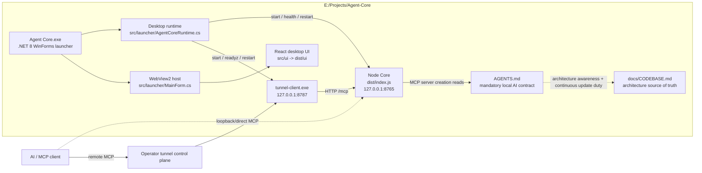
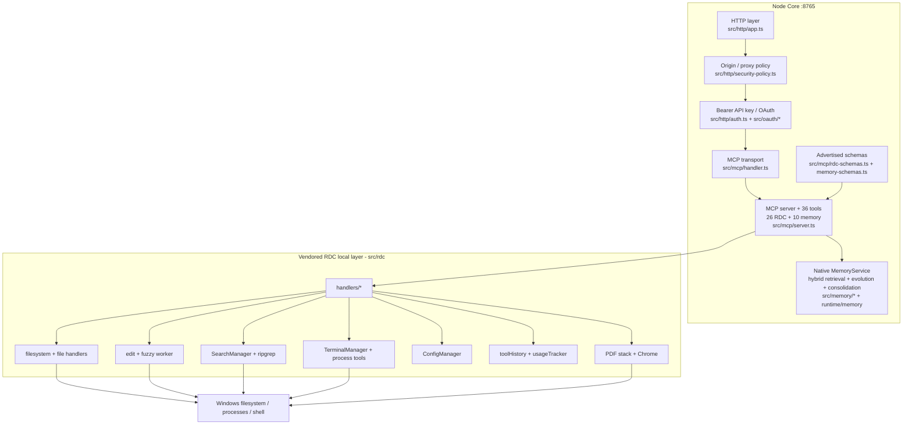
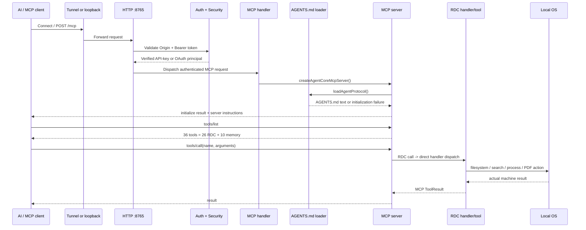
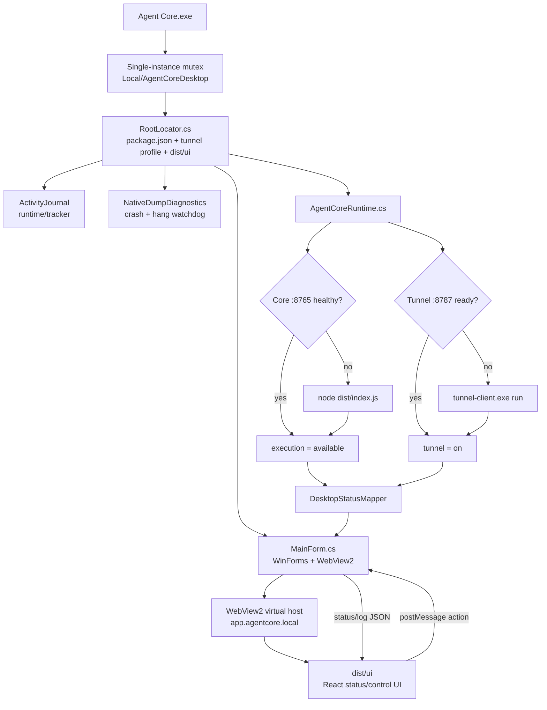
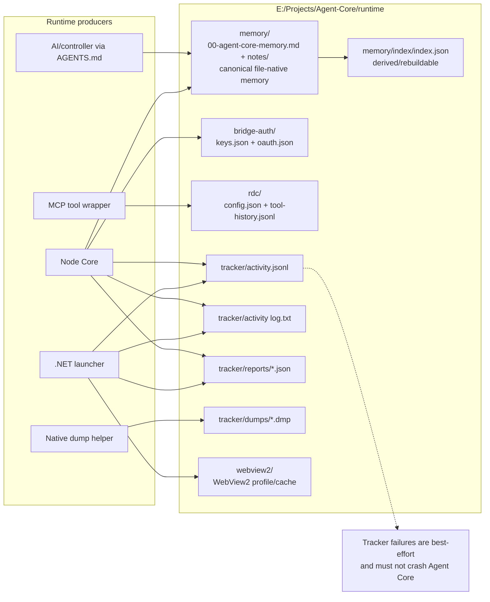
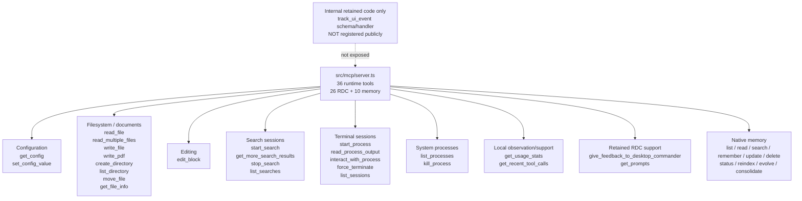

# Agent Core Codebase Map

> **Status:** Maintained architecture source of truth
> **Baseline grounded:** 2026-09-16
> **Project root:** `E:\Projects\Agent-Core`
> **Product version:** `0.8.0`
> **Primary runtime model:** local authenticated RDC-compatible MCP machine bridge

## 1. Purpose and maintenance contract

This file is the maintained architecture map for Agent Core. Every AI/controller operating Agent Core should know that this audited architecture source exists and what it represents. Reading it is not mandatory before every task; consult the relevant section when architecture context, subsystem ownership, topology, or uncertainty makes it useful. Full-repository grounding should not be repeated every session while this document remains current.

For a concrete task, inspect the exact source files needed for the requested change. Source code remains the final authority if it conflicts with this document. When a conflict is found, correct this document in the same task.

Update this document whenever a change affects architecture, runtime flow, public tool surface, ports/endpoints, authentication, storage/state paths, launcher behavior, tunnel behavior, tracker behavior, UI/native bridge behavior, build layout, generated artifacts, security boundaries, or test contracts. Document implemented state, not planned state.

### Explicit grounding exclusions

The baseline grounding intentionally did **not** inspect the contents of:

- `E:\Projects\Agent-Core\DO NOT TOUCH WITHOUT INSTRUCTION EXPLICIT`
- `E:\Projects\Agent-Core\.env`
- `E:\Projects\Agent-Core\secrets`

These paths are outside normal architecture grounding unless the user explicitly instructs otherwise. `.env` may override defaults documented here; therefore environment-dependent values below are source defaults or redacted observed structure, never guessed secret values.

## 2. Executive architecture

Agent Core is currently a direct machine bridge, not the previous autonomous-agent framework.

```text
AI / MCP client
    |
    | authenticated MCP over tunnel or loopback
    v
Node HTTP server :8765
    |
    +-- GET /health                public health
    +-- OAuth discovery/endpoints
    +-- POST /mcp                  authenticated MCP
            |
            v
mandatory AGENTS.md bootstrap
            |
            v
MCP tools/list + tools/call
            |
            +-- 26 RDC-compatible machine-control tools -> local Windows machine
            |
            +-- 10 explicit memory tools -> native MemoryService
                                       |
                                       +-- runtime/memory canonical notes
                                       +-- hybrid lexical + semantic retrieval
                                       +-- typed links + conservative evolution
                                       +-- rebuildable derived vector index
                                       +-- proposal-only consolidation
```

Remote access is a separate tunnel path:

```text
remote MCP client
    <-> operator control plane
    <-> tunnel-client.exe
    <-> http://127.0.0.1:8765/mcp
```

Desktop orchestration is a separate native application:

```text
Agent Core.exe (.NET 8 WinForms)
    |
    +-- starts/monitors Node core :8765
    +-- starts/monitors tunnel :8787
    +-- hosts React UI inside WebView2
    +-- shares the persistent Activity Journal
    +-- captures native crash/hang dumps
```

The active `src` tree contains no searched implementation identifiers for Supabase, `capability_route`, `routeContextId`, Graphify, or the old memory lifecycle.

## 3. Start-to-end runtime lifecycle

### 3.1 Desktop launcher startup

User-facing executable:

`E:\Projects\Agent-Core\Agent Core.exe`

Source:

`src\launcher\`

`Program.cs` performs the normal desktop boot sequence:

1. Handles `--native-dump-helper` mode before normal UI startup.
2. Enforces one desktop instance with mutex `Local\AgentCoreDesktop`.
3. Resolves the Agent Core root with `RootLocator`.
4. Opens the persistent `ActivityJournal`.
5. Starts native crash/hang diagnostics.
6. Installs WinForms and AppDomain exception handlers.
7. Creates `AgentCoreRuntime` and `MainForm`.
8. Runs the WinForms message loop.

`RootLocator.cs` considers a directory an Agent Core root when all three markers exist:

- `package.json`
- `tunnel-client\agent-core.yaml`
- `dist\ui`

The current root launcher therefore does not depend on `SubProject\Agent-Code`.

### 3.2 Launcher orchestration

`src\launcher\AgentCoreRuntime.cs` owns desktop lifecycle control.

Fixed service ports used by the launcher:

- Agent Core HTTP/MCP: `127.0.0.1:8765`
- tunnel readiness/admin: `127.0.0.1:8787`

Core launch command:

```text
node dist\index.js
```

Node executable resolution order:

1. `AGENT_CORE_NODE_EXE`
2. `C:\Program Files\nodejs\node.exe`
3. Node resolved from `PATH`

Tunnel launch concept:

```text
tunnel-client\tunnel-client.exe run
  --profile-file tunnel-client\agent-core.yaml
  --harpoon.allow-plaintext-http
```

Both are launched hidden. Readiness waits are approximately 12 seconds with polling around 200 ms. Restart/stop is identity-aware: the launcher refuses to kill an unrelated process merely because it occupies a managed port.

### 3.3 Node core startup

Entrypoint: `src\index.ts` -> `dist\index.js`.

Startup order:

1. Install process-level tracker hooks.
2. Load app config.
3. Record startup in tracker.
4. Ensure configured data directory exists.
5. Load local RDC config.
6. Resolve the optional memory embedder from `memoryEmbedding` config; current implementation supports Cloudflare Workers AI.
7. Initialize the native file-backed MemoryService with the configured memory directory and optional embedder.
8. Validate canonical bootstrap/notes and ensure the rebuildable lexical/semantic memory index.
9. Record memory-service readiness in the Activity Tracker.
10. Trigger background Chrome availability for PDF generation.
11. Construct API key store.
12. Construct OAuth store.
13. Construct HTTP security policy.
14. Construct OAuth service.
15. Create HTTP server and MCP handler, passing the shared MemoryService to MCP server factories.
16. Listen on configured host/port.
17. Record listening state.

Source defaults from `src\config.ts`, unless overridden by process environment or excluded `.env`:

- host: `127.0.0.1`
- port: `8765`
- auth/OAuth data directory: `runtime\bridge-auth`
- memory directory: `runtime\memory` (override: `AGENT_CORE_MEMORY_DIR`)
- memory embedding provider: `cloudflare-workers-ai` only when account ID + API token + model are all configured
- memory embedding dimensions: `768` default, overridable with `CLOUDFLARE_EMBEDDING_DIMENSIONS`
- runtime callers that construct an older/manual config object without `memoryEmbedding` are treated as embedding-disabled instead of crashing startup; `loadConfig()` still returns the full current field
- MCP protocol mode: `dual`

When normal process environment loading is used, `src\config.ts` attempts `process.loadEnvFile()` on the root `.env`. Credential values remain excluded from architecture documentation and must never be written into logs/docs.

### 3.4 Health truth model

`GET /health` is public. Current source reports direct execution plus native memory readiness. Memory health has this shape:

```json
{
  "status": "available | degraded | error",
  "mode": "file-native",
  "canonicalStore": "available | degraded | error",
  "noteCount": 1,
  "issueCount": 0,
  "index": "available | degraded | not-configured",
  "embedding": "available | degraded | not-configured",
  "intelligence": "available | degraded | not-configured",
  "embeddingProvider": "cloudflare-workers-ai",
  "embeddingModel": "<configured model>",
  "embeddingDimensions": 768
}
```

The top-level bridge health remains `status: ok` when the HTTP bridge is running. `execution: available` still means direct RDC machine-control capability. Canonical-store health is independent from optional embedding/index intelligence: embedding/API failure degrades memory retrieval/intelligence but does not invalidate canonical Markdown memory.

## 4. Mandatory AI operating contract

Root contract: `AGENTS.md`
Loader: `src\mcp\agent-protocol.ts`
Integration: `src\mcp\server.ts`

Behavior:

1. Every MCP server instance calls `loadAgentProtocol()`.
2. The loader reads root `AGENTS.md` synchronously as UTF-8 and trims it.
3. Missing, unreadable, or empty content throws.
4. Content is passed as MCP `ServerOptions.instructions`.
5. MCP initialization therefore carries the local operating contract before normal tool use.
6. The contract contains the top-level directive: **ALWAYS VIEW YOUR MEMORY DIRECTORY BEFORE DOING ANYTHING ELSE.** The canonical directory is `E:\Projects\Agent-Core\runtime\memory`; it contains the pinned foundational memory plus canonical note/index/state subdirectories. This remains an action requirement before other Agent Core work. A native MemoryService is now wired into startup and MCP, so memory health is no longer hard-coded `not-used`.
7. The contract requires every controller to know that `docs\CODEBASE.md` is the maintained architecture record produced from the full audit. It does not require opening this document mechanically before every task; it requires using it when architecture context is needed and updating the relevant section for every Agent Core change, small or large.
8. When native memory MCP tools are available, AGENTS.md prefers memory_list / memory_read for canonical memory access and selective recall; direct filesystem viewing remains the fallback/audit path.

This is a local operating protocol only; it does not claim to modify model weights, provider policy, or higher-priority system/safety rules.

## 5. HTTP request layer

Primary files:

- `src\http\app.ts`
- `src\http\auth.ts`
- `src\http\security-policy.ts`

Request routing order in `app.ts`:

1. `GET /health`
2. OAuth/OAuth-discovery routes handled by `OAuthService`
3. `/mcp`
4. all other paths -> `404`

Before `/mcp` dispatch:

1. browser Origin is validated when present
2. Bearer authentication is resolved
3. verified principal is passed to MCP dispatch

HTTP event taxonomy deliberately separates server failure from rejected client traffic:

- response `>=500` -> `HTTP / error`
- `401` or `403` -> `AUTH / info`
- other `4xx` -> `REQUEST / info`
- `/favicon.ico` `404` -> ignored noise
- successful responses and `/health` -> not logged by this finish hook

Low-level client/parser/socket errors are recorded as `CLIENT / info`, so a malformed/disconnected client is not automatically a system-failure false positive.

## 6. Authentication and API key store

Primary files:

- `src\auth\key-types.ts`
- `src\auth\key-store.ts`
- `src\auth\persistent-file.ts`
- `src\http\auth.ts`

Agent Core API keys use prefix `agent_core_live_`. Secrets are generated from cryptographic random bytes. Persistence stores a scrypt-derived hash plus salt; raw API keys are returned only when created/rotated and are not written into the store.

Supported key lifecycle:

- create
- import
- verify
- list metadata
- revoke
- rotate
- timestamp expiry

Bearer authentication resolution order:

1. parse `Authorization: Bearer ...`
2. verify as Agent Core API key
3. if OAuth is enabled, verify as OAuth access token
4. reject otherwise

The verified principal is forwarded to MCP dispatch. The current 26 RDC tool handlers are direct local capabilities; they are not selected by a capability router or route context.

Generic auth persistence uses temp-file replacement. On Windows, the generic persistence helper has a fallback for replacement failures such as `EPERM`, `EACCES`, or `EBUSY`. OAuth credential persistence is stricter and described separately below.

## 7. OAuth subsystem

Primary files:

- `src\oauth\atomic-file.ts`
- `src\oauth\file-lock.ts`
- `src\oauth\store.ts`
- `src\oauth\service.ts`

OAuth state file name is `oauth.json` inside the effective Agent Core data directory.

Supported protocol behavior:

- OAuth protected-resource discovery
- OAuth authorization-server discovery
- dynamic client registration
- authorization-code grant
- PKCE `S256`
- refresh-token grant
- MCP scope `mcp:tools`
- optional `offline_access`

Generated identifier/token prefixes include:

- `agent_core_client_`
- `agent_core_secret_`
- `agent_core_code_`
- `agent_core_oauth_`
- `agent_core_refresh_`

Authorization codes are short-lived and one-use. Access tokens are approximately one hour. Refresh tokens are approximately 30 days and rotate on consumption.

Client secrets, authorization codes, access tokens, and refresh tokens are persisted as hashes rather than raw values.

### 7.1 OAuth durability and concurrency

OAuth persistence intentionally has stronger semantics than ordinary config persistence:

- write temporary file
- flush/fsync
- atomic rename
- no unsafe in-place fallback for credential-state replacement

`src\oauth\file-lock.ts` supplies cross-process exclusion through `.oauth.lock`.

Important guarantees implemented/tested in source contract:

- same-process operations serialize
- different `FileOAuthStore` instances sharing one file serialize
- multiple Node processes are excluded correctly
- authorization code consumption is atomic
- refresh-token consumption is atomic
- a failed persistence step does not burn a still-valid grant
- stale locks owned by dead processes can be recovered
- lock ownership includes process/host/token information

There is a narrow lost-registration recovery path for ChatGPT-style connector OAuth callbacks. It is not a generic client takeover path; it is constrained to the empty-client-registry recovery case and expected callback shape.

### 7.2 Operator authorization UI

The authorization endpoint renders an HTML form asking the local operator for a valid Agent Core API key. Successful approval creates an authorization code and redirects to the registered client callback.

Rejected authorization requests emit a safe Activity Tracker diagnostic containing only the validation reason and non-secret request metadata (for example client id, redirect host, resource identity, scope names, and presence/method flags). API keys, state values, authorization codes, and PKCE challenge values are not logged.

### 7.3 External tunnel protected-resource identity

OAuth protected-resource identity is resolved independently from the local listener URL. `src\config.ts` reads `AGENT_CORE_OAUTH_PROTECTED_RESOURCE_URL` (with legacy alias `AGENT_CORE_PROTECTED_RESOURCE_URL`) into `httpSecurity.protectedResourceUrl`; `HttpSecurityPolicy.protectedResource()` uses that configured identity when present and otherwise falls back to `<externalBaseUrl>/mcp`.

This distinction is required for ChatGPT/OpenAI tunnel connectors: the external connector may present a tunnel resource such as an OpenAI gateway MCP URL while Agent Core continues listening locally at `http://127.0.0.1:8765/mcp`. Authorization validation requires the request `resource` to exactly match the resolved protected-resource identity and records safe rejection reasons such as `resource_mismatch` without logging API keys, state, authorization codes, or PKCE challenge values.

A 2026-09-17 re-auth incident exposed this mismatch: the connector supplied the external tunnel resource while Agent Core fell back to the loopback MCP resource, causing `GET /oauth/authorize` to return `400` before the API-key form. Configuring `AGENT_CORE_OAUTH_PROTECTED_RESOURCE_URL` restored the authorization form. The tunnel profile and operator API-key files were not modified by that fix.

Post-fix evidence includes the dedicated OAuth test covering an explicitly configured OpenAI tunnel protected resource, live operator re-auth confirmation, and a later read-only runtime snapshot showing bridge/execution/memory healthy, tunnel readiness true, and active OAuth access/refresh grant state.

## 8. HTTP security policy

Primary file: `src\http\security-policy.ts`.

Rules:

- a configured canonical public base URL takes precedence over request identity
- forwarded host/proto/client address are trusted only when `trustProxy=true`
- malformed trusted forwarded identity fails closed
- loopback classification handles IPv4 loopback, IPv6 loopback, and IPv4-mapped loopback
- missing peer identity fails closed
- Origin must use HTTP/HTTPS and may not contain credentials/path/query/hash
- allowed browser origins include appropriate loopback and configured/canonical origins

Default binding remains loopback unless configuration explicitly changes it.

## 9. MCP transport and dispatch

Primary files:

- `src\mcp\handler.ts`
- `src\mcp\server.ts`
- `src\mcp\rdc-schemas.ts`
- `src\mcp\rdc-tool-metadata.ts`
- `src\mcp\agent-protocol.ts`

Default MCP mode is `dual`.

Transport support:

- modern MCP HTTP through `createMcpHandler`
- legacy JSON fallback through `WebStandardStreamableHTTPServerTransport`

If protocol mode is explicitly set to `legacy`, modern requests are rejected. `/mcp` is POST-only.

Current dispatch model:

```text
tools/list
    -> registered metadata + input schemas

tools/call
    -> generic wrapper
    -> RDC-compatible handler
    -> local operation
```

There is no route selection, workflow selection, memory lease, postflight gate, execution DAG, or capability-authority step.

The generic wrapper:

- measures duration
- records recent history except for `get_recent_tool_calls` itself
- updates usage success/failure counters
- records successful calls as `MCP / success`
- records handled `isError` results as `OPERATION / info`
- captures thrown exceptions as real MCP failures

## 10. Public MCP tool surface

The active runtime registers **36** tools when MemoryService is present: the original **26 RDC-compatible tools remain unchanged as the machine-control subset**, plus **10 explicit memory tools**. Memory does not route or gate any RDC call.

### Configuration

1. `get_config`
2. `set_config_value`

### Filesystem/documents

3. `read_file`
4. `read_multiple_files`
5. `write_file`
6. `write_pdf`
7. `create_directory`
8. `list_directory`
9. `move_file`
10. `get_file_info`
11. `edit_block`

### Search

12. `start_search`
13. `get_more_search_results`
14. `stop_search`
15. `list_searches`

### Terminal/process

16. `start_process`
17. `read_process_output`
18. `interact_with_process`
19. `force_terminate`
20. `list_sessions`
21. `list_processes`
22. `kill_process`

### Usage/history/support

23. `get_usage_stats`
24. `get_recent_tool_calls`
25. `give_feedback_to_desktop_commander`
26. `get_prompts`

### Memory

27. `memory_list`
28. `memory_read`
29. `memory_search`
30. `memory_remember`
31. `memory_update`
32. `memory_delete`
33. `memory_status`
34. `memory_reindex`
35. `memory_evolve`
36. `memory_consolidate`

`src\mcp\rdc-schemas.ts` remains the RDC Zod v4 adapter. Memory tools use their own adapter in `src\mcp\memory-schemas.ts` and handlers in `src\mcp\memory-tools.ts`. `src\mcp\rdc-tool-metadata.ts` is the title/description/annotation source.

A `track_ui_event` helper exists in the vendored RDC area but is **not** part of the registered current MCP tool surface.


## 10A. Native memory subsystem

Memory is a first-class sibling subsystem under `src\memory`; it is **not** part of `src\rdc` and is never a preflight gate for normal machine-control tools.

Primary source files:

- `src\memory\types.ts` — canonical record/link/evolution/health contracts
- `src\memory\paths.ts` — canonical runtime paths and `AGENT_CORE_MEMORY_DIR` override
- `src\memory\note-format.ts` — strict Markdown+JSON metadata parsing/serialization and pinned bootstrap projection
- `src\memory\lock.ts` — cross-process mutation lock with stale-owner recovery
- `src\memory\store.ts` — file-native canonical store with atomic fsync+rename writes and pinned deletion protection
- `src\memory\semantic-document.ts` — derived content+context+keywords+tags+category text
- `src\memory\relations.ts` — typed link validation/dedup/fan-out bounds
- `src\memory\embedder.ts` — provider-neutral embedder contract plus Cloudflare Workers AI OpenAI-compatible adapter
- `src\memory\retrieval.ts` — hybrid lexical/metadata + semantic cosine ranking and bounded linked-neighbor expansion
- `src\memory\index.ts` — rebuildable fingerprint/semantic-text/vector index with embedder identity and stale-vector invalidation
- `src\memory\intelligence.ts` — strict deterministic metadata enrichment + embedding-neighbor proposal engine
- `src\memory\evolution.ts` — conservative validated evolution application for empty metadata and `related` links
- `src\memory\consolidation.ts` — duplicate/overlap candidate detection; proposal-only, no automatic merge/delete
- `src\memory\service.ts` — list/read/remember/update/delete/search/reindex/evolve/consolidate lifecycle and health

Canonical runtime layout:

```text
runtime/memory/
  00-agent-core-memory.md   # pinned foundational bootstrap
  notes/                    # one canonical Markdown file per ordinary memory
  index/index.json          # derived/rebuildable state only
  state/                    # reserved local memory state
  .memory.lock              # transient cross-process mutation lock
```

Ordinary canonical notes carry a machine-readable `agent-core-memory` JSON comment plus human-readable body. The foundational bootstrap remains the existing user-readable file and is projected as pinned memory id `agent-core-foundational` without rewriting it.

Canonical files are authoritative. The derived index may be deleted/rebuilt without losing memory. Startup automatically ensures/rebuilds the index from canonical records; index failure degrades memory health but does not invalidate a healthy canonical store.

Recall uses inspectable lexical/metadata components (phrase/token/keyword/tag/context/category with weak recency tie-break), optional semantic cosine similarity, and bounded typed-link expansion. Query embedding failure is fail-soft: search falls back to deterministic ranking while embedding/intelligence health becomes degraded. Actual returned non-pinned memories durably increment `retrievalCount` and `lastAccessedAt`; recall does not change `updatedAt`.

Mutation history is bounded and records concrete create/update/retrieval/link/evolution events. Ordinary APIs cannot update or delete the pinned foundational memory. Delete repairs incoming links and refuses destructive deletion when canonical memory issues make complete repair unsafe.

Phase 8 is implemented through a provider-neutral `MemoryEmbedder` and a Cloudflare Workers AI adapter using its OpenAI-compatible embeddings endpoint. Vectors, semantic text, fingerprints, and embedder identity live only in `runtime\memory\index\index.json`; changing content/semantic metadata or embedder identity invalidates/rebuilds derived vectors without migrating canonical notes.

Phase 9 uses `EmbeddingMemoryIntelligence`: deterministic token-based enrichment plus semantic-neighbor proposals validated through a strict Zod schema. Evolution is conservative: it may fill empty metadata and add bounded `related` links, but does not rewrite substantive existing content. New memories can be enriched/evolved after index refresh; content updates may auto-evolve only when the caller is not explicitly changing semantic metadata/links. `memory_evolve` provides an explicit manual path.

Phase 10 is non-destructive. `memory_consolidate` computes semantic similarity plus lexical Jaccard overlap and returns `review-merge` / `review-supersedes` candidates only. It does not merge, delete, or rewrite memories. `memory_reindex` remains a separate deterministic derived-state rebuild.

## 11. Vendored RDC machine-control layer

Primary directory: `src\rdc`.

Vendored version constant:

`0.2.50`

This is the machine-control implementation used by Agent Core's own `/mcp` endpoint. It is distinct from the separately installed Remote Desktop Commander remote-device/helper discussed later.

The root TypeScript build intentionally excludes unused/legacy RDC entrypoint surfaces such as remote-device and bundled RDC UI entrypoints. Agent Core wires the required handlers directly.

### 11.1 RDC configuration

Primary files:

- `src\rdc\config.ts`
- `src\rdc\config-manager.ts`
- `src\rdc\config-field-definitions.ts`

Default local config directory:

`runtime\rdc`

Override:

`AGENT_CORE_RDC_CONFIG_DIR`

Current `runtime\rdc\config.json` observed during baseline grounding:

- `defaultShell = powershell.exe`
- `allowedDirectories = []`
- `telemetryEnabled = false`
- `fileWriteLineLimit = 50`
- `fileReadLineLimit = 1000`

**Important:** the vendored filesystem implementation treats `allowedDirectories = []` as unrestricted filesystem access. This is observed current local state, not a recommendation.

User-editable config fields are intentionally limited to:

- `blockedCommands`
- `allowedDirectories`
- `defaultShell`
- `telemetryEnabled`
- `fileReadLineLimit`
- `fileWriteLineLimit`

The config manager uses cross-process locking, atomic temp/rename persistence, file watching/reload, and coalesced non-blocking updates.

### 11.2 Default blocked-command policy

Current default blocklist includes:

`mkfs`, `format`, `mount`, `umount`, `fdisk`, `dd`, `parted`, `diskpart`, `sudo`, `su`, `passwd`, `adduser`, `useradd`, `usermod`, `groupadd`, `chsh`, `visudo`, `shutdown`, `reboot`, `halt`, `poweroff`, `init`, `iptables`, `firewall`, `netsh`, `sfc`, `bcdedit`, `reg`, `net`, `sc`, `runas`, `cipher`, `takeown`.

`src\rdc\command-manager.ts` parses shell chains/subshell forms, extracts commands, and checks base commands before terminal execution.

### 11.3 Telemetry and dormant feature flags

`src\rdc\utils\capture.ts` deliberately turns upstream Desktop Commander telemetry capture calls into no-ops and reports telemetry disabled.

Vendored `feature-flags.ts` still contains code capable of fetching a Desktop Commander flag URL, but current active-source inspection found no call to `featureFlagManager.initialize()`. Treat that remote-fetch path as dormant unless future source explicitly initializes it.

## 12. Filesystem subsystem

Primary implementation:

- `src\rdc\tools\filesystem.ts`
- `src\rdc\handlers\filesystem-handlers.ts`
- `src\rdc\utils\files\*`

### 12.1 Canonical-path safety boundary

Before local file operations, `validatePath()`:

1. expands `~`
2. resolves an absolute path
3. resolves symlinks for existing paths
4. for a new path, resolves its parent/deepest existing ancestor
5. checks the canonical target against `allowedDirectories`
6. returns the resolved target used by the operation

The ancestor/symlink handling prevents writing through an allowed-directory symlink into a restricted target. Path validation has an approximately 10-second timeout.

### 12.2 Read behavior

`read_file` supports both local files and explicit URL reads.

Local file handlers cover:

- text
- image
- PDF
- Excel
- DOCX
- generic binary files

Text reads support offset/length pagination. Excel supports sheet/range semantics. PDFs are projected into Markdown/page structure and may expose embedded images. Images are returned as encoded viewable content.

URL fetch has an approximately 30-second timeout. Local reads use an abortable upper bound of approximately three minutes so a stalled cloud/network file does not hold the MCP call indefinitely.

A directory passed to `read_file` is detected and returns guidance/listing rather than only surfacing a raw `EISDIR` failure.

### 12.3 Write behavior and overwrite guard

`write_file` supports `rewrite` and `append`.

The MCP schema preserves RDC-compatible optional mode/default behavior, but the handler layer tracks whether the caller explicitly supplied a mode. An existing non-empty file is protected from an accidental implicit overwrite when mode was omitted. This behavioral contract is explicitly represented in `tests\bridge-runtime.test.ts`.

### 12.4 Editing

`edit_block` supports:

- exact text replacement with expected replacement count
- structured range edits for handlers such as Excel
- DOCX handler editing through its XML representation

Text editing preserves the target file's line-ending style.

If an exact text block is not found, fuzzy matching is diagnostic only: it reports the closest match/similarity/diff so the caller can retry with exact text. It does not silently perform a fuzzy replacement. Current fuzzy threshold is about `0.7`.

### 12.5 Directory and metadata behavior

`list_directory` recursively descends to requested depth and caps large nested directory listings to protect context size. `get_file_info` augments base filesystem metadata with type-specific information such as text line count, Excel sheets, image/PDF/binary flags, PDF page count/title/author, and append position.

## 13. Search subsystem

Primary files:

- `src\rdc\search-manager.ts`
- `src\rdc\handlers\search-handlers.ts`
- `src\rdc\utils\ripgrep-resolver.ts`

Search is session-based and progressive:

```text
start_search
    -> session id
get_more_search_results
    -> paginated/progressive results
stop_search
    -> terminate session
list_searches
    -> inspect active sessions
```

Supported modes:

- filename search
- content search

Options include case sensitivity, hidden files, context lines, file-pattern filtering, result cap, timeout, early termination, and literal versus regex matching.

Ripgrep resolution order:

1. bundled `@vscode/ripgrep`
2. system `rg`
3. common platform-specific install paths

When targeted Office formats require it, Excel/DOCX search has format-aware handling. Office-content matching is intentionally literal instead of arbitrary regex execution.

Completed search sessions are retained briefly for result retrieval and later cleaned up.

## 14. Terminal and process subsystem

Primary files:

- `src\rdc\terminal-manager.ts`
- `src\rdc\command-manager.ts`
- `src\rdc\tools\improved-process-tools.ts`
- `src\rdc\tools\process.ts`
- terminal/process handler files under `src\rdc\handlers`

### 14.1 Managed terminal sessions

`start_process` validates command policy first, chooses an explicit/configured/default shell, then creates a managed terminal session.

Tracked session data includes:

- PID/session identity
- buffered output
- read cursor
- waiting/blocked state
- exit status
- runtime
- recently completed sessions

Output is bounded to prevent runaway processes consuming unbounded memory. Individual output lines are also bounded. `read_process_output` supports:

- new output since previous read
- absolute line offset
- tail reads
- output length limit
- optional timing diagnostics

`interact_with_process` supports REPL-style workflows and polls for prompt/finish state.

### 14.2 `node:local` virtual execution

`start_process` accepts a special `node:local` mode. It creates a negative virtual PID and executes each later interaction as a fresh temporary `.mjs` script on the MCP server.

Important: virtual `node:local` interactions do **not** retain script state across calls. Each call must be self-contained.

### 14.3 System process tools

`list_processes` uses:

- Windows: `tasklist /FO CSV /NH`
- Unix-like systems: `ps aux`

`kill_process` terminates the requested PID through the platform process primitive.

## 15. PDF subsystem

Directory: `src\rdc\tools\pdf`.

Capabilities include:

- PDF -> Markdown/page structure
- embedded-image extraction
- Markdown -> PDF
- page insertion
- page deletion

PDF-to-Markdown uses the bundled OpenDocs conversion layer. Markdown-to-PDF uses `md-to-pdf` and requires Chrome/Chromium.

Chrome resolution order:

1. private Puppeteer cache under `runtime\rdc\puppeteer-cache`
2. system Chrome/Chromium
3. download Chrome for Testing through `@puppeteer/browsers`

Core startup calls `ensureChromeAvailable()` in the background. Old private cached Chrome builds can be pruned while the active build is preserved.

## 16. Local tool history and usage counters

### 16.1 Tool history

Implementation: `src\rdc\utils\toolHistory.ts`.

Persistent file:

`runtime\rdc\tool-history.jsonl`

Important bounds:

- last ~1000 entries in memory
- stored output per entry capped around 4 KiB
- on-disk history capped around 5 MiB
- trim target around 4 MiB
- queued writes flushed roughly once per second

This is an operational “what happened recently” aid, not a result cache.

### 16.2 Usage counters

Implementation: `src\rdc\utils\usageTracker.ts`.

Usage state is stored in RDC config and categorizes calls into filesystem, terminal, edit, search, config, and process groups plus per-tool counts, successes/failures, first/last use, and session counters.

Vendored onboarding/feedback logic remains in source. `get_prompts` exposes the simplified prompt-retrieval path. `give_feedback_to_desktop_commander` opens an external feedback form. Upstream telemetry capture itself is disabled in Agent Core as documented earlier.

## 17. Persistent activity tracker

Node implementation:

`src\tracker\activity-tracker.ts`

Desktop implementation:

`src\launcher\ActivityJournal.cs`

Shared tracker root:

`runtime\tracker`

Primary artifacts:

- `activity.jsonl` — structured persistent journal
- `activity log.txt` — human/AI-readable mirror
- `activity.clear` — persistent clear cutoff
- `reports\*.json` — failure snapshots
- `dumps\*.dmp` — native crash/hang dumps when generated

### 17.1 Node tracker semantics

The Node tracker keeps a recent event ring bounded to approximately 256 entries / roughly 64 KiB of context.

It provides:

- cross-process write locking
- journal flush persistence
- TXT mirroring
- malformed-JSONL recovery into `activity.corrupt.<timestamp>.jsonl`
- persistent clear cutoff
- failure-report snapshot generation
- report pruning
- redaction of common token/password/authorization/API-key context fields before persistence
- process hooks for uncaught-exception monitoring, unhandled rejections, warnings, and process exit

Tracker failure is intentionally fail-soft: inability to write diagnostic data must not itself crash Agent Core.

Failure-report retention policy is approximately:

- maximum age: 365 days
- maximum aggregate size: 128 MiB

### 17.2 Activity Log dual path

The launcher and Node core feed the same persistent tracker concept. Operational evidence can be consumed through:

1. the Activity Log panel inside `Agent Core.exe`
2. direct read of `runtime\tracker\activity log.txt`

The TXT mirror exists so an AI/controller can inspect activity without taking foreground control of the user's desktop window.

## 18. Native crash and hang diagnostics

Primary implementation:

`src\launcher\NativeDumpDiagnostics.cs`

The launcher uses an out-of-process helper mode of the same executable:

```text
Agent Core.exe --native-dump-helper ...
```

Mechanism includes:

- named request/completed/stop events
- Win32 unhandled-exception filter
- vectored handling for selected fatal native exception classes
- helper-side `MiniDumpWriteDump` through `Dbghelp.dll`
- UI heartbeat watchdog

Native fatal classes monitored include access violation, illegal instruction, stack overflow, heap corruption, and stack-buffer overrun families.

Hang detection uses a UI heartbeat. A missing healthy heartbeat for approximately 15 seconds becomes a hang candidate. Long scheduler/system-sleep gaps are considered so ordinary suspension is less likely to be misclassified as a UI hang.

Dump retention follows approximately the same 365-day / 128-MiB budget as failure-report retention.

## 19. Desktop UI host

Primary implementation:

`src\launcher\MainForm.cs`

Window defaults are approximately:

- initial `1120 x 680`
- minimum `940 x 560`

WebView2 fills the application window.

WebView2 user-data directory:

`runtime\webview2`

The user does not interact with a browser tab or visible localhost UI. The native host maps:

`dist\ui`

to the virtual host:

`https://app.agentcore.local/`

and navigates WebView2 to its `index.html`.

Navigation away from the local application host is cancelled. New-window requests are blocked. Normal launcher WebView2 configuration disables context menus, the status bar, and DevTools.

### 19.1 Page/WebView diagnostics

The host has diagnostics for:

- JavaScript errors
- unhandled promise rejections
- React root remaining empty after load
- navigation failure
- WebView2 process failure

These feed the activity journal. WebView2 process failure may also request a native diagnostic snapshot.

## 20. React desktop UI

Source:

`src\ui`

Output:

`dist\ui`

Independent UI package version: `0.8.0`.

Stack:

- React 19
- Vite 6
- Tailwind CSS 4
- Lucide React
- TypeScript

UI scripts:

```text
npm run build
npm test
npm run typecheck
```

Vite uses relative base `./` and writes directly to `..\..\dist\ui`.

### 20.1 Native host bridge

`src\ui\src\host.ts` defines the WebView2 messaging contract.

Browser/UI -> native messages include concepts such as:

- `ready`
- user `action`
- UI diagnostic events

Native -> UI messages include:

- status snapshot
- Activity Log snapshot/events
- action state/error data as applicable

### 20.2 Current visual and status surface

Top action cards:

- Activity Monitor
- Open Tunnel Admin UI
- Restart Tunnel
- Open Agent Core Folder
- Restart Agent Core
- Restart All

Left control/status area:

- Start Windows autostart toggle
- Reset OAuth / Re-auth
- Connection
- Memory
- Tunnel
- Execution

Right area:

- Activity Log
- CLEAR action

Connection/Tunnel/Execution ON/OFF elements are passive status indicators, not manual power switches. Memory now follows the native MemoryService health reported by `/health`.

Status mapping semantics:

- Connection ON = Agent Core `/health` reachable/healthy
- Memory ON = `available`
- Memory DEG/amber = `degraded`
- Memory OFF = `not-used` or `error`
- Tunnel ON = tunnel readiness succeeds
- Execution available/ON = health reports direct RDC machine execution available
- overall online = bridge+tunnel ready and memory not degraded/error
- memory degraded/error contributes to overall degraded state

## 21. Launcher actions and controls

`AgentCoreRuntime` currently supports actions including:

- open Agent Core folder
- open tunnel admin UI
- restart Agent Core
- restart tunnel
- restart all
- reset OAuth / re-auth
- enable/disable Windows autostart
- clear Activity Log

Windows autostart is stored under the current user's Run registry entry for Agent Core.

### Reset OAuth path resolution

`AgentCoreRuntime.ResetOAuthAsync()` now resolves the same effective Agent Core data directory precedence as the Node core for `AGENT_CORE_DATA_DIR`: process environment, then root `.env`, then the default `runtime\bridge-auth`. Reset/re-auth creates a backup of the effective `oauth.json`, preserves registered OAuth clients/client-secret hashes, clears authorization codes plus access/refresh-token records, and leaves `keys.json` untouched so the operator API key remains valid for re-authorization.

## 22. Tunnel client

Directory:

`tunnel-client`

Important files:

- `tunnel-client.exe`
- `agent-core.yaml` — operator-owned active profile, ignored by Git
- `agent-core.example.yaml` — tracked non-secret template

The active profile structure was inspected with credential values redacted. Observed shape:

- `config_version: 1`
- configured control-plane base URL
- configured tunnel ID
- configured API key
- health listener `127.0.0.1:8787`
- admin browser auto-open disabled
- log level `info`
- log format `struct-text`
- MCP channel `main` -> `http://127.0.0.1:8765/mcp`

The example profile can reference an API-key file beneath `secrets`; the contents of the root `secrets` directory were deliberately excluded from grounding.

## 23. Custom tunnel admin-client build

Script:

`scripts\tunnel\build-admin-client.ps1`

This builds a pinned modified OpenAI tunnel-client distribution in a temporary work area.

Pinned upstream information found in the script:

- repository: `https://github.com/openai/tunnel-client.git`
- tag: `v0.0.10`
- revision: `105e17a79a36e4e5c897fd698ed2b8dbf935b144`
- pnpm: `10.11.0`

Purpose: produce an admin-only tunnel distribution. The script removes the upstream interactive assistant/Codex surface while retaining tunnel, MCP, health, control-plane, and administrative functionality.

It emits provenance data such as upstream revision, binary hash, build tools, and scoped test/exclusion information in its build artifact area.

## 24. External Remote Desktop Commander helper

This subsystem is **not** the same thing as `src\rdc`.

Operational files/directories include:

- `Start-Desktop-Commander.bat`
- `Apply-Desktop-Commander-Allowlist.ps1`
- `Desktop-Commander-Allowlist.txt`
- `Edit-Desktop-Commander-Allowlist.bat`
- `dist\.desktop-commander\...`
- `rdc\...`

### 24.1 Isolated RDC launcher

`Start-Desktop-Commander.bat` uses an isolated profile under:

`dist\.desktop-commander\agent-core-home`

and npm cache under:

`dist\.desktop-commander\npm-cache`

It applies `Desktop-Commander-Allowlist.txt` then starts:

```text
@wonderwhy-er/desktop-commander@0.2.47 remote --persist-session
```

### 24.2 Locally installed RDC copy

`rdc\package.json` depends on `@wonderwhy-er/desktop-commander ^0.2.47`.

The installed package inspected during this grounding reports exact version `0.2.47`.

### 24.3 Version distinction

Do not conflate these two layers:

- external Remote Desktop Commander device/helper: **0.2.47**
- vendored Agent Core local machine-control layer: **0.2.50**

External RDC is an operator/development bridge for reaching the PC. Agent Core's own `/mcp` machine tools come from vendored `src\rdc`.

## 25. Allowlist files

### `Desktop-Commander-Allowlist.txt`

Consumed by `Apply-Desktop-Commander-Allowlist.ps1` for the external isolated RDC profile. During grounding it listed the roots of drives E, D, C, and F.

### `Agent-Core-Allowlist.txt`

Still exists at root, but active source/scripts scanning found no current consumer. Treat it as **stale/unwired residue** unless new source explicitly reconnects it.

Current vendored RDC filesystem policy instead comes from `runtime\rdc\config.json` -> `allowedDirectories`.

## 26. Build layout

### 26.1 Node core

Root `package.json` commands:

```text
npm run build   -> tsc -p tsconfig.json
npm test        -> vitest run
npm run start   -> node dist/index.js
npm run verify  -> build + test
```

Node engine requirement: `>=24.15.0`.

TypeScript output: `dist` with source maps.

### 26.2 React UI

UI is a separate package at `src\ui`; root TypeScript compilation excludes it.

UI Vite build writes to:

`dist\ui`

### 26.3 Native launcher

Project:

`src\launcher\AgentCore.Launcher.csproj`

Target:

`.NET 8 / net8.0-windows / WinForms`

Important native UI dependency:

`Microsoft.Web.WebView2`

Application icon is wired to Agent Core branding assets. Publish staging has been used under `runtime\launcher-publish`; the user-facing executable is root `Agent Core.exe`.

There is currently no root npm script that owns the .NET publish pipeline. Launcher publish remains a separate build operation.

## 27. Generated output versus source

`dist` contains:

- generated Node JavaScript/source maps corresponding to active root TypeScript source
- generated `dist\ui` Vite output

`dist\.desktop-commander` is different: it is the isolated external RDC profile/cache, not TypeScript compiler output.

When corresponding source exists under `src`, do not edit generated implementation under `dist` directly. Edit source and rebuild when authorized.

## 28. Runtime directory map

`runtime` is ignored by Git and currently contains both active state and historical development/recovery artifacts.

### 28.1 Active or architecturally meaningful paths

- `runtime\memory` — canonical native memory root. `00-agent-core-memory.md` is the pinned foundational memory; `notes\` stores ordinary canonical memories; `index\index.json` is derived/rebuildable semantic-text/fingerprint state; `state\` is reserved local memory state. `AGENTS.md` still requires viewing this memory directory before other Agent Core work.
- `runtime\rdc` — vendored RDC config, local tool history, Puppeteer Chrome cache
- `runtime\tracker` — persistent activity journal/TXT mirror/clear marker/reports/native dumps
- `runtime\webview2` — WebView2 profile/cache/state
- configured core auth/OAuth data directory — source default `runtime\bridge-auth`, but actual effective path may be overridden by excluded `.env`
- `runtime\launcher-publish` — launcher publish staging used by current development workflow

### 28.2 Historical/recovery/test/visual artifacts currently present

Examples observed during baseline grounding:

- `agent-core-raw`
- `agent-core-raw.bak-*`
- `recovery`
- `recovery-root-git`
- multiple UI/window screenshots
- backup App/UI output
- launcher build/test logs
- `test-desktop-status`
- `native-dump-test-temp+`
- `tracker-red5.png`
- embedded-icon/diagnostic artifacts
- local npm cache

Their presence does **not** make them active runtime architecture. Do not opportunistically clean them. Cleanup requires its own explicit user instruction.

## 29. Important root artifacts

### `Agent Core.exe`

Current user-facing desktop launcher.

### `AGENTS.md`

Mandatory local AI operating contract injected into MCP initialization. It points controllers to the canonical `runtime\memory` first-action requirement and to this `CODEBASE.md` architecture map.

### `Memory-in-progress.md`

Implementation plan for the future native Agent Core memory subsystem, grounded from the explicitly authorized A-MEM reference repository. This file documents planned work only; it is not evidence that the memory engine, MCP memory tools, semantic retrieval, or health transition have been implemented.

### `agent-core.zip`

Raw UI archive re-supplied by the user during UI recovery. Its inspected archive entries form a small standalone React/Vite design source (`src\App.tsx`, `src\main.tsx`, CSS, package/build files, etc.). It is not directly executed by current Agent Core runtime.

### `prompt.txt`

Contains the historical explicit instruction used while integrating tracker/activity-log behavior. It is not an executable configuration source.

### `assets`

Current Agent Core icon/branding assets used by native/UI packaging.

### `SECURITY.md`

Security documentation exists, but at least one persistence-path statement can be stale relative to current source. See Known Drift.

## 30. SubProject boundary

Top-level `SubProject` currently contains:

- `Agent-Code`
- `Market-Signal-Lab`
- `Presentation-Bridge`
- `Super-Runtime`
- `Tools-Photoshop`

A scan of active Agent Core `src` and root operational scripts found no current runtime dependency on these SubProjects.

### 30.1 `SubProject\Agent-Code`

The older Agent Code application still exists with its own executables, Tauri source, UI, resources, WebView2 data, and tests.

Current root `Agent Core.exe` does not require it according to active `RootLocator` and launcher source. Treat Agent Code as a separate/legacy SubProject unless a future task explicitly reconnects it.

### 30.2 Other SubProjects

Market-Signal-Lab, Presentation-Bridge, Super-Runtime, and Tools-Photoshop are independent project areas, not components of the current Agent Core startup graph. Do not recursively interpret their internal code as Agent Core architecture unless an integration is explicitly introduced.

## 31. Test architecture and contracts

The original full-audit documentation was created from source/test inspection without executing the suites. On 2026-09-17, the Phase 8–10 audit executed the relevant root Vitest contracts plus isolated semantic-memory tests; exact evidence is recorded in the change record below.

Root Vitest excludes generated/runtime/SubProject/UI areas and tests the Node bridge separately. UI and .NET launcher use their own test setups.

### `tests\bridge-runtime.test.ts`

Covers:

- authenticated MCP bridge
- 26 RDC-compatible tools preserved plus 10 explicit memory tools (36 total) when MemoryService is wired
- absence of `capability_route`
- direct config/file create/read/write/edit/info
- existing-file overwrite protection when explicit write mode is omitted
- progressive search
- direct process execution without routing/workflow/memory gates
- local usage/history
- PDF create/read/modify

### `tests\desktop-status.test.ts`

Covers health truth:

- execution `available` / `rdc-direct`
- native file-backed memory health is expected to become `available` when a valid bootstrap memory is supplied; the test contract now uses an isolated temp memory root

### `tests\http-auth.test.ts`

Covers:

- public health
- Bearer requirement for MCP
- verified-principal propagation
- Origin rejection before MCP dispatch

### `tests\http-security.test.ts`

Covers:

- canonical public URL authority
- trusted proxy semantics
- malformed forwarded-header rejection
- loopback classification
- deterministic browser-Origin validation

### `tests\key-store.test.ts`

Covers:

- raw API secret not persisted
- key verification
- revoke/expiry
- rotation

### `tests\oauth.test.ts`

Covers:

- OAuth discovery metadata
- dynamically registered client secret hashing
- PKCE authorization-code flow
- OAuth access token accepted on `/mcp`

### OAuth durability/concurrency tests

Files include process-lock, concurrency-review, atomic-exchange-review, crossprocess-repair, and rename-repair tests.

Their contracts include:

- cross-process exclusion
- stale lock recovery
- concurrent independent token issuance
- exactly-once grant consumption
- persistence failure does not consume a valid grant
- multi-process durable state
- failed atomic replacement does not fall back to unsafe in-place OAuth overwrite

### `tests\rdc-parity.test.ts`

Ensures all 26 RDC local tools remain present unchanged as a parity subset, 10 explicit memory tools are added alongside them (36 total), and no `capability_route` is exposed.

### `tests\memory-phase8-10.test.ts`

Added during the 2026-09-17 audit. Uses an isolated temporary canonical memory root and deterministic fake embedder to verify:

- semantic vectors contribute to hybrid retrieval scoring
- conservative evolution adds bounded `related` links without rewriting substantive memory content
- consolidation returns review candidates without merging/deleting canonical memories
- query-embedding failure falls back to deterministic retrieval
- embedding failure degrades optional embedding/memory health while canonical storage remains available
- a later successful semantic query clears transient query-embedding degradation and restores health to `available` without restart/reindex
- reinitializing `MemoryService` from the same isolated canonical root preserves ordinary memories and reusable embedding/index readiness

### Launcher tests

`src\launcher.tests\DesktopStatusMapperTests.cs` covers available memory -> online and degraded memory -> degraded overall while bridge/tunnel remain on.
`src\launcher.tests\RootLocatorTests.cs` covers root-marker discovery.

### UI tests

`src\ui\src\App.test.tsx` exists under the UI package's separate Vitest configuration and now expects Memory ON for `available` host status.

## 32. Current Git/worktree state

At the 2026-09-16 baseline, the repository is in a **large uncommitted refactor state**.

Git reports many files from the prior Agent Core framework architecture as deleted while the current RDC-style bridge, launcher, tracker, UI, and related files are modified or untracked.

Consequences for future work:

- do not assume Git HEAD describes current architecture
- do not run broad `git restore`, `git checkout`, `git clean`, `git reset --hard`, or mass deletion to make the tree match HEAD without explicit user instruction
- preserve unrelated SubProject/user changes
- treat the current working tree as implementation truth

Old deleted paths still visible in Git history/status include routing, memory, workflow, execution DAG, GitHub fabric, Langflow, continuity, operator-directives, observability, plugin, Supabase, and many related tests/scripts. Their appearance in Git metadata does **not** make them active runtime code.

## 33. Confirmed inactive legacy architecture

A baseline active-source scan across `.ts`, `.tsx`, and `.cs` under `src` returned:

`ZERO_ACTIVE_LEGACY_MATCHES`

for the searched legacy identifiers:

- Supabase
- `capability_route`
- `routeContextId`
- Graphify
- legacy pre-reset memory-lifecycle identifiers

Current runtime still preserves direct RDC-style dispatch. The new native `src\memory` subsystem is separate from the removed legacy memory lifecycle and does not gate RDC execution.

## 34. Known drift, retained residue, and resolved drift

This section records remaining residue plus previously identified drift that has now been synchronized, so historical mismatches are not mistaken for current architecture.

### 34.1 `.env.example` synchronized with active architecture

The tracked `.env.example` now reflects the active source contract: loopback host/port, `runtime\bridge-auth`, `runtime\memory`, dual MCP mode, public/protected-resource OAuth identity fields, proxy/origin settings, Cloudflare Workers AI embedding configuration, RDC config root, and optional launcher Node override. It contains placeholders/defaults only, not effective runtime secrets.

The real root `.env` remains operator-sensitive and is excluded from normal architecture grounding; effective values may therefore differ from the example without making the example stale.

### 34.2 Auth persistence path

API-key and OAuth state live in the effective Agent Core data directory. Source default is `runtime\bridge-auth`; `AGENT_CORE_DATA_DIR` from process environment or root `.env` may override it. `SECURITY.md` and launcher Reset OAuth behavior were synchronized to this contract on 2026-09-17.

### 34.3 Reset OAuth consistency

`AgentCoreRuntime.ResetOAuthAsync()` resolves the effective data directory with the same precedence as the Node core, backs up `oauth.json`, preserves registered OAuth clients/client-secret hashes, clears authorization codes plus access/refresh-token grants, leaves the separate `keys.json` API-key store untouched, and restarts the core. Resolver regression tests cover default, `.env`, and process-environment precedence; `OAuthStateResetterTests` cover client preservation, grant clearing, backup creation, and safe no-op when the OAuth store is missing.

### 34.4 `Agent-Core-Allowlist.txt` is not wired into current core

No active consumer was found. Actual vendored RDC filesystem policy comes from `runtime\rdc\config.json` `allowedDirectories`.

### 34.5 `.gitmodules` contains historical `referensi/*` paths

`.gitmodules` still lists many old `referensi/...` submodules. The normal root tree grounded here no longer presents a matching active `referensi` architecture.

The protected `DO NOT TOUCH WITHOUT INSTRUCTION EXPLICIT` area was intentionally not inspected, so this document makes no claims about content inside it.

### 34.6 RDC version split

Vendored local Agent Core machine handlers identify as `0.2.50`; the external Remote Desktop Commander helper installed/launched for remote operator access is `0.2.47`.

### 34.7 Runtime historical artifacts

A file existing under `runtime` is not proof that current source consumes it. Use this architecture map and active source paths before treating runtime leftovers as authoritative.

## 35. Sources that are not sufficient alone to infer architecture

Do not derive current architecture from any one of these alone:

- `.env.example` alone (it is a configuration example, not proof of effective runtime values)
- deleted files shown by Git history/status
- historical runtime backups/screenshots/test logs
- old Agent Code SubProject
- `.gitmodules` historical reference paths
- generated `dist` where corresponding `src` exists

Current source + this maintained map are the starting points.

## 36. Targeted inspection map for future changes

The point of this document is to eliminate unnecessary full grounding. After reading this file, inspect only the targeted implementation surface below unless evidence requires expansion.

### Change AI identity/personality/operating behavior

Inspect:

- `AGENTS.md`
- `src\mcp\agent-protocol.ts`
- `src\mcp\server.ts`

Do not invent a router/workflow gate to enforce local instructions. The current mechanism is MCP initialization instructions.

### Add/remove/change an MCP tool

Inspect:

- `src\mcp\server.ts`
- `src\mcp\rdc-schemas.ts`
- `src\mcp\rdc-tool-metadata.ts`
- relevant `src\rdc\handlers\*`
- relevant `src\rdc\tools\*`

Then update section 10 of this document so the exact public surface remains truthful.

### Change HTTP routing or health

Inspect:

- `src\index.ts`
- `src\http\app.ts`
- `src\config.ts`
- launcher status mapper if health schema changes

### Change API-key authentication

Inspect:

- `src\auth\key-types.ts`
- `src\auth\key-store.ts`
- `src\auth\persistent-file.ts`
- `src\http\auth.ts`

### Change OAuth

Inspect:

- `src\oauth\atomic-file.ts`
- `src\oauth\file-lock.ts`
- `src\oauth\store.ts`
- `src\oauth\service.ts`
- `src\http\auth.ts`
- `src\http\security-policy.ts`
- launcher Reset OAuth path if storage location changes

Do not inspect/expose root secrets merely to understand OAuth architecture.

### Change browser/HTTP trust boundaries

Inspect:

- `src\http\security-policy.ts`
- `src\http\app.ts`
- `src\config.ts`

### Change filesystem access/safety

Inspect:

- `src\rdc\tools\filesystem.ts`
- `src\rdc\handlers\filesystem-handlers.ts`
- relevant `src\rdc\utils\files\*`
- `src\rdc\config-manager.ts`
- `runtime\rdc\config.json` only when current local policy state matters

### Change shell command safety

Inspect:

- `src\rdc\command-manager.ts`
- `src\rdc\config-manager.ts`
- `src\rdc\tools\improved-process-tools.ts`

### Change editing behavior

Inspect:

- `src\rdc\tools\edit.ts`
- relevant file handler under `src\rdc\utils\files`
- filesystem validation/writing helpers

### Change search

Inspect:

- `src\rdc\search-manager.ts`
- `src\rdc\handlers\search-handlers.ts`
- `src\rdc\utils\ripgrep-resolver.ts`

### Change terminal/process execution

Inspect:

- `src\rdc\tools\improved-process-tools.ts`
- `src\rdc\terminal-manager.ts`
- `src\rdc\command-manager.ts`
- `src\rdc\tools\process.ts`

### Change PDF behavior

Inspect:

- `src\rdc\tools\filesystem.ts`
- `src\rdc\tools\pdf\*`
- PDF/file handlers under `src\rdc\utils\files`

### Change local RDC config/tool history

Inspect:

- `src\rdc\config.ts`
- `src\rdc\config-manager.ts`
- `src\rdc\config-field-definitions.ts`
- `src\rdc\utils\toolHistory.ts`
- `src\rdc\utils\usageTracker.ts`

### Change Activity Log / diagnostics

Inspect both process sides:

- `src\tracker\activity-tracker.ts`
- `src\launcher\ActivityJournal.cs`
- `src\launcher\NativeDumpDiagnostics.cs`
- `src\launcher\MainForm.cs`
- `src\ui\src\App.tsx`
- `src\ui\src\host.ts`

The JSONL journal, TXT mirror, clear cutoff, reports, UI view, and native dump path form one observability system and should remain semantically aligned.

### Change launcher lifecycle/status/actions

Inspect:

- `src\launcher\Program.cs`
- `src\launcher\RootLocator.cs`
- `src\launcher\AgentCoreRuntime.cs`
- `src\launcher\DesktopStatus.cs`
- `src\launcher\MainForm.cs`

### Change desktop UI

Inspect:

- `src\ui\src\App.tsx`
- `src\ui\src\host.ts`
- `src\ui\src\index.css`
- `src\ui\vite.config.ts`

Output is `dist\ui`; do not treat output assets as source.

### Change tunnel behavior

Inspect:

- `tunnel-client\agent-core.example.yaml`
- operator-owned `tunnel-client\agent-core.yaml` only if the task actually requires current profile state
- `src\launcher\AgentCoreRuntime.cs`
- `scripts\tunnel\build-admin-client.ps1`

Never copy tunnel secrets into this document.

### Change external Remote Desktop Commander helper

Inspect:

- `Start-Desktop-Commander.bat`
- `Apply-Desktop-Commander-Allowlist.ps1`
- `Desktop-Commander-Allowlist.txt`
- `rdc\package.json`

Do not confuse this with the vendored `src\rdc` machine layer.

### Change build/package structure

Inspect:

- root `package.json`
- `tsconfig.json`
- `vitest.config.ts`
- `src\ui\package.json`
- `src\ui\vite.config.ts`
- `src\launcher\AgentCore.Launcher.csproj`

## 37. Documentation maintenance protocol

`docs\CODEBASE.md` is intended to stay alive with the codebase.

For every Agent Core change, whether small or large:

1. Know that this audited architecture document exists; open the relevant section when architecture context is needed rather than mechanically rereading the entire document every task.
2. Inspect only the affected implementation paths unless evidence requires broader inspection.
3. Make the requested code/config/content change.
4. Update the affected section(s), file map, workflow description, or change record in this document in the same task so the documented current state remains synchronized.
5. A change is not documentation-complete until the corresponding `CODEBASE.md` update has been made.
6. Never document an intended future state as if it already exists.
7. If code contradicts this file, code is authoritative and this file must be corrected immediately.
8. Remove stale descriptions when components are deleted/replaced; do not preserve fictional architecture.
9. Do not use documentation as proof that runtime behavior was verified.
10. Respect the three grounding exclusions unless the user explicitly authorizes inspection.

Changes that normally require a CODEBASE update include:

- module/directory ownership
- startup/shutdown path
- registered tools or schemas
- ports/endpoints/protocol modes
- auth/OAuth behavior
- security/trust boundaries
- filesystem/process safety
- persistent state/config paths
- launcher actions and status mapping
- tunnel topology/profile contract
- tracker/log/report/dump behavior
- UI/native host message contract
- build outputs/dependencies
- active-vs-residue classification
- test contract changes

Even implementation-only edits that are small must leave a synchronized trace in the relevant section or change record. Keep the update surgical; this rule requires continuous accuracy, not broad documentation rewrites.

## 38. Baseline grounding evidence and scope

The 2026-09-16 baseline was assembled from direct inspection of the current working tree, not from old README claims.

Grounded areas included:

- root package/build/config structure
- current Git working-tree state
- active Node core startup/shutdown
- HTTP routing and security policy
- API-key authentication
- OAuth store/service/locking/atomic persistence
- MCP initialization/transport/server/schema/metadata
- mandatory `AGENTS.md` injection
- exact 26-tool registration
- vendored RDC version/config/managers/handlers/tools/utilities
- filesystem/path/symlink/write/edit behavior
- search/ripgrep behavior
- terminal/process behavior
- PDF/Chrome behavior
- tool-history and usage state
- Node tracker
- .NET Activity Journal
- native crash/hang diagnostics
- .NET launcher lifecycle/root discovery/status/actions
- React/WebView2 host/UI contract
- tunnel-client profile structure with credential values redacted
- custom tunnel-client build script
- external Remote Desktop Commander profile/launcher/version
- generated `dist` structure
- runtime directory categories
- SubProject top-level boundary and active-reference check
- root/launcher/UI test contracts by source inspection
- current-source legacy-identifier negative scan

Explicitly skipped without reading contents:

- `DO NOT TOUCH WITHOUT INSTRUCTION EXPLICIT`
- root `.env`
- root `secrets`

No test suite, build, or broad runtime verification was executed as part of this documentation-grounding task.

## 39. Change record

### 2026-09-16 — Initial authoritative current-tree map

- Performed detailed current-tree grounding after the RDC-style bridge refactor.
- Established this file as the maintained architecture map for future AI/controllers.
- Documented start-to-end desktop -> Node -> HTTP/OAuth -> MCP -> RDC handler -> machine flow.
- Documented mandatory `AGENTS.md` initialization instructions.
- Documented exact 26-tool public MCP surface.
- Documented auth/OAuth/security, filesystem/edit/search/process/PDF, tracker, native diagnostics, launcher/UI, tunnel, build/runtime, external RDC, and test boundaries.
- Recorded known stale/residual files and unresolved path/version mismatches rather than silently reconciling them.
- Recorded massive uncommitted refactor state so future AI does not restore the legacy architecture from Git HEAD by mistake.
- Confirmed searched active `src` contains no legacy Supabase/routing/Graphify/memory-lifecycle identifiers.
- Preserved explicit grounding exclusions for protected references, root `.env`, and root `secrets`.

## 40. Second-pass exhaustive grounding audit

A second grounding pass was performed on 2026-09-16 specifically to catch areas that the first architecture pass may have described only by directory or subsystem.

The same hard exclusions remained in force and their contents were not inspected:

- `DO NOT TOUCH WITHOUT INSTRUCTION EXPLICIT`
- root `.env`
- root `secrets`

For first-party source inventory, generated dependency/build trees such as `node_modules`, launcher `bin`, and launcher `obj` were classified rather than read file-by-file. The audited first-party inventory contains:

- `src`: 126 files after the native memory implementation
- `tests`: 12 files
- `scripts`: 2 files

The pass also rechecked root artifacts, generated `dist`, relevant `runtime` structure, tunnel files, external RDC helper material, Git state, and SubProject dependency boundaries.

### 40.1 Important new findings from the second pass

The public MCP contract and handler-level validation deliberately/accidentally have two schema layers:

- `src\mcp\rdc-schemas.ts` — Zod v4 schemas supplied to `McpServer.registerTool`; this is what MCP clients see through `tools/list`.
- `src\rdc\tools\schemas.ts` — Zod v3 schemas used again inside RDC handlers for runtime parsing/refinement.

Any tool argument change must inspect and update both layers when applicable. A mismatch can make the advertised MCP schema disagree with what the handler actually accepts.
The handler schema file also contains `track_ui_event`, and `history-handlers.ts` implements it, but `src\mcp\server.ts` does not register that name. Therefore it is internal/dormant residue, not part of the 26-tool public MCP surface.

The file layer is a real handler factory, not a single generic text reader:

`src\rdc\utils\files\factory.ts` selects handlers in this priority order:

1. DOCX
2. PDF
3. Excel
4. image
5. content-detected binary
6. text fallback

Shared contract: `src\rdc\utils\files\base.ts` defines `FileHandler`, `ReadOptions`, `FileResult`, `FileInfo`, `EditResult`, and format metadata.

Notable format behavior:

- `text.ts`: UTF-8/UTF-16LE-aware line reading, pagination, deep-offset/reverse-read optimizations, write/append, metadata; text `editRange` remains technical debt because search/replace lives in `tools\edit.ts`.
- `excel.ts`: ExcelJS-backed read/write plus `editRange`; supports sheet/range access, formulas beginning with `=`, whole-sheet replacement, and append.
- `docx.ts`: ZIP/WordprocessingML handler; default read is a text-bearing outline, paginated reads expose pretty-printed XML, edits replace XML then compact/repack the DOCX, including header/footer fallback.
- `image.ts`: supported image extensions are read fully as base64 with MIME metadata.
- `binary.ts`: content-detected unsupported binaries are not decoded; the response directs the controller to process them through terminal tooling.
- `pdf.ts`: `read_file` PDF dispatch uses the PDF handler; the public `write_pdf` path is implemented separately by `tools\filesystem.ts::writePdf`.

This format-handler layer is part of active machine-control behavior and must be included when changing filesystem semantics.
### 40.2 RDC helper internals that affect active behavior

`src\rdc\tools\fuzzySearch.ts` runs fuzzy edit matching in a worker thread with a 30-second hard timeout; the dependency-free Levenshtein core is `fuzzySearchCore.ts`. Fuzzy matching is advisory when an exact edit target is absent; the edit tool returns the closest text/diff instead of silently applying a fuzzy replacement.

`src\rdc\utils\process-detection.ts` classifies terminal output as waiting/running/finished using REPL prompt and error/completion patterns. `TerminalManager` and `improved-process-tools.ts` depend on this heuristic for early returns and interactive sessions.

`src\rdc\utils\withTimeout.ts` contains two timeout models:

- `withTimeout`: timer race without cancelling underlying work.
- `runWithAbortableTimeout`: passes an `AbortSignal`, marks timeouts `ETIMEDOUT`, and is used where cancellable filesystem reads matter.

`src\rdc\utils\system-info.ts` performs OS, shell, process, Node/Python, container/orchestrator, path, and development-environment discovery. Its output feeds `get_config` and OS/path guidance embedded in MCP tool descriptions.

`src\rdc\utils\ripgrep-resolver.ts` resolves ripgrep from `@vscode/ripgrep`, system PATH, then common install locations.

`src\rdc\utils\lineEndingHandler.ts` preserves/detects newline style for surgical text edits. `fuzzySearchLogger.ts` stores local fuzzy diagnostics. `logger.ts` is the small RDC stderr logging wrapper.

`src\rdc\types.ts` is the shared type contract for process sessions/results and file-preview structured content.
### 40.3 Vendored support features versus active Agent Core behavior

Several files are retained from Desktop Commander but are not equivalent to core orchestration features:

- `client-context.ts` reports the local client identity as `agent-core-http` / `local`.
- `error-handlers.ts` standardizes tool `isError` responses.
- `tools\config.ts` exposes RDC configuration plus system information; editable keys are constrained by `config-field-definitions.ts`.
- `tools\usage.ts` exposes local usage counters.
- `tools\prompts.ts` serves bundled `data\onboarding-prompts.json` through the public `get_prompts` tool.
- `tools\feedback.ts` can open the retained Desktop Commander Tally feedback form in the system browser.

Automatic onboarding/feedback injection is not wired into the current Agent Core MCP dispatcher. Searches found `shouldShowOnboarding`, `shouldPromptForFeedback`, and `markOnboardingShown` only as methods in `usageTracker.ts`, not as callers elsewhere in active `src`.

Likewise, `featureFlagManager.initialize()` has no active caller in `src`. The retained feature-flag implementation can read/fetch Desktop Commander flags if explicitly initialized, but normal Agent Core startup does not initialize it.

Cloud telemetry functions in `utils\capture.ts` remain hard-disabled/no-op. This is separate from local usage counters and local tool history, which are active.

Known counter drift: `usageTracker.ts` still maps some terminal category names using legacy `execute_command` / `read_output`; the current public names are `start_process` / `read_process_output` / `interact_with_process`. Overall success/failure/tool counts still update in the MCP wrapper, but category-specific terminal counts should not be assumed to cover every current process tool.
### 40.4 UI scaffold residue discovered in second pass

The active desktop UI is still `src\ui\src\App.tsx` + `host.ts` hosted by WebView2. However three source-package metadata files retain an older AI Studio scaffold:

- `src\ui\README.md` describes running an AI Studio app and setting `GEMINI_API_KEY`.
- `src\ui\.env.example` contains Gemini/AI Studio example variables.
- `src\ui\metadata.json` declares `MAJOR_CAPABILITY_SERVER_SIDE_GEMINI_API`.

A content search found Gemini references in those scaffold metadata files, not in the active React runtime source. Do not infer that Agent Core currently calls Gemini from these files.

The vendored RDC UI tree under `src\rdc\ui` is also distinct from the Agent Core launcher UI. TypeScript build output currently carries only:

`dist\rdc\ui\file-preview\shared\preview-file-types.js`

because that shared classifier is imported by active filesystem/edit handlers. The retained `config-editor` / `file-preview` HTML and RDC CSS assets are not the desktop launcher UI and are not emitted as those full applications in the current `dist` tree.

### 40.5 Root/generated-control files explicitly accounted for

- root `.gitignore`: packaging/source-control exclusion policy; notably excludes `dist`, runtime, secrets, tunnel profile contents, and old reference/capability material.
- root `package-lock.json`: generated npm dependency lock for the Node bridge; architecture authority remains `package.json` + source imports, while the lock determines resolved installation versions.
- `src\ui\package-lock.json`: generated dependency lock for the React UI package.
- `.git`: version-control metadata, not runtime architecture.
- `node_modules`: installed third-party dependencies, not first-party source.
- launcher `bin` / `obj`: .NET generated build/intermediate output, not source authority.
## 41. Complete first-party source inventory baseline

This inventory exists to prevent future broad grounding merely to discover whether a first-party file exists. Generated dependency/build files are classified elsewhere; this list covers current first-party `src`, root `tests`, and `scripts`.

### Core / auth / HTTP

- `src\config.ts`
- `src\index.ts`
- `src\auth\key-store.ts`
- `src\auth\key-types.ts`
- `src\auth\persistent-file.ts`
- `src\http\app.ts`
- `src\http\auth.ts`
- `src\http\security-policy.ts`

### Native memory subsystem

- `src\memory\types.ts`
- `src\memory\paths.ts`
- `src\memory\note-format.ts`
- `src\memory\lock.ts`
- `src\memory\store.ts`
- `src\memory\semantic-document.ts`
- `src\memory\relations.ts`
- `src\memory\retrieval.ts`
- `src\memory\index.ts`
- `src\memory\service.ts`

### Launcher and launcher tests

- `src\launcher\ActivityEntry.cs`
- `src\launcher\ActivityJournal.cs`
- `src\launcher\AgentCore.Launcher.csproj`
- `src\launcher\AgentCoreRuntime.cs`
- `src\launcher\DesktopStatus.cs`
- `src\launcher\MainForm.cs`
- `src\launcher\NativeDumpDiagnostics.cs`
- `src\launcher\Program.cs`
- `src\launcher\RootLocator.cs`
- `src\launcher.tests\AgentCore.Launcher.Tests.csproj`
- `src\launcher.tests\DesktopStatusMapperTests.cs`
- `src\launcher.tests\RootLocatorTests.cs`

### MCP / OAuth / tracker

- `src\mcp\agent-protocol.ts`
- `src\mcp\handler.ts`
- `src\mcp\memory-schemas.ts`
- `src\mcp\memory-tools.ts`
- `src\mcp\rdc-schemas.ts`
- `src\mcp\rdc-tool-metadata.ts`
- `src\mcp\server.ts`
- `src\oauth\atomic-file.ts`
- `src\oauth\file-lock.ts`
- `src\oauth\service.ts`
- `src\oauth\store.ts`
- `src\tracker\activity-tracker.ts`

### RDC core/managers/contracts

- `src\rdc\client-context.ts`
- `src\rdc\command-manager.ts`
- `src\rdc\config-field-definitions.ts`
- `src\rdc\config-manager.ts`
- `src\rdc\config.ts`
- `src\rdc\error-handlers.ts`
- `src\rdc\search-manager.ts`
- `src\rdc\terminal-manager.ts`
- `src\rdc\types.ts`
- `src\rdc\version.ts`
- `src\rdc\data\onboarding-prompts.json`
### RDC handlers

- `src\rdc\handlers\edit-search-handlers.ts`
- `src\rdc\handlers\filesystem-handlers.ts`
- `src\rdc\handlers\history-handlers.ts`
- `src\rdc\handlers\index.ts`
- `src\rdc\handlers\process-handlers.ts`
- `src\rdc\handlers\search-handlers.ts`
- `src\rdc\handlers\terminal-handlers.ts`

### RDC tools

- `src\rdc\tools\config.ts`
- `src\rdc\tools\edit.ts`
- `src\rdc\tools\feedback.ts`
- `src\rdc\tools\filesystem.ts`
- `src\rdc\tools\fuzzySearch.ts`
- `src\rdc\tools\fuzzySearchCore.ts`
- `src\rdc\tools\improved-process-tools.ts`
- `src\rdc\tools\mime-types.ts`
- `src\rdc\tools\process.ts`
- `src\rdc\tools\prompts.ts`
- `src\rdc\tools\schemas.ts`
- `src\rdc\tools\usage.ts`

### RDC PDF stack

- `src\rdc\tools\pdf\extract-images.ts`
- `src\rdc\tools\pdf\index.ts`- `src\rdc\tools\pdf\manipulations.ts`
- `src\rdc\tools\pdf\markdown.ts`
- `src\rdc\tools\pdf\utils.ts`
- `src\rdc\tools\pdf\lib\pdf2md.ts`

### RDC file-handler stack

- `src\rdc\utils\files\base.ts`
- `src\rdc\utils\files\binary.ts`
- `src\rdc\utils\files\docx.ts`
- `src\rdc\utils\files\excel.ts`
- `src\rdc\utils\files\factory.ts`
- `src\rdc\utils\files\image.ts`
- `src\rdc\utils\files\index.ts`
- `src\rdc\utils\files\pdf.ts`
- `src\rdc\utils\files\text.ts`

### RDC utility stack

- `src\rdc\utils\capture.ts`
- `src\rdc\utils\feature-flags.ts`
- `src\rdc\utils\fuzzySearchLogger.ts`
- `src\rdc\utils\lineEndingHandler.ts`
- `src\rdc\utils\logger.ts`
- `src\rdc\utils\process-detection.ts`
- `src\rdc\utils\ripgrep-resolver.ts`
- `src\rdc\utils\system-info.ts`
- `src\rdc\utils\toolHistory.ts`
- `src\rdc\utils\usageTracker.ts`
- `src\rdc\utils\withTimeout.ts`
### Vendored RDC UI/source helpers

- `src\rdc\ui\config-editor\index.html`
- `src\rdc\ui\file-preview\index.html`
- `src\rdc\ui\file-preview\shared\preview-file-types.ts`
- `src\rdc\ui\styles\base.css`
- `src\rdc\ui\styles\apps\config-editor.css`
- `src\rdc\ui\styles\apps\file-preview.css`
- `src\rdc\ui\styles\components\compact-row.css`

Only the shared preview-file classifier is pulled into the current Node build through active imports; the full retained RDC HTML/CSS applications are not the Agent Core desktop UI.

### Agent Core React UI package

- `src\ui\index.html`
- `src\ui\package.json`
- `src\ui\package-lock.json`
- `src\ui\tsconfig.json`
- `src\ui\vite.config.ts`
- `src\ui\vitest.config.ts`
- `src\ui\src\App.tsx`
- `src\ui\src\App.test.tsx`
- `src\ui\src\host.ts`
- `src\ui\src\index.css`
- `src\ui\src\main.tsx`
- `src\ui\src\test-setup.ts`
UI scaffold/support files also present:

- `src\ui\.env.example` — stale AI Studio example, not root `.env`.
- `src\ui\.gitignore`
- `src\ui\README.md` — stale AI Studio README.
- `src\ui\metadata.json` — stale Gemini capability metadata.
- `src\ui\public\agent-core-app-icon.png`
- `src\ui\public\agent-core.png`

### Branding assets under source

- `src\assets\branding\agent-core-app-icon.png`
- `src\assets\branding\agent-core.ico`
- `src\assets\branding\agent-core.png`

### Root TypeScript test suite

- `tests\bridge-runtime.test.ts`
- `tests\desktop-status.test.ts`
- `tests\http-auth.test.ts`
- `tests\http-security.test.ts`
- `tests\key-store.test.ts`
- `tests\oauth.test.ts`
- `tests\oauth-atomic-exchange-review.test.ts`
- `tests\oauth-concurrency-review.test.ts`
- `tests\oauth-crossprocess-repair.test.ts`
- `tests\oauth-process-lock.test.ts`
- `tests\oauth-rename-repair.test.ts`
- `tests\rdc-parity.test.ts`
### Root scripts

- `scripts\tunnel\build-admin-client.ps1`
- `scripts\windows\.keep` — placeholder only; no active Windows script currently lives beside it.

### 41.1 SubProject boundary recheck

Second-pass content searches found no `SubProject` references in active root `src`, root `tests`, or root `scripts`. Therefore the SubProject trees remain separate co-located projects/research products rather than runtime dependencies of the current Agent Core bridge.

Their existence matters for repository navigation, but future Agent Core architecture work should not deep-ground all SubProjects unless a requested change crosses that boundary.

### 41.2 Inventory maintenance rule

When first-party files under `src`, root `tests`, or root `scripts` are added, removed, renamed, or materially repurposed, update this inventory or its owning subsystem section in the same task. Do not use this inventory as a reason to skip inspecting the exact files being changed; its purpose is to eliminate repeated broad discovery, not targeted source verification.

## 42. Second-pass change record

### 2026-09-16 — Exhaustive coverage audit

- Cross-checked the entire current first-party `src`/`tests`/`scripts` inventory against the first grounding document.
- Promoted previously implicit file-handler internals into explicit architecture documentation.
- Documented the dual MCP-schema/runtime-handler-schema maintenance boundary.
- Documented dormant `track_ui_event`, feature-flag initialization, onboarding/feedback injection residue, and terminal usage-category name drift.
- Documented stale AI Studio/Gemini metadata in the React UI package and confirmed it is not active provider logic.
- Documented the distinction between retained RDC UI source assets and the actual Agent Core React/WebView2 UI.
- Added a complete first-party source inventory baseline so future controllers can discover files without repository-wide re-grounding.
- Reconfirmed no active SubProject references in root `src`, `tests`, or `scripts`.
- No build or test suite was executed during this second grounding pass.
## 43. Mermaid architecture and workflow diagrams

The diagrams below visualize the grounded current implementation. They describe implemented topology, not planned architecture.

### 43.1 Whole-system topology





### 43.2 AI request lifecycle: connect to real machine action



### 43.3 Desktop launcher, UI, health, and tunnel lifecycle



### 43.4 Persistent state, logs, history, and diagnostics



### 43.5 Public MCP tool systems



### 43.6 Repository position map: active, generated, separate, and residue

```mermaid
flowchart TB
  ROOT["E:/Projects/Agent-Core"]

  ROOT --> SRC["src/<br/>ACTIVE first-party source"]
  ROOT --> TEST["tests/<br/>current root test contracts"]
  ROOT --> SCRIPTS["scripts/<br/>current operational/build scripts"]
  ROOT --> DIST["dist/<br/>GENERATED Node + UI output"]
  ROOT --> RUNTIME["runtime/<br/>LOCAL mutable state/cache/logs"]
  ROOT --> TUN["tunnel-client/<br/>tunnel executable + profile"]
  ROOT --> DOCS["docs/CODEBASE.md<br/>architecture source of truth"]
  ROOT --> SUB["SubProject/<br/>co-located separate projects"]
  ROOT --> EXT["rdc/ + Start-Desktop-Commander.bat<br/>external RDC helper 0.2.47"]

  SRC --> CORE["config / index / auth / http / oauth / mcp"]
  SRC --> MEMORYSRC["memory/<br/>file-native memory service + retrieval + index"]
  SRC --> RDCLOCAL["rdc/<br/>vendored local machine-control 0.2.50"]
  SRC --> LAUNCH["launcher/<br/>WinForms/WebView2 desktop host"]
  SRC --> UI["ui/<br/>React desktop UI"]
  SRC --> TRACKER["tracker/<br/>Node activity tracker"]

  RES["Known retained/stale residue<br/>AI Studio/Gemini UI metadata<br/>retained RDC HTML/CSS apps<br/>historical runtime artifacts"]
  ROOT -. historical / not authoritative .-> RES

  PROTECT["Excluded from normal grounding<br/>DO NOT TOUCH WITHOUT INSTRUCTION EXPLICIT<br/>root .env<br/>root secrets/"]
  ROOT -. explicit user authorization required .-> PROTECT
```



### 43.7 Diagram maintenance rule

These Mermaid diagrams are part of the maintained architecture map, not decorative snapshots. When runtime topology, public tool registration, persistence paths, launcher/tunnel flow, or active-vs-residue classification changes, update the affected diagram in the same task as the textual section.

### 2026-09-16 — Mermaid system map added

- Added whole-system topology from AI/tunnel through Node/RDC to the local machine.
- Added authenticated MCP request lifecycle including mandatory `AGENTS.md` loading.
- Added desktop launcher/WebView2/core/tunnel lifecycle.
- Added persistent state/log/history/diagnostic topology.
- Added public 26-tool subsystem map and internal non-public residue distinction.
- Added repository-position map for active source, generated output, runtime state, separate SubProjects, retained residue, and protected grounding exclusions.
### 2026-09-16 — Memory-first directive and continuous architecture maintenance

- Updated `AGENTS.md` with the exact top-level directive: **ALWAYS VIEW YOUR MEMORY DIRECTORY BEFORE DOING ANYTHING ELSE.**
- Canonical memory directory was initially seeded at `runtime\memory` with `00-agent-core-memory.md`. At that point no runtime memory service existed; this historical condition was superseded on 2026-09-17 by the native MemoryService implementation.
- Changed the `CODEBASE.md` contract from mandatory pre-reading to mandatory awareness: controllers must know this is the full-audit architecture record and consult the relevant section when needed.
- Made `CODEBASE.md` synchronization mandatory for every Agent Core change, small or large, using surgical updates to the affected section/file map/workflow/change record.
- Removed the conflicting documentation rule that required reading this file first for every architecture-affecting change.
- Updated the Mermaid topology edge so it represents architecture awareness and continuous update duty rather than unconditional pre-reading.

### 2026-09-16 — Foundational controller memory seeded

- Created canonical AI/controller memory directory `runtime\memory`.
- Added `runtime\memory\00-agent-core-memory.md` as the single foundational memory source for Agent Core identity, purpose, working/verification protocol, architecture continuity, local-machine boundaries, and communication behavior.
- Updated `AGENTS.md` so the memory-first directive now points to the concrete canonical path and must view its contents before other Agent Core work.
- Kept runtime health semantics unchanged at `memory: not-used`; the new directory is controller continuity memory, not yet a wired memory service or retrieval/evolution engine.
- Added the canonical memory directory to the runtime map and persistent-state Mermaid topology.
### 2026-09-17 — A-MEM grounding plan artifact

- Re-grounded the explicitly authorized reference `DO NOT TOUCH WITHOUT INSTRUCTION EXPLICIT\memory\A-mem-sys` after first viewing the canonical `runtime\memory` directory.
- Added root `Memory-in-progress.md` as a planning-only implementation document for a future native Agent Core memory subsystem.
- The plan adapts A-MEM concepts such as structured semantic notes, enriched retrieval text, relationships, neighbor-expanded recall, and controlled evolution while rejecting A-MEM's Python/Chroma in-memory authority and destructive reset behavior.
- At the time this plan artifact was created, no runtime memory service had yet been implemented. This historical statement is superseded by the later 2026-09-17 native memory implementation record below.


### 2026-09-17 — Native file-backed memory phases 1–7 implemented

- Implemented `src\memory` as a first-class subsystem separate from RDC machine control.
- Added strict structured memory records, pinned bootstrap projection, typed links, bounded evolution history, and canonical Markdown+JSON note format.
- Added atomic file-native persistence and cross-process locking under `runtime\memory`; canonical files remain authoritative.
- Hardened note mutations to perform read-modify-write inside the cross-process memory lock, preventing stale-read lost updates for concurrent recall counters and metadata changes; link targets are revalidated at commit time.
- Added deterministic metadata-aware retrieval with bounded linked-neighbor expansion and durable recall counters/timestamps.
- Added six explicit MCP memory tools alongside the unchanged 26 RDC tools; no RDC call routes through memory.
- Wired MemoryService into Node startup, health, Activity Tracker metadata, desktop status mapping, and React Memory indicator.
- Added rebuildable derived `runtime\memory\index\index.json` with semantic-text fingerprints; index failure degrades memory without invalidating canonical memory.
- Added `AGENT_CORE_MEMORY_DIR` override for isolated/non-live memory roots.
- Replaced stale Supabase/Graphify/hard-lifecycle entries in .env.example with current active configuration, including the file-native memory root.
- Updated React and .NET status test sources to the new available/degraded memory model; the tests themselves were not executed.
- Updated AGENTS.md to prefer explicit memory MCP tools for canonical/selective recall when available, while retaining direct filesystem viewing as fallback/audit.
- Updated root TypeScript test contracts for the then-current 32-tool surface and file-native memory health, but did **not** run Vitest/xUnit or runtime acceptance because verification was not authorized.
- Build evidence at this Phase 1–7 checkpoint: root TypeScript build passed; React/Vite production build passed; .NET launcher publish completed with exit code 0 (existing WindowsBase/WebView2 warning remains).
- Root `Agent Core.exe` was refreshed from the successful launcher publish while the launcher was not running.
- At this checkpoint Phase 8–10 were still pending; that historical state is superseded by the Phase 8–10 implementation record below.
- Live Agent Core runtime acceptance remained unexecuted at this checkpoint.
### 2026-09-17 — Native memory phases 8–10 implemented

- Added provider-neutral `MemoryEmbedder` and `CloudflareWorkersAIEmbedder`; startup constructs it only when account ID, API token, and embedding model are configured.
- Embedding credentials remain environment-only and are not persisted into canonical memory, derived index metadata, documentation, or tracker payloads.
- Derived index format now stores embedder identity plus optional vectors; unchanged semantic records reuse vectors, while semantic-field or embedder-identity changes trigger regeneration.
- Hybrid recall combines existing lexical/metadata scoring with semantic cosine similarity and keeps deterministic fallback when query embedding is unavailable.
- Added `EmbeddingMemoryIntelligence` with strict Zod-validated proposals. It deterministically enriches missing metadata and proposes bounded semantic-neighbor `related` links.
- Evolution is conservative and fail-soft: existing substantive memory content is never automatically rewritten, and normal RDC execution never passes through memory/evolution.
- Added proposal-only semantic consolidation using embedding similarity plus lexical Jaccard overlap; consolidation never automatically merges or deletes canonical memories.
- Added `memory_status`, `memory_reindex`, `memory_evolve`, and `memory_consolidate`; active source surface is now 36 tools = 26 RDC + 10 memory.
- Updated `tests\rdc-parity.test.ts` to the 10-memory-tool source contract; at this implementation checkpoint the test had not yet been executed.
- Updated `.env.example`, foundational memory, implementation plan, textual architecture, and Mermaid diagrams to the Phase 8–10 state.
- Root TypeScript `npm run build` completed successfully after the Phase 8–10 source/wiring changes.
- At this implementation checkpoint runtime/test acceptance was still pending; that historical state is superseded by the audit record below.

### 2026-09-17 — Phase 8–10 re-audit and targeted local acceptance

- Re-audited the active Phase 8–10 memory source, startup wiring, public MCP contract, tests, live embedding path, and production-path health instead of relying on the prior implementation summary.
- Found and fixed a startup compatibility regression: `startAgentCoreService()` assumed `config.memoryEmbedding` always existed, causing older/manual `AppConfig` callers to crash before startup. Missing `memoryEmbedding` is now treated as embedding-disabled while `loadConfig()` still supplies the full current configuration.
- Corrected stale authenticated bridge acceptance from 32 tools to the current **36 tools = 26 RDC + 10 memory** contract.
- Added `tests\memory-phase8-10.test.ts` with an isolated memory root and deterministic fake embedder for hybrid semantic scoring, conservative evolution, non-destructive consolidation, fail-soft embedding fallback, transient provider recovery, and service reinitialization durability.
- Found and fixed a second recovery bug: one failed query embedding left memory health sticky `degraded` even after the provider recovered. Transient query-embedding issues are now tracked separately from index/build embedding readiness and are cleared after the next successful semantic query, restoring health without restart/reindex.
- `npm run build` → PASS after both audit fixes.
- Final targeted Vitest batch after both fixes → **4 files / 10 tests PASS, exit code 0**, including authenticated bridge/runtime, RDC parity, Phase 8–10 memory behavior/recovery, and desktop memory-status mapping.
- Live configured Cloudflare embedding probe → provider `cloudflare-workers-ai`, model `@cf/google/embeddinggemma-300m`, actual vector dimensions `768`, all values finite, normalized vector norm `1`. Secret values were not printed or persisted.
- Temporary real `node dist/index.js` production-path startup + `/health` → bridge `ok`, execution `available`, memory `available`, canonical store `available`, index `available`, embedding `available`, intelligence `available`, `issueCount=0`.
- Restored the pre-audit service state by stopping the temporary Node process; transient embedding probe file was removed.
- Full repository-wide Vitest/xUnit regression was not run because the audit intentionally targeted the changed subsystem/runtime contracts.

### 2026-09-17 — External AI-controller memory acceptance PASS

- A separately connected AI controller exercised the real Agent Core MCP memory surface end-to-end: `memory_status`, `memory_list`, `memory_remember`, semantic `memory_search`, repeated `memory_read`, `memory_evolve`, `memory_consolidate`, direct non-memory `get_config`, `memory_delete`, cleanup search, and final `memory_status`.
- `runtime\tracker\activity log.txt` independently recorded that exact sequence as SUCCESS from 12:40:38 through 12:42:50 with no intervening memory/MCP failures.
- Repeated reads increased retrieval metadata while preserving content; evolution produced a valid conservative no-op; consolidation surfaced the semantic pair as a review proposal without mutating/deleting either memory.
- Direct `get_config` succeeded during the same acceptance run, confirming RDC execution remains independently callable and is not gated by memory routing/evolution.
- Both temporary acceptance memories were deleted. Post-test live `/health` reported memory/canonical/index/embedding/intelligence all `available`, Cloudflare EmbeddingGemma 768 dimensions, `issueCount=0`, `noteCount=1`.
- A recursive post-test audit of `runtime\memory` found zero occurrences of the two temporary acceptance memory IDs, confirming cleanup from canonical and derived state.


### 2026-09-17 — Documentation reconciliation and post-re-auth runtime evidence

- Reconciled current-state documentation against active `src` implementation for config, OAuth validation, launcher reset behavior, memory service lifecycle, and startup health wiring.
- Converted stale `docs\Memory-in-progress.md` into a pointer to the canonical root memory status/plan so two divergent memory plans are no longer maintained.
- Corrected `SECURITY.md` so native MemoryService existence is explicit while preserving the key security invariant: memory does not authorize, route, or gate normal RDC tools.
- Marked `.env.example` as synchronized with active architecture and removed obsolete `.env.example` / `SECURITY` drift labels from the repository map.
- Integrated external tunnel protected-resource behavior into OAuth section 7.3 and removed the duplicate out-of-order OAuth fix section from the document tail.
- Read-only live snapshot after operator re-auth: bridge `rdc-local`, execution/memory/canonical/index/embedding/intelligence `available`, `issueCount=0`, `noteCount=1`, tunnel readiness true, and active OAuth access/refresh grant state present. No credential/token values were printed.
- Remaining verification boundary is unchanged: full repository-wide Vitest/xUnit regression has not been run; Phase 11 memory UX remains optional.
