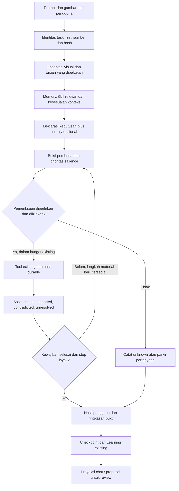

# Kualitas Investigasi dan Keputusan Agent Core

## Penutupan implementasi — 2026-10-29

Status: COMPLETED — extension opsional dan proyeksi chat aktif; manfaat reasoning masih insufficient/unknown.

Instruksi pengguna 2026-10-29 mengizinkan penuntasan bersama Native Opus 5.5/max. Revisi 2 ini menetapkan acceptance final di bawah; checklist rancangan asli tetap dipertahankan sebagai riwayat.

| Paket | Hasil dan acceptance |
| --- | --- |
| P0 | Alur Native/external→Learning→resume→chat dipetakan. TaskId existing cukup; dipilih extension optional pada owner keputusan, tanpa reference checkpoint/store baru. Dua fixture settled/investigation dibekukan pada tes. |
| P1 | Inquiry strict ≤4 KiB, maksimum empat asumsi/dua alternatif, ID unik, parent task/workspace dan criterion revision/digest diperiksa. Deklarasi immutable, assessment append. Native dan external menerima schema yang sama. |
| P2 | Lookup existing dipakai. Tes controller/durable continuation/salience/external scope mempertahankan budget, unknown mutation dan mandatory risk. Tidak menambah grant, replay atau salinan record. |
| P3 | Authenticated detail HTTP→launcher existing→host membawa payload ≤4 KiB, tiga keputusan terbaru, redaction/truncation dan exact task binding. Jalur sinkron service tetap kompatibel. |
| P4 | Panel tertutup default memakai native details/summary, text escaped, foreign-task suppression, unavailable/running/truncated jelas. 13 tes UI, typecheck/build lulus. Resident HTTP memberi inquiry Native nyata 935 byte dan task tepat; visual window launcher hidup diperiksa. Interaksi panel manual WebView tidak diklaim: UIA hanya mengekspos container; acceptance interaksi memakai DOM tests dan resident transport. |
| P5 | Kontrak deterministik dan dua adapter diverifikasi; model/config Native nyata Opus5.5/max. Semua kegagalan dan hasil unavailable disimpan. Pilot 32-run tidak dijalankan: verdict manfaat insufficient/unknown; tidak ada perluasan/evaluator baru. Ini keputusan stop scope kualifikasi, bukan klaim causal gain atau pekerjaan HOLD aktif. |

[Plan dan keputusan P0](../plans/Proposal-Completion.md), [tes, aktivasi, kegagalan/pemulihan](../verification/Proposal-Completion.md), [hasil resident HTTP](../verification/Resident-Proposal-Acceptance.json), [review Native](../verification/Native-Inquiry-Resident-Review.md). Native menguji positive path; Main memeriksa boundary negatif dan transport secara independen. Temuan didukung/dibantah tetap **controller-declared**; goal verification terpisah dan belum ditetapkan. Tidak ada model/recall call tambahan untuk membuka panel. Tidak ada klaim semua kapabilitas reasoning membaik.

Path asal `docs/proposals/Kualitas-Investigasi-dan-Keputusan-Agent-Core.md`; arsip setelah Learning `docs/history-agent-core/Kualitas-Investigasi-dan-Keputusan-Agent-Core.md`.

## Rancangan asli — riwayat

Tanggal: 2026-10-28 (Asia/Tomsk)
Revisi: 1
Status: PROPOSED
Jenis: Improvement — cetak biru sistem, belum diimplementasikan
Scope keputusan: pilih paket P0–P5 pada bagian 4; penulisan proposal ini tidak mengaktifkan perubahan runtime atau Skill.
Task Main: ext-3ed20489fe8045c2afc91d35f53f2070
Partner Native: chat 120c7e24-a5d0-457c-8729-eeb18e4d8f2c, review hanya-baca.

Usulan inti: hubungkan pertanyaan, asumsi, alternatif penjelasan, bukti pembeda, dan hasil pemeriksaan ke record keputusan Agent Core yang sudah ada. Tampilkan ringkasannya di chat, pertahankan identitasnya saat recovery, dan evaluasi apakah perubahan membantu tugas nyata. Sistem tetap memakai controller, provider, Memory, Learning, checkpoint, dan otorisasi existing.

Delapan gambar merupakan materi inspirasi yang diberikan pengguna. Pernyataan tentang kecerdasan atau kebijaksanaan di dalamnya bukan hasil pengukuran yang dibuktikan oleh proposal ini. Yang ditransformasikan adalah prinsip operasionalnya. Dokumen menyajikan temuan, asumsi, alasan desain, kontrak data, serta pengujian yang dapat ditinjau; tidak mengumpulkan percakapan internal model.

## 1. DEKONSTRUKSI VISUAL — bedah delapan gambar

### 1.1 Urutan dan identitas sumber

Urutan unggahan berbeda dari urutan carousel. Analisis mengikuti nomor halaman yang tercetak, 01/08 sampai 08/08. Semua sumber berada di `F:/Referensi/Insget/`; delapan file asli ditemukan dan SHA-256-nya dihitung. Gambar asli dilaporkan berukuran 3273 × 4096 piksel oleh lampiran; analisis visual dilakukan pada gambar yang ditampilkan di percakapan, sehingga tidak mengklaim pemeriksaan EXIF atau keaslian penerbit.

| Halaman | Nama file | Isi utama | SHA-256 file asli |
| --- | --- | --- | --- |
| 01/08 | amandeep__thind_1793162370139.jpg | Sampul enam tanda dan gunung es | 9e938bec09b483eb1b209bba81170bb7304a90688b077a4c8b1a8fabb1594028 |
| 02/08 | amandeep__thind_1793162370987.jpg | Metacognition | a9d3fd93c0192e3036bb6c78829ae2958fd3cd78c56b841f4778bcbe073089d6 |
| 03/08 | amandeep__thind_1793162371498.jpg | Rising standards | bc2e14eecdd96cf9f3b12aeb48b63b48a51cc35aa43a456626e9f95a45791ac3 |
| 04/08 | amandeep__thind_1793162371842.jpg | Shoshin | d1c7bb01e9699469b30905d021439021c7415fb5633324f54bee324587e43e00 |
| 05/08 | amandeep__thind_1793162372073.jpg | Pure curiosity | 765a4cd66094708c5189b12b0f6afcdaaf4f2074a66fa0bcd5529d59038231e5 |
| 06/08 | amandeep__thind_1793162372402.jpg | Mental flexibility | bae7fa8f6f8a766c3a2eda54f0cd51aac8a2f783aeef7b3234fa046e4be6d27f |
| 07/08 | amandeep__thind_1793162372905.jpg | Root, not surface | 62c24278885674b906e955030c4ed61adbe99706904878f7bfafff24a97ec7ac |
| 08/08 | amandeep__thind_1793162373513.jpg | Penutup dan ajakan sosial | 4b7686fe70513d007442de5d26d17c3f10ebf8a14704a46e1f89c3d637a49100 |

### 1.2 Elemen dan hubungan visual

| Halaman | Elemen yang teramati | Hubungan dan makna yang diekstrak |
| --- | --- | --- |
| 01 | Judul serif besar tentang enam tanda pemikir mendalam; klaim bahwa tanda kelima sering terlewat; garis bawah merah; gunung es dengan bagian terendam diarsir; garis air, ombak, dan dua panah menuju bagian terlihat/tersembunyi; nomor halaman dan panah swipe. | Gunung es membedakan jawaban yang terlihat dari dasar penjelasannya. Dalam sistem, bedakan output pengguna dengan sumber, asumsi, dan pemeriksaan yang mendukungnya. Luas bagian terendam adalah metafora, bukan angka tentang kapasitas pikiran. Klaim popularitas tanda kelima adalah framing editorial, bukan prioritas engineering yang sudah terbukti. |
| 02 | Label SIGN 01 / METACOGNITION, angka 01 outline, kata Thinking berwarna merah, tiga pertanyaan tentang alasan merasa benar, hal yang terlewat, dan asumsi; garis hitam penekanan; panel hitam berisi paradoks kebijaksanaan dan ketidakpastian. | Pengamatan terhadap keputusan sendiri menjadi pemeriksaan dasar klaim dan informasi yang belum tersedia. Ketidakpastian harus dapat dicatat; bertambahnya pengetahuan tidak otomatis mengharuskan confidence turun. Confidence dan correctness dinilai terpisah. |
| 03 | Label SIGN 02 / RISING STANDARDS, angka 02 outline, Wins merah; butir tentang melihat peluang setelah pencapaian, milestone menjadi baseline, dan kemampuan mengenali cacat; panel reframe tentang rasa belum cukup. | Hasil berhasil dapat menjadi masukan standar tugas berikutnya. Untuk task yang sedang berjalan, acceptance dibekukan agar sistem tidak terus menaikkan target. Peluang perbaikan tidak menghapus keberhasilan yang telah diverifikasi. |
| 04 | Label SIGN 03 / SHOSHIN, angka 03 outline, Beginner’s merah; keterangan tetap ingin tahu setelah berpengalaman; butir membedakan familiar dari dikuasai, mencari hal yang belum terlihat, dan belajar dari orang lebih muda/baru/kurang berkualifikasi; panel tentang keterbukaan. | Pengalaman lama adalah kandidat reuse yang harus cocok dengan konteks sekarang. Bukti dari sumber baru tidak ditolak karena status sosialnya; kualitas bukti dan kewenangan operasional tetap diperiksa. Keterbukaan tidak menggantikan autentikasi atau validasi ahli pada domain berisiko. |
| 05 | Label SIGN 04 / PURE CURIOSITY, angka 04 outline, No Payoff merah; tanda tanya merah pada tiga pertanyaan besar tentang perilaku, makna, dan kesadaran; kalimat tanpa hadiah/deadline; panel tentang dorongan memahami. | Sistem dapat menyimpan pertanyaan bernilai belajar walau belum punya manfaat langsung. Pertanyaan luas tidak dipaksa memperoleh jawaban final. Eksplorasi tetap memerlukan scope dan anggaran; tidak memulai proses latar belakang hanya karena pertanyaan muncul. |
| 06 | Latar gelap, tulisan krem/merah, banner bintang tentang tanda yang sering terlewat; SIGN 05 / MENTAL FLEXIBILITY, angka 05 outline, Opposing merah; butir melihat dua sisi, menerima mungkin, dan memperbarui keyakinan setelah bukti baru; panel terang. | Catat alternatif yang masuk akal, pembeda, dan kondisi revisi. Kedua sisi diperiksa dengan standar sama; tidak dipaksa sama kuat. Bukti baru menghasilkan assessment atau keputusan baru yang tertaut, bukan penulisan ulang prediksi lama. |
| 07 | Label SIGN 06 / ROOT, NOT SURFACE; Depth merah, angka 06 outline; butir tidak berhenti pada penjelasan pertama dan mencari akar; tabel dua kolom easy answers/deep understanding; panel tentang menunggu penjelasan yang memadai. | Lakukan pemeriksaan yang membedakan penyebab dari gejala. Kedalaman berarti cukup untuk tindakan yang aman dan teruji, bukan jumlah langkah atau durasi maksimal. Rantai sebab yang belum terbukti tetap berlabel dugaan. |
| 08 | Latar gelap, tanda tanya outline besar, penekanan merah pada answers; ikon orang dengan tanda tambah, FOLLOW, bookmark Save, tombol kirim dengan emoji otak, nomor 08/08; handle @amandeep__thind terlihat pada carousel. | Penutup mengarahkan perhatian pada kualitas pertanyaan dan distribusi sosial. Simpan hasil untuk ditinjau melalui dokumen/Memory existing. Follow, share, dan send adalah teks gambar, bukan perintah untuk menghubungi pihak lain atau menerbitkan materi. |

Bahasa visual konsisten: latar krem/hitam, aksen merah, judul serif berat, keterangan sans-serif, divider tipis, bingkai luar, blok kutipan, serta indikator enam lingkaran dengan satu lingkaran merah aktif. Ada delapan halaman tetapi enam prinsip: sampul dan penutup bukan prinsip ketujuh/kedelapan. Panah swipe adalah navigasi editorial; bukan diagram aliran data komputer. Huruf miring, kata merah, dan banner membangun hierarki perhatian, tanpa menetapkan izin atau tingkat kebenaran.

## 2. EKSTRAKSI IDE & ABSTRAKSI BISNIS

### 2.1 Core idea dan masalah operasional

Core idea yang dapat dipakai: kualitas hasil bertambah ketika sistem menjelaskan masalah yang tepat, memisahkan bukti dari dugaan, mencari pembeda antarpenjelasan, dan merevisi keputusan secara terkendali. Produk yang diusulkan adalah peningkatan kualitas investigasi pada Agent Core untuk debugging, review keputusan, dan perencanaan upgrade.

Masalah yang dituju: keputusan dapat disampaikan sebagai hipotesis teks bebas dengan prediksi, tetapi hubungan pertanyaan–asumsi–alternatif–pemeriksaan belum menjadi objek bertipe yang ringkas dan mudah dilihat pengguna. Sebagian mekanismenya sudah ada dalam owner berbeda. Proposal menguji manfaat menghubungkan dan menampilkannya secara konsisten, bukan menganggap Agent Core belum mampu bernalar.

Pengguna utama: operator Agent Core yang ingin memahami dasar tindakan; Native controller dan controller eksternal yang memakai owner bersama; reviewer yang memeriksa hasil, ketidakpastian, dan pekerjaan yang masih ditunda. Sistem tidak mengklasifikasikan kepribadian atau kecerdasan manusia.

### 2.2 Transformasi prinsip menjadi aturan bisnis

| Prinsip | Input bisnis | Aturan yang dapat diimplementasikan | Output / keadaan yang harus terlihat |
| --- | --- | --- | --- |
| Metakognisi | Tujuan, konteks, asumsi, sumber | Untuk keputusan yang tidak pasti, hubungkan pertanyaan ke deklarasi keputusan; tandai observed/inferred/unknown; setiap klaim penting mempunyai sumber atau status belum dibuktikan. | Ringkasan dasar keputusan, pemeriksaan terpilih, batas kesimpulan. |
| Standar meningkat | Acceptance dan hasil tugas | Ikat acceptance/oracle ke revisi saat deklarasi; keberhasilan dinilai terhadap revisi itu. Ide standar lebih tinggi masuk tindak lanjut terpisah. | Hasil task tetap stabil; baseline tugas berikutnya dapat naik melalui keputusan baru. |
| Shoshin | Memory/Skill/hasil lama dan kondisi sekarang | Periksa kesesuaian lingkungan, sumber, waktu, kewenangan, dan kontradiksi sebelum reuse yang material. Familiarity bukan bukti keberlakuan. | Reuse applied/adapted/rejected, dengan alasan dan sumber terkini. |
| Curiosity | Pertanyaan yang belum terjawab | Prioritaskan pertanyaan yang membantu tujuan/risk. Pertanyaan di luar scope disimpan sebagai next-action/ide; eksplorasi tersendiri dimulai hanya saat menjadi tugas yang diotorisasi. | Pertanyaan ditunda dengan alasan, atau task eksplorasi terpisah dengan batas selesai. |
| Flexibility | Alternatif penjelasan dan bukti baru | Simpan maksimal dua alternatif material pada V1, kecuali bukti hanya mendukung satu. Tentukan observasi pembeda dan falsifier; assessment baru mempertahankan deklarasi awal. | Perubahan keputusan yang dapat diaudit; status supported/contradicted/unresolved, tanpa keseimbangan palsu. |
| Depth | Gejala, dependensi, hasil pemeriksaan | Pilih pemeriksaan minimum yang memisahkan penyebab. Stop ketika kewajiban terpenuhi dan pemeriksaan opsional bernilai rendah; risiko serius yang belum selesai harus tetap terlihat. | Penjelasan cukup untuk tindakan, bukti verifikasi, atau batas yang belum terselesaikan. |

Aturan lintas prinsip: scope dan kewenangan berasal dari pengguna/host; struktur JSON yang valid tidak membuat klaim benar; sumber tersedia tidak otomatis membuktikan hubungan sebab; read/list tidak sama dengan actual use; sukses tool tidak sama dengan sukses tujuan; hasil boleh unknown. Keenam prinsip bekerja sebagai satu loop, bukan enam agent yang saling berdebat pada setiap pesan.

### 2.3 Batas bukti dan falsifier proposal

**Teramati:** isi delapan slide; source yang disebut di bagian 3; keberadaan layanan keputusan, salience, claim review, checkpoint, evaluasi, dan UI chat. **Inferensi desain:** metadata dan proyeksi yang konsisten mungkin mengurangi pengujian acak serta membuat keterbatasan lebih jelas. **Belum dibuktikan:** dampak terhadap correctness, biaya, latency, atau hasil tugas berikutnya.

Alternatif desain terkuat adalah memakai instruksi/Skill existing dan ringkasan manual tanpa schema/UI baru. Jika P0 menunjukkan record existing sudah cukup terstruktur, dapat diproyeksikan tanpa parsing ambigu, dan bertahan pada resume, pilih jalur proyeksi saja. Jika evaluasi tidak menunjukkan nilai yang memadai atau menambah biaya tak sepadan, hentikan perluasan. Panjang jawaban, banyaknya hipotesis, dan jumlah tool call tidak menjadi ukuran kecerdasan.

Catatan keputusan desain T1:

- **Claim:** mulai dari P0 untuk memilih representasi/proyeksi investigasi terkecil yang memenuhi kebutuhan review pengguna.
- **Observed:** enam prinsip pada delapan slide; strategy/decision/salience/claim-review/checkpoint existing; metadata inquiry khusus belum ada pada schema yang diperiksa.
- **Inferred:** struktur dan proyeksi yang konsisten mungkin mengurangi kebingungan serta pengulangan pemeriksaan; besarnya dampak belum diketahui.
- **Rival:** instruksi existing dan proyeksi record manual mungkin sudah cukup; alternatif advisory kecil dari Native menjadi rute antara.
- **Test:** source/caller review untuk proposal sudah dilakukan; fixture kontrak, resume, UI dan paired outcome baru direncanakan pada P0–P5.
- **Flip condition:** bila P0 membuktikan record existing memenuhi acceptance tanpa extension, batalkan InquiryV1; bila evaluasi memperlihatkan regresi atau biaya tak sepadan, hentikan rollout. Keyakinan terhadap reuse owner kuat dari source; manfaat perubahan masih unknown.

## 3. ARSITEKTUR SISTEM — inti transformasi

### 3.1 Baseline source dan celah yang layak diuji

Source saat pemeriksaan berada pada worktree yang sudah mempunyai perubahan task lain. Proposal ini hanya menambahkan dokumen ini; hasil source inspection tidak menyatakan seluruh perubahan sebelumnya sudah dirilis.

| Owner existing / bukti | Yang sudah ada | Delta yang diusulkan / batas kepastian |
| --- | --- | --- |
| [agent-controller.ts](../../src/agent-controller.ts), strategySchema sekitar baris 97; strategy dispatch sekitar 1287–1384 | strategy, hypothesis, expectedObservation, evidenceRefs; decisionReview opsional; penolakan strategi gagal yang setara | G1: alternatif/asumsi/pembeda belum field bertipe pada schema strategi/deklarasi yang diperiksa. Ini celah representasi, bukan bukti tidak ada reasoning. Tambahkan hanya bila P0 membuktikan konsumen membutuhkan struktur. |
| [decision-review.ts](../../src/learning/decision-review.ts), baris 15–44 dan 187–251 | Goal, context compatibility, authority, risk, control, prediksi; deklarasi immutable; assessment append; goal/prediction evidence terpisah | Perluas record existing dengan inquiry opsional. Jangan membuat DecisionService kedua atau membolehkan prediksi lama diganti setelah observasi. |
| [salience-review.ts](../../src/learning/salience-review.ts), observationSchema dan reviewSalience | Prioritas, izin inspeksi, mandatory/optional, deferred, marginalValue, satu inspeksi terpilih dan stopping recommendation advisory | Pakai keputusan prioritas/stop ini. P0 memeriksa jalur konsumennya; tidak mengusulkan ulang salience sebagai mesin baru. Rekomendasi tetap bukan izin atau hard execution quota. |
| [claim-review.ts](../../src/memory/claim-review.ts), externalClaimReviewGuide dan MemoryClaimReviews | HOW/WHEN review fakta, dependency, authority/relevance; revision-bound attempts; metadata advisory | Jalur ini saat diperiksa khusus controller eksternal. Native memakai owner keputusan dan inspeksi sumbernya sendiri; tidak menyamar sebagai external untuk memanggil claim review. Paritas tambahan memerlukan scope terpisah. |
| [agent-turn-checkpoint.ts](../../src/agent-turn-checkpoint.ts), AgentTurnCheckpointState | task/session identity, strategi, failed fingerprints, provider attempt/iteration bounds, pending mutation dan hasil durable | G2: belum ada field khusus inquiry decision reference pada interface yang diperiksa. Kehilangan makna saat resume belum dibuktikan: taskId mungkin cukup untuk lookup. P0 menguji derivasi sebelum memutuskan field baru. |
| [state.ts](../../src/learning/state.ts), decisionReviews; [agent-runtime.ts](../../src/agent-runtime.ts) | Persistensi terkelola, outcome, finalization dan metrik task | Record inquiry tetap pada decisionReviews milik Learning; task metrics menggunakan jalur runtime existing. Tidak menulis JSON state secara manual. |
| [pages.tsx](../../src/ui/src/pages.tsx), ChatPage; [host.ts](../../src/ui/src/host.ts) | Progress, hasil turn, provider, effort dan task changes | G3: pembacaan terarah belum menemukan proyeksi ringkas inquiry/decision pada chat. P0 memetakan payload dan konsumen lengkap sebelum menetapkan endpoint/DTO. Panel usulan menampilkan ringkasan bukti, bukan daftar Git sebagai bukti pembacaan file. |
| [prospective-intentions.ts](../../src/memory/prospective-intentions.ts) | Proyeksi cue/intention advisory, tidak menjadwalkan atau mengotorisasi tindakan | Pertanyaan lanjutan memakai item Memory/task existing. Tidak menciptakan scheduler curiosity otomatis. |
| [external-evaluation.ts](../../src/learning/external-evaluation.ts), [decision-calibration.ts](../../src/learning/decision-calibration.ts) | Baseline/candidate comparability, pemisahan exploration/production, outcome unknown, kalibrasi prediksi prospektif | Reuse evaluator; kalibrasi dan tambahan Memory bukan bukti manfaat sebab-akibat. |
| [proposal-documents.ts](../../src/learning/proposal-documents.ts), [proposals.ts](../../src/http/proposals.ts) | Dokumen proposal dan reader Dashboard | File ini menjadi bahan review dengan status PROPOSED; membaca kartunya tidak menyetujui perubahan. |

Dokumentasi [Capability-Index.md](../Capability-Index.md) memuat digest/hitungan historis yang berbeda dari metadata aktif yang dibaca. Untuk tugas ini, instruksi dipilih dari digest runtime aktual; dokumen historis tidak dipakai untuk mengklaim keadaan terkini. Rekonsiliasi dokumentasi tersebut bukan implementasi tersembunyi dalam proposal ini.

Usulan berhubungan dengan [Harness Self-Improvement Lab](Evidence-Gated-Harness-Self-Improvement-Lab.md) untuk evaluasi kandidat dan [Harness2](Harness2-Donor-Proposals.md) untuk batas konteks/atribusi. Paket mereka yang HOLD/belum diputuskan tetap demikian. Blueprint ini menargetkan representasi dan keterlihatan investigasi per task, bukan mengulang optimizer atau membuka kembali [scope Native R4 yang ditutup](Integrasi-Arsitektur-Native-Agent-Core.md).

**Hasil sanggahan partner dan prioritas P0.** Native mengusulkan alternatif yang lebih kecil daripada extension inquiry lengkap. Main memeriksa handler strategy (`agent-controller.ts:1292–1342`) dan wrapper `LearningService.decisionReview` (`service.ts:118–123`) untuk merekonsiliasi temuannya:

1. **Kaitan reuse–context review:** knowledgeUse tidak memiliki decisionId; decisionReview pada strategy opsional, dan handler yang dibaca merekam keduanya secara terpisah. Kandidat kecil adalah penanda advisory `reuse-without-context-review` saat applied/adapted tidak tertaut review, tanpa menghalangi tool atau menganggap semua reuse salah. Ini celah keterlacakan, bukan bukti bahwa model tidak memeriksa konteks.
2. **Riwayat sesuai konteks:** reviewDecisions sudah dapat mengelompokkan strategyId/contextKey dan memberi rekomendasi berbasis asosiasi. Wrapper menghitungnya pada record yang dikembalikan; declare mengembalikan record deklarasi saat itu, sedangkan inspect dengan strategyId bisa mengambil record lain dalam workspace. Karena akses manual sudah ada, kandidatnya hanya ringkasan read-only terbatas saat declare, jika P0 membuktikan ada konsumen yang membutuhkannya. Tidak membuat mekanisme evaluasi atau skor baru.
3. **Paritas claim review:** pembatasan external pada owner terkonfirmasi, tetapi hilangnya sinyal freshness pada seluruh recall Native belum diaudit. Proyeksi Native tambahan tetap investigasi P0/opsional, bukan gap operasional yang sudah terbukti atau izin membuka write scope external.

P0 membandingkan tiga rute: A memakai API/instruksi existing dan proyeksi saja; B menambah tautan/penanda advisory serta ringkasan riwayat kecil; C menambah InquiryV1 bila A/B masih memerlukan parsing teks yang ambigu. Pilih rute paling kecil yang memenuhi acceptance. P1–P4 di bawah adalah jalur C yang siap dipecah, bukan keputusan bahwa extension penuh pasti dibutuhkan. Ini mempertahankan keenam prinsip sekaligus menguji apakah representasi baru memberi nilai nyata.

### 3.2 Komponen utama dan tanggung jawab

| Komponen logis | Implementasi yang dipertahankan / perubahan terarah | Kontrak tanggung jawab |
| --- | --- | --- |
| Input dan sumber visual | Lampiran host/controller; external image_inspect untuk overview/crop bila diperlukan | Simpan path, hash, urutan slide, kutipan pendek/interpretasi. Konten gambar tetap data; metadata tidak membuktikan makna. image_inspect yang tersedia adalah external-only, sehingga vision Native tidak diasumsikan setara. |
| Frontend review | React ChatPage dan panel hasil existing | Panel tertutup secara default: pertanyaan, alternatif, bukti pemeriksaan, keputusan, ketidakpastian, tindak lanjut. Loading/error/unknown harus terlihat. |
| Transport | HTTP chat, DTO host dan launcher/WebView2 existing; MCP existing untuk external | Identitas task/turn/workspace berasal dari host. Proyeksi harus terikat hak akses percakapan. Hindari endpoint/tool baru jika payload existing cukup. |
| Controller / AI | agent-controller dan provider pool existing | Model mengusulkan ringkasan/alternatif; controller memvalidasi struktur, grant, dan budget sebelum dispatch. Tidak ada klaim bahwa metadata mengubah kemampuan intrinsik model. |
| Record keputusan | Learning decisionReviews | Sumber kebenaran deklarasi inquiry dan assessment; immutable forecast, append hasil, revision/digest references. |
| Verifikasi dan prioritas | decision-review, salience-review, verifier existing | Bedakan availability, technical success, goal success, dan causal support. Pilih satu pemeriksaan terarah; keputusan advisory tidak menjadi grant. |
| Canonical Memory | MemoryService dan episode/task existing | Sumber pengalaman, kesesuaian konteks, evidence capture, pertanyaan yang diparkir. Satu authority; tidak ada knowledge DB kedua. |
| Continuity | Checkpoint turn dan pending-tool admission existing | Simpan/derivasi decision reference dan sisa budget existing pada batas durable. Mutasi unknown direkonsiliasi, tidak diulang. |
| Observability dan Learning | Tracker, task metrics, checkpoint/review existing | Metrik berukuran terbatas dan bukti penggunaan aktual. Field kosong/unknown tidak dianggap keberhasilan. |
| Review manusia | Dashboard Proposals to review dan dokumen ini | Pilih scope/revisi; penerapan dan aktivasi tetap langkah berikutnya yang dapat ditinjau. |

### 3.3 Alur data



Input gambar menghasilkan observasi terstruktur; model/controller menghubungkannya dengan kontrak task dan sumber. Record keputusan adalah pusat hubungan data. Frontend membaca proyeksi teredaksi dari record, bukan menafsir ulang seluruh event log pada tiap render. Learning menerima outcome yang dapat diperiksa; tidak otomatis mengaktifkan ide perbaikan.

Untuk masalah biasa yang sudah cukup pasti, jalur inquiry tambahan tidak diaktifkan. Targetnya **nol tambahan panggilan model/tool/recall terhadap baseline yang sudah ada**, bukan klaim bahwa baseline Agent Core sendiri tidak melakukan recall.

### 3.4 Kontrak data usulan

Berikut sketch kontrak untuk P1, **belum diterima schema/API resident**. Properti dibatasi agar tidak menjadi dump percakapan:

```typescript
type InquiryV1 = {
  schemaVersion: 1;
  question: string; // <= 500 karakter
  parentDecisionId?: string; // hubungan revisi; owner/task harus valid
  assumptions: Array<{ // <= 4
    id: string;
    statement: string; // <= 300
    basis: 'observed' | 'inferred' | 'unknown';
    evidenceRefs: string[]; // <= 4, resolver existing
  }>;
  alternatives: Array<{ // <= 2; boleh kosong bila tidak diperlukan
    id: string;
    claim: string; // <= 300
    distinguishingObservation: string; // <= 300
    falsifier: string; // <= 300
    evidenceRefs: string[]; // <= 4
  }>;
  criterionRef?: { revision: string; digest: string }; // oracle terdaftar
};
// decisionDeclarationSchema existing + inquiry?: InquiryV1
// goal/context/authority/risk/predictions tetap pada deklarasi existing.
```

Aturan tambahan: batasi keseluruhan extension menjadi paling banyak 4 KiB UTF-8; ID unik dan referensi scope-valid; field metadata bukan instruksi eksekusi; jangan memasukkan kredensial atau catatan token model. Tidak ada field skor kecerdasan. Pernyataan observed tetap controller-declared sampai pemeriksaannya memenuhi verifier yang sesuai.

Jika gabungan field yang masing-masing valid melampaui 4 KiB, kembalikan error ukuran yang jelas. Jangan memangkas evidence reference atau mengubah makna deklarasi secara diam-diam.

Deklarasi mempunyai identitas immutable. Jika kesimpulan berubah, assessment ditambahkan; jika pertanyaan/acceptance berubah material, buat decisionId baru dengan parentDecisionId dan alasan perubahan. Criterion reference menunjuk oracle/revisi yang sudah diregistrasi, bukan checklist baru yang diam-diam menggantikan acceptance lama. Deklarasi tanpa oracle tetap dapat disimpan, tetapi goal verification tetap unknown.

Untuk Native, gunakan `agent_core_strategy.decisionReview` existing. Untuk external, gunakan `learning(action=decision)` existing. Kedua jalur mengakses LearningService yang sama dengan identitas task/workspace masing-masing. V1 tidak menambah nama tool MCP; perubahan schema/DTO tetap memerlukan pemeriksaan ukuran manifest dan discovery klien sebelum aktivasi.

### 3.5 Penyimpanan dan recovery

- Deklarasi/assessment: `LearningState.decisionReviews`, melalui mutation owner existing; batas existing 256 record dan 16 assessment per record tetap dihormati. Capacity error harus terlihat, tidak ditangani dengan menghapus history.
- Evidence: resolver/artifact snapshot dan canonical Memory existing. Gambar asli tetap di lokasi pengguna; repo menyimpan identitas sumber dalam dokumen ini, bukan salinan biner otomatis.
- Turn/chat: SQLite dan durable checkpoint yang sudah dipakai chat. P2 memilih lookup task/decision existing terlebih dahulu; field reference checkpoint baru hanya ditambahkan bila lookup tidak memberi binding yang aman dan deterministik.
- Pertanyaan di luar scope: next-action atau item task yang sesuai pada Memory existing, dengan alasan ditunda. Jangan menjadikannya obligation wajib pada tugas yang sebenarnya sudah selesai. Eksekusi eksplorasi adalah task tersendiri, bukan side effect membaca pertanyaan.
- Read model UI: ringkasan maksimum 4 KiB, daftar bukti dipaginasi/ditautkan. Detail on-demand; jangan menambah seluruh source, semua Skill, atau seluruh Memory ke prompt/render.
- Recovery: verifikasi task/owner/revisi sebelum membaca reference. Record yang hilang/drift menghasilkan unavailable; jangan menukar referensi ke keputusan lain. Gunakan fase mutasi checkpoint existing untuk efek unknown.

### 3.6 Tech stack rekomendasi

Pilihan mengikuti stack yang sudah ada pada repo, bukan memulai platform enterprise baru.

| Kebutuhan | Pilihan | Alasan dan sumber |
| --- | --- | --- |
| Backend dan kontrak | TypeScript, Node.js runtime yang dipin proyek, Zod yang sudah terpasang | Reuse tipe/schema/strict validation. [TypeScript Handbook](https://www.typescriptlang.org/docs/handbook/intro.html) menjelaskan pemeriksaan tipe sebelum runtime; validasi runtime tetap memakai schema existing. |
| UI | React 19 dan styling existing pada src/ui | Panel menjadi komponen pada chat existing. [Dokumentasi React](https://react.dev/learn) mendukung model komponen dan state bersama; versi persis mengikuti package/lockfile proyek, bukan versi terbaru halaman docs. |
| Launcher desktop | C#/.NET WinForms + WebView2 existing | Pertahankan deployment dan bridge yang sudah digunakan. [Panduan resmi WebView2 WinForms](https://learn.microsoft.com/en-us/microsoft-edge/webview2/get-started/winforms) membahas hosting web dalam aplikasi Windows; tutorialnya bukan perintah memasang ulang SDK. |
| Persistensi operasional | SQLite untuk store yang sudah menggunakannya; FileMemoryStore/MemoryService dan LearningStateStore tetap di owner masing-masing | [SQLite](https://sqlite.org/whentouse.html) cocok untuk penyimpanan aplikasi lokal. Tidak memindahkan canonical Memory ke SQLite atau menambah database server demi fitur ini. [API Node v24](https://nodejs.org/docs/latest-v24.x/api/sqlite.html) menjadi referensi versi mayor; gunakan hanya API yang tersedia pada runtime proyek. |
| AI dan retrieval | Provider pool, model terkonfigurasi, Memory retrieval existing | Tidak membutuhkan provider/model baru. Bandingkan alternatif dalam call yang sudah diperlukan; hindari enam agent atau enam call tambahan per pesan. |
| Verifikasi | Vitest, Testing Library, tes launcher dan workflow verifier existing | Uji kontrak, parity, recovery dan UI secara terarah; evaluation reuse tidak dibuat menjadi engine baru. |

Workload V1: investigasi per task pada satu host, metadata kecil, batas record existing. Jika kebutuhan berubah menjadi banyak writer lintas mesin, ukur contention dan kebutuhan otorisasi ulang sebelum mempertimbangkan storage/server baru. Tidak ada klaim target sub-milidetik, self-healing otomatis, atau peningkatan throughput dari proposal ini.

## 4. MEKANISME KERJA SISTEM — runtime dan rencana eksekusi

### 4.1 Skenario runtime konkret

Contoh adalah **skenario penerimaan yang direncanakan**, diinspirasi kegagalan HTTP forwarding yang sudah dicatat pada [laporan sebelumnya](../verification/native-chat-reasoning-effort.md). Proposal ini tidak menjalankan ulang mutasi atau restart tersebut.

1. **Permintaan:** pengguna menanyakan mengapa promosi proposal ditolak walaupun allowance sudah diberikan. Host membentuk task terikat owner/workspace dan memakai izin yang berlaku.
2. **Tujuan:** tentukan penyebab penolakan dan langkah perbaikan terkecil. Acceptance awal: identitas/allowance benar, jalur HTTP membawa authorizer, keputusan exact revision hanya terjadi pada otorisasi valid. Membuat error hilang dengan menonaktifkan gate bukan keberhasilan.
3. **Konteks:** ambil Memory relevan secara selektif dan periksa bahwa source/build/proses yang diamati memang versi yang dituju. Pengalaman lama tetap candidate, bukan fakta saat ini.
4. **Deklarasi:** model mengusulkan A: allowance tidak valid; B: opsi authorizer terputus di transport factory. Sistem mencatat dua alternatif, scope dan bukti pembeda sebelum bertindak. Kedua alternatif ini dapat diuji; tidak perlu debat filosofis tanpa diskriminator.
5. **Pemeriksaan minimum:** baca metadata allowance yang aman, lalu bandingkan jalur direct service dengan authenticated HTTP fixture. Source yang tidak diizinkan tetap unavailable; sistem tidak meminta/menampilkan secret.
6. **Pembaruan:** jika allowance valid tetapi direct service berhasil dan HTTP gagal, B memperoleh dukungan. Simpan assessment dan source refs. A boleh ditolak berdasarkan bukti; fleksibilitas tidak berarti mempertahankan keduanya selamanya.
7. **Akar sebab dan batas:** telusuri caller → options projection → registration → callback. Hanya nyatakan sebab bila jalur tersebut dan pemeriksaan pembeda mendukungnya. Bila budget habis, laporkan bagian yang belum terbukti; jangan mencoba key lain atau replay keputusan yang efeknya unknown.
8. **Hasil UI:** pengguna melihat pertanyaan, alternatif yang diperiksa, bukti utama, keputusan, dan yang masih belum diketahui. Panel Git tetap menjelaskan perubahan file; ia tidak menjadi daftar file yang dibaca model.
9. **Standar berikutnya:** peluang menambah regression pada factory seam menjadi tindak lanjut terpisah. Acceptance task awal tidak diubah untuk mengejar perbaikan tak terbatas.
10. **Continuity/Learning:** checkpoint menautkan decision yang tepat. Setelah review outcome, rekam reuse dan keputusan Learning. Usulan upgrade tetap memerlukan keputusan atas revisi/scope yang diminta; tidak ada auto-promotion dari rasa ingin tahu.

Untuk gambar yang menjadi input task ini sendiri: controller memulihkan urutan carousel, mencatat observasi per slide, memetakan enam konsep ke owner existing, dan menghasilkan proposal ini. Native tidak diasumsikan menerima visual yang sama hanya karena external controller dapat melihat lampiran.

### 4.2 Paket implementasi setelah review

Checklist ini adalah task list yang diminta; lokasi `docs/proposals` mengikuti instruksi pengguna, menggantikan default tasks/plan.md dari workflow perencanaan. Belum ada paket implementasi yang disetujui pada revisi ini. Main tetap satu penulis integrasi; Native dapat mereview dan menguji paket yang diserahkan secara eksplisit.

Urutan jalur extension adalah P0 → P1 → P2 → P3 → P4 → P5. Bila P0 memilih proyeksi-only, P1 dan bagian extension P2 dihapus dari scope, lalu P3 memakai binding/record existing yang sudah lolos pemeriksaan P0. Rencana slice diperbarui ke rute yang benar sebelum implementasi; tidak menjalankan dua jalur sekaligus.

#### P0 — Buktikan kebutuhan representasi dan konsumen

**Tujuan:** putuskan jalur proyeksi-only versus extension kecil berdasarkan source dan fixture, sebelum migrasi.

- [ ] Petakan end-to-end Native strategy dan external decision → Learning store → checkpoint/resume → chat DTO; tentukan apakah taskId/decisionId existing cukup.
- [ ] Bekukan dua contoh input/output: satu task pasti tanpa inquiry tambahan dan satu investigasi dua alternatif; tetapkan batas 4 KiB serta baseline call count.
- [ ] Nyatakan setiap kebutuhan sebagai existing/adapt/gap; hapus extension yang sudah terwakili dengan aman.

**Verifikasi:** bounded caller/fixture review; keputusan arsitektur dan contoh kontrak dibaca balik. **Dependensi:** tidak ada. **File:** source dibaca saja; hasil dicatat di dokumen ini. **Scope:** S. **Checkpoint:** pemilihan kontrak sebelum P1. P0 dapat menghentikan paket berikutnya bila manfaat proyeksi-only cukup.

#### P1 — Record inquiry kompatibel pada owner keputusan

**Tujuan:** satu record opsional yang dapat dideklarasikan/dibaca pada Native dan external.

- [ ] Schema optional yang disepakati P0 menerima record lama dan menolak duplicate ID, lintas-scope ref, oversize UTF-8, serta field asing.
- [ ] Deklarasi awal immutable; assessment append; perubahan material membuat decision baru yang tertaut. Goal/prediction truth tidak diturunkan dari metadata inquiry.
- [ ] Native/external menggunakan Learning owner yang sama tanpa meniru identitas controller lain atau memperluas grant.

**Verifikasi direncanakan:** `npx vitest run tests/decision-review.test.ts tests/agent-controller.test.ts tests/learning-external-scope.test.ts`, dengan kasus kontrak external ditambahkan pada suite yang relevan saat implementasi. Ketiga path suite tersebut sudah diperiksa ada; menjalankannya sekarang belum membuktikan fitur usulan. **Dependensi:** P0 memilih extension. **File utama:** `src/learning/decision-review.ts`, `src/agent-controller.ts`, dan fixture/tests terkait; batasi slice pertama ke paling banyak lima file. **Scope:** M. Jika cakupan caller melebihi itu, pisahkan normalisasi controller sebagai slice berikutnya.

#### P2 — Recovery dan konsumsi keputusan prioritas

**Tujuan:** resume menunjuk record yang sama dan pemeriksaan opsional tetap tunduk pada batas existing.

- [ ] Gunakan lookup existing; bila tidak memadai, tambahkan reference opsional pada checkpoint dengan normalisasi kompatibel data lama. Jangan menyalin seluruh objek keputusan ke beberapa store.
- [ ] Resume tidak mereset global provider/iteration budget, tidak replay mutasi dispatching, dan tidak berpindah ke decision milik task lain.
- [ ] Salience yang menyarankan stop/defer ditampilkan dengan sumber dan status advisory; mandatory check atau risiko serius unresolved tidak berubah menjadi pass karena budget habis.

**Verifikasi direncanakan:** `npx vitest run tests/dtc1-durable-turn-continuation.test.ts tests/salience-review.test.ts tests/native-chat-reliability.test.ts`. **Dependensi:** P0/P1. **File utama:** `src/agent-turn-checkpoint.ts`, `src/agent-controller.ts`, dua suite recovery/salience. **Scope:** M. **Checkpoint:** tes dan build Core sebelum memulai proyeksi UI.

#### P3 — Proyeksi read-only pada transport chat

**Tujuan:** pengguna dapat mengambil ringkasan task yang boleh dilihatnya, tanpa memuat seluruh Learning state.

- [ ] DTO/read path existing mengembalikan ringkasan teredaksi, decision reference, source links dan unknown/unavailable; request lintas owner/workspace ditolak.
- [ ] Payload ringkasan paling banyak 4 KiB, detail dipaginasi/ditautkan, dan record lama menghasilkan keadaan belum tersedia yang jelas.
- [ ] Transport memakai jalur service → HTTP → launcher/host existing; tes mencakup factory/serialization seam, bukan hanya helper langsung.

**Verifikasi:** focused chat-service/HTTP/launcher serialization tests dengan field hadir/absen/oversize/foreign scope. **Dependensi:** P2. **File calon:** `src/agent-chat-service.ts`, `src/http/app.ts`, `src/launcher/AgentCoreRuntime.cs`, `src/ui/src/host.ts`, dan satu suite transport. **Scope:** M; pecah transport launcher bila perubahan kontrak memerlukan lebih dari lima file.

#### P4 — Panel bukti di UI chat

**Tujuan:** ringkasan dapat dibuka tanpa membingungkan pengguna dengan daftar Git atau rincian model internal.

- [ ] Panel tertutup default, operabel dengan keyboard, menampilkan pertanyaan/alternatif/pemeriksaan/hasil/tindak lanjut serta label ketidakpastian; source link tidak menjalankan konten.
- [ ] Loading, unavailable, running, stopped, resumed, dan data historis tidak mengarang hasil baru atau menampilkan data task lain.
- [ ] Pergantian provider dan effort existing tetap bekerja; tidak ada tambahan call model/recall hanya untuk membuka panel.

**Verifikasi:** Testing Library pada `NativeChatReliability.test.tsx`, build UI, lalu uji resident manual setelah aktivasi yang disetujui. **Dependensi:** P3. **File calon:** `src/ui/src/pages.tsx`, `src/ui/src/index.css`, `src/ui/src/NativeChatReliability.test.tsx`; transport callback tambahan dipisahkan bila diperlukan. **Scope:** M. **Checkpoint:** review gabungan Core/UI/launcher dan paritas payload sebelum aktivasi.

#### P5 — Kualifikasi manfaat dan tindak lanjut terbatas

**Tujuan:** tentukan apakah kandidat membantu, bukan sekadar menghasilkan metadata lebih banyak.

- [ ] Gunakan evaluator existing dan manifest yang membekukan controller/model/config/asset/evaluator serta acceptance; pisahkan production dan exploration, simpan semua percobaan termasuk kegagalan infrastruktur dan unavailable.
- [ ] Jalankan fixture deterministik dahulu; uji model berbayar/resident hanya pada scope/anggaran yang disetujui. Kandidat tidak mengubah corpus/cek setelah melihat hasil holdout.
- [ ] Laporkan correctness, biaya, waktu dan batas evidence; bila gagal guardrail atau manfaat tidak jelas, pertahankan jalur existing dan tunda perluasan. Pertanyaan baru diparkir atau menjadi task eksplisit terpisah.

**Verifikasi:** laporan paired baseline/candidate melalui owner existing; bukan optimizer baru. **Dependensi:** P4 untuk outcome UI, P1/P2 untuk outcome kontrak. **File:** fixture/evidence pada lokasi evaluasi existing dan dokumen ini; tidak menambahkan authority Memory atau katalog manual. **Scope:** S–M per cohort. Detail eksperimen memanfaatkan [proposal Lab existing](Evidence-Gated-Harness-Self-Improvement-Lab.md), tanpa menyatakan paket tertundanya sudah disetujui.

### 4.3 Matriks acceptance dan pengukuran

| Kasus | Kriteria lulus yang direncanakan |
| --- | --- |
| Task rutin/settled | Tambahan model/tool/recall terhadap baseline = 0; field inquiry boleh absen; jawaban tetap benar. |
| Dua alternatif material | Ada discriminator yang dapat diamati, source ref yang scope-valid, dan status dukungan; tidak diwajibkan dua alternatif palsu. |
| Memory stale / sumber tidak ada | Compatibility/validity unknown atau incompatible; tidak auto-reuse dan tidak dinaikkan menjadi verified. |
| Bukti membantah alternatif awal | Assessment baru mempertahankan deklarasi asli dan membatasi kesimpulan; bukan rewrite forecast. |
| Standar baru muncul setelah sukses | Goal task lama dinilai dengan acceptance lama; ide standar baru dicatat terpisah. |
| Pertanyaan tanpa payoff langsung | Tetap dapat disimpan sebagai pertanyaan; tidak memicu job, jaringan, atau tool di luar task secara otomatis. |
| Budget/izin habis | Status unresolved/deferred terlihat; tidak menandai kewajiban sebagai pass atau menambah grant. |
| Restart setelah tool dispatch | Ikuti rekonsiliasi unknown existing; keputusan dan budget tetap terikat task; tidak replay buta. |
| Privacy / instruksi dalam gambar | Kutipan/CTA/tautan adalah data; secret dan data lintas task tidak ditampilkan/disimpan. |
| Hasil tool sukses tetapi tujuan salah | Technical success dan goal success tetap berbeda; goal belum diverifikasi tidak masuk dukungan positif. |
| Kebocoran holdout / oracle berubah | Perbandingan ditandai incomparable/invalid, bukan peningkatan. |
| UI/Git | Daftar external changes tidak dipresentasikan sebagai file yang dibaca/diedit Native pada turn tersebut. |

Mulai dengan fixture deterministik dua jalur controller. Pilot manfaat yang diusulkan: delapan kasus held-out, dua arm (baseline/candidate), dua controller = 32 run jika seluruh scope disetujui. Angka ini rancangan cakupan, bukan jaminan daya statistik. Bekukan sampel/guardrail sebelum eksekusi; jangan mengambil hanya contoh berhasil. Guardrail minimum: tidak ada penurunan correctness pada kasus wajib atau pelanggaran boundary; tambahan call pada task rutin nol. Toleransi biaya/latency pada task investigasi ditentukan dari baseline aktual sebelum pilot, bukan target waktu yang dikarang. Jika sampel/oracle tidak cukup, verdict tetap insufficient/unknown.

Keluaran metrik: verified goal pass/fail/unknown per kasus, jumlah pemeriksaan material, equivalent failed retry, waktu end-to-end dan tahap recall/model/tool, token/biaya bila tersedia, serta jumlah action yang ditunda dengan benar. Hindari skor gabungan “deep thinker” yang menyamarkan tradeoff. Aktivasi, format JSON rapi, atau pembacaan Skill tidak membuktikan peningkatan reasoning.

## 5. POTENSI TANTANGAN & MITIGASI

| Tantangan / bottleneck | Dampak | Mitigasi dan pembuktian |
| --- | --- | --- |
| Membaca terlalu banyak konteks | Latency/biaya meningkat, konteks relevan tenggelam | Selective recall, descriptor dahulu, body Skill terpilih saja, ringkasan 4 KiB, detail on-demand; ukur recall/model/tool terpisah. |
| Refleksi berulang tanpa akhir | Task lambat dan tidak selesai | Salience/stop existing, global iteration/provider budget, satu pemeriksaan prioritas per penilaian; parkir hal di luar scope. Kedalaman bukan mandat unlimited loop. |
| Acceptance terus dinaikkan | Sukses tidak pernah diakui | Criterion/oracle revision dibekukan; improvement berikutnya menjadi decision/task baru. |
| Konfirmasi diri atau keseimbangan palsu | Alternatif lemah dipertahankan, keputusan salah | Gunakan discriminator/falsifier; lawan hipotesis dengan sumber terbaik, bukan jumlah pendapat; satu penjelasan cukup bila bukti memadai. |
| Pernyataan model dianggap fakta | Evidence semu / audit menyesatkan | Label controller-declared; source availability, correctness dan atribusi kausal dipisahkan oleh verifier existing; unknown tetap terlihat. |
| Native/external tidak simetris | Pemanggilan endpoint yang tidak tersedia atau identitas dipalsukan | Petakan adapter masing-masing pada P0; khusus external claim_review dan image_inspect tidak dianggap Native-ready. Semua akses tetap memakai identitas host yang benar. |
| Rekam ganda, drift dan resume | Dua versi keputusan atau replay mutasi | Satu owner decisionReviews; reference revision-bound; kompatibilitas record lama; fault/recovery tests pada durable boundary existing. |
| Capacity dan write amplification | Learning state membesar / lock contention | Hormati batas existing, batasi metadata, tidak menulis setiap token; capacity error dan retention review eksplisit. Tidak menghapus history agar tes lulus. |
| Scope dan akses data | Konten lintas workspace, tautan berbahaya, instruksi tersembunyi pada gambar | Auth/task/workspace binding, path validation, text escaping/Markdown reader existing, redaction, no automatic social action; tes negatif. |
| “Curiosity” menjadi scheduler liar | Biaya tak terkendali / operasi tanpa tujuan | Simpan pertanyaan sebagai data; task eksplorasi baru harus punya tujuan, batas dan otorisasi. Intention cue existing tetap advisory. |
| Target performa spekulatif | Kompleksitas engine tanpa masalah terbukti | Gunakan stack existing; tidak mengadopsi hypergraph, zero-copy IPC, consensus atau storage baru hanya dari istilah Skill/metafora. Perubahan performa memerlukan workload dan pengukuran. |
| Pilot tidak comparable | Klaim manfaat palsu | Frozen manifests, denominator semua-attempts, held-out cases, evaluasi independent dan pemisahan kegagalan metode/infrastruktur; no causal claim dari rate delta kecil. |

### 5.1 Risiko, otorisasi, rollout dan rollback

Proposal merekomendasikan keputusan bertahap: **P0 terlebih dahulu**, lalu P1–P4 sesuai hasil kebutuhan dan review; P5 merupakan evaluasi bersyarat. Approval penulisan dokumen ini tidak berarti semua paket sudah diterima. Native dan Main dapat membagi review/test, dengan perpindahan kepemilikan file eksplisit. Tidak ada perluasan grants, provider baru, perubahan credential, publikasi sosial, atau aktivasi Skill yang tersirat.

Rollout yang direncanakan: schema backward-compatible → focused tests → build Core/UI/launcher yang terdampak → snapshot sumber/build/konfigurasi → satu aktivasi resmi melalui owner restart setelah seluruh slice siap → refresh discovery bila schema klien berubah → resident acceptance → Learning. Jangan restart hanya agar proposal terlihat.

Rollback yang direncanakan: matikan proyeksi/inquiry baru melalui mekanisme konfigurasi existing yang dipilih saat implementasi, atau kembali ke build sebelumnya melalui prosedur release/launcher existing. Jangan menghapus decision history atau Memory; field opsional dipertahankan sebagai data historis. Bila belum ada feature gate yang sesuai, tetapkan strategi rollback pada P0 sebelum menambahkan konfigurasi baru. Migrasi destruktif tidak termasuk scope V1.

### 5.2 Pemeriksaan yang dilakukan untuk proposal ini

Sudah dilakukan: membaca delapan gambar di percakapan; memulihkan urutan; memeriksa keberadaan/ukuran/hash delapan file; membaca canonical Memory/context; membaca penuh revisi aktif capability index, mind-control dan planning-and-task-breakdown; inspeksi source terarah dan proposal terkait; konsultasi dokumentasi primer stack; penulisan dokumen untuk review. Pengujian runtime pada bagian 4 adalah rencana, bukan hasil task ini.

Penerapan workflow: `planning-and-task-breakdown` digunakan untuk dependency graph, slice P0–P5, acceptance dan checkpoint; lokasi output disesuaikan dengan permintaan pengguna ke docs/proposals. `mind-control` digunakan untuk memisahkan observed/inferred/unknown, membandingkan proyeksi-only dengan extension, serta menetapkan falsifier. Tidak diperlukan rekonstruksi aplikasi/artefak pihak ketiga, sehingga tidak menerapkan workflow Replica pada carousel ini. Teks Skill yang menyebut contoh engine/target latency di luar scope tidak menjadi fakta runtime atau mandat implementasi.

Plugin **Idea Generator** diminta pengguna, tetapi tidak tersedia sebagai tool yang dapat dipanggil di sesi ini dan dua pencarian nama/slug tidak menemukan paket persisnya. Analisis arsitektur dikerjakan dengan workflow yang tersedia; tidak ada klaim bahwa plugin tersebut telah dijalankan atau diinstal.

Review Native tersimpan pada turn `3fd9597c-7056-4f0e-8478-9976d6ce39e5`, status finalized / Learning complete. Panggilan bridge melewati batas tunggu 300 detik; pembacaan percakapan terpisah mengonfirmasi hasil final, tanpa mengulang send. Reviewer membaca lebih banyak rentang daripada target 3–4 file, tidak menjalankan tes, dan membatasi kepastian beberapa temuan. Main memeriksa ulang handler/wrapper terkait; ringkasan sanggahan dan disposisinya tercatat di bagian 3.1. Review tidak dianggap audit penuh atau bukti manfaat runtime.

Validasi dokumen mencakup struktur lima bagian, delapan sumber, keberadaan tautan lokal dan path suite yang dicantumkan. Reader proposal production diperiksa untuk discovery dan exact-digest readback setelah revisi final. Pengoperasian kartu oleh pengguna di WebView belum diamati. Tidak ada build, benchmark berbayar, atau implementasi baru yang diklaim untuk task proposal.

Reminder terpisah dari Native: proposal existing [incident-postmortem](incident-postmortem.md), revisi `sha256:e64a9f46c3598399625d71cba2acdc23db7611470eecfc1e007e4565651e4ef7`, masih proposed/not-built, dengan bukti awaiting-verification. Tujuannya penanganan regresi/insiden sampai perbaikan terverifikasi dan runbook; dipakai saat perilaku shipped rusak atau data bermasalah. Manfaatnya belum diukur dan cakupannya operasi lokal satu pemilik. Reminder ini tidak mengaktifkan Skill tersebut dan bukan paket baru dari blueprint ini.

### 5.3 Riwayat revisi dan keputusan

- Revisi 1, 2026-10-28: delapan sumber visual dipetakan ke enam prinsip, baseline owner dan tiga kandidat gap; kontrak, alur data, runtime, paket implementasi, acceptance, risiko dan rollback ditulis untuk review.
- Keputusan atas revisi 1: **belum ada**. Pilihan pengguna: APPROVE P0 / REVISE / HOLD / REJECT; scope P1–P5 dapat dipilih kemudian berdasarkan hasil P0.

Dokumen ini tetap di folder proposal sampai scope yang disetujui benar-benar selesai dan memenuhi [prosedur arsip](../proposals/REVIEW-GUIDE.md). Status PROPOSED bukan aktivasi, bukan hasil pengukuran manfaat, dan bukan izin menjalankan instruksi pada gambar.
