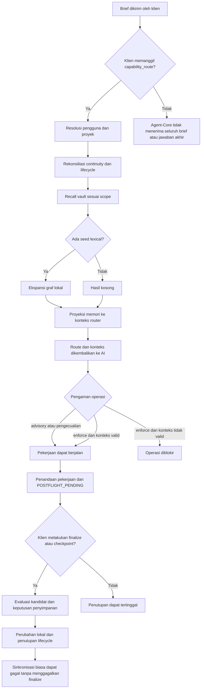

# Audit penggunaan memori Agent-Core — 9 September 2026

Dokumen ini menyimpan snapshot audit sebelum perbaikan lifecycle. Angka data dan temuan di bawah bukan status runtime terkini. Kontrak implementasi saat ini dijelaskan dalam [stability.md](stability.md) dan [akses Supabase langsung](supabase-direct-memory.md).

## Kesimpulan

**Memori pernah dibaca dan diisi, tetapi penggunaan sebelum bekerja serta penyimpanan sebelum tugas selesai belum diwajibkan secara menyeluruh.** Pada layanan yang diperiksa, vault berisi 382 item, sementara status untuk pengguna terautentikasi dan proyek Agent-Core menunjukkan 0 item. Seluruh 39 segmen vault terbaca dengan `principalId` kosong. Ini merupakan hambatan nyata terhadap recall dalam scope pengguna, meskipun health melaporkan `healthy: true`.

Mode lifecycle layanan aktif adalah `advisory`. Konfigurasi yang dimuat melalui resolver proyek mengaktifkan vault, tetapi menonaktifkan Supabase Second Memory dan tidak memiliki pengaturan koneksinya. Resolver ini dijalankan dari lingkungan pemeriksaan; konfigurasi proses aktif dapat menerima override dari launcher. Mode `advisory` diverifikasi langsung melalui endpoint layanan. Status Supabase proses aktif tidak diekspos, sehingga tidak ada klaim bahwa koneksi remote aktif telah diuji.

Audit membandingkan perilaku tersebut dengan kebijakan yang diminta: **vault, Graphify, dan Supabase harus sehat sebelum pekerjaan substantif; setiap tugas wajib memiliki keputusan penyimpanan dan penutupan yang dapat dibuktikan.** Kebijakan ini belum diterapkan oleh audit.

## Bukti dan batas pemeriksaan

- Build TypeScript berhasil. Suite utama: **883 passed, 20 skipped, 1 failed** dari 904 kasus. Kegagalan tunggal berada pada sertifikasi diff Git, dengan pesan `fatal: unable to read b7cc0d61472ba31bc37b385864692bbe5f0ada3c`; bukan kegagalan assertion perilaku memori atau MCP. Riwayat Git tidak diubah.
- Sepuluh probe tambahan mereproduksi perilaku saat ini pada fixture terisolasi. Sepuluh probe berhasil; keberhasilan ini berarti observasinya terkonfirmasi, **bukan** bahwa kebijakan ketat sudah terpenuhi.
- Layanan sesudah reload berjalan dengan PID 2424, `/health` menjawab `ok`, execution sehat dan tidak memiliki run aktif. Build baru memuat 69 tool; capability response menyebut 67 tool operasional, ditambah dua tool identitas/kapabilitas yang berhasil dipanggil.
- Graphify Python benar-benar digunakan untuk membuat graf fixture dua simpul dan satu sisi. Pada data lokal, graf mempunyai 382 simpul dan mencakup seluruh ID item vault. Kesamaan ID tidak membuktikan kesamaan revisi atau relasi. Graf menyimpan 272 sisi, sedangkan vault menyimpan 412 relasi; sebagian relasi digabung per pasangan simpul.
- Tidak ada mutasi data memori produksi, pengujian gangguan terhadap layanan produksi, atau penulisan ke Supabase. Uji remote menggunakan transport dalam memori. Pemeriksaan produksi dibatasi pada status, validasi sebelum operasi tanpa menjalankan operasinya, serta pembacaan berkas.
- Panggilan `memory_search` tanpa route pada koneksi dengan beberapa workspace ditolak sebagai `WORKSPACE_PROJECT_AMBIGUOUS`. Ini tidak dihitung sebagai hasil recall kosong. Angka 0 item di atas berasal dari `agent_core_status`, yang memiliki scope proyek eksplisit.

Bukti terstruktur audit disimpan sebagai evidence.json pada laporan operator lokal dan tidak disertakan dalam distribusi publik. Probe dapat diulang dengan:

```powershell
npm run build
node scripts/memory/audit-lifecycle.mjs
```

Script mencetak lokasi berkas hasil melalui keluaran terakhir dan menyimpan fixture di direktori sementara. Tidak diperlukan kredensial remote; Graphify memakai toolchain lokal proyek.

## Alur aktual



`capability_route` memanggil preflight dan memasukkan hasil terpilih ke konteks `CapabilityRouter`. Probe mengonfirmasi bahwa batasan yang disimpan benar-benar diterima router. Ini membuktikan penyaluran konteks, tetapi tidak membuktikan bahwa model membaca seluruh hasil atau bahwa pilihan akhir model berubah.

Graphify berperan sebagai pembentuk proyeksi graf. Recall normal menggunakan penelusuran lokal dalam JavaScript atas graf tersebut, bukan memanggil layanan Graphify terpisah pada setiap brief. Bila tidak ada kandidat lexical, tahap ekspansi graf tidak dijalankan. Obsidian menyediakan kompatibilitas format vault; aplikasi Obsidian tidak perlu terbuka. Supabase merupakan mirror pemulihan, bukan sumber recall utama ketika vault lokal tersedia.

Backend mencari di `runtime/memory/vault`. Catatan pengendali yang berada di subfolder lain pada root memori tidak otomatis menjadi item vault atau ikut recall Agent-Core.

## Temuan berprioritas

### P1 — Item vault tidak memiliki pemilik yang cocok dengan scope pengguna

**Bukti runtime dan berkas:** 382 item pada health tanpa scope; 0 item pada status koneksi terautentikasi untuk proyek yang sama. Semua segmen memiliki identitas pemilik kosong. Probe mereproduksi 1 item global, 0 item dalam scope pengguna, dan health tetap sehat.

[Parser vault](../src/memory/file-native/vault-codec.ts#L124) menerima `principal_id` yang tidak tersedia sebagai string kosong. [Pemeriksaan scope](../src/memory/file-native/vault-repository.ts#L60) secara benar mengharuskan identitas pemilik dan proyek cocok. Akar masalah pada data/validasinya tidak boleh diperbaiki dengan melemahkan isolasi antar pengguna.

**Dampak:** sistem dapat terlihat sehat dan memiliki banyak memori, tetapi AI pengguna tidak memperoleh memori tersebut. Riwayat continuity yang masih terlihat tidak membuktikan bahwa scope segmen vault benar.

**Arah perbaikan:** validasi pemilik saat startup/import, tampilkan jumlah item yang belum memiliki pemilik, dan migrasikan hanya berdasarkan pemetaan kepemilikan yang didukung bukti. Asal pasti kehilangan identitas belum terbukti; jangan menyimpulkan satu migrasi tertentu sebagai penyebab tanpa pemeriksaan provenance.

### P1 — Kewajiban sebelum bekerja masih bersifat opsional pada jalur tertentu

**Bukti kode, runtime, dan fixture:** [default konfigurasi](../src/config.ts#L237) adalah `advisory`. Probe validasi layanan untuk operasi tulis tanpa lease mengembalikan `ok: true`, `required: true`, `valid: false`. Probe ini tidak melakukan penulisan file.

[Pengaman operasi](../src/mcp/memory-lifecycle-guard.ts#L75) melewati validasi untuk operasi yang diklasifikasikan tidak bermakna dan untuk mode `disabled`; `advisory` mengembalikan peringatan. Pada `enforce`, pembacaan file tetap dikecualikan. Konteks valid juga masih mengizinkan operasi ketika Python/Graphify tidak tersedia.

**Dampak:** menyalakan `enforce` saja tidak memenuhi syarat tiga komponen sehat dan tidak memastikan pekerjaan analisis telah memakai memori.

**Arah perbaikan:** satu pemeriksaan kesiapan sebelum konteks kerja substantif diterbitkan, dengan pengecualian terbatas untuk diagnosis/pemulihan. Jangan hanya menambah kondisi pada tool tulis.

### P1 — Health tidak membuktikan Graphify atau Supabase berfungsi

**Bukti kode dan fixture:** [health backend](../src/memory/file-native/backend.ts#L338) memeriksa keberadaan path Python, bukan keberhasilan menjalankannya atau kesiapan modul Graphify. Berkas teks bernama executable Python cukup untuk menghilangkan penanda `graph_degraded`. Error remote terakhir tidak ikut hasil health.

[Adapter graf](../src/memory/file-native/graphify-adapter.ts#L54) menerima graf JSON yang bisa dibaca tanpa membandingkan generasinya dengan vault. Probe membangun graf dengan Graphify asli, menggantinya dengan graf kosong yang valid, lalu memperoleh nol relasi tanpa rebuild. [Retriever](../src/memory/file-native/retriever.ts#L49) dan refresh graph menoleransi kegagalan graf.

**Dampak:** status sehat dan hasil recall tidak mengungkap hilangnya kontribusi graf atau gagalnya mirror. Pada snapshot produksi ini seluruh ID item ada dalam graf; audit tidak menyatakan graf produksi terbukti usang.

**Arah perbaikan:** health per komponen dengan bukti eksekusi, generasi/hash vault, kesegaran graf, dan status remote yang terlihat.

### P1 — Finalize dapat menutup tugas ketika mirror gagal

**Bukti kode dan fixture:** [tool finalize](../src/mcp/memory-turn-tools.ts#L31) memanggil apply dan penutupan lokal. [Sinkronisasi biasa](../src/memory/file-native/backend.ts#L361) menggunakan mode non-strict; kegagalan transport disimpan lalu dikembalikan sebagai `null`.

Pada fixture `enforce` dengan Supabase diaktifkan dan transport gagal, finalize menghasilkan `finalized: true`, lifecycle `CLOSED`, dan health sehat, meskipun tidak ada bukti sinkronisasi remote. Pemanggilan durability boundary secara eksplisit setelah transport pulih menghasilkan `REMOTE_SYNCED`.

**Dampak:** keberhasilan pekerjaan lokal dan keberhasilan durability remote tercampur dalam kesimpulan final. Jalur checkpoint memiliki pemeriksaan durability yang lebih kuat, tetapi tidak boleh dianggap melindungi seluruh jalur finalize.

**Arah perbaikan:** bedakan keberhasilan lokal dari penutupan durable; simpan pekerjaan yang sudah terjadi dan lanjutkan sinkronisasi tanpa mengulang efek pekerjaan.

### P1 — Kewajiban penutupan dapat dilewati dengan objective lain

**Bukti kode dan fixture:** [pencarian lifecycle tertunda](../src/memory/file-native/backend.ts#L156) mencocokkan objective hash atau continuity task. Setelah pekerjaan ditandai `POSTFLIGHT_PENDING`, route untuk objective sama diblokir pada `enforce`, tetapi objective berbeda memperoleh konteks baru. Operasi baca tidak menambah meaningful-work count, sehingga pekerjaan analisis juga dapat berakhir tanpa penanda pending.

**Dampak:** menyebut finalize wajib pada deskripsi tool tidak menciptakan jaminan bahwa seluruh tugas ditutup. Agent-Core tidak memiliki kontrol atas jawaban akhir yang dikeluarkan langsung oleh klien di luar layanannya.

**Arah perbaikan:** identitas tugas stabil, daftar kewajiban penutupan yang dapat direkonsiliasi, dan kontrak keberhasilan terminal yang mewajibkan receipt. Jelaskan batas jaminan pada antarmuka klien.

### P1 — Kandidat pengetahuan baru dapat dibuang tanpa penjelasan yang memadai

**Bukti kode dan fixture:** [evaluasi postflight](../src/memory/file-native/backend.ts#L184) mulai dari `NO_DURABLE_MEMORY`. Penulisan root baru mensyaratkan kandidat, `FRESH_DURABLE_CONTEXT`, evidence, dan `rootReason`, tetapi `rootReason` opsional dalam schema tool.

Kandidat baru dengan evidence dan alasan `FRESH_DURABLE_CONTEXT`, tetapi tanpa `rootReason`, menghasilkan `NO_DURABLE_MEMORY`, `semanticMutation: false`, dan lifecycle `CLOSED`. Tidak ada error kelengkapan input yang memaksa klien memperbaikinya.

**Dampak:** proses tampak selesai meskipun pengetahuan yang sudah dinyatakan bernilai tidak disimpan. Tidak semua keputusan tanpa penulisan salah; duplikasi dan operasi sementara tetap merupakan alasan yang sah.

**Arah perbaikan:** validasi kondisional sebelum penutupan, alasan penolakan kandidat yang eksplisit, dan pengujian untuk setiap cabang keputusan.

## Riwayat penggunaan

Snapshot lokal mencakup catatan 3–8 September 2026 UTC:

| Catatan | Hasil pembacaan |
| --- | --- |
| Keputusan penyimpanan | 503; 348 `WRITE_NEW_ROOT`, 155 `NO_DURABLE_MEMORY`; seluruhnya memiliki `appliedAt` |
| Lifecycle | 84; 43 pending, 40 closed, 1 open |
| Korelasi berdasarkan route ID | 65 lifecycle memiliki keputusan; 19 tidak memiliki pasangan keputusan, termasuk 18 dengan meaningful-work count positif |
| Context yang masih tersimpan | 6; 4 mempunyai hasil recall tidak kosong |
| Event operasional | 5.698, termasuk intended/succeeded/failed, commit, checkpoint, dan continuity |

Angka ini membuktikan adanya aktivitas historis, bukan tingkat kepatuhan tugas produksi. Context dapat dipangkas, jalur commit/checkpoint berbeda, dan riwayat tidak mempunyai label asal produksi/pengujian yang konsisten. Data dengan asal yang tidak dapat dibuktikan tidak dipromosikan menjadi bukti tugas nyata. Fixture audit baru terpisah dari semua angka di atas.

Tidak ada bukti bahwa memori sama sekali tidak pernah diisi. Ada bukti bahwa recall saat ini terhalang scope pemilik dan bahwa penutupan mempunyai celah. Pengujian lama yang lulus atas perilaku fallback hanya membuktikan perilaku tersebut konsisten dengan implementasinya.

## Batas validasi tambahan

- Build paket skill belum dapat dijalankan karena `capabilities/registry/catalog.json` tidak tersedia. Tidak dibuat katalog pengganti untuk menyamarkan kondisi ini.
- Pemeriksaan branding repository belum lulus pada snapshot audit ini. Itu tidak mengubah hasil pengujian perilaku Agent-Core di atas.
- Tidak ada verifikasi Supabase live. Bukti keberhasilan transport remote terbatas pada fixture; ledger lokal tidak diperlakukan sebagai konfirmasi remote terkini.
- Temuan dan rencana perbaikan tidak mengubah konfigurasi strictness atau data historis. Lihat [rencana perbaikan](memory-lifecycle-remediation-plan.md).
