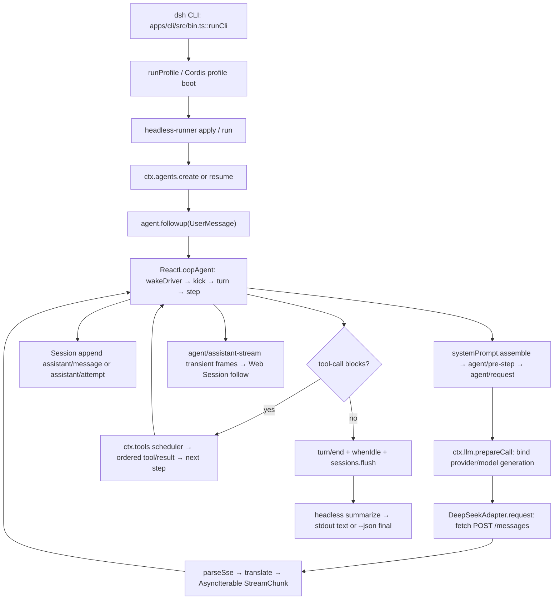

# DeepSeek Harness — Runtime Architecture & Integration Blueprint
**Date:** 2026-10-23  
**Type:** source-grounded integration proposal (NOT implemented)  
**Source:** local checkout `F:\Workflow\deepseek-harness`, branch `master`, HEAD `687f282e8625c6b8d11ff58211a90524be2e4317`.  
**Scope:** model caller invocation → interaction processing → human-readable text output. Static source inspection only; no model call, install, build, test, or integration was executed.

## 1. Architecture Map & Concurrency Pattern
This repository is **not** one monolithic caller. It is a Cordis plugin tree selected by an application profile. The clearest first-party one-shot caller/output implementation is `@deepseek-ai/dsh-headless`; Web and SDK use the same core loop but different output adapters.



### Verified call chain: one-shot text mode
| Order | Real source owner | Function/event and responsibility |
|---|---|---|
| 1 | `apps/cli/src/bin.ts` | `runCli` parses `dsh --profile headless`, delegates to `runProfile`. |
| 2 | `apps/cli/src/profile-boot.ts` | `runProfile` loads profile bundle/patch layers; `packages/bundle/headless/cordis.patch.yml` mounts the runner. |
| 3 | `packages/bundle/headless/src/index.ts` | `apply → run`; waits for Loader, selects model, creates/resumes Agent, calls `agent.followup(createUserMessage(...))`. |
| 4 | `packages/core/agent-loop/src/agent.ts` | `ReactLoopAgent.wakeDriver → kick → turn → preStep → step`; logs `turn/start`, `step/start`, admitted prompt/user, and request header/context. |
| 5 | Same file | `prepareRequest`: `agent/request` waterfall then `ctx.llm.prepareCall`; `buildRequest` derives frozen history from Session log. |
| 6 | `packages/llm/llm/src/index.ts` | `LlmRuntime.prepareCall` binds exact adapter/config and one-shot stream; `llm/stream` waterfall delegates. |
| 7 | `packages/llm/llm-deepseek/src/adapter.ts` | `DeepSeekAdapter.generate/request` makes HTTP `POST /messages`, parses SSE, translates raw provider frames into `StreamChunk`. |
| 8 | `packages/core/agent-loop/src/agent.ts` | `AssistantStreamAttempt` emits live frames and commits settled `assistant/message`; failed/retried stream commits `assistant/attempt`. |
| 9 | `packages/core/agent-loop/src/tool-calls.ts` | If model supplied calls: `executeToolCalls` dispatches; logs `tool/call`/`tool/result`; starts next model step as required. |
| 10 | `packages/bundle/headless/src/index.ts` | `agent.whenIdle`, await children, `sessions.flush`, `summarize(session, firstSeq)` gets latest committed assistant **text blocks**, writes final text to stdout. |

### Text output channels are **not interchangeable**
- **Normal headless:** completed text from durable `assistant/message` after flush → `process.stdout`; provider reasoning deltas are written separately to `stderr`. A failed run can still have a terminal status/nonzero exit.
- **Headless `--json`:** `packages/bundle/headless/src/json-stream.ts::projectJsonRun` emits bounded NDJSON `session`, `status`, `text`, `thinking`, `tool_call`, `tool_result`; `finish(text)` emits the full `{"type":"final","text":"..."}` without truncation.
- **Web UI:** `packages/api/session-controller/src/history.ts::SessionHistoryController.follow` merges committed `session/event` with optional transient `agent/assistant-stream` frames; historical/replay text comes from durable events.
- **SDK:** `packages/sdk/server/src/server.ts::prompt` calls `agent.followup`; `session.event` and `session.status` notifications carry updates, and `wait` fences completion. `packages/sdk/server/src/index.ts` exposes the stdio JSON-RPC server.
### Concurrency / consistency (from inspected code)
1. **Cordis startup:** plugin fibers/effects load with independent async activation; headless `run` awaits `ctx.get('loader')?.await()` before creating an Agent, avoiding half-mounted tools/providers.
2. **One Agent driver per session:** `ReactLoopAgent` uses `Phase` (`idle` / `maintenance` / `running`), an inbox and `wakeDriver` latch; the driver performs sequential steps and `whenIdle` awaits the current activity.
3. **Per-model stream:** asynchronous `for await` over `AsyncIterable<StreamChunk>`; provider request uses `AbortSignal.any`, idle watchdog, and iterator cleanup. `prepareCall` freezes adapter/config generation and forbids double dispatch.
4. **Parallel tool execution:** `executeToolCalls → runGroup` is a **bounded rolling pool** (`maxParallelToolCalls`); exclusive tools form barriers. Pre-/post-execute and durable `tool/result` commit remain ordered by model call order despite overlapping dispatch.
5. **Failure/retry:** aborted or failed streams settle to durable `assistant/attempt` or interrupted assistant text; `agent/request-error` may elect retry. Skipped tools receive synthetic error results so replay is structurally complete.
6. **MCP connection concurrency:** MCP client supervisor serializes tool-list resync and manages reconnect/backoff; server-name tool registration has whole-generation swap/rollback. It is separate from the Agent step pool.
7. **Output authority:** transient `agent/assistant-stream` frames are **not final answers**. The committed Session event and subsequent `turn/end` govern the final result. A hard crash before settlement cannot be treated as delivered text.

## 2. Dependency Analysis
| Layer | Actual dependency/runtime | Role |
|---|---|---|
| Entry/packaging | Node.js `^22.19 || >=24`, `pnpm@11.28.5`, ESM TypeScript, `tsx` for source launch | Profile boot and installed app |
| Plugin framework | vendored `@deepseek-ai/cordis`, Schemastery | Service injection, `ctx.effect`, `ctx.on`, reversible waterfall hooks |
| Agent/session | `@deepseek-ai/dsh-agent-loop`, `dsh-agent`, `dsh-session`, `dsh-session-persistence-jsonl` | Turn/step, durable request/message events, replay/flush |
| LLM bridge | `@deepseek-ai/dsh-llm`, `dsh-llm-deepseek` | Adapter registry, config binding, `llm/stream` waterfall |
| DeepSeek transport | Node `fetch` + SSE (`eventsource-parser@^3.1.0`) | HTTP Messages API, token/event translation |
| Tools | `@deepseek-ai/dsh-tools`, `dsh-system-prompt` | Tool execution policy, parallel-safe scheduling, schema assembly |
| External MCP | `@deepseek-ai/dsh-mcp-client`, `@modelcontextprotocol/client@2.2.0` | stdio / Streamable HTTP server discovery and tool forwarding |
| External app APIs | `dsh-sdk-jsonrpc-server`, `dsh-api-session-controller` | stdio JSON-RPC SDK and Web live/durable session-follow |
| Validation/types | `zod@4.4.3`, `@deepseek-ai/schemastery` | Config and boundary validation; not a secondary LLM runtime |

Sources: root and package `package.json`, `docs/architecture.md`, `docs/agent-lifecycle.md`, and the implementations linked above. Only the tested source snapshot is asserted; version strings describe this checkout, not latest releases.
## 3. Integration Hook Points (specific owners)
| Intent | Hook / function (real source) | Proposed adapter and limits |
|---|---|---|
| Add memory facts to next request | `packages/core/system-prompt/src/index.ts::SystemPrompt.context` | Register named, ordered `PromptContext` with **synchronous** current text provider. Refreshed admitted context becomes logged model-visible history. Never run blocking network I/O inside `text()`. |
| Async retrieve before request | `packages/core/agent-loop/src/agent.ts::preStep` → `agent/pre-step` waterfall | A Cordis plugin may await external Memory recall before calling/preserving `next()`; attach validated, bounded, source-attributed context through the normal admission path. Preserve `kind`, messages, `startsRequestSeries`; never inject unlogged hidden model input. |
| Select model / policy | `ReactLoopAgent.prepareRequest` → `agent/request` | Inspect or propose provider/model; mandatory authorization remains outside model-selected tool text. Changes apply before `prepareCall` freezes config. |
| Observe model bytes/chunks | `packages/llm/llm/src/index.ts::LlmRuntime.streamWithRegistration` → `llm/stream` | Observe chunks or wrap `next()` correctly, with cancellation, truncation, and no request mutation. Not a safe permanent-memory write point by itself. |
| Register new model provider | `ctx.llm.registerAdapter` / `packages/llm/llm-deepseek/src/host.ts::registerDeepSeekProvider` | Make a Cordis provider plugin only if implementing a **new model adapter**; MCP client tools do not replace this route. |
| Make Node/MCP tools visible | `packages/mcp/mcp-client/src/index.ts::apply` + `tools.ts::syncTools` | Mount existing MCP client in profile. stdio and Streamable HTTP supported; exports tools as `mcp__<serverName>__<rawName>` via `ctx.tools.register`. No tool-runtime rewrite. |
| Guard tool calls | `packages/core/tools/src/index.ts::ToolRuntime.register` and tool pre/execute/post hooks | Tool policies/scope/approval before dispatch. Avoid injecting directly into scheduler; parallel eligibility must be explicit. |
| Persist external outcomes | `packages/core/session/src/index.ts::Session.append` and `session/event` | Consume durable `assistant/message`, `tool/result`, `turn/end` and IDs for memory candidate extraction **after** the outcome is observed; deduplicate by session/event sequence. |
| Display/stream responses | `packages/api/session-controller/src/history.ts::SessionHistoryController.follow` | Web/GUI consumer: snapshot plus ordered live `session/event` and optional assistant frames; final UI text should prefer committed message. |
| Scriptable caller & reply | `packages/sdk/server/src/server.ts::prompt/wait` or headless `run/summarize` | TypeScript/Node client receives notifications + waits or parses `--json` NDJSON `final`. Keep stdout clean in machine mode. |

**Boundary note:** `dsh-mcp-client` is an existing MCP **client** to external tool servers, not an MCP server hosting the DSH model. Agent Core as a tool provider needs its own authorized MCP server endpoint/transport, controller admission and credential handling. An arbitrary direct HTTP call to its backend is not automatically authorized.

## 4. Actionable Implementation Steps (not executed)
1. **Define result contract:** `{sessionId, turnId?, requestId, status, text, sourceSeq, error?}`. Final `text` must be derived from committed assistant text blocks or headless NDJSON `final`; never infer final success from a transient token.
2. **Pick the low-risk path first:** keep DeepSeek Harness's own AgentLoop/adapter untouched; run your Node/TypeScript tool/memory bridge as a separate local MCP **server** with a small permitted tool list.
3. **Mount the existing MCP client:** add one scoped row to a profile `cordis.patch.yml` or a separate `--patch` overlay (the snippet below is a template, not an applied config). Do not edit `packages/core/agent-loop`.
4. **Authenticate at the external server:** resolve secrets locally, validate session/workspace/grants and contract bootstrap; never serialize API keys into Session prompt/events. Start with read-only tools; opt in explicitly before writes.
5. **Expose narrow operations:** e.g. `memory_recall` (bounded results + provenance), `read_project_context`, `verify_action`. Only add tool mutation after independent approval/evidence gates exist. Reuse Agent Core's canonical Memory—**do not** create a second writer/store.
6. **For automatic memory context:** add a small Cordis plugin using `ctx.systemPrompt.context({name,order,text})` with already-resolved text; if recall needs I/O, await it at `agent/pre-step` and preserve its waterfall result. The admitted context must be reproducible from Session events.
7. **Call/observe from TypeScript:** start `dsh --profile headless --json` with a narrow patch for one-shot work, or use shipped `sdk` profile JSON-RPC for persistent sessions. Address the exact session, subscribe to durable events, then await `wait`/terminal `final`; persist only verified results.
8. **Instrument/review:** correlate `sessionId`, event seq, model/provider, tool call IDs, aborted/retried attempts and elapsed time. Add idempotency/deadlines on the outer bridge. Roll back by removing the profile patch/plugin registration, not changing DeepSeek core or session history.

### Example Cordis overlay for a separately implemented Node MCP server
```yaml
# Example only: include as profile overlay; no server was installed.
- insert:
    - id: mcp-personal-tools
      name: '@deepseek-ai/dsh-mcp-client'
      config:
        serverName: personaltools
        transport: stdio
        command: node
        args: ['<absolute-path-to-your-local-mcp-server.mjs>']
        toolCallTimeoutMs: 60000
        failOnStartupError: true
```
### Tactical acceptance checklist (run only during an approved implementation)
- [ ] **Entry:** launch a shipped `dsh` profile; verify `ctx.llm` sees the intended provider/model and rejects missing credentials explicitly.
- [ ] **Single turn:** one user instruction yields ordered `turn/start → step/start → request → assistant/message → step/end → turn/end`; count actual tool steps without assuming one request per turn.
- [ ] **Text correctness:** compare `--json` final text to text blocks from committed assistant events; reasoning/failed attempts are not silently promoted as answers.
- [ ] **Tool concurrency:** test one parallel-safe pair and an exclusive barrier; the observed `tool/result` order must remain model order even if executions finish out of order.
- [ ] **MCP:** successful tool discovery before the first turn; duplicate server name, lost connection, timeout, and exhausted reconnect budget fail visibly.
- [ ] **Memory:** recall from known source → bounded prompt admission → durable logged context; in a fresh session, the **same** canonical memory returns the same source; no hidden duplicate writes.
- [ ] **Failure:** simulated provider error, cancellation, stream abort and process loss must not produce a false success or duplicate output; replay relies on persisted events.
- [ ] **Portability/security:** use installation/profile patches (not hardcoded internal source paths), minimum tool grants, no credentials in logs, user authorization for mutating actions.
- [ ] **Measure:** compare a baseline with tools/memory disabled versus one isolated plugin on identical tasks, preserving correctness and reporting latency/token/tool-cost.

### Reuse vs redesign decision
**Recommended minimal donor path:** reuse DSH's `mcp-client`, `systemPrompt.context`, `agent/pre-step` and durable `session/event` to connect an external Node/TypeScript capability owner. This is simpler and more reversible than copying DSH's `ReactLoopAgent` or replacing Agent Core's existing Native runtime. DSH's complete loop is valuable as a **reference**, not evidence that transplantation improves your system.

**Alternative for a bespoke model backend:** subclass `LlmAdapter`, implement `stream(GenerateOptions): AsyncIterable<StreamChunk>`, register with `ctx.llm.registerAdapter` and honor SSE ordering, structured failure, idempotent cancellation and exact provider capabilities. Only undertake this if the existing provider adapters cannot deliver the needed model transport.

### Risks, evidence limits, and ownership
- This file is a proposed engineering design. **No integration, benchmark, runtime behavior, credentials, plugin activation, MCP connection, or model response was exercised.**
- Snapshot checked: `deepseek-ai/deepseek-harness` at commit `687f282e8625c6b8d11ff58211a90524be2e4317`. Future versions can change pre-stable APIs and source locations.
- Profile overlay syntax/precedence: `docs/architecture.md`; prompt contracts: `packages/core/system-prompt/README.md`; MCP memory examples and fresh-session acceptance: `docs/user/guide/mcp-memory.md`.
- Distinguish **factual existing hooks** above from **hypothetical bridge implementation**; Agent Core's external Memory/security owners remain authoritative for its own sessions.
