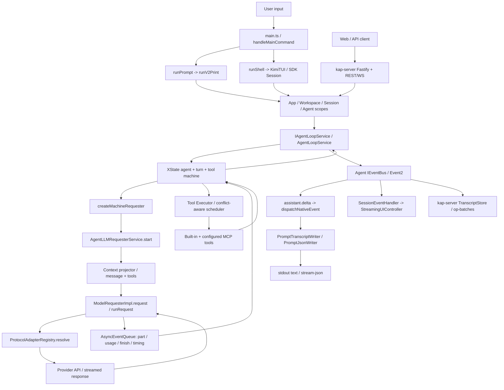
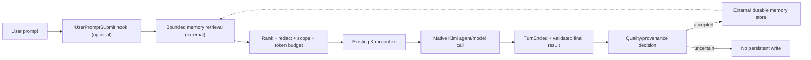

# Kimi Code Runtime Architecture & Integration Blueprint

**Target:** `F:\Workflow\kimi-code`  
**Tanggal audit:** 2026-10-23  
**Cakupan:** Model Caller Invocation → Interaction Processing → Text Output Response  
**Jenis hasil:** Proposal berdasarkan pembacaan source lokal, bukan implementasi atau verifikasi perilaku live.  
**Status:** SOURCE-GROUNDED / PROPOSAL ONLY / NO RUNTIME MUTATION.

## 0. Kesimpulan eksekutif

Arsitektur Kimi Code v2 memisahkan CLI/TUI, session/agent lifecycle, state machine, model requester, provider protocol, tool execution, dan output rendering. **Tidak perlu mengganti model engine** untuk menghubungkan MCP atau memory milik sendiri. Jalur paling kecil adalah menambahkan MCP server melalui konfigurasi yang sudah ada; jika context recall harus otomatis, gunakan hook `UserPromptSubmit` atau integrasi event yang sudah tersedia. Jangan menambah pemanggil LLM paralel pada tahap awal.

**Sumber otoritatif:** file TypeScript lokal yang dicantumkan di setiap bagian. `README` hanya memberi orientasi; seluruh kesimpulan inti ditelusuri ke source. Belum ada eksekusi model, build, test, provider login, atau perubahan konfigurasi.

## 1. Architecture Map & Concurrency Pattern

### 1.1 Entry point dan caller nyata

| Lapisan | Simbol / file | Fungsi aktual |
|---|---|---|
| Proses CLI | `apps/kimi-code/src/main.ts` → `handleMainCommand()` | Pilih mode print (`runPrompt`) atau TUI (`runShell`). |
| Print mode | `apps/kimi-code/src/cli/run-prompt.ts` → `runPrompt()` | Delegasi ke `runV2Print()`. |
| Turn pertama | `apps/kimi-code/src/cli/v2/run-v2-print.ts` → `runNativeTurn()` | `IAgentLoopService.submit()`, tunggu `Turn.result`, subscribe `IEventBus`. |
| Agent lifecycle | `packages/agent-core-v2/src/agent/loop/loopService.ts` → `AgentLoopService` | Menangani queue, turn, step, retry, cancel, context, tool dan delta. |
| Machine bridge | `.../agent/loop/machine/engine.ts` → `machineEngineAttachBundle()` | Menghubungkan XState actor/turn/tool machine dengan requester dan events. |
| Model caller adapter | `.../agent/loop/machine/requester.ts` → `createMachineRequester()` | Memanggil `IAgentLLMRequesterService.start()` dan mem-forward streaming parts. |
| Agent request owner | `.../agent/llmRequester/llmRequesterService.ts` → `start()/runRequest()` | Menyiapkan history, prompt, tool schema, trace, token budget, fallback/retry. |
| **Actual provider call** | `.../llm-adapter/model/model-requester-impl.ts` → `ModelRequesterImpl.runRequest()` | Menjalankan `requester.generate(config, content, control)`. |
| Provider routing | `.../llm-adapter/protocol/protocolAdapterRegistry.ts` → `resolve()` | Memilih adapter OpenAI / Responses / Anthropic / Google GenAI dan connection. |
| CLI text sink | `apps/kimi-code/src/cli/v2/run-v2-print.ts` → `dispatchNativeEvent()` | Mengubah `assistant.delta` ke `PromptTurnWriter`. |
| Final text writer | `apps/kimi-code/src/cli/prompt-render.ts` | `PromptTranscriptWriter` menulis teks ke stdout; `PromptJsonWriter` menulis JSON lines. |

**Pembedaan:** `apps/kimi-code/src/main.ts` adalah entry point proses, **bukan** fungsi yang menembakkan request HTTP model. Request provider aktual dipanggil pada `ModelRequesterImpl.runRequest()` setelah resolving protocol. Paket `packages/kosong` juga berisi abstraction/generator, tetapi jalur v2 yang ditelusuri memakai `agent-core-v2/src/llm-adapter` dan implementasi `src/human/llm/requester/bases/*`. Jangan menyamakan kedua jalur.

### 1.2 Diagram end-to-end



Panah provider → machine menunjukkan aliran event balik; loop dapat menjalankan step berikutnya setelah tool result. Diagram ini menyederhanakan variasi jalur server/TUI tetapi mempertahankan ownership fungsi utama.

### 1.3 Lifecycle interaksi

1. `runNativeTurn()` membuat subscriber event sebelum submit prompt, memanggil `loop.submit()`, menunggu `handle.launched` lalu `turn.result`.
2. `AgentLoopService` mengatur turn/step melalui machine; context dan profile diproyeksikan menjadi message + tool schema di `AgentLLMRequesterService`.
3. `ModelRequesterImpl` resolve credential dan protocol, memanggil requester provider, mengumpulkan event `part/usage/finish/timing`.
4. `createMachineRequester()` menerjemahkan parts sebagai `llm.streaming.part` dan hasil akhir sebagai `llm.done` atau `llm.failed.remote`.
5. `machine/engine.ts` memisahkan text/thinking/tool-call delta; `loopService.ts` mem-publish `AssistantDelta`, `ThinkingDelta`, dan tool events.
6. Jika ada tool calls, `createMachineTools()` menyusun batch; `AgentToolExecutorService` memvalidasi/menjadwalkan tool lalu mengirim output balik sebagai konteks step berikutnya.
7. Subscriber print menangkap `assistant.delta`; `PromptTranscriptWriter` mengalirkan teks dan `PromptJsonWriter` mengeluarkan JSON lines. Writer di-flush saat turn settle sebelum kebijakan background `exit/drain/steer`.
8. TUI memakai `SessionEventHandler` + `StreamingUIController.appendAssistantDelta()`; server memakai `bindSessionTranscript()` dan op-batch transcript. Keduanya tidak melewati writer CLI `-p`.

### 1.4 Pola concurrency yang terverifikasi dari source

| Mekanisme | Lokasi | Konsekuensi integrasi |
|---|---|---|
| XState v5 actors | `agent/loop/machine/engine.ts` dan `#human/agent/machine` | State turn/step/abort bukan loop sinkron sederhana; hook harus menghormati state transition. |
| Async iterable/event queue | `llm-adapter/model/model-requester-impl.ts`, `_base/asyncEventQueue.ts` | Streaming parts dapat muncul sebelum pesan final; jangan simpan teks parsial sebagai hasil final. |
| Parallel tool-call arguments | `agent/loop/machine/tools.ts`; `ModelRequesterImpl` | Argument delta beberapa tool bisa interleaved; ikat ke `toolCallId`, bukan posisi kedatangan. |
| Conflict-aware scheduler | `agent/toolExecutor/toolScheduler.ts` | Tool dengan akses yang konflik diserialkan; tugas independen dapat berjalan concurrent. |
| Tool completion race | `agent/toolExecutor/toolExecutorService.ts` | Hasil/finalization diproses melalui `Promise.race`; urutan selesai tidak harus urutan permintaan. |
| Cancellation | `machine/requester.ts`, `machine/tools.ts` | `AbortSignal.any` menggabungkan pembatalan; MCP/memory adapter harus fail-soft dan cancellable. |
| Background continuation | `run-v2-print.ts` | Selesainya main turn tidak selalu berarti proses siap exit; kebijakan `exit/drain/steer` dan cron/goal berlaku. |
| Scope isolation | `app/scopes.ts` | App, Workspace, Session, Agent memiliki lifecycle berbeda; jangan simpan state per-agent pada singleton global. |

## 2. Dependency Analysis

| Dependency / platform | Bukti lokal | Peran |
|---|---|---|
| Node.js ≥24.15 + pnpm 10.33 | root `package.json` | Runtime/build monorepo TypeScript ESM. |
| TypeScript 7, Zod 4 | root & `packages/agent-core-v2/package.json` | Type contracts, config parsing dan validation. |
| `xstate` v5 | `packages/agent-core-v2/package.json` | State machines / actor orchestration. |
| OpenAI SDK, Anthropic SDK, `@google/genai` | `packages/agent-core-v2/package.json`; `protocolAdapterRegistry.ts` | Provider/transport request adapters. |
| `@modelcontextprotocol/sdk` | `packages/agent-core-v2/package.json` | MCP client dan tool integration. |
| Fastify 5, `ws` 8, Pino | `packages/kap-server/package.json` | REST/WebSocket API dan logging. |
| `@moonshot-ai/pi-tui` | `apps/kimi-code/src/tui/kimi-tui.ts` | Terminal UI streaming rendering. |
| `@moonshot-ai/transcript` | `packages/kap-server/src/services/transcript/coreBinding.ts` | Transcript projection, idempotent ops dan consumer sync. |
| `@moonshot-ai/kimi-code-sdk` | `apps/kimi-code/src/cli/run-shell.ts` | Public harness/session facade untuk TUI dan integrator Node. |
| `@moonshot-ai/kosong` | `packages/kosong/src/generate.ts` | Library LLM abstraction terpisah; bukan shortcut untuk seluruh v2 lifecycle. |

**Connector riil:** `app/mcpConfig/configLoader.ts` membaca konfigurasi user `<KIMI_HOME>/mcp.json`, project root `.mcp.json`, dan CWD `.kimi-code/mcp.json`. `AgentMcpService.registerMcpServer()` mengubah tool MCP yang ditemukan menjadi `IAgentToolRegistryService.register()`. Project-level MCP dapat tertahan oleh workspace trust; print mode mengeluarkan peringatan ketika konfigurasi project dilewati. Jangan menonaktifkan gate itu demi integrasi.

## 3. Integration Hook Points

| Prioritas | Hook spesifik | Kegunaan | Perubahan yang dibutuhkan |
|---|---|---|---|
| **A / minimum** | `app/mcpConfig/configLoader.ts::loadMcpServersDetailed()` → `agent/mcp/mcpService.ts::registerMcpServer()` | MCP memory search, store, knowledge API, custom Node tools | **Tidak perlu patch Kimi**; sediakan server MCP eksternal dan konfigurasi. |
| **A / otomatis** | `features/externalHooks/agent/agentExternalHooksService.ts::runPromptSubmitHook()` | Pre-turn bounded memory retrieval, inject konteks sebagai `hookParts` | Hook `UserPromptSubmit` terkonfigurasi; jangan ubah historical chat langsung. |
| **B / capture** | `IAgentLoopService` event `TurnEnded` via `IEventBus`; `runNativeTurn()` subscriber | Simpan ringkasan hasil akhir, bukan setiap `assistant.delta` | Adapter/subscriber dengan penilaian kualitas dan persetujuan scope. |
| **B / native tool** | `agent/toolRegistry/toolRegistryService.ts::register()` + `agent/toolExecutor/toolExecutorService.ts` | Modul TypeScript internal dengan schema dan permission gate yang ada | Hanya jika MCP tidak cukup; gunakan feature/contribution native. |
| **C / context projection** | `agent/contextMemory/contextMemory.ts::IAgentContextMemoryService` + `contextProjectorService.ts::project()` | Memory retrieval yang benar-benar menyatu di request context | Perlu adapter scoped dan token budget; raw source mutation berisiko. |
| **C / provider** | `llm-adapter/protocol/protocolAdapterRegistry.ts::resolve()`; `model-requester-impl.ts::runRequest()` | Adapter endpoint/model baru, tracing request | Bukan posisi untuk knowledge injection; pertahankan credential + error mapping. |
| **C / output** | `apps/kimi-code/src/cli/prompt-render.ts::PromptTurnWriter`; `run-v2-print.ts::dispatchNativeEvent()` | Output filter atau structured text extraction | Hanya print mode; TUI/server punya sink berbeda. |

### 3.1 Peta desain memory yang disarankan



**Penting:** `IAgentContextMemoryService` adalah konteks conversation/compaction saat ini, **bukan otomatis persistent semantic memory lintas proyek**. Jangan menggantinya dengan database kedua atau menulis langsung ke wire/journal. External memory harus memiliki scope, provenance, retention, dan kebijakan storage yang eksplisit.

### 3.2 Batas keamanan dan interaksi

- Sebarkan memory sebagai **data tidak tepercaya**, bukan instruksi system baru. Redact secrets/API key sebelum search, storage, logging atau event emission.
- Pre-prompt hook wajib bounded, timeout, abort-aware, fail-open untuk retrieval opsional; jangan membuat semua prompt gagal hanya karena memory provider offline.
- Hindari `onDidFinishStep` sebagai durable-write trigger mentah: step dapat berisi tool call, retry, atau incomplete answer. Gunakan authoritative settled turn plus pemeriksaan konten.
- Untuk MCP, ikuti workspace trust, OAuth/token lifecycle, argument/schema validation, tool permissions, serta guard terhadap nama tool collision.
- Lindungi concurrency dengan key `sessionId/agentId/turnId/toolCallId`; idempotency pada write hasil, cancel saat agent/session ditutup, dan jangan replay operasi side-effecting secara buta.
- Jangan menyalin stdout/stderr thinking ke memory dan jangan menganggap `assistant.delta` adalah pesan final yang sudah disetujui.

## 4. Actionable Implementation Steps

**Phase 0 — Baseline read-only.** Catat branch/commit aktual, root package versions dan mode yang akan diintegrasikan (`-p`, TUI atau server). Temukan config MCP aktif dan trust state. Tidak perlu build atau restart hanya untuk audit ini.

**Phase 1 — Reuse native MCP.** Bangun *satu* standalone TypeScript/Node MCP server di project personal yang berisi maksimum dua tool awal: `memory_search(query,scope,limit)` dan `memory_remember(candidate,provenance)`. Implement schema ketat, redaction, timeout, canonical store eksternal, no hidden autonomous writes. Jangan memasang LLM baru pada MCP server.

**Phase 2 — Wire via config.** Daftarkan server ke `mcp.json` level user atau project yang sesuai dengan scope trust. Bentuk konfigurasi contoh (placeholder, **bukan path/file yang sudah ada**):

```json
{
  "mcpServers": {
    "personalMemory": {
      "transport": "stdio",
      "command": "<absolute-path-to-node>",
      "args": ["<absolute-path-to-compiled-mcp-entry>.mjs"]
    }
  }
}
```

**Phase 3 — Observability saja dulu.** Melalui satu sesi terisolasi, verifikasi MCP discovery/tool schema dan lakukan satu `memory_search` read-only. Catat permission/trust, latency, failure behavior, serta apakah hasil masuk sebagai tool output tanpa mengganggu text delta.

**Phase 4 — Optional automatic recall.** Jika user benar-benar menghendaki memory selalu dipakai, aktifkan `UserPromptSubmit` hook untuk lookup relevan (misalnya maksimum 3 potongan, fixed token budget). Validasi sumber, sandbox/untrusted boundary, satu insert per prompt ID, dan no mutation pada history asli.

**Phase 5 — Write after stable outcome.** Tambahkan subscriber `TurnEnded` melalui SDK/event bus. Pisahkan completed/failed/cancelled; hanya simpan ringkasan yang terbukti bermanfaat, dengan provenance serta dedup key `sessionId+turnId+contentDigest`. Tahan/skip output gagal atau belum tervalidasi.

**Phase 6 — Jika butuh orchestration lebih dalam.** Bandingkan (a) MCP tools + hook yang sudah ada, (b) modul contribution pada `IAgentToolRegistryService.register()`, (c) adapter provider baru. Pilih perluasan hanya ketika baseline menunjukkan kebutuhan nyata yang tak dicapai jalur lebih kecil. Jangan mengganti state machine atau menambah LLM caller paralel.

## 5. Verification gates sebelum status LIVE

1. **Readiness:** config valid, server MCP trusted/connected, schema terlihat dan tidak collision.
2. **Correctness:** prompt identik tanpa/bersama memory mempunyai output tetap relevan; ada provenance/TTL dan tak ada kebocoran secrets.
3. **Retry + cancellation:** abort di tengah stream/tool, timeout memory, reconnect MCP; tanpa orphan process atau duplicate durable write.
4. **Parallelism:** dua tool calls interleaved, resources yang konflik tetap serial, hasil dikaitkan dengan `toolCallId` benar.
5. **Output parity:** `-p` text ke stdout, `--output-format stream-json`, TUI event rendering dan REST/WS transcript tidak saling tercampur. Protokol output final tetap asli.
6. **Persistence:** setelah session restart, hanya durable memory yang disetujui tersedia; journal/context/history internal tetap konsisten.
7. **Regression scope:** jalankan targeted tests untuk seam yang disentuh **hanya setelah scope implementasi/testing disetujui**. Tidak ada tes tersebut dilakukan dalam audit proposal ini.

**Rollback proposal:** bila hanya menambah MCP config, rollback cukup disable/remove entry MCP dan stop server milik integrasi; jangan hapus session journal, pengguna lain, system tool atau provider credentials. Mutasi source perlu checkpoint/rollback terpisah.

## 6. Architecture opportunity (hipotesis, belum implementasi)

**Dual-plane harness:** pisahkan (i) *live interaction plane* yang tetap dimiliki Kimi/XState dari (ii) *durable evidence-memory plane* eksternal yang hanya menerima final outcomes tervalidasi. Keduanya berkomunikasi dengan MCP tool dan event envelope bertanda `sessionId/agentId/turnId`. Ini menggabungkan event sourcing + memory retrieval tanpa membuat pengelola percakapan kedua.

**Hipotesis manfaat:** recall lintas sesi dan audit provenance bertambah, sementara semantics tool scheduling, cancellation, permission, dan text streaming tidak berubah. **Pembatal hipotesis:** latency p95 meningkat melampaui budget, output bercampur, duplicate writes, atau prompt tanpa memory provider menjadi gagal. Jika ini terjadi, kembali ke MCP tool yang dipanggil eksplisit saja.

## 7. Evidence index (dibaca langsung)

- `apps/kimi-code/src/main.ts`: `handleMainCommand`.
- `apps/kimi-code/src/cli/run-prompt.ts` dan `src/cli/v2/run-v2-print.ts`: `runPrompt`, `runNativeTurn`, `dispatchNativeEvent`, print background policy.
- `apps/kimi-code/src/cli/prompt-render.ts`: `PromptTranscriptWriter`, `PromptJsonWriter`.
- `apps/kimi-code/src/cli/run-shell.ts`, `src/tui/controllers/session-event-handler.ts`, `streaming-ui.ts`: jalur TUI.
- `packages/agent-core-v2/src/agent/loop/loop.ts` dan `loopService.ts`: lifecycle, hooks dan `AssistantDelta`.
- `packages/agent-core-v2/src/agent/loop/machine/{engine,requester,tools}.ts`: actor, request bridge, tool-call batch.
- `packages/agent-core-v2/src/agent/llmRequester/{llmRequester,llmRequesterService}.ts`: request owner/stream.
- `packages/agent-core-v2/src/llm-adapter/model/{model-requester,model-requester-impl}.ts`: per-provider request/stream.
- `packages/agent-core-v2/src/llm-adapter/protocol/protocolAdapterRegistry.ts`: provider route.
- `packages/agent-core-v2/src/agent/{contextMemory,contextProjector,toolRegistry,toolExecutor,mcp}/*`: context, MCP dan executor.
- `packages/agent-core-v2/src/features/externalHooks/agent/agentExternalHooksService.ts`: hook lifecycle.
- `packages/agent-core-v2/src/app/mcpConfig/configLoader.ts`: MCP config paths/merge.
- `packages/kap-server/src/services/transcript/coreBinding.ts`: event-to-transcript projection.
- `package.json` dan `packages/{agent-core-v2,kosong,kap-server,node-sdk}/package.json`: dependency names/versions.

**Batas bukti:** ini static source tracing dengan pembacaan terarah; tidak mengaudit seluruh 2.377 baris loop service, semua provider failure branch, semua transport remote maupun aktual performance runtime. Tidak ada klaim timing, reliability, deployment atau end-to-end PASS tanpa execution evidence. Proposal hanya menjadi landasan implementasi berikutnya.
