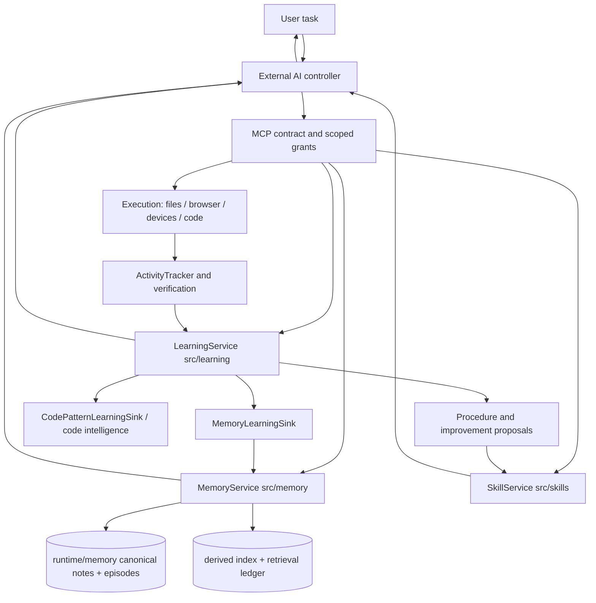
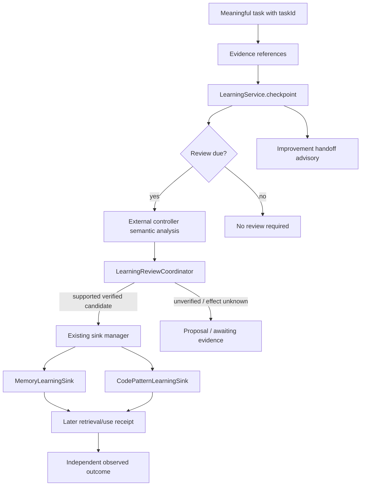

# Agent Core — Memory, Learning, Self-Learning, Self-Improvement, and Proactivity
**Source-first research atlas | 2026-10-22 | CURRENT OWNER MAP — not a release declaration**

> **Audience:** research on safe, polyglot, evidence-gated improvement of the *external AI/controller* without replacing Agent Core's existing architecture. **Native AI Agent Core development and operation are active under the 2026-10-24 user decision.** This document maps current source interfaces; it is not a production test or permission grant.

## 0. Reading contract, confidence labels, and document authority
- **Current source** beats historical plans, stale diagrams, prior chat, paper claims, and code-search results. Read the exact source before using an owner or adding a new one.
- **Observed source:** a function, schema, branch or storage invariant was inspected. **Observed health:** a specific read-only status call returned a value. **Historically verified:** an older acceptance report records an event, not a check rerun today. **Hypothesis/gap:** additional verification is needed. **Unverified:** no independent comparable evidence.
- **Canonical implementation owner:** `src/memory/` plus `src/memory/mcp/` for Memory; `src/learning/` for Learning; `src/skills/service.ts` for Skill artifacts; `src/tracker/` for Activity evidence; `src/verification/` for source/verifier evidence.
- **Canonical persistence:** `runtime/memory/` for Memory; the Learning state owner resolves its location via `src/learning/paths.ts` and `config.learning.stateDir`. Derived indexes and telemetry are *not* alternative canonical memories.
- **Mandatory bootstrap:** external client calls `controller_contract(read)`, reads `AGENTS.md`, acknowledges its fresh session receipt, then inspects canonical Memory before ordinary Agent Core operations. A receipt enables scoped access, not permission to override higher-level controls.
- **Development boundary:** this research targets external AI; Native development is also available, with changes following the actual user task. No automatic edit, model weight change, release, self-deployment, or security/grant revision is implied.
- This atlas intentionally excludes secrets, credentials, raw chats, private reasoning, transitory process identifiers, and large historical progress logs. Evidence pointers link to source; not every function call was exercised in this documentation work.
- **Historical correction:** documents written before 2026-10-16 may name `SubProject/agent-core-memory` or an old activation marker as the runtime owner. Current `src/memory/host-runtime.ts` instead initializes `MemoryService` from `src/memory/service.ts` and validates `runtime/memory/state/host/activation.json`. Historical layouts are migration inputs only.

## 1. Terminology: avoid confusing data, learning and demonstrated value
| Concept | Current owner / object | Meaning | Not proof of |
| --- | --- | --- | --- |
| Memory record | `src/memory/types.ts`, `service.ts` | Long-lived canonical knowledge/metadata/source links | Truth merely because stored |
| Memory recall | `retrieval.ts`, `controller-session.ts` | Scoped, ranked selection and bounded disclosure to controller | Model applied knowledge |
| Retrieval ledger | `retrieval-ledger.ts` | Search attempts, exposure, delivery, use receipts | Causal outcome improvement |
| Task experience | `episodes.ts`, `capsule.ts` | Bound events, working state, task continuity/obligations | Semantic knowledge promotion |
| Consolidation | `promotion.ts`, `consolidation.ts` | Review and guarded transition of candidate knowledge | Every candidate is correct |
| Learning checkpoint | `src/learning/triggers.ts`, `service.ts` | Durable marker that an eligible meaningful task needs review | Candidate captured or reusable |
| Learning review | `src/learning/review.ts` | Controller-supplied semantic candidates checked/recorded or proposed/rejected | Performance gain from capture |
| Procedural knowledge | `src/agent-learning-loop.ts`, `learning/external-procedure.ts` | Reuse condition, steps, outcomes, positive/negative receipt | Safe automatic execution |
| Skill revision | `src/skills/service.ts` | Versioned artifact with digest/stage/promotion/rollback | Tool permission or correctness |
| Improvement proposal | `learning/external-improvements.ts`, `proposal-documents.ts` | Revision-bound decision artifact, human review required | Approval/activation/deployment |
| Proactivity | `learning/improvement-handoff.ts`, `memory/prospective-intentions.ts` | Advisory triggers and proposals within active task | Always-on autonomous agent |
| Evaluation | `learning/external-evaluation.ts`, `controlled-outcome.ts` | Baseline/candidate projections with host evidence | Causal benefit by default |

## 2. Current architecture and single-owner relationship

- `src/index.ts::startAgentCoreService`: initializes `initializeAgentCoreMemory`, optional semantic code intelligence, `LearningService.initialize`, `SkillService.initialize`, `learning.attachSkills`, and `ExternalControllerLearningService.initialize`. These are existing owners, not proposed new services.
- `src/mcp/server.ts` plus `src/mcp/controller-contract.ts` expose the admitted external tool surface. Authenticated MCP and per-tool grants belong to the host; Memory contents and Skill text are *data*, not authority.
- `src/workflows/controller-cycle.ts::buildControllerCycle` is a **diagram/projection**: it explicitly says the external AI plans the work, while Core dispatches chosen authorized tools. Treat the diagram as an explanation, not an executable workflow orchestrator.
- `src/agent-controller.ts`, `agent-runtime.ts`, `agent-learning-loop.ts` also serve the existing Native runtime. They can be read to map shared contracts but are not open for Native development.
- An external AI's actual prompt assembly, model policy and host-internal scheduling cannot be proven by the Agent Core repository alone.

## 3. Memory bootstrap and authority of the active root
**Files:** `src/memory/host-runtime.ts`, `host-activation.ts`, `initialize.ts`, `store.ts`, `transaction.ts`, `paths.ts`.
1. `initializeAgentCoreMemory(projectRoot,memoryDir,embedder)` calls `readMemoryActivation`; it expects the canonical root and complete activation/experience identity, otherwise fails closed.
2. Activation validates path segments, rejects symlinks and ambiguous historical/current marker combinations, checks root identity plus permitted backup provenance, and acquires the Memory activation lock. It does not silently initialize an empty parallel writer.
3. `MemoryService.initialize` uses `FileMemoryStore`, loads canonical notes, validates completeness, recovers unfinished transactions and refreshes or degrades the derived index.
4. The `AgentCoreMemoryRuntime` exposes both `service` and `experience` as the **same** `MemoryService` instance in `experience-v2` mode. This is intentional: not two Memory engines.
5. `runtime/memory-v2/` and `runtime/memory-v2-activation.json` are historical **migration-only** inputs. Any older diagram treating them as active must be considered superseded.
6. The currently configured Cloudflare Workers AI embedder is optional infrastructure used to enhance semantic retrieval; Memory's source of truth remains local canonical records.

## 4. Canonical record, metadata and durable state
- `src/memory/types.ts`/`note-format.ts`: records carry `id`, content/title, keywords, context, tags, category, typed links, timestamps, retrieval counts, optional provenance/source and expiration; foundational pinned records are protected. Experience-v2 schema and archive references extend the ordinary record model.
- `src/memory/service.ts::remember`: controller-supplied metadata has precedence when valid; missing metadata is conservatively enriched; provenance and links are validated, stored, then index refreshed. A stored item is not automatically a verified claim.
- `service.ts::update` and `batch`: canonical updates require record validation and locking; ordinary API cannot mutate pinned foundation. Explicit updates are distinct from curation proposals.
- `src/memory/store.ts::FileMemoryStore`: reads notes, `state`, revisions and experience manifests as one scoped snapshot. Missing foundation, invalid experience manifest and other corruption cause errors rather than being interpreted as an empty store.
- `src/memory/transaction.ts::MemoryTransactionCoordinator`: validates bounded paths, maintains preparing/prepared/applying/committed journal phases, checks original fingerprints (CAS), stages and backs up, applies mutations, rolls back interrupted non-commits and recovers on read/startup. It does **not** create an OS-wide sandbox.
- Canonical commit is authoritative; derived indexing may subsequently fail or lag. Keep `committed`, `index-current`, `retrievable`, `delivered`, `used`, and `goal-success` as six distinct claims.
- Typed relations include `related`, `supports`, `contradicts`, `derived-from` and temporal supersession through owner-specific contracts. Link similarity alone does not authorize rewriting neighboring knowledge.
- `src/memory/revisions.ts`, `temporal.ts`, `archive.ts` support source and history references. Historical `knownAt/asOf` must not leak later knowledge, and incomplete historical coverage remains explicitly incomplete.

## 5. Retrieval end-to-end: source, rank, disclose, prove later use

- `src/memory/retrieval.ts::searchMemories` calculates lexical phrase, token overlap, metadata, source provenance, semantic similarity, BM25, feedback and recency components, plus typed link expansion. Profiles are selectable (`legacy`, `bm25`, `fusion`) in an appropriate context.
- The semantic index (`src/memory/index.ts`, `embedder.ts`, `semantic-document.ts`, `passages.ts`) is derived/rebuildable. Embedding outage lowers availability or coverage; never infer canonical note loss from an index outage.
- `src/memory/controller-session.ts::ControllerMemorySession`: scope and workspace are assigned by host, and disclosure cursors bind to scope, request and snapshot. Views include `map`, `abstract`, `record`, `episode`, `evidence`; budget is bounded (512–65,536 bytes).
- `src/memory/controller-protocol.ts`: strict method schema validates before dispatch; budget reserve accounts for wrapper bytes. Returned envelope warns explicitly that recalled Memory is advisory.
- `src/memory/retrieval-ledger.ts`: distinguish retrieval attempted, records selected, delivered-to-controller, applied/adapted/rejected later, verified outcome and causation-not-established. Mere `retrievalCount` or a self-reported `verified:true` is insufficient.
- `src/memory/search-projection.ts`, `evidence-excerpt.ts`, `progressive-disclosure.ts`: manage disclosure size and bounded excerpts. A trimmed/missing item is not equivalent to negative knowledge.
- Superseded, expired or forgotten records must be excluded in current recall according to context, rather than deleting their audit history without user scope.
- `src/memory/planned-context.ts`: 1 root plus up to 4 explicit subquestions, budgets and deadlines, serialized calls, coverage and explicit partial/blocked statuses. Timeout/abort ends local wait but may not cancel remote embedding; never claim silent cancellation.

## 6. Task experience, continuity and prospective intentions
- `src/memory/episodes.ts::MemoryEpisodes`: stores explicit task-scoped events (`action`, `observation`, `decision`, `failure`, `success`, `correction`, `checkpoint`, `status-change`) with revisions, operation identity, source refs and working-state changes.
- `src/memory/capsule.ts` renders bounded context capsules; `controller-session.ts::assessTaskContinuity` differentiates ready, expand-required, revalidate-required and checkpoint-required. A ready capsule means continuity freshness, **not** task success.
- `src/memory/experience-types.ts`: events, checkpoint assertions and working items are typed. Durable active obligations and source assertions are not equivalent to guaranteed future execution.
- `src/memory/prospective-intentions.ts::evaluateIntentions` is a pure, read-only projection of time/event cues into `waiting/eligible/expired/resolved/unknown`. It **does not schedule, resolve or perform an action**.
- `src/memory/project-synthesis.ts`, `evidence-lineage.ts` and `subquestion-retrieval.ts` support scoped synthesis and retrieval planning; they do not independently judge entire real-world claims true.
- Resume and cross-session continuity are real stored capabilities only when the task, identity, capsule and source revisions match. Historical task text remains evidence, not a new user request or execution permission.

## 7. Memory consolidation, semantic correctness and knowledge governance
- `src/memory/consolidation.ts`: detects candidates for overlap/merge, not automatic truth or authority.
- `src/memory/promotion.ts::MemoryPromotion`: supports revision-bound `create`, `amend`, `merge`, `retain`, `conflict`, and `supersede` plans. Every proposal binds an episode, expected revision, operationId, input references, and read-set/activation dependencies.
- Preview/preparation is not application. Application is guarded by current source revisions, immutable identities, review policy and canonical transaction. The system may reject stale candidates and require user review.
- Contradiction/supersession keep provenance instead of erasing uncomfortable negative evidence. Model-generated relations require review and specific source support; similarity is not causal proof.
- `src/memory/claim-review.ts`: optional **external-only** HOW/WHEN contract per claim. A claim can specify `reality/decision/dependency/relevance`, source lookups, triggers and cadence. Actual controller-reported attempts record supported/contradicted/unresolved/not-applicable separately; unavailable source cannot become successful validation. A cadence field is **not** a scheduler.
- `src/memory/recall-repair.ts`: read-only preview, apply/reject and bounded verify for missed recall, tied to actual historical retrieval attempts. Only allowed keyword repair uses canonical batch transaction and exact revision guards; a selected query passing is not broad recall improvement.
- `src/memory/derivations.ts`: source-range evidence derivation metadata; evidence existence does not equal semantic correctness or guarantee that a generated claim is entailed by source.
- `src/memory/reconsolidation*` and `relevance.ts`: specialized contracts/experiments; do not confuse optional experiments with active always-on autonomic mutation.

## 8. LearningService: checkpoints, reviews, sinks, actual reuse

**Owner paths:** `src/learning/service.ts`, `triggers.ts`, `review.ts`, `evaluation.ts`, `effect-evidence.ts`, `sink-manager.ts`, `state.ts`, `curator.ts`, `decision-evidence.ts`, `code-pattern-sink.ts`, `src/memory/learning-sink.ts`.
- Learning is deterministic bookkeeping and admission; **external AI** remains semantic reviewer. `LearningService` initializes `LearningStateStore`, `MemoryLearningSink`, optional Grafel `CodePatternLearningSink`, review coordinator, curator and journey. Never add a second LearningService.
- `checkpoint` needs task-bound `idempotencyKey`, reason and evidenceRefs; an identical logical checkpoint does not count twice. Source-observed `src/learning/triggers.ts::applyCheckpoint` sets `reviewDue=true` for **every new meaningful checkpoint**, including ordinary `task-complete`, and tracks its pending review. `src/learning/service.ts::status` reports `reviewDue` when any pending review exists. The displayed `reviewInterval` configuration is **not** a gating threshold in these current functions; immediate reasons (`user-correction`, `verified-recovery`, `explicit-learn`) affect review priority/reason, not whether the checkpoint is reviewable.
- `learning(action=status)` distinguishes health, pending reviews and curator due. A review can legitimately report `no-new-knowledge`, `awaiting-verification`, `rejected`; it should not manufacture useful knowledge every time.
- `LearningReviewCoordinator::validateCandidate` checks purpose/type, metadata, bounded evidence references, safe content, optional evaluation/envelope. A `verified` Boolean is insufficient; controlled behavioral effect requires independent evidence and may stay proposal-only.
- Sink manager routes verified generic facts/recoveries to canonical Memory and code-specific patterns to existing Code Intelligence/Grafel only when available. Dedupe runs before capture; sink unavailable/failure does not erase other work.
- `learning/curator.ts::LearningCurator.propose` *proposes* stale/contradiction/overlap/feature-outcome and weak-pattern reviews. It does **not** silently delete notes, rewrite patterns or activate Skills.
- `learning/feature-outcome-pool.ts` and `learning/external-evaluation.ts::projectExternalFeatureOutcomes`: collect positive/negative feature observations but distinguish method failure from infrastructure/unavailable and exclude ambiguous outcomes from support. A feature's success count is not a proof of causal reuse.
- `learning/decision-evidence.ts`: candidate fingerprints and correction references preserve provenance; a correction declaration is not an automatic rewrite of neighbor knowledge.
- Persistent knowledge is valuable when a later task **retrieves → decides → actually applies → independently verifies result**, not simply because checkpoint, record or token count increased.

## 9. External controller task and end-of-task contract
- `src/learning/external-controller.ts::ExternalControllerLearningService` owns external task episodes, task/workspace binding, planning context and durable Learning mirrors. New tasks start with `controller_learning(action=episode,episodeOperation=start)` using stable taskKey and verified workspace.
- `controller_learning(action=context)` reads scoped existing Memory, Patterns, Skills, procedures and evidence. Planned retrieval enforces valid task ownership and waits with bound budgets; blocked/partial/unavailable are explicit results.
- External controller records actual tool/action outcomes, failure families, knowledge-use receipts and artifact-use receipts if relevant. The external host makes decisions, not `external-controller.ts` as a hidden replacement agent.
- `controller_learning(action=episode, episodeOperation=verify)` distinguishes model-declared task outcome from independent `verificationStatus`. `terminalOutcome=verified` with `verificationStatus=unavailable` is **not** independently verified success.
- `learning(action=checkpoint)` is **separate** from task completion/episode verification. If due, `learning(action=review)` must close exact `checkpointKeys` and `taskId`, with candidates or a justified empty disposition.
- Delivery of a proposal notice is `unconfirmed` until real recipient acknowledgment. Proactive notification is not proof of read or consent.
- External controller instructions cannot force a third-party host model to comply or change provider policy; observable receipts are stronger evidence than a text instruction, but do not themselves prove task impact.
- Historical Native cumulative-learning acceptance is relevant architecture context but Native development is active; external improvements must not change shared Native behavior beyond the actual task scope.

## 10. Failures, Reflexion and reusable procedures

- `src/failure-evidence.ts`, `src/tracker/activity-tracker.ts`: normalize redacted failure evidence with task/invocation identity, avoiding raw credential dumps.
- `src/agent-learning-loop.ts`: structured episode event vocabulary (`task-start`, `recall`, `hypothesis`, `action`, `observation`, `failure`, `diagnosis`, `strategy-change`, `verification`, `knowledge-use`, `procedure-candidate`, `finalization`).
- `src/learning/external-procedure.ts`, `service.ts::proposeProcedure`: stable fingerprints, steps, permitted tools, reuse conditions, expected checks, negative/failure receipts and candidate-state flow. Structured positive evidence and independent task identity matter; historical replay does not create new support.
- Candidate readiness is **proposal**; Skill build and activation are separately controlled by exact user decision and revision. A procedure artifact is not a new hidden agent/runtime.
- Reflexion is triggered by observed failure, user correction, verified regression or repeated nonprogress; diagnosis remains task-local until a correction succeeds and later reuse is independently verified. Equivalent blind retries are wasteful and must not be fed back as new proof.
- Advisory failure categorization is a *lead* for the external controller. Distinguish tool/API errors, hypothesis disproved, bad context, absent verifier, infrastructure failures, and unknown cause before proposing a generic prompt fix.

## 11. Self-improvement, Skills, evaluation and anti-overclaim boundaries
- `src/learning/improvement-handoff.ts::improvementHandoff`: after a meaningful checkpoint, returns `assess-observed-evidence` or `insufficient-evidence`, `maxProposals:1`, `proposalRequired:false` and `executionAuthority:false`. It doesn't choose edits.
- `src/learning/external-improvements.ts`: revision/digest-bound registration, notice, feedback and progress, with explicit user decision and non-authoritative delivery. `docs/proposals/` is human-readable projection, **not** automatic approval.
- `src/learning/proposal-documents.ts`: bounded reader used by Dashboard; no autonomous edit or activation on GET. `src/learning/skill-proposals.ts` owns Skill-specific decision/proposal state.
- `src/skills/service.ts::SkillService`: import/discover staged artifacts, revision digests, baseline checks, explicit confirmation, source lineage, activation backup/recovery, rollback. Skills and suggestions cannot broaden tool grants or override user permission.
- `src/learning/external-evaluation.ts::evaluateExternalComparison`: strict baseline/candidate comparison, attempted case coverage, model/revision/time context parity and host observations, plus nullable measured latency/cost. Its `benefitVerdict` intentionally remains `withheld`: comparable observational deltas are not causal proof.
- `src/learning/controlled-outcome.ts`, `decision-review.ts`, `decision-calibration.ts`: explain what a scored outcome, prospective prediction, risk-coverage and evaluation provenance *do and do not* establish. Prediction calibration is descriptive, not autonomous control policy.
- `src/memory/workflow-verifier.ts`, `src/verification/evidence-snapshot.ts`: source/answer/report digest validation and exact task binding. Source file identity, a test script existing, or a controller's `verified=true` do not substitute a real verifier run.
- `scripts/verify/cumulative-workflow-eval.mjs` is an isolated baseline/reuse study for particular cohorts; it is **not** a generic optimizer, proof of every future architecture, or evidence that a new candidate has helped.
- **Research-grade claim:** compare baseline, equal-compute retry/parallel refinement null, and candidate on independent tasks with matched model/tools/grants, cost and full attempt accounting; reserve final lockbox not tuned repeatedly. See `docs/proposals/Evidence-Gated-Harness-Self-Improvement-Lab.md` revision 3, still proposal-only.

## 12. Proactivity: existing capabilities versus true autonomous behavior
| Mechanism | Existing code | Scope | Limitation |
| --- | --- | --- | --- |
| End-of-task improvement nudge | `learning/improvement-handoff.ts` | Advisory assessment triggered by meaningful checkpoint | Not always-on background proposal generation |
| Curator recommendations | `learning/curator.ts`, `triggers.ts` | Opportunistic when review cadence and task progression allow | No autonomous Memory retirement or Skills installation |
| Prospective task intention | `memory/prospective-intentions.ts` | Host time/event cue classification | Does not schedule/poll or execute |
| Claim review cadence metadata | `memory/claim-review.ts` | HOW/WHEN stored per claim; explicit attempts | Not a periodic job scheduler |

## 13. Current-source snapshot and research cautions
- **Point-in-time observation (2026-10-22, not a permanent invariant):** read-only `memory_status` returned canonicalStore/index/embedding/intelligence `available`, `canonicalComplete=true`, `noteCount=229`, `issueCount=0`, with Cloudflare Workers AI EmbeddingGemma 300m/768d. `learning(status)` returned enabled/available and healthy Memory/Grafel Pattern sinks. These health values do **not** prove held-out benefit or correctness of any individual memory.
- **Cadence source authority:** health exposes `reviewInterval=10` and `curatorIntervalHours=168`, but `src/learning/triggers.ts` makes **every new meaningful checkpoint** pending for semantic review; `LearningService.status` reports a review due when the pending queue is nonempty. Curator cadence is a separate time-based eligibility mechanism.
- Healthy components, many notes, or completed procedural checkpoints do not establish improved problem-solving. Evidence must tie retrieved context to later action and independently verified outcome with a fair comparison.
- See `docs/research/Agent-Core-Polyglot-Improvement-Contract-20261022.md` for conservative multi-language extension and isolated experimentation.

## 14. Research checklist for preserving architecture during improvement
Before proposing changes, write: (1) real user goal and failure symptom; (2) exact current owner/call path; (3) evidence supporting and contradicting a proposed cause; (4) equivalent mechanism already present; (5) one reversible, externally scoped change; (6) protected Memory/Learning/Skill/runtime/grant invariants; (7) independent oracle and protected passing cases; (8) matched-budget simple null baseline; (9) explicit stop/rollback condition; (10) output artifact revision and human decision.
- Treat similarity between a reference project's **names** and Agent Core components as a research lead, not architectural equivalence. Compare inputs, state ownership, outputs, failure modes and replay semantics.
- Stop when current mechanisms suffice, no independently verifiable task exists, or proposed cost/security/Native changes exceed scope. `NO_OP` and `INSUFFICIENT_EVIDENCE` are legitimate research outcomes.
- External references to study selectively: Loopany (task/reflect), Karpathy Autoresearch (fixed-budget experiment), Harness² (Propose–Probe–Compose), DeepTutor (learning workflow/RAG), FAPO (pipeline diagnosis). A second Memory/Skill/Learning system is not justified simply by a paper benchmark.

## 15. Evidence index and unverified areas
| Research claim | Exact code owner | Evidence level / qualification |
| --- | --- | --- |
| One active Memory engine and canonical root | `src/memory/host-runtime.ts`, `service.ts` | Source-observed; activation mode not a second store |
| Journal/CAS and recovery | `src/memory/transaction.ts`, `store.ts` | Source-observed algorithm; no fault-injection rerun |
| Recall exposure versus verified use | `src/memory/retrieval-ledger.ts`, `src/learning/workflow-evidence.ts` | Receipt model observed; causal advantage unproven |
| Episodes, capsules, obligations | `src/memory/episodes.ts`, `controller-session.ts`, `prospective-intentions.ts` | Source-observed; proactivity only advisory |
| Controller semantic review and sinks | `src/learning/review.ts`, `service.ts`, `sink-manager.ts` | Source-observed; model judgement needed |
| Improvement proposal versus execution | `src/learning/improvement-handoff.ts`, `external-improvements.ts` | Source-observed; no execution grant |
| Skill revisions / rollback | `src/skills/service.ts` | Source-observed; full cross-version safety parity untested here |
| Baseline versus candidate | `src/learning/external-evaluation.ts` | Comparable observations, causal verdict withheld |
| Externally hosted agent compliance | Outside Agent Core source | Not provable by local source |
| Always-on proactivity | Future host-authorized scheduler | Not established by pure intention evaluator |
- Remaining relevant audits: fault-injection recovery, negative Skill revision cases, same-task pass/fail comparisons, equal-budget retry null controls, held-out evaluation, source-to-outcome causal reuse and polyglot worker process isolation.
- **Source pointers:** `docs/Agent-Core-Memory-Architecture-Audit-20261016.md` (static imports), `docs/Agent-Core-Memory-Source-Linked-Workflow-20261016.md` (specific call paths), `docs/External-Learning-Promotion.md` (historical acceptance), `docs/proposals/REVIEW-GUIDE.md`, `docs/CODEBASE.md` (short index), `AGENTS.md` (local contract).
- Older files depicting `SubProject/agent-core-memory` as active or the retired Hermes bridge are historical-only and should not be loaded as current architecture. This report did not run code/build/tests or certify full operational behavior.

## 16. External MCP tool contract map: what each boundary means
| API family | Typical operations | Authoritative owner | Evidence boundary |
| --- | --- | --- | --- |
| `controller_contract` | `read`, `acknowledge` | `src/mcp/controller-contract.ts` | Live digest/session handshake, **not** expanded tool authority |
| `controller_learning` | `episode`, `context`, `artifact_receipt`, `procedure`, `evaluate`, `improvement` | `src/learning/external-controller.ts` | Host-bound task/workspace evidence, not a replacement reasoner |
| `memory_list/read/search/page` | Canonical inventory and bounded recall | `src/memory/service.ts`, retrieval and MCP façades | Retrieved does not equal used or true |
| `memory_status` | Health, completeness, embedder/index status | `src/memory/service.ts` | Healthy infrastructure does not validate individual claims |
| `memory_v2_read` | `capabilities`, `task_context`, `claim_review`, recall views | `src/memory/mcp/*`, controller session | External calls require real `scope.taskId`; no implicit task authority |
| `memory_v2_write` | Task events, checkpoint, claim review and guarded promotion | `src/memory/mcp/*`, `episodes.ts`, `promotion.ts` | Exact revision/operation guards; no silent knowledge truth |
| `learning` | `status`, `checkpoint`, `review`, `curate`, `journey`, `receipt`, `decision` | `src/learning/service.ts` | Semantic review and actual effect are separate |
| `skills` | `search/read/propose/decide_proposal/stage_revision/promote_revision/rollback_revision` | `src/skills/service.ts` and Learning proposal owners | Proposal, revision, build and activation are distinct states |
| `code_patterns` | `query/record/refine/apply/reject/promote` | Existing Code Intelligence / Grafel | Code-specific patterns; not canonical generic Memory |
| `get_recent_tool_calls` | Bounded/redacted past failures | `src/rdc`, tracker | Failure evidence supports diagnosis, not a guessed root cause |
- **Readback observed this turn:** `memory_v2_read(action=capabilities)` advertises views `map/abstract/record/episode/evidence`, output budgets 512–65,536 bytes and `writeMode=experience-v2`. This is a schema observation, not a round-trip test of every operation.
- **Admission owner:** `src/memory/mcp/scope.ts::createMemoryScopeResolver` binds authenticated owner + current registered workspace; a client payload cannot freely choose the storage owner. `createExternalMemoryRecallAdmission` rechecks task, session, invocation and cancellation context around awaited work.
- **Operational warning:** a tool may appear in the connector while its backend is degraded. Discovery, granted, invoked, successful, and independently useful are different states.

## 17. Memory dataflow, storage recovery and epistemic controls
### 17.1 Canonical activation and corruption handling
1. `src/memory/host-runtime.ts` defines `MEMORY_ROOT_RELATIVE='runtime/memory'` and the marker `runtime/memory/state/host/activation.json`. The `experience` and `service` fields point to the **same** `MemoryService` instance.
2. `readMemoryActivation` rejects multiple activation markers, symlink path components, historical-root collisions, incomplete/invalid experience manifest, mismatched root identity and unsupported/offline migration states. Rejection is safer than constructing a new empty writer after a corrupt/unknown root.
3. `withMemoryActivationLock` prevents concurrent activation and refuses an unresolved historical lock. It is a local process-level mechanism, not proof of whole-machine isolation.
4. Canonical notes and their revisions are the data authority. Transaction journal, backup, CAS fingerprints and derived index/embedding are separate operational records. Derived index regeneration never means canonical notes were retrained or replaced.
5. Distinguish `canonical unavailable`, `activation refused`, `semantic embedding unavailable`, `retrieval partial`, and `claim unverified`. Do not compress them into one generic “memory failed” diagnosis.
### 17.2 Retrieval evidence lifecycle
- The `src/memory/retrieval-ledger.ts` contract distinguishes `succeeded/no-results/failed` retrieval and `not-attempted/returned-to-controller/failed` delivery. Each exposure has `selected/dropped/deduped/trimmed` disposition, record fingerprint, rank and optional score reasons.
- A `MemoryUseReceipt` links exact retrieval attempt, memory ID, content digest, applicability (`applied/adapted/rejected`), outcome (`success/failure/unavailable`) and optional verification reference. It does **not** magically infer model causality.
- Candidate metrics to research: recall precision on independently labeled tasks; disclosure freshness; wrong-source leakage; real applied-use rate; downstream task success against matched no-memory/equal-budget controls.
### 17.3 Retention is a suggestion, not erasure
- `src/memory/retention-score.ts` calculates a bounded salience/time/access score using `lambda=.02`, `sigma=.6`, `mu=.04`; `reviewThreshold=.2` identifies records for examination. The formula cannot judge the factual truth of a record.
- Expired, forgotten, archived and superseded knowledge must be handled according to canonical visibility/history rules; do not translate low retrieval frequency into irreversible deletion.

## 18. Learning mechanics and exact event semantics
### 18.1 Checkpoint is not periodic-only
- In current `src/learning/triggers.ts::applyCheckpoint`, an unseen idempotency key and meaningful reason append a pending review, increment `checkpointCount/sinceReview`, and return `reviewDue=true`. Duplicate keys return `advanced=false`; a pending duplicate can still report a review due.
- The `LearningService.status` implementation reports `reviewDue=true` whenever pending reviews exist. The public `reviewInterval` configuration remains visible, but **does not determine this branch**. This supersedes older “every N turns only” descriptions.
- `user-correction`, `verified-recovery`, and `explicit-learn` form the `IMMEDIATE` reason set; `task-complete` is meaningful by default and also requests a review.
- `LearningService.checkpoint` validates/normalizes evidence and workspace, persists checkpoint state, may trigger a separate curator proposal if due, and returns an optional `improvementHandoff` advisory. This is neither task outcome verification nor Skill activation.
### 18.2 Admission rules and sink destinations
- `src/learning/review.ts::validateCandidate` rejects blank/oversized/unsafe text and unsupported evidence-ref prefixes; a verified candidate needs evidence references. Verified operational reflection needs a reuse condition, and verified code pattern needs a workspace.
- A candidate with `verified=false`, or claimed behavioral effect without observed `effectEvidence`, stays `proposal`. Purpose/evaluation-specific claims can require independent workflow evidence and recomputation before capture.
- `src/learning/sink-manager.ts` chooses one pre-existing supporting sink, checks availability and dedupe, then returns `captured/duplicate/sink-unavailable/sink-failed/rejected`. Successful tool execution is never itself permission to persist speculation.
- `src/learning/feature-outcome-pool.ts` groups uniquely identified events by feature, counts positive/negative labels and proposes reviews after at least two recognized events and a shrinkage-score threshold. This is **correlational advisory telemetry**, not proof that the feature caused the outcome.
- `src/learning/paths.ts` resolves Learning's configured `stateDir` to `state.json`; Learning state is **not** another canonical knowledge store. Exact resolved runtime location depends on validated configuration.
### 18.3 End-to-end controller sequence (documentary, not executable automation)
```text
contract read + acknowledge -> canonical Memory inspection
 -> external episode(start: stable taskKey + registered workspace)
 -> context/retrieval with host taskId -> authorized action(s)
 -> actual result and independent goal evidence when available
 -> episode verify (only if inspectable) -> Learning checkpoint once
 -> semantic review for exact pending checkpoint keys
 -> candidate captured / duplicate / proposal / no-new-knowledge
 -> later separate task retrieval + use receipt + outcome comparison
```

## 19. Procedure/Skill lifecycle, self-improvement and limits of “proactive”
### 19.1 Reusable procedure admission: current strict shape
- `src/learning/external-procedure.ts::externalProcedureAdmissionSchema` requires `schemaVersion=1`, description, trigger, prerequisites, actions, avoid-list, expected consequence + checker, reversal/stop, rollback, positive/negative/exception examples, provenance refs and declared allowed tools.
- Optional lookup parameter bindings specify `name/source/field/fallback`; placeholders must be declared and used. The adapter serializes labeled JSON values into existing bounded steps. It **does not** resolve the lookup, perform a command, gain grants or validate semantic equivalence.
- Readiness of repeated independently verified procedures produces a **proposal**. The human's decision is bound to a specific proposal revision and scope. A reviewed Skill is not active until existing validation/staging/promotion accepts it; rollback remains an owner-controlled operation.
### 19.2 Improvement handoff and causal benefit
- `src/learning/improvement-handoff.ts` returns an advisory only after an advanced meaningful checkpoint: `status=assess-observed-evidence/insufficient-evidence`, `maxProposals=1`, `proposalRequired=false`, `executionAuthority=false`.
- The advisor explicitly rejects scanning, benchmarks, auto-edits, Skill activation and background work merely to fabricate an improvement opportunity. It asks the external controller to identify a concrete owner and real evidence, then surface a revision-bound document to the user.
- `src/learning/external-evaluation.ts` compares declared baseline/candidate tasks with independent host observations, cases, model/config/evaluator/collector identity, attempt coverage, costs and time. It can return `comparable/incomparable/insufficient` but **always withholds causal benefit verdict**.
- Evaluations distinguish `goal-success`, `method-failure`, `infrastructure-failure`, `evidence-unavailable`, `interrupted`, `not-exercised`, and `unknown`. Do not bury failed/unknown tasks in success-only summaries.
### 19.3 Proactive capability truth table
| Signal | Source-triggered reaction | Already exists? | Does not establish |
| --- | --- | --- | --- |
| Meaningful task finishes | Learning checkpoint + potential review/improvement advisory | Yes | Autonomous follow-up execution |
| Failed tool/correction | Evidence-led Reflexion guidance for next attempt | Controller-driven | Guaranteed correct diagnosis |
| Task obligation date/event observed | `evaluateIntentions` returns `waiting/eligible/expired/resolved/unknown` | Pure projection | Scheduler/polling/notifications |
| Scheduled claim recheck metadata | HOW/WHEN and explicit review attempts | Metadata and review | Automatic external revalidation |
| Stale memory or mixed outcomes | Curator proposes review | Conditional/opportunistic | Silent delete/repair |
| Skill proposal revision | In-session reminder / Dashboard view | Qualified notice | Consent, message acknowledgment |
- `src/memory/prospective-intentions.ts`: cues are `at-or-after(instant)` or `observed-event(key)`; optional expiry, bounded 4 KiB encoded payload and maximum 64 relevant obligations. Eligible items are sorted before output limiting so waiting items cannot starve due cues.

## 20. Polyglot research boundary: reuse one architecture
- **Default:** TypeScript/Node is still authoritative for MCP, Memory transactions, Learning and Skill decisions. .NET hosts desktop lifecycle/UI. A Python/Go/Rust helper can only be justified by a real, independently measurable advantage in a pure computational subproblem.
- **Input contract for any future helper:** host taskId, registered workspace identity, frozen source digest, declared case corpus, bounded redacted observations, model/evaluator revisions, explicit CPU/time/output limits and no ambient secrets or direct `runtime/memory` write access.
- **Output contract:** strict versioned candidate/no-op/insufficient-evidence record, proposed one-owner patch, assumptions and counterevidence, predicted outcome, expected regression exposure, comparable cost, explicit rollback path and auditable artifact/source fingerprint.
- **Three-route comparison:** (A) minimal patch to an existing TS owner (lowest risk); (B) optional one-shot isolated worker (only for measured unique algorithm/performance); (C) first-principles redesign (only if (A) and (B) cannot satisfy hard requirements). Choosing a different language without a distinct benefit is not a new capability.
- **Evaluation design:** baseline, same-budget simple retry/refinement null, and one revision-locked candidate; same model/tools/grants, complete attempts, positive controls, negative cases, held-out tasks, resource measurements and an independent goal oracle.
- **Rejection conditions:** source outside approved task scope touched, authority changed, privacy leak, direct canonical writer added, missing observation/independent oracle, incompatible baseline, duplicate feature owner or unrecoverable state mutation.
- Detailed protocol remains in [Polyglot Improvement Contract](Agent-Core-Polyglot-Improvement-Contract-20261022.md); no autonomous polyglot runtime is claimed active here.

## 21. Research evidence ledger, falsifiers and document hygiene
| Claim to test in future research | Evidence we actually have | What would falsify or limit the claim |
| --- | --- | --- |
| Persistent canonical Memory exists | `host-runtime.ts` and `service.ts`; live health `canonicalComplete=true` | Wrong active activation root, invalid on-disk records, journal corruption |
| Context retrieval can serve later tasks | Retrieval and ledger APIs/source contract | Recall misses, stale facts, wrong workspace, failed disclosure |
| Learning can capture reusable correction | `review.ts` plus Memory/Pattern sink manager | Candidate never admitted/used; independent result absent |
| Procedures can become Skills after review | `external-procedure.ts`, Skill revision owners | No independent repeated support or no exact human decision |
| Agent Core benefits from its own learning | **Unproven in this audit** | Held-out null matches/exceeds candidate, inflated attempt selection, leakage |
| Time/event intentions are proactivity | Pure status projection verified in source | No trigger observation, scheduling, execution or delivery proof |
| Polyglot helper improves current harness | **Not implemented/tested by this documentation task** | Complexity/cost exceeds any reproducible gain versus native owner |
- **Verification limits:** this architecture audit uses exact-source reads, document readback and bounded read-only status; no root build, test suite, fault injection, restart, product deployment or benchmark of long-term improvement was performed.
