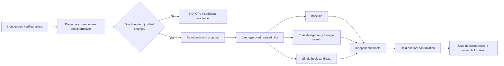

# Agent Core — Polyglot Improvement and Architecture Preservation Contract
**Research specification | 2026-10-22 | PROPOSAL ONLY / NOT INSTALLED**

## 1. Objective and interpretation
“Polyglot” here means combining existing mechanisms and optionally code written in different languages **behind one Agent Core-owned contract**, not creating independent parallel agents, canonical Memory stores or Learning engines. Cross-disciplinary borrowing is allowed only when inputs, outputs, state and failure behavior can be tested. If no consumer needs another language, stay in the current TypeScript/Node owner.
- Goal: improve measurable external-controller task correctness and continuity without destabilizing the current codebase, Native Agent or security grants.
- Rule: *architecture before donor*. Choose minimal existing TypeScript owner, then a bounded adapter only for demonstrated unique capability, and reconsider large redesign only if the first two are infeasible.
- Source truth: `src/memory/`, `src/learning/`, `src/skills/service.ts`, `src/verification/`, `src/mcp/`, `src/tracker/`. See [Memory/Learning Atlas](Agent-Core-Memory-Learning-Architecture-20261022.md).

## 2. Existing owner remains authoritative
| Concern | Exclusive owner | Optional new consumer | Never |
| --- | --- | --- | --- |
| Canonical memory | `src/memory/service.ts` + FileMemoryStore/transactions | JS/Python/Rust observer through bounded read/API | Parallel JSONL/vector store or direct writes |
| Task episodes and continuity | `src/memory/episodes.ts` and external Learning task binding | Analysis of digest-bound event/excerpt | Free-floating work unrelated to real taskId |
| Learning knowledge decisions | `src/learning/service.ts` + reviewer/sinks | External AI analysis or pure library result | Second curator saving its own “truth” |
| Skills and proposals | `learning/skill-proposals.ts`, `skills/service.ts` | Candidate patch manifest and advisory | Direct production Skill rewrite/auto-activation |
| Source/tool evidence | `tracker` + `verification` + task receipts | Normalized bounded observations | Unredacted logs or forged verification |
| Tool authority | MCP auth/grants/AGENTS bootstrap | Only known approved tool call | Child process inheriting extra privileges |
| Native runtime | Existing runtime, development active | Task-scoped shared-owner integration | Native parity feature as external side effect |

## 3. Proposed interface: read-only research worker, one bounded task
A future adapter, if independently justified, receives a **serialized, redacted, frozen snapshot**, not direct root access, unrestricted credentials or a mutable Memory connection. The host retains decision rights.
```json
{
  "schemaVersion": 1,
  "kind": "analysis-request",
  "taskId": "host-real-task-id",
  "workspace": "registered-workspace",
  "hypothesis": "one testable mechanism",
  "sourceRefs": ["file:authorized-source#sha256:..."],
  "baselineDigest": "sha256:...",
  "allowedSurfaces": ["context-selection"],
  "budgets": {"maxDurationMs": 10000, "maxInputBytes": 32768},
  "network": "disabled",
  "mutation": "none"
}
```
- Output is strict versioned JSON with `candidate/no-op/insufficient-evidence`, proposed **one-surface delta**, basis and counterevidence, predicted cases, protected passing cases, cost, stop condition and rollback pointer. It is always advisory.
- Host rejects unknown fields, excess size, traversal/symlink destinations, unapproved tools, incompatible baseline digest, stale task identity and references not independently resolvable.
- Use source digests and structured provenance as data validation, *not* cryptographic proof of semantic truth. Redact prompts/logs and never pass API keys or raw chats to third-party binaries.
- Cross-language communication, if needed, is bounded request/response over a dedicated child-process protocol with explicit exit status, timeout and cleanup; no direct database or canonical path writer.

## 4. Donor mechanisms, not wholesale framework transplants
| Inspiration | Mechanism worth testing | What Agent Core already owns | Adoption decision |
| --- | --- | --- | --- |
| Loopany | Outcome → evidence-led reflection → user-reviewed Skill proposal | Canonical Memory, episodes, Learning, proposals | No second persistent log/store; inspect missing consumer only |
| Karpathy Autoresearch | Fixed budget, one editable surface, compare-and-revert | Source revision/evaluation/proposal handoff | Adapt offline experiment protocol; no training/GPU dependency |
| Google Harness² | Task-level propose–probe–compose and cross-task lessons | Scope-bound tasks, Memory, Learning, evaluation | Allowlist one prompt/context hook in isolated fixture |
| DeepTutor | Mastery/feedback loop and source-grounded retrieval | Existing retrieval/index, task states, evidence | Study domain-specific teaching cases, no full tutor server |
| FAPO/FAFO | Step-level attribution and prompt-first, structural-second escalation | Tracker outcomes, verifier, procedures | Only on reproducible multi-step task with an independent scorer |
- The Deep Research narrative that Agent Core “lacks persistent memory” is **not source-grounded**: current `src/memory/host-runtime.ts`, `service.ts`, and `src/index.ts` demonstrate a canonical persistent Memory owner. Do not build a duplicate.
- Treat published gains as *author-reported under their benchmarks*, never local Agent Core benefit or evidence of an existing defect. License compatibility, pinned revision and threat model are required before copying implementation bytes.

## 5. Candidate experiment, preserving the external controller

1. **P0 — Read-only equivalence and baseline case:** verify current source owner, select one independently checkable failure family and positive passing controls, record costs/context. No tests/build.
2. **P1 — Bounded candidate:** one module, one controlled surface (prompt guidance, context selection or workflow ordering); record exact baseline digest, semantic hypothesis and expected falsifier. NO_OP is legitimate.
3. **P2 — Separately approved isolated verification:** compare fixed context/model/tool grants among baseline, equal-budget simple approach and candidate; use independently determined goal-success oracle. Record all attempts, regressions, data contamination, measured cost/latency if available; never repeatedly tune the sealed final evaluation set.
4. **P3 — Review and rollback:** compare metrics/risks, give human exact proposal version, preserve baseline and execution authority separation. Activation/build/deploy always separate scope.
5. **Stop:** no real oracle; missing or mismatched source; current owner already implements mechanism; any protected Native/grant/credential touch; security regression, unknown side effects or resource overrun.

## 6. Language / runtime selection and trust boundaries
- **TypeScript/Node first:** current `MemoryService`, `LearningService`, `SkillService`, verification and MCP tools remain the only canonical state-mutating owners.
- **Python optional** for isolated statistical analysis/offline candidate scoring or external scientific libraries when native TS is materially worse; treat process outputs as untrusted proposals, not authenticated host observations.
- **Go/Rust optional** for source parsers or performance-sensitive pure computation only after profiling; prefer a one-shot process with bounded input, sandboxed working directory and no network. No daemon, no global PATH injection, no install by default.
- **.NET launcher/WebView2** remains presentation and process hosting; not a second Memory engine or an indirect source of runtime authority.
- **Failure contract:** child exit, timeout, crash, malformed JSON, out-of-budget, missing oracle, stderr anomalies, interrupted output and revision drift each map to explicit `unavailable/rejected/unknown`, never silent PASS.
- Cross-language data must use a versioned schema, deterministic/canonical digest identity, allowlisted file references and fixed source byte limits. Do not parse untrusted stdout as imperative commands or auto-execute returned scripts.
- OS-specific caveats: Windows paths, exFAT ownership/lock behavior, CRLF normalization, case-insensitive files and symlink/junction traversal must be addressed by the **existing** file/path policy; never infer Unix sandbox semantics from a donor repo.

## 7. Minimum evidence, acceptance and unresolved decisions
- **Read-only documentation acceptance:** pinned source and current owner map, negative/outdated reference exclusions, honest unknowns and absence of second canonical store.
- **Future implementation acceptance (requires authorization):** matching source contracts, manifest-digest parity, realistic failure and passing fixture, independent verifier, repeatable rollback, and no regression of runtime grants/privacy or user-approved workflows.
- **Actual improvement acceptance:** positive outcome on untouched related tasks versus both the original baseline and matched-cost alternative; no hidden test leakage or unverifiable “self-reported” wins.
- **Unknown today:** whether a new polyglot worker is necessary at all, independent Agent Core evaluation benefit, process isolation and backend cost in the actual local workload. Build only after these are evidenced; do not make a speculative worker just to use another language.

- This file contains no implementation authority. Document changes only; all research prototypes and external tool use must respect task-scoped user approval.

## 8. Current-source adapters and comparative research protocol (documentation only)
| Problem family | Try existing owner first | Polyglot candidate only if independently justified | Output cannot do |
| --- | --- | --- | --- |
| Poor Memory recall | `memory/retrieval.ts`, `search-projection.ts`, `recall-repair.ts` | Offline controlled scorer, bounded per-query report | Mutate notes or search ranks silently |
| Wrong/forgotten task continuity | `memory/episodes.ts`, `capsule.ts`, host task binding | Bounded event classification on redacted task snapshots | Reopen closed task or authorize actions |
| Low-quality candidate review | `learning/review.ts`, `sink-manager.ts`, external controller | Independent candidate critique with negative cases | Self-declare `verified=true` as proof |
| Skill procedure errors | `learning/external-procedure.ts`, `skills/service.ts` | Stateless validator/semantic consistency checker | Install/promote/override grants |
| Unreliable benefit measurement | `learning/external-evaluation.ts`, `controlled-outcome.ts` | Offline causal-study/statistical analysis | Assert benefit from observed deltas |
- The actual current `src/learning/external-evaluation.ts` distinguishes complete attempts from independently verified opportunities and always returns `benefitVerdict='withheld'`. A future worker must not downgrade that boundary.
- A procedural candidate must still pass current `externalProcedureAdmissionSchema`: positive, negative and exception examples, prerequisites, avoidance, consequence checker, reversal/stop, rollback and inspectable provenance. External computation is not evidence admission.
- `src/memory/mcp/scope.ts` checks a real host-authenticated, registered task identity; any future helper receives a frozen **derived** input but cannot impersonate that owner, alter the memory task head or use a source string to obtain permission.
- The minimal study should count new errors, incomplete outcomes, risk exposure, resident CPU/RAM/time, financial cost when metered, and extra controller attention as **costs**. “More steps” or “more generated suggestions” are not automatically improvements.
- End each proposed polyglot integration with one falsifier: *with equal effort, does the native baseline solve as many independently checked cases as the worker?* If yes, reject the extra runtime unless another requirement is proven.
- This addendum changes no Worker/TS/.NET code and does not demonstrate an improvement; it records research choices and decision boundaries only.
