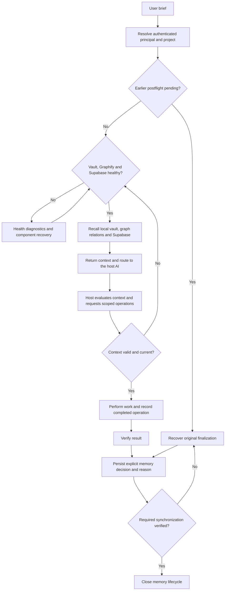

# Stability Contract

This document defines the behavior and verification required for Agent Core to be considered stable. A healthy process alone does not certify a release: build, regression tests, repository integrity, and live lifecycle checks must also pass. Current verification results must state any failed gate explicitly.

## Current acceptance boundary

The workflow/durability task completed on 10 September 2026 after a real ChatGPT Web managed DAG passed 60 behavior and 35 integration tests. Independent compilation matched 318 installed compiler files. A cooperative restart preserved the plan, run, and nine checkpoint memories; the host then recalled those memories and completed the task. Readback showed workflow version 30 `CLOSED`, a synchronized closure receipt, 39 active memories, and no pending Supabase items. The completed checkpoint was created after the restart and has not been tested through a second restart.

These are scoped functional results. The prepared release uses the prerelease channel; it does not establish whole-project stable certification. Historical performance failures and the operator checkout's unresolved Git-object recovery are separate limitations. See the self-contained [verification summary](stability-verification-2026-09-09.md) for tested source identity, current-attempt evidence, production/fixture distinctions, and remaining boundaries. Packaging or later publication must supply its own source/asset/registry evidence.

## Required core behavior

Verification covers:

- OAuth/MCP availability and custom Agent Core key authentication;
- file-native memory integrity and deterministic recall;
- Local Continuity snapshot/rehydration;
- dependency-correct concurrent command execution;
- persisted event-driven wake without busy polling;
- factual per-attempt logs/result markers;
- cross-route continuation;
- restart recovery with no false success;
- secret-safe execution-to-memory promotion;
- `Agent Code Native.exe` graceful shutdown and restart on Windows;
- operational-tool regression safety.

## Memory architecture contract

Semantic memory is file-native. The authority order is:

```text
canonical Obsidian-compatible Markdown vault
> immutable revision/history + auxiliary durable state under .agent-core
> bundled project-local ripgrep lexical recall
> deterministic Graphify derived graph (rebuildable, never authority)
> direct Supabase searchable second memory
```

Canonical writes are journalled and atomically renamed. Supabase holds a scoped searchable projection through its Data API; it does not replace the local canonical vault. The optional encrypted file mirror is a separate full-vault recovery path.

The client calls `capability_route` before substantive work. Before its final answer it closes through `memory_turn_finalize`, or through `task_checkpoint` when that tool has recorded the memory decision and returned a synchronized `CLOSED` lifecycle. These are alternative entry points to the same postflight contract; a closed lifecycle does not accept a new decision. The default lifecycle mode is `enforce`: workspace analysis and mutations require a valid recalled context, and pending postflight prevents another objective in the same principal/project scope from bypassing closure. Status and recovery controls remain available, including scoped existing execution logs, artifact metadata, and workflow recovery guidance. Artifact reuse checks may verify registered artifact hashes; these diagnostics do not expose file contents, start work, or delete artifacts. Explicit `advisory` and `disabled` modes are diagnostic settings and do not satisfy this stability contract.



Recall is supplied to the host AI as structured context. Agent Core can gate its own operations; only host-side evaluation or an end-to-end decision test can establish how that AI used the returned context.

The pending-closure check also runs before substantive operations on an already-open context. Opening two routes in advance does not let one bypass the other's unfinished postflight. Operations sharing the same context may continue, and work authorized before another context became pending can still record its completion. Finalization and recovery remain available to clear the pending state.

`NO_DURABLE_MEMORY` is an explicit persisted decision. A new durable root requires evidence and a reason. Failed synchronization leaves `POSTFLIGHT_PENDING`; retrying the same finalization arguments resumes persistence without repeating successful work. Finalization can recover its scoped persisted authority after route expiry or runtime restart, without granting permission for new execution. The host AI still controls responses and tools outside Agent Core, so plugin installation alone cannot enforce their use.

Private runtime dependencies are project-local and relocatable: ripgrep, uv, CPython, and Graphify all resolve beneath `.tools/`. Runtime startup reads the project-local `.env` with process environment taking precedence, so a controller that starts `dist/index.js` directly cannot silently resolve a different memory root.

Graphify is derived-only and rebuildable from the vault. Strict preflight requires a functioning Python/Graphify runtime and a projection receipt matching canonical content. Missing or stale derived indexes are rebuilt; a failed recall returns an error. A successful empty recall is valid. Completed local work remains recorded if a component fails or the context expires afterwards.

Vault readiness uses a real temporary write/fsync/remove probe. Supabase health receipts are bounded to five seconds; graph runtime checks are bounded to thirty seconds, with projection freshness checked separately. Obsidian readiness means the vault works; its desktop application does not need to be open.

Direct Supabase access uses the server API key from the root `.env` and the scoped `agent_core_memory_call` RPC. Redacted memory content, revisions, and relations are searchable in PostgreSQL. This projection does not provide end-to-end content encryption. See [direct memory setup](supabase-direct-memory.md) for the API contract and the separate optional encrypted file mirror.

Full-vault disaster recovery requires a configured file mirror or a vault backup. Direct remote recall can supply context to an empty local reader. Verified Supabase workflow generations also support explicit restoration of scoped workflow contracts, continuity records, memory decisions, and their referenced semantic memory revisions. Restoration verifies the generation and local staged bytes under an exclusive recovery lease, preserves a rollback copy, and reconstructs expired leases rather than granting new execution authority. This scoped restoration does not restore every auxiliary record, application setting, or historical file in the vault.

## Windows lifecycle contract

```text
E:\Projects\Agent-Core\SubProject\Agent-Code\Agent Code Native.exe
```

is the sole Windows lifecycle authority: start, stop, restart, OAuth reset/re-auth, tunnel supervision, watchdog, health probing, and autostart. Task Scheduler only launches this native controller at sign-in; supervision and service lifecycle decisions remain inside the controller. `Exit Agent Core` stops only identity-validated Agent Core and tunnel processes owned by that lifecycle and preserves runtime data, logs, OAuth/key state, capabilities, and secrets.

The controller uses the bundled admin-only tunnel runtime at `tunnel-client/tunnel-client.exe`. An explicit `AGENT_CORE_TUNNEL_EXE` override must name an existing `.exe` file; relative paths resolve from the project root, and invalid overrides fail startup. The controller does not discover or download a replacement tunnel runtime. If the bundle is missing, run [the tunnel build script](../scripts/tunnel/build-admin-client.ps1) and install its verified candidate at the bundled path. The build script produces a candidate without replacing the running service.

The Windows GNU controller build requires the verified Microsoft `WebView2Loader.dll` beside `Agent Code Native.exe`. Keep the loader with the executable during installation or relocation; validate both file hashes before replacing the installed pair.

Process coordination that must survive a crash — the OAuth cross-process lock included — uses atomic lock files with an owner token, stale-owner detection, bounded retry, and a release that verifies ownership before clearing.

## HTTP/OAuth trust-boundary contract

```text
operational audit projectId = routed/stored operation projectId
OAuth access-token resource = canonical <base>/mcp resource
missing MCP Origin          = allowed for non-browser clients
invalid/untrusted Origin    = HTTP 403 before authentication/dispatch
GET /health                 = anonymous lightweight readiness
GET /health/metrics         = loopback-only detailed diagnostics
agent_core_health_metrics   = authenticated remote-capable detailed diagnostics
X-Forwarded-* trust         = disabled by default
canonical public identity   = AGENT_CORE_PUBLIC_BASE_URL when configured
```

HTTP trust configuration:

```text
AGENT_CORE_PUBLIC_BASE_URL=<http-or-https-origin>   optional canonical issuer/resource origin
AGENT_CORE_TRUST_PROXY=true|false                   default false
AGENT_CORE_MCP_ALLOWED_ORIGINS=<origin;origin;...>  optional browser-origin hostname allowlist
```

`AGENT_CORE_PUBLIC_BASE_URL` is authoritative when set. Otherwise forwarded host/protocol are used only when `AGENT_CORE_TRUST_PROXY=true`; direct requests cannot manufacture a public OAuth identity merely by sending `X-Forwarded-*` headers. The default remains false.

Rollback is configuration-local: remove `AGENT_CORE_PUBLIC_BASE_URL` when canonical identity is not desired, keep `AGENT_CORE_TRUST_PROXY=false` for direct deployments, and use the authenticated MCP metrics tool instead of exposing detailed HTTP metrics remotely. The protections against cross-resource OAuth replay, browser-Origin abuse, and project audit leakage have no permissive fallback mode.

## MCP dual-era contract

Agent Core serves both the 2025-era stateless MCP path and the modern 2026-07-28 protocol from the official split SDK v2 packages.

```text
@modelcontextprotocol/server   2.0.0
@modelcontextprotocol/node     2.0.0
@modelcontextprotocol/client   2.0.0 dev-only interoperability test client
```

Protocol serving contract:

```text
AGENT_CORE_MCP_PROTOCOL_MODE=dual     default
AGENT_CORE_MCP_PROTOCOL_MODE=legacy   runtime rollback

dual mode:
  2025-era stateless MCP              supported
  modern 2026-07-28 MCP               supported
  server/discover                     supported
  modern per-request envelope         validated by the official SDK v2
  Mcp-Method / Mcp-Name               validated by the official SDK v2

legacy mode:
  2025-era stateless MCP              supported
  modern 2026-07-28 negotiation       rejected; auto clients may fall back
```

Agent Core keeps buffered JSON responses for the certified stateless path by using the official v2 `WebStandardStreamableHTTPServerTransport` with `enableJsonResponse=true`, and serves modern traffic through the official v2 `createMcpHandler` validation path. Agent Core does not implement its own modern protocol parser or `server/discover` semantics.

The trust boundaries above apply ahead of either protocol era: an untrusted browser `Origin` is rejected before authentication/dispatch, bearer authentication remains Agent Core-owned, OAuth access tokens remain protected-resource-bound, and detailed HTTP metrics remain loopback-only.

OAuth compatibility policy:

```text
DCR                                 preserved for existing connector compatibility
authorization-code response iss     emitted and bound to the canonical issuer (RFC 9207)
CIMD activation                     deferred until host interoperability and a safe
                                    metadata-fetch trust policy are proven
speculative auth endpoints          none
```

## Execution and recovery contract

Execution containment:

```text
command policy decision          structured/deterministic; raw command omitted from decision
shell-compatible command API     preserved
blocked nested interpreters      rejected before persistence/dispatch
process-tree termination         Windows taskkill /T; POSIX process group
wall-clock cap                   enforced
combined stdout/stderr cap       enforced; default 64 MiB, hard config ceiling 1 GiB
CPU-time hard cap                unsupported in the current pure-Node adapter
memory hard cap                  unsupported in the current pure-Node adapter
```

The output budget is configured with `AGENT_CORE_EXECUTION_MAX_OUTPUT_BYTES`. Exceeding it terminates the owned process tree and produces a factual failed result with `EXECUTION_OUTPUT_LIMIT_EXCEEDED`; a quota-truncated attempt is never classified as success. CPU-time and memory hard caps are reported as unsupported rather than simulated.

Execution recovery is an operator-only stopped-runtime workflow:

```text
agent-core execution-backup [reason]
agent-core execution-restore <bundle-path>
agent-core execution-retention-plan [older-than-days]
agent-core execution-retention-apply <plan-path> <bundle-path>
```

`ExecutionService` holds an exclusive owner-token runtime lease beside the execution state root. Backup, restore, and retention apply acquire that same lease, so destructive maintenance fails closed while a live runtime owns the state.

A recovery bundle contains the complete execution state tree plus the complete evidence tree. Its manifest records source/state-format versions, the logical state root hash, SHA-256 and byte size for every file, creation time, and reason. Restore verifies the whole bundle before mutation, keeps a pre-restore rollback snapshot, stages replacements, and automatically restores prior live state if a replacement step fails.

Raw-log retention is explicit and backup-gated. Planning is dry-run only and produces an immutable SHA-256 plan. Apply requires a verified bundle created no earlier than that plan, revalidates the exact candidates, never expands the deletion set, preserves `.result.json` terminal evidence, and writes one JSONL audit decision per candidate. No MCP restore or physical-purge tool exists.

The detailed operator procedure is maintained in `docs/deterministic-execution-fabric.md`.

## Audit and observability contract

Correlation:

```text
HTTP request                     unique requestId + W3C-compatible trace/span context
MCP tool                         nested tool correlation, same request trace
capability route                 routeContextId linked to the active request trace
execution_create                 durable creator correlation in run metadata
execution_start / attempt        factual start-request correlation
execution event/result marker    trace + request + route + tool + run/node/attempt lineage
```

Audit:

```text
request/routing audit write path     bounded enqueue; no synchronous appendFileSync
authoritative storage                local JSONL
queue                                bounded; drop/error counters are explicit
record integrity                     sequence + SHA-256 previousHash chain
rotation                             whole-record immutable segments
retention                            whole segments only after atomic anchor advancement
verification                         read-only `agent-core audit-verify [audit-root]`
tamper claim                         tamper-evident, not tamper-proof against full local replacement
raw credentials/raw execution logs   excluded
```

Detailed observability metrics stay local-authoritative and low-cardinality. `/health/metrics` keeps the loopback-only HTTP policy; the authenticated `agent_core_health_metrics` MCP tool is the remote diagnostic path. Audit health exposes counts, queue state, rotation count, and only a 16-character head-hash prefix.

Optional OTLP export is disabled unless `AGENT_CORE_OTLP_ENDPOINT` is set. The endpoint must be credential-free `http:`/`https:` on `localhost`, `127/8`, or `::1`; query/fragment/userinfo and any remote hostname are rejected. No telemetry API-key/header configuration exists. Only traces and metrics are exported over OTLP/HTTP JSON; the local audit chain remains authoritative.

Collector availability is non-authoritative: a timeout or refusal increments local telemetry failure metrics and keeps a bounded retry queue, but never downgrades `overallHealth` or changes HTTP/MCP/tool/execution results.

## Resource governance contract

Resource pressure is a local deterministic control-plane input. It can reduce only the number of **new** execution nodes dispatched. It never changes process/result truth, terminates already-running work, raises concurrency above the run/operator maximum, or invokes an external model or API.

`LocalMaintenanceCoordinator` has no import or invocation path for retention apply, recovery restore, credential revocation/rotation, or filesystem deletion. Its scheduled work is limited to memory/execution integrity-status reads and dry-run retention planning, and it is disabled by default. The execution runtime lease is unaffected by it.

## Quality gate contract

Routing and recall quality are certified offline before any routing or recall heuristic may be tuned. The repository owns both corpora and the evaluator, and `quality:gate` runs inside `verify:release`. Evaluation uses only local deterministic code against temporary file-native roots — no embedding API, cloud reranker, or AI judge participates.

Routing metrics gated:

```text
tier accuracy
false high-impact rate
unsafe route overpermission
false read-only classification
relevant skill precision@2
unnecessary skill-load rate
verification correctness
routing deterministic replay
```

Memory metrics gated:

```text
Recall@K
MRR
hard-guardrail recall
current-revision correctness
prior-failure recall
graph-target recall
conflict visibility
artifact/procedure recall
noise displacement rate
cross-project contamination
cross-principal contamination
character-budget correctness
memory deterministic replay
```

A scale gate additionally measures end-to-end preflight/recall p95 against a `< 150 ms` target, and the execution gates measure DAG validation, ready dispatch, and persisted wake delivery against their own targets. A measured excursion is recorded, never hidden and never fixed by moving a threshold.

## Release gate

### Prerelease channel

A prerelease can distribute verified functional changes while stable certification remains incomplete, provided its release notes state the outstanding gates. It must use GitHub's prerelease flag, the `next` package dist-tag, matching version/source metadata, and verified artifact checksums. It must not advance the stable release or stable package channel. Private runtime state, credentials, local memory, caches, and operational reports remain excluded in either channel. The full project source archive includes active SubProject source; this does not certify every independent native component or bundle all of its upstream references.

### Stable channel

Stable certification is performed locally by the Agent Core execution authority. Every stable release must pass the local gates below before publication. Once those local gates pass and the build is declared stable, that evidence is authoritative and must not be repeated through GitHub Actions or any other CI runner. GitHub Actions is disabled for this repository and is not an allowed verification or publication path.

The local release gates are:

| Gate | Requirement |
|---|---|
| Dependencies | clean `npm ci` |
| Build | TypeScript build passes |
| Regression | full test suite passes |
| Brand | tracked-source brand scan passes |
| Release metadata | package/server/changelog versions consistent; README remains version-neutral |
| Documentation links | every relative link in tracked Markdown resolves |
| Security packaging | no secrets/runtime/capability caches in release staging |
| Plugin package | tracked-core plugin bundle builds successfully |
| Artifact integrity | SHA-256 checksums generated for published assets |
| GitHub Release | release is published only after verification succeeds |
| GitHub Package | plugin package publishes successfully under the stable channel |

If any stable gate fails, stable publication stops. After those gates pass, publication proceeds directly from the verified local artifacts through authenticated GitHub release tooling and GitHub Packages. CI must not rerun those gates or block the release. A separately labeled prerelease follows the narrower channel contract above and cannot claim the stable gates passed.

Certification checks the source commit and clean tracked state before and after each gate. Untracked source, scripts, tests, or other declared verification inputs must be reviewed and tracked first. A successful command cannot certify edits made during verification under an unchanged HEAD.

Release packages use tracked regular files and fresh compiler output in an isolated staging directory. The builder rejects redirected source paths, undeclared compiler inputs, and changes to the captured source bytes or tracked file set. It does not traverse the live output directory to collect generated assets. Private runtime state and local evidence reports are excluded.

Published parity requires the current HEAD, local tag, remote tag, and manifest source commit to agree. Downloaded assets must match their checksums and a fresh local build of that source. The registry's `stable` package version and integrity must match the verified release tarball. Matching asset names alone does not satisfy this gate.

## Evidence policy

Agent Core distinguishes semantic conclusions from operational evidence:

```text
raw stdout/stderr       -> local execution evidence only
execution events        -> execution journal
verified artifact/hash  -> structured evidence
accepted decision       -> memory / continuity checkpoint
semantic task completed -> explicit task checkpoint only
```

A process disappearing, a timeout, or a restart is never sufficient evidence of success.
