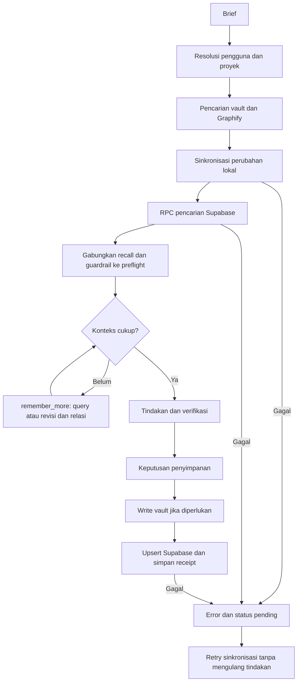

# Akses memori langsung ke Supabase

Agent-Core memakai Data API Supabase untuk menyimpan proyeksi memori yang bisa dicari, membaca satu memori beserta revisinya, recall saat preflight, dan pencarian konteks lanjutan. Vault Markdown tetap menjadi sumber penulisan utama; Graphify tetap memberi konteks relasi lokal. Jalur ini tidak memerlukan OpenAI API key, embedding, atau aplikasi Obsidian yang terbuka.

## Konfigurasi

1. Jalankan isi [`20260909_direct_memory.sql`](../supabase/migrations/20260909_direct_memory.sql) di SQL Editor proyek Supabase. Migrasi membuat tabel `agent_core_memory_records` dan RPC `agent_core_memory_call`, tanpa mengubah tabel aplikasi lain. Migrasi cadangan terenkripsi tidak diperlukan untuk jalur ini.
2. Ambil **Project URL** dan **secret key** server (`sb_secret_...`) dari pengaturan API proyek Supabase. Key publishable/anon tidak mempunyai hak untuk RPC ini. Secret key memberi hak server dan hanya disimpan pada mesin Agent-Core. [Dokumentasi API keys Supabase](https://supabase.com/docs/guides/getting-started/api-keys).
3. Tambahkan ke `.env` pada root Agent-Core:

```env
AGENT_CORE_MEMORY_SUPABASE_DIRECT_ENABLED=true
AGENT_CORE_MEMORY_SUPABASE_URL=https://PROJECT_ID.supabase.co
AGENT_CORE_MEMORY_SUPABASE_SECRET_KEY=sb_secret_ISI_DI_SINI
AGENT_CORE_MEMORY_HARD_LIFECYCLE_MODE=enforce
```

Isi nilai setelah `=` tanpa teks placeholder. `.env` sudah diabaikan Git. Jangan memasukkan key ke brief, memori, dokumen, atau kode. `SUPABASE_URL`, `SUPABASE_SECRET_KEY` dan key JWT `SUPABASE_SERVICE_ROLE_KEY` lama juga didukung sebagai alias; variabel berawalan `AGENT_CORE_MEMORY_` diutamakan. Key modern dikirim melalui header `apikey`, bukan diperlakukan sebagai bearer JWT.

4. Dari root proyek, jalankan:

```powershell
npm run build
node scripts/memory/check-supabase.mjs
```

Checker hanya memanggil RPC kesehatan. `healthy: true` membuktikan autentikasi, tabel dan RPC dapat diakses, bukan bahwa setiap memori telah disinkronkan. Exit code `2` berarti mode belum diaktifkan; `1` berarti konfigurasi atau pemeriksaan gagal. Tidak ada key atau isi memori yang dicetak.

5. Restart Agent-Core agar proses berjalan memuat `.env` baru. Variabel environment proses mengalahkan `.env`; jika konfigurasi masih tampak lama, periksa environment launcher. Panggil `memory_status` dengan `sync: true` pada route proyek, atau dengan `projectRoot` eksplisit, untuk mengirim memori lokal yang sudah dimiliki scope tersebut. Recall berikutnya juga mencoba sinkronisasi perubahan lokal sebelum mencari di Supabase.

Untuk pengaturan timeout opsional:

```env
AGENT_CORE_MEMORY_SUPABASE_TIMEOUT_MS=15000
```

## Tool dan alur aktual

Mode normal mewajibkan vault terbaca dan tertulis, Graphify berfungsi dengan indeks yang sesuai vault, serta Supabase sehat sebelum pekerjaan substantif. Ini juga berlaku untuk analisis yang membaca file atau mencari kode. Pemeriksaan status dan pemulihan tetap tersedia saat pekerjaan tertahan. Hasil recall kosong yang berhasil tetap sah; kegagalan komponen menghasilkan error.

`memory_turn_finalize` mencatat keputusan penyimpanan, memverifikasi sinkronisasi, lalu menutup lifecycle. Jika sinkronisasi gagal, status tetap `POSTFLIGHT_PENDING`. Ulangi argumen finalisasi yang sama dengan `routeContextId` asli; pemulihan ini juga tersedia setelah restart atau route kedaluwarsa dan tidak membuka izin eksekusi baru.

| Kebutuhan | Jalur Agent-Core |
| --- | --- |
| Recall dari brief | `capability_route` → preflight → pencarian vault dan RPC Supabase → konteks routing |
| Mencari memori | `memory_search` dengan `query` |
| Membaca satu memori | `memory_get` dengan `memoryId`; memakai Supabase jika ID tidak tersedia di vault lokal |
| Write/save | `memory_commit`, `memory_revise`, dan keputusan penyimpanan postflight → vault → RPC upsert |
| Melupakan | `memory_forget` → tombstone lokal → sinkronisasi; tombstone dikeluarkan dari hasil pencarian |
| Mencari konteks tambahan | `memory_remember_more` dengan `contextId` yang masih valid dan `query`, atau `seedMemoryIds` untuk revisi/relasi |
| Memeriksa/retry | `memory_status` dengan `sync: true` dan `routeContextId` atau `projectRoot`; hasil memuat `supabaseSync` dan `supabaseDirect` |

Jika preflight tertahan karena Supabase tidak sehat atau route belum tersedia setelah restart, panggil `memory_status` dengan argumen berikut:

```json
{"projectRoot":"E:\\Projects\\Agent-Core","sync":true}
```

Root harus termasuk workspace yang diizinkan. Pemeriksaan dan sinkronisasi memakai principal terautentikasi sesuai konfigurasi memori; jika `routeContextId` juga diberikan, pemilik dan proyek route harus cocok. Pemulihan ini tidak membuka izin pekerjaan baru.



Contoh argumen pencarian lanjutan setelah mendapat `contextId` dari `capability_route`:

```json
{
  "routeContextId": "UUID_DARI_CAPABILITY_ROUTE",
  "contextId": "UUID_DARI_PREFLIGHT",
  "query": "keputusan autentikasi Supabase dan alasan pemilihan scope proyek",
  "reason": "user_requested",
  "maxItems": 4,
  "characterBudget": 6000
}
```

`seedMemoryIds` boleh tidak diisi bila ada `query`. Pencarian lanjutan ini dipanggil AI saat konteks belum cukup; Agent-Core belum menilai sendiri ambiguitas semua brief. Query tambahan dicatat sebagai recall expansion. Memori adalah bukti kontekstual dan tetap perlu dievaluasi, bukan instruksi dengan otoritas lebih tinggi.

## Isolasi, sinkronisasi, dan batas

- Pengguna dan proyek berasal dari autentikasi/routing Agent-Core. Semua query/get/upsert SQL terikat keduanya. Tool tidak menerima principal bebas dari brief. Memori historis tanpa pemilik tidak otomatis diberi pemilik atau diekspor. ID principal harus konsisten agar recall lintas sesi merujuk memori yang sama.
- Tabel memakai RLS; role `anon`, `authenticated`, dan `PUBLIC` tidak diberi akses tabel maupun eksekusi RPC. Server secret memakai `service_role`; karena itu isolasi antarpengguna berada pada batas autentikasi Agent-Core dan filter RPC, bukan pada secret key per pengguna.
- Supabase menyimpan teks memori yang sudah melalui redaksi, revisi dan relasi dalam bentuk yang dapat dicari PostgreSQL. Ini **bukan enkripsi isi end-to-end**. Jalur cadangan terenkripsi yang terpisah tetap tersedia untuk pemulihan seluruh vault/state. Indeks memakai full-text `simple` dengan probe OR, bukan semantic vector search; padanan kata yang tidak pernah disimpan bisa tidak ditemukan.
- Satu vault menjadi penulis kanonis untuk scope yang sama. Reader dengan vault kosong bisa recall/get/remember_more dari Supabase tanpa mengimpor atau menimpa file lokal. Untuk merevisi memori yang hanya ada di remote, pulihkan vault kanonis terlebih dahulu; jalur ini bukan multiwriter atau pengganti backup penuh. Record lokal, termasuk tombstone, diutamakan atas proyeksi remote.
- Write yang berhasil lokal memberi `supabaseSync.state: synced` atau `pending`, `pendingItems`, dan kode error yang aman. Vault adalah antrean retry persisten; receipt per record tersimpan di `.agent-core/state/supabase-direct-receipts`. Startup ulang tidak kehilangan perubahan yang belum dikirim. `pendingItems: -1` berarti jumlah belum dapat dibaca karena masalah vault, bukan antrean kosong.
- Upsert idempoten dan memakai token versi untuk menolak overwrite dari penulis atau receipt lama. Konflik tidak ditimpa otomatis. Recall/preflight gagal dengan error eksplisit jika sinkronisasi atau query remote gagal; recall kosong yang berhasil tetap menghasilkan daftar kosong. Handler `capability_route` meneruskan kegagalan preflight ketika mode langsung aktif.
- Supabase yang diaktifkan ikut menentukan `memory_status.healthy`. Durability boundary tidak mengesahkan sinkronisasi jika RPC gagal. Mode normal, kewajiban preflight, keputusan penyimpanan, dan pemulihan penutupan mengikuti [kontrak stabilitas](stability.md). Laporan audit terdahulu merupakan bukti kondisi saat audit tersebut dijalankan.
- Search dibatasi 100 hasil sebelum penggabungan dengan budget recall lokal. `remember_more` dibatasi item, karakter, hop dan paling banyak 64 node ketika Supabase langsung aktif. Satu dokumen proyeksi dibatasi 2 MiB; respons HTTP dibatasi 8 MiB. Kesalahan autentikasi, timeout, schema dan konflik tidak diubah menjadi hasil kosong.

## Verifikasi

`tests/memory-supabase-direct.test.ts` mengeksekusi migrasi dan RPC pada PostgreSQL terisolasi melalui PGlite, lalu menguji MemoryService: guardrail remote memengaruhi preflight, recall kosong, query lanjutan, revisi/relasi, pemisahan scope, restart/retry, tombstone, hak akses SQL, format header, timeout dan redaksi key. PGlite hanya dependency pengujian; runtime memakai `fetch` bawaan Node.

Pengujian lokal tidak membuktikan key atau proyek Supabase pengguna sudah terhubung. Gunakan checker dan `memory_status` setelah migrasi, pengisian `.env`, dan restart untuk verifikasi koneksi nyata.
